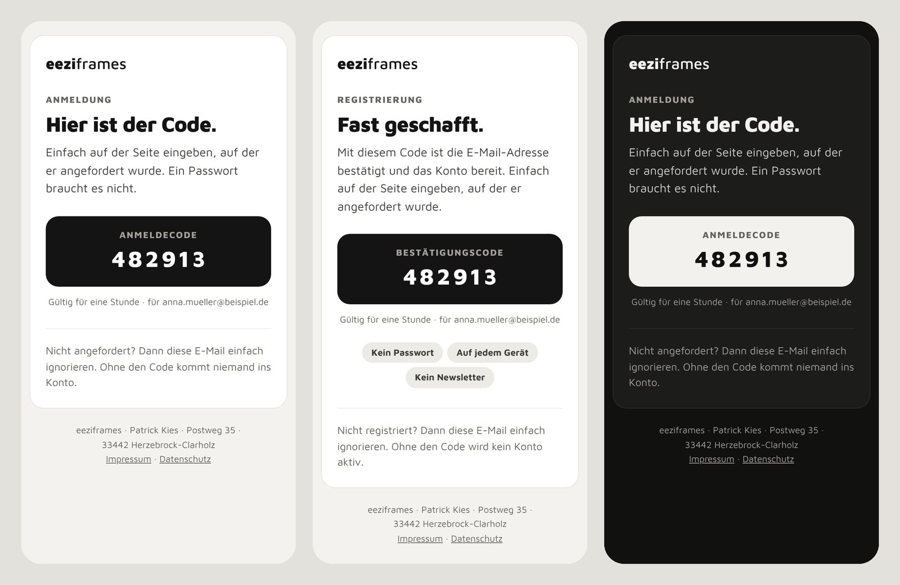
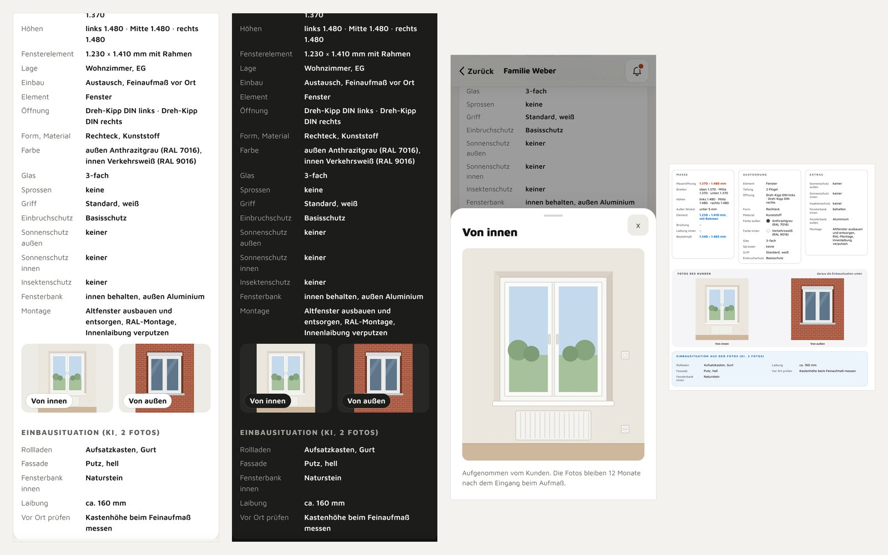

# Gestaltung

eeziframes ist ein Präzisionswerkzeug auf einer dunklen Bühne: Schrift führt, ein grünes Signal zeigt, was zählt, das Foto erzählt die Aussage, alles andere tritt zurück. Seit dem 21.10.2026 sieht die Website aus wie die Beiträge auf Instagram (dieselbe Bühne, dieselbe Schrift, dieselbe Bildsprache), damit niemand zwischen Beitrag und Seite den Faden verliert. Diese Seite ist die Regel; die Werte stehen als Tokens in `web/assets/gemeinsam.css` (lädt vor `app.css` und `portal.css`).

## System

**Marke.** eeziframes, immer klein geschrieben: auch am Satzanfang, in Titeln, in Versalzeilen (Eyebrows, Markenstreifen und Eyebrows im PDF) und in Dokumenteigenschaften. „eezi“ spricht sich wie „easy“, „frames“ sind die Rahmen; der Name funktioniert deshalb auch außerhalb Deutschlands. Wortmarke: „eezi“ in Black (900), „frames“ in Medium (500), gleiche Farbe, kein Abstand, nie umbrochen (`Marke.wort()` in `gemeinsam.js`, im PDF `wortmarke()` in `blatt.js`); daneben das Zeichen: Licht fällt durch ein Fenster in einen dunklen Raum (schwarze Kachel mit 15 % Rundung, drei weiße Lichtflächen: Decke, Fenster, Lichtstreifen am Boden; der Streifen verlässt die Kachel unten links und endet an ihrer Rundung). Eine Quelle für alle Stellen (`scripts/logo-setzen.py`: Seitenköpfe, Favicon, Zentrale, `Logo.svg`; das PDF zeichnet dieselben Punkte in `blatt.js`, die E-Mails tragen es als eingebettetes Bild, `scripts/marke-bilder.mjs` erzeugt Apple-Icon, Vorschaubild und dieses Bild). Ein Haarstrich (`.fi-rand`) zeigt die Kachel dort, wo der Lichtstreifen sie verlässt; im dunklen Modus wird er hell, damit sich die schwarze Kachel abhebt. Auf dunklen Bändern (PDF, Beispielblatt der Führung) steht es umgekehrt: weiße Kachel, schwarzes Licht. Beim Laden geht das Licht einmal an (Fenster und Decke werden hell, dann läuft der Streifen über den Boden, 1,6 s), danach bei Berührung; bei „weniger Bewegung“ ruhig. In HTML, das in Versalien stehen kann, steht die Marke in `.mk` (`Marke.klein()`), im PDF setzt `VERSAL()` alles groß außer der Marke; `translate="no"` schützt den Namen vor automatischen Übersetzern. Interne Namen bleiben (Worker und Repo `fenstero`, Speicher `aufmass.…`, Code-Kürzel `AM1`), damit Bereitstellung, gespeicherte Daten und Codes gültig bleiben.

**Wortspiel mit „eezi“.** Sparsam und nur dort, wo es etwas zusammenfasst: Claim und Startbilder, das Ende der Führung, Seitentitel und Vorschautexte, der Markenstreifen im PDF. Nie in Messanleitungen, Fehlermeldungen, Preisen, Rechtstexten, im Kundenlink eines Betriebs (dort steht der Betrieb, nicht wir) und nie zweimal auf einem Bildschirm.

| Stelle | Text |
|---|---|
| Startseite, Hauseigentümer (einziges h1 der Startseite, auch in der Textfassung) | „Fenster ausmessen. Selbst. eezi.“ |
| Startseite, Hauseigentümer (Eyebrow) | „In Minuten zum Aufmaß für jeden Fensterbauer“ (sagt, was man bekommt; der Einführungspreis steht nur im Band ganz oben) |
| Startseite und Seite für Fensterbauer (Eyebrow) | „Das Erstaufmaß kommt zu Ihnen, ganz eezi“ |
| App, Startbild und Textfassung der App (Eyebrow) | „Fensterplanung, ganz eezi“ |
| Ratgeber, Übersicht (Eyebrow) | „Ratgeber · Fensterplanung, ganz eezi“ |
| Führung, letzter Schritt | „Fertig. Das war eezi.“ |
| Vorschau beim Teilen (`og:title`) | „eeziframes – Fensterplanung, easy gemacht“, „eeziframes – Fenster ausmessen, ganz eezi“, „Aufmaß ohne Anfahrt: eeziframes für Fensterbauer“ |
| Aufmaßblatt, Markenstreifen | „eeziframes · Fenster ausmessen. Selbst. eezi.“ |

Seitentitel (`<title>`) beginnen mit dem Suchbegriff und enden mit der Marke, ohne Wortspiel („Fenster ausmessen: kostenlose Aufmaß-App im Browser | eeziframes“); wo Hauseigentümer angesprochen sind, heißt es „ausmessen“, nicht „aufmessen“, weil so gesucht wird (docs/SEO.md). Die Ratgeberseiten selbst sind Messanleitungen und bleiben ohne Wortspiel.

**Farbe.** Grund `#161616` (immer der Hintergrund, `--ground`, alter Name `--paper`), Fläche `#1f1f1f` nur als Karte mit 2-px-Rand in Linie `#2b2b2b` (`--ring`), Fläche 2/3 `#262626`/`#2e2e2e`, Linie 2 `#3a3a3a` (Hover, `--lift`). Schrift `#f3f2ee` (`--text`, alter Name `--ink`) für Überschriften, Namen und Listen, `#c9c8c3` (`--text2`) für Lead und Erklärsätze, `#93928d` (`--muted`) nur für Labels und Nebenzeilen. **Ein Signal, Grün `#8fd694`** (`--accent`): Kicker, Haken, Fortschritt und genau ein Wort je Überschrift (`.ak`); nie für Fließtext, nie als Fläche hinter Text; `--accent-soft` liegt hinter grünen Symbolen und unter positiven Chips. **Cream `#f1f0ea`** (`--cream` = `--primary`) gehört der Hauptaktion: eine Cream-Fläche je Bildschirm (Cream-Pille); gewählt in Segmenten und Chips ist ebenfalls Cream. Status: ok Grün, warn `#f0b35a`, bad `#ff7b72` (nur echte Fehler in Formularen), immer als Wort mit Punkt oder Symbol; „Nein“ in Aufzählungen ist grau und trägt ein Kreuz (`.chip.weg`). Zeichnungsfarben, keine Oberflächenfarben: Orange `#ff8a5b` ist die Maueröffnung, Blau `#7aa2ff` das Element (3-D-Modell, Maßlinien, Zeichnungen auf weißen Karten; im Aufmaßblatt die Druckfarben). Es gibt nur diese eine Stimmung: hell und dunkel sind dasselbe, `prefers-color-scheme` und `[data-theme]` ändern nichts mehr. Keine Verläufe als Schmuck, keine Schatten unter Karten (nur `--float` an Blättern und Dialogen), keine weiteren Farben. Farben kommen ausschließlich aus Tokens.

**Schrift.** Inter (variabel, lokal in `web/fonts/`, SIL OFL), wie in den Beiträgen: 500 für Text, 700 für Listen und Chips, 800 für Überschriften (900 gibt es nicht); Headlines mit Punkt am Ende und Laufweite -.03 bis -.04em, Kicker in Versalien mit Sperrung .18em, genau ein Wort je Headline in Grün. Sechs Rollen je Oberfläche, nichts unter 13 px.
App: 40 Zahl/Hero · 32 Titel · 24 Zwischentitel · 17 Text · 15 Nebentext · 13 Label.
Betriebsbereich: 44 Hero (36 am Telefon) · 30 Titel (26 am Telefon) · 22 Zwischentitel · 17 Text · 15 Nebentext · 13 Label. Große Zahlen (Kennzahlen, Preise) tragen die Titelrolle.
Ratgeber, Seite für Fensterbauer und Textfassung: 40 Titel (32 am Telefon) · 24 Zwischentitel · 17 Text · 15 Nebentext · 13 Label.
Zentrale (nur für den Inhaber): 30 Titel (26 am Telefon) · 22 Zwischentitel · 17 Text · 15 Nebentext · 13 Label. Große Zahlen tragen die Titelrolle.

**Fläche, Form, Raum.** Karten liegen mit einem 2-px-Rand auf dem Grund (`--ring`), Hover hellt den Rand auf (`--lift`); Schatten wirft nur, was schwebt (`--float` Blätter und Dialoge). Radien 8 · 12 · 18 · 24; Knöpfe, Chips, Segmente und Badges sind Pillen (`--pill`). Kontrollhöhen 44 (`--h1`: Chips, kleine Knöpfe, Segmente) und 52 (`--h2`: Knöpfe, Segment-Gruppen außen). Raster 4 px, Abstände 8 · 12 · 16 · 20 · 24.

**Bildsprache.** Fotos in der Art der Beiträge: ein Tier oder ein Astronaut tut etwas Menschliches rund ums Fenster, fotorealistisch, warmes Licht, modernes Wohnzimmer; das Bild erzählt die Aussage der Seite, der Text bleibt sachlich. Auf der Startseite (beide Ansichten) und im Startbild der App läuft das Foto wie in den Beiträgen randlos und ohne Rahmen aus (`.hero-foto`): am Schreibtisch rechts bis an den Bildschirmrand, nach links, oben und unten weich in den Grund #161616 ausgeblendet, der Text steht links auf dem dunklen Grund; am Telefon randlos ganz oben, Kicker und Überschrift beginnen im Auslauf. Überall sonst steht das Foto in einer Fotokarte (`.foto-karte`: Karte mit Rand und Radius 24, unten eine Reihe Haken-Chips). Nie liegt Fließtext auf dem sichtbaren Teil eines Fotos. Immer mit `width`, `height` und einem Satz als `alt`. Plätze, Dateinamen, Prompts und der Weg von `fotos-roh/` nach `web/bilder/foto/` (`scripts/fotos.py`): docs/BILDER.md. Bis ein Foto da ist, zeigt der Platz einen neutralen Platzhalter ohne Text (Fenster, Licht am Boden; keine Beschriftung, keine Dateipfade, `scripts/fotos.py`). Zeichnungen (SVG, weiße Karte, Orange und Blau) bleiben daneben die Sprache der Anleitung.

**Aufbau eines Startbilds** (Startseite beide Ansichten, App, Seite für Fensterbauer, Übersicht Ratgeber), wie das Cover einer Beitragsreihe: Kicker in Grün → Headline mit Punkt, ein Wort grün → Lead → Cream-Pille mit Pfeil im Kreis (`.btn.primary` mit `.pf`) und Ghost-Knopf → Foto (Startseite: randlos auslaufend rechts hinter dem Text, am Telefon randlos über der Überschrift; sonst Fotokarte, am Schreibtisch rechts neben dem Text, am Telefon direkt unter den Knöpfen, vor dem Lead). Linksbündig; zentriert werden nur Symbole in Kacheln und Badges.

**Bewegung.** Drei Dauern 150 · 220 · 320 ms, zwei Kurven (`--e-out`, `--e-io`). Katalog, mehr gibt es nicht:
1 Erscheinen (8 px aufwärts, gestaffelt nur beim Aufbau) · 2 Wechsel (App gleitet, Betriebsbereich blendet) · 3 Bestätigen (ein Haken wird gezogen) · 4 Fehler (Rütteln, 300 ms) · 5 Fortschritt (Balken, Ringe, Zahlen laufen nach) · 6 Einrasten (eine Zahl setzt sich aus 1,06) · 7 Öffnen/Schließen (Blatt steigt auf, mittig am Schreibtisch) · 8 Laden (ruhige Drehung) · 9 Scrollgebunden (siehe unten). Dazu zwei Rückmeldungen am Objekt: Markieren (Ring läuft um das Neue) und Puls (Ring läuft aus), und die gezeichneten Bewegtbilder (Lottie, siehe unten). Bei „weniger Bewegung“ läuft nichts.

**Scrollgebunden.** `Scroll.binden(el, fn)` (gemeinsam.js) liefert einen Wert 0…1, während ein Element durchs Bild wandert; die Oberfläche liest ihn als `--sp`. Eingesetzt, wo es den Gegenstand zeigt, nicht als Schmuck: das Startbild der App neigt sich um ±3° und die Fensterkarte der Startseite dreht sich um ±7°, als sähe man am Objekt vorbei; Zahlen (Streifen, Rechner) laufen hoch, wenn sie ins Bild kommen, und laufen beim Schieben nach; die Nachrichten der Telefon-Attrappe erscheinen erst, wenn der Block sichtbar ist; die Bühne „So läuft es“ zeigt den Schritt, der gerade daneben steht. Blöcke erscheinen gestaffelt nur beim Aufbau. Parallaxe, Neigen per Maus und Lesefortschritt gibt es nicht.

**Bewegtbilder (Lottie).** Fünf gezeichnete Zeichen in der Sprache der Zeichnung (Tinte auf Papier, Orange für die Maueröffnung, Blau für das Element, Grün für erledigt), aus Code erzeugt (`scripts/lottie-erzeugen.py` → `web/assets/lottie/*.json`, Bodymovin 5.7, nur Formen, keine Ausdrücke). Spieler `web/vendor/lottie_light.min.js` (SVG, MIT, ohne eval, läuft unter der strengen CSP). `Lottie.auf(wurzel)` startet alles mit `data-lottie`; die Farben werden beim Laden gegen die Tokens getauscht, auch im dunklen Modus; gespielt wird nur, was im Bild ist, Schleifen pausieren außerhalb; bei „weniger Bewegung“ steht das Endbild; bis der Spieler da ist, steht das Standbild (`.lottie-still`).

| Zeichen | Dauer | Wo |
|---|---|---|
| `messen` – drei Breiten, das kleinste Maß rastet ein | 3,8 s, Schleife | Glossar „Wie genau ist das Aufmaß?“ und „Öffnung oder Element?“; Betrieb „So funktioniert es“ |
| `fotos` – der Sucher findet das Fenster, eine Linie liest es, drei Treffer | 2,8 s, Schleife | App, über dem Foto, solange die KI liest |
| `senden` – der Flieger steigt am gepunkteten Bogen auf, ein Ring am Ziel | 1,9 s, einmal | App „Jetzt abschicken“ |
| `eingang` – ein Aufmaß fällt in die Ablage, Plakette | 4,4 s, Schleife | Betrieb, leere Zustände (Projekte, Nachrichten) |
| `fertig` – Kreis, Haken, vier kurze Striche | 1,3 s, einmal | App „Freigeschaltet“, „Gesendet“ (direkt), Kundenlink „Fast erledigt“; Betrieb „Projekt angelegt“ |

Regel: ein Bewegtbild erklärt oder bestätigt etwas an genau dieser Stelle; nie zwei auf einem Bildschirm, nie neben dem 3-D-Modell, nie als Füllung.

**Das Modell antwortet auf jede Wahl.** Was gewählt wird, ist am Fenster zu sehen, nicht nur in der Kachel: Formen (Rundbogen, Segmentbogen, Schräg, Rund) sind echte Geometrie – Bogen in der Wand, Laibung aus Streifen, Rahmen, Fuge, Flügel und Glas beschnitten, Oberlicht mit Kämpfer – mit fester Punktzahl, deshalb morpht der Wechsel statt zu springen. Die Öffnungsart wird vorgeführt: Dreh schwingt um das Band, Kipp neigt sich, Dreh-Kipp zeigt beides nacheinander, der Griff dreht vorher mit, Fest lässt einen Glanz übers Glas laufen (1,5–2,9 s, `--e-io`, einmal je Wahl, Haptik-Tipp beim Einrasten). Verglasung und Glas-Extras: zweite und dritte Scheibe in der Profiltiefe, Sonnenschutz tönt, Sichtschutz zeigt das Ornament, dazu die **Lupe** unten rechts (Schnitt durch Glaspaket und Profil: Scheiben, Abstandhalter, Folie, Beschichtung). Einbruchschutz: Pilzköpfe rasten nacheinander ein (RC1 N an den Seiten, nur noch bei älteren Aufmaßen; RC2 rundum) und der Griff bekommt einen Schließzylinder. Absturzsicherung: die Kamera zeigt die Außenseite. Balkontür mit Griff außen: der Ziehgriff erscheint auf der Außenseite des Gehflügels. Offene Farbe: das Modell steht neutral weiß (`#f1f0ea`), die Fensterkarte sagt „Farbe offen“. Fensterbänke: innen bis vor die Wand mit Stirn und Enden, außen mit Gefälle und Tropfkante, Material als Oberfläche und als Musterpunkt in der Auswahl; die Kamera geht dafür etwas nach oben. Der Hinweis in der Bühne nennt die Wahl in Worten.

**Griffe im Modell.** Ein Griff besteht aus Rosette (etwa 30 × 75 mm, fest auf dem Profil) und Hebel (etwa 135 mm), beide in der Griff-Farbe mit dünnem dunklem Umriss, damit Weiß auf Weiß lesbar bleibt; Druckknopf an der Hebelwurzel, abschließbar mit Zylinder in der Nabe. Der Hebel dreht in der Vorführung um die Achse in der Rosette. Lage (`w3dGriffLage`, `w3dGriffAchse`): seitlich auf der Mitte des Flügelprofils gegenüber den Bändern; am Fenster mittig im geraden Teil des Profils, an Türen und bodentiefen Fenstern (Brüstung unter 400 mm) etwa 1.050 mm über dem Fußboden; das Getriebe (etwa ± 250 mm um die Achse) liegt nie im Bogen oder in der Schräge. Kipp: oben mittig, Hebel waagerecht. Stulp: nur der Gehflügel hat einen Griff, der Standflügel (`steh`) keinen; gefragt wird „Welcher Flügel geht zuerst auf?“ und wie er öffnet, die Bänder sitzen fest außen. Hebe-Schiebe: Achse auf 1.050 mm, der lange Hebel zeigt geschlossen nach oben und dreht zum Heben sichtbar nach unten; bei Schema C rücken die Griffe vom Stoß weg. „Ohne Griff“ und Hebe-Schiebe elektrisch zeigen keinen Griff (elektrisch dafür einen Wandtaster). Außen nur, was gewählt ist: Ziehgriff oder Schloss an der Balkontür, Schließzylinder an Schiebe- und Falttüren mit „Abschließbar“. Kippbares Oberlicht: Oberlichtöffner (Stange und Hebel) auf dem Blendrahmen. Der gewählte Flügel ist blau umrandet (Element), nie grün. In den Fragen nach Griff und Griff-Farbe fährt die Kamera auf den Griff (2,6-fach), beim Einbruchschutz auf Griff und Pilzköpfe (1,9-fach).

**Knöpfe am Sonnenschutz.** In den Fragen zum Sonnenschutz außen (Art, Kasten, Farbe, Bedienung) und innen (Art, Farbe) sitzt unten rechts „Herunterfahren“ bzw. „Hochfahren“, beim Raffstore dazu „Lamellen wenden“ (`aria-pressed`). Dunkle Pillen wie der Hinweis, 44 px hoch, 15 px, 2-px-Ring, kein Cream. Die Fahrt dauert 1,8 s (`--e-io`), die Lamellen folgen um je 12 ms versetzt, Wenden 0,6 s; bei weniger Bewegung springt der Behang. Der Stand gilt nur für die Ansicht (`W3D_BEHANG`) und wird nie gespeichert.

**Zoom im Modell.** Jede Bühne hat oben rechts „−“ und „+“ (44 × 44 px, `aria-label` Verkleinern und Vergrößern), gezoomt dazu „1:1“. Zwei Finger zoomen und schieben, ein Finger schiebt (gezoomt) oder dreht (1:1), Strg bzw. Cmd mit Mausrad oder Trackpad zoomt, Doppeltipp schaltet zwischen 1:1 und 2,5-fach an der Stelle. Bereich 1- bis 4-fach. Gezoomt wird über den Maßstab und neu gelegt (scharf, Maßschilder bleiben 13 px), verschoben über `--panx`/`--pany` an der Kamera; das Schwingen steht dann still. Auf scrollbaren Seiten (Ergebnis, Gespeichert, Startseite) scrollt senkrechtes Wischen über dem Modell die Seite (`touch-action: pan-y`), waagerecht dreht, zwei Finger zoomen; auf festen Bildschirmen und gezoomt gehören alle Gesten dem Modell. Der Zoom gilt je Bildschirm und Frage und beginnt bei einer neuen Frage wieder bei 1:1; in der Sprossenfrage ist er aus, weil die Regler neben dem Modell rechnen.

**Maße in der Übersicht.** Wo alle Maße zugleich stehen (Ergebnis, Startbild, Übersichten), stehen gleiche Maße nur einmal; die Maueröffnung steht außen (Höhe links, Breite oben, Schild nach außen), das Element innen. Weichen die drei Maße ab, stehen alle drei da (links, rechts und in der Mitte bzw. oben, unten und in der Mitte). Beim Messen bleibt jede Linie dort, wo gemessen wird.

**Elementarten.** Der erste Schritt fragt, wo und was: „Fenster ersetzen“ oder „Neue Öffnung“, dazu Fenster, Balkon- oder Terrassentür, Festverglasung, Hebe-Schiebe-Tür, PSK-Tür oder Faltschiebewand; die Vorschau darunter zeigt das Element sofort. Jede Art hat ihre eigenen Fragen und ihr eigenes Modell, Titel und Messtexte sprechen von Tür und Schwelle, wo es eine Tür ist (`artSetzen`, `qList`, `w3dCalc`). Übersicht: `docs/gestaltung/elementarten.jpg`.

| Art | Fragen | Im Modell |
|---|---|---|
| Fenster | wie bisher, dazu Unterlicht (Glas oder gedämmtes Paneel, 200 bis 1.200 mm in 5-cm-Schritten) und Griff „ohne“ (verdeckt oder elektrisch) | Unterlicht als festes Feld unter dem Kämpfer, die Flügel werden kürzer; typisch hinter der Küchenzeile |
| Balkon- oder Terrassentür | Flügel wie beim Fenster (ab 1,3 m Breite schlägt die App zwei Flügel ohne Pfosten vor, Stulp), Oberlicht, Schwelle (flach, barrierefrei, Standard), „Und der Fußboden?“ (bleibt oder wird erneuert, davon hängt die Höhe der Schwelle ab), Sprossen, Griff innen, „Und außen?“ (kein Griff, Ziehgriff mit Schnäpper, abschließbar) | bodentief mit Boden innen und außen, Schwelle statt Fensterbank, Profil wie beim Fenster, Pfosten bleiben; der Griff außen sitzt auf der Außenseite des Gehflügels |
| Festverglasung | 1 bis 4 Felder, Material, Form | Glas direkt im Blendrahmen, keine Flügelrahmen, Griffe oder Pilzköpfe; Fragen nach Flügeln, Öffnung, Ober-/Unterlicht und Griff entfallen |
| Hebe-Schiebe-Tür | Schema A, 3-teilig, C, D; Seite des Schiebeflügels; Schwelle (flach, barrierefrei, Standard); Hebegriff, abschließbar oder elektrisch | bodentief mit Boden innen und außen, Schwelle statt Fensterbank, tiefer Rahmen mit zwei Laufebenen: Festteil außen, Schiebeflügel innen, langer Hebegriff. Vorführung: Griff dreht, der Flügel hebt sich 7 px, schiebt vor das Festteil und zurück |
| PSK-Tür (Parallel-Schiebe-Kipp) | 2- oder 3-teilig, Seite des Schiebeflügels; in der Auswahl „schiebt und kippt, meist günstiger“; Schwelle gibt es immer, deshalb keine Frage danach | bodentief wie die Hebe-Schiebe-Tür, Schiebeflügel innen vor dem Festteil, Symbol mit Pfeil und Kipp-Dreieck. Vorführung: der Flügel stellt sich aus, schiebt vor das Festteil und zurück (3 s) |
| Faltschiebewand | 2 bis 7 Flügel, Paket links, rechts oder beidseitig, Gehflügel, Schwelle | Vorführung je Bild gerechnet: die Flügel falten sich abwechselnd zum Paket und kommen zurück; der Gehflügel am Ende gegenüber dem Paket geht wie eine Tür auf, bei „Beide Seiten“ in der Mitte, wo die Pakete zusammenstoßen; ohne Gehflügel trägt das freie Ende der Kette den Bediengriff |
| Sonnenschutz außen | Rollladen, Raffstore, Screen; Kasten als Aufsatz oder Vorbau; sieben Farben; Antrieb (die Frage zeigt die Bedienung von innen) | Führungsschienen links und rechts in der Farbe (Rollladen 22 × 40 mm, Screen-ZIP 30 × 40 mm, Raffstore 26 × 30 mm), Endleiste mit Tiefe. Raffstore aus einzelnen 80-mm-Lamellen mit C-Profil (Abstand 72 mm, also 8 mm Überlappung, offen 52° geneigt mit Durchblick), zwei Aufzugbänder, beim Hochfahren sammeln sich die Lamellen flach auf der Endschiene und fahren als Paket unter die Blende. Rollladenpanzer mit Lichtschlitzen und zwei Anschlagstopfen, Screen als Gewebe mit Fallstab. Vorbau: Kasten bzw. Blende vor der Fassade (Rollladen mit Schräge), Schienen auf der Fassade, Behang bis auf die Außenbank; Aufsatz: Kasten oben in der Öffnung, außen überputzt mit Auslaufschlitz, Schienen und Behang in der Laibung vor dem Rahmen. Innen neben der Öffnung: Gurtwickler mit Gurt, Kurbelstange oder Wandtaster je nach Antrieb |
| Sicht- und Blendschutz innen | Rollo, Plissee, Jalousie; sieben Farben | raumseitig vor dem Glas, mit Kassette und Endleiste: Stoffbahn, Falten (20 mm), Lamellen mit Lichtspalt (25 mm) |

**Neue Öffnung.** Wo noch kein Fenster ist, fotografiert der Kunde die Wand und zieht das Element auf dem Foto zurecht wie beim Scannen eines Dokuments: vier Ecken als große Griffe, Raster in Dritteln, außen abgedunkelt, eine Lupe (2,6-fach, mit Fadenkreuz) zeigt beim Ziehen die Stelle unter dem Finger, „Rechteck ausrichten“ macht aus dem Viereck ein Rechteck, Innen- oder Außenfoto wählbar. Danach Wunschmaße der Rohbauöffnung (Breite, Höhe, Brüstung, Wandstärke; Vorgabe je Art), das Element rechnerisch 15 mm je Seite kleiner, Hinweis auf Sturz und Statik, ab 5 m² (Tür 14 m², Festverglasung 9 m²) ein Warnhinweis; Montage heißt „Wanddurchbruch samt Sturz“. Die KI beschreibt dann die Wand (Leitungen, Heizkörper, tragend oder nicht) statt ein Fenster zu suchen. Das Foto mit eingezeichneter Lage (JPEG, längste Kante 720 px) steht im Ergebnis und im Aufmaßblatt, bleibt aber auf dem Gerät: Aufmaß-Code und Server bekommen nur die vier Ecken.

**Haptik.** `Haptik.tick()` (Taste, Auswahl, Schalter, Segment), `Haptik.ok()` (ein Schritt ist fertig: alle Maße da, Fenster gespeichert, gesendet, gekauft, Projekt angelegt, Aufmaß eingegangen), `Haptik.fehler()` (Eingabe abgelehnt, Formular rüttelt). Nur bei Berührung (`pointer: coarse`), nur nach einer echten Berührung (Nutzeraktivierung), nie bei „weniger Bewegung“, abschaltbar über `localStorage` `aufmass.haptik = aus`. Android über `navigator.vibrate`; iOS hat dafür nur den Schalter (`input type=checkbox switch`), der beim Umlegen klickt – wo es das nicht gibt, passiert nichts.

## Komponenten

Alle Zustände je Element: Ruhe, Hover (nur bei `hover: hover`), gedrückt (`scale(.98)`), gewählt (Tinte auf Papier), Fokus (2-px-Tintenrahmen, nur Tastatur), nicht verfügbar (40 % Deckkraft), in Führung und Tour gesperrt (grau mit Schloss, siehe unten). Keine Größenänderung beim Wählen, Zielflächen mindestens 44 px, Text in Knöpfen einzeilig (Ellipse) oder bewusst zweizeilig mit fester Höhe.

| Element | Regel |
|---|---|
| Knopf `.btn` | 52 px, Pille, 17 px fett. `primary` Cream mit dunkler Schrift (die Hauptaktion, eine je Bildschirm, mit `.pf` Pfeil im Kreis), `ghost` 2-px-Rand, `soft` Fläche 2, `danger`/`ok` als Wort in Statusfarbe. `small` 44, `big` 56. |
| Segmente `.seg` | 2–3 Optionen (in Fragen auch 4 sehr kurze oder bis 6 Zahlen), gleich breit, außen 52 / innen 44. `.fit`: Inhaltsbreite, wenn Beschriftungen zu verschieden lang sind (Projektfilter). |
| Chips `.chip` | 44 px, Pille mit 2-px-Rand, gewählt Cream. `.haken` grüner Haken (Aufzählung), `.weg` graues Kreuz (gibt es nicht). `.grid2`/`.grid3` für gleich breite Reihen. |
| Fragebildschirm (App, `SCREENS.frage`) | Das Modell steht still: Es sitzt oben unter der Kopfzeile und ist bei jeder Frage gleich hoch und am gleichen Ort, beim Weiterblättern ändert sich daran nichts. Seine Höhe hängt nur vom Bildschirm ab: Höhe minus Navigation minus Platz fürs Dock (`--q-dock`: 38 % der Höhe, 240 bis 300 px; das Modell mindestens 160, höchstens 600 px). Gemessen über alle Fragen jeder Elementart: 409 px bei 390 × 844, 285 px bei 390 × 667, 258 px bei 360 × 640, 490 px bei 430 × 932, oben immer bei 64 px. Darunter das Dock (`.qdock`) mit Kicker 13 px, Frage 24 px, Satz 15 px und der Eingabe; was nicht hineinpasst, scrollt im Dock (die Seite nie), und solange unten noch mehr als ein paar Pixel stehen, blendet sein unterer Rand aus (`.mehr`). Antippen behält die Stelle im Dock, eine neue Frage beginnt oben. Unten Zurück (Kreis 52 px) und „Weiter“ (Cream-Pille 52 px); 8 px zwischen den Blöcken. Bei 390 × 844 scrollen nur die textreichen Fragen im Dock (Lage, Erreichbarkeit mit Empfehlung, Absturzsicherung, Montage). Im DOM steht das Modell vorn wie auf dem Bildschirm. Dieselben Bausteine nutzt die Führung (dort ohne festes Dock). |
| Auswahl in Fragen (App, `auswahl()`, `qCards()`) | ≤ 3 kurze Optionen, 4 sehr kurze (Geschoss: Keller · EG · OG · DG) oder bis 6 Zahlen (Flügel der Faltwand) → Segmente; Ober- und Unterlicht antworten kurz („Nein · Kippbar · Fest“, „Nein · Aus Glas · Als Paneel“), Blatt und Modell nennen weiter die langen Namen · ≤ 6 kurze Optionen → Chips in zwei gleich breiten Spalten (mit Musterpunkt oder Symbol, wenn es eines gibt) · mit Symbol → kompakte Kacheln (`.qcards.kompakt`): Symbol 28 px links (unter 375 px Breite 24 px), Name 15 px fett, darunter eine Zeile 13 px, der Preis in dieser Zeile („Pflegeleicht · €“), 56 px hoch, gleich hoch je Reihe, gewählt mit Rand in Schriftfarbe; die Info ⓘ ist ein eigenes Ziel (44 × 44) am rechten Rand. 2 Kacheln nebeneinander, 4 als 2 × 2 (jede Reihe so hoch wie ihre höchste Kachel), 3 schmal mit Symbol oben (`.drei`), mehr als 4 als Reihe zum Wischen (`.reihe`, jede Kachel so breit wie ihr Inhalt, am Rand ausgeblendet, die erste beginnt bündig mit dem Text). Lange Wörter bekommen in der Anzeige weiche Trennstellen (`TRENN`: „Innen-liegend“, „Abschließ-bar“), Spannen wie „0,5 bis 0,7“ brechen nicht um; Blatt, PDF und Server bekommen die Wörter ganz. Am Start bleibt die Elementart eine Liste (`.qcards.liste`, Symbol 44 px links, Name und Erklärung rechts) · Höhe des Unterlichts und Sprossen als Stufenregler (Zeile 52 px, − und + je 44 × 44) · Formen: fünf gleich große Symbolkacheln (60 px) in einer Reihe, Name und Kurzbeschreibung der gewählten darunter · lange Beschriftungen → Liste mit Markierungskreis (44 px je Zeile) · Farben → Tupfen (38 px, Ziel 48 × 52, gewählt mit Ring, ohne Größenänderung) in einer Reihe zum Wischen, Name und Code der gewählten darunter (`.qcur`; Name auch als `aria-label` und Tooltip); innen teilen sich Name und „Innen wie außen“ eine Zeile. |
| Karten `.card` | Fläche, 2-px-Rand, Radius 18; Hervorhebung durch Rand in Schriftfarbe (`.hi`), nicht durch Farbe. |
| Fotokarte `.foto-karte` | Foto mit Rand und Radius 24, unten Haken-Chips (36 px, 13 px, keine Ziele); Bildsprache und Plätze in docs/BILDER.md. |
| Startbild-Foto `.hero-foto` | Startseite und App-Start: Foto ohne Rahmen, per Maske in den Grund ausgeblendet, Haken-Chips darauf; langsamer Zoom beim Laden (aus bei reduzierter Bewegung). |
| Status `.badge` | 13 px, Fläche 2, Statusfarbe nur als Punkt oder Symbol. |
| Kennzahl `.stat` | Zahl in Titelrolle, Symbol in Statusfarbe, am Telefon als Zeile. |
| Blatt `.sheet` | Telefon: von unten; Schreibtisch: mittig, Radius 24, `--float`. |
| Eingaben | 48 px, Ring, Fokus Tinte; Messwert 32 px fett. |
| Hinweis `.fx-pilot` | eine Zeile in Fläche oben, schließbar, verschwindet im Servermodus; am Telefon zwei Zeilen mit „Mehr“. |
| Einführungspreis `.einf-bar` | Band in Fläche mit Rand unten über die ganze Breite ganz oben: Preis fett, „danach …“ (am Telefon ausgeblendet), Restzeit als grüne Pille („Noch 31 Tage“, am letzten Tag „Nur noch heute“), Ziel grün unterstrichen; das ganze Band ist ein Ziel. Hauseigentümer: Aufmaßblatt, öffnet die App; Fensterbauer: Abo 10 und Plus, springt zu den Preisen. Steht auf Startseite, App-Start, Betriebsbereich (Konto „service“) und den Ratgeber- und Fensterbauerseiten (dort vom Server eingesetzt); ab dem Stichtag nirgends mehr. |
| Farbwahl `.fw-cur`, `.fw-raster` | Rahmen außen und innen, Sonnenschutz, Sicht- und Blendschutz innen, Griff: oben die gewählte Farbe groß (Tupfen 44 px, Name 17 px fett, darunter Nummer bzw. Code und „eigene Angabe“ oder „wie außen“; innen rechts daneben der Chip „Innen wie außen“). Darunter ein Raster ohne Wischen: beim Rahmen die zwölf beliebtesten (RAL 9016, 7016, 9001, 7035, 7039, 8022, 9005, 7012, 6005, 8019, 7021, 5011) sechs je Reihe mit Nummer, beim Sonnenschutz die eigenen Töne plus DB 703 und RAL 9007, beim Griff nur echte Griff-Oberflächen (Weiß, Silber, Edelstahl, Titan, Schwarz, Anthrazit, Braun, Bronze, Messing), fünf je Reihe mit Namen. Dann die Chips „Alle Farben“ (und beim Rahmen „Holzdekore“), die das Farbblatt öffnen (nicht beim Griff), das Feld für die eigene Angabe und beim Rahmen eine Zeile „Am Bildschirm nur ungefähr: Es zählt das Farbmuster.“ |
| Farbblatt „Alle Farben“ `.fb` | Blatt von unten in der Spalte der App (höchstens 640 px), 62 % hoch; darüber bleibt das Modell sichtbar und ungetönt und zeigt jede Wahl sofort, Tippen darüber schließt. Fester Kopf: gewählte Farbe groß (Feld 52 px, Name, Nummer) mit „Fertig“ (Cream, die eine Hauptaktion), Suche (48 px, „Nummer oder Name, z. B. 7016“: Nummer mit und ohne „RAL“, angefangene Nummern, Namen mit Tippfehlern, Suchwörter wie „anthrazit“ oder „silber“), Farbfamilien als Chips zum Wischen (Weiß und Creme, Grau, Anthrazit und Schwarz, Braun, Holzdekore, Beige und Gelb, Orange, Rot und Rosa, Violett, Blau, Grün, Metallic und Struktur). Darunter „Woher kenne ich meine Farbe?“ zum Aufklappen, der Hinweis auf das Farbmuster und das Raster: Felder 52 px mit Radius 12, Nummer 13 px fett, Name 13 px in zwei Zeilen (getrennt an der Wortfuge), gewählt mit Ring in Schriftfarbe; zuerst „Beliebt bei Fenstern“ (bzw. bei Rollladen und Raffstore, für innen), dann jede Familie. Ohne Treffer: „Als eigene Angabe nehmen“. Unten „Weiß ich noch nicht“ (Rahmen). Escape oder „Fertig“ schließt, der Fokus geht zurück auf „Alle Farben“; wechselt die Frage, geht das Blatt zu. In der Führung gesperrt. Daten: `web/assets/ral.js` (216 RAL-Classic-Töne mit offiziellem Namen und sRGB-Näherung, 15 Holzdekore mit Maserung, DB 701 bis 703, Struktur- und Eloxal-Oberflächen; `RAL.finde`, `RAL.suche`), gespeichert wird der Schlüssel ('1015', 'winch', 'db703'), Aufmaßblatt, Betrieb und Server zeigen Name und Nummer. |
| Eigene Farbe `.farbfeld` | unter jeder Farbwahl (Rahmen außen und innen, Griff, Sonnenschutz außen, Sicht- und Blendschutz innen): Textfeld 48 px, Schrift 17 px (kein Zoom auf dem iPhone), Platzhalter kurz („Eigene Angabe, z. B. RAL 7021“), links ein Tupfen in der erkannten Farbe. Erkannt werden RAL-Classic-Nummern und -Namen, DB 701–703, Struktur, Eloxal, Holzdekore, Farbwörter und #hex (`RAL.lesen` in `ral.js`, ohne ral.js `Farbtext` in `gemeinsam.js`); das Modell färbt sich schon beim Tippen, Unbekanntes geht als Wunsch an den Fensterbauer, etwa „wie die Haustür“. Eine Farbe aus der Liste hebt die eigene Angabe auf. ✕ löscht die eigene Angabe mit einem Tippen, der Fokus bleibt im Feld. |
| Gut zu wissen `.tour-fakt` | Fläche mit Ring, links ein 3-px-Strich in Grün; Eyebrow in Grün, die Zahl in der Zwischentitelrolle (24 App, 22 Betrieb), ein Satz, „Mit eeziframes:“ fett, Quelle 13 px. Steht in jedem Schritt von Führung und Tour, liegt wie Inhalt auf dem Papier. |
| Schloss `.schloss` | 22 px, Tinte mit Papier-Symbol (Karten, Farbtupfen; in kompakten Kacheln rechts in der Mitte, auf Tupfen mittig), in Chips und Segmenten 18 px gedämpft und an Stelle des Symbols im Chip; das Element trägt `aria-disabled` und einen Namen mit „gesperrt“. |
| Weiß ich noch nicht `.qoffen` | unter jeder Wunschfrage (Material, Farben, Glas, Sprossen, Griff, Einbruchschutz, Sonnenschutz, Kasten, Antrieb, Insekten- und Sichtschutz, Fensterbänke, Montage, Absturzsicherung, Griff außen): volle Breite, 48 px, gestrichelter Ring, fett „Weiß ich noch nicht“ und darunter 13 px „Dein Fensterbauer berät dich“ (beide Zeilen eng gesetzt), rechts ein Markierungskreis (22 px); gedrückt: Ring durchgezogen in Tinte, Fläche, Haken im Kreis. Beim Kasten heißt er „Fensterbauer entscheidet“, bei der Montage „Fensterbauer schlägt vor“. Offen gedrückt ist in den Optionen darüber nichts gewählt. Wie eine Option: noch einmal antippen ändert nichts, offen bleibt es, bis etwas gewählt wird (Ausnahme Glas-Extras: aus heißt „keine Extras“). |
| Gestaltung übernehmen `.qcards.design` | Liste mit Zeichnung des Fensters links (36 px, Zeile 56 px), „Wie Wohnzimmer“ bzw. „Wie Küche und 2 weitere“ (15 px fett) und eine Zeile mit Material, Farbe außen, Sprossen, Sonnenschutz; gewählt mit Tintenring. Darunter „Übernommen. Speichern oder einzeln anpassen.“ und der Chip „Doch neu gestalten“; unten statt „Weiter“ zwei Knöpfe: „Anpassen“ (Ring) und „Speichern“ (Tinte). |
| Noch zu klären `.paper-klaer`, `.klaer` | im Aufmaßblatt der App und im Aufmaß des Betriebsbereichs über den Positionen: links ein 3-px-Strich in Warnfarbe, Eyebrow in Warnfarbe mit Anzahl („Noch zu klären · 4“, im Betrieb „Mit dem Kunden zu klären · 4“); keine farbige Fläche. Im Betrieb (`.kl-*`): daneben „n von m geklärt“ und ein Balken in Grün, Gruppen Pflicht, Mit dem Kunden, Vor Ort prüfen (ab fünf Punkten zum Aufklappen) mit Anzahl; je Punkt ein runder Haken (44 px, offen mit blassem Haken, geklärt grün), die Position (13 px, 800), was zu klären ist (15 px, Pflicht fett), warum (13 px, grau), darunter „Notiz“ und „Beim Kunden nachfragen“. Bei der Position dieselben Punkte ohne Notiz und Rückfrage. |
| Maße prüfen `.msg.warn.mass-pruef` | im Ergebnis unter den Maßen, wenn das Seitenverhältnis auf dem Foto nicht zu den Maßen passt: ein Satz in Warnfarbe, zwei Knöpfe („Tauschen“ bzw. „Nachmessen“, und „Stimmt so“). |
| Bewegtbild `[data-lottie]` | Behälter gibt die Größe vor (Haken 112, Flieger 176×110, Glossar 150, leer 128, Projektkarte 56), Standbild bis zum Laden. |

## Erstaufmaß: offen lassen, Pflichtthemen, Gestaltung übernehmen

Das erste Aufmaß soll vollständig sein, ohne den Kunden zu Entscheidungen zu drängen, die eigentlich der Fensterbauer trifft. Drei Regeln: Was Geld kostet, ist nicht vorausgewählt; was Pflicht ist, fragt die App dort, wo es entsteht; was der Kunde nicht beurteilen kann, liest die KI aus den Fotos und gibt es dem Fensterbauer. Übersicht: `docs/gestaltung/erstaufmass.jpg`.

- **Offen statt Vorgabe:** Jede Wunschfrage hat „Weiß ich noch nicht“ (`.qoffen`, Komponenten). Farbe außen und Fensterbank außen beginnen offen, weil eine stille Vorgabe dort Geld kostet. Intern bleibt der bisherige Wert stehen, damit Modell und Zeichnung gültig bleiben (`w.offen`, Vorgaben von `baseWin()` unverändert, ältere Codes lesen sich gleich); jede Wahl, auch eine eingetippte Farbe, entscheidet und hebt „offen“ auf. „Weiß ich noch nicht“ ist eine Wahl wie die anderen: noch einmal antippen entscheidet nichts (nur bei den Glas-Extras heißt aus „keine Extras“); eine eingetippte Farbe, die wieder gelöscht wird, ohne dass eine Farbe aus der Liste gewählt wurde, lässt die Farbe wieder offen; Sprossenbreite und -seite entscheiden die Sprossenart nicht. Offen heißt im Modell neutral weiß, in Karte, Blatt, PDF und Betriebsbereich „offen, bitte beraten“. Rollladen gewählt: den Kasten wählt erst der Fensterbauer („Fensterbauer entscheidet“), die Frage nennt, was die KI auf dem Foto gesehen hat („Laut Foto vorhanden: …“). Sonnenschutz offen: Kasten-, Farb- und Antriebsfrage entfallen.
- **Absturzsicherung:** Die Bauordnungen der meisten Länder verlangen Fensterbrüstungen von 80 cm, bei mehr als 12 m Absturzhöhe 90 cm (§ 38 MBO; Bayern weicht ab); die Absturzhöhe kennt die App nicht, darum fragt sie nur im OG und DG, wenn die Brüstung unter 900 mm liegt (0 mm heißt bodentief), bei Türen immer, ohne Brüstungsmaß, wenn die KI die Brüstung bodentief oder niedrig sieht. Vier Karten mit Symbol (Balkon davor, Geländer außen, Glasbrüstung, unten fest), bei Türen drei („Führt die Tür auf einen Balkon oder eine Terrasse?“), dazu „Weiß ich noch nicht“. Die Lage fragt im OG und DG nach der Brüstung, wenn sie fehlt; das Feld bleibt stehen, während man es einstellt, die Stufenknöpfe beginnen bei 850 mm.
- **Einbruchschutz:** zuerst „Ist das Fenster leicht erreichbar?“ (Ja, leicht · Nein), dann die Empfehlung in einem Satz („Die Polizei empfiehlt hier mindestens RC2 …“), darunter Basisschutz oder RC2. RC1 N erscheint nur, wenn ein älteres Aufmaß es schon hat.
- **Lüftung:** kein eigener Schritt. Tauscht der Kunde mehr als ein Drittel seiner Fenster, steht in der Anfrage ein Satz in Warnfarbe: „… mehr als ein Drittel. Dann ist ein Lüftungskonzept nach DIN 1946-6 erforderlich; darum kümmert sich dein Fensterbauer.“ Blatt und Betrieb führen es in der Klärungsliste. Die Zahl aller Fenster im Haus hat keine Vorgabe (früher 9); ohne sie gibt es keinen Hinweis, statt einen aus einer geratenen Zahl.
- **Förderung:** in Schritt 2 der Anfrage als Auswahl BAFA-Zuschuss · Steuerbonus · Keine · Noch offen (Glossar „Förderung“), darunter ein Satz, was das bedeutet (BAFA: Energieeffizienz-Experte, Antrag vor Beginn, Vertrag mit Förderklausel; Steuerbonus: Bescheinigung vom Fachbetrieb). Je Position steht der Zielwert als „Förderwert“ (Uw höchstens 0,95 W/(m²K); 1,1 bei RC2, barrierearmer Schwelle oder Schallschutz; 1,4 bzw. 1,6 im Baudenkmal).
- **Maße gegen das Foto:** Liegt das Seitenverhältnis laut Foto deutlich daneben, fragt das Ergebnis „Breite und Höhe vertauscht?“ („Tauschen“ tauscht alle acht Maße) oder bittet ums Nachmessen; „Stimmt so“ bestätigt, der Fensterbauer sieht es dann als Prüfpunkt. Nie bei einer neuen Öffnung, still bei kleinen Abweichungen (Schrägsicht).
- **Name des Fensters:** Pflichtfeld in der ersten Frage („Wo ist das Fenster?“), Beschriftung „Name des Fensters · Pflichtfeld“, Beispiel „Küche links“. Ohne Namen gehen weder „Weiter“ noch „Speichern“ (auch nicht über „Speichern“ bei der Gestaltung): Das Feld wird rot (Fläche Fehler, Text in Fehlerfarbe), darunter ein Satz, warum, und der Fokus springt hinein; einen automatischen Namen wie „Fenster 3“ gibt es nicht mehr. Der Name wird bei jedem Tastendruck übernommen, ohne neu zu zeichnen, damit das erste Antippen von „Weiter“ nach der Eingabe nicht verloren geht.
- **Gestaltung übernehmen:** Gleich nach der Lage (und der Absturzsicherung) kommen die schon gespeicherten Gestaltungen als Karten, gleiche zusammengefasst, höchstens vier, die zuletzt gespeicherte zuerst, beim Ändern ohne die eigene. Antippen übernimmt Material, Farben, Glas, Sprossenmuster und -art, Griff, Einbruchschutz, Sonnenschutz mit Farbe und Antrieb, Sicht- und Insektenschutz, Fensterbänke, RAL-Montage und Beiputzen und was dort offen war; Name, Maße, Lage, Elementart, Teilung und Flügel bleiben. Das Sprossenmuster wird auf die Flügel des neuen Fensters gespiegelt, was nicht passt, gleicht sich an (Griff einer Tür, „bleibt“ bei einer neuen Öffnung). Danach „Speichern“ legt das Fenster sofort an, „Anpassen“ geht die Fragen mit den übernommenen Werten durch, „Doch neu gestalten“ nimmt alles zurück, solange das Fenster nicht gespeichert ist. Als übernommen gilt eine Karte erst nach dem Antippen (gleiche Vorgaben zweier Fenster zählen nicht). Wer nicht übernehmen will, tippt einfach „Weiter“.
- **Klärungsliste:** Was offen ist oder Pflicht wird, sammelt das Modell (`AW.klaerung`, gemeinsam für App, Betriebsbereich, PDF und Server): Absturzsicherung, Lüftungskonzept, Förderweg (mit Glas für die Förderung), Sturz und Statik bei der neuen Öffnung, Maße laut Foto, Strom für einen elektrischen Antrieb, wenn die KI keinen sieht, Fensterbank aus Faserzement laut Foto (auf Asbest prüfen), ohne Fotos erfasst (Einbausituation vor Ort aufnehmen, betroffene Positionen in einer Zeile), leicht erreichbar ohne RC2, offene Wünsche je Position; seit dem 22.10.2026 dazu Notizen des Kunden, Hinweise der KI, Maße, Bau und Umfang, je Punkt mit Grund und Gruppe (Tabelle unter „Aufmaß beim Betrieb“). App: im Aufmaßblatt (PDF) oben „Noch zu klären · n“; Betrieb: „Mit dem Kunden zu klären · n“ über dem Aufmaß, zum Abhaken, und im kopierten Text; PDF siehe unten.
- **Ohne Foto weiter:** Fotos sind empfohlen, nicht Pflicht (beide Kacheln „empfohlen“). Solange kein Foto da ist, steht unten nur „Ohne Foto weiter“ als zweitrangiger Knopf (`.btn.ghost`); mit dem ersten Foto wird daraus „Weiter zum Messen“ bzw. „Weiter zum Einzeichnen“. Das Antippen öffnet ein Blatt: Eyebrow „Ohne Foto“, „Mit Foto wird dein Aufmaß besser.“, drei Haken (die KI liest Rollladenkasten, Laibung, Fensterbänke und Fassade, sie merkt vertauschte Maße, der Fensterbauer sieht die Stelle vor dem Termin; bei der neuen Öffnung Einzeichnen, Wand und Lage), ein gedämpfter Satz, was ohne Foto geschieht, der Haken „Diesen Hinweis nicht mehr anzeigen“ (`aufmass.ohnefoto.zu`, gilt sofort), dann „Foto machen“ (öffnet gleich die Kamera, das Blatt schließt mit dem Foto) und „Ohne Foto weiter“. Passt am kleinen Telefon (375 × 667) ohne Scrollen. Das Fenster merkt sich die Wahl (`ohneFoto`; zählt wie Fotos nicht als Änderung, in App und Server); die neue Öffnung springt ohne Einzeichnen zu den Wunschmaßen und von dort zurück zu den Fotos. Beim Fensterbauer steht im Einbau „ohne Fotos“ bzw. „ohne Foto, Lage nicht eingezeichnet“ und in der Klärungsliste „Ohne Fotos erfasst“, bis ein Foto nachgereicht ist.
- **KI für den Fensterbauer:** Was der Kunde nicht beurteilen kann (Kastenart, Anschlag innen und außen, Fassade, Fensterbänke, Brüstung, Geschoss, Erreichbarkeit, Strom, Gerüst), liefert die KI als feste Werte (docs/KI.md). Daraus werden die Fassade im Modell, der Anschlag fürs Blatt und das Geschoss als Vorschlag (nie gegen eine eigene Angabe); in Blatt, PDF und Betrieb steht es als „Auf einen Blick“ vor dem Befund, die Maßprüfung als „Maße und Foto“.

## Konfigurator: Notizen, Wege, Begriffe (Strang S1)

Der Kunde soll an jeder Stelle etwas sagen, jederzeit zurückkommen und jedes Fachwort verstehen können, ohne dass eine Übersicht zum Abfotografieren entsteht.

- **Notiz an jeder Stelle:** Jeder Schritt (Start, Fotos, Einzeichnen, Wunschmaße, Messen, Ränder, Ergebnis), jede Wunschfrage und die Anfrage-Seiten („Fürs Angebot“, im Link „Fast fertig“) tragen oben rechts neben dem i den Knopf „Notiz“ (Stift, Pille mit Rand, 44 px). Er öffnet ein Blatt „Was soll dein Fensterbauer hier wissen?“ mit Textfeld (500 Zeichen, Zähler), „Notiz speichern“ als einzige Hauptaktion und „Löschen“, wenn schon eine Notiz da ist. Eine vorhandene Notiz zeigt sich am Knopf mit Haken und dunklem Rand und steht beim Öffnen wieder im Feld; Schließen behält den Text. Daten: `w.notizen = { <stelle>: text }` (Schritte `start`, `fotos`, `zeichnen`, `planmasse`, `messen`, `raender`, `ergebnis`, Fragen mit ihrem Schlüssel aus `qList`), Anfrage-Seiten als `proj.notizen` (`anfrage`, `anfrage2`, `anfrage3`). Beschriftung und Reihenfolge liefert `AW.notizStelle`/`AW.notizListe` (modell.js), `AW.notizSauber` säubert, was ankommt. Notizen gehen mit Zwischenstand, Aufmaß-Code und Senden zum Betrieb, zählen aber nicht als Änderung (`aenderungFp` in App und Server). Die Gesamtnotiz der letzten Frage bleibt. Die Großansicht eines Fotos hat ebenfalls „Notiz“ (Stelle `fotos`).
- **Kein Weg ohne Rückweg:** Die Kopfzeile hat in jedem Schritt rechts „Übersicht“ (drei Striche) neben „Begriffe“ (am Telefon nur das Buch). Die Übersicht ist ein Blatt mit den Schritten dieses Fensters (erledigte mit Haken, antippbar), in den Wünschen den Abschnitten, allen Fenstern (Name, Position, Stand, keine Angaben), „Speichern und zur Liste“ (nur mit Namen und offenen Änderungen), „Zur Fensterliste“ bzw. im Link „Zur Startseite des Aufmaßes“ und im eigenen Aufmaß „Zur Startseite von eeziframes“. Das Logo auf der App-Startseite führt im eigenen Aufmaß zur Website; im Link bleibt es ohne Ziel (Kundenschutz). Wer ein Fenster mit offenen Änderungen verlässt, bekommt „Noch nicht gespeichert“: Speichern (bzw. „Namen eingeben“), Später weitermachen, Verwerfen, Abbrechen.
- **Zurück-Taste:** Die App legt an ihrer Adresse einen Verlaufseintrag als Falle an (`history.state.eezi`, die Adresse samt `#k-…` bleibt gleich). Die Zurück-Taste des Browsers oder Telefons schließt zuerst ein offenes Blatt (Foto, Notiz, Verlassen, Begriffe, Übersicht, „Ohne Foto“), sonst geht sie genau wie der Zurück-Knopf einen Schritt zurück; erst auf der Startseite verlässt sie die App. Esc schließt das oberste Blatt.
- **Entwurf:** Das Fenster in Arbeit liegt bei jeder Darstellung (400 ms verzögert) im Browser (`aufmass.entwurf.v1`, im Link `aufmass.k.<code>.entwurf`, ohne Bild der Lage, die Fotos liegen ohnehin in IndexedDB). Nach Neuladen oder Verlassen steht auf der Startseite die Karte „Angefangen“ bzw. „Änderungen nicht gespeichert“ mit Name, Stelle („Weiter bei: Wünsche, Farbe außen“), „Fortsetzen“ und „Verwerfen“; über der Fensterliste, auf der Einladungsseite im Kundenlink direkt unter dem Absender (der Betrieb bleibt vorn). Der Entwurf zählt nicht gegen die Grenzen und wird nicht gesendet.
- **Unten immer zurück:** Jeder Schritt mit unterer Leiste hat links den runden Pfeil (`.bb-zurueck`, wie `.qnav` bei den Fragen). Die Zifferntasten bei Messen und Rändern haben unten links den Pfeil zurück (voriges Maß, vom ersten Maß zu den Fotos, vom ersten Rand zum letzten Maß), in der Mitte 0, rechts Löschen, darunter „Weiter“ über die ganze Breite.
- **Fotos groß:** Eine Kachel mit Foto öffnet beim Antippen die Großansicht (Lupe in der Ecke); nur die leere Kachel startet die Kamera. Zoom bis 400 % mit zwei Fingern, Doppeltipp, Mausrad und den Knöpfen − und + (52 px), Verschieben mit einem Finger, `touch-action: none` nur dort. Darunter „Neu aufnehmen“, „Notiz“ und „Löschen“; das eingezeichnete Lage-Bild im Ergebnis ebenso, mit „Lage ändern“. Bei weniger Bewegung ohne Übergang.
- **Orientierung in den Wünschen:** Die Wünsche sind in die sieben Kapitel der Detailtiefe gegliedert (Lage · Aufbau · Material & Farbe · Glas & Sprossen · Griff & Schutz · Sonnenschutz · Einbau, siehe unten). Statt „Frage 7 von 26“ (die Zahl wuchs mit den Antworten) sagt die Eyebrow das Kapitel, „Material & Farbe · 1 von 3“; rechts daneben in `.hd-tools` die Tiefe als Pille („Üblich“, `.qtiefe`) und „Notiz“. Über dem Modell die Kapitelleiste (`.qleiste`, feste Höhe 48 px, eigene Zeile im Raster `leiste · buehne · dock · nav`): nur Namen, erledigte mit Haken, das aktuelle mit `aria-current`, antippen springt auf die erste sichtbare Frage des Kapitels. Die Höhe des Modells zieht die Leiste ab und bleibt bei jeder Frage gleich. Unter 700 px Höhe ist die Leiste ausgeblendet (dann über die Übersicht). Dieselben Kapitel stehen als Chips in der Übersicht und nach dem Speichern („Direkt zu einem Thema“), nur Namen, keine Werte. Eyebrows brechen nur nach einem „·“ um.
- **Begriffe:** Jeder Schritt hat oben ein i, jede Frage eines am Titel, jede Option mit Fachwort eines in Karte, Chip oder Zeile (44 px, getrennt vom Antippen der Option); jedes Maß beim Messen hat einen eigenen Eintrag („Wo genau?“). Das Verzeichnis „Begriffe“ hat ein Suchfeld (sucht in Name, Frage, Text und Tipp, ohne neu zu zeichnen), oben „Zu diesem Schritt“ und darunter die Einträge nach Themen (Aufmaß und Messen, Element und Öffnen, Material und Form, Sprossen, Farbe, Glas, Griff und Sicherheit, Sonnen- und Sichtschutz, Fensterbank und Montage, Projekt und Förderung), alphabetisch. Jeder Eintrag hat Name (`s`), Frage als Überschrift, zwei Absätze in Du-Form, einen Praxis-Tipp (`.g-tipp`) und eine Zeichnung (Orange Maueröffnung, Blau Element). Die Messanleitung steht ganz da, nichts wird abgeschnitten.

## Detailtiefe: so tief, wie der Kunde will

Die App fragt inzwischen rund 90 Dinge ab (dazu 2026 noch Sicherheitsstufen, Sonderformen, Seitenteile, Beschläge, Oberflächen, Technik und Zubehör). Wer alles auf einmal sieht, wird schwindelig; wer nur die Hälfte sieht, kann vieles nicht sagen. Darum entscheidet der Kunde selbst, wie tief er geht, und alles, was er nicht beantwortet, ist trotzdem geregelt.

- **Drei Tiefen:** Gleich nach Lage, Absturzsicherung und „Gestaltung übernehmen“ fragt die App „Wie genau möchtest du planen?“: **Das Wichtigste** (den Rest nach Standard), **Die üblichen Wünsche** (mit Griff, Sprossen, Kasten), **Alles im Detail** (auch Profil, Technik, Zubehör). Ohne Wahl gilt die mittlere. Bei einem dreiflügeligen Fenster sind das 17, 30 und 49 Fragen. Die Tiefe gilt fürs ganze Projekt (`S.proj.tiefe`), steht als Pille rechts neben „n von m · Kapitel“ und lässt sich dort jederzeit ändern; beim Wechsel geht keine Antwort verloren.
- **Jede Frage hat eine Stufe** (`q.s`): 1 braucht der Fensterbauer fürs Angebot (Lage, Form, Flügel und Öffnung, Material, Farben, Glas, Sonnenschutz ja oder nein, Fensterbänke, Montage); 2 sind die üblichen Wünsche (Scharnierseite, Ober- und Unterlicht, Sprossen, Griff, Einbruchschutz, Kasten, Antrieb, Insekten- und Sichtschutz, Seitenteile, Kipp vor Dreh, Holzart, Lüfter, Farben von Kasten, Schienen und Klappläden); 3 sind Details (Profilform, Oberfläche, Rahmenansicht, Dichtung, Abstandhalter, Sprossenfarbe, Griffmodell und -höhe, Kindersicherung, Bänder, Fensteröffner, Alarmkontakt, Gitter, Geländer, Lamellen, Führung, Panzer, Lichtschlitze, Gewebe, Steuerung, Bedienseite, Farbe und Maße der Fensterbänke, Abdeckleisten, RC2 N und RC3, Trapez und Dreieck, Extraklar, Vogelschutz und selbstreinigendes Glas).
- **Kapitel in fester Reihenfolge:** Lage · Aufbau · Material & Farbe · Glas & Sprossen · Griff & Schutz · Sonnenschutz · Einbau. Die Fragen folgen dem, wie man ein Fenster beschreibt: erst was es ist, dann woraus, dann was dazukommt. Verbirgt ein Kapitel Fragen, endet es mit der Zeile „Mehr zu …“ (`.qmehr`); sie öffnet nur dieses Kapitel, die Tiefe bleibt. Nach dem Speichern springen Chips je Kapitel zurück (`.kap-chips`, „Direkt zu einem Thema“), in der Übersicht dieselben Kapitel.
- **Standard des Fensterbauers statt „offen“:** Detailfragen beginnen mit der Zeile „Standard des Fensterbauers“ (`.qoffen.qstd`). Sie speichert nichts: keine Zeile im Blatt, kein Eintrag in der Klärungsliste, der Fensterbauer nimmt, was er üblicherweise verbaut. „Weiß ich noch nicht“ bleibt den Fragen, bei denen Geld und Beratung dranhängen; das landet als „offen, bitte beraten“ in der Klärungsliste. Ein Kunde, der nur das Wichtigste angibt, erzeugt also keine lange Liste offener Punkte.
- **Sparsam gespeichert:** Die Detailangaben stehen in einem Register (`AW.DETAIL` in `modell.js`: Stufe, Kapitel, Name, wann sie gelten, Text fürs Blatt) und haben keine Vorgabe in `baseWin()`. Codes enthalten nur, was gewählt wurde; ältere Codes lesen sich gleich. „Ohne“ bzw. „Standard“ löscht den Wert wieder.
- **Gefragt wird, was gilt:** Lamellen nur beim Raffstore, Panzer und Lichtschlitze nur beim Rollladen, Paneel nur an der Balkontür, die Ecklösung nur bei der Hebe-Schiebe-Tür, Seitenteile nur bei Rechtecken, das Geländer nur, wenn eine Absturzsicherung nötig ist, Trapez und Dreieck sind wie Rund fest verglast. Passt eine Angabe nach einer Änderung nicht mehr, verschwindet sie aus Liste und Blatt.
- **Im Modell zu sehen:** Seitenteile, schmale Ansicht, Kipp vor Dreh (der Griff kippt in der ersten Stellung), PSK mit zwei Schiebeflügeln, Faltwand nach außen, Oberlicht über Hebe-Schiebe- und Faltwand, Paneel mit Riegel, Trapez und Dreieck, Bänder, Griffmodell und -höhe, Stulp ohne zweiten Griff, abschließbarer Griff bei RC2 N, RC2 und Kindersicherung, Fensteröffner und Schalldämmlüfter auf dem Rahmen, Abdeckleisten, Fensterbank mit Farbe, Überstand und Endkappen, Unterputzkasten, Solarmodul, Kasten und Schienen in eigener Farbe, Seilführung, Z- und Flachlamelle, Alu-Panzer, Lichtschlitze, Klappläden (Lamellen, Füllung, Brettleisten), Insektenschutzrollo mit Kassette, Gewebe und Rahmenfarbe, Fenstergitter in der Laibung, Geländer 950 mm über dem Boden (bei Brüstung entsprechend niedriger) und Glasbrüstung, Profilform, Oberfläche, Dichtung und Abstandhalter (auch in der Glaslupe), Sprossenfarbe, Extraklar, Vogelschutz, Sichtschutz nur unten.
- **Für den Fensterbauer:** Die Detailangaben stehen bei ihrer Gruppe der Wünsche (`wg` im Register: Fenster, Glas, Beschlag und Sicherheit, Sonnenschutz, Insektenschutz, Fensterbänke, Montage), im Aufmaßblatt wie im Betriebsbereich in derselben Ordnung; Notizen zu Detailfragen stehen bei derselben Gruppe. Dazu steht in den Eckdaten „Geplant: Das Wichtigste“ usw., damit er weiß, was der Kunde bewusst ihm überlassen hat. Was bei der gewählten Tiefe nicht gefragt wurde (etwa die Fensterbank außen bei „Das Wichtigste“), gilt als Standard und steht nicht als offen in der Klärungsliste (`AW.nachTiefe`).
- **Nachweis:** 427 Fragebildschirme bei „Alles im Detail“ in zehn Bauarten (Fenster, mit Raffstore und Geländer, mit Rollladen, Klappläden, Stulp, Balkontür, Hebe-Schiebe-, PSK- und Faltschiebetür, Festverglasung) bei 390 × 844: kein abgeschnittener Text, keine Seite breiter als der Bildschirm, keine Fehler. Prüfsuite Abschnitt 21 (Tiefen, Kapitel, Standard, Code, Modell); dabei wurde „Griff & Sicherheit“ zu „Griff & Schutz“, weil die Kopfzeile mit zweistelligen Zahlen 2 px zu lang war.

## Ansicht: Hauseigentümer oder Fensterbauer

Die öffentlichen Seiten haben zwei Ansichten, nie gemischt: Wer auf „Starten“ drückt, weiß, wofür, und kein Fensterbauer landet versehentlich in der App für Hauseigentümer.

- **Umschalter** „Hauseigentümer | Fensterbauer“ (Segment, die gewählte Seite in Tinte) in der Kopfzeile: am Schreibtisch neben dem Logo, am Telefon und Tablet als eigene, volle Zeile der klebenden Kopfzeile; Ziele 44 px. Er steht auf allen öffentlichen Seiten des Betriebsbereichs, auch bei „So funktioniert es“, Preisen, Registrierung und Tour, und zeigt dort „Fensterbauer“.
- **Anker:** `/#hauseigentuemer` und `/#fensterbauer` (der frühere `/#betriebe` gilt weiter) öffnen die Ansicht; ein Klick auf den Umschalter springt an den Anfang der Ansicht und schreibt den Anker in die Adresse, ohne Verlaufseintrag. Die Wahl bleibt im Browser gespeichert. Ohne Anker und ohne frühere Wahl gilt „Hauseigentümer“; wer über den QR-Code eines Aufmaßblatts kommt (`?von=pdf`), landet bei „Fensterbauer“. Die Abschnitte tragen bewusst keine `id`, damit der Browser beim Laden nicht an den Abschnitt springt und die Kopfzeile den Titel verdeckt.
- **Hauseigentümer:** Hero „Fenster ausmessen. Selbst. eezi.“ (h1), Kennzahlen, „Was im Aufmaß steckt“, Ratgeber als Karten, am Ende die helle Karte „Sie sind Fensterbauer?“. Kopfzeile: „Ratgeber“ und „Fenster ausmessen“ (in die App). Kein „Anmelden“, kein „Starten“. Liegt in diesem Browser schon ein angefangenes Aufmaß, heißen beide Knöpfe „Aufmaß fortsetzen“, darunter steht, wie viele Fenster erfasst sind.
- **Fensterbauer:** Hero „Aufmaß ohne Anfahrt.“ (h1), „So läuft es“, „Was im Aufmaß steckt“, Beispiel, Vertrauen, Rechner, „Holen Sie es in Ihr Konto“, am Ende die helle Karte „Ihre eigenen Fenster ausmessen?“. Kopfzeile: „Preise“, „Anmelden“, „Kostenlos starten“ (am Telefon „Starten“, der Umschalter darunter zeigt die Zielgruppe).
- **Sprache der Knöpfe:** Kein Knopf ohne klare Zielgruppe. Die Fußzeile sagt „So funktioniert es für Betriebe“ und „Preise für Betriebe“, das Anmeldeblatt „Anmelden für Fensterbauer“; die App verlinkt unten „Sie sind Fensterbauer?“ direkt in deren Ansicht.

## Angefangenes Aufmaß, Paywall und Grenzen

- **Fortsetzen statt starten:** Mit erfassten Fenstern zeigt die App-Startseite kein Startbild mehr, sondern „Dein Aufmaß · Weiter, wo du warst.“ mit dem Stand in einem Satz und gleich darunter der Liste („Deine Fenster.“, Karten, „Weiteres Fenster“); Erklärung, Führung und Fußlinks folgen darunter. Beim Kundenlink genauso, unter der Liste die Karte „Jederzeit weitermachen“ (über den Link, auch auf einem anderen Gerät, sobald der Abgleich mit dem Server geklappt hat; die Fotos sieht der Betrieb erst nach dem Senden; gültig bis …). An der Grenze ohne Fenster bleibt diese Ansicht mit der Erklärung statt des Startbilds.
- **Rückweg zur Liste:** Der Zurück-Knopf heißt „Aufmaß“, ein gespeichertes Fenster hat zusätzlich „Alle Fenster ansehen (n)“ als volle Pille.
- **Keine Gesamtübersicht, nie (Entscheidung des Inhabers):** Ein gespeichertes Fenster zeigt ein kleines Symbol, „Gespeichert · Position n“, den Namen, die Elementart und den Stand („Vollständig“, „Maße offen“, „2 Wünsche offen“), darunter „Wie geht es weiter?“ (weiteres Fenster oder Absenden bzw. Aufmaßblatt) und die Aktionen. Eine Karte „Alle Angaben“, Maße in der Faktenzeile oder Listen aller Wünsche gibt es in keinem Zustand, auch nicht nach dem Freischalten und nicht im Kundenlink: Sonst ersetzt ein Bildschirmfoto das Blatt. Karten in Listen und auf „Prüfen“ sagen nur den Stand und zählen offene Wünsche, ohne sie zu nennen. Das Ergebnis zeigt im Modell nur die vier Hauptmaße zum Prüfen beim Messen, aus den Fotos nur die Zahl der Angaben. Das freigeschaltete Aufmaßblatt gibt es als PDF (Herunterladen, Teilen); eine HTML-Fassung in der App gibt es nicht mehr. Die Vorschau des Blatts vor dem Freischalten zeigt Positionen und Räume, die Maße als Punkte.
- **Grenzen sichtbar machen, bevor sie greifen:** Unter einem Fenster steht, bis wann es frei änderbar ist; danach ein Hinweis in Warnfarbe mit den übrigen Änderungen („noch dreimal“), nach jeder gezählten Änderung eine kurze Meldung. Feste Fenster tragen in der Liste „fest“, „Maße ändern“ und „Wünsche ändern“ sind blass (`aria-disabled`), antippen erklärt den Grund. Ab zehn freien Plätzen steht unter „Weiteres Fenster“, wie viele noch gehen; an der Grenze ersetzt ein Hinweis den Knopf.
- **Link zu:** Abgelaufen oder deaktiviert zeigt der Kundenlink „Hier geht es gerade nicht weiter.“ mit dem Grund, die Liste ohne Knöpfe und keine untere Leiste.
- **Nachbesserung:** Unter einem Fenster steht dann „Während der Nachbesserung kannst du dieses Fenster frei ändern, darum hat … gebeten.“, nichts ist blass.
- **Vorschau für den Betrieb** („Als Kunde öffnen“, nur im Browser mit dem Betriebskonto): ganz oben ein Hinweis in Warnfarbe in der Sie-Form („Vorschau für Ihren Betrieb. … wird weder gespeichert noch gesendet …“), darunter alles wie beim Kunden, ohne die Karte „Jederzeit weitermachen“; „Senden“ meldet „Vorschau: Hier wird nichts gesendet.“
- **Schon erledigt:** Hat ein anderes Gerät gesendet, heißt die Startseite des Links „Schon erledigt.“ statt „Danke, erledigt.“; lagen hier noch Änderungen, sagt ein Hinweis in Warnfarbe, dass sie nicht angekommen sind. Die Liste heißt „Auf diesem Gerät.“, die Karten „Auf diesem Gerät“ statt „Übermittelt“.

## Konto für Hauseigentümer

Gilt nur ohne Link eines Fensterbauers und nur, wenn der Server Konten hat (`/api/status` meldet `konten`); sonst bleibt alles wie vorher (Gast, Kasse mit E-Mail).

- **Gast zuerst:** Messen geht ohne Konto. Unter der Liste steht die Karte „Nur auf diesem Gerät“ mit „Aufmaß sichern“ (Knopf Primär, eine Zeile Nutzen, „Kein Passwort.“). Ist die Anmeldung abgelaufen, heißt sie „Bitte neu anmelden“ mit „Anmelden“. Gesichert zeigt sie „Gesichert“, die E-Mail-Adresse (bricht notfalls an jeder Stelle um, `.mail`) und die Pille „Dein Konto“ bzw. „Deine n Aufmaße“.
- **Startbild:** Unter „Wie genau ist das?“ eine zweite Zeile: „Schon ein Aufmaß gesichert? Anmelden“ bzw. „Angemeldet als … · Dein Konto“.
- **Sichern** (`#sichern`): zwei Schritte mit derselben Kasse-Gestalt (`kform`): E-Mail und Zustimmung zu den AGB (die Datenschutzerklärung steht als Hinweis darunter, ohne „gelesen“-Haken), dann „Code eingeben.“ (`autocomplete="one-time-code"`, 6 bis 10 Ziffern, je nach „Email OTP Length“ bei Supabase; der Text nennt keine feste Stellenzahl), „Neuen Code schicken“ und „Andere E-Mail-Adresse“ als Textlinks. Drei Anlässe, je eigene Überschrift: „Auf jedem Gerät weitermachen.“ (sichern), „Weiter mit deinem Aufmaß.“ (anmelden, ohne Zustimmung; legt kein Konto an, im Code-Schritt steht dazu ein Satz), „Dein Aufmaß sichern.“ als „Schritt 1 von 2“ der Kasse (Freischalten). Der Anmeldelink aus der E-Mail führt direkt zurück in die App. Die Vorlagen bei Supabase schicken nur den Code: Mail-Apps öffnen Links gern in einem anderen Browser, und dort fehlt das gerade gemessene Fenster. Für den Fall, dass doch ein Link kommt, steht unter dem Code-Feld eine Zeile `.link-statt-code`: beim Sichern und Freischalten „öffne ihn in diesem Browser: Dein Aufmaß liegt bisher nur hier“, beim Anmelden „tippe ihn einfach an“.
- **Dein Konto** (`#meinkonto`): h1 „Alles gesichert.“, die Adresse in der Unterzeile; „Deine Aufmaße.“ als Karten wie die Fensterliste (Dateisymbol, „GERADE GEÖFFNET“ bzw. „GEÄNDERT AM …“, Name oder „Aufmaß vom …“, Fenster und „freigeschaltet“), rechts daneben je ein Löschen-Knopf (52 px, Papierkorb in Gefahrfarbe, Name im `aria-label`), darunter gestrichelt „Neues Aufmaß beginnen“. Löschen fragt in einer Karte „Bitte bestätigen“ direkt unter dem Aufmaß, Abmelden und „Konto löschen“ unter der Liste, jeweils mit der Folge in einem Satz (bei einem freigeschalteten Aufmaß: das Freischalten ist dann auch weg). Unten Platz (20) und Fristen.
- **Nicht gesichert:** Ist das Konto voll, heißt die Karte unter der Liste „Nicht gesichert“ mit dem Grund und „Dein Konto“; dort steht derselbe Hinweis in Warnfarbe über der Liste.
- **Rückfrage beim Anmeldelink:** Hat dieser Browser den Code nicht selbst angefordert (oder ist ein anderes Konto angemeldet), fragt `#linkanmelden` „Mit diesem Konto anmelden?“ mit der Adresse des Kontos und dem, was mit dem Aufmaß auf dem Gerät passiert; „Anmelden“ primär, „Nicht anmelden“ daneben. Liegen hier Änderungen an einem Aufmaß aus einem anderen Konto, die dort noch nicht angekommen sind, heißt es „Änderungen nicht gesichert.“ mit einem Hinweis in Warnfarbe und „Trotzdem anmelden“. Der Betriebsbereich fragt genauso, im Blatt „Mit diesem Konto anmelden?“ (Sie-Form, „Nicht anmelden“ und „Anmelden“). Liegt in diesem Browser kein Aufmaß, steht darunter eine Notiz (`.note.link-anderswo`): Ein angefangenes Aufmaß liegt im Browser oder in der App, in der gemessen wurde, und kommt dort mit dem Code ins Konto.
- **Anderswo gelöscht:** Wird das offene Aufmaß auf einem anderen Gerät gelöscht, verschwindet es auch hier mit einer Meldung, und die App geht zur Startseite mit dem nächsten Aufmaß, egal in welchem Schritt sie war.
- **Kasse mit Konto:** Schritt 2 sagt „Rechnung an“ die Adresse des Kontos; wer schon angemeldet ist, springt von „Freischalten“ direkt dorthin.
- **Kassenseite** (Schritt 2, mit und ohne Konto): Bestellung mit Preis und Steuer, „Zahlungsarten“ so, wie der Server sie Stripe vorgibt, dann eine Karte `.kasse-recht` mit zwei Haken (`kcheck`): „Ich akzeptiere die AGB (Stand: …).“ und die Zustimmung zur sofortigen Bereitstellung im Wortlaut des Servers. Darunter in Nebentext (14 px) „Dein Widerrufsrecht: Widerrufsbelehrung und Muster-Widerrufsformular“ und die Datenschutzerklärung als Textlinks. Beim Betreten der Kasse sind beide Haken leer; fehlt einer, färbt sich nur dieser rot mit seinem Satz darunter.
- **Meldungen** (Toast) brechen bis zu drei Zeilen um, statt abgeschnitten zu werden, und bleiben je nach Länge länger stehen.

## Anmelde-E-Mails

Die beiden Vorlagen bei Supabase (`supabase/vorlagen/anmeldecode.html` für „Magic Link“, `registrierung.html` für „Confirm signup“) sehen aus wie der Code-Schritt der App, damit man die Mail und den Bildschirm sofort zusammenbringt:

- **Aufbau (seit 22.10.2026 auf der Bühne):** Grund `#161616`, eine Karte `#1f1f1f` mit 2-px-Rand `#2b2b2b` (Radius 24), oben die Wortmarke („eezi“ 900, „frames“ 500, 22 px), darunter der Kicker in Grün (13 px, 800, Versalien: „Anmeldung“ bzw. „Registrierung“), h1 mit Punkt und einem grünen Wort („Hier ist der Code.“ bzw. „Fast geschafft.“, 34 px, 800) und ein Satz in 17 px in Text 2. Unter der Karte Anbieter, Impressum und Datenschutz in 13 px.
- **Der Code** steht im Cream-Feld wie die Hauptaktion (Radius 18): kleine Versalzeile „Anmeldecode“ bzw. „Bestätigungscode“, darunter die Ziffern in `#161616`, 40 px, 800, Laufweite 0,18 em, gleich breite Ziffern; am Telefon 32 px. Bis 10 Stellen passen in eine Zeile, auch bei 360 px Breite. Darunter „Gültig für eine Stunde · für“ und die Adresse.
- **Registrierung** zeigt zusätzlich drei Chips mit grünem Haken wie auf der Seite: „Kein Passwort“, „Auf jedem Gerät“, „Kein Newsletter“.
- **Eine Stimmung:** wie die Website nur die dunkle Bühne (`color-scheme: dark`), in hellen und dunklen Mail-Programmen gleich; das Bild oben zeigt noch den früheren hellen Stand.
- **Bewusst nicht:** keine Bilder, keine Schrift vom Server, nichts Nachgeladenes (die Datenschutzerklärung sagt: keine Zählpixel, wir erfahren nicht, ob eine Mail geöffnet wird); deshalb steht nur die Wortmarke, nicht das Zeichen. Die Schrift ist Inter, wo vorhanden, sonst die Systemschrift; nachgeladen wird keine. Kein Link, nur der Code. Kein „du“ und kein „Sie“, weil Betriebe und Hauseigentümer dieselbe Mail bekommen. Ziffern und Adresse werden nicht automatisch zu Telefon- oder Mail-Links.

## Rückmeldung statt Feier

Konfetti ist vollständig entfernt (`Feier.konfetti`, `.fx-konfetti`, alle Aufrufe, Prüfungen angepasst). Jeder frühere Moment hat eine Rückmeldung am Gegenstand:

| Moment | Vorher | Jetzt |
|---|---|---|
| App · alle vier Maße da | Konfetti | Maßlinien am 3-D-Modell zeichnen sich nacheinander, die vier Werte rasten ein |
| App · Fenster gespeichert | Konfetti | Haken wird gezogen, der Name setzt sich |
| App · Aufmaß abgeschickt / gekauft | Konfetti | Haken bzw. Flieger, ein Ring läuft aus dem Zeichen |
| App · PDF gespeichert | Konfetti | Ring um die Dateikarte |
| App · Kopie geteilt | Konfetti | Ring um den erledigten Weg |
| Betrieb · Projekt angelegt | Konfetti | Haken wird gezogen, Ring um die Karte „Projekt angelegt“ |
| Betrieb · Aufmaß eingegangen | Konfetti | Ring um die Aufmaß-Karte |
| Betrieb · Link gesendet | Puls | Puls am Status |
| Betrieb · Registrierung, Liste angelegt | Konfetti | nichts Zusätzliches: die Seite baut sich gestaffelt auf, der Hinweis nennt die Zahl |

## Aufmaßblatt (PDF)

Das Aufmaßblatt ist das Dokument, das zum Fensterbauer geht. Gelesen wird es vom Fensterbauer, oft ausgedruckt, abgeheftet und beschriftet; der Kunde schickt es weiter. Ein Zeichner (`web/assets/blatt.js`) liefert drei Ausgaben: für den Kunden (Du), wie es an einen Betrieb geht (Sie) und im Betriebsbereich mit Namen und Logo des Betriebs, Bestellmaß und Stand der Klärungsliste. Seit dem 22.10.2026 folgt es demselben Vorgehen wie das Aufmaß im Betriebsbereich (siehe „Aufmaß beim Betrieb“) und dem Stil der Website, gedruckt auf weißem Papier. Der Aufbau folgt Befunden aus Leseforschung und Gestaltungsrichtlinien (Recherche vom 15.10.2026, Quellen unten).

**Druckpalette und Schrift.** Papier weiß, Tinte `#161616`, Tinte 2 `#3a3a3f`, Grau `#68686d` nur für Begriffe und Nebensätze, Linie `#d9d9de`. Das Kopfband ist die Bühne der Website (`#161616`) mit heller Schrift; der Kicker darin in Grün `#8fd694`, auf Papier in Druckgrün `#2e7d3a` (Grün `#8fd694` hätte auf Weiß nur 1,6 : 1). Haken sind grüne Kreise mit dunklem Haken wie die Haken-Chips. Warnfarbe `#a85a00` als Wort mit Punkt (`#f0b35a`), nie allein. Karten haben einen Rand (0,5 mm, wie die 2 px der Website), keine Fläche und keinen Schatten; die Klärungsliste trägt links einen Strich in Warnfarbe wie `.klaer`. Orange `#ff8a5b` (Schrift `#b3401e`) und Blau `#7aa2ff` (Schrift `#3d63c9`) gibt es nur in der Zeichnung und an ihren Maßen. Schrift Inter wie auf der Website, eingebettet als drei Schnitte aus der variablen Inter in `web/fonts` (500 Text, 700 Listen, 800 Überschriften; `blatt-schrift.js`, auf Latin-1 und Satzzeichen verkleinert), Überschriften mit Punkt, Kicker in Versalien mit Sperrung. Der Betrieb tritt mit Namen und Logo auf (aus dem Betriebskonto, dunkle Logos auf hellem Feld, sonst die Initiale), nicht mit einer Farbfläche.

**Aufbau.** Seite 1 ist die Übersicht: Kopfband mit Name und Logo des Betriebs bzw. der Marke, Kennung (`AM-` und sechs Zeichen aus dem Code, im Betrieb die Projektnummer) und Datum; Kicker, der Kunde als Titel mit Punkt, Adresse und Gebäude, eine Reihe Chips mit Haken (Positionen, Elemente, ausgewertete Fotos, vollständig oder nicht, „alle Maße in mm“). Im Betrieb dann „Ihr Kunde“ und „Eckdaten zum Projekt“ nebeneinander und die **Übersicht** aller Positionen (Zeichnung, Raum, Art, Öffnung, Element, Bestellmaß fett, Stück; ein Punkt am Bestellmaß heißt „vor Ort prüfen“). Für Hauseigentümer **der Weg** in fünf Schritten (Fotografiert, Gemessen, Wünsche festgelegt, Aufmaßblatt erstellt, jeweils Haken und „Erledigt“; der fünfte ist der nächste Schritt: „Jetzt senden“ bzw. „Ihr Schritt: Angebot“), links die Eckdaten, rechts die umrandete Box „Für deinen Fensterbauer“ bzw. „Für Sie als Fensterbauer“ mit einer Spitze am fünften Schritt. Darunter in jeder Ausgabe die ganze **Klärungsliste** („Mit dem Kunden zu klären“, beim Kunden „Noch zu klären, dein Fensterbauer berät dich“): nach Gruppen Pflicht, Mit dem Kunden, Vor Ort prüfen, je Punkt ein Kästchen, links die Position, rechts was zu klären ist und darunter warum; im Betrieb stehen geklärte Punkte mit grünem Haken, „geklärt, Datum“ und der Notiz des Teams, oben „n von m geklärt“. Länger als die Seite geht sie mit „Fortsetzung“ weiter. Danach **je Position eine Seite**: Kopf wie eine Lieferscheinzeile (Nummer, Raum, Art, Öffnung, Geschoss, Stück, Fotos), rechts dunkel hervorgehoben das Bestellmaß (Betrieb) bzw. die Maueröffnung; eine Zeile „Zu klären: …“ mit den Punkten dieser Position; links die Zeichnung (aus `AW.plan`, dieselbe wie im Betriebsbereich) mit Legende in Worten, rechts „Maße von Hand“ (Maueröffnung, drei Breiten, drei Höhen, außer Winkel, Element, Brüstung, Laibung, Lage, Einbau; im Betrieb der Warnsatz zum Bestellmaß); dann „Wünsche des Kunden“ in einem Satz, „Noch offen“ als Chips mit Punkt und die acht Gruppen in zwei Spalten (Fenster, Farbe, Glas, Beschlag und Sicherheit, Sonnenschutz, Insektenschutz, Fensterbänke bzw. Schwelle und Boden, Montage) mit den Notizen des Kunden an ihrer Stelle (Strich links, „Notiz des Kunden zu …“); zuletzt die Einbausituation aus den Fotos (zweispaltig, Hinweise und Prüfpunkte mit Punkt) und die Fotos. Am Ende ab zwei Positionen (für Hauseigentümer) die **Tabelle** mit Öffnungsart, Farbe und Glas, dann „Ausstattung im Überblick“, „Zahlen“ und alle Elemente im selben Maßstab; für Hauseigentümer zuletzt der Aufmaß-Code mit Anleitung und QR zur Anmeldung und darunter die Box „Ihre Kunden messen selbst. Sie fahren erst zum Feinaufmaß.“ (3 Projekte kostenlos, danach 9 € netto je Projekt, Meisterstunde zum Vergleich, QR „Scannen: Projekt anlegen“). Auf jeder Seite Kennung, Datum und „Seite x von y“; in den Blättern der Hauseigentümer rechts der senkrechte Markenstreifen in der Farbe der Bühne, im Blatt des Betriebs keiner. Dokumenteigenschaften: Titel, Sprache `de-DE`, Titel statt Dateiname in der Fensterleiste.

| Befund | Folgerung im Aufmaßblatt | Quelle |
|---|---|---|
| Leser springen von Überschrift zu Überschrift; oben und links wird am meisten gelesen | Positionsköpfe mit Daten zuerst (Nummer, Raum, Art, Öffnung, Etage, Stückzahl, Fotos), oben links das, was der Fensterbauer braucht | [Pernice, NN/g 2019](https://www.nngroup.com/articles/text-scanning-patterns-eyetracking/); [Pernice, NN/g 2017](https://www.nngroup.com/articles/f-shaped-pattern-reading-web-content/) |
| Umgekehrte Pyramide: das Ergebnis zuerst | eine Zeile Zusammenfassung unter dem Titel | [Schade, NN/g 2018](https://www.nngroup.com/articles/inverted-pyramid/); [GOV.UK, klare Struktur](https://guidance.publishing.service.gov.uk/writing-to-gov-uk-standards/writing-guidelines/clear-structure/) |
| Je näher das Ziel, desto eher wird abgeschlossen; geschenkter Fortschritt wirkt | „4 von 5 Schritten erledigt“, ehrlich gezählt (fehlt ein Maß, steht der Schritt offen da), der fünfte als einzige Handlung. Einschränkung: Belegt an Treueprogrammen, nicht an einem einmaligen „Senden“ | [Kivetz, Urminsky & Zheng 2006](https://business.columbia.edu/faculty/research/goal-gradient-hypothesis-resurrected-purchase-acceleration-illusionary-goal); [Nunes & Drèze 2006](https://doi.org/10.1086/500480) |
| Kein allgemeiner Zeigarnik-Effekt, wohl aber die Neigung, Unterbrochenes wieder aufzunehmen | kein offenes Ende als Kniff, sondern genau eine konkrete nächste Handlung | [Ghibellini & Meier 2025](https://doi.org/10.1057/s41599-025-05000-w) |
| Status als Farbe und Wort, in normaler Schreibweise | Haken und „Erledigt“, Kreis mit Punkt für den nächsten Schritt, nie Farbe allein | [GOV.UK Design System, Task list](https://design-system.service.gov.uk/components/task-list/); [WCAG 1.4.1](https://www.w3.org/WAI/WCAG22/Understanding/use-of-color) |
| Ein gemeinsamer Rahmen gruppiert, auch über Abstand hinweg | eine umrandete Box für den Fensterbauer, mit Spitze am fünften Schritt angeschlossen | [Palmer 1992](https://pubmed.ncbi.nlm.nih.gov/1516361/); [Harley, NN/g 2020](https://www.nngroup.com/articles/common-region/) |
| Was nach Werbung aussieht, wird übersehen | beide Boxen wie Inhalt gestaltet: Tinte, Rand statt Fläche, keine Farbfläche, keine Plakette | [Pernice, NN/g 2018](https://www.nngroup.com/articles/banner-blindness-old-and-new-findings/); [GOV.UK, Inset text](https://design-system.service.gov.uk/components/inset-text/) |
| Die erste Seite bekommt die meiste Aufmerksamkeit; eine Seite muss allein zuordenbar sein | Seite 1 trägt Inhalt statt Deckblatt; Kennung, Datum und „Seite x von y“ auf jeder Seite wie im Schriftfeld technischer Zeichnungen | [Fessenden, NN/g 2018](https://www.nngroup.com/articles/scrolling-and-attention/); [ISO 7200:2004](https://www.iso.org/standard/35446.html) |
| Kontrast mindestens 4,5:1; Beschriftungen nicht kleiner als der Text; Lesbarkeit bricht unter kleinen Schriften ein | keine hellgrauen Daten (Tinte 2 `#3a3a3f`, Grau nur für Nebensachen), Maßbeschriftung in der Zeichnung 7,8 pt wie die Werte der Karten (8 pt), Orange und Blau als Text dunkler (`#b3401e`, `#3d63c9`), „Fußboden“ 7,4 pt | [WCAG 1.4.3](https://www.w3.org/WAI/WCAG22/Understanding/contrast-minimum); [UKAAF 2012](https://webs.uab.cat/act/wp-content/uploads/sites/126/2017/03/ukaaf-creating-clear-print-and-large-print-documents.pdf); [Legge & Bigelow 2011](https://doi.org/10.1167/11.5.8) |
| Zugängliches PDF: Titel und Sprache gesetzt | Titel, Sprache `de-DE`, Titel in der Fensterleiste; Text bleibt Text (kopierbar, Code in Courier) | ISO 14289-1 (PDF/UA); [W3C-Techniken PDF16, PDF18](https://www.w3.org/WAI/WCAG22/Techniques/) |
| Eine Legende für alle Maße, Farbe nie allein | unter jeder Zeichnung die Legende in Worten („Maueröffnung, von Hand“, „Element“, „Ansicht von innen · mm“); Orange Maueröffnung, Blau Element, jeweils mit Wort, gestrichelt heißt Mittelmaß bzw. öffnet nach außen, F heißt fest; etwa 8 % der Männer europäischer Herkunft sind rot-grün-farbenblind | [ISO 129-1](https://www.iso.org/standard/64007.html); [DIN EN ISO 129-1](https://www.dinmedia.de/de/norm/din-en-iso-129-1/314070706); [Birch 2012](https://doi.org/10.1364/JOSAA.29.000313) |
| QR-Codes mindestens 2 × 2 cm mit 4 Modulen Rand, Kurzadresse daneben, sagen, was Scannen tut; gescannt wird selten | QR 25 bzw. 28 mm mit vier Modulen Ruhezone, „Scannen: Anmeldung“ und „Scannen: Projekt anlegen“, Kurzadresse, im PDF anklickbar | [GOV.WALES 2024](https://www.gov.wales/create-and-use-qr-code); [Section508.gov 2024](https://www.section508.gov/blog/accessibility-bytes/qr-codes/); [Ball et al. 2026](https://doi.org/10.3991/ijim.v20i14.61501) |
| PDF taugt zum Drucken, schlecht zum Lesen am Bildschirm | einspaltige Positionsseiten zum Ausdrucken und Abheften; digital übernimmt der Fensterbauer alles per Code | [Nielsen & Kaley, NN/g 2020](https://www.nngroup.com/articles/pdf-unfit-for-human-consumption/) |

**Umbruch.** Lange Beschriftungen werden an der Wortfuge getrennt („Absturz-“ / „sicherung“), nie mitten im Wort. Jede Position wird vor dem Zeichnen gemessen: Die Zeichnung ist so hoch, wie nach Wünschen, Gruppen, Einbausituation und Fotos Platz bleibt (72 bis 118 mm), damit die Position auf ihre Seite passt; reicht auch das nicht, bleibt die Zeichnung groß und die Einbausituation geht geschlossen auf die nächste Seite („Pos. 1 · Wohnzimmer, Fortsetzung“), Gruppen werden nie geteilt. Die Nachricht des Kunden steht ungekürzt in der Klärungsliste.

Nicht belegt und deshalb nicht behauptet: dass erste Seiten weggeworfen werden (es gibt keine Studie dazu; Seite 1 trägt trotzdem Inhalt, weil das ohnehin der Leserichtung entspricht). Offen für eine rechtliche Prüfung: ob BFSG oder BITV für eeziframes gelten; bis dahin gelten sie als Maßstab.

**Beispiel aus der Führung.** Dieselbe PDF mit `beispiel: true`: Kennung `AM-BEISPIEL`, schräg „BEISPIEL“ über jeder Seite (Rot, 7 % Deckkraft), Kunde „Familie Muster“, statt des Aufmaß-Codes der Hinweis, dass er im echten Blatt dort steht. So geht ein Beispiel nie als echtes Aufmaß durch.

## Aufmaß beim Betrieb

Ein eingegangenes Aufmaß hat im Betriebsbereich ein eigenes Vorgehen (Strang S5, 22.10.2026): erst sehen, was zu klären ist, dann die Positionen im Überblick, dann jede Position klar gezeichnet und mit den Wünschen des Kunden in kurzen Sätzen. Regeln und Texte stehen an einer Stelle in `web/assets/modell.js` (`AW.klaerung`, `AW.wuensche`, `AW.bestellmass`, `AW.plan`/`AW.zeichnungSVG`), damit Bildschirm, kopierter Text und PDF dasselbe sagen. Bausteine in `portal.js` (Abschnitt „Aufmaß beim Betrieb“), Stil in `portal.css` (Block „Strang S5“).

1. **Kopf** (`.amhead`): Chips mit Haken (Positionen, Elemente, Fotos, „alle Maße vollständig“ oder mit Punkt „Maße teilweise offen“), dann Kunde mit Kontakt, Objekt, Gebäude, „Fenster im Haus: 5 von 11 werden getauscht“ (das Lüftungskonzept steht nur in der Klärungsliste), Zeitraum, Budget, Förderung, Eingang (die Nachricht steht in der Klärungsliste); die Hauptaktion „Aufmaßblatt als PDF“ als Cream-Pille, daneben „Als Text kopieren“.
2. **Mit dem Kunden zu klären** (`.klaer`) ganz oben und vollständig, zum Abarbeiten: Haken je Punkt, eine Notiz des Teams, „Beim Kunden nachfragen“ öffnet die Nachbesserung mit dem Punkt als Hinweis. Gespeichert am Projekt (`l.klaer[id] = { ok, notiz, wann }`, auf dem Server über `PATCH /api/konto/projekte/:id` mit `{ klaer }`), gezählt als „n von m geklärt“, im kopierten Text als `[x]`, im PDF mit grünem Haken. Im Blatt „Nachbesserung anfragen“ stehen die offenen Punkte, die der Kunde selbst beantworten kann, als Chips; Antippen übernimmt den Text in den Hinweis.
3. **Übersicht** (`.am-tab`): je Position eine Zeile gleichen Aufbaus (Zeichnung, Nummer und Raum, Art, Geschoss, Stück, „2 zu klären“ mit Punkt, Öffnung, Element, Bestellmaß fett); Antippen springt zur Position und klappt sie auf. Am Telefon zwei Zeilen statt Spalten.
4. **Position** (`details.posc`): zu mit Zeichnung, Name, Bestellmaß und Marken (zu klären, offen, Notizen); auf mit den Punkten dieser Position, der **Zeichnung** auf weißer Karte (zwei Größen: Schreibtisch und Telefon), dem **Bestellmaß-Vorschlag** mit Formel und Warnsatz, den **Wünschen** (ein Satz fürs Wesentliche, „Noch offen“ als Chips mit Punkt, acht Gruppen in zwei Spalten), den **Maßen von Hand** und der **Einbausituation laut Fotos** mit den Fotos (groß mit Zoom, siehe „Fotos beim Fensterbauer“). Notizen des Kunden je Stelle (`w.notizen`, Beschriftung `AW.notizStelle`, Vertrag mit Strang S1) stehen als Zitat mit Sprechblase in der Gruppe ihrer Stelle, Maß- und Fotonotizen bei Maßen und Fotos.

**Zeichnung.** Ansicht von innen, Maße in mm. Wand hell, Laibung, Fensterbank bzw. Schwelle, Fußboden mit Schraffur. Das Element in der Farbe innen mit Blendrahmen, Kämpfer, Pfosten oder Stulp, Flügeln, Glas, Sprossen, Ober- und Unterlicht (Glas oder Paneel) und Form (Rundbogen, Segmentbogen, Schräg, Rund) als echte Geometrie. Öffnungssymbole wie im Ratgeber: Linien beginnen an der Bandseite, die Spitze zeigt zum Griff, Kippen mit Spitze oben, gestrichelt öffnet nach außen, Schiebeflügel mit Pfeil, F heißt fest; Griffe an der richtigen Seite. Maßketten nur außen, nichts liegt auf dem Glas: oben „oben“, „Mitte“ (gestrichelt) und das Element blau; links „links“ und „Mitte“, rechts „rechts“ und das Element blau; unten „unten“; die Brüstung als Fortsetzung der linken Kette bis zum Fußboden. Schrägstriche als Maßbegrenzung, die Zahl auf weißem Grund. Bei neuer Öffnung (Wunschmaß) je eine Kette „Breite“ und „Höhe“.

**Bestellmaß.** Öffnung minus Abzug des Betriebs („Mein Betrieb“: je Seite, oben, unten bei Fenstern für den Fensterbankanschluss, unten bei Türen an der Schwelle; 0 bis 60 mm). Ein Satz in Warnfarbe mit Symbol, wenn das Foto einen Anschlag zeigt („der Vorschlag ist ohne Anschlag gerechnet“), die Öffnung mehr als 10 mm außer Winkel ist oder Maße und Foto nicht zusammenpassen.

**Klärungsliste.** Nur echte Auslöser aus den Daten; je Punkt Position (`k`), was zu klären ist (`v`), warum (`warum`), Gruppe und eine feste Kennung (`id`, bleibt über Neuzeichnen und Nachbesserung gleich). Neutral formuliert, damit derselbe Text beim Kunden und beim Betrieb passt.

| Gruppe | Punkte |
|---|---|
| Pflicht | Absturzsicherung (OG und DG unter 900 mm, Türen ohne Balkon), Lüftungskonzept (mehr als ein Drittel der Fenster), neue Öffnung: Sturz und Statik, Baudenkmal: Genehmigung der Denkmalbehörde, Dachgeschoss: zweiter Rettungsweg |
| Mit dem Kunden | Förderweg (BAFA, Steuerbonus, offen), 2-fach-Glas trotz Förderung, Einbruchschutz bei leicht erreichbaren Fenstern (angegeben oder laut Foto), Eigentumswohnung oder Mehrfamilienhaus, Fußboden wird erneuert, im Projekt geplant aber nicht im Aufmaß (Haustür, Rollläden, Insektenschutz, Fensterbänke), Zahl der Fenster im Haus fehlt, Maße unvollständig, Brüstung fehlt im OG und DG, Laibung fehlt für eine neue Fensterbank, nicht erkannter Farbwunsch, Fensterbank außen soll bleiben, Notizen des Kunden je Stelle, Nachricht, offene Wünsche („Weiß ich noch nicht“) |
| Vor Ort prüfen | ohne Fotos, Fotos ohne Auswertung, Seitenverhältnis Foto und Maße, mehr als 10 mm außer Winkel, Element größer als die Öffnung oder je Seite über 60 mm kleiner, Strom für Motor oder Smart Home, Faserzement (Asbest), barrierefreie Schwelle (Abdichtung, Entwässerung), Gerüst laut Foto, großes Element im OG oder DG (ab 3 m²), Hinweise und Prüfpunkte der KI, gleiche Fenster (Anzahl über 1) |

**3-D-Ansicht.** Der Betrieb bekommt keine 3-D-Ansicht; das Versprechen „mit 3-D-Ansicht“ ist von der Startseite und aus dem Aufmaßblatt entfernt. Die Zeichnung mit allen Maßen ersetzt sie für Kalkulation und Bestellung; das 3-D-Modell bleibt das Werkzeug des Kunden in der App.

## Führung und Tour statt Demo-Konten

Wer eeziframes kennenlernen will, braucht kein Konto und bekommt keine Beispieldaten in ein echtes Konto: Hauseigentümer starten die **Führung** in der App, Fensterbauer die **Tour** im Betriebsbereich. Beide zeigen die echten Bausteine, jeder Schritt hat einen kurzen Fakt mit Quelle („Gut zu wissen“: eine Zahl, ein Satz, „Mit eeziframes: …“, die Quelle), Vorgegebenes trägt ein Schloss.

**Gesperrt.** Grau (Fläche 2, gestrichelter Rand bei Chips, Symbol auf 35 %), ein Schloss (Tinte auf Papier in Karten und Farbtupfen, gedämpft in Chips und Segmenten), `aria-disabled="true"` und ein Name, der „in der Führung gesperrt“ bzw. „in der Tour vorgegeben“ sagt. Antippen ändert nichts und erklärt kurz: „In der Führung gesperrt. Im eigenen Aufmaß wählst du frei.“ bzw. „In der Tour vorgegeben. In Ihrem Konto tragen Sie alles selbst ein.“ Gesperrt ist, was ein Fenster individuell macht; das Übliche bleibt frei, damit das Modell auf jede Wahl antwortet.

**Führung (App, Du).** Start über „Führung starten“ auf der App-Startseite (unter „Fenster aufmessen“), über die Startseite des Portals (`/app/#fuehrung`) und im Fotoschritt eines echten Aufmaßes, solange noch kein Foto da ist („Nur mal ansehen?“). Die Führung arbeitet an einer Kopie: Fenster, Fotos und Auswahl werden beiseitegelegt und beim Beenden zurückgelegt; gespeichert wird nichts, das eigene Projekt bleibt unberührt. KI-Ergebnisse eines echten Fotos landen immer bei dem Fenster, zu dem das Foto gehört, auch wenn währenddessen die Führung läuft. Kopf: „Beenden“ mit ×, Titel „Führung“, Fortschrittsbalken; unten Zurück und Weiter.

| Schritt | Was man tut | Gesperrt |
|---|---|---|
| 1 Element | Fenster, Balkon- oder Terrassentür, Festverglasung, Hebe-Schiebe-Tür, PSK-Tür oder Faltschiebewand, mit passenden Maßen | „Neue Öffnung“ |
| 2 Fotos | Beispielfotos, die KI liest (nachgestellt, feste Ergebnisse), sechs Stichworte | Kamera |
| 3 Messen | die vier Maße tippen sich selbst ein, Maßlinie für Maßlinie; danach „Alle Maße da“ und „Nochmal zeigen“ | Zifferntasten |
| 4 Öffnung | je Art: Flügel antippen und Öffnungsart wählen (der Flügel führt sie vor), Felder, Schema (schiebt; bei der PSK-Tür stellt sich der Flügel aus), Flügelzahl (faltet) | 3 Flügel; 3 und 4 Felder; Schema 3-teilig und D; 2, 6 und 7 Flügel |
| 5 Material | Kunststoff oder Holz | Holz-Alu, Aluminium |
| 6 Farbe außen | sechs Farben | neun Farben, eigene Farbe |
| 7 Glas | 2- oder 3-fach, Sicherheits- und Sichtschutzglas | Schallschutz, Sonnenschutz |
| 8 Sonnenschutz | Rollladen oder Raffstore, beim ersten Besuch steht ein Raffstore in Anthrazit; drei Farben | Bestehender, Screen; vier Farben, eigene Farbe |
| 9 Aufmaßblatt | Vorschau von Seite 1 (Weg mit 4 von 5, Eckdaten, Box für den Fensterbauer, Position 1 mit Zeichnung, Stempel „Beispiel“, Seite 2 dahinter), „An beliebig viele Fensterbauer“, der Preis offen genannt, „Beispiel als PDF ansehen“; Weiter heißt „Eigenes Fenster aufmessen“ | – |

**Tour (Betriebsbereich, Sie).** Start über „Tour starten“ im Abschnitt für Fensterbauer der Startseite, auf „So funktioniert es“, im Anmeldeblatt, in der Fußzeile, in der leeren Projektliste, in der Seitenleiste und in „Mein Betrieb“. Kopf mit „Tour beenden“ und acht Schrittknöpfen (erledigte mit Haken, am Telefon nur Nummern, der aktuelle mit Namen); links die Bühne, rechts Titel, Text, drei Merkpunkte und der Fakt; Zurück und Weiter bleiben am unteren Rand. Konten und Projekte bleiben unberührt, die Tour wird nicht gespeichert.

| Schritt | Bühne | Zum Ausprobieren |
|---|---|---|
| 1 Projekt anlegen | Formular mit Kunde, Kontakt, Objekt (vorgegeben), Gebäude | Anrede Sie oder Du |
| 2 Link schicken | Telefon mit der vorformulierten Nachricht | Kanal, Laufzeit bis zum Öffnen 7, 14 oder 30 Tage, ab dann 60 Tage |
| 3 Kunde misst | Kundenansicht im Telefon, die vier Maße erscheinen; Verlauf wie im Projekt bis „Aufmaß eingegangen“ | Nochmal abspielen |
| 4 Aufmaß kommt an | „Mit dem Kunden zu klären“ (die ersten vier Punkte), darunter die Positionen zum Aufklappen mit Zeichnung, Bestellmaß, Wünschen und Fotoauswertung | Aufklappen |
| 5 Bestellmaß und PDF | Rechnung Öffnung → Bestellmaß; darunter ein echter Ausschnitt von Seite 1 des Beispiel-PDFs (Kopf mit Namen des Betriebs, Kunde und Eckdaten, Übersicht aller Positionen mit Bestellmaß-Vorschlag; die Klärungsliste folgt darunter auf derselben Seite), als Blatt auf einem zweiten, unten ausgeblendet; das Bild wechselt mit dem Abzug | Abzug 10, 15 oder 20 mm (eigener Wert gesperrt), ganzes Beispiel-PDF |
| 6 Nachbesserung | Hinweis an den Kunden (vorgegeben), danach die Nachricht und seine Antwort | Link erneut öffnen |
| 7 Aufmaß per Code | Code vom Kunden (vorgegeben), wo was im Aufmaßblatt steht | Übernehmen |
| 8 Preise und Start | Start, Abo 10, Plus, zum Vergleich die Meisterstunde | Kostenlos starten |

**Fakten.** Jede Zahl wurde am 15.10.2026 an der Quelle gelesen. Nicht verwendet, weil es keine belastbaren Zahlen gibt: Kosten und Dauer eines Aufmaßtermins, Anteil der Fahrzeiten, Quote von Angebot zu Auftrag, Preisunterschiede zwischen Angeboten für dieselben Fenster. Veraltet und deshalb nicht genannt: „bis 12.000 € BAFA-Zuschuss“ (seit 21.07.2026 gibt es den Sanierungsfahrplan-Bonus erst auf Kosten über 30.000 €).

| Wo | Fakt | Quelle |
|---|---|---|
| Führung 1 | 2 bis 3 vergleichbare Angebote einholen | [Verbraucherzentrale NRW, Broschüre „Fenster“, 02/2025](https://verbraucherzentrale.nrw/sites/default/files/2025-03/broschuere_fenster_02_2025.pdf) |
| Führung 2 | 36 % der Eigentümer finden es schwer, passende Handwerker zu finden (501 Befragte) | [ImmoScout24, 06.08.2025](https://www.immobilienscout24.de/unternehmen/news-medien/news/default-title/wirtschaftslage-und-handwerkermangel-daempfen-sanierungsvorhaben/) |
| Führung 3 | Aufträge im Ausbauhandwerk reichen 9,9 Wochen (Glaser, Tischler, Rollladenbauer gehören dazu); gemessen ist der Auftragsbestand, nicht die Wartezeit | [ZDH-Konjunkturbericht 1/2026](https://www.zdh.de/fileadmin/Oeffentlich/Wirschaft_Energie_Umwelt/Themen/Konjunkturberichte/2026/2026-1/ZDH_Konjunkturbericht_Q1_2026.pdf) |
| Führung 4 | mehr als ein Drittel der Fenster getauscht: nach DIN 1946-6 ist ein Lüftungskonzept erforderlich (eine Norm, kein Gesetz; das Konzept zeigt, ob zusätzlich gelüftet werden muss); gelesen am 16.10.2026 | [Energie-Fachberater, „Wann braucht man ein Lüftungskonzept bei der Sanierung?“](https://www.energie-fachberater.de/heizung-lueftung/lueftung-klima/lueftung/wann-braucht-man-ein-lueftungskonzept-bei-der-sanierung.php) |
| Führung 5 | 3-fach-Fenster 1,3 × 1,3 m mit Montage, ohne Ausbau, inklusive Mehrwertsteuer, Herbst 2023: 598 € (Kunststoff) bis 1.153 € (Alu) | [VFF und Bundesverband Flachglas, Studie 01/2024](https://window.de/wp-content/uploads/2024/03/VFF-BF-Studie-2024-Energetische-Modernisierung-Fenster-ES.pdf) |
| Führung 6, Tour 5 | 87 % der Betriebe: Kunden erwarten individuelle Angebote | [Bitkom, Studienbericht Handwerk, 01/2026](https://www.bitkom.org/sites/main/files/2026-01/bitkom-studienbericht-handwerk.pdf) |
| Führung 7 | neue Fenster sparen typischerweise 10 bis 20 % Heizkosten; 3-fach statt alter Isolierverglasung bis zu 60 % weniger Wärmeverlust durchs Fenster | [Verbraucherzentrale Energieberatung, „Fenstertausch“, 10.03.2026](https://verbraucherzentrale-energieberatung.de/sanieren-bauen/daemmen/fenstertausch/) |
| Führung 8 | BAFA-Zuschuss 15 % für neue Fenster, ein Energieeffizienz-Experte muss eingebunden sein | [BAFA, Gebäudehülle](https://www.bafa.de/DE/Energie/Effiziente_Gebaeude/Sanierung_Wohngebaeude/Gebaeudehuelle/gebaeudehuelle_node.html) |
| Führung 9, Tour 2 | 68 % der Betriebe verschicken Angebote digital, 35 % beraten online | [Bitkom, Studienbericht Handwerk, 01/2026](https://www.bitkom.org/sites/main/files/2026-01/bitkom-studienbericht-handwerk.pdf) |
| Tour 1 | 97.482 offene Stellen im Handwerk 2025 rechnerisch nicht passend besetzbar, fast jede zweite | [KOFA/IW, KOFA Kompakt 7/2026](https://www.kofa.de/media/Publikationen/KOFA_Kompakt/KOFA_Kompakt_07.2026_Handwerk.pdf) |
| Tour 3 | ein Kostenanschlag ist im Zweifel nicht zu vergüten | [§ 632 Abs. 3 BGB](https://dejure.org/gesetze/BGB/632.html) |
| Tour 4, Aufmaßblatt Seite 2 | Meisterstunde 65,14 € netto im Schnitt (Umfrage eines Softwareanbieters, 534 Betriebe) | [OneQrew/Taifun, Preisatlas Handwerk 2024](https://taifun-software.de/app/uploads/2025/10/Preisatlas_2024_TAIFUN-komprimiert.pdf) |
| Tour 6 | 76 % der Betriebe nennen Zeitersparnis als Vorteil digitaler Anwendungen | [Bitkom, Studienbericht Handwerk, 01/2026](https://www.bitkom.org/sites/main/files/2026-01/bitkom-studienbericht-handwerk.pdf) |
| Tour 7 | 49 % der Deutschen finden, Handwerksbetriebe arbeiten oft noch zu analog | [Bitkom, 14.03.2025](https://www.bitkom.org/Presse/Presseinformation/Digitale-Services-Handwerk) |
| Tour 8 | Ausbauhandwerk: 9,9 Wochen Auftragsreichweite bei 78 % Auslastung | [ZDH-Konjunkturbericht 1/2026](https://www.zdh.de/fileadmin/Oeffentlich/Wirschaft_Energie_Umwelt/Themen/Konjunkturberichte/2026/2026-1/ZDH_Konjunkturbericht_Q1_2026.pdf) |

**Entfernt.** Die Demo-Konten (Fensterbau Brandt, Glaserei Vogt) samt Anmeldedaten, „Demo ansehen“, „Demo-Ansicht wechseln“, „Oder Demo-Zugang“, „Demo zurücksetzen“, „Nur testen? Beispieldaten einsetzen“, „Beispiel-IBAN einsetzen“, „Demo: Kunde füllt aus“, das Beispielprojekt in der leeren Projektliste und die Beispielfotos im echten Aufmaß (Fotos und KI-Angaben aus Beispielen gehören in kein Aufmaß, das an einen Betrieb geht). Wer zuletzt in einem Demo-Konto war, ist beim nächsten Laden abgemeldet; eigene Betriebe aus der Pilotphase bleiben. Für die automatische Prüfung legt `scripts/pruefen.mjs` die beiden Betriebe selbst im Browser an.

## Fotos beim Fensterbauer

Die zwei Fotos je Fenster (innen, außen) kommen mit dem Aufmaß an: im Betriebsbereich, im PDF des Betriebs und im Aufmaßblatt des Kunden. Technik und Löschfristen stehen in `functions/api/fotos.js`, die Texte für Kunden in der Datenschutzerklärung (Abschnitt 5 und 8).

- **Position im Betriebsbereich:** unter den Angaben, über der Einbausituation, zwei gleich große Felder nebeneinander (4 : 3, Radius `--r2`, Fläche `--surface2`, das Foto eingepasst, nicht beschnitten), unten links die Pille „Von innen“ bzw. „Von außen“ (13 px, 700, auf `--surface` mit `--ring`). Geladen wird erst beim Aufklappen der Position; währenddessen dreht sich der Kreis der Seite (bei reduzierter Bewegung steht er). Ein Feld ist ein Knopf (`aria-label` „Foto von innen groß ansehen“), mindestens 44 px.
- **Groß:** Antippen öffnet das Blatt mit der Seite als Überschrift, darunter die Position, dem Foto in voller Breite (höchstens 70 % der Bildschirmhöhe) und einem Satz: „Aufgenommen vom Kunden. … Die Fotos bleiben 12 Monate nach dem Eingang beim Aufmaß.“ Zoomen mit zwei Fingern, Doppeltipp oder Doppelklick, Mausrad und den Knöpfen − und + (1- bis 5-fach, der Punkt unter Finger oder Maus bleibt stehen, vergrößert verschieben; Anzeige „160 %“); „Nächstes Foto 1 von 8“ geht durch alle Fotos des Aufmaßes. Aufgeklappte Positionen und die Scrollstelle bleiben dabei erhalten.
- **Ehrlich, wenn etwas fehlt:** Ist ein Foto nicht angekommen, steht im Feld „Foto nicht angekommen“ statt eines leeren Rahmens; nach 12 Monaten ersetzt ein Satz die Felder („Die Fotos wurden 12 Monate nach dem Eingang gelöscht.“). Gesperrte Aufmaße (noch keine Zahlungsart) zeigen keine Fotos.
- **Im PDF:** je Position unter der Einbausituation aus den Fotos beide Fotos nebeneinander in Karten mit Rand, 48 mm hoch, mit „Von innen“ und „Von außen“ darunter. Fürs PDF werden die Fotos auf höchstens 960 px verkleinert, damit die Datei auch mit vielen Fenstern per E-Mail und Messenger geht.
- **In der App:** Ein gespeichertes Fenster zeigt seine Fotos wieder, auch nach dem Neuladen und mit Konto auf einem anderen Gerät. „Senden“ wartet sichtbar, solange Fotos noch vorbereitet, ausgewertet oder übertragen werden („Fotos werden vorbereitet …“, „Fotos werden ausgewertet …“, „Fotos werden übertragen …“ im Knopf, dazu eine Meldung). Die Karten sagen, wohin die Fotos gehen: „Deine Fotos sieht … erst, wenn du sendest.“ beim Link, „auf jedem Gerät, mit deinen Fotos.“ mit Konto.

## Kundenschutz für Fensterbauer

Ein Kunde, den ein Betrieb über seinen Link schickt, trifft bei eeziframes auf keinen anderen Betrieb: vom ersten Öffnen bis lange nach dem Absenden. Das ist eine Zusage in den Nutzungsbedingungen (§ 11 Kundenschutz) und technisch abgesichert:

- **Im Link nur der eigene Betrieb:** keine anderen Betriebe, keine Werbung, keine fremden Angebote; der Kopf sagt „Persönliche Anfrage von …“, Start und Prüfen-Seite sagen, dass die Angaben nur an diesen Betrieb gehen.
- **Kein Blatt, kein Code, kein Kauf, kein Konto im Link:** Die Bildschirme Teilen, Datei, Kasse, Gekauft, Konto, Sichern und Mein Konto gibt es dort nicht (`NUR_EIGENES` in `app.js` führt zu „Prüfen und senden“); PDF und Teilen melden „Das Aufmaßblatt bekommst du von …“. Die Kopie gibt der Betrieb seinem Kunden mit dem Angebot.
- **Nur ins eigene Konto:** Aufmaße aus einem Link gehen nur in das Projekt dieses Betriebs; ein Code mit der Kennung eines fremden Projekts wird beim Einfügen abgewiesen („gehört zu keinem Ihrer Projekte“, `importCode` in `modell.js`, gleich im Browser und auf dem Server).
- **Erklärt, wo Betriebe entscheiden:** eigener Abschnitt „Ihr Kunde bleibt Ihr Kunde.“ mit vier Zusagen (Nur Ihr Betrieb · Nur in Ihr Konto · Keine Kopie von uns · Kein Weiterverkauf) auf der Startseite der Betriebe und unter „So funktioniert es“ (Schild in Grün, Liste mit Haken, zwei Spalten, am Telefon eine; Verweis auf § 11), auf der Seite für Fensterbauer mit Frage „Kann mir ein anderer Betrieb über eeziframes den Kunden abwerben?“, als Satz mit Schild in der Vorschau der Registrierung und beim neuen Projekt, in der Tour (Schritte 2 und 3) und in der Kurzfassung der Nutzungsbedingungen.
- **Für später:** Ein Verzeichnis von Betrieben (etwa „Diese Fensterbauer nehmen eeziframes-Aufmaße an“) darf es nur im eigenen Aufmaß der Hauseigentümer geben, nie in einem Link.
- **Bewusst „Zusage“, nicht „Garantie“:** Eine Garantie hieße in Deutschland Haftung ohne Verschulden (§ 13 Abs. 1 der Nutzungsbedingungen); zugesagt wird, was eeziframes selbst in der Hand hat. Was der Kunde außerhalb von eeziframes tut, entscheidet er selbst; das steht in § 11 Abs. 2.

## Einladungsseite im Kundenlink

Die erste Seite, die ein Kunde sieht, wenn er den Aufmaß-Link seines Fensterbauers öffnet. Sie gehört dem Betrieb: sein Zeichen und sein Name stehen vorn, eeziframes erscheint nur klein als Übermittler. Eine Quelle für die App, die Vorschau im Betriebsbereich, die Registrierung und den Server: `web/assets/einladung.js` mit `web/assets/einladung.css` (beide Seiten laden sie nach `app.css` bzw. `portal.css`; die Regeln setzen ihre Werte selbst, damit die Vorschau genau so aussieht wie beim Kunden).

- **Aufbau** wie ein Startbild, linksbündig: Absender (Logo auf weißem Feld oder ohne Feld, sonst die Initiale in der Farbe des Betriebs; „Persönliche Anfrage von“, Name in 24 px, „für <Kunde>“) → Kicker „Ihr Fenster-Aufmaß“ → „Ihre Fenster, Ihr Angebot.“ mit „Angebot“ in Grün → Begrüßung des Betriebs mit Unterschrift (Foto oder Initiale des Ansprechpartners) → Cream-Pille „Erstes Fenster ausmessen“ mit Pfeil und Ghost-Knopf „So funktioniert es“ (scrollt zum Ablauf, die Adresse des Links bleibt) → Dauer und Pause („Etwa 5 Minuten je Fenster. … Über diesen Link kommen Sie jederzeit zurück.“). Darunter Karten mit 2-px-Rand: „So geht’s“ (Fotos, Messen, Wünsche, Senden), „Das brauchen Sie“ (Haken-Chips: Zollstock oder Maßband, Handy, freier Zugang, für große Türen eine zweite Person; „Weiß ich noch nicht“ ist erlaubt), „Danach“ (Angebot, Feinaufmaß, Einbau), „Ihre Daten“ (nur dieser Betrieb; vor dem Senden sieht er nur Öffnen und Fortschritt bzw. im Pilotbetrieb bleibt alles im Browser; kostenlos, ohne Konto, ohne Werbung; eeziframes übermittelt im Auftrag des Betriebs), „Fragen?“ (Ansprechpartner, Anrufen, E-Mail, Website, „Ihr Link gilt bis …“). Ganz unten „Übermittelt mit eeziframes“ mit Datenschutz, darunter die Rechtslinks. Kein 3-D-Modell mit Beispielmaßen, kein Foto, kein Wortspiel. Am Telefon steht die Pille auf dem ersten Bildschirm; am Schreibtisch (Spalte der App, 640 px) stehen die Karten zweispaltig, „So geht’s“ über die volle Breite mit den Schritten in zwei Spalten.
- **Kopf:** Auf der Startseite des Links steht links nichts, rechts „Begriffe“; Zeichen und Wortmarke von eeziframes gibt es dort nicht.
- **Anrede:** wie der Betrieb sie für das Projekt wählt (Server: `du` des Projekts; Link: Feld `s` im Profil); ältere Links ohne Angabe duzen wie bisher. Sie gilt für alle Startseiten des Links (erster Besuch, weiter, gesendet, Nachbesserung, Link zu), für die Karte „Jederzeit weitermachen“ und die Kontaktkarte; die Messschritte der App duzen immer, bei Sie sagt die Seite das in einem Satz. Im Betriebsbereich heißt das Segment „Anrede in Nachricht und Einladungsseite“, neue Projekte übernehmen die Anrede der Einladungsseite.
- **Andere Zustände** nutzen dieselben Bausteine (Absender, Kontakt, Übermittler). Bei einer Nachbesserung steht der Hinweis des Betriebs als Karte über dem Knopf („Darum bittet …“, links ein 3-px-Strich in Warnfarbe, keine Fläche); nur ohne Hinweis heißt es „Was genau, steht in der Nachricht.“
- **Gestalten** im Betriebsbereich unter „Mein Betrieb · Einladungsseite“ (dort die Karte „Ihre Einladungsseite“ mit dem Absender und dem Stand in einer Zeile): Logo hochladen (PNG, JPG oder SVG; der Browser schneidet durchsichtige Ränder ab, verkleinert auf höchstens 480 × 160 px und speichert PNG oder WebP bis 120.000 Zeichen; SVG wird dabei zum Pixelbild, damit keine Datei des Betriebs je ein Skript beim Kunden ausführt), Hintergrund „Helles Feld“ oder „Ohne Feld“ (vorgeschlagen aus der Helligkeit des Logos), Farbe des Zeichens (sechs Farben; sie erscheint nur in der Initiale und im Kopf des Aufmaßblatts, nie an Knöpfen, Kickern oder Text), Begrüßung je Anrede mit `{Kunde}` (leer heißt Vorlage), Anrede für neue Projekte, Ansprechpartner mit Foto (quadratisch, 192 px), Telefon und E-Mail je mit Schalter „beim Kunden zeigen“, Ort und Website. Daneben (am Telefon darunter) die Vorschau im Telefonrahmen: dieselbe Funktion wie in der App, scrollbar, nicht bedienbar, so wie der Kunde die Seite gerade sieht. Gespeichert wird bei jeder Änderung. Die Registrierung zeigt in Schritt 2 („Ihre Einladung.“) dieselbe Seite.
- **Transport:** Mit Server speichert `PATCH /api/konto` die Felder `logo`, `einladung` und `col` (geprüft: Signatur und Größe des Bildes, Längen, Telefon, E-Mail, Farbe; ein ungültiger Teil ändert nichts), `GET /api/link/:code` liefert `auftritt` (Telefon und E-Mail nur mit Schalter, die Nummer des Kontos erst, wenn der Betrieb die Seite einmal gespeichert hat) und den Hinweis der Nachbesserung; Änderungen gelten sofort für alle Links. Ohne Server (Pilotbetrieb) reisen Anrede, Ansprechpartner, Telefon, E-Mail, Ort, Website, Farbe, eigene Begrüßung und der Hinweis einer Nachbesserung als kurzes JSON im Link (`#k-<code>-<slug>.<Betrieb>.<Kunde>.<Profil>~<Runde>`); Logo und Foto nicht, dort steht die Initiale. Ein verschickter Link behält diesen Stand. Der Betriebsbereich sagt beides und zeigt die Vorschau so.
- **Daten im Konto:** `logo` (auch für das Aufmaßblatt), `einladung { begruessung, begruessungDu, ansprechpartner, foto, telefon, telefonZeigen, mail, mailZeigen, web, ort, anrede, logoGrund }`, `col`.
- **Offen für den Inhaber:** Das Logo steht allen Tarifen offen; Preiskarte, Abrechnung und Nutzungsbedingungen nennen es noch als Teil von Plus. Ebenso offen: ob „Vertrag widerrufen“ im Kundenlink nötig ist (dort schließt der Kunde keinen Vertrag mit eeziframes).

## Betriebsbereich wie die Beiträge (Strang S6, 22.10.2026)

Der angemeldete Bereich der Fensterbauer spricht dieselbe Sprache wie Startseite und Beiträge. Umgesetzt in `web/assets/portal.js` und `portal.css`, wenige gemeinsame Bausteine in `gemeinsam.css` (Block „S6“ am Ende).

- **Seitenkopf:** Kicker in Grün (auf „Projekte“ und „Mein Betrieb“ der Name des Betriebs, sonst Thema oder Schritt), Überschrift mit Punkt und genau einem grünen Wort (`akSatz()`, ohne Angabe das letzte: „Ihre Projekte.“, „Ihre Nachrichten.“, „Ihre Abrechnung.“, „Ihr Betrieb.“, „Familie Weber.“), dann der Lead. Zwischentitel und Überschriften der Blätter ebenso („Bisheriger Verlauf.“, „Ihr Tarif.“, „Gebuchte Positionen.“, „Ihr Team.“, „Code vom Kunden einfügen.“). Beschriftungen in Karten bleiben graue Labels.
- **Eine Cream-Pille je Bildschirm, mit Pfeil im Kreis:** „Neues Projekt“, „Weiter“ und „Projekt anlegen“, „Weiter“ und „Konto anlegen“ in der Registrierung, „Hinterlegen“ ohne Zahlungsart, die empfohlene Preiskarte (Abo 10), „Weiter“ in der Tour. Alles andere mit Ring, auch die Knöpfe in Hinweisbändern; in der Tour sind die Knöpfe der Bühne gedämpft. Die Hauptaktion der Kopfzeile öffentlicher Seiten („Kostenlos starten“, „Fenster ausmessen“) trägt Cream nur, solange keine Cream-Pille der Seite und kein Blatt im Bild ist (`kopfCta()`), sonst Ring.
- **Status als Wort mit Punkt:** keine farbigen Randstreifen an Projektkarten. Neu eingegangen: Rand in Schriftfarbe und „Neu“ mit grünem Punkt; neue Nachrichten ebenso, das Symbol grün auf weichem Grün; der Punkt an der Glocke grün. Orange und Blau nur in Zeichnungen (die Szene „Ihr Kunde misst“ zeigt die Maße in Blau, dem Element). „Projekt angelegt“, „Mit eeziframes“ im Rechner und das Ergebnis in der Tour: Rand in Schriftfarbe statt grüner Fläche.
- **Avatar des Betriebs** in Cream mit dunkler Initiale oder als Logo aus der Einladungsseite (weißes Feld), auch in den Telefon-Attrappen.
- **Bedienung:** Schalter als ganze Zeile (Ziel ab 44 px), „an“ in Cream mit dunklem Knopf (gilt überall). Gefahr-Knopf als Ring mit dem Wort in Fehlerfarbe. Fokus in Eingaben: Rand in Schriftfarbe. Chips, Kopfknöpfe und „Abmelden“ 44 px, die Schieberegler im Rechner mit 44 px hoher Trefferfläche.
- **Projektliste:** Reihenfolge nach dem, was zu tun ist: neu eingegangen, Kunde misst oder hat geöffnet, gesendet, nicht verschickt, gesehen, abgelaufen oder deaktiviert. Kennzahlen „Beim Kunden“ (gesendet, geöffnet, misst), „Eingegangen“ und Kontingent; ein angelegtes, nie verschicktes Projekt steht als Satz darunter und als Filter „Nicht verschickt“, nicht als „beim Kunden“. Filter als Chips mit Anzahl, daneben „Liste einladen“ und „Code vom Kunden einfügen“. Am Telefon die Kennzahlen als eine Zeile mit drei Zahlen, damit die erste Karte auf den ersten Bildschirm kommt; die Projektnummer bricht nie um. Der Verlauf steht am Telefon senkrecht mit der Zeit je Schritt.
- **Ohne Sackgassen:** Zurück im Browser oder am Telefon geht in der Seite einen Schritt zurück (Blatt zu, Schritt in Registrierung, neuem Projekt oder Tour, Bildschirm), bis zur Projektliste; erst dort verlässt es die Seite. Dafür hält der Bereich genau einen eigenen Eintrag im Verlauf (die „Wache“), die Anker der Startseite ersetzen weiter nur die Adresse. Öffentliche Seiten zeigen neben „Zurück“ das Zeichen als Weg zur Startseite. `/#projekt-<id>` öffnet ein Projekt direkt (Link in der E-Mail), ohne Anmeldung zuerst das Anmeldeblatt.
- **Fußzeile auch angemeldet:** schlank unter dem Inhalt, am Telefon über der Tableiste: „Vertrag widerrufen“ zuerst, „So funktioniert es“, Preise, Ratgeber und die Rechtslinks.
- **Keine Attrappen:** „E-Mail bei neuem Aufmaß“ und „Erinnerung an offene Links“ verschickt der Server (`functions/api/benachrichtigung.js`: beim Eingang sofort, mit Kunde, Anzahl und Link ins Projekt, ohne Maße; die Erinnerung einmal je Projekt, wenn ein Kunde 3 Tage nach dem Anlegen noch nicht misst, im täglichen Lauf). Die Schalter stehen nur da, wenn der Server Mails verschicken kann, sonst ein Satz. „Team“ ist als „geplant“ gekennzeichnet, ohne Knopf; Plus verspricht nur, was es gibt (Projekte unbegrenzt), die Einladungsseite mit Logo gibt es in jedem Tarif.
- **Neues Projekt:** Gebäude wie in der App (mit Denkmalschutz und Altbau). Ist eine Haustür geplant, sagt ein Satz, dass die App sie nicht misst; im Projekt steht „Vor Ort aufnehmen.“, bis das Aufmaß da ist, danach führt es die Klärungsliste. Die Vorschau der Nachricht ersetzt zuerst die Adresse und dann die Zeilenumbrüche, damit „Viele Grüße“ stehen bleibt.
- **Rechtsseiten, Fehlerseite, Ratgeber:** Links in Schriftfarbe mit Unterstreichung, die Fehlerseite linksbündig. Platzhalterfotos ohne Text.

## Zentrale des Inhabers

Das Werkzeug des Inhabers unter `/zentrale/` (`web/assets/zentrale.css`, `zentrale.js`, Inhalt und Gründe in docs/ZENTRALE.md). Dieselbe Sprache wie der Betriebsbereich, nur dichter: Papier, Fläche mit Ring, Tinte als Primärfarbe, Status als Wort mit Punkt. Anrede Du (ein Werkzeug für eine Person), kein Wortspiel.

- **Rahmen:** am Schreibtisch eine Seitenleiste (Marke mit „Zentrale“ als Eyebrow, sechs Bereiche, unten „Abmelden“), am Telefon eine klebende Kopfzeile mit Marke und „Abmelden“, darunter die Bereiche als wischbare Reihe (Ziele 44 px).
- **Kopf je Seite:** Titel, eine Zeile Nebentext (Stand, Zeitraum, Anzahl), rechts die Aktion der Seite (Aktualisieren, CSV, Zeitraum als Segment).
- **Kennzahlen:** `.stat` wie im Betriebsbereich, Zahl in der Titelrolle, darunter eine Zeile mit dem, was die Zahl einordnet.
- **Diagramme:** Säulen in Tinte, eine zweite Reihe (Seitenaufrufe hinter den Besuchen) in Fläche 3 dahinter; Achse mit erstem Tag, höchstem Wert und letztem Tag; jeder Wert steht zusätzlich im Titel der Säule. Kein Diagramm ohne Zahl daneben.
- **Ranglisten und Trichter:** Name, Zahl, Anteil, darunter ein 6-px-Balken in Tinte. Im Trichter steht der Anteil an der ersten Stufe nur bei echten Teilmengen.
- **Tabellen:** Spaltenköpfe als Label (13 px, Versalien), Zahlen rechtsbündig; ganze Zeile klickbar, der Name ist zusätzlich ein Link. Am Telefon Karten untereinander, Spaltentitel aus `data-k`.
- **Dialoge:** `.fx-dialog` aus gemeinsam.css mit Titel in der Zwischentitelrolle, Fokus im ersten Feld, Escape schließt. Gefährliches (Sperren, Löschen, Abo sofort beenden) als `.btn.danger`; Löschen nur mit eingetipptem Namen.
- **Daten der Endkunden** erscheinen nur als Projektnummer; eingeblendet tragen sie ein Badge „Kundendaten eingeblendet“ und einen Knopf zum Ausblenden.
- **Mehrfachnutzung:** Hinweise in der Übersicht in Warnfarbe mit Ziel (der Betrieb, die Käufe); im Betrieb die Tabelle „Kundenlinks in Arbeit“ (angelegt, gelöscht, fest, Stand), auffällige Links mit Badge und den Gründen in einer Unterzeile.

## Ratgeber, Seite für Fensterbauer und Textfassung

Seiten aus reinem HTML für Menschen, Suchmaschinen und KI-Assistenten (`web/ratgeber/`, `web/fuer-fensterbauer/`, Gestaltung `web/assets/ratgeber.css`, Gründe in docs/SEO.md). Sie sprechen dieselbe Sprache wie App und Betriebsbereich, nur als Lesetext: Papier, Tinte, Karten mit Ring, keine Bewegung.

- **Kopf:** Zeichen und Wortmarke links, rechts „Ratgeber“, „Für Fensterbauer“ (am Telefon ausgeblendet) und ein kleiner schwarzer Knopf; klebt oben, halbtransparent wie die App.
- **Spalte:** höchstens 820 px, Rand 16 px. Brotkrumen in 13 px, Augenbraue mit Datum, ein h1.
- **Antwort zuerst:** Karte „Kurz gesagt“ direkt unter dem Titel; die Seite beantwortet die Frage in zwei, drei Sätzen, der Rest vertieft.
- **Schritte:** nummerierte Liste mit schwarzen Ziffernkacheln (32 px, Radius 10), fetter Satzanfang als Schrittname.
- **Tabellen:** Karte mit Ring, Spaltenköpfe als Label (13 px, Versalien). Am Telefon werden sie zu Karten untereinander: erste Spalte als Titel, die übrigen mit ihrem Spaltentitel aus `data-k`; so bricht kein Wort mitten durch, auch am Schreibtisch trennt die erste Spalte nur an Silbengrenzen. Tabellen sind zum Lesen da: keine leeren Zeilen oder Spalten zum Ausfüllen.
- **Zeichnungen:** `figure.rg-bild` mit einer SVG-Datei aus `/bilder/` (höchstens 560 px breit, Karte mit Ring), Unterschrift 15 px in Nebentext. In der Zeichnung: weiße Fläche, Wand in Fläche 2, Glas hellblau, Maueröffnung Orange, Element Blau, Maßpfeile Orange; Beschriftung mindestens 18 Einheiten bei 480 Breite, damit sie am Telefon nicht unter 13 px fällt; so wenig Text wie möglich, den Rest sagt die Unterschrift.
- **Keine Eingaben:** Der Ratgeber hat keine Formulare, Vorlagen oder Rechner, in die man Fensterwerte oder Wünsche einträgt; er erklärt und verweist auf die App, in der das Aufmaß entsteht.
- **Fragen:** `details` als Karten, 48 px hoch, „+“ und „–“ rechts.
- **Quellen:** nummeriert im Text ([1]), Liste am Ende mit Datum; „Stand“ als letzte Zeile.
- **Druck:** Kopf, Fuß, Knöpfe und Brotkrumen fallen weg, gedruckt wird der Text der Seite.
- **Fußzeile:** Ratgeber-Links, dann AGB, Nutzungsbedingungen, Datenschutz, Cookies, Impressum und zuletzt „Vertrag widerrufen“ als Knopf mit Rand (Pille, 44 px, fett), damit die Widerrufsfunktion nach § 356a BGB auf jeder Seite hervorgehoben ist. Dasselbe in den Rechtsseiten (`.widerruf-knopf`), im Betriebsbereich (`.foot-widerruf`) und in der App (`.link.widerruf`): Dort stehen die Rechtslinks unter jedem Bildschirm mit Platz, „Vertrag widerrufen“ als erster Eintrag, alle Links 44 px hoch; die Messbildschirme ohne eigene Fußzeile zeigen sie im Glossar-Blatt („Begriffe“). Hat jemand der KI-Auswertung zugestimmt, kommt „KI-Einwilligung widerrufen“ dazu (ein Tipp, dann fragt die App beim nächsten Foto wieder).
- **Textfassung von Startseite und App:** dieselben Bausteine innerhalb von `#app`; sichtbar nur ohne JavaScript, mit JavaScript ersetzt sie die App beim ersten Bild, ohne Aufblitzen (`.js .vorab`).

## Entscheidungen

- Marke eeziframes, immer klein, mit einer Wortmarke aus zwei Schnitten; „eezi“ fett macht das Wortspiel lesbar, ohne Farbe oder Schmuck. Das Zeichen (Licht durchs Fenster in einen dunklen Raum) hat der Inhaber vorgegeben; es ist als Vektor nachgezeichnet, damit es von 16 px bis zum Vorschaubild scharf bleibt, und steht überall gleich, auch auf der Fehlerseite und in den E-Mails.
- Eine Bühne für Beiträge und Website: Wer von Instagram kommt, findet dieselbe dunkle Bühne, dieselbe Schrift, dasselbe Grün und dieselben Tiere wieder. Deshalb gibt es nur eine Stimmung (kein heller Modus mehr) und Fotos nur an festen Plätzen mit fester Bildsprache.
- Primärfarbe ist Cream, das Signal Grün; beides sparsam, damit es wirkt. Blau bleibt dem Fensterelement, Orange der Maueröffnung; so liest man die Zeichnung, nicht die Knöpfe.
- Zwei Knopfhöhen (44/52), nicht fünf. Segment-Gruppen sind außen so hoch wie Knöpfe, damit Reihen bündig sind.
- Bedienelemente in Fragen folgen einer Regel nach Anzahl und Länge der Optionen statt je Frage einer Lösung.
- Das Modell ist der Gegenstand, die Eingabe ein kompaktes Dock darunter (21.10.2026): Kacheln mit Symbol links statt oben, Farben als Tupfen mit dem Namen der gewählten darunter, „Weiß ich noch nicht“, Listenzeilen und Stufenregler auf das Maß der Zielfläche. Ziele bleiben 44 px, Schrift bleibt in den sechs Rollen, kein Text wird abgeschnitten.
- Das Modell steht still statt mitzuwachsen: Vorher bekam es, was die Eingabe übrig ließ, und sprang beim Weiterblättern in Höhe und Lage (bei 390 × 844 zwischen 222 und 490 px). Jetzt ist es bei jeder Frage gleich groß und am gleichen Ort (409 px bei 390 × 844, vorher bei Material 395, Öffnungsart 376, Griff 263 px); textreiche Fragen scrollen im Dock statt das Modell zu verkleinern. Der Titel steht dafür unter dem Modell, wie bei einem Produkt: zuerst der Gegenstand, dann die Frage.
- Status als Wort mit Punkt. Farbige Pillen gibt es nicht mehr; Tönung bleibt den beiden Maßfarben und Hinweiskarten vorbehalten.
- Schmuckbewegung entfernt: Neigen der Karte, Magnetknöpfe, Parallaxe, Lesefortschritt. Zahlen zählen beim Aufbau einmal hoch (Katalog 5).
- Blätter am Schreibtisch mittig statt am unteren Rand.
- Die Telefon-Attrappe und die Bühne „So läuft es“ sind Illustration; dort gelten die Rollen sinngemäß (verkleinerte Oberfläche), aber nie unter 13 px.
- Pilot-Hinweis bleibt eine Tintenzeile; am Telefon zwei Zeilen mit „Mehr“, verschwindet im Servermodus. Text unverändert.
- Startbilder: am Telefon stehen Foto, Titel und Cream-Pille auf dem ersten Bildschirm (Startseite: Foto randlos oben; sonst Titel, Pille, Fotokarte), dann der Text; das 3-D-Modell folgt darunter (App-Start) bzw. in „Was im Aufmaß steckt“ (Startseite). Der Kundenlink eines Betriebs bleibt ohne Foto (dort steht der Betrieb, nicht wir).
- Bewegtbilder sind gezeichnet, nicht gekauft: dieselben Linienstärken, Radien und Farben wie die Oberfläche, aus Code erzeugt und jederzeit änderbar.
- Haptik ist leise: ein Tippen von 8 ms, nie als Dauerfeuer; Fehler stoßen einmal.
- Rund heißt fest verglast: die Fragen nach Flügeln, Öffnung, Scharnieren, Oberlicht und Fensterbank entfallen, ein Hinweis sagt warum; was vorher eingestellt war, kommt beim Wechsel zurück wieder.
- Pilzköpfe sitzen in Wirklichkeit im Falz; das Modell zeigt sie auf dem Flügelrahmen, damit der Unterschied zwischen Basis, RC1 N und RC2 sichtbar ist.
- Türen heißen Türen: Titel, Messtexte („bis zur Schwelle bzw. zum fertigen Fußboden“), Ergebnis, Aufmaßblatt und Betriebsbereich sprechen von Tür und Türelement; Schwelle statt Fensterbank, keine Sprossenfrage.
- Festverglasung heißt ohne Griff und ohne Flügelrahmen; der Einbruchschutz zeigt sich dort in Glas und Verglasungssicherung statt in Pilzköpfen.
- Bei „Neue Öffnung“ gibt es nichts Bestehendes zu behalten (Rollladen, Fensterbank), die Maße sind Wunschmaße und so gekennzeichnet; das endgültige Maß legt der Fachbetrieb nach der Statik fest.
- Ältere Aufmaße mit „Rollladen“ werden als Sonnenschutz außen gelesen, damit nichts verloren geht.
- Vorführungen (Drehen, Kippen, Schieben, Falten) laufen einmal, wenn eine Wahl fällt, nie in Schleife, und gar nicht bei „weniger Bewegung“. Sie beginnen, sobald das neue Bild steht (zwei Bildwechsel), der Griff dreht in den ersten 100 ms.
- **3-D-Bühne in WebGL statt CSS-3D:** Das Modell beschreibt weiter `app.js` (jede Fläche mit Größe, Lage, Drehung, Umriss und Hintergrund), gezeichnet wird es mit WebGL 2 (`web/assets/buehne.js`). Grund: CSS-3D überlässt es dem Browser, Flächen zu sortieren und an Schnittkanten zu teilen; dabei schien je nach Browser (vor allem Safari) die Laibung durch die Wand, wenn man über Eck von oben schaute, und an Teilungskanten blitzten feine Linien entlang des Fensters und in Verlängerung der Laibungen. Mit Tiefenpuffer gibt es keine Sortierung und keine Teilung mehr: Was hinter der Wand liegt, bleibt verdeckt, aus jedem Blickwinkel. Dazu Kantenglättung, Licht von innen (rechts oben vorn) und außen (links oben), weiche Schatten aus der sichtbaren Seite (der Sturz schattet in die Öffnung, die Fensterbank auf die Wand), Verschattung in den Innenecken (Laibung zum Rahmen, Fensterbank zum Rahmen), gerundete Profilkanten, Glas mit Spiegelung zum Rand hin und echte Oberflächen statt Streifenmuster: Putz mit feiner Körnung, Klinker im Läuferverband (NF 240 × 71 mm, 10 mm Fuge, jeder Stein etwas anders), Naturstein gesprenkelt, Holzdekor gemasert mit Gehrung an den Rahmenecken, Holzfassade aus Brettern, Aluminium gebürstet. Die Wand ist ohne Ende, die Terrasse vor Türen läuft weich aus. Die Flächen bleiben unsichtbar im DOM (Prüfungen, Vorführungen als CSS-Animation, Maßlinien, Regler und Lupe bleiben HTML über der Leinwand); Kamera und Schwingen rechnet die Bühne und schreibt sie in `.w3d-cam`, damit Maßlinien und Modell gleich stehen. Ohne WebGL 2, ohne Grafikchip (Software-WebGL braucht Hunderte Millisekunden je Bild), nach Verlust des WebGL-Zusammenhangs und auf Geräten, die trotz halber Auflösung und ohne Schatten zu langsam bleiben, zeichnet das CSS-Modell wie bisher. `?gl=voll` erzwingt WebGL für Bildvergleiche.
- Flüssig vor prächtig: Die Faltwand läuft als CSS-Animation je Flügel aus berechneten Stützstellen (Compositor bzw. Core Animation, keine Arbeit je Bild im Skript); bei gleicher Struktur geht nur die Hülle der Bühne in den neuen Bildschirm, Flächen werden nur geschrieben, wenn sich etwas ändert, die Größe der Bühne wird einmal gelesen; kein Weichzeichner über dem bewegten Modell, Kantenschatten als Verlauf statt als weicher Innenschatten, unsichtbare Pilzköpfe und Auswahlringe sind keine Ebenen; während sich die Geometrie verwandelt oder etwas vorgeführt wird, steht das sanfte Schwingen still. Gemessen (Telefon, CPU 4-fach gedrosselt): Faltwand von 19 auf 45 Bilder je Sekunde (allein vorgeführt 10 auf 36), längstes Bild von 267 auf 100 ms (allein 600 auf 50 ms); Antwort auf eine Wahl ohne lange Aufgabe.
- Kennenlernen ohne Konto: Führung und Tour statt Demo-Konten. Sie zeigen dieselben Bausteine wie die echten Abläufe, sind aber als Beispiel gekennzeichnet und schreiben nichts in Konten, Projekte oder das eigene Aufmaß.
- Fakten nur mit Quelle und Datum; was sich nicht belegen lässt (Termindauer, Fahrzeiten, Angebotsquoten), wird nicht behauptet.
- Zwei Ansichten statt einer langen Startseite für beide Zielgruppen, mit dem Umschalter in der Kopfzeile: Die Seite zeigt immer nur, was zur gewählten Zielgruppe gehört, und jeder Knopf ist eindeutig.
- Ratgeber als eigene HTML-Seiten statt in der App: KI-Crawler führen kein JavaScript aus, und eine Anleitung soll auch ohne App lesbar, verlinkbar und druckbar sein.
- Die Zentrale nutzt die Bausteine des Betriebsbereichs statt einer eigenen Optik: Wer beides kennt, findet sich sofort zurecht, und Tokens, Kontraste und Zielgrößen sind schon geprüft. Fünf Schriftrollen reichen, ein Hero gibt es dort nicht.
- Wer wiederkommt, will weitermachen: Mit angefangenem Aufmaß steht die Liste oben, das Startbild nicht mehr; „fortsetzen“ statt „ausmessen“.
- Vor dem Freischalten keine Gesamtansicht, die ein Blatt ersetzen könnte; zum Prüfen beim Messen bleibt, was der Schritt braucht.
- Grenzen gegen Mehrfachnutzung werden angekündigt, nicht erst gemeldet, wenn sie greifen; feste Fenster erklären sich beim Antippen.
- Offen statt Vorgabe: Eine still vorausgewählte Farbe außen oder Fensterbank außen landet als Wunsch im Angebot, obwohl der Kunde nie gewählt hat. „Weiß ich noch nicht“ ist ehrlicher und gibt dem Fensterbauer eine Liste, worüber er beraten muss. Die Vorgaben im Code bleiben trotzdem, weil Codes nur Abweichungen speichern.
- Pflichtthemen dort fragen, wo sie entstehen (Absturzsicherung nach der Lage, Erreichbarkeit beim Einbruchschutz, Lüftung bei der Zahl der Fenster), statt einer Checkliste am Ende. Das Lüftungskonzept bleibt ein Satz, weil der Kunde nichts entscheiden muss.
- Gestaltung übernehmen statt Kopieren: Kopieren übernimmt auch Maße und Namen, die dann falsch sind. Übernommen wird nur, was ein Fenster gestaltet; die eigene Messung bleibt unberührt.
- Haustür und „Schallschutz nach Lage“ bewusst nicht im Erstaufmaß: Die Haustür ist ein eigenes Produkt mit eigener Beratung, Schallschutz ist als Glas-Extra schon da.
- Tiefe statt Zwang (21.10.2026): Die neuen Angaben machen das Aufmaß vollständiger, aber nicht jeder will sie beantworten. Drei Tiefen, Kapitel und „Mehr zu …“ halten den Weg kurz, ohne etwas zu verstecken; „Standard des Fensterbauers“ ist die ehrliche Antwort für alles, was der Kunde nicht kennt, und kostet ihn keine Entscheidung. Abgelehnt: ein Expertenmodus als Schalter (zu technisch), alle Details in einer Liste am Ende (dort liest sie keiner), Vorgaben für Details (sie würden als Wunsch im Angebot landen).
- Die neuen Teile zeichnet dieselbe Bühne mit den Mitteln, die es schon gibt (Flächen mit Hintergrund, Körper für Bänder, Öffner und Lüfter, ausgeschnittene Muster für Gitter und Geländer, eigene Glasarten); was im Modell nicht sichtbar wäre (Alarmkontakt, Sensoren, Bedienseite, Holzart), steht nur in Liste und Blatt.
- Bewusst gelassen: Server, Abrechnung, Reihenfolge der übrigen Fragen.

## Nachweis

Gemessen mit Playwright über 264 Bildschirme (105 App am Telefon, darunter alle Fragen jeder Elementart, der Weg „Neue Öffnung“ und die neun Schritte der Führung oben und unten; 37 Betrieb Schreibtisch und 37 Betrieb Telefon, darunter beide Ansichten der Startseite und die acht Schritte der Tour; 85 Ausschnitte der Ratgeberseiten, der Seite für Fensterbauer und der Textfassung von Startseite und App ohne JavaScript, Schreibtisch und Telefon, in Bildschirmhöhen durchgescrollt): kein Umbruch oder Überlauf in Bedienelementen, keine ungleichen Höhen in einer Reihe, keine Zielfläche unter 44 px, keine Schrift unter 13 px, Kontrast ≥ 4,5:1 (≥ 3:1 groß), kein Querscrollen, genau sechs Schriftrollen je Oberfläche (App 13 · 15 · 17 · 24 · 32 · 40; Betriebsbereich 13 · 15 · 17 · 22 · 30 · 44, am Telefon 26 und 36 statt 30 und 44; Ratgeber fünf: 13 · 15 · 17 · 24 · 40, am Telefon 32 statt 40), bei „weniger Bewegung“ keine laufende Animation, auch nicht in Führung und Tour, die Marke nirgends in Versalien und kein alter Name; dieselbe Messung im dunklen Modus ohne Befund. Prüfsuite `scripts/pruefen.mjs`: 785 Prüfungen grün (darunter: Fotos, Abschnitt 19: über den Kundenlink abgelegt, beim Betrieb erst nach dem Senden und nicht bei gesperrten Aufmaßen, Byte für Byte wie aufgenommen, fremde Betriebe und Konten sehen nichts, Löschfristen beim Senden, nach 30 Tagen ohne Senden, 12 Monate nach dem Eingang, mit Aufmaß und Konto, nach dem Neuladen wieder in den Kacheln, Senden wartet auf sie, im Betriebsbereich klein erst beim Aufklappen und groß im Blatt mit 44-px-Feldern und 13-px-Beschriftung, im PDF auf 960 px verkleinert, auf einem zweiten Gerät aus dem Konto, Abmelden räumt das Gerät; KI-Auswertung, Abschnitt 18: kommt auch an, wenn vor ihr gespeichert, ein weiteres Fenster angelegt oder gesendet wird, „liest noch“ bis dahin, Senden wartet sichtbar, eine nachgereichte Auswertung zählt nicht als Änderung, auch nicht bei festen Fenstern; Anmelde-E-Mails bei Supabase im Stil der Seite, nur mit Code, ohne Anrede und ohne Nachgeladenes, 10 Stellen und lange Adresse bei 360 px, Codefeld hell und dunkel; Anmeldecode mit 6 bis 10 Stellen in App und Betriebsbereich, Hinweis, einen Link statt Code im selben Browser zu öffnen, Notiz beim Anmeldelink in einem Browser ohne Aufmaß; Kontakt ask@eeziframes.com und 0152 56950998 in allen Rechtstexten, gleich wie in anbieter.js, keine Platzhalter mehr, die Sperre für echtes Geld greift weiter bei Platzhaltern; die Bestätigung der Domain für Zoho Mail unter /verifyforzoho.html ohne Weiterleitung; das neue Zeichen auf allen Seiten gleich, auch auf der Fehlerseite, in Favicon, Zentrale, PDF und als eingebettetes Bild in den E-Mails; die Tour zeigt einen echten Ausschnitt des Aufmaßblatts zum gewählten Abzug, ein Fingerabdruck meldet, wenn er nicht mehr zum PDF passt; der Name des Fensters ist Pflicht, ohne ihn kein Weiter und kein Speichern, das erste Antippen nach der Eingabe zählt; Kundenschutz: im Link kein Weg zu Blatt, Code, Kasse oder Konto, Abschnitt auf der Startseite der Betriebe und der Seite für Fensterbauer, § 11 in den Nutzungsbedingungen; Rechtliches, Abschnitt 17: Anbieter in allen Rechtstexten, Widerrufsbelehrung mit Telefonnummer und Online-Funktion, Erlöschen nach der Belehrung, Stand von AGB und Nutzungsbedingungen aus `functions/api/recht.js`, Cookies-Seite nennt jeden Speicher-Eintrag, Widerruf im Browser und als gewöhnliches Formular mit Eingangsbestätigung, Vertragsbestätigung mit AGB im Wortlaut und Nachholen nach einer Störung, Zustimmung an der Kasse, Sperre für echte Zahlungen, solange Angaben fehlen, Registrierung nur als Unternehmer; Erstaufmaß, Abschnitt 16: Farbe außen und Fensterbank außen ohne Vorauswahl, „Weiß ich noch nicht“ bei jeder Wunschfrage, eine Wahl entscheidet und „Weiß ich noch nicht“ macht sie wieder offen, Kasten entscheidet der Fensterbauer, Absturzsicherung nur im OG und DG unter 900 mm Brüstung, bei Türen immer, bei bodentiefer Brüstung laut Foto, Erreichbarkeit vor dem Einbruchschutz mit der Empfehlung der Polizei, Lüftungskonzept ab mehr als einem Drittel, Förderweg mit Zielwerten 0,95, 1,1, 1,4 und 1,6, ältere Aufmaße mit „Förderung ja“ als noch offen, Balkontür mit Fußboden und Griff außen, ab 1,3 m zwei Flügel, PSK-Tür mit Schwelle und Vorführung, Kunststoff-Alu, KI-Fachangaben aus beiden Fotos mit verworfenen Unbekannten, Maße gegen das Foto mit Tauschen, Nachmessen und Stimmt so, Gestaltung übernehmen mit Anpassen, Speichern und Doch neu gestalten, ohne die eigene beim Ändern, Griff einer Tür angeglichen, Klärungsliste im Blatt der App, im PDF (Eckdaten, ausführlich nach Position 1 mit der Übersicht auf derselben Seite, Beschriftungen an der Wortfuge getrennt), im Betriebsbereich und im kopierten Text, Aufmaß-Code mit allen neuen Angaben, Gestaltung der neuen Schritte hell und dunkel, nichts entscheidet still eine Vorgabe (Sprossenbreite, erneutes „Weiß ich noch nicht“, gelöschte eigene Farbe), Brüstungsfeld bleibt beim Einstellen, „Doch neu gestalten“ nach dem Speichern weg, lange Klärungsliste über mehrere Seiten, offene Angaben in Karten, Übersicht und Betrieb, keine Vorgabe für die Fenster im Haus, Asbest-Prüfpunkt; Fortsetzen, Paywall und Grenzen, Abschnitt 14: angefangenes Aufmaß mit der Liste oben und „Aufmaß fortsetzen“ auf der Startseite, vor dem Freischalten weder „Alle Angaben“ noch Maße in Liste und Vorschau, 50 angelegte Fenster auch nach dem Löschen, 7 Tage frei und danach vier Änderungen, feste Fenster, Zwischenstand beim Kundenlink auf dem Server ohne Bilder, zwei Geräte ohne verlorene Fenster, je Fenster gewinnt das zuletzt gespeicherte, ein altes Gerät dreht nichts zurück und verbraucht keine Änderung, Server zählt Änderungen selbst, frei während der Nachbesserung, 60 Tage ab dem ersten Öffnen, abgelaufene Links ohne neue Frist, Laufzeit verkürzt die 60 Tage nicht, Verlängern, abgelaufene, deaktivierte und eingegangene Links ohne Inhalt, Absenden mit Abgleich, auch nach einem Funkloch beim Öffnen, nicht wenn das Hochladen scheitert, 409 „erst abgleichen“ bei altem Stand, Uhr des Geräts mit der Serverzeit abgeglichen, Senden zählt gegen den Zwischenstand, zweites Gerät erfährt vom Eingang und nennt seine Änderungen nicht übermittelt, zurückgezogene und wieder angefragte Nachbesserung, Löschen mit Zeitpunkt, Angaben zum Haus mit eigenem Zeitpunkt, Uhr des Geräts begrenzt, Fenster ohne Kennung abgewiesen, Vorschau des Betriebs speichert, liest und sendet nichts, beim Kunden mit der Adresse der Vorschau normal, Serverfehler sperrt den Link nicht, Bremsen je Anschluss und nicht zurücksetzbar, Bremse für unbekannte Codes, kurze Codes ohne Zwischenstand, Hinweise auf Mehrfachnutzung in der Zentrale, Aufräumen leert den Inhalt und behält die Zähler, Wiederherstellen nach dem Verlängern; Konto für Hauseigentümer, Abschnitt 15: Anmelden mit E-Mail und Code ohne Passwort, falscher Code abgewiesen, Aufmaß im Konto mit Name und Fensterzahl, fremdes Konto sieht und ändert nichts, ohne Anmeldung nichts, höchstens 20 Aufmaße je Konto, Freischalten nur mit Konto und nur für ein eigenes gesichertes Aufmaß, Rechnung an die E-Mail des Kontos, Kauf am Aufmaß und auf jedem Gerät, mit dem Kauf endet die freie Woche, kein zweiter Kauf desselben Aufmaßes, ein als Gast gekauftes Blatt kommt beim Sichern mit (ein gefälschter Nachweis nicht), ein Aufmaß und das ganze Konto löschen (Löschmarke, kein Wiederanlegen von einem anderen Gerät, auch nicht nach neuem Anmelden), Störung von Supabase gilt nicht als abgelaufene Anmeldung, Kauf am bezahlten Aufmaß, auch wenn im Browser ein anderes offen ist, Aufmaß ohne Besitzer wird von niemandem übernommen, Aufräumen nach 12 Monaten bzw. 3 Jahren, Löschmarken nach 12 Monaten, nicht bei einer Änderung während des Laufs; im Browser Gast-Karte direkt unter der Liste, Sichern nur mit E-Mail und Zustimmung, falscher Code, zweites Gerät mit demselben Aufmaß und Abgleich zurück, Kasse mit Konto ohne erneute E-Mail, Kauf auf dem anderen Gerät da, „Dein Konto“ mit neuem Aufmaß und Wechsel, ein anderes Aufmaß in der Liste löschen, Abmelden mit Rückfrage, Anmeldelink aus der E-Mail im selben Browser ohne und in einem fremden mit Rückfrage („Nicht anmelden“ lässt alles, wie es war), abgelaufene Anmeldung, Konto löschen, ein Gerät mit alter Kopie nimmt sie weg, Konto voll („Nicht gesichert“ auch nach dem Neuladen, Abmelden wirft nichts weg, nach dem Löschen eines alten kommt es hinein), anderswo gelöscht während der Kasse: zurück zur Startseite, Anmeldelink zusammen mit der Rückkehr von der Kasse, Betriebsbereich: fremder Anmeldelink nur mit Rückfrage, Gestaltung hell und dunkel mit langer Adresse, Rückfrage und Löschen; Zentrale des Inhabers, Abschnitt 13: zu ohne Passwort ab 12 Zeichen, Sitzungs-Cookie `__Host-zentrale` mit Secure, HttpOnly und SameSite=Strict, ohne Kopfzeile `x-zentrale` nichts, Bremse nach fünf Fehlversuchen, abgelaufene, veränderte und nach Passwortwechsel ungültige Sitzungen, zweiter Faktor nach RFC 6238 mit Testvektoren und Einmal-Codes, Kennzahlen je Betrieb, Kunden der Betriebe nur als Projektnummer, Einblick nur mit zweitem Faktor und Anlass im Protokoll, Sperren mit Begründung für den Betrieb und ruhenden Kundenlinks, Entsperren, Notiz bleibt auf dem Server, Nachricht, Gutschrift schaltet wartende Aufmaße frei, Doppelkonto-Verdacht aufheben, Export als JSON, CSV ohne Formeln aus Eingaben, Löschen nur mit Namen und Löschnachweis ohne E-Mail, Statistik ohne Cookies mit Besuchen, Herkunft, Gerät, Land und Bots, nicht gezählt bei Do Not Track, Global Privacy Control, angemeldetem Inhaber, Vorab-Laden, Aufräumen nach Fristen; im Browser Anmeldung, Suche, Zeile, Sperre bis in den Betriebsbereich, Export, Zweiter Faktor mit QR-Code, Gestaltung am Schreibtisch und am Telefon im dunklen Modus mit „weniger Bewegung“: nur 13 · 15 · 17 · 22 · 30 bzw. 26, Ziele ab 44 px, kein Querscrollen; Anmeldung über den Link aus der E-Mail, neu, bestehend und abgelaufen; Supabase mit neuen und früheren Schlüsseln, Hinweise bei verwechselten Schlüsseln in `/api/status`, Stripe-Anbindung gegen ein nachgestelltes Stripe, Sammelrechnung nur einmal, auch bei zwei gleichzeitigen Läufen und nach einem gescheiterten Lauf, „Jetzt abrechnen“ in der Zentrale meldet einen Fehlschlag, Kasse im Testmodus mit Testbetrieb-Hinweis und Testkarte, Zahlung unterwegs mit „bitte nicht noch einmal bezahlen“ und Freischalten beim nächsten Öffnen, Zahlungsart-Blatt mit Test-IBAN nur im Testmodus; Ansicht: Umschalter oben, je Ansicht nur deren Inhalte und Knöpfe, Anker `#hauseigentuemer`, `#fensterbauer` und `#betriebe`, Wahl bleibt nach dem Neuladen, Preise zeigen „Fensterbauer“, QR-Code eines Aufmaßblatts führt zu den Fensterbauern, am Telefon der Umschalter als volle Zeile mit ganz lesbaren Wörtern; Auffindbarkeit: `www.eeziframes.com` zählt als Hauptdomain, die `…workers.dev`-Adresse bleibt gesperrt, jede Seite der Sitemap ohne JavaScript mit genau einem h1, Titel, Beschreibung und lesbaren strukturierten Daten mit absoluten Adressen, Textfassung von Startseite und App ohne JavaScript sichtbar und mit JavaScript ersetzt, Ratgeber am Telefon und am Schreibtisch mit erlaubten Schriftgrößen, Zielen ab 44 px und ohne Querscrollen, Pilotphase gesperrt, Freigabe mit `INDEXIERUNG=1` auf einem eigenen Testserver, Kopfzeilen, Sitemap, Worker-Routen und Preise im Gleichstand, Stand je Seite gleich in Sitemap, JSON-LD und Text, 47 häufige Fragen im JSON-LD wortgleich mit dem sichtbaren Text, Zeichnungen ohne noindex mit Alternativtext, Ratgeber ohne Formulare, Vorlagen und Rechner, IndexNow nur mit Freigabe; Bewegtbilder laufen in Tokenfarben, stehen bei „weniger Bewegung“ auf dem Endbild, Haptik tippt am Telefon nach Berührung und schweigt sonst, Scroll-Bindung setzt den Wert; Start mit Stelle und Element, Unterlicht, Festverglasung, Hebe-Schiebe-Tür schiebt, Faltschiebewand faltet und kommt zurück, Raffstore und Jalousie im Modell, Einzeichnen mit Lupe und Rechteck, Wunschmaße, Foto bleibt auf dem Gerät, eigene Farben bei jeder Farbwahl, Bühne bleibt bei gleicher Struktur stehen; Führung von der Startseite und über `#fuehrung`, neun Schritte mit Fakt und Quelle, Gesperrtes meldet sich und ändert nichts, Element frei wählbar mit passenden Maßen, Beispiel-PDF mit Wasserzeichen und ohne Code, nach der Führung bleibt das eigene Aufmaß unverändert; Tour mit acht Schritten, Anrede und Abzug rechnen mit, Beispiel-PDF mit Bestellmaß, Tour schreibt kein Konto; keine Demo-Konten, Demo-Zugänge oder Beispieldaten mehr, alte Demo-Sitzungen werden abgemeldet; Aufmaßblatt mit langer Nachricht und allen Kontaktdaten: Position 1 bleibt auf Seite 1, die Zeichnung endet über dem Fuß, die Nachricht folgt ungekürzt; Position 2 steht samt Fotoauswertung auf einer Seite; Marke eeziframes auf jeder Seite klein und mit Wortmarke, im Aufmaßblatt nie in Versalien; KI: eine Anfrage je Foto mit dem Auftrag Einbausituation, kein Altfenster im Befund, Prüfpunkte fürs Feinaufmaß, Wand-Auftrag bei der neuen Öffnung). Vorher/Nachher je Bildschirm liegt dem Pull Request bei (`docs/gestaltung/`).
