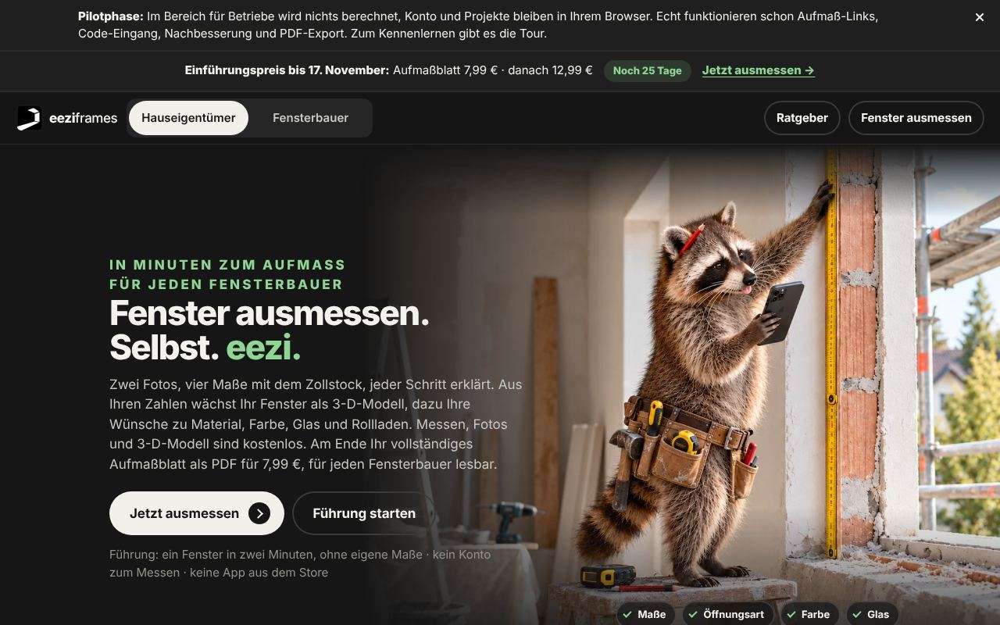
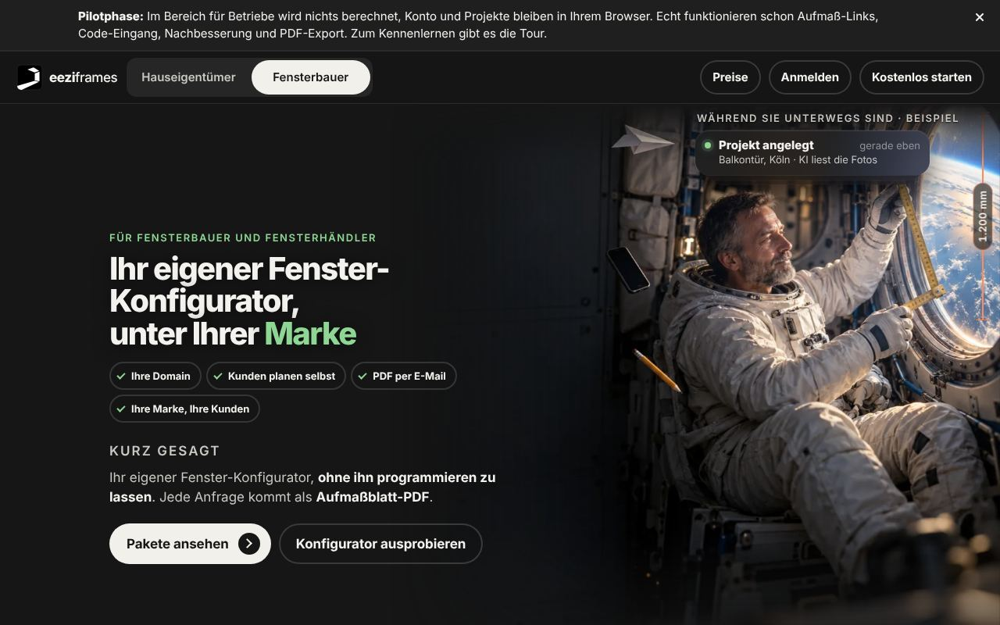
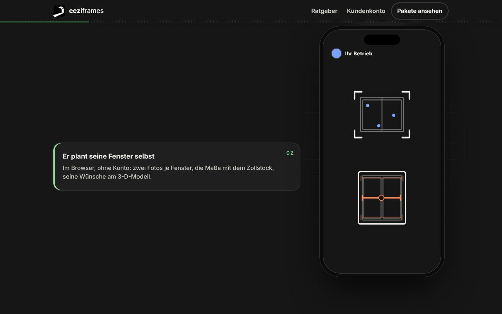
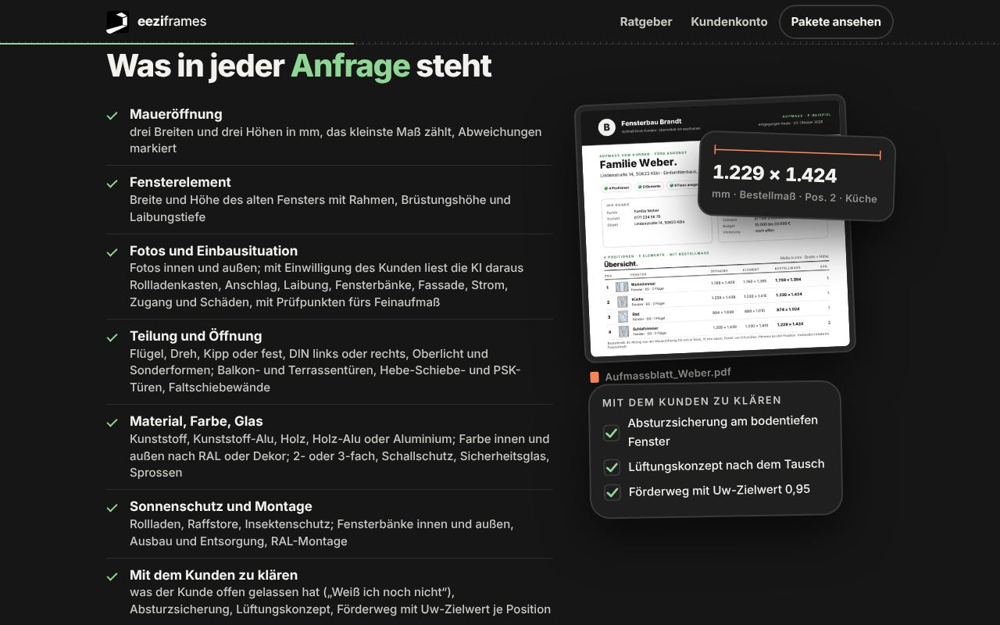
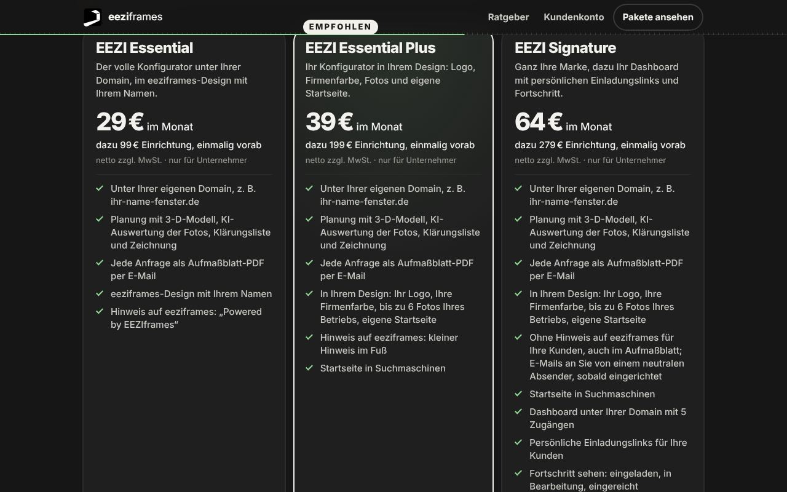
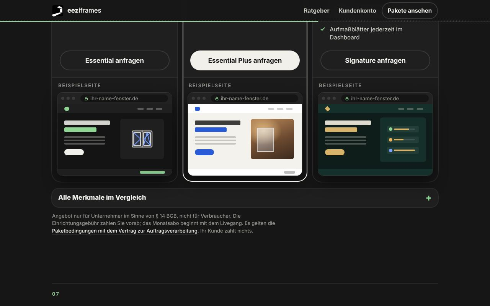
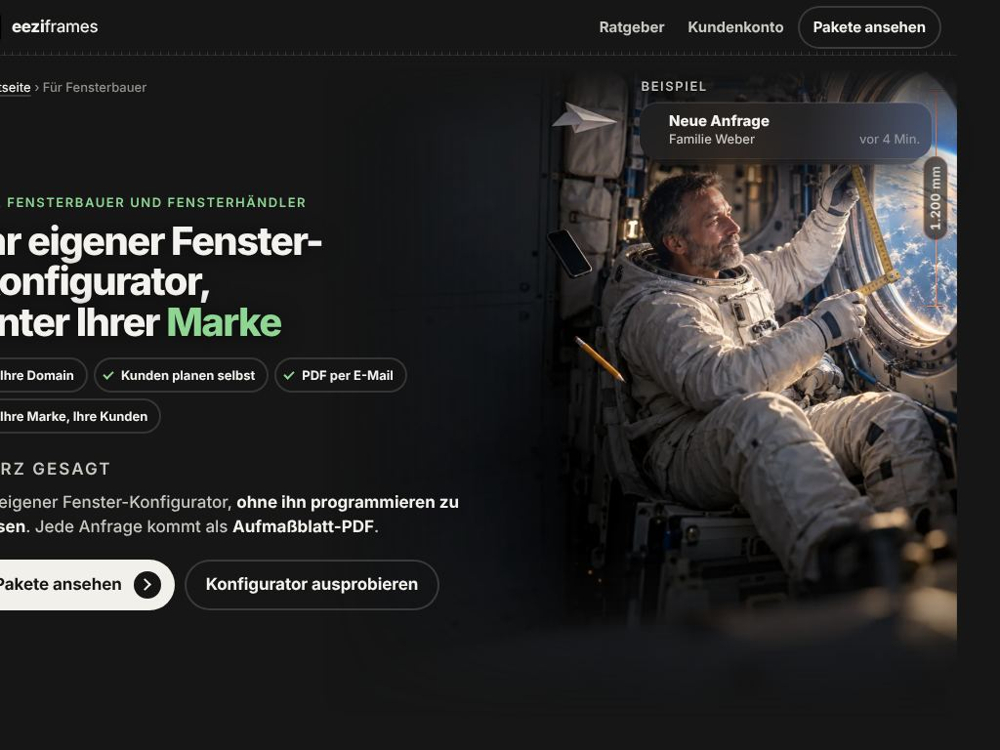

# 1. Projektanalyse

Ergebnis 1 des Website-Blueprints (MASTER-PROMPT V4, Phase A, Zusammenführung). Stand 24.10.2026, Arbeitszweig
`claude/design-dna-styleguide`, Commit `6f9b992`. Das Repository wurde nur gelesen. Grundlage sind die sechs Bestandsdateien unter
[bestand/](bestand/), deren Angaben stichprobenartig am Repository nachgeprüft wurden (Abgleich unten). Die bestehende Gestaltung ist
kein Vorbild; sie wird beschrieben und an den Anforderungen des Inhabers gemessen.

**Maßstab.** `.claude/skills/premium-gestaltung/SKILL.md` (Vorstellungen und Mindestanforderungen des Inhabers),
`.claude/skills/premium-gestaltung/designrichtung.md` (Aussehen) und `docs/GESTALTUNG.md` (Markenregeln).

**Belege** stehen als `Datei:Zeile`, bei Rechtstexten mit Paragraf. Abkürzungen:

| Kürzel | Datei |
|---|---|
| `SKILL` | `.claude/skills/premium-gestaltung/SKILL.md` |
| `DR` | `.claude/skills/premium-gestaltung/designrichtung.md` |
| `VK` | `web/fuer-fensterbauer/index.html` (Verkaufsseite) |
| `PB` | `web/konfigurator-bedingungen/index.html` (Paketbedingungen mit AV-Vertrag) |
| `AGB`, `NB` | `web/agb/index.html`, `web/nutzungsbedingungen/index.html` |
| `BAUPLAN` | `docs/instanzen/BAUPLAN.md` |
| [GM], [SI], [CP], [TD], [BM], [BD] | Bestandsdateien [geschaeftsmodell.md](bestand/geschaeftsmodell.md), [seiten-und-inhalte.md](bestand/seiten-und-inhalte.md), [conversion-pfade.md](bestand/conversion-pfade.md), [technik-und-designsystem.md](bestand/technik-und-designsystem.md), [browser-mobil.md](bestand/browser-mobil.md), [browser-desktop.md](bestand/browser-desktop.md) |

**Was es nicht gibt.** Nutzerforschung, Personas, Besucherzahlen, Geräteanteile, Konversionsraten, Umsatzziele und Kundenstimmen
liegen nicht im Repository. Die Statistik der Zentrale zählt auf dem Server, ihre Werte stehen nicht im Repository
(`docs/ZENTRALE.md:27`). Alles zu Wissensstand und Absicht von Besuchern ist deshalb abgeleitet und als solches gekennzeichnet.

**Abgleich der Bestandsdateien am Repository**

| Thema | Bestandsdatei | Repository | Geltung in diesem Dokument |
|---|---|---|---|
| Echte Fotos und Platzhalter | [TD] Kurzfassung: „fünf echte Fotos“, „weitere sieben Plätze“ Platzhalter; [BD] 7 zählt fünf echte Fotos ohne `fuer-fensterbauer.webp` | `web/bilder/foto/`: 6 echte Fotos, davon 4 eingebaut; `start-fensterbauer.webp` und `fuer-fensterbauer.webp` werden nirgends in `web/` oder `functions/` verwendet; 11 Platzhalter (10 × 3.494 B, `gross.webp` 3.950 B) | 6 echte Fotos, 4 im Einsatz, 11 Platzhalter (wie [SI] 4.6 und [BM] 8.2) |
| Zeichnungen | [TD] 4.2: „25 Dateien“ | `web/bilder/*.svg`: 28 Dateien | 28 (wie [SI] 4.6) |
| Altbestand-Tarif „Plus“ | [GM] 3.5 nennt „Team“ mit Beleg `NB:46` | `NB:46`: „Projekte unbegrenzt, dazu Ihr Logo und Ihre Farbe beim Kunden sowie die weiteren Leistungen laut Preisübersicht“, kein Team; Team nur in der Tour (`web/assets/portal.js:1579`), laut `docs/ABRECHNUNG.md:103` „bewusst noch nicht gebaut“ | Team wird nicht als Leistung geführt |
| Wortzahl Verkaufsseite | [SI] 3.5: 2.190; [BM]: 1.456 | verschiedene Messgrundlagen: Quelltext samt zugeklappter Antworten gegenüber sichtbarem Inhalt ohne Kopf und Fuß | beide Zahlen mit Grundlage |
| Zahl der Kopfzeilen | [SI] 2.1: sieben; [BD] 7: sechs Ansichten mit eigener Kopfzeile | [SI] zählt die Textfassungen ohne JavaScript mit | kein Widerspruch |
| h1 der Ansicht Fensterbauer | `docs/SEO.md:101`: „Aufmaß ohne Anfahrt.“ | eingebettet ist das h1 der Verkaufsseite (`VK:57`), die Prüfsuite verlangt das ([CP] 13 Nr. 5) | `docs/SEO.md:101` ist an dieser Stelle veraltet |
| Anrede | [CP] 3: „Website Sie, App du“ nach `docs/INSTANZEN.md:18` | Ratgeber duzen ([SI] 3.8); die Instagram-Linie siezt Hauseigentümer (`marketing/highlights/BEITRAGS-LINIE.txt:9`) | Regel und Praxis weichen ab, Frage 21 |
| Zustand der Bildschirmfotos | [BM] 1, [BD] 0: lokale Vorschau ohne Datenbank, ohne `PAKETE_OFFEN`, ohne Grafikchip | Pilotleiste und „Es wird nichts berechnet“ erscheinen nur ohne Server (`web/assets/gemeinsam.js:344-357`, `web/assets/portal.js:482`); welche Variablen bei Cloudflare gesetzt sind, steht nicht im Repository | Befunde dazu gelten für den Pilotzustand, Frage 8 |

---

## 1.1 Geschäftsmodell und Leistungen (mit Quellen)

eeziframes (Anbieter Patrick Kies, Herzebrock-Clarholz; `PB:33` § 1, `web/impressum/index.html`) betreibt eine Planungs- und
Aufmaß-App für Fenster im Browser (`README.md:3`). Daraus entstehen drei Geschäftsbereiche:

| Bereich | Kunde | Leistung | Erlös | Stand | Belege |
|---|---|---|---|---|---|
| **Konfigurator-Pakete** (Kern laut Inhaber) | Fensterbauer und Fensterhändler, nur Unternehmer nach § 14 BGB | eigener Fenster-Konfigurator unter Domain und Marke des Betriebs; eeziframes richtet ein, sichert die Domain, betreibt; jede Anfrage eines Endkunden kommt als E-Mail mit Aufmaßblatt-PDF | Einrichtung einmalig vorab, Monatsabo ab Livegang, keine Gebühr je Anfrage | Verkauf nicht geöffnet (`PAKETE_OFFEN` fehlt), Preise vorläufig, Paketbedingungen „Entwurf zur anwaltlichen Prüfung“ | `README.md:3`, `BAUPLAN:10-14`, `PB:38` § 2, `VK:70`, `VK:237`, `web/assets/pakete.js:17`, `docs/BESTELLUNG.md:50-57`, `PB:28` |
| **Aufmaßblatt für Hauseigentümer** | Hauseigentümer (Verbraucher) | kostenlos messen, Fotos, KI-Auswertung, 3-D-Modell; das fertige Aufmaßblatt als PDF einmalig kaufen und an beliebig viele Betriebe weitergeben | Einmalkauf 7,99 € bis 17.11.2026, danach 12,99 € | eingebaut; ohne Server Testkauf; die Live-Kasse öffnet erst mit vollständigem `verkaufStand()` | `AGB:55` § 6 (1), `web/config.js:12-14`, `docs/ABRECHNUNG.md:43`, `functions/api/recht.js:55-62`, `README.md:5` |
| **Altbestand: Betriebskonten mit Aufmaß-Links** | Bestandsbetriebe | Kundenlinks, Eingang des Aufmaßes ins Konto, Nachbesserung | Tarife Start, Abo 10, Plus | läuft weiter, „wird nicht mehr beworben“; trotzdem sichtbar in Kopf und Fuß der Ansicht Fensterbauer, in der Tour und im Aufmaßblatt-PDF | `NB:44-46` § 4, `README.md:3`, `BAUPLAN:657` E28, `web/assets/portal.js:450`, `:482`, `web/assets/blatt.js:664`, `:694` |

**Vorgabe des Inhabers für Verkaufsflächen.** „Auf der Seite für Fensterbauer soll ein Fensterbauer kaufen. Das Produkt ist ein
hochwertiger Fenster-Konfigurator unter seiner eigenen Marke und Domain, den er in drei Paketen in seine Seite bringt. Nicht die
Hauptaussage: ‚Kunden messen selbst‘. Kein Thema mehr: eine Plattform, auf der Kunden bei eeziframes Projekte anlegen.“
(`SKILL:23-25`). Messlatte: Ein Fensterbauer soll an der Seite merken, dass eeziframes Webdesign und Digitales beherrscht (`SKILL:38`).

**Leistungen der Konfigurator-Pakete**

- **Domain:** eeziframes registriert eine Wunsch-Domain (Jahrespreis bis 25 € netto inklusive), ist während des Vertrags Inhaber,
  hält sie nach Vertragsende 12 Monate und überträgt sie auf Wunsch gegen eine Pauschale, deren Betrag offen ist (`PB:64-66` § 6).
- **Voller Konfigurator:** 3-D-Modell, KI-Auswertung der Fotos, Klärungsliste, Zeichnung; dieselbe App wie für Hauseigentümer, unter
  der Domain des Betriebs mit dessen Namen und ohne Preise (`web/assets/pakete.js:75`, `VK:209`).
- **Anfrage:** E-Mail mit Aufmaßblatt-PDF an bis zu drei bestätigte Adressen, Antwortadresse ist der Kunde (`PB:38` § 2 (1),
  `web/assets/instanzregeln.js:66`). Inhalt: Maueröffnung (drei Breiten, drei Höhen), Fensterelement, Fotos und Einbausituation,
  Teilung und Öffnung, Material, Farbe, Glas, Sonnenschutz und Montage, Klärungsliste (`VK:124-130`).
- **Endkunde:** plant im Browser ohne Konto, sieht nur den Betrieb, keine Preise, keine Werbung, bekommt nach dem Senden seine Anfrage
  als PDF (`VK:89-90`, `VK:240`).
- **Einrichtung als Dienstleistung:** Rückruf, Konfigurator anlegen, Domain verbinden, Gestaltung, Vorschau-Link, Testanfrage, Freigabe
  durch den Betrieb, Live; danach ein Knopf „Fenster planen“ als HTML-Schnipsel für die eigene Website; „meist 3 bis 5 Werktage nach
  der Zahlung“ (`docs/BESTELLUNG.md:19-30`, `VK:193`).
- **Kundenkonto `/partner/`:** Bestellung, Statusleiste, Nachrichten, Rückruf, Rechnungen; Zahlungsmittel und Kündigung über das
  Stripe-Kundenportal (`docs/BESTELLUNG.md:13`, `:43`).
- **Kundenschutz:** nur der Betrieb wird gezeigt, Anfragen nur an bestätigte Adressen, Verarbeitung im Auftrag, kein Weiterverkauf
  (`PB:84-86` § 10, `VK:160-166`).
- **Nur Signature:** Dashboard unter `https://<domain>/betrieb/` mit fünf Zugängen, persönliche Einladungslinks, Fortschritt,
  abgelegte Aufmaßblätter (`docs/INSTANZEN.md:184-207`).
- **Betrieb:** „Server, Updates, Sicherheit und neue Funktionen sind dabei“ (`VK:77`).
- **Nicht geschuldet:** Beratung, Angebote oder Aufmaß gegenüber den Kunden des Betriebs; die Verfügbarkeitszusage ist ein Platzhalter
  (`PB:44` § 2 (4), `PB:89` § 11).
- **Nicht gebaut:** Subdomain beim Betrieb, Einbettung per iframe, Mitarbeiter-Selbstverwaltung, Sortiment je Instanz
  (`docs/INSTANZEN.md:366-368`, `BAUPLAN:659` E30, `BAUPLAN:717`).

**Leistungen für Hauseigentümer**

- Web-App auf Handy, Tablet oder Computer, ohne Installation und ohne Konto zum Messen; Deutsch, für Deutschland (`web/index.html:62`,
  `:76-77`).
- Elementarten: Fenster mit Ober- und Unterlicht, Balkon- und Terrassentüren, Festverglasungen, Hebe-Schiebe- und PSK-Türen,
  Faltschiebewände; Rollladen, Raffstore, Screen, Rollo, Plissee, Jalousie (`README.md:3`); nicht Haustür und Dachfenster
  (`docs/SEO.md:47`).
- Je Fenster drei Breiten und drei Höhen der Maueröffnung und das Rahmenmaß; das kleinste Maß zählt (`web/index.html:59`).
- Fotos innen und außen; die KI liest mit Einwilligung die Einbausituation, keine Preise (`docs/KI.md:9`, `docs/KI.md:21-33`,
  `web/assets/gemeinsam.js:36-75`).
- Führung ohne eigene Maße (`/app/#fuehrung`), Konto mit E-Mail und Code ohne Passwort (`README.md:5`, `AGB:39-41` § 3).
- 23 Ratgeber-Artikel in sechs Schritten, bewusst ohne Vorlagen, Formulare und Rechner (`docs/SEO.md:93`, `:149`).
- Grenzen: höchstens 50 Fenster je Aufmaß; Änderungsregeln nach dem Kauf (`AGB:45` § 4).
- Ausdrücklich nicht: Fensterverkauf, Vermittlung von Aufträgen, Aufmaß vor Ort; das Aufmaßblatt ist kein Bestellmaß (`AGB:35` § 2 (4)).

**Kosten,** soweit genannt: KI-Auswertung etwa 2,6 Eurocent je Fenster (`docs/KI.md:76`). Ausführlich: [GM] 1–2.

---

## 1.2 Pakete und Preise (Tabelle mit Quellen)

**Konfigurator-Pakete** (Fensterbauer und Fensterhändler, nur Unternehmer, alle Preise netto zuzüglich Umsatzsteuer, vorläufig)

| Paket | Einrichtung, einmalig vorab | Monatlich ab Livegang | Satz auf der Karte | Hinweis auf eeziframes | Stellung | Quelle |
|---|---|---|---|---|---|---|
| EEZI Essential | 99 € | 29 € | „Der volle Konfigurator unter Ihrer Domain, im eeziframes-Design mit Ihrem Namen.“ | deutlich: „Powered by EEZIframes“, verlinkt auf die Seite für Fensterbauer | – | `web/assets/pakete.js:44`, `PB:80` § 9 (1) |
| EEZI Essential Plus | 199 € | 39 € | „Ihr Konfigurator in Ihrem Design: Logo, Firmenfarbe, Fotos und eigene Startseite.“ | dezent, kleiner Hinweis im Fuß | „Empfohlen“, einziger Cream-Knopf | `web/assets/pakete.js:52`, `functions/pakete-seite.js:32-33` |
| EEZI Signature | 279 € | 64 € | „Ganz Ihre Marke, dazu Ihr Dashboard mit persönlichen Einladungslinks und Fortschritt.“ | keiner, auch nicht in PDF, E-Mails, Titeln, Rechtstexten | – | `web/assets/pakete.js:60`, `docs/INSTANZEN.md:288` |

Unterschied laut Seite: „Sie unterscheiden sich darin, wie sehr der Konfigurator Ihre Marke trägt, und Signature hat zusätzlich ein
Dashboard mit persönlichen Einladungslinks“ (`VK:236`).

**Merkmale, in denen sich die Pakete unterscheiden** (einzige Quelle `web/assets/pakete.js:42-67`; gleiche Tabelle in `PB:41` § 2 (2))

| Merkmal | Essential | Essential Plus | Signature |
|---|---|---|---|
| Gestaltung | eeziframes-Design mit Ihrem Namen | Ihr Design | Ihr Design |
| Logo, Firmenfarbe, eigene Startseite | nein | ja | ja |
| Fotos des Betriebs | 0 | bis 6 | bis 6 |
| Hinweis auf eeziframes in App, Aufmaßblatt, E-Mail | deutlich | dezent | keiner |
| Absender der E-Mails | Konfigurator-Postfach von eeziframes | wie Essential | neutrales Postfach, „sobald eingerichtet“ |
| In Suchmaschinen | nein | Startseite | Startseite |
| Originalfotos per Link in der E-Mail | 14 Tage | 14 Tage | nein |
| Aufbewahrung der Anfragen | 30 Tage nach Zustellung | 30 Tage nach Zustellung | Vertragsdauer |
| Dashboard, Einladungslinks, Fortschritt | nein | nein | ja, 5 Zugänge |
| KI-Auswertungen je Monat (Richtwert) | 600 | 1.000 | 2.000 |
| Anfragen je Tag (Richtwert) | 50 | 50 | 100 |

**Bedingungen für alle drei Pakete**

- Nur für Unternehmer nach § 14 BGB, Preise netto zuzüglich Umsatzsteuer (`web/assets/pakete.js:7`, `PB:34` § 1 (2), `PB:52` § 4 (1)).
- Vorläufig: `VORLAEUFIG = true`, Preisstand `2026-10-22`; es gilt der Preis bei der Bestellung, er bleibt für den Vertrag fest
  (`web/assets/pakete.js:15-17`, `VK:174`, `docs/BESTELLUNG.md:38`).
- Zahlung der Einrichtung über Stripe per Karte oder SEPA-Lastschrift; der Vertrag kommt mit dem Zahlungseingang zustande; die
  Monatsgebühr wird ab Livegang monatlich im Voraus abgebucht (`PB:48` § 3 (2), `PB:53-54` § 4).
- Monatlich kündbar zum Ende des Abrechnungsmonats, ohne Mindestlaufzeit (`PB:69` § 7 (1), `VK:243`).
- Storno bis zum Beginn der Einrichtung mit voller Erstattung (`PB:70` § 7 (2)).
- Wechsel nach oben auf Anfrage gegen die Differenz der Einrichtungsgebühren, nach unten ab dem nächsten Abrechnungsmonat (`PB:71` § 7 (3));
  `docs/BESTELLUNG.md:41` sagt „auf Wunsch die Differenz“, siehe Frage 9.
- Preisänderungen mindestens sechs Wochen vorher, Sonderkündigungsrecht (`PB:55` § 4 (4)).
- Keine Gebühr je Anfrage, keine Kosten für Programmierung, Server oder Pflege (`VK:70`, `VK:237`).
- Einführungspreise für die Pakete gibt es nicht ([GM] 3.1).

Größenordnung, eigene Rechnung aus den Preisen, keine Prognose: erstes Vertragsjahr netto Essential 447 €, Essential Plus 667 €,
Signature 1.047 € ([GM] 3.1).

**Hauseigentümer**

| Produkt | Preis | Einführungspreis | Zahlung | Quelle |
|---|---|---|---|---|
| Messen, Fotos, KI-Auswertung, 3-D-Modell | 0 € | – | – | `AGB:23`, `docs/ABRECHNUNG.md:43` |
| Aufmaßblatt als PDF, ohne Link eines Betriebs | Endpreis, einmalig | 7,99 € bei Kauf bis einschließlich 17.11.2026, ab 18.11.2026 von selbst 12,99 € | Stripe; Karte, Apple Pay, Google Pay, PayPal je nach Kasse; keine SEPA-Lastschrift | `AGB:55-56` § 6, `web/config.js:12-14`, `functions/api/umgebung.js:72` |
| Messen über den Link eines Betriebs | 0 € | – | – | `AGB:34` § 2 (3) |

Planungshinweis: Der Einführungspreis endet am 17.11.2026 um 23:00 UTC (`web/config.js:14`); danach ersetzt der Server die Preise in den
festen Seiten selbst (`functions/seo.js:139-171`). Ein „statt“-Preis wird bewusst nicht gezeigt (`docs/ABRECHNUNG.md:11`). Geht die neue
Website nach diesem Tag online, gilt 12,99 €.

**Altbestand, nicht beworben**

| Tarif | Preis netto | Einführungspreis | Quelle |
|---|---|---|---|
| Start | keine Grundgebühr; drei Projekte mit eingegangenem Aufmaß frei, danach 9 € je Projekt | – | `NB:44` § 4 |
| Abo 10 | 10 Projekte je Monat inklusive, jedes weitere 5 € | 49 € im Monat bei Abschluss bis 17.11.2026, danach 69 € | `NB:45` § 4 |
| Plus | Projekte unbegrenzt, Logo und Farbe beim Kunden, „weitere Leistungen laut Preisübersicht“ | 79 € im Monat bei Abschluss bis 17.11.2026, danach 119 € | `NB:46` § 4 |

Der Tarif „Plus“ (79 € bzw. 119 €) und das Paket „EEZI Essential Plus“ (39 €) sind verschiedene Produkte mit gleichem Namensteil
(`BAUPLAN:328`); beide sind in der Ansicht Fensterbauer erreichbar ([CP] 5.4).

---

## 1.3 Zielgruppen und Besuchssituationen (nach Kenntnisstand und Kaufabsicht)

**Grundlage.** Belegt sind die Zielgruppen, die Einstiege im Code und Suchbegriffe aus Vorschlägen der Google-Suche ohne Suchvolumen
(`docs/SEO.md:28-47`). Kenntnisstand und Kaufabsicht sind daraus abgeleitet, nicht erhoben. „Mobil zuerst“ ist eine Vorgabe des
Inhabers, keine Messung (`SKILL:28`).

**Zielgruppen**

| Zielgruppe | Rolle | Beleg |
|---|---|---|
| Fensterbauer und Fensterhändler in Deutschland, Unternehmer | Käufer der Pakete; „Hauptzielgruppe“ | `marketing/highlights/BEITRAGS-LINIE.txt:9`, `SKILL:23`, `VK:56` |
| Hauseigentümer, die neue Fenster planen | Käufer des Aufmaßblatts; zugleich Endkunden in den Konfiguratoren der Betriebe | `web/index.html:73`, `BAUPLAN:11` |
| Bestandsbetriebe | Nutzer des Altbestands; Service, keine Akquise | `docs/GESTALTUNG.md:193` |
| Paketkunden nach dem Kauf | Kundenkonto, bei Signature Team im Dashboard | `docs/BESTELLUNG.md:13`, `docs/INSTANZEN.md:184` |
| Suchmaschinen und KI-Assistenten | Mittler, die finden, zitieren, empfehlen | `docs/SEO.md:3` |

**Stufen.** Kenntnisstand: **K1** kennt sein Problem, nicht die Lösungsart · **K2** kennt die Lösungsart (Aufmaß-App, Konfigurator,
Software), nicht eeziframes · **K3** kennt das Produkt oder sein Ergebnis. Kaufabsicht: **niedrig** (informiert sich), **mittel**
(vergleicht, prüft), **hoch** (will handeln).

| Nr. | Situation | Einstieg heute | Kenntnis | Absicht | Landet auf | Beleg |
|---|---|---|---|---|---|---|
| F1 | Fensterbauer mit Fachfrage: Erstaufmaß, Haftung bei falschem Aufmaß, Anfahrtspauschale, geplatzter Termin, Software | Suche | K1–K2 | niedrig bis mittel | fünf Fachartikel, von dort 4 bis 6 Knöpfe zur Verkaufsseite | `docs/SEO.md:38`, `:45`, [SI] 3.8 |
| F2 | Fensterbauer sucht Software oder einen Konfigurator | Suche, KI-Assistent (`llms.txt` nennt Pakete mit Preisen) | K2 | mittel | Verkaufsseite | `docs/SEO.md:142`, `functions/pakete-seite.js:272-285` |
| F3 | Fensterbauer sieht den Essential-Konfigurator eines anderen Betriebs | Link „Powered by EEZIframes“ | K3 | mittel bis hoch | Verkaufsseite | `PB:80` § 9 (1), `BAUPLAN:656` E27 |
| F4 | Fensterbauer bekommt das Aufmaßblatt eines Kunden | QR-Code im PDF → `/?von=pdf` | K3 (Ergebnis in der Hand) | Aufmaß übernehmen; Paketkauf offen | Registrierung im Altbestand („Die ersten 3 Aufmaße sind frei“) | `web/assets/blatt.js:226-227`, `web/assets/portal.js:849` |
| F5 | Fensterbauer über Instagram, Anzeige oder den Umschalter der Startseite | `/#fensterbauer`; Anzeigen laut Doku auf `/?…#fensterbauer` „(dort wird registriert)“ | unbekannt | unbekannt | Ansicht Fensterbauer mit Kopf des Altbestands | `docs/ZENTRALE.md:83`, `docs/GESTALTUNG.md:193` |
| F6 | Fensterbauer hat die Verkaufsseite gelesen und will prüfen oder kaufen | „Konfigurator ausprobieren“, Paketkarten | K3 | hoch | App für Hauseigentümer (Demos nicht freigeschaltet), Anfrageformular | `VK:63`, `VK:209-210` |
| H1 | Hauseigentümer mit Problem am Fenster (beschlagen, undicht, Alter) | Suche | K1 | niedrig | Ratgeber „Prüfen“ | `docs/SEO.md:44`, `:93` |
| H2 | Hauseigentümer vor Entscheidung oder Auswahl (reparieren oder tauschen, Kosten, Förderung, Material, Glas) | Suche | K1–K2 | niedrig bis mittel | Ratgeber „Entscheiden“, „Auswählen“ | `docs/SEO.md:37`, `:41-44` |
| H3 | Hauseigentümer will messen („fenster ausmessen“, „aufmaß app kostenlos“, „aufmaßblatt fenster pdf“) | Suche | K2 | hoch | Messanleitung, dann `/app/` | `docs/SEO.md:34-36`, `:40` |
| H4 | Hauseigentümer mit Angeboten oder vor dem Einbau | Suche | K2 | niedrig für das Aufmaßblatt | Ratgeber „Vergleichen“, „Einbauen“ | `docs/SEO.md:37`, `:43-44` |
| H5 | Hauseigentümer über einen KI-Assistenten | Antwort mit Verweis auf Ratgeber oder `llms.txt` | wie H1–H4 | wie H1–H4 | Ratgeber, App | `docs/SEO.md:3`, `:112` |
| H6 | Hauseigentümer direkt auf der Startseite | Adresse, Empfehlung | unbekannt | unbekannt | Standardansicht Hauseigentümer | `web/assets/portal.js:398` |
| H7 | Hauseigentümer über Link oder Konfigurator eines Betriebs | `/app/#k-…` bzw. Domain des Betriebs | K3 (eingeladen) | hoch, aber keine Kaufhandlung bei eeziframes | App, nicht die Website (Logo ohne Ziel) | `docs/GESTALTUNG.md:139`, `docs/ABRECHNUNG.md:82` |
| B1, P1 | Bestandsbetrieb, Paketkunde | „Anmelden“, Kundenkonto, Dashboard | K3 | Service | Betriebsbereich, `/partner/`, `/betrieb/` | `docs/GESTALTUNG.md:193`, `docs/BESTELLUNG.md:13` |

**Folgerungen für die Konzeption (abgeleitet)**

- Fensterbauer kommen überwiegend mit der Brille „Aufmaß, Anfahrt, Haftung, Software“ (F1, F4); die Hauptaussage soll aber der
  Konfigurator unter eigener Marke sein, nicht „Kunden messen selbst“ (`SKILL:23-24`). Für „Konfigurator“ gibt es keine erhobenen
  Suchbegriffe (`docs/SEO.md:38`, `:45`).
- F3 und F4 sind die einzigen Einstiege, in denen ein Fensterbauer das Produkt schon gesehen hat. F4 endet heute im Altbestand.
- Beide Gruppen teilen sich die Startseite; sie öffnet mit der Ansicht für Hauseigentümer (`web/assets/portal.js:398`), obwohl die
  Fensterbauer die Hauptzielgruppe sind (Frage 2).
- Nicht belegt: Anteil Telefon und Schreibtisch, wer im Betrieb entscheidet, Größe der Zielbetriebe, Unterschiede zwischen
  Fensterbauer und Fensterhändler ([GM] 4.3).

---

## 1.4 Conversion-Ziele

**Primäre Zielhandlung: Fensterbauer bestellt ein Konfigurator-Paket.** Solange `PAKETE_OFFEN` fehlt, ist der Abschluss die
unverbindliche Paketanfrage über das Formular der Verkaufsseite (`POST /api/partner/frage`). Die Seite führt dabei zu
Essential Plus („Empfohlen“) und zu Signature.

- Inhaber: „Auf der Seite für Fensterbauer soll ein Fensterbauer kaufen“ (`SKILL:23`); „Auf Verkaufsflächen führt jedes Element zum
  Kauf: Pakete sichtbar machen, zum höheren Paket hinführen, nächste Handlung klar“ (`SKILL:50-51`).
- Fensterbauer sind die Hauptzielgruppe (`marketing/highlights/BEITRAGS-LINIE.txt:9`); das beworbene Produkt sind die Pakete,
  der Altbestand wird nicht mehr beworben (`README.md:3`, `BAUPLAN:657` E28).
- Wiederkehrender Erlös: Einrichtung plus Monatsabo (`web/assets/pakete.js:44-60`).
- Abschluss heute: Formular mit Paketvorwahl (`functions/pakete-seite.js:113-115`, `:173-197`); mit `PAKETE_OFFEN=1` Bestellung über
  `/partner/#bestellen/<paket>` und Stripe (`docs/BESTELLUNG.md:48-57`, `functions/api/partner.js:386-412`).

**Sekundäre Zielhandlung: Hauseigentümer beginnt in der App zu messen** (`/app/#ausmessen`), mit dem Ziel, das Aufmaßblatt zu kaufen.

- Einzige Einnahme von Hauseigentümern (`docs/ABRECHNUNG.md:7`, `AGB:23`).
- Die Startseite öffnet mit der Ansicht für Hauseigentümer (`web/assets/portal.js:398`, `docs/SEO.md:101`); 23 Ratgeber führen zur App,
  „jede zusätzliche Seite im Besuch ist eine Chance, dass jemand misst“ (`docs/SEO.md:91`).
- Das gekaufte Aufmaßblatt trägt eine Einladung an Fensterbauer und ist so ein Weg, über den Betriebe zu eeziframes finden
  (`docs/ABRECHNUNG.md:84`); heute führt er in den Altbestand statt zu den Paketen ([SI] 3.9).

**Unterstützende Handlungen** (keine Ziele für sich): Konfigurator ausprobieren bzw. Live-Demo ansehen (`VK:63`, `VK:209`; Demos erst
mit `PAKETE_DEMOS=1`), Paketvergleich öffnen, Paketbedingungen lesen (`VK:188`), Führung starten (`web/assets/portal.js:852`),
Fachartikel und Ratgeber lesen.

**Keine Zielhandlung:** Registrierung im Altbestand („Kostenlos starten“). Sie bleibt für Bestandsbetriebe erreichbar
(`web/assets/portal.js:848`), ist aber kein Ziel mehr (`BAUPLAN:657` E28, `SKILL:25`).

| Rang | Handlung | Zielgruppe | Abschluss heute | Messbar über |
|---|---|---|---|---|
| 1 | Paket bestellen, zurzeit anfragen; zum höheren Paket | Fensterbauer, Fensterhändler | Formular „Paket unverbindlich anfragen“ | Statistik der Zentrale zählt „Vorgänge“ und drei Trichter (`docs/ZENTRALE.md:27`); ob die Paketanfrage dazugehört, ist offen |
| 2 | Messen beginnen, Aufmaßblatt kaufen | Hauseigentümer | Kasse in der App; ohne Server Testkauf | Vorgänge „Kasse, Kauf“ (`docs/ZENTRALE.md:27`) |
| – | ausprobieren, vergleichen, Bedingungen lesen, Führung | beide | – | – |

**Einschränkung.** Eine Rangfolge zwischen Paketverkauf und Aufmaßblatt nennt das Repository nicht ([GM] 5.2). Die Reihenfolge oben
folgt aus `SKILL` und der Instagram-Linie und ist zu bestätigen (Frage 1).

---

## 1.5 Bestehende Seiten, Navigation und Hierarchie

Ausführlich: [SI] 1–3 und 5.

- **Ebene 0:** Startseite `/`, eine URL mit zwei Ansichten über einen Umschalter; Standard ist „Hauseigentümer“ (`web/assets/portal.js:398`).
  Die Ansicht „Fensterbauer“ lädt `/fuer-fensterbauer/` per `fetch` und bettet sie ein (`web/assets/portal.js:792-844`).
- **Ebene 1:** App `/app/`, Ratgeber-Übersicht `/ratgeber/`, Verkaufsseite `/fuer-fensterbauer/`, Kundenkonto `/partner/` (noindex).
- **Ebene 2:** 23 Ratgeber-Artikel, 5 Fachartikel für Fensterbauer, Paketbedingungen `/konfigurator-bedingungen/`.
- **Flach:** sechs Rechtsseiten, nur über den Fuß. Intern: `/zentrale/`; nur auf Instanz-Domains: `/betrieb/`.
- **Zweiter, älterer Strang ohne eigene URL:** „So funktioniert es“, „Preise“, „Tour“ und Registrierung des Altbestands, erreichbar über
  Kopf und Fuß der Startseite (`web/assets/portal.js:787-789`, `:846-848`).
- **Navigation:** sieben Kopfzeilen-Varianten; am Telefon blenden die statischen Seiten alle Textlinks aus, ein Menü gibt es nicht
  (`web/assets/ratgeber.css:15`). Rechtsseiten verlinken „Für Betriebe“ auf `/`, also auf die Ansicht Hauseigentümer
  (`web/agb/index.html:17`). Die App verlinkt „Sie sind Fensterbauer?“ auf `/#fensterbauer` mit dem Kopf des Altbestands
  (`web/assets/app.js:2308`).
- **Interne Verlinkung:** 27 Seiten verlinken im Inhalt die App, 9 die Verkaufsseite; aus den 23 Ratgebern führt im Inhalt nur einer zur
  Verkaufsseite ([SI] 2.5).
- **Dopplungen:** die Verkaufsseite an zwei Orten; die Startseite in zwei inhaltlich verschiedenen Fassungen (mit und ohne JavaScript);
  die Liste „was im Aufmaß steckt“ in vier Fassungen ([SI] 5.3).

---

## 1.6 Bestehende Conversion-Pfade und Formulare

Ausführlich: [CP].

| Pfad | Ablauf | Formular | Stand |
|---|---|---|---|
| P3 Paket bestellen | Verkaufsseite → Paketkarte „… anfragen“ → Formular mit Paketvorwahl; mit `PAKETE_OFFEN=1`: `/partner/#bestellen/<paket>`, sechs Schritte (Paket, E-Mail mit Code, Unternehmen mit elf Pflichtangaben samt Impressumsangaben, Konfigurator, Gestaltung, Prüfen) → Stripe → Statusleiste mit sechs Schritten bis Live | `web/assets/partner.js:161-300`, `web/assets/instanzregeln.js:190-265` | nur Anfrage |
| P3a Frage ohne Konto | Formular auf der Verkaufsseite: Name, Firma, E-Mail, Telefon, Paket, Frage (drei Pflichtfelder), Honigtopf; funktioniert mit und ohne JavaScript | `functions/pakete-seite.js:173-189`, `functions/api/partner.js:206-228` | aktiver Abschluss; ohne Datenbank Antwort 503 mit technischer Meldung (`functions/api/router.js:86`) |
| P1 Aufmaßblatt | messen → „Fürs Angebot“ (freiwillig) → Vorschau mit verschwommenen Maßen, „Freischalten · 7,99 €“ → Aufmaß sichern (E-Mail, Code) → Kasse mit zwei leeren Haken → Stripe → Blatt | `web/assets/app.js:3241-3510` | ohne Server Testkauf |
| P2, P6 Altbestand | Registrierung, Kundenlinks, Tarife | `web/assets/portal.js:911-963` | läuft, nicht beworben |
| P4 Tour, Führung | Tour (Altbestand, 8 Schritte), Führung (App, 9 Schritte) | `web/assets/portal.js:1436-1592`, `web/assets/app.js:6302-6539` | Vorführung ohne Speichern |
| P5 Einführungsband | Startseite (Hauseigentümer), App, Ratgeber; nicht auf `/fuer-fensterbauer/` | `web/assets/gemeinsam.js:326-342`, `functions/seo.js:160-171` | endet am 17.11.2026 von selbst |
| P7 Widerruf | drei Pflichtfelder, ohne JavaScript nutzbar, in jeder Fußzeile | `web/widerruf/index.html`, `functions/api/widerruf.js:1-9` | funktioniert |
| P8 Kontakt | E-Mail und Telefon im Impressum, Frageformular, Nachrichten und Rückruf im Kundenkonto | `web/impressum/index.html:31-33` | kein Kontaktweg für Hauseigentümer außer Impressum |

Wichtigste Reibungen laut [CP] 12: zwei Geschäftsmodelle in der Ansicht Fensterbauer; drei Anmeldungen für Fensterbauer
(`/partner/`, Betriebsbereich, `/betrieb/`); Namensgleichheit „Plus“; bis zu fünf Stationen zwischen „Freischalten“ und Aufmaßblatt
mit doppelter Zustimmung zu den AGB; uneinheitliche Einstiege in die App (`/app/` gegenüber `/app/#ausmessen`); „Konfigurator
ausprobieren“ führt in die App für Hauseigentümer mit Preis und Paywall.

---

## 1.7 Technik, Komponenten, Designsystem, Assets

Ausführlich: [TD].

- **Auslieferung:** ein Cloudflare Worker liefert `web/` ohne Build aus und schreibt HTML beim Ausliefern um (Kopfzeilen, Canonical,
  Paket-Bausteine, Einführungspreis) (`wrangler.jsonc:13-25`, `functions/seo.js:113-170`). Die Startseite wird im Browser von
  `portal.js` gezeichnet; die Verkaufsseite ist statisches HTML mit generierten Bausteinen (`functions/pakete-seite.js:5-15`).
- **CSP:** nur eigene Herkunft, keine Inline-Skripte, kein `eval`, kein WebAssembly, `frame-ancestors 'none'` (`web/_headers:5-12`,
  `functions/seo.js:68-75`); die Prüfsuite meldet jede fremde Anfrage (`scripts/pruefen.mjs:76-84`).
- **Designsystem:** Tokens an einer Stelle (`web/assets/gemeinsam.css:9-32`): dunkle Bühne `#161616`, Karten mit 2-px-Ring, Cream
  `#f1f0ea` für die Hauptaktion, Grün `#8fd694` als Signal, Inter lokal. Schriftgrößen auf der Verkaufsseite 13, 15, 17, 24, 40
  (Telefon 32), geprüft; die Startseite nutzt eine zweite Skala mit `clamp()`, ungeprüft ([TD] 2.2).
- **Bewegung:** Helfer `Scroll.binden`, `Reveal.auf`, `Lottie.auf`, ruhige Fassung über `ruhig()` (`web/assets/gemeinsam.js:175-324`).
  Von zehn Bausteinen der Designrichtung sind fünf umgesetzt, drei teilweise, zwei fehlen (Explosionsansicht, Riesenwort) ([TD] 2.6).
- **WebGL-Bühne:** zeichnet das Fenstermodell der App detailliert, hängt aber an `app.js` (810 KB) und lässt sich nicht neben
  `portal.js` laden ([TD] 6.1). Vorgerenderte Bildfolgen aus dem eigenen Konfigurator wären möglich, ungeprüft.
- **Ladegewicht:** Startseite rund 547 KB Skripte synchron, darunter `modell.js` mit Abrechnungslogik; die Überschrift steht erst nach
  `portal.js` ([TD] 1.4).
- **Assets:** 6 echte Fotos (4 im Einsatz), 11 Platzhalter, echtes Aufmaßblatt als Bild in drei Fassungen, 28 SVG-Zeichnungen, 10
  Lottie-Zeichen (4 ungenutzt: `marke`, `domain`, `dashboard`, `konfigurator`), vier Hochformat-Videos (5 bis 8 s, 9 bis 18,6 MB, mit Ton),
  rund 40 Bildschirmaufnahmen des 3-D-Modells (Stand 21.10.2026, vor Einsatz neu aufzunehmen) ([TD] 4).
- **Prüfsuite:** harte Regeln zu Schriftgrößen, Zielen, Querscrollen, Marke, Eingaben, FAQ, h1 und festen Texten der Verkaufsseite
  ([TD] 5.2, 5.3). Nicht geprüft: Schriftgrößen der Startseite, Cream-Pille und grünes Wort auf Start- und Verkaufsseite, ruhige Fassung
  der Verkaufsseite, Breite 1024 ([TD] 5.4).

---

## 1.8 Darstellung im Browser: Telefon und Schreibtisch getrennt

Aufnahmen vom 24.10.2026 aus der lokalen Vorschau ohne Datenbank, ohne `PAKETE_OFFEN` und ohne Grafikchip, als Standbilder ([BM] 1,
[BD] 0). Bewegung ist nicht beurteilt. Was der Pilotzustand zeigt (Pilotleiste, „Es wird nichts berechnet“), kann online fehlen.

### Telefon (390 × 844)

| Seite | Länge | Wörter | erste Cream-Pille im Inhalt | Bildschirme ohne Farbakzent |
|---|---|---|---|---|
| Startseite, Hauseigentümer | 6.211 px ≈ 7,4 Bildschirme | 593 | y = 756, erster Bildschirm | 4 von 9 |
| Ansicht Fensterbauer | 15.410 px ≈ 18,3 Bildschirme | 1.561 | y = 1.019, zweiter Bildschirm | 2 von 3 aufgenommenen |
| Verkaufsseite | 16.019 px ≈ 19 Bildschirme | 1.456 (Inhalt) | y = 949, zweiter Bildschirm | 12 von 21 |
| App, Startbild | 844 px, innen 2.421 px | – | y = 711, erster Bildschirm | 1 von 6 |
| Ratgeber-Übersicht | 9.201 px ≈ 10,9 Bildschirme | 613 | nur im Kopf; im Inhalt y = 7.879 | 3 von 4 |

Quelle: [BM] 1. Kein Querscrollen bei 390 px.

Startseite, erster Bildschirm: Pilotleiste, Einführungsband, Kopf und Umschalter liegen vor dem Foto; es beginnt erst bei y = 268.
Dasselbe Ziel steht dreimal auf dem Bildschirm (Link im Band, Kopfknopf, Pille); die Pille liegt im Daumenbereich ([BM] S1).

Startseite ab dem zweiten Bildschirm: Raster aus Karten mit Strichsymbolen, schmale Spalten, Karten bis acht Zeilen, 99 % unbunt
([BM] S3). Gegen „Echtes Material statt Symbole“ (`SKILL:41`) und `DR:127`.

Ansicht Fensterbauer: Die einzige Cream-Pille ist „Starten“ im Kopf; sie öffnet die Registrierung des Altbestands
(`web/assets/portal.js:450`), nicht die Pakete. Das aktive Segment des Umschalters wirkt wie eine zweite Pille ([BM] F1).

Verkaufsseite, erster Bildschirm: ein Held (Astronaut am Bullauge), Glas-Nachricht als „Beispiel“, Maßlinie, Haken-Chips; vom
Inhaber ausdrücklich gemocht (`SKILL:120`). Im ersten Bildschirm steht keine Cream-Pille, nur der umrandete Kopfknopf ([BM] V1).

Abschnitt 03: echtes Aufmaßblatt mit schwebender Bestellmaß-Karte, das erste Produktbild nach dem Startbild ([BM] V5).

Zahlenkarte mit sechs Zeilen Prozentwerten, danach Kundenschutz mit Platzhalterbild, das die halbe Bildschirmhöhe belegt ([BM] V9).

Pakete erst im elften von 21 Bildschirmen (y ≈ 8.650). Der Hinweis „Vorläufige Preise“ steht vor den Preisen und ist größer als sie;
die Wischreihe beginnt bei Essential Plus („Empfohlen“), Signature ist nur durch Wischen zu sehen ([BM] V11).

App-Startbild: Foto, Überschrift, zwei Knöpfe auf einem Bildschirm, Hauptaktion im Daumenbereich; davor der Preiskasten ([BM] A1).

**Befund Telefon** ([BM] 8): Nach den Startbildern fehlen Bild und Licht (23 von 45 Fotos ohne Farbakzent); Platzhalter an sichtbaren
Stellen; klebender Kopf der Startseite 117 px (14 % der Höhe); Lesetexte mit sieben bis zehn Zeilen gegen höchstens drei
(`DR:208`); Tippziele unter 44 px (Brotkrumen 60 × 16 px, Quellenverweise etwa 20 × 19 px, „Leistungen ansehen“ 41 px); Anrede wechselt
zwischen Sie und du.

### Schreibtisch (1280 × 800, Stichprobe 1024 × 768)

| Seite | Höhe | Bildschirme | Beobachtung |
|---|---|---|---|
| Startseite, Hauseigentümer | 3.474 px | ≈ 4,3 | ab Bildschirm 2 ohne Foto |
| Ansicht Fensterbauer | 13.223 px | ≈ 16,5 | Kopf mit „Preise“, „Anmelden“, „Kostenlos starten“ |
| Verkaufsseite | 13.387 px | ≈ 16,7 | Preise auf Bildschirm 11 von 18 |
| Ratgeber-Übersicht | 7.558 px | ≈ 9,4 | größte Fläche je Bildschirm ist ein Platzhalter |

Quelle: [BD] 0.

Startseite: Zwei Bänder und Kopf belegen 23 % der Höhe; das Pilotband richtet sich an Betriebe, steht aber über der Ansicht für
Hauseigentümer. Rund 110 Wörter im ersten Bildschirm ([BD] 1, Bildschirm 1).

Ansicht Fensterbauer: starkes Startbild mit einer Cream-Pille „Pakete ansehen“; im Kopf daneben „Preise“, „Anmelden“, „Kostenlos
starten“ des Altbestands. „Kostenlos starten“ steht einen Bildschirm vor „Sie zahlen eine Einrichtung und einen festen Monatspreis“
(`VK:77`) ([BD] 2).

„So funktioniert es“: Die Bühne ist rund 3,3 Bildschirme hoch und trägt fünf Sätze; als Standbild ist die linke Hälfte zu etwa 85 % leer
([BD] 3, Bildschirm 4).

„Was in jeder Anfrage steht“: das einzige Element mit Tiefe aus echtem Material (Aufmaßblatt, schwebende Karten, Dateiname) ([BD] 3,
Bildschirm 7).

Pakete: übersichtlich, große Preise, „Empfohlen“ in der Mitte. Preis und Knopf eines Pakets stehen bei 1280 × 800 nie auf demselben
Bildschirm (rund 700 px Abstand); die Beispielseiten sind Skizzen und stehen unter den Knöpfen; der Vergleich ist zugeklappt ([BD] 3,
Bildschirme 11 und 12).

Bei 1024 px lässt sich die Verkaufsseite um 44 px quer scrollen; Ursache nicht eindeutig bestimmt (`div.vk-licht` reicht bis x = 1373)
([BD] 3a). Gegen „Kein Querscrollen“ (`SKILL:71`).

**Befund Schreibtisch** ([BD] 7): Jede Ansicht hat eine eigene Kopfzeile; auf der Verkaufsseite ist der Kopfknopf nie Cream, auf 14 von
18 Bildschirmen steht keine Cream-Pille; zwischen Abschnitten 110 bis 300 px leerer Grund ohne Textur, Licht oder Bild; die App steht als
schmale Spalte mit je rund 268 px Rand; nichts ist überdimensioniert. Darstellungsfehler: Cream-Knopf in der Telefon-Attrappe ragt über
den Rand (1280 und 1024).

---

## 1.9 Befund

### 1. Was die Website bereits überzeugend vermittelt

- **Produktkern in einem Satz:** „Ihr eigener Fenster-Konfigurator, unter Ihrer Marke“ und „ohne ihn programmieren zu lassen. Jede
  Anfrage kommt als Aufmaßblatt-PDF“ (`VK:57`, `VK:61`) treffen die Vorgabe `SKILL:23-24`.
- **Startbild der Verkaufsseite:** Foto, als „Beispiel“ gekennzeichnete Glas-Nachrichten, Maßlinie, Haken-Chips unter der Überschrift
  (`VK:55-63`); ausdrücklich gemocht (`SKILL:120`), stärkstes vorhandenes Element im Sinn der Designrichtung ([TD] 3.3).
- **Ergebnis statt Behauptung:** echtes Aufmaßblatt mit Bestellmaß-Karte und Klärungsliste (`VK:132-145`, desktop-verkauf-07).
- **Preise offen und vollständig:** Monat, Einrichtung, netto, nur Unternehmer, keine Gebühr je Anfrage (`VK:70`, `VK:188`,
  `web/assets/pakete.js:44-60`); „Empfohlen“ statt „Beliebt“ (`SKILL:49`).
- **Paketlogik verständlich:** „Drei Pakete, ein Konfigurator: Sie entscheiden, wie sehr er Ihre Marke trägt.“ (`VK:172`, `VK:236`).
- **Kundenschutz** als vier kurze Zusagen mit Vertragsbezug (`VK:160-166`, `PB:84-86` § 10).
- **Ablauf bis Live** mit Zeitangabe und denselben sechs Schritten wie im Kundenkonto (`VK:192-203`, `web/assets/instanzregeln.js:74-77`).
- **Ehrlichkeit:** Beispiele gekennzeichnet, Marktzahlen mit Quellen, Verkaufsstand offen benannt (`VK:55`, `VK:259-266`, `VK:174`).
- **Hauseigentümer:** kurze Kernaussage „Fenster ausmessen. Selbst. eezi.“, Preis offen samt „danach 12,99 €“ und „Messen … kostenlos“
  (`web/assets/portal.js:852-854`); das App-Startbild fasst alles auf einem Bildschirm (mobil-app-01).

### 2. Welche Informationen visuell oder strukturell ungünstig präsentiert werden

- **Länge und Reihenfolge der Verkaufsseite:** 15 Abschnitte, rund 19 Bildschirme am Telefon und 17 am Schreibtisch; die Pakete kommen
  an neunter Stelle bzw. auf Bildschirm 11 ([SI] 3.5, [BM] V11, [BD] 3). Gegen „Pakete sichtbar machen“ (`SKILL:50`).
- **Ratgeber-Form auf der Verkaufsfläche:** Kasten „Kurz gesagt“, nummerierte Quellen, zehn Fragen, Wissenskarten, Fuß mit 39 Links
  ([SI] 3.5, [BD] Bildschirm 18). Gegen `SKILL:29-30` und `DR:197`.
- **Text statt Bild:** Lesetexte mit sieben bis zehn Zeilen, Zahlenkarten mit vier bis sechs Zeilen ([BM] 8.8). Gegen `DR:111`, `DR:208`.
- **Strichsymbole als Hauptträger:** Startseite „Was im Aufmaß steckt“, Verkaufsseite „So funktioniert es“ (mobil-startseite-03,
  mobil-fuer-fensterbauer-04). Gegen `SKILL:41`, `DR:127`.
- **Flache Bildschirme:** 23 von 45 Telefonbildern ohne Farbakzent ([BM] 1); am Schreibtisch leere Hälften und 110 bis 300 px leerer
  Grund zwischen Abschnitten ([BD] 7).
- **Platzhalter an sichtbaren Stellen:** `gross.webp` (Startseite), `fb-kundenschutz.webp`, `fb-frage.webp` (Verkaufsseite), alle sieben
  der Ratgeber-Übersicht; ihre Alt-Texte beschreiben Motive, die nicht zu sehen sind ([SI] 4.6). Beispielseiten unter den Paketkarten
  sind Skizzen (`functions/pakete-seite.js:92-108`).
- **Vorbehalt vor dem Preis:** Der Kasten „Vorläufige Preise“ steht vor den Preisen und ist größer als sie ([BM] V11, [BD] Bildschirm 10).
- **Bänder vor dem Startbild der Startseite:** am Telefon vier Bänder, Foto ab y = 268; am Schreibtisch 23 % der Höhe ([BM] S1, [BD] 1).
- **Uneinheitliche Formen:** zwei Schriftskalen auf der Startseite ([TD] 2.2); sechs Überschriften der Verkaufsseite ohne grünes Wort
  ([SI] 5.6); grüner Schein der empfohlenen Paketkarte ohne Lichtquelle (`web/assets/verkauf.css:23` gegen `DR:196`).
- **Darstellungsfehler:** Cream-Knopf ragt aus der Telefon-Attrappe; Querscrollen bei 1024 px ([BD] 3, 3a).
- **Navigation am Telefon:** kein Menü, Textlinks ausgeblendet; Ratgeber, Verkaufsseite und Kundenkonto nur über den Fuß ([SI] 2.1).

### 3. Welche Bestandteile bereits sinnvoll funktionieren

- **Eine Quelle, zwei Orte:** Einbettung der Verkaufsseite in die Startseite mit Rückfallkarte und Sprungmarken innerhalb der
  Einbettung (`web/assets/portal.js:792-844`), abgesichert durch die Prüfsuite (`scripts/pruefen.mjs:160-207`).
- **Paketdaten aus einer Quelle** (`web/assets/pakete.js`), Bausteine mit lesbarer Fassung ohne JavaScript (`functions/pakete-seite.js:6-18`),
  Verkaufsstand über einen Schalter mit JSON-LD `PreOrder` bzw. `InStock` (`docs/BESTELLUNG.md:48-57`).
- **Anfrageformular** mit und ohne JavaScript, Paketvorwahl aus der Karte, Fehler am Feld mit Fokus, Honigtopf, Bremse
  (`web/assets/verkauf.js:19-90`, `functions/api/partner.js:206-228`).
- **Eine Cream-Pille je Bildschirm** auf der Startseite: Der Kopfknopf wird zum Ring, solange eine Hauptaktion sichtbar ist
  (`web/assets/portal.js:551-562`).
- **Paket-Wischreihe am Telefon** mit Namensleiste und einmaligem Wisch-Hinweis (`web/assets/verkauf.js:333-405`); entspricht dem
  Wunsch `SKILL:121-122`, das mitwischende Beispielbild fehlt noch.
- **Bewegungshelfer** mit ruhiger Fassung, Schleifen nur im Bild, Lottie in Tokenfarben (`web/assets/gemeinsam.js:175-324`).
- **Statusleiste** vom Verkauf bis Live in gleicher Sprache (`web/assets/instanzregeln.js:72-77`, `functions/pakete-seite.js:141-164`).
- **Einführungspreis** endet von selbst, ohne „statt“-Preis (`functions/seo.js:139-171`, `docs/ABRECHNUNG.md:11`).
- **Textfassung ohne JavaScript** für Suchmaschinen und KI-Assistenten (`web/index.html:43-99`, `docs/SEO.md:101`).
- **Widerruf** ohne JavaScript, in jeder Fußzeile (`web/widerruf/index.html`).
- **App:** feste untere Leiste mit Zurück und Weiter, Vorauswahl im ersten Schritt, erklärter Farbcode („Orange: Maueröffnung“),
  Hinweis „Ohne Foto“ mit Nutzen in drei Zeilen ([BM] A3–A6).
- **Ratgeber:** Weg in sechs Schritten mit Leseführung zum nächsten Schritt (`docs/SEO.md:93`); 28 Fachseiten mit Quellen als Zubringer.

### 4. Welche Gestaltung die Kaufentscheidung möglicherweise erschwert

- **Zwei Angebote für Fensterbauer gleichzeitig:** Kopf mit „Preise“, „Anmelden“, „Kostenlos starten“ (Altbestand) über den Paketen;
  am Telefon ist „Starten“ die einzige Cream-Pille über dem Paket-Startbild (`web/assets/portal.js:450`, mobil-fensterbauer-ansicht-01).
  Pilotband „Zum Kennenlernen gibt es die Tour“ verweist auf das alte Modell (`web/assets/gemeinsam.js:349`).
- **Namensgleichheit „Plus“:** Tarif 79 € gegenüber Paket 39 € in derselben Ansicht (`NB:46`, `web/assets/pakete.js:52`).
- **Drei Vorbehalte auf dem Weg zum Kauf:** „Vorläufige Preise“, „Live-Demos … in Kürze“, „Bestellung bald möglich“ (`VK:174`, `VK:209`, `VK:220`).
- **„Konfigurator ausprobieren“** führt in die App für Hauseigentümer mit Einführungspreis 7,99 €, Paywall und Du-Anrede (`VK:210`,
  mobil-app-01), während die Seite sagt, unter der eigenen Domain zeige der Konfigurator keine Preise (`VK:209`).
- **Preis und Handlung getrennt:** am Schreibtisch nie zusammen auf einem Bildschirm, Vergleich zugeklappt, Signature am Telefon nur
  durch Wischen ([BD] 3, [BM] V11).
- **Schwache Hauptaktion auf der Verkaufsseite:** keine Cream-Pille im ersten Telefon-Bildschirm, Kopfknopf nie gefüllt, Seite endet mit
  Quellen und Linkliste statt einer Handlung ([BM] V1, [BD] Bildschirm 18).
- **Nebenaussage im Mittelpunkt:** Der Abschnitt „Warum Kunden selbst planen“ trägt die meisten Belege der Seite (`VK:150-155`), obwohl
  „Kunden messen selbst“ nicht die Hauptaussage sein soll (`SKILL:24`). Die Marktzahlen beschreiben die Branche, nicht das Produkt ([BM] V8).
- **Widersprüchliche Zahlen:** „vier Maße“ gegenüber „8 Maße“ (`web/assets/portal.js:852`, `:854`); „ein Fenster in zwei Minuten“
  (Führung) gegenüber „5 Min. je Fenster“; „0 Zeilen Code auf Ihrer Website“ (`VK:70`) gegenüber dem HTML-Schnipsel zum Livegang
  (`web/assets/partner.js:531`).
- **Pilothinweise neben Preisen:** „Pilotphase: Es wird nichts berechnet“ auf derselben Seite wie 7,99 € (`web/assets/portal.js:482`);
  nur ohne Server.
- **Kundenkonto:** „Paket wählen und bestellen“ (`web/assets/partner.js:132`) gegenüber „Bestellung bald möglich“; ohne Datenbank eine
  Fehlermeldung mit Variablennamen (`functions/api/router.js:86`).
- **Kontakt:** „gern auch am Telefon“ ohne Telefonnummer auf der Verkaufsseite (`functions/pakete-seite.js:194`).
- **Uneinheitliche Beispiele:** „Familie Beispiel, 3 Positionen“ in der Telefon-Bühne, „Familie Weber, 4 Positionen“ im Aufmaßblatt
  (`VK:111`, `VK:133`).
- **Hauseigentümer:** Die Startseite endet mit dem Wechsel zu den Fensterbauern statt mit einer Aufforderung zum Messen ([BM] S8); die
  Konto-Pflicht vor dem Kauf zeigt sich erst im Kaufablauf ([CP] 3).

### 5. Welche vorhandenen Inhalte wiederverwendet werden sollten

- **Kernsätze:** `VK:57` (h1, von der Prüfsuite wörtlich verlangt), `VK:61`, `VK:75` („Eigene Konfiguratoren sind zu teuer, die der
  Hersteller zeigen deren Marke. eeziframes ist fertig, unter Ihrer Domain.“), `VK:80` („Anfragen, mit denen Sie rechnen können …“),
  `VK:159` („Ihre Kunden bleiben Ihre Kunden“), `VK:172`; für Hauseigentümer „Fenster ausmessen. Selbst. eezi.“ (Prüfsuite) und
  „Fotografieren. Messen. Wünschen.“ ([SI] 4.1).
- **Paketdaten und Kartensätze** aus `web/assets/pakete.js`, Vergleichstabelle, Rechtshinweis unter den Karten (`VK:188`).
- **Inhalt jeder Anfrage** (sieben Punkte, `VK:123-131`), als eine Fassung statt vier ([SI] 5.3).
- **Kundenschutz:** vier Zusagen im Wortlaut, den die Prüfsuite verlangt ([TD] 5.3).
- **Ablauf** in sechs Schritten mit „meist 3 bis 5 Werktage“ (`VK:192-203`).
- **Häufige Fragen** der Verkaufsseite (zehn; mindestens sechs zu Domain, Kündigung, Datenschutz, Kunde und Website sind Pflicht,
  [TD] 5.2 Nr. 10).
- **Belegte Marktzahlen** mit Quellen (9,9 Wochen, 97.482, 65,14 €, 68 %; `VK:151-154`, `VK:261-265`) als Nebenbeleg.
- **Material:** `fb-sessel.webp` (Held), `fb-kunden-planen.webp`, `start-hauseigentuemer.webp`, `app-start.webp`, ungenutzt
  `start-fensterbauer.webp`; echtes Aufmaßblatt `web/bilder/tour-aufmassblatt-{10,15,20}.webp`; Bildschirmaufnahmen des 3-D-Modells
  und Hochformat-Videos unter `marketing/highlights/` (nach Neuaufnahme bzw. starker Kompression); ungenutzte Lottie-Zeichen `marke`,
  `domain`, `dashboard`, `konfigurator`; Fensterzeichnung `AW.svg` (`web/assets/modell.js:958-995`); WebGL-Bühne als Quelle für
  vorgerenderte Bildfolgen ([TD] 4, 6).
- **Bausteine der Designrichtung,** die schon laufen: Glas-Nachricht, Medienkarte, Zahlenkachel, Maßlinie, Messraster, Scroll-Bühne
  ([TD] 2.6).
- **Ratgeber und Fachartikel** (28 Seiten) als Such- und KI-Zubringer, mit `llms.txt` (`functions/seo.js:258-287`).

### 6. Welche Elemente strukturell neu organisiert werden könnten

- **Reihenfolge der Verkaufsseite:** Pakete früher; Belege (Anfrage-Inhalt, Kundenschutz, Ablauf) um die Kaufentscheidung ordnen statt
  davor.
- **Ratgeber-Bausteine** (Quellenliste, Wissenskarten, lange FAQ) aus dem Verkaufsfluss lösen oder am Ende verdichten.
- **Altbestand-Strang** (Kopf „Preise/Anmelden/Kostenlos starten“, Fußlinks, Tour, Pilotband, `?von=pdf`, Werbeblock im Aufmaßblatt)
  aus der Ansicht Fensterbauer herausnehmen oder für Bestandsbetriebe an eine Stelle bündeln; hängt an Frage 3.
- **Vorbehalte bündeln:** ein Hinweis zum Verkaufsstand statt drei, nicht vor den Preisen.
- **Probieren:** den Weg „Konfigurator ausprobieren“ so ordnen, dass ein Fensterbauer nicht in Paywall und Hauseigentümer-Preis landet.
- **Beispielbild je Paket** an die Paketkarte koppeln, wie vom Inhaber gewünscht (`SKILL:121-122`).
- **Rolle der Startseite:** Standardansicht, Umschalter und doppelte Verkaufsseite klären (Frage 2).
- **Kopfzeilen und Telefon-Navigation** vereinheitlichen; drei Anmeldungen für Fensterbauer ordnen ([CP] 5.4).
- **Inhaltskataloge** „was im Aufmaß steckt“ zu einer Fassung zusammenführen ([SI] 5.3).
- **Einstiege in die App** vereinheitlichen (`/app/` gegenüber `/app/#ausmessen`) ([SI] 5.4).
- **Kontaktwege:** Telefon oder Rückruf für Interessenten ohne Konto (Frage 13).
- **Hauseigentümer-Seite** mit einer abschließenden Aufforderung zum Messen statt mit dem Wechsel zu den Fensterbauern.

---

## 1.10 Was erhalten bleiben muss (Funktionen, Regeln, Rechtliches)

Vollständige Liste mit Begründung: [CP] 13; Regeln der Prüfsuite: [TD] 5.

**Funktionen**

| Nr. | Was | Beleg |
|---|---|---|
| 1 | Einbettung der Verkaufsseite in `/#fensterbauer`: `Verkauf.auf(behälter, { still })` nach jedem Aufbau, zwei Wurzeln, Rückfallkarte; jedes neue Element muss eingebettet und nach Neuaufbau gleich funktionieren | `web/assets/portal.js:792-844`, `web/assets/verkauf.js:1-11`, `SKILL:63-64` |
| 2 | Anker und Einstiege: `#hauseigentuemer`, `#fensterbauer`, `#betriebe`, `#tour`, `#projekt-<id>`, `?von=pdf`, `/app/#ausmessen`, `#fuehrung`, `#k-…`; h2-IDs der Verkaufsseite (`die-idee`, `so-funktioniert-es`, `pakete`, `ablauf`, `demos`, `bestellen`, `haeufige-fragen`) | `web/assets/portal.js:1962-1978`, `web/assets/app.js:6560-6612`, `web/assets/blatt.js:226-227`, `scripts/pruefen-instanzen/29.mjs:110-114` |
| 3 | Textfassung ohne JavaScript auf Startseite und App | `web/index.html:43-99`, `docs/SEO.md:101` |
| 4 | Verkaufsseite als statisches HTML, Paket-Bausteine mit Rückfall, Preise ohne JavaScript sichtbar | `functions/pakete-seite.js:6-18`, `:251-269` |
| 5 | Frageformular: `method="post"`, mit und ohne JavaScript, Honigtopf, Bremse, nur Hauptdomain; einzige Eingabe auf `/fuer-fensterbauer/` | `functions/api/partner.js:206-228`, `scripts/pruefen.mjs:1789-1797` |
| 6 | Verkaufsstand nur über `PAKETE_OFFEN`, `PAKETE_DEMOS`, `Instanzregeln.verkauf()`; „Vorläufige Preise“, solange `VORLAEUFIG` gilt | `docs/BESTELLUNG.md:48-57`, `web/assets/pakete.js:17` |
| 7 | Eine Stelle je Wahrheit: Preise und Merkmale nur aus `pakete.js`, Status, Fristen und Feldregeln nur aus `instanzregeln.js` | `docs/INSTANZEN.md:12`, `web/assets/pakete.js:1-10` |
| 8 | Rückkehradressen von Stripe | `functions/api/stripe.js:128`, `:148`, `:183`, `:379` |
| 9 | Kundenkonto, Zentrale, Dashboard ohne Suchmaschinen und ohne Zwischenspeicher | `worker.js`, `web/_headers` |
| 10 | Altbestand voll funktionsfähig: Konten, Kundenlinks, Abrechnung; Zusage „Ändert sich etwas? Nein.“ | `docs/INSTANZEN.md:3`, `VK:244` |
| 11 | Paywall: keine Maße vor dem Kauf | `docs/ABRECHNUNG.md:43` |
| 12 | KI-Auswertung nur mit Einwilligung; ohne Konto bleiben Fotos auf dem Gerät | `web/assets/gemeinsam.js:36-75`, `web/index.html:78` |
| 13 | Sicherheit: Rückfrage bei fremdem Anmeldelink, frische Anmeldung für Geld-Aktionen, Code statt Passwort | `web/assets/portal.js:224-235`, `functions/api/partner.js:5-8` |
| 14 | Barrierefreiheit in Formularen: `aria-invalid`, `aria-describedby`, `role="status"`, Fokus auf Fehler und Dank | `web/assets/verkauf.js:42-68` |

**Regeln des Inhabers, der Marke und der Prüfsuite**

- Keine fremden Server; CSP nur eigene Herkunft; Bibliotheken mit Lizenz in `web/vendor/` (`SKILL:60`, `web/_headers:5-12`).
- Mobil zuerst: 390 × 844, danach 1280 und 1024; am Schreibtisch nichts überdimensionieren (`SKILL:28`).
- Zwei Technikstufen je Element, Stufe 2 immer mit Ersatzfassung; flüssig auf mittlerem Android-Telefon; Schleifen nur im Bild
  (`SKILL:55-61`).
- Ruhige Fassung jeder Bewegung; ohne JavaScript lesbar und bedienbar (`SKILL:62`).
- Markenregeln: dunkle Bühne, Karten mit 2-px-Rand, eine Cream-Pille je Bildschirm, ein grünes Wort je Überschrift, Inter, Schriftgrößen
  nur 13, 15, 17, 24, 40 (Telefon 32), Ziele ab 44 px, kein Querscrollen, Paketnamen „EEZI …“, Marke sonst klein (`SKILL:68-71`,
  `docs/GESTALTUNG.md:7`).
- Ehrlich: keine erfundenen Belege, Kundenzahlen, Bewertungen, Siegel, Testimonials; „Empfohlen“ statt „Beliebt“; Beispiele kennzeichnen
  (`SKILL:49`, `DR:200`).
- Kein Inhaltsverzeichnis und keine Lesezeit auf Verkaufsflächen (`SKILL:29-30`, `scripts/pruefen.mjs:1765`).
- SEO: genau ein h1 je Seite, Titel mit „eeziframes“ bis 75 Zeichen, Beschreibung 70 bis 170, Canonical, FAQ im JSON-LD wortgleich
  sichtbar, Sitemap, `llms.txt`; neue Pfade in `run_worker_first` und `istSeite()` ([TD] 5.2 Nr. 7, 10; [CP] 13 Nr. 23).
- Feste Erwartungen der Prüfsuite (Eyebrow und h1 der Startseite wörtlich, h1 der Verkaufsseite, Kundenschutz-Zusagen, Paketkarten,
  kein Link auf `/#tour` oder `/#fensterbauer` von der Verkaufsseite) ändern sich nur bewusst mit der Suite ([TD] 5.3).
- Generierte Bereiche nur über die Generatoren ändern (`scripts/bedingungen-pdf.mjs`, `scripts/ratgeber-bausteine.mjs`; `SKILL:107-108`).
- Prüfsuite-Abschnitte 2, 6, 10, 29, 30 vor jedem Livegang (`SKILL:114`).

**Rechtliches**

- Preisangaben: Pakete netto zuzüglich Umsatzsteuer, nur für Unternehmer nach § 14 BGB; Aufmaßblatt als Endpreis inklusive MwSt. bzw.
  mit Hinweis nach § 19 UStG; Zahlungsarten vor dem Kauf (§ 312j BGB) (`functions/pakete-seite.js:44`, `:122`,
  `web/assets/app.js:3333-3335`, `docs/ABRECHNUNG.md:25`).
- Einführungspreis ohne „statt“-Preis (§ 5 UWG, `docs/ABRECHNUNG.md:11`).
- Zustimmungsnachweis: Server nimmt nur `PAKET_STAND`, `AGB_STAND`, `NB_STAND` und den Wortlaut `ZUSTIMMUNG` an; Haken an Kassen beim
  Betreten leer (`functions/api/recht.js:12-19`, `web/assets/app.js:3337`).
- Widerruf: „Vertrag widerrufen“ in jeder Fußzeile, Formular ohne JavaScript (§ 356a BGB; `web/widerruf/index.html`).
- Pflichtseiten erreichbar: Impressum, Datenschutz (Abschnitt `#pakete`), Cookies, AGB, Nutzungsbedingungen, Paketbedingungen mit
  AV-Vertrag; Verweis vom Kundenschutz auf `PB` § 10 (`/konfigurator-bedingungen/#kundenschutz`).
- Kundenschutz-Zusagen auf der Seite gleichlautend mit `PB` § 10 und `NB` § 11 ([CP] 13 Nr. 26).
- Kennzeichnung „Powered by EEZIframes“ bei Essential ist Vertragsinhalt (`PB:80` § 9 (1)).
- Hinweise auf den Stand bleiben sichtbar, solange sie zutreffen: Paketbedingungen „Entwurf zur anwaltlichen Prüfung“ (`PB:28`),
  vorläufige Preise (`web/assets/pakete.js:17`).
- Datenschutzzusagen der Seite: Server in Frankfurt, KI nur mit Einwilligung, keine Inhalte von Drittanbietern (`web/index.html:78`).

---

## 1.11 Offene Fragen an den Inhaber

Zusammengeführt und bereinigt aus [GM] 7, [SI] 5.7, [CP] 14, [TD] 7, [BM] 9, [BD] 8 und dem Abgleich oben.

**A. Ziel und Ausrichtung** (bestimmen die Struktur)

1. **Rangfolge:** Ist die Paketbestellung (bis zur Öffnung die Anfrage) die Hauptumwandlung der ganzen Website und das Messen mit Kauf
   des Aufmaßblatts das zweite Ziel? Das Repository nennt keine Rangfolge ([GM] 5.2).
2. **Startseite:** Soll sie weiter mit der Ansicht für Hauseigentümer öffnen (`web/assets/portal.js:398`), obwohl die Fensterbauer die
   Hauptzielgruppe sind? Soll die Verkaufsseite dauerhaft an zwei Orten stehen (`/fuer-fensterbauer/` und `/#fensterbauer`)?
3. **Altbestand:** Wird das Modell mit Aufmaß-Links neuen Betrieben noch angeboten? Davon hängen Kopf und Fuß der Ansicht Fensterbauer,
   Pilotband, Tour, „Preise“, der Hinweis bei `?von=pdf` und der Werbeblock im Aufmaßblatt ab (`web/assets/portal.js:450`, `:482`,
   `:849`; `web/assets/blatt.js:664`, `:694`). Wohin soll der QR-Code im Aufmaßblatt führen: Registrierung oder Pakete?
4. **Plattform-Satz:** Gilt „eeziframes bringt Leute, die am Haus etwas vorhaben, mit den Betrieben aus ihrer Gegend zusammen. Später
   kommen weitere Gewerke dazu“ (`docs/ONLINE-STELLEN.md:3`) noch? Er steht gegen `SKILL:25` und `AGB:35` § 2 (4).
5. **Zielzahlen:** Gibt es Zahlen (Anfragen, Bestellungen, Käufe je Monat), an denen die neue Website gemessen wird? Zählt die
   Zentrale die Paketanfrage als Vorgang (`docs/ZENTRALE.md:27`)?
6. **„Kunden planen selbst“:** Soll dieser Abschnitt mit den meisten Belegen der Seite bleiben (`VK:147-157`), obwohl er nicht die
   Hauptaussage sein soll (`SKILL:24`)?

**B. Angebot und Verkaufsstand**

7. Sind die Paketpreise 29/99 €, 39/199 €, 64/279 € endgültig (`VORLAEUFIG = true`, `web/assets/pakete.js:17`)? Sind Einführungspreise
   für Pakete geplant?
8. **Produktionsstand:** Wann werden `PAKETE_OFFEN` und `PAKETE_DEMOS` gesetzt? Sind Supabase, Stripe (Test oder Live), `MWST` und
   `INDEXIERUNG` bei Cloudflare gesetzt? Davon hängen Pilotleiste, Frageformular (ohne Datenbank 503) und Kundenkonto ab
   (`web/config.js:6`, `functions/api/router.js:86`).
9. **Paketwechsel nach oben:** Differenz der Einrichtungsgebühr immer fällig (`PB:71` § 7 (3), `VK:243`) oder „auf Wunsch“
   (`docs/BESTELLUNG.md:41`)?
10. **Zusagen belegen:** Sind „etwa 5 Minuten je Fenster“ (`VK:70`), „meist 3 bis 5 Werktage bis Live“ (`VK:193`) und „Antwort in der
    Regel innerhalb eines Werktags“ (`VK:220`) gemessen oder Ziele? Wie viele Einrichtungen je Woche sind machbar, solange der Inhaber
    jede selbst einrichtet (`docs/INSTANZEN.md:297-306`)?
11. **Referenzen:** Gibt es Pilotbetriebe oder erste Kunden, die genannt werden dürfen? Bis dahin zeigt die Website keine Kundenstimmen,
    Zahlen oder Logos (`SKILL:49`, `DR:200`).
12. **„0 Zeilen Code auf Ihrer Website“** (`VK:70`) neben dem HTML-Schnipsel „Fenster planen“ zum Livegang (`web/assets/partner.js:531`):
    so gemeint, und soll die Kennzahl bleiben?
13. **Kontakt:** Telefonnummer oder Rückruf ohne Konto auf der Verkaufsseite, wie „gern auch am Telefon“ verspricht
    (`functions/pakete-seite.js:194`)? Ist das Fehlen eines Kontaktformulars für Hauseigentümer gewollt?
14. **Zielgruppe und Markt:** Sind Fensterhändler eine eigene Gruppe mit anderen Bedürfnissen? Nur Deutschland (`web/index.html:77`,
    `BAUPLAN:709` F5)?
15. **Statusleiste:** Soll ein unbezahlter Entwurf als „Bestellt“ erscheinen (`web/assets/partner.js:439-451`)?

**C. Recht und Steuer**

16. **Umsatzsteuer:** Kleinunternehmerregelung (`NB:48`, `AGB:55`) oder 19 % („zuzüglich der gesetzlichen Umsatzsteuer“, `PB:52` § 4 (1));
    `MWST` ist nicht gesetzt (`functions/api/recht.js:58`).
17. **Suchmaschinen:** freigegeben (`docs/SEO.md:5`, Stand 18.10.2026) oder gesperrt, bis Impressum und Datenschutz fertig sind
    (`README.md:5`)?
18. **Anwaltliche Prüfung:** Wann liegen Paketbedingungen und AV-Vertrag (sechs Platzhalter, `PB:28`, `:65`, `:89`, `:94`, `:106`, `:164`),
    Rechtsvorlage der Instanzen (`functions/instanz/recht.js:25`), Impressum, Datenschutz, AGB und Nutzungsbedingungen geprüft vor?
19. **Barrierefreiheit:** Gelten BFSG oder BITV (`docs/GESTALTUNG.md:276`)?

**D. Wortlaut, Marke, Material, Gestaltungsregeln**

20. **Maße und Dauer:** „vier Maße“ (`web/assets/portal.js:852`, App) oder „8 Maße je Fenster“ (`web/assets/portal.js:854`)? „Ein Fenster in
    zwei Minuten“ (Führung) neben „5 Min. je Fenster“: Welche Angaben soll die Website nennen?
21. **Anrede der Hauseigentümer:** Sie (Startseite, Instagram-Linie `marketing/highlights/BEITRAGS-LINIE.txt:9`, `docs/INSTANZEN.md:18`
    für die Website) oder du (App, Ratgeber)?
22. **Schreibweisen:** „Powered by EEZIframes“ in Versalien (`web/assets/pakete.js:83`) gegen „eeziframes, immer klein“
    (`docs/GESTALTUNG.md:7`): gewollt? Kurznamen „Essential“, „Signature“ in Knöpfen und Vergleich (`functions/pakete-seite.js:28`) gegen
    „Paketnamen in Versalien wie vorgegeben“ (`SKILL:71`)?
23. **„Plus“ doppelt:** Wie soll die Website mit Tarif „Plus“ und Paket „EEZI Essential Plus“ umgehen, solange beide sichtbar sind?
24. **Bilder:** Kommen die elf fehlenden Fotos (`docs/BILDER.md`), oder entfallen die Plätze? Was sollen die Beispielbilder je Paket
    zeigen: echte Instanzen, Renderings, Bildschirmaufnahmen? Darf `start-fensterbauer.webp` (Bär in der Werkstatt) eingesetzt werden?
25. **Beispieldaten:** Reicht die Kennzeichnung „Beispiel“ bzw. „P-BEISPIEL“ für „Fensterbau Brandt“ und „Familie Weber“, und sollen die
    Beispiele einheitlich sein (`VK:111` „Familie Beispiel“, `VK:133` „Familie Weber“)?
26. **Instagram:** Folgt die Linie „Aufmaß ohne Anfahrt“ mit Tarif Start (`marketing/highlights/BEITRAGS-LINIE.txt:7`) der neuen
    Ausrichtung auf die Pakete? Die Website soll wie die Beiträge aussehen (`docs/GESTALTUNG.md:3`).
27. **Regelkonflikte im Designsystem:** Lesefortschritt und Tiefe beim Scrollen sind umgesetzt (`web/assets/verkauf.js:158-166`,
    `:448-465`), `docs/GESTALTUNG.md:41` sagt „gibt es nicht“. Bewegungsdauern 600 und 900 ms (`DR`, `web/assets/verkauf.css:506-507`)
    gegen „drei Dauern … mehr gibt es nicht“ (`docs/GESTALTUNG.md:38`). Schriftskala der Startseite mit `clamp()` gegen `SKILL:69`.
    Welche Regel gilt für die neue Website?
28. **Suchbegriffe:** Soll für die Pakete eine eigene Recherche rund um „Fenster-Konfigurator“ entstehen (`docs/SEO.md:38`, `:45` nennen
    für Fensterbauer nur Aufmaß und Software)?
29. **Elementarten:** README nennt Rollo, Plissee und Jalousie (`README.md:3`), Startseite und Verkaufsseite nennen sie nicht, dafür
    Insektenschutz, Rundbogen, Wiener Sprossen (`web/assets/portal.js:783`, `VK:66-68`). Welche Liste soll die Website zeigen?
