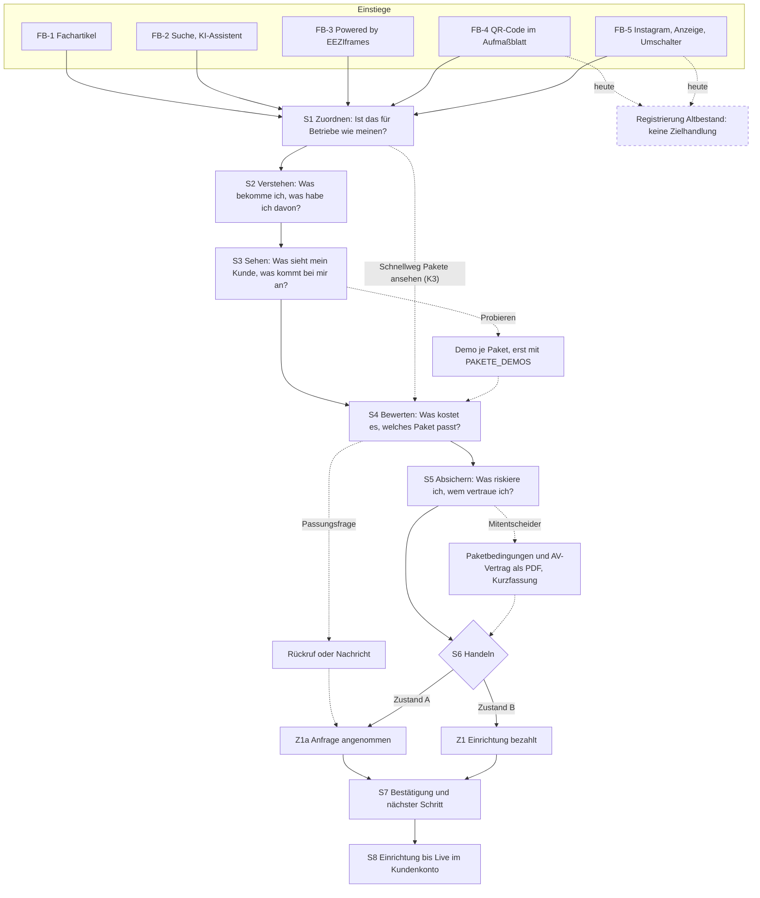
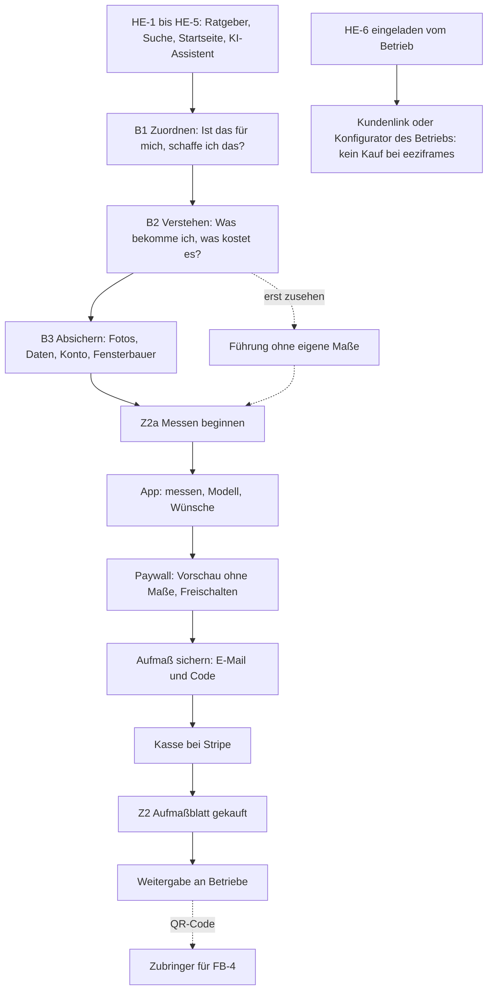

# 4. Customer Decision Architecture

Ergebnis 4 des Website-Blueprints (MASTER-PROMPT V4), Phase D: Reverse Engineering der Kaufentscheidung. Stand 24.10.2026,
Arbeitszweig `claude/design-dna-styleguide`, Commit `c5b4198`. Planungsdokument: Das Repository wurde nur gelesen, nichts wurde gebaut.
Seitenaufbau und Abschnittsfolge legt dieses Dokument nicht fest; das geschieht in Phase E (Informationsarchitektur) und Phase I
(Abschnitts-Spezifikation). Es liefert dafür die Kette der Entscheidungen, die jede Seite tragen muss.

**Grundlage**

| Kürzel | Datei |
|---|---|
| PA | [01-projektanalyse.md](01-projektanalyse.md); „PA-Frage n“ = Frage n in PA 1.11 |
| GM, CP | [bestand/geschaeftsmodell.md](bestand/geschaeftsmodell.md), [bestand/conversion-pfade.md](bestand/conversion-pfade.md) |
| RE | [03-recherche.md](03-recherche.md): Erkenntnisse E1–E19, Regeln R1–R14 (3.5.1), Tests T1–T19 (3.5.2) |
| PAK | [recherche/pakete-und-entscheidung.md](recherche/pakete-und-entscheidung.md): Beobachtungen B1–B8, Hypothesen PAK-H1 bis -H40, Fragen F1–F14 |
| DNA | `docs/design-dna/03-dna-einleitung.md` (Kapitel 5: Konstruktionsformel 5.1, Prinzipien Nr. 1–11 in 5.2, Stellschrauben und Dialekte 5.3, Signature-Effekte 5.4, Abgrenzung 5.5) mit `03-dna-teil-1.md` bis `-3.md` |
| SKILL, DR | `.claude/skills/premium-gestaltung/SKILL.md`, `.claude/skills/premium-gestaltung/designrichtung.md` |
| GEST | `docs/GESTALTUNG.md` |
| VK, PB, AGB, NB | `web/fuer-fensterbauer/index.html` (Verkaufsseite), `web/konfigurator-bedingungen/index.html` (Paketbedingungen mit AV-Vertrag), `web/agb/index.html`, `web/nutzungsbedingungen/index.html` |

**Hinweis zur Design-DNA.** Die im Auftrag genannten Dateien `docs/design-dna/03-design-dna.md`, `04-styleguide.md` und
`05-ergebnis-b-styleguide.md` liegen auf diesem Zweig nicht vor. Kapitel 5 der DNA steht in `03-dna-einleitung.md` mit drei Teilen
(Stand „in Prüfung“, Commit `54aad4b`), `02-vergleich.md` liegt vor. Die Gestaltungsmittel in 4.4 stützen sich deshalb auf die
Prinzipien Nr. 1–11, die Stellschrauben und die Signature-Effekte aus Kapitel 5 sowie auf die Bausteine in DR Abschnitt 4. Tokens und
Bausteine des technischen Styleguides (10.1–10.10) sind nachzutragen, sobald er vorliegt. Die DNA beruht auf Desktop-Standbildern
(0 von 15 Mobilansichten, DNA 5.5); alles zum Telefon ist dort Neuentwurf.

**Kennzeichnungen**

- `Datei:Zeile` ist ein Beleg im Repository. Was keinen Beleg hat, steht als **[Hypothese]** da.
- **Textentwurf** ist neuer Wortlaut, gebildet nur aus belegten Fakten; er braucht die Freigabe des Inhabers.
- **V** heißt verbindliches Gestaltungsmittel (Vorgabe des Inhabers, DNA 5.2, Regel aus RE 3.5.1, Recht oder Prüfsuite).
  **H** heißt Gestaltungshypothese (Test aus RE 3.5.2 oder H-D-Nummer aus 4.7); sie wird erst nach Prüfung zur Regel.
- „Abweichung von bestehender Regel – Freigabe durch den Inhaber nötig“ markiert jeden Vorschlag, der einer Regel in GEST oder DR
  widerspricht. Alle Abweichungen stehen gesammelt in 4.7.2 (AB-1 bis AB-8).
- **O-n** ist ein offener Punkt (4.7.3) mit Verweis auf die Fragen in PA 1.11.

**Methode.** Die Analyse geht von jeder Zielhandlung rückwärts: Was muss unmittelbar davor entschieden sein, und was braucht der
Besucher dafür? Fragen und Zweifel wurden mit simulierten Perspektiven abgeleitet: Inhaber eines kleinen Fensterbaubetriebs, Büro oder
Verkauf im Betrieb, B2B-Vertrieb, Hauseigentümer vor dem Fenstertausch. Das ist eine Analysemethode und keine Nutzerstudie. Im
Repository gibt es keine Nutzerforschung, keine Besucherzahlen, keine Konversionsraten und keine Kundenstimmen (PA, Absatz „Was es
nicht gibt“). Aussagen über Wirkung sind Hypothesen. Wahrscheinlichkeiten oder erwartete Steigerungen werden nicht angegeben.

**Zwei Verkaufszustände.** Die Architektur muss in beiden Zuständen tragen, die der Code schon kennt (`Instanzregeln.verkauf()`,
docs/BESTELLUNG.md:48-57):

| Zustand | Schalter | Abschluss für Pakete | Stand |
|---|---|---|---|
| **A „Vorverkauf“** | `PAKETE_OFFEN` fehlt, oder die Paket-Kasse ist im Live-Modus zu | unverbindliche Anfrage | heute. Die Paketbedingungen sagen: „solange es [offene Stellen] gibt, nehmen wir keine kostenpflichtigen Bestellungen an“ (PB:28) |
| **B „Verkauf offen“** | `PAKETE_OFFEN=1` und `paketVerkaufStand()` vollständig (`functions/api/recht.js:73-85`) | Bestellung mit Zahlung der Einrichtung | Zeitpunkt offen (O-3) |
| unabhängig davon: **Demos** | `PAKETE_DEMOS=1` | – | bis dahin führt „Konfigurator ausprobieren“ in die App für Hauseigentümer (VK:209-210) |

---

## 4.1 Zielhandlungen

### 4.1.1 Übersicht

| Nr. | Zielhandlung | Rang | Wer | „Abschluss“ heißt konkret | Zählt nicht als Abschluss | Stand heute | Beleg |
|---|---|---|---|---|---|---|---|
| **Z1** | Konfigurator-Paket bestellen | **primär** (Zustand B) | Fensterbauer und Fensterhändler, nur Unternehmer nach § 14 BGB | Die Einrichtungsgebühr ist eingegangen. Damit kommt der Vertrag zustande (PB:48), der Status wechselt von `offen` auf `bezahlt` (docs/BESTELLUNG.md, Tabelle „Ablauf“). Bei SEPA erst mit dem Zahlungseingang („Lastschrift unterwegs“, 2 bis 5 Werktage, `web/assets/partner.js:294`) | Klick auf „… bestellen“; begonnenes Bestellformular; unbezahlter Entwurf, obwohl die Statusleiste ihn „Bestellt“ nennt (`web/assets/partner.js:439-451`, PA-Frage 15) | nicht möglich | SKILL:23, :50-51; `functions/api/partner.js:386-412` |
| **Z1+** | zum höheren Paket greifen | Teilziel von Z1 und Z1a | wie Z1 | Paketfeld der Bestellung oder der Anfrage lautet EEZI Essential Plus oder EEZI Signature | „Noch offen“ im Anfrageformular | messbar nur über das Paketfeld | SKILL:50; `functions/pakete-seite.js:177-182` |
| **Z1a** | Paket unverbindlich anfragen | **primär** in Zustand A; in Zustand B Nebenweg „Vorher eine Frage?“ | wie Z1 | `POST /api/partner/frage` wird angenommen: Der Dank „Danke, Ihre Frage ist da …“ ersetzt das Formular, die Mail geht an `MAIL_KONTAKT` (`web/assets/verkauf.js:19-90`; docs/BESTELLUNG.md:59) | Formular geöffnet; Absenden mit Antwort 503, solange die Datenbank fehlt (`functions/api/router.js:85-86`); Treffer im Honigtopf | einziger aktiver Abschluss für Pakete | CP 5.5; docs/BESTELLUNG.md:50-57 |
| **Z2a** | Messen beginnen | **sekundär**, Abschluss der Website | Hauseigentümer ohne Link eines Betriebs | Eintritt in den ersten Messschritt der App (`/app/#ausmessen`); der Trichter der Zentrale zählt ihn als „App geöffnet“ (`web/assets/zentrale.js:326-328`) | Ratgeber gelesen; Führung gestartet (unterstützend) | vorhanden | `web/assets/portal.js:852`; docs/SEO.md:91 |
| **Z2** | Aufmaßblatt kaufen | **sekundär**, Abschluss in der App | wie Z2a | Zahlung bestätigt (`/api/zahlung/pruefen`), die App zeigt „Freigeschaltet.“ (`web/assets/app.js:3363-3380`, `:3473-3510`) | „Freischalten“ getippt; Aufmaß gesichert; Kasse geöffnet | ohne Server Testkauf | AGB:55 § 6; docs/ABRECHNUNG.md:43 |

**Wirtschaftlich** ist Z1 erst mit dem Livegang abgeschlossen. Ab dann läuft das Monatsabo (PB:54); bis zum Beginn der Einrichtung
kann der Betrieb stornieren und bekommt die Einrichtung voll erstattet (PB:70). Für die Website endet Z1 mit der Zahlung, alles danach
gehört zum Kundenkonto (4.3.1, Frage 8). Für Z2 endet die Arbeit der Website mit Z2a; Paywall, Konto und Kasse liegen in der App und
sind nur so weit Gegenstand dieses Dokuments, wie die Website sie vorbereiten muss.

### 4.1.2 Unterstützende Handlungen (keine Ziele für sich)

| Nr. | Handlung | Erfolg heißt | Beleg |
|---|---|---|---|
| U1 | Konfigurator ausprobieren, Live-Demo ansehen | Der Besucher kehrt mit einem Bild davon, was sein Kunde sieht, zur Paketwahl zurück | VK:209-210; Demo-Instanzen docs/INSTANZEN.md:310 |
| U2 | Vergleich der Pakete öffnen | Der Unterschied ist verstanden („wie sehr der Konfigurator Ihre Marke trägt“, VK:236) | VK:182-185 |
| U3 | Paketbedingungen und AV-Vertrag lesen oder als PDF laden | Vertragsfragen sind ohne Gespräch geklärt; das PDF lässt sich weitergeben | VK:188; docs/BESTELLUNG.md:61-67 |
| U4 | Führung starten | Der Hauseigentümer kennt den Ablauf ohne eigene Maße und wechselt über „Eigenes Fenster ausmessen“ zu Z2a | `web/assets/app.js:6302-6539` |
| U5 | Fachartikel oder Ratgeber lesen | Weiterlesen zum nächsten Schritt, zur Verkaufsseite oder in die App | docs/SEO.md:93; VK:251-255 |
| U6 | Aufmaßblatt an Betriebe weitergeben | Das PDF erreicht Fensterbauer; der QR-Code führt sie zu eeziframes | docs/ABRECHNUNG.md:84; `web/assets/blatt.js:226-227` |

### 4.1.3 Service, keine Akquise

Anmelden im Betriebsbereich (Altbestand), Kundenkonto `/partner/` und Dashboard `/betrieb/` (Signature) bleiben erreichbar. Sie
konkurrieren aber nicht mit Z1 oder Z1a um die Hauptaktion. Heute gibt es dafür drei Anmeldungen und drei Oberflächen (CP 5.4).

### 4.1.4 Keine Zielhandlung

- **Registrierung im Altbestand** („Kostenlos starten“, „Die ersten 3 Aufmaße sind frei“; BAUPLAN:657 E28, SKILL:25). Am Telefon ist
  „Starten“ heute die einzige Cream-Pille im Kopf der Ansicht Fensterbauer (`web/assets/portal.js:450`; PA 1.9/4).
- **Projekte bei eeziframes anlegen** im Sinn einer Plattform (SKILL:25).

### 4.1.5 Rangfolge und Spannung zwischen den Zielen

- Z1 und Z1a vor Z2 folgt aus SKILL:23 und der Instagram-Linie (`marketing/highlights/BEITRAGS-LINIE.txt:9`). Eine Rangfolge nennt das
  Repository nicht (PA-Frage 1, O-1).
- Z2 verkauft Hauseigentümern ein Blatt, das sie „an beliebig viele Betriebe“ schicken (`web/index.html:95`). Z1 sagt Betrieben zu:
  „Ihre Kunden bleiben Ihre Kunden“ (VK:159). Die Zusage gilt für den Konfigurator des Betriebs, nicht für den Weg der Hauseigentümer
  auf eeziframes.com (RE 3.3.3, WET-H4). Folgerung für die Architektur: Beide Wege bleiben getrennt. Im Pfad der Fensterbauer erscheint
  kein Element für Hauseigentümer und umgekehrt, abgesehen von je einem leisen Wechsel (4.5). Wie die Seite den Unterschied erklärt,
  ist offen (O-15).
- **Messbarkeit.** Für Z2a und Z2 gibt es den Trichter App geöffnet → Kasse geöffnet → gekauft (`web/assets/zentrale.js:326-328`).
  Für Z1 und Z1a gibt es keinen Trichter; ob die Paketanfrage als Vorgang zählt, ist offen (docs/ZENTRALE.md:27; RE 3.5.4; O-2).

---

## 4.2 Besuchergruppen nach Kenntnisstand und Kaufabsicht

Stufen wie in PA 1.3. Kenntnisstand: **K1** kennt sein Problem, nicht die Lösungsart · **K2** kennt die Lösungsart, nicht eeziframes ·
**K3** kennt das Produkt oder sein Ergebnis. Kaufabsicht: **niedrig** (informiert sich), **mittel** (vergleicht), **hoch** (will
handeln). Belegt sind Einstiege und Suchbegriffe ohne Suchvolumen (docs/SEO.md:28-47). Kenntnis, Absicht und die Spalte „Was er zuerst
wissen will“ sind daraus abgeleitet und damit **[Hypothese]**. Wie groß die Gruppen sind, ist unbekannt.

### 4.2.1 Fensterbauer und Fensterhändler

| ID | Reifegrad | Einstieg | Kenntnis | Absicht | Nächste Zielhandlung | Was er zuerst wissen will [Hypothese] | Beleg und Grenze |
|---|---|---|---|---|---|---|---|
| **FB-1** | Problem ohne Lösungsart: Fachfrage zu Erstaufmaß, falschem Aufmaß, Anfahrtspauschale, geplatztem Termin | Suche → einer der fünf Fachartikel (VK:251-255) | K1 | niedrig | U5, dann Verkaufsseite | „Kann ich Fahrten zum Erstaufmaß sparen, ohne für falsche Maße zu haften?“ | Suchbegriffe belegt (docs/SEO.md:38, :45). Er kommt mit der Brille „Aufmaß“, die Hauptaussage ist aber der Konfigurator (SKILL:23-24) |
| **FB-2** | Lösungsart bekannt: sucht Software, Aufmaß-App oder Konfigurator | Suche, KI-Assistent; `llms.txt` nennt die Pakete mit Preisen | K2 | mittel | Z1a, Z1 | „Was kostet es, und was ist anders als beim Konfigurator des Herstellers oder einem Shop?“ | `functions/pakete-seite.js:272-285`; docs/SEO.md:142. Für „Konfigurator“ gibt es keine erhobenen Suchbegriffe (docs/SEO.md:38, :45) |
| **FB-3** | Produkt im Einsatz gesehen | Link „Powered by EEZIframes“ im Essential-Konfigurator eines anderen Betriebs → `/fuer-fensterbauer/`, neuer Tab | K3 | mittel bis hoch | Z1 | „Was kostet das für mich, und geht es ohne diesen Hinweis?“ | PB:80 § 9 (1); GEST „Startansicht einer Instanz“. Die Gruppe entsteht erst mit live geschalteten Essential-Instanzen; heute gibt es keine Kunden (PA-Frage 11) |
| **FB-4** | Ergebnis in der Hand: hat das Aufmaßblatt eines Kunden bekommen | QR-Code im PDF → `/?von=pdf`, Ansicht Fensterbauer mit Hinweis zum Code | K3 (Ergebnis) | hoch für „Aufmaß übernehmen“, offen für ein Paket | heute Registrierung im Altbestand; künftig Z1a, Z1 (O-4) | „Was mache ich mit diesem Blatt, und bekomme ich solche Anfragen auch unter meinem Namen?“ | `web/assets/blatt.js:226-227`; `web/assets/portal.js:849`. Die Statistik zählt die Herkunft QR-Code (docs/ZENTRALE.md:27) |
| **FB-5** | angestoßen, ohne Kontext | Instagram-Highlights; Anzeigen auf `/?…#fensterbauer` „(dort wird registriert)“; Umschalter der Startseite | unbekannt | unbekannt | S1, S2 der Kette | „Worum geht es hier überhaupt?“ | docs/ZENTRALE.md:83. Die Instagram-Linie lautet noch „Aufmaß ohne Anfahrt“ mit Tarif Start (`marketing/highlights/BEITRAGS-LINIE.txt:7`; PA-Frage 26); Erwartung und Seite passen nicht zusammen |
| **FB-6** | Prüfer kurz vor dem Kauf | hat die Verkaufsseite gelesen; will probieren, vergleichen, Bedingungen lesen, anfragen | K3 | hoch | Z1a, Z1, Z1+ | „Welches Paket, was riskiere ich, wann geht es los?“ | VK:63, :188, :209-210 |
| **FB-7** | Bestandsbetrieb mit Kundenlinks | „Anmelden“ im Betriebsbereich; Frage „Ich nutze eeziframes schon mit Kundenlinks. Ändert sich etwas?“ | K3 | Service; Zusatzkauf möglich („Sie bestellen es zusätzlich, wie ein neuer Kunde“) | Service, ggf. Z1 | „Ändert sich für mich etwas?“ | VK:244; GEST:193. Die Zahl der Bestandsbetriebe steht nicht im Repository |

Nicht belegt: Unterschiede zwischen Fensterbauer und Fensterhändler (PA-Frage 14), Größe der Betriebe und wer dort über Software
entscheidet (PAK F9), Anteil von Telefon und Schreibtisch (GM 4.3). „Mobil zuerst“ ist eine Vorgabe des Inhabers, keine Messung
(SKILL:28).

### 4.2.2 Hauseigentümer

| ID | Situation | Einstieg | Kenntnis | Absicht | Zielhandlung | Beleg |
|---|---|---|---|---|---|---|
| **HE-1** | Problem am Fenster (beschlagen, undicht, Alter) | Suche → Ratgeber „Prüfen“ | K1 | niedrig | U5 | PA 1.3 H1; docs/SEO.md:44, :93 |
| **HE-2** | vor Entscheidung oder Auswahl (tauschen oder reparieren, Kosten, Förderung, Material) | Suche → Ratgeber „Entscheiden“, „Auswählen“ | K1–K2 | niedrig bis mittel | U5, dann Z2a | PA 1.3 H2; docs/SEO.md:37, :41-44 |
| **HE-3** | will messen („fenster ausmessen“, „aufmaß app kostenlos“, „aufmaßblatt fenster pdf“) | Suche → Messanleitung, App | K2 | hoch | **Z2a, Z2** | PA 1.3 H3; docs/SEO.md:34-36, :40 |
| **HE-4** | hat Angebote oder steht vor dem Einbau | Suche → Ratgeber „Vergleichen“, „Einbauen“ | K2 | niedrig für das Aufmaßblatt | U5 | PA 1.3 H4 |
| **HE-5** | direkt, über eine Empfehlung oder einen KI-Assistenten | Startseite, Ratgeber, `llms.txt` | unbekannt | unbekannt | Z2a | PA 1.3 H5, H6; docs/SEO.md:3 |
| **HE-6** | vom Betrieb eingeladen oder im Konfigurator eines Betriebs | `/app/#k-…` oder Domain des Betriebs | K3 | hoch, aber keine Kaufhandlung bei eeziframes | keine; die Website versucht nicht, ihn zu gewinnen (Kundenschutz) | PA 1.3 H7; GEST:139; GEST „Kundenschutz für Fensterbauer“ |

### 4.2.3 Mitentscheider und Mittler

| ID | Wer | Rolle in der Entscheidung | Beleg oder Grundlage | Status |
|---|---|---|---|---|
| **M-1** | Inhaber oder Geschäftsführer, wenn Büro oder Verkauf recherchiert | unterschreibt und zahlt | Das Bestellformular verlangt getrennt einen „Ansprechpartner“ und „wer das Unternehmen vertritt (Inhaber oder Geschäftsführer)“ (`web/assets/instanzregeln.js:216`, `:219`) | im Formular angelegt; dass Recherche und Entscheidung auf zwei Personen fallen, ist Hypothese |
| **M-2** | Mitarbeitende, die mit den Anfragen arbeiten | Empfänger der Anfragen (bis drei Adressen), bei Signature fünf Zugänge zum Dashboard | `web/assets/instanzregeln.js:66`; docs/INSTANZEN.md:184-207 | Nutzer belegt, Mitsprache Hypothese |
| **M-3** | wer die Website des Betriebs pflegt | baut zum Livegang den Knopf „Fenster planen“ ein | VK:239; docs/BESTELLUNG.md (Tabelle „Ablauf“, Schritt Live) | Hypothese; der Konfigurator braucht keine Website (VK:239) |
| **M-4** | Steuerberater, Buchhaltung | prüft netto, Umsatzsteuer, Rechnung, Abo | PB:52, :54; PAK-H31 | Hypothese |
| **M-5** | wer im Betrieb für Datenschutz zuständig ist | prüft AV-Vertrag, Datenstandort, KI | VK:241; PB, Anlage AV-Vertrag | Hypothese |
| **M-6** | Partner oder Mitbewohner des Hauseigentümers | entscheidet über den Fenstertausch mit | – | Hypothese |
| **M-7** | der Fensterbauer des Hauseigentümers | nimmt das Aufmaßblatt an oder misst selbst | Die Startseite sagt, das Aufmaßblatt sei eines, „das jeder Fensterbauer lesen kann“ (`web/index.html:52`); das Feinaufmaß bleibt beim Betrieb (AGB:35 § 2 (4)) | ob Betriebe es annehmen, ist nicht belegt (O-20) |
| Mittler | Suchmaschinen, KI-Assistenten | bestimmen Einstieg und Erwartung | docs/SEO.md:3; `llms.txt` (`functions/seo.js:258-287`) | als Ziel belegt |

### 4.2.4 Folgerungen [Hypothese]

1. Die Kette in 4.4 richtet sich zuerst nach **FB-2 und FB-6**, die Z1 am nächsten stehen, und nach **FB-3 und FB-4**, die Produkt oder
   Ergebnis schon gesehen haben. FB-1 wird über die Fachartikel zugeführt, FB-5 braucht vor allem die Stufen S1 und S2.
2. FB-1 und FB-4 kommen mit der Brille „Aufmaß“. Die Brücke zur Hauptaussage ist nicht „Kunden messen selbst“, sondern der Satz
   „Anfragen, mit denen Sie rechnen können: keine Einzeiler aus dem Kontaktformular, sondern Maße, Fotos und Wünsche je Position, mit
   Klärungsliste“ (VK:80).
3. Mitentscheider brauchen Inhalte, die ohne die Seite funktionieren. Die Paketbedingungen gibt es schon als PDF; eine Kurzfassung der
   Pakete fehlt (RE T12).

---

## 4.3 Rückwärtsanalyse je Zielhandlung

Vier Analysen: Z1 (Bestellung, Zustand B), Z1a (Anfrage, Zustand A), Z1+ (höheres Paket) und Z2a/Z2 (Hauseigentümer). Zweifel tragen
die Nummern des Katalogs in 4.6 (F-nn für Fensterbauer, H-nn für Hauseigentümer).

### 4.3.1 Z1 Paket bestellen (Zustand B)

**1. Entscheidung unmittelbar vor der Handlung.** Die Entscheidung fällt an zwei Orten:

- **Auf der Website:** „Dieses Paket, und ich beginne jetzt die Bestellung.“ Auslöser ist der Knopf „… bestellen“ an der Paketkarte,
  Ziel `/partner/#bestellen/<paket>` (`functions/pakete-seite.js:190-194`).
- **Im Kundenkonto, Schritt 6:** „Ich zahle heute die Einrichtung von 99, 199 oder 279 € netto und gehe ein monatlich kündbares Abo ab
  dem Livegang ein.“ Dazu drei Haken (Unternehmer, Paketbedingungen in der Fassung `PAKET_STAND`, AV-Vertrag) und der Knopf
  „Kostenpflichtig bestellen“ (`web/assets/partner.js:274-300`).
- **Folgerung [Hypothese]:** Die Website muss die zweite Entscheidung vorwegnehmen. Was in Schritt 6 zum ersten Mal auftaucht
  (Bruttobetrag, AV-Vertrag, Impressumsangaben), wirkt wie eine spät aufgedeckte Bedingung (RE E11).

**2. Notwendige Informationen**

| Information | Quelle | Heute auf der Verkaufsseite? |
|---|---|---|
| Was er bekommt: eigener Konfigurator unter seiner Domain, jede Anfrage als Aufmaßblatt-PDF | VK:57, :61 | ja, im Startbild |
| Was in jeder Anfrage steht | VK:123-131 | ja, im fünften Abschnitt |
| Was sein Kunde sieht: nur den Betrieb, keine Preise, keine Werbung, eine Bestätigung und seine Anfrage als PDF | VK:240 | nur in den Häufigen Fragen |
| Monatspreis, Einrichtung, netto, nur Unternehmer, Steuerhinweis | `web/assets/pakete.js:44-60`; VK:188 | ja; der Steuerstatus ist offen (O-6) |
| Was die Einrichtung enthält: Anruf zur Wunschzeit, Anlage, Domain bis 25 € Jahrespreis, Gestaltung nach Paket, Vorschau mit Freigabe | PB:58-64 | nein (PAK B5) |
| Wann gezahlt wird: Einrichtung vorab, Abo ab Livegang | PB:53-54 | ja (VK:188) |
| Bindung: monatlich kündbar, ohne Mindestlaufzeit | PB:69 | nur in den Häufigen Fragen (VK:243) |
| Ausstieg vor dem Livegang: Storno bis zum Beginn der Einrichtung mit voller Erstattung, danach keine | PB:70 | nein |
| Dauer bis Live: meist 3 bis 5 Werktage nach der Zahlung | VK:193 | ja; ob gemessen oder Ziel, ist offen (O-8) |
| Was er bereithalten muss: Firma und Angaben fürs Impressum, Wunsch-Domain oder Namensvorschlag, bis drei Empfängeradressen, bei Plus und Signature Logo, Farben, Fotos, Texte, bei Signature Zugänge | `web/assets/partner.js:161-175`; `web/assets/instanzregeln.js:200-257` | nein |
| Zahlungsarten: Karte oder SEPA-Lastschrift; SEPA verschiebt den Start um 2 bis 5 Werktage | PB:53; `web/assets/partner.js:294` | Karte und SEPA ja (Ablauf), die Verzögerung nein |
| Wem die Domain gehört und was nach dem Vertrag geschieht | PB:65 | nur Verweis „regeln die Paketbedingungen“ (VK:238) |
| Wer für den Datenschutz verantwortlich ist, wo die Daten liegen | VK:241; PB, Anlage | ja, in den Häufigen Fragen |

**3. Zweifel, die die Handlung verhindern.** Drei betreffen den Nutzen: F-08 „Kommen über den Konfigurator überhaupt Anfragen?“ (keine
Antwort im Repository), F-14 „Passt das zu meinem Sortiment?“ (Lücke im Produkt), F-12 „eeziframes verkauft Hauseigentümern selbst ein
Aufmaßblatt“. Die übrigen betreffen das Risiko: F-04 Domain gehört während des Vertrags eeziframes, F-07 Einrichtung ist nach Beginn
nicht erstattbar, F-18 Preisbindung widersprüchlich, F-17 Bedingungen sind ein Entwurf, F-20 Einzelunternehmen in der Pilotphase,
F-21 keine Referenzen, F-29 Verfügbarkeit und Haftung offen.

**4. Vorteile, die verständlich sein müssen.** Reihenfolge nach der Hauptaussage des Inhabers (SKILL:23-24):

1. Eigener Konfigurator unter eigener Domain und Marke, ohne Programmierauftrag, zum festen Preis (VK:57, :61, :75, :77).
2. Anfragen, mit denen der Betrieb rechnen kann: Maße, Fotos, Wünsche und Klärungsliste statt Einzeiler (VK:80, :123-131).
3. Der Kunde bleibt sein Kunde (VK:159-166; PB:84-86).
4. Keine Gebühr je Anfrage; Server, Updates, Sicherheit und neue Funktionen sind dabei (VK:77, :237).
5. In Tagen live, mit Vorschau und Freigabe (VK:192-203).

„Kunden planen selbst“ bleibt Mittel zum Zweck: Es erklärt, wie Vorteil 2 entsteht, und ist nicht selbst die Botschaft.

**5. Unterschiede zwischen den Angeboten**

- **Zwischen den Paketen:** siehe 4.3.3.
- **Gegenüber dem bisherigen Arbeitsweg** (Kontaktformular mit Freitext, Erstaufmaß vor Ort): „Sie kalkulieren aus dem Aufmaß und
  fahren erst zum Feinaufmaß, wenn der Auftrag kommt“ (VK:92). Laut Recherche ist das der eigentliche Gegner, nicht ein anderer Anbieter
  (RE 3.3.2).
- **Gegenüber Herstellerkonfiguratoren und Eigenentwicklung:** „Eigene Konfiguratoren sind zu teuer, die der Hersteller zeigen deren
  Marke. eeziframes ist fertig, unter Ihrer Domain.“ (VK:75). Keine Vergleichsseite gegen benannte Anbieter (RE 3.3.4). Die Preise
  individueller Konfiguratoren aus der Recherche sind Eigenangaben Dritter und gehören nicht auf die Seite (RE 3.3.2).
- **Gegenüber dem Altbestand:** Für neue Betriebe ist er keine Alternative und wird nicht gezeigt (BAUPLAN:657 E28). Für
  Bestandsbetriebe gilt VK:244.
- **Gegenüber kostenlosen Widgets** (Clean Invoice, RE 3.3.5): Die Positionierung ist offen (O-14). Bis dahin trifft die Seite keine
  Vergleichsaussage und nennt „eigene Domain“ nicht als Alleinstellung (RE 3.3.3).

**6. Vertrauensvoraussetzungen**

- **Vorhanden:** Gestaltungsqualität der Seite selbst, die der Inhaber als Messlatte nennt (SKILL:38) und die die Forschung als
  Glaubwürdigkeitsfaktor führt (RE E14); offene Preise; Paketbedingungen und AV-Vertrag als PDF vor dem Kauf; Kundenschutz als
  „Zusage“, bewusst nicht als „Garantie“ (GEST:379); Datenstandort Frankfurt (VK:241); Beispiele als „Beispiel“ gekennzeichnet (VK:55);
  Marktzahlen mit Quellen (VK:259-266).
- **Fehlt oder ist offen:** geprüfte Rechtstexte (PB:28; O-24), Live-Demos (`PAKETE_DEMOS`; O-3), Beispielbilder je Paket (O-12),
  Person und Telefonnummer auf der Verkaufsseite (O-9), Referenzen, nur mit Zustimmung des Betriebs (PB:81; O-21), Zusage zur
  Verfügbarkeit (PB:89; O-24).
- **Technische Startbedingung:** Das Formular darf nie mit 503 und Variablennamen antworten (`functions/api/router.js:85-86`; O-3).

**7. Wann eine Handlungsaufforderung sinnvoll ist**

- **Ab dem ersten Bildschirm:** „Pakete ansehen“ als Weg zu den Preisen, nicht „bestellen“. [Hypothese: Wer die Lösungsart kennt (K2),
  braucht vor einer Bestellung zuerst S2 und S3 der Kette; wer schon entschieden hat (K3), springt.]
- **„… bestellen“ nur an der Paketkarte,** und erst wenn auf demselben Telefon-Bildschirm Monatspreis, Einrichtung und Steuerzeile
  stehen und der Block mit den Risikofakten direkt folgt (R1, R8).
- **Zweite Gelegenheit** nach Kundenschutz und Ablauf: eine kompakte Paketwahl, deren einzige Cream-Pille dem empfohlenen Paket gehört
  (H-D7). Die Seite endet mit einer Handlung statt wie heute mit Quellen und Linkliste (PA 1.9/4).
- **Nicht:** dauerhaft als Cream-Pille im Kopf (der Kopf bleibt Ring, GEST:456), nicht als Einblendung über dem Inhalt, nicht mit
  Frist oder Countdown (R7).

**8. Was später folgen kann.** Mehrere Entscheidungen lassen sich nach dem Kauf treffen und müssen deshalb vor dem Kauf nicht verlangt
werden:

| Entscheidung | Später möglich über | Beleg |
|---|---|---|
| Name der Domain | „Bitte schlagen Sie mir Namen vor.“ im Bestellformular | `web/assets/partner.js:240` |
| Logo, Farben, Fotos, Texte | „Logo reiche ich nach.“; „Was noch fehlt, können Sie bis zur Freigabe nachreichen.“ | `web/assets/partner.js:173`, `:263` |
| Gestaltungswünsche | „Wünsche ergänzen“ in Einrichtung und Domain-Schritt | `web/assets/partner.js:453-470` |
| größeres Paket | jederzeit auf Anfrage, Differenz der Einrichtung | PB:71 |
| Empfänger der Anfragen | im Kundenkonto ändern | `web/assets/partner.js:497-552` |

Inhalte, die nachrangig sein können: vollständiger Vergleich, Wortlaut des AV-Vertrags, Fachartikel, Quellen der Marktzahlen, Häufige
Fragen jenseits der Pflichtfragen der Prüfsuite (PA 1.5, Abschnitt 5).

**9. Was bewusst nicht im Vordergrund stehen soll.** „Kunden messen selbst“ als Hauptaussage (SKILL:24); der Plattform-Gedanke
(SKILL:25); der Altbestand mit „Preise“, „Kostenlos starten“, Tour und Tarifen (BAUPLAN:657 E28); Marktzahlen als Hauptbeleg, denn sie
beschreiben die Branche, nicht das Produkt (PA 1.9/4); KI als Versprechen ohne sichtbaren Beleg (RE 3.3.4); Richtwerte zu
KI-Auswertungen und Anfragen je Tag (gehören in Vergleich und Bedingungen); Technik der Auslieferung außer dem Datenstandort; die
Kennzahlen „0 Zeilen Code“ und „5 Minuten je Fenster“, solange sie nicht geklärt sind (O-10, O-11); drei getrennte Vorbehalte
(„Vorläufige Preise“, „Live-Demos in Kürze“, „Bestellung bald möglich“, VK:174, :209, :220).

**Textentwurf** für den Block vor dem Wechsel ins Kundenkonto (Zustand B, aus `web/assets/partner.js:161-175`,
`web/assets/instanzregeln.js:200-257`):
„Für die Bestellung brauchen Sie: die Angaben Ihres Unternehmens fürs Impressum, eine Wunsch-Domain oder unseren Vorschlag und bis zu
drei E-Mail-Adressen für Ihre Anfragen. Logo und Fotos für Plus und Signature können Sie bis zur Freigabe nachreichen.“

**Textentwurf** für den Risikoblock unter den Karten (nur aus PB:48, :54, :60, :69, :70):
„Der Vertrag beginnt erst mit Ihrer Zahlung. Das Monatsabo läuft erst ab dem Livegang. Vorher sehen Sie Ihren Konfigurator in einer
Vorschau und geben ihn frei. Bis zum Beginn der Einrichtung stornieren Sie mit voller Erstattung, danach wird die Einrichtung nicht
erstattet. Monatlich kündbar, ohne Mindestlaufzeit.“ Darunter der Link „Paketbedingungen mit AV-Vertrag“.

### 4.3.2 Z1a Paket unverbindlich anfragen (Zustand A, heute)

**1. Entscheidung unmittelbar vor der Handlung.** „Ich gebe Namen und E-Mail-Adresse heraus und schreibe eine Frage, ohne mich zu
verpflichten.“ Auslöser ist der Kartenknopf „… anfragen“ (springt zu `#bestellen` und wählt das Paket vor,
`functions/pakete-seite.js:113-115`) oder direkt „Frage senden“. Entschieden wird über Aufwand und Preisgabe von Daten, nicht über Geld.

**2. Notwendige Informationen.** Unverbindlich und kostenlos (VK:220). Wer antwortet und wann: „in der Regel innerhalb eines Werktags“
(VK:220; ob gemessen, ist offen, O-8). Wofür die Angaben genutzt werden: „nur, um Ihnen zu antworten“ mit Link auf `/datenschutz/#pakete`
(CP 5.5). Warum noch nicht bestellt werden kann: Die Bedingungen werden geprüft (PB:28, sinngemäß). Was die Anfrage bringt: eine Antwort
und die Nachricht, „sobald Sie bestellen können“ (VK:220). Dass später der Preis beim Bestellen gilt (VK:174; zum Widerspruch F-18).

**3. Zweifel.** F-32 „Kann ich mit jemandem sprechen?“; „Werde ich danach mit Anrufen verfolgt?“ (Antwort nur: Angaben „nur, um Ihnen
zu antworten“); „Was soll ich schreiben?“ (Pflicht-Freitext mit 3 bis 2.000 Zeichen, CP 5.5); „Wann kann ich bestellen?“ (kein Datum,
O-3); F-18 „Ändert sich der Preis noch?“; F-20 „Antwortet überhaupt jemand?“.

**4. Vorteile, die verständlich sein müssen.** Antwort auf die Frage, welches Paket passt, ohne Kaufdruck; Vormerkung für die Öffnung;
„Noch offen“ als Paket ist erlaubt (`functions/pakete-seite.js:177-182`).

**5. Unterschiede.** Anfrage (unverbindlich, kostenlos) gegenüber Bestellung (Vertrag mit Zahlung). Die bestehende Logik hält das
auseinander: Der Kartenknopf heißt in Zustand A „… anfragen“, in Zustand B „… bestellen“ (`functions/pakete-seite.js:109-131`).

**6. Vertrauensvoraussetzungen.** Ein Formular, das funktioniert; erkennbar, wer antwortet (Person und Firma, O-9); der Satz zum
Datenschutz; kein Haken für Werbung oder Newsletter (gibt es nicht, bleibt so).

**7. Wann eine Handlungsaufforderung sinnvoll ist.** In Zustand A ist der Kartenknopf die Hauptaktion (Cream nur an der empfohlenen
Karte). Das Formular steht direkt nach Paketen und Risikoblock, nicht wie heute nach Ablauf und Live-Demos (VK:215) [Hypothese; AB-3].
„Bestellung bald möglich“ steht als ein Satz am Formular und nicht zusätzlich als Kasten vor den Preisen (AB-4).

**8. Was später folgen kann.** Antwort per Mail; Nachricht zur Öffnung; Bestellung im Kundenkonto. Nicht gebaut ist, dass Angaben aus
der Anfrage in die Bestellung übernommen werden; die Anfrage erscheint nur dann als Nachricht im Kundenkonto, wenn es zu der Adresse
schon eines gibt (docs/BESTELLUNG.md:59). Das wird nicht versprochen.

**9. Was bewusst nicht im Vordergrund stehen soll.** Ein Formular, das wie eine Ersatzkasse Firmenangaben verlangt; jede Form von
Dringlichkeit; drei getrennte Vorbehalte.

### 4.3.3 Z1+ Wahl des höheren Pakets

**1. Entscheidung unmittelbar vor der Handlung.** Merkmale aus `web/assets/pakete.js:42-67`, Differenzen aus PAK 1.1 (eigene Rechnung):

- **Essential → Plus:** „10 € mehr im Monat und 100 € mehr Einrichtung sind mir eigenes Design (Logo, Firmenfarbe, bis zu 6 Fotos,
  eigene Startseite), die Startseite in Suchmaschinen und ein dezenter statt eines deutlichen Hinweises auf eeziframes wert.“
- **Plus → Signature:** „25 € mehr im Monat und 80 € mehr Einrichtung sind mir kein Hinweis auf eeziframes, ein Dashboard mit fünf
  Zugängen, persönliche Einladungslinks, der Fortschritt meiner Kunden und die Aufbewahrung der Anfragen über die Vertragsdauer wert.“

**2. Notwendige Informationen.** Wie der Konfigurator in jedem Paket für seinen Kunden aussieht (Beispielbild; heute Skizzen,
`functions/pakete-seite.js:92-108`). Was „Powered by EEZIframes“ konkret ist: deutlich, verlinkt auf die Seite für Fensterbauer
(PB:80). Was „in Suchmaschinen“ heißt: Essential nein, Plus und Signature die Startseite. Wozu Einladungslinks und Fortschritt dienen:
Der Betrieb lädt Kunden persönlich ein, sieht „eingeladen, in Bearbeitung, eingereicht“ und wird nach drei Tagen an offene Einladungen
erinnert (docs/INSTANZEN.md:184-207). Dass ein Wechsel nach oben jederzeit möglich ist (PB:71).

**3. Zweifel.** F-23 „Welches Paket brauche ich?“ (bei unklarer eigener Präferenz verstärkt sich Überforderung, RE E8); F-24 „Wirbt
eeziframes mit ‚Powered by‘ bei meinen Kunden?“; „Habe ich überhaupt Logo und Fotos?“ (Antwort: „Logo reiche ich nach.“, Rechte nach
PB:59); „Signature verspricht den neutralen Absender nur ‚sobald eingerichtet‘“ (docs/INSTANZEN.md:308; die Zusage bleibt so
eingeschränkt); „Lohnt sich die Startseite in Suchmaschinen?“ (keine Daten).

**4. Vorteile, die verständlich sein müssen.** Bild statt Liste: dieselbe Startseite des Konfigurators in drei Stufen der Marke
(SKILL:121-122; RE T15). Für Signature zusätzlich ein Bild des Dashboards (Material fehlt, O-12).

**5. Unterschiede zwischen den Angeboten.** Nur die Unterschiede, in Gruppen: Ihre Marke · Gefunden werden · Team und Einladungen ·
Daten (PAK-H10, RE T7). Das Gemeinsame steht einmal als Satz.
**Textentwurf** (aus VK:236): „In allen Paketen: Ihre eigene Domain, der volle Konfigurator und jede Anfrage als Aufmaßblatt-PDF per
E-Mail.“

**6. Vertrauensvoraussetzungen.** „Empfohlen“ mit sachlichem Grund statt nach der Position in der Liste (PAK B1; R7); kein
Lockvogelpaket (R7); „Beliebt“ erst mit gezählten Bestellungen (SKILL:49). Welches Paket empfohlen wird, entscheidet der Inhaber (O-5).
**Textentwurf** für den Grund, falls Plus empfohlen bleibt (aus `web/assets/pakete.js:52-57`): „Empfohlen, wenn Ihre Kunden Ihr Logo,
Ihre Farbe und Ihre Fotos sehen sollen und Ihre Startseite in Suchmaschinen erscheinen soll.“

**7. Wann eine Handlungsaufforderung sinnvoll ist.** Cream nur am Knopf der empfohlenen Karte. Am Telefon beginnt die Wischreihe dort,
alle drei Preise stehen ohne Wischen in einer Namensleiste (R9). Für Signature ist ein gleichwertiger Gesprächsweg denkbar (RE T16);
einen Rückruf ohne Konto gibt es aber nicht, also führt er zum Formular mit dem Wunsch „Rückruf“ (H-D14).

**8. Was später folgen kann.** Der Wechsel nach oben im Kundenkonto („Paketwechsel anfragen“, `web/assets/partner.js:497-552`).
[Hypothese, Zielkonflikt:] Der Hinweis darauf nimmt Druck aus der Wahl, kann aber den Anteil höherer Pakete beim ersten Kauf senken; das
steht gegen „zum höheren Paket hinführen“ (SKILL:50). Heute steht er nur in den Häufigen Fragen (VK:243). Ob er an die Karten rückt,
entscheidet der Inhaber (O-26).

**9. Was bewusst nicht im Vordergrund stehen soll.** Die Zeilen App-Symbol, Rahmen der E-Mails, Absender, Originalfotos 14 Tage und die
Richtwerte; sie bleiben im vollständigen Vergleich der Paketbedingungen.

### 4.3.4 Z2a und Z2 Hauseigentümer: Messen beginnen, Aufmaßblatt kaufen

**1. Entscheidung unmittelbar vor der Handlung.**

- **Website (Z2a):** „Ich fange jetzt an; die Zeit ist es mir wert.“ Die Startseite nennt „etwa fünf Minuten je Fenster“
  (`web/index.html:58`); ob das gemessen ist, ist offen (O-11).
- **App, an der Paywall (Z2):** „7,99 € sind mir das fertige Aufmaßblatt wert, und ich sichere dafür mein Aufmaß mit E-Mail und Code.“
  Der Einführungspreis gilt bis 17.11.2026, danach 12,99 € (`web/config.js:12-14`; `web/assets/app.js:3354-3416`). Geht die neue
  Website nach diesem Tag online, gilt 12,99 € (PA 1.2).

**2. Notwendige Informationen.** Messen kostenlos, ohne Konto, ohne App aus dem Store (`web/index.html:61-62`). Was man braucht:
Zollstock, Handy, zwei Fotos je Fenster (`web/index.html:58`). Was herauskommt: je Position Zeichnung mit Maßen, Fotos, Auswertung,
Wünsche und ein Code (AGB:33 § 2 (2)). Der Preis vor dem Aufwand (R13). Kein Bestellmaß, der Fachbetrieb nimmt das Feinaufmaß
(AGB:35 § 2 (4)). Fotos bleiben ohne Konto auf dem Gerät, die KI liest sie nur mit Einwilligung, Server in Frankfurt (`web/index.html:62`,
`:78`). Für den Kauf ist ein Konto mit E-Mail und Code nötig; das zeigt sich heute erst im Kaufablauf (CP 3). Zahlungsarten ohne
SEPA-Lastschrift (AGB:56 § 6 (2)). Über den Link eines Betriebs ist alles kostenlos (AGB:34 § 2 (3)).

**3. Zweifel.** H-01 „Kann ich das als Laie?“; H-05 „Nimmt mein Fensterbauer das an?“; H-04 „Was passiert mit den Fotos meines
Hauses?“; H-03 „Brauche ich ein Konto?“; H-07 „Bekomme ich dann Anrufe von Betrieben?“; H-13 „Brauche ich das, wenn der Fensterbauer
ohnehin misst?“.

**4. Vorteile, die verständlich sein müssen.** Selbst messen, jeder Schritt erklärt (`web/index.html:58`); ein Blatt für beliebig viele
Betriebe (`web/index.html:95`); das eigene Fenster als 3-D-Modell mit Wünschen, „Weiß ich noch nicht“ ist erlaubt
(`web/index.html:60`; README.md:3). Keine Aussage über schnellere oder günstigere Angebote, dafür gibt es keinen Beleg.

**5. Unterschiede zwischen den Angeboten.** Kostenlos (Messen, Fotos, Modell) gegenüber kostenpflichtig (Blatt); eigener Weg gegenüber
dem Link eines Betriebs (0 €); App gegenüber einer Vorlage zum Ausdrucken (die Ratgeber verzichten bewusst auf Vorlagen,
docs/SEO.md:149).

**6. Vertrauensvoraussetzungen.** Ein Satz zu Fotos und Daten im Einstieg (RE T19); Preis mit Datum, ohne Countdown (R13); Führung ohne
eigene Maße (U4); ein Beispiel-Aufmaßblatt als Bild, gekennzeichnet; einheitliche Anrede (O-13).

**7. Wann eine Handlungsaufforderung sinnvoll ist.** „Jetzt ausmessen“ (Cream) und „Führung starten“ (Ring) im ersten Bildschirm
(heute erfüllt). Am Ende jedes Ratgebers mit einheitlichem Ziel `/app/#ausmessen` (heute teils `/app/`, CP 3). Am Ende der Startseite
vor der Karte für Fensterbauer (H-D12). In Ratgebern der Stufe „Prüfen“ leise, weil dort die Absicht niedrig ist (HE-1) [Hypothese].

**8. Was später folgen kann.** Aufmaß sichern, Kauf, Weitergabe an Betriebe; die Ratgeber „Vergleichen“ und „Einbauen“ nach dem Kauf.

**9. Was bewusst nicht im Vordergrund stehen soll.** Die Pakete für Fensterbauer im Messpfad (außer Umschalter und Karte am Ende,
GEST:192); die Pilotleiste; widersprüchliche Zahlen („vier Maße“ gegenüber „8 Maße je Fenster“, `web/assets/portal.js:852`, `:854`;
O-11); Fachsprache des Fensterbaus.

---

## 4.4 Entscheidungsarchitektur als Kette

**Wie die Kette zu lesen ist.** Sie ordnet Fragen, nicht Abschnitte. Besucher springen, und Kaufaufgaben laufen nach der Recherche eher
parallel als nacheinander (PAK 13, Q38). Deshalb muss jede Stufe für sich verständlich und über eine Sprungmarke erreichbar sein; die
h2-IDs der Verkaufsseite bleiben (PA 1.10 Nr. 2). Die Reihenfolge der Abschnitte legt Phase E fest.

### 4.4.1 Schaubild: Fensterbauer

### 4.4.2 Tabelle: Fensterbauer

Ortsangaben am Telefon beziehen sich auf 390 × 844 (Bildschirm n = Bereich y von (n − 1) × 844 bis n × 844), am Schreibtisch auf
1280 × 800. Schriftgrößen nur aus der Skala 13, 15, 17, 24, 40 (Telefon 32) (SKILL:69). Für alle Stufen gelten die elf Prinzipien der
DNA (5.2) als V; die Tabelle nennt, wie sie in der Stufe greifen.

| Stufe | Frage des Besuchers | Antwort, Inhalt (Bestand) | Beleg | Hürde heute | Gestaltungsmittel |
|---|---|---|---|---|---|
| **S0 Ankommen** | „Bin ich da, wo mein Link hinzeigte?“ | Fachartikel, „Powered by“ und `llms.txt` führen auf die Verkaufsseite; der QR-Code führt in die Ansicht Fensterbauer mit Hinweis zum Code | PB:80; `functions/pakete-seite.js:272-285`; `web/assets/portal.js:849` | Anzeigen und Instagram zielen auf `/?…#fensterbauer` mit Kopf des Altbestands (docs/ZENTRALE.md:83; GEST:193); Rechtsseiten verlinken „Für Betriebe“ auf die Ansicht Hauseigentümer (`web/agb/index.html:17`); die App verlinkt „Sie sind Fensterbauer?“ in den Altbestand-Kopf (`web/assets/app.js:2308`) | **V** Ladebudget (R11): erster Telefon-Bildschirm höchstens 300 KB Bilder, LCP ≤ 2,5 s. **V** Textfassung und Preise ohne JavaScript (PA 1.10 Nr. 3, 4). **H** Alle Einstiege für Fensterbauer zeigen auf `/fuer-fensterbauer/` oder eine Ansicht ohne Altbestand-Kopf (AB-2, O-4) |
| **S1 Zuordnen** | „Ist das für Betriebe wie meinen, und worum geht es in einem Satz?“ | Kicker „Für Fensterbauer und Fensterhändler“, h1 „Ihr eigener Fenster-Konfigurator, unter Ihrer Marke“, Haken-Chips | VK:56-58 | Telefon: Foto 390 × 655 px (78 % der Höhe), keine Cream-Pille im ersten Bildschirm, die erste bei y = 949 (PA 1.8); Chip „Kunden planen selbst“ trägt die Nebenaussage (SKILL:24) | **V** Konstruktionsformel (DNA 5.1): Grund #161616 → Foto `fb-sessel` als einziger Fokusträger → Glas-Nachrichten nur über dem Bild (DR:196) → flache, frontale Bedienschicht (DNA Nr. 1, 3, 4). **V** Startbild mit Foto, Meldungen und Haken-Chips bleibt (SKILL:120). **V** Kicker 13 px Technikstimme, h1 32 px in höchstens drei Zeilen, genau ein grünes Wort („Marke“). **V** Cream-Pille „Pakete ansehen“ im ersten Bildschirm, im Daumenbereich ab y ≈ 560 (R12; SKILL:86; Annahme BM). **H** Dafür das Foto auf etwa 60 bis 65 % der Höhe (≈ 510 bis 550 px) kürzen und die Chips in einer Zeile führen, damit die Pille bei y ≈ 700 bis 800 liegt; „Kurz gesagt“ unter die Pille. **V** Der Meldungsstapel endet nach drei Meldungen statt alle 3,4 s neu einzufallen (R2; AB-8). **H** (RE T1) Preissignal als 13-px-Zeile unter der Pille, **Textentwurf**: „Ab 29 € im Monat, netto, plus Einrichtung · vorläufige Preise“. 1280: Text links über fünf Spalten, Foto rechts über sieben, angeschnitten (DR 3.3); Pille im ersten 800-px-Bildschirm (heute erfüllt) |
| **S2 Verstehen** | „Was bekomme ich genau, und warum ist das besser als mein Kontaktformular oder der Konfigurator des Herstellers?“ | „ohne ihn programmieren zu lassen. Jede Anfrage kommt als Aufmaßblatt-PDF“; „Eigene Konfiguratoren sind zu teuer …“; kein Programmierauftrag, fester Monatspreis; „keine Einzeiler aus dem Kontaktformular, sondern Maße, Fotos und Wünsche je Position, mit Klärungsliste“ | VK:61, :75, :77, :80 | Lesetexte mit sieben bis zehn Zeilen (PA 1.8); der Abschnitt „Warum Kunden selbst planen“ trägt die meisten Belege, ist aber Nebenaussage (VK:147-157) | **V** Ein Gedanke je Telefon-Bildschirm; Lesetext 17 px, höchstens drei Zeilen je Block (DR 3.3, DR 6). **V** Maßstabssprung (DNA Nr. 7): Hauptelement (Bild oder 32-px-Überschrift) gegenüber 13-px-Beschriftung, keine Zwischenstufe außer der Überschrift. **H** (RE T14) Gegenüberstellung als ein Bild statt Text: hinten eine Kontaktformular-Nachricht als Einzeiler (**Textentwurf**, als „Beispiel“ gekennzeichnet: „Bitte um Angebot für 3 Fenster“), davor zu etwa zwei Dritteln überdeckend die erste Seite eines Aufmaßblatts; Signature-Effekt „Teilüberdeckung als Vorher-nachher-Vergleich“ (DNA 5.4, Ref 01), einziger Effekt der Stufe. Ruhige Fassung: beide Ebenen stehen übereinander |
| **S3 Sehen** (Produktbeweis) | „Wie sieht das für meinen Kunden aus, und was landet bei mir im Postfach?“ | Ablauf in fünf Schritten vom Knopf auf der Website bis zum Feinaufmaß; Inhalt jeder Anfrage in sieben Punkten; der Kunde sieht nur den Betrieb, keine Preise | VK:85-118, :123-131, :240 | Telefon-Bühne über 3,3 Bildschirme für fünf Sätze (PA 1.8); Strichsymbole statt Material; Beispiele uneinheitlich („Familie Beispiel“ gegenüber „Familie Weber“, VK:111, :133); „Konfigurator ausprobieren“ zeigt die eeziframes-Fassung mit Preis (PAK B7) | **V** Echtes Material statt Symbolen (SKILL:41): Aufmaßblatt `web/bilder/tour-aufmassblatt-{10,15,20}.webp`, Bildschirme des Konfigurators (vor Einsatz neu aufzunehmen, PA 1.7). **V** Mindestens drei Ebenen (DNA Nr. 2): Grund mit Messraster, zum Rand ausgeblendet und kontrastarm (DR Baustein 5; DNA Nr. 11) → Aufmaßblatt als Fokusträger, am Telefon etwa 85 % der Breite (≈ 330 px) → Bestellmaß-Karte als Glas, überdeckt das Blatt teilweise → Beschriftungen 13 px frontal. **V** Ein Beispielbetrieb, eine Beispielfamilie, eine Beispieldomain auf der ganzen Seite, gekennzeichnet (R7; PA-Frage 25). **H** (H-D9) Signature-Effekt nur hier: Explosionsansicht des Aufmaßblatts (DNA 5.4 „Material-Explosionsansicht mit HUD-Annotation“, Ref 10; DR Baustein 6, heute nicht umgesetzt). Die Schichten Maße · Fotos · Klärungsliste lösen sich mit dem Scrollfortschritt des Abschnitts (0 bis 1), jede mit haarfeiner Führungslinie und 13-px-Beschriftung; nur das Motiv bewegt sich. Ruhige Fassung: das auseinandergezogene Endbild. **H** Geräte-Bühne (DR Baustein 8) mit der Startseite des Konfigurators unter einer gekennzeichneten Beispieldomain |
| **S4 Bewerten** (Preis und Paket) | „Was kostet das im Monat und einmalig, und welches Paket passt zu mir?“ | Drei Pakete mit Satz, Preis, Einrichtung und „netto zzgl. MwSt. · nur für Unternehmer“; Leitsatz „Drei Pakete, ein Konfigurator: Sie entscheiden, wie sehr er Ihre Marke trägt.“; Vergleich | VK:171-189, :236; `web/assets/pakete.js:42-99` | Pakete erst auf Telefon-Bildschirm 11 von 21 (y ≈ 8.650) und Schreibtisch-Bildschirm 11 von 18; der Kasten „Vorläufige Preise“ ist größer als die Preise; Signature nur durch Wischen; am Schreibtisch nie Preis und Knopf auf einem Bildschirm (≈ 700 px Abstand); Empfehlung ohne Grund; Vergleich mit 17 Zeilen, eingeklappt; Beispielseiten sind Skizzen (PA 1.8; PAK B1–B5) | **V** (R1) Je Karte Monatspreis 32 px (Telefon; „Zahl als Held“, DR 3.2) mit „im Monat“ 15 px, darunter die Einrichtung 15 px mit einem Satz zu ihrem Inhalt, darunter die Steuerzeile 13 px. **V** (R9) Über der Wischreihe eine Namensleiste aus drei Segmenten je mindestens 44 px hoch, darin Kurzname 13 px und Monatspreis 15 px; Tippen springt zur Karte; die Reihe startet bei der empfohlenen Karte (SKILL:121-122; GEST:452). **V** Einzige Cream-Pille ist der Knopf der empfohlenen Karte, die anderen sind Ring (SKILL:71; GEST:456). **V** Karten frontal, ein Formsystem, ohne Eigenmaterial und ohne Leuchten (DNA Nr. 1, 5, 9, 10); Hervorhebung über 2-px-Rand in Cream und Pille „Empfohlen“; der grüne Schein entfällt (AB-5). **V** Beispielbild je Paket im Browserrahmen, wischt mit (SKILL:121-122); Material fehlt (O-12). **H** Das Beispielbild ist Fokusträger der Karte und nimmt etwa die Hälfte der Kartenhöhe ein. **H** (RE T4) Grund der Empfehlung als 15-px-Zeile über dem Preis. **H** (RE T5) Differenz zum Nachbarpaket. **H** (RE T7) Satz „In allen Paketen …“ über den Karten; Vergleich gruppiert, nur Unterschiede (AB-6). **H** (H-D2) Lage: Pakete spätestens ab Telefon-Bildschirm 5 bis 6, am Schreibtisch ab Bildschirm 4; am Schreibtisch stehen Preis und Knopf jeder Karte in einem 800-px-Bildschirm (Karte ohne aufgeklappte Leistungsliste höchstens ≈ 640 px). 1280: drei Karten nebeneinander, aufsteigend (RE 3.4.3; absteigend nur als Test T6) |
| **S5 Absichern** | „Was riskiere ich, wer steht dahinter, und was, wenn es nicht passt?“ | Risikofakten: Vertrag erst mit Zahlung, Abo ab Livegang, Vorschau und Freigabe, Storno bis zum Beginn der Einrichtung, monatlich kündbar; ehrliche Grenze: danach keine Erstattung. Kundenschutz mit vier Zusagen. Ablauf in sechs Schritten, meist 3 bis 5 Werktage. Bedingungen und AV-Vertrag als PDF. Anbieter Patrick Kies, Herzebrock-Clarholz, Telefon und E-Mail im Impressum | PB:48, :54, :60, :69, :70; VK:159-166, :192-203; PB:84-86; docs/BESTELLUNG.md:61-67; PB:33; `web/impressum/index.html:31-33` | Risikofakten verstreut (PAK B3); „gern auch am Telefon“ ohne Nummer (`functions/pakete-seite.js:194`); Bedingungen sind Entwurf (PB:28); keine Referenzen; Platzhalterbild über eine halbe Bildschirmhöhe im Kundenschutz (PA 1.8) | **V** (R8) Risikoblock direkt unter den Karten: fünf Zeilen à 15 px mit grünem Haken, darunter die Grenze ohne Haken in `--text2`, darunter der Link „Paketbedingungen mit AV-Vertrag“ als 44-px-Ziel (**Textentwurf** in 4.3.1). **V** Kundenschutz-Zusagen im Wortlaut, den die Prüfsuite verlangt (PA 1.10). **V** Ablauf in den Worten der Statusleiste (`web/assets/instanzregeln.js:74-77`). **V** Keine Stimmen, Zähler, Logos, Siegel; Pilotstatus offen (R7; SKILL:49). **H** Ablauf als Maßstab mit sechs Strichmarken und Ziffern 01 bis 06 in der Technikstimme, der aktive Schritt grün (DR Baustein 7; DNA 5.4 „Scroll-Hinweis mit Fortschrittslinie“, statisch belegt in Ref 09, 15); einziger Signature-Effekt der Stufe. **H** (PAK-H33) Person und Firma mit Name, Ort und Telefon in dieser Stufe (O-9). **H** Statt eines Platzhalterbilds kein Bild; der freie Raum zählt zum Negativraum (DNA Nr. 8) |
| **S6 Handeln** | A: „Lohnt es sich, jetzt schon anzufragen, und was passiert dann?“ B: „Bestelle ich jetzt, und was muss ich bereithaben?“ | A: „Die Pakete sind fertig, die Bestellung schalten wir in Kürze frei … Unverbindlich und kostenlos.“; Formular mit sechs Feldern, drei davon Pflicht. B: „Wählen Sie Ihr Paket. Im Kundenkonto geben Sie Ihre Angaben ein, stimmen den Paketbedingungen zu und bezahlen die Einrichtung bei Stripe; die Eingangsbestätigung kommt sofort per E-Mail.“ | VK:220; `functions/pakete-seite.js:177-197` | A: Formular erst nach Ablauf und Live-Demos (VK:215); Freitext ist Pflicht; ohne Datenbank Antwort 503 mit Variablennamen; drei Vorbehalte. B: sechs Schritte, elf Pflichtangaben, Paket doppelt gewählt, eigene Oberfläche (CP 5.4) | **V** Ein Formular als einzige Eingabe der Seite; Felder 52 px, Schrift 17 px, Fehler am Feld, der Dank ersetzt das Formular und bekommt den Fokus (GEST:455). **V** (R10) Feldumrisse mindestens 3:1 (heute ≈ 1,6:1, RE E18). **V** Paket aus der Karte vorgewählt (`functions/pakete-seite.js:113-115`). **V** Eine Cream-Pille: „Frage senden“, solange keine andere im Bildschirm steht. **H** (RE T10) Pflicht nur E-Mail und Paket, Frage freiwillig, Prüfung beim Verlassen des Feldes. **H** (H-D1) In Zustand B vor dem Wechsel ins Kundenkonto der Block „Für die Bestellung brauchen Sie …“ (**Textentwurf** in 4.3.1). **H** (RE T9) Leiser zweiter Weg direkt unter den Paketen: Ring-Knopf, **Textentwurf** „Unsicher, welches Paket passt? Rückruf oder Nachricht“, führt ins Formular mit „Noch offen“. Kein Signature-Effekt; Bewegung nur als Rückmeldung (220 ms, DR 3.5) |
| **S7 Bestätigung** | „Ist es angekommen, wer meldet sich wann, was kann ich vorbereiten?“ | A: „Danke, Ihre Frage ist da. Wir melden uns in der Regel innerhalb eines Werktags.“ B: Danke-Seite „Wir melden uns innerhalb eines Werktags zu Ihrer Wunschzeit“, Statusleiste, Eingangsbestätigung mit beiden PDFs | CP 5.5; `web/assets/partner.js:571-576`; docs/BESTELLUNG.md:19-30 | Statusleiste zeigt „Bestellt“ für einen unbezahlten Entwurf (PA-Frage 15); „innerhalb eines Werktags“ nicht als gemessen belegt (O-8) | **V** `role="status"`, Fokus auf den Dank (PA 1.10 Nr. 14). **V** Kleine Animation (Lottie-Haken) einmal, ruhige Fassung zeigt das Endbild (DR 3.5). **H** (PAK-H38, -H39) Bestätigung mit Zahlen (heute fällig, ab Livegang monatlich, monatlich kündbar), wer sich wann meldet und was der Betrieb vorbereiten kann |
| **S8 Einrichtung bis Live** | „Wo stehe ich?“ | Statusleiste mit sechs Schritten, Rückruf, Vorschau, Freigabe, Knopf „Fenster planen“ | docs/BESTELLUNG.md:19-30 | – | außerhalb der Website; dieselben sechs Wörter wie in S5 (`web/assets/instanzregeln.js:74-77`) |

**Handlungsaufforderung je Zustand.** Knopftexte aus `functions/pakete-seite.js:109-131` und `:190-197`; neue Texte sind gekennzeichnet.

| Ort | Zustand A (heute) | Zustand B | zusätzlich mit Demos |
|---|---|---|---|
| Startbild | Cream „Pakete ansehen“, Ring „Konfigurator ausprobieren“ mit Hinweis auf die Fassung für Hauseigentümer (R14) | gleich | Ring führt zur Demo; **Textentwurf** „Live-Demo ansehen“ |
| empfohlene Karte | Cream „Essential Plus anfragen“ | Cream „Essential Plus bestellen“ | **H** (RE T11) kleiner Link „Demo“ an jeder Karte |
| übrige Karten | Ring „Essential anfragen“, „Signature anfragen“ | Ring „… bestellen“ | wie oben |
| direkt unter den Karten | **H** Ring „Unsicher, welches Paket passt?“ → Formular | gleich, Formular „Vorher eine Frage?“ | gleich |
| Formular | Cream „Frage senden“ | Ring oder Cream, je nachdem, ob eine Bestell-Pille im Bildschirm steht | gleich |
| Seitenende | **H** (H-D7) kompakte Paketwahl, Cream am empfohlenen Paket | gleich | gleich |

### 4.4.3 Schaubild: Hauseigentümer

### 4.4.4 Tabelle: Hauseigentümer

| Stufe | Frage des Besuchers | Antwort, Inhalt (Bestand) | Beleg | Hürde heute | Gestaltungsmittel |
|---|---|---|---|---|---|
| **B1 Zuordnen** | „Ist das für mich, und schaffe ich das?“ | h1 „Fenster ausmessen. Selbst. eezi.“; „Zwei Fotos und die Maße mit dem Zollstock, jeder Schritt erklärt“ | `web/index.html:50`, `:58`; GEST:192 | Telefon: vier Bänder vor dem Foto, das Foto beginnt bei y = 268; dasselbe Ziel steht dreimal auf dem Bildschirm (PA 1.8) | **V** (R12) Startknopf, „kostenlos, ohne Konto“ und Preis in den ersten zwei Bildschirmen. **V** Eine Cream-Pille „Jetzt ausmessen“ im Daumenbereich (heute y = 756 bis 812). **V** Foto `start-hauseigentuemer.webp` als einziger Fokusträger, randlos (GEST:34; DNA Nr. 3, 4). **H** Über dem Foto höchstens ein Band; die Pilotleiste erscheint nur ohne Server (PA, Abgleich) |
| **B2 Verstehen** | „Was bekomme ich am Ende, und was kostet es?“ | Inhalt des Aufmaßblatts; Messen kostenlos, Blatt 7,99 € bis 17.11.2026, danach 12,99 € | AGB:33; `web/index.html:61` | Raster aus Karten mit Strichsymbolen (PA 1.8); „vier Maße“ gegenüber „8 Maße je Fenster“ | **V** (SKILL:41) Echtes Aufmaßblatt und 3-D-Modell statt Symbolen. **V** (R13) Preis außerhalb des Bands, mit Datum, ohne Countdown. **H** (RE T18) Ablauf Foto → Maß → Modell → Blatt als eine Bildfolge, nicht als „Handy zu Briefumschlag“ (SKILL:125); einziger Signature-Effekt im B2C-Pfad: scrollgekoppelt, nur das Motiv bewegt sich, ruhige Fassung als vier Standbilder |
| **B3 Absichern** | „Was passiert mit den Fotos meines Hauses, brauche ich ein Konto, kann mein Fensterbauer damit arbeiten?“ | Eingaben und Fotos bleiben ohne Konto auf dem Gerät; KI nur mit Einwilligung; Server in Frankfurt; kein Bestellmaß, Feinaufmaß beim Betrieb | `web/index.html:62`, `:78`; AGB:35 | Konto-Pflicht für den Kauf zeigt sich erst im Kaufablauf (CP 3); Annahme durch Betriebe nicht belegt | **H** (RE T19) Ein Satz zu Fotos und Daten im Einstieg. **H** (H-D11) „Zum Kauf: E-Mail und Code, kein Passwort“ in derselben Zeile wie der Preis (**Textentwurf**). **V** (R7) Keine Aussage, das Blatt werde von allen Betrieben angenommen |
| **B4 Handeln** (Website) | „Fange ich jetzt an, oder schaue ich erst zu?“ | „Jetzt ausmessen“, „Führung starten“ | `web/assets/portal.js:852` | Ratgeber führen teils auf `/app/` statt `/app/#ausmessen` (CP 3); die Startseite endet mit dem Wechsel zu den Fensterbauern (PA 1.9/4) | **V** Eine Cream-Pille je Bildschirm. **H** Einheitliches Ziel `/app/#ausmessen`. **H** (H-D12) Messaufforderung am Ende der Startseite vor der Karte für Fensterbauer |
| **B5 Kaufen** (App) | „Ist mir das Blatt den Preis wert?“ | Paywall mit verschwommener Vorschau, „Freischalten · 7,99 €“, Konto sichern, Kasse | `web/assets/app.js:3354-3510` | bis zu fünf Stationen, Zustimmung zu den AGB zweimal (CP 3) | **V** Keine Maße vor dem Kauf (PA 1.10 Nr. 11). Hinweis an die Planung der App, nicht Teil dieser Website-Kette |

### 4.4.5 Dosierung der DNA je Stufe

Verbindlich in jeder Stufe (V): die Konstruktionsformel und die elf Prinzipien der DNA (5.1, 5.2), die Ein-Drittel-Regel und drei
Ebenen der Bewegung (DR 3.5), eine ruhige Fassung, in der jeder Ruhezustand als Standbild trägt (SKILL:62; DNA 5.3, Zeile
„Bewegung“), Bewegung nur im Motiv, nie in der Bedienschicht (DNA 5.1 Nr. 7). Variable Merkmale werden je Stufe gewählt. Für die
Signature-Effekte gilt als Dosierungsvorschlag (**H**, H-D10): höchstens einer je Stufe, in den Entscheidungsstufen S4 und S6 keiner,
weil dort jedes zusätzliche Blickziel mit Preis und Knopf konkurriert (RE E2, E3).

| Stufe | Variable Stellschrauben (DNA 5.3), dosiert | Signature-Effekt (DNA 5.4) | Bewegung (Tiefe und Physik, SKILL:43-46) |
|---|---|---|---|
| S1 | Foto als Bühne, kantenlos; Licht mit Quelle im Bild (Erdlicht aus dem Bullauge); transluzente UI nur über dem Foto; Feindetail Maßlinie am Fokusträger | Glas mit Hintergrundunschärfe (Glas-Nachricht, vorhanden) | langsamer Zoom und Tiefe beim Scrollen im Foto (vorhanden, GEST:447); Meldungen fallen ein und enden (R2) |
| S2 | ruhiger Grund, flache Lösung (Dialekt C) | Teilüberdeckung als Vorher-nachher-Vergleich (H) | einmaliger Auftritt der vorderen Ebene, 600 ms (DR 3.5) |
| S3 | Material stark (Papier, Fotos), Messraster als Grund, plastischer Körper | Material-Explosionsansicht mit HUD-Annotation (H) | scrollgekoppelt, Trägheit beim Auseinandergleiten, nur das Motiv |
| S4 | Kartenraster als Ordnungsfigur (DNA 5.3: 6 von 15), Feindetail an Kanten, Beispielbild als Fokusträger je Karte | keiner | Wischen mit Feder, höchstens 3 % Überschwingen, nur wo die Hand führt (DR 3.5); das Beispielbild wischt mit |
| S5 | Haarlinien, Technikstimme, Kacheln für Fakten | Fortschrittslinie als Maßstab (H) | der grüne Strich wächst mit dem Scrollfortschritt; sonst ruhig |
| S6 | flach und ruhig | keiner | nur Rückmeldung |
| S7 | – | keiner | Lottie-Haken einmal |

---

## 4.5 Mehrere Wege zur gleichen Zielhandlung

### 4.5.1 Zu Z1, Z1a und Z1+

| Nr. | Weg | Gruppe | Stationen bis zum Abschluss | Urteil | Begründung, Bedingung |
|---|---|---|---|---|---|
| **W1** | Verkaufsseite von oben | FB-2, FB-6 | `/fuer-fensterbauer/` → S1 bis S5 → Karte → Z1a oder Z1 | **sinnvoll, Hauptweg** | trägt alle Stufen; die Länge von heute rund 19 Telefon-Bildschirmen (PA 1.8) muss deutlich sinken (H-D2) |
| **W2** | Schnellweg „Pakete ansehen“ | FB-3, FB-6, Wiederkehrende | S1 → Sprung zu `#pakete` → S4, S5 → Z | **sinnvoll** | Sprungmarke vorhanden (VK:63). Bedingung: An der Sprungstelle stehen Leitsatz, alle drei Preise, Risikoblock und Knopf zusammen |
| **W3** | Probieren zuerst | FB-6 | S3 → Demo → zurück zu S4 | **sinnvoll ab `PAKETE_DEMOS=1`; heute nur eingeschränkt** | Heute zeigt die App die eeziframes-Fassung mit Paywall zu 7,99 € und Du-Anrede (PAK B7; PA 1.9/4), und der Rückweg „Sie sind Fensterbauer?“ führt in den Altbestand-Kopf (`web/assets/app.js:2308`). Bis zu den Demos bleibt der Weg mit dem Hinweis auf die Fassung für Hauseigentümer (R14), als Ring und nicht als Hauptweg [Hypothese: Öffnen in neuem Tab, damit die Verkaufsseite offen bleibt] |
| **W4** | Gespräch zuerst | FB-6 mit Passungsfrage, M-1 | S4 oder S5 → Rückruf oder Nachricht → Z1a → später Z1 | **sinnvoll als leiser zweiter Weg** | RE E15, T9. Heute gibt es Rückruf nur im Kundenkonto nach Anmeldung (CP 10); die Telefonnummer steht nur im Impressum (O-9) |
| **W5** | Fachartikel → Verkaufsseite | FB-1 | Artikel → S1 → … | **sinnvoll, zum Anfang der Seite** | K1 braucht S1 bis S3; ein Sprung zu `#pakete` überspringt das. Ausnahme [Hypothese]: der Artikel „Fensterbau-Software“ (K2) darf auf `#pakete` zeigen |
| **W6** | Startseite, Umschalter → Ansicht Fensterbauer (eingebettete Verkaufsseite) | FB-5 | `/#fensterbauer` → S1 → … | **sinnvoll nur ohne Altbestand-Kopf** | Heute ist „Kostenlos starten“ bzw. „Starten“ die Cream-Pille im Kopf (`web/assets/portal.js:450`) → AB-2. Die Einbettung muss jedes Element gleich tragen (SKILL:63-64) |
| **W7** | QR-Code im Aufmaßblatt → `?von=pdf` | FB-4 | Hinweis zum Code → heute Registrierung | **heute für Z1 nicht sinnvoll; sinnvoll, wenn der Hinweis zuerst das Übernehmen des Aufmaßes erklärt und danach zu den Paketen führt** | Hängt an der Frage, ob der Altbestand neuen Betrieben angeboten wird (O-4); ebenso der Werbeblock im PDF „3 Projekte kostenlos“ (`web/assets/blatt.js:664`, `:694`) |
| **W8** | „Powered by EEZIframes“ → Verkaufsseite | FB-3 | Link in neuem Tab → S1 → W2 | **sinnvoll** | vertraglich vorgesehen (PB:80). Ob die Statistik diese Herkunft erkennen kann, ist offen; ein Merkmal am Link ist nicht gebaut (O-2) |
| **W9** | KI-Assistent → `llms.txt` → Verkaufsseite | FB-2 | Antwort → S1 oder `#pakete` | **sinnvoll** | Preise in `llms.txt` kommen aus derselben Quelle wie die Seite (PA 1.10 Nr. 7) |
| **W10** | Kundenkonto direkt („Noch kein Paket? Paket wählen und bestellen“) | FB-6 | `/partner/` → sechs Schritte | **in Zustand A nicht sinnvoll**, in Zustand B für Wiederkehrende sinnvoll | In Zustand A erfährt der Besucher erst in Schritt 6, dass nicht bestellt werden kann (CP 5.4, offener Befund 11; `web/assets/partner.js:132`) |
| **W11** | Bestandsbetrieb → Paket zusätzlich | FB-7 | Betriebsbereich → Verkaufsseite → Z1 | **sinnvoll als Nebenweg** | VK:244. Ort: Betriebsbereich, nicht das Startbild der Verkaufsseite [Hypothese] |
| **W12** | Instagram oder Anzeige → `/?…#fensterbauer` | FB-5 | Ansicht Fensterbauer mit Registrierung | **heute nicht sinnvoll** | Ziel „dort wird registriert“ (docs/ZENTRALE.md:83) und Instagram-Linie des Altbestands (PA-Frage 26). Sinnvoll mit Ziel `/fuer-fensterbauer/` und einer Botschaft, die zur Seite passt |

**Ausgeschlossen:** Registrierung im Altbestand, Tour und Tarife als Weg zu den Paketen; ein zweites Formular oder ein Bestellformular
auf der Verkaufsseite (einzige Eingabe, GEST:455; Prüfsuite, PA 1.10 Nr. 5); Einblendungen beim Verlassen, Countdown, künstliche
Knappheit (R7; SKILL:48); Chat-Fenster eines Drittanbieters (keine fremden Server, SKILL:60); „Preise anfragen“ statt offener Preise
(R1).

### 4.5.2 Zu Z2a und Z2

| Nr. | Weg | Urteil | Begründung, Bedingung |
|---|---|---|---|
| **WH1** | Startbild der Startseite → `/app/#ausmessen` | **sinnvoll, Hauptweg** | `web/assets/portal.js:852` |
| **WH2** | Ratgeber → App | **sinnvoll** | Ziel vereinheitlichen (heute `/app/` gegenüber `/app/#ausmessen`, CP 3) |
| **WH3** | Führung → „Eigenes Fenster ausmessen“ | **sinnvoll** für Unsichere (HE-2, HE-5) | `web/assets/app.js:6539` |
| **WH4** | Einführungsband → App | **sinnvoll bis 17.11.2026**, danach verschwindet es von selbst | Der Preis muss zusätzlich statisch stehen (R5, R13) |
| **WH5** | KI-Assistent → Ratgeber oder App | **sinnvoll** | docs/SEO.md:3, :112 |
| **WH6** | Ansicht Fensterbauer → Karte „Ihre eigenen Fenster ausmessen?“ | **sinnvoll als leiser Wechsel** | GEST:193 |

**Ausgeschlossen:** Hauseigentümer aus einem Kundenlink oder dem Konfigurator eines Betriebs zu einem Kauf bei eeziframes führen
(Kundenschutz, GEST:370-379). Ebenso der umgekehrte Weg von heute, auf dem Fensterbauer über „Konfigurator ausprobieren“ in den
Kaufpfad der Hauseigentümer geraten (W3).

---

## 4.6 Zweifel- und Einwandkatalog

Die Zweifel sind mit simulierten Perspektiven abgeleitet und damit Hypothesen; die Antworten stammen ausschließlich aus dem Repository.
**Stand:** beantwortet · teilweise (Antwort vorhanden, aber unvollständig, widersprüchlich oder ein Entwurf) · offen (keine Antwort;
die Seite gibt dann keine Zusicherung). **Stufe** nennt, wo die Antwort stehen muss.

### 4.6.1 Fensterbauer und Fensterhändler

| Nr. | Zweifel oder Einwand | Stufe | Antwort aus dem Repository | Beleg | Stand |
|---|---|---|---|---|---|
| F-01 | „Noch eine Software, die ich bedienen muss?“ | S2 | Der Konfigurator ist für die Kunden; der Betrieb bekommt jede Anfrage als E-Mail mit PDF. Kein Programmierauftrag; Server, Updates, Sicherheit und neue Funktionen sind dabei | VK:61, :77; PB:38 § 2 (1) | beantwortet |
| F-02 | „Brauche ich eine Website oder meinen Webdesigner?“ | S2, S5 | „Nein. Ihr Konfigurator ist selbst eine Seite unter Ihrer Domain.“ Mit Website gibt es zum Livegang einen Knopf „Fenster planen“ zum Einfügen | VK:239 | beantwortet |
| F-03 | „Ich habe schon eine Domain. Kann ich die nehmen?“ | S5 | „Eine Domain, die Ihnen schon gehört, binden wir nur nach Absprache an.“ Subdomain beim Betrieb und Einbettung per iframe sind nicht gebaut | PB:66 § 6 (3); docs/INSTANZEN.md:366-368 | teilweise |
| F-04 | „Gehört mir die Domain?“ | S5 | Während des Vertrags ist eeziframes Inhaber; nach dem Ende hält eeziframes sie zwölf Monate und überträgt sie auf Wunsch gegen eine Pauschale, deren Betrag offen ist | PB:65 § 6 (2) | teilweise (O-24) |
| F-05 | „Gibt es versteckte Kosten?“ | S4 | Einrichtung und Monatspreis; keine Gebühr je Anfrage, keine Kosten für Programmierung, Server oder Pflege; Domain bis 25 € Jahrespreis enthalten, teurere nach Absprache | VK:237; PB:64 § 6 (1) | teilweise: Übertragungspauschale und Umsatzsteuer offen (O-6, O-24) |
| F-06 | „Wie lange bin ich gebunden?“ | S4, S5 | Unbestimmte Zeit, beidseitig kündbar zum Ende des laufenden Abrechnungsmonats, ohne Mindestlaufzeit | PB:69 § 7 (1) | beantwortet; Wortlaut „Monatsende“ (VK:243) weicht ab (O-7) |
| F-07 | „Was, wenn mir die Vorschau nicht gefällt?“ | S5 | Live erst mit Freigabe oder nach Absprache; Änderungswünsche möglich. Storno mit voller Erstattung bis zum Beginn der Einrichtung, danach keine Erstattung | PB:60 § 5 (3); PB:70 § 7 (2) | teilweise: Erstattung bei Nichtfreigabe offen (O-16) |
| F-08 | „Kommen über den Konfigurator überhaupt Anfragen? Lohnt sich das?“ | S2 | Keine Zahlen im Repository. Belegt ist nur, was der Betrieb tun kann: den Link teilen, „wo Ihre Kunden Sie finden: in der E-Mail-Signatur, bei Google, in sozialen Netzwerken oder auf dem Firmenwagen“; bei Plus und Signature ist die Startseite in Suchmaschinen. eeziframes vermittelt keine Kunden | VK:239; `web/assets/pakete.js:42-67`; PB:85 § 10 (2); SKILL:25 | offen. Die Seite verspricht keine Anfragen. **Textentwurf** zur Erwartung: „Ihr Konfigurator ist Ihr Werkzeug: Wir vermitteln keine Kunden. Den Link teilen Sie dort, wo Ihre Kunden Sie finden.“ (H-D4) |
| F-09 | „Kunden messen falsch, und dann hafte ich?“ | S3 | „Die Maße im Aufmaßblatt sind Angaben Ihrer Kunden; vor der Fertigung messen Sie selbst nach (Feinaufmaß).“ Für das erste Angebot genügt das Kundenaufmaß; es zählt das kleinste von drei Maßen | PB:44 § 2 (4); VK:245; Fachartikel „Falsches Aufmaß“ (VK:251-255) | beantwortet |
| F-10 | „Sehen meine Kunden Preise, Werbung oder andere Betriebe?“ | S3, S5 | „Ihr Konfigurator zeigt Ihren Kunden nur Ihren Betrieb: keine anderen Betriebe, keine Werbung, keine Preise von uns.“ | PB:84 § 10 (1); VK:240 | beantwortet |
| F-11 | „Verkauft ihr meine Anfragen, sprecht ihr meine Kunden an?“ | S5 | „Wir sprechen Ihre Kunden nicht an, verkaufen keine Anfragen und geben ihre Daten an niemanden weiter, außer an die Unterauftragnehmer aus der Anlage.“ Für eigene Zwecke nur Summen ohne Personenbezug | PB:85-86 § 10 (2), (3) | beantwortet |
| F-12 | „eeziframes verkauft Hauseigentümern selbst ein Aufmaßblatt für beliebig viele Betriebe. Arbeitet ihr gegen mich?“ | S5 | Die Zusage gilt für den Konfigurator des Betriebs. Gegenüber Hauseigentümern: „Wir verkaufen keine Fenster, vermitteln keine Aufträge und messen nicht selbst.“ | VK:159; AGB:35 § 2 (4); `web/index.html:95` | teilweise; Darstellung offen (O-15) |
| F-13 | „Mein Kunde nimmt seine Anfrage als PDF und holt woanders Angebote.“ | S5 | Der Endkunde bekommt nach dem Senden „Meine Anfrage als PDF“; das ist so entschieden, damit er etwas in der Hand hat. Was er außerhalb tut, entscheidet er selbst (Grundsatz aus dem Kundenschutz) | VK:240; BAUPLAN:636 E7; GEST:379 | teilweise; ob und wie die Seite das anspricht, ist offen (O-18) |
| F-14 | „Mein Kunde wählt Dinge, die ich nicht anbiete. Passt das zu meinem Sortiment?“ | S3, S4 | Sortiment und Vorbelegung je Konfigurator sind nicht gebaut (Rang 1 der Ausbauliste) und dürfen nicht als Leistung erscheinen. Vorhanden: Klärungsliste und „Weiß ich noch nicht“; Haustür und Dachfenster sind nicht enthalten | BAUPLAN:717; RE R14; VK:130; docs/SEO.md:47 | offen (O-17) |
| F-15 | „Was steht in einer Anfrage, reicht das fürs Angebot?“ | S3 | Maueröffnung mit drei Breiten und drei Höhen, Fensterelement, Fotos und Einbausituation, Teilung und Öffnung, Material, Farbe, Glas, Sonnenschutz und Montage, Klärungsliste | VK:123-131; VK:245 | beantwortet |
| F-16 | „Wer ist für den Datenschutz verantwortlich, wo liegen die Daten, was macht die KI?“ | S5 | Für die Anfragen ist der Betrieb verantwortlich, eeziframes verarbeitet im Auftrag; AV-Vertrag mit der Bestellung; Daten bei Supabase in Frankfurt; Unterauftragnehmer Cloudflare, Supabase, Resend, Anthropic; KI liest Fotos nur mit Einwilligung des Kunden | VK:241; PB:149-152; `web/assets/gemeinsam.js:36-75` | teilweise: AV-Vertrag ist Entwurf (PB:28) |
| F-17 | „Die Bedingungen sind ein Entwurf. Kann ich überhaupt schon kaufen?“ | S6 | Nein: Solange offene Stellen bestehen, werden keine kostenpflichtigen Bestellungen angenommen; heute ist die Anfrage der Weg | PB:28; docs/BESTELLUNG.md:50-57 | beantwortet; Zeitpunkt offen (O-3) |
| F-18 | „Die Preise sind vorläufig. Zahle ich später mehr?“ | S4 | Seite: „es gilt der Preis, den Sie beim Bestellen sehen, und er bleibt für Ihren Vertrag fest“. Bedingungen: Preisänderungen mit mindestens sechs Wochen Ankündigung und Kündigungsrecht | VK:174; PB:55 § 4 (4) | offen: Widerspruch (O-7) |
| F-19 | „Wie viel Arbeit habe ich mit der Einrichtung, wie lange dauert es?“ | S5 | Rückruf zur Wunschzeit, eeziframes legt an und gestaltet; der Betrieb liefert Angaben fürs Impressum, Rechte an Logo und Fotos, Freigabe der Vorschau. Meist 3 bis 5 Werktage nach der Zahlung | PB:58-60 § 5; VK:193, :242 | teilweise: ob gemessen, offen (O-8) |
| F-20 | „Wer steckt dahinter? Gibt es euch in einem Jahr noch?“ | S5 | Anbieter ist Patrick Kies, Herzebrock-Clarholz; E-Mail und Telefon im Impressum. Pilotphase. Nach Vertragsende: Domain zwölf Monate gehalten, Daten 30 Tage, Export bei Signature | PB:33 § 1; `web/impressum/index.html:31-33`; README.md:5; PB:65, :77 | teilweise; eine Zusage zum Fortbestand gibt es nicht und wird nicht erfunden |
| F-21 | „Gibt es Referenzen?“ | S5 | Nein. Referenzen nur mit Zustimmung des Betriebs | PB:81 § 9 (2); SKILL:49 | offen (O-21) |
| F-22 | „Kann ich das vorher ausprobieren?“ | S3 | Demos je Paket sind vorbereitet, aber nicht freigeschaltet. Bis dahin die App für Hauseigentümer, ohne Konto, mit dem Hinweis, dass sie unter der Domain des Betriebs seinen Namen trägt und keine Preise zeigt | VK:209-210; docs/INSTANZEN.md:310 | teilweise (O-3) |
| F-23 | „Welches Paket brauche ich?“ | S4 | „Sie unterscheiden sich darin, wie sehr der Konfigurator Ihre Marke trägt, und Signature hat zusätzlich ein Dashboard mit persönlichen Einladungslinks.“ Plus ist „Empfohlen“, ohne Grund | VK:236; `functions/pakete-seite.js:32-33` | teilweise (O-5) |
| F-24 | „Macht ihr mit ‚Powered by‘ Werbung bei meinen Kunden?“ | S4 | Bei Essential ist der Hinweis deutlich und verlinkt auf die Seite für Fensterbauer, nicht auf das Angebot für Hauseigentümer; bei Plus dezent im Fuß, bei Signature keiner. Sonst keine Werbung | PB:80 § 9 (1); PB:84 § 10 (1); GEST „Startansicht einer Instanz“ | teilweise: Schreibweise offen (PA-Frage 22) |
| F-25 | „Kann ich später wechseln?“ | S4 | Nach oben jederzeit auf Anfrage gegen die Differenz der Einrichtungsgebühren, nach unten ab dem nächsten Abrechnungsmonat | PB:71 § 7 (3) | teilweise: „Fällig wird“ gegenüber „auf Wunsch“ (docs/BESTELLUNG.md:41; O-7) |
| F-26 | „Wie viele Anfragen und KI-Auswertungen sind drin?“ | S4 (Vergleich) | Richtwerte: Anfragen am Tag 50, 50, 100; KI-Auswertungen im Monat 600, 1.000, 2.000; Begrenzung erst ab dem Vierfachen bzw. Doppelten | `web/assets/pakete.js:42-67`; GM 3.2 | beantwortet |
| F-27 | „Was passiert, wenn eine Abbuchung fehlschlägt?“ | S5 (Bedingungen) | Erneuter Versuch; nach 14 Tagen Pause, nach 60 Tagen Pause endet der Vertrag. Die Fristen sind Vorschläge bis zur Antwort des Inhabers | PB:75, :77 § 8; `web/assets/instanzregeln.js:8`, `:59` | teilweise |
| F-28 | „Was passiert mit meinen Daten nach der Kündigung?“ | S5 | 30 Tage nach Vertragsende werden alle Daten gelöscht, bis dahin Export mit Signature; Anfragen bei Essential und Plus 30 Tage nach Zustellung | PB:77 § 8 (3); PB:169 | beantwortet |
| F-29 | „Was, wenn der Konfigurator ausfällt? Wer haftet?“ | S5 (Bedingungen) | Verfügbarkeitszusage und Haftungshöchstbetrag sind Platzhalter | PB:89 § 11 (1); PB:94 | offen (O-24) |
| F-30 | „Netto oder brutto, und bekomme ich eine ordentliche Rechnung?“ | S4 | Netto zuzüglich gesetzlicher Umsatzsteuer laut Bedingungen; Nutzungsbedingungen nennen die Kleinunternehmerregelung; `MWST` ist nicht gesetzt. Rechnungen per E-Mail und im Kundenkonto | PB:52, :54 § 4; NB:48; `functions/api/recht.js:58` | offen (O-6) |
| F-31 | „Ich nutze eeziframes schon mit Kundenlinks. Ändert sich etwas?“ | Service | „Nein. Ihr Konto, Ihre Kundenlinks und Ihre Abrechnung laufen weiter wie bisher.“ Ein Paket wird zusätzlich bestellt | VK:244 | beantwortet |
| F-32 | „Kann ich mit jemandem sprechen?“ | S4, S6 | Rückruf zur Wunschzeit im Kundenkonto nach Anmeldung bzw. nach der Zahlung; Frageformular ohne Konto; Telefonnummer nur im Impressum. Die Seite sagt „gern auch am Telefon“, nennt aber keine Nummer | CP 10; `functions/pakete-seite.js:194`; `web/impressum/index.html:33` | teilweise (O-9) |
| F-33 | „Passt das auch für einen Händler ohne eigene Montage?“ | S1 | Der Kicker nennt „Fensterbauer und Fensterhändler“; Unterschiede sind nicht beschrieben | VK:56 | offen (O-22) |
| F-34 | „Kommen meine Kunden damit zurecht, auch am Handy?“ | S3 | Handy, Tablet oder Computer, ohne Installation und ohne Konto; Führung; Planungstiefe nach Wunsch | `web/index.html:76-77`; GEST:169-176 | teilweise: keine Daten zur Bedienbarkeit |
| F-35 | „Können Mitarbeitende mit eigenen Zugängen arbeiten?“ | S4 | Signature: fünf Zugänge zum Dashboard; Selbstverwaltung durch Mitarbeitende ist nicht gebaut | docs/INSTANZEN.md:184-207, :366-368 | teilweise |
| F-36 | „Stimmen ‚0 Zeilen Code‘ und ‚5 Minuten je Fenster‘?“ | S1 (Leiste) | „0 Zeilen Code“ steht neben dem HTML-Schnipsel zum Livegang; „5 Minuten“ ist nicht gemessen, die Führung spricht von zwei Minuten | VK:70; `web/assets/partner.js:531`; PA 1.9/4 | offen (O-10, O-11) |

### 4.6.2 Hauseigentümer

| Nr. | Zweifel oder Einwand | Stufe | Antwort aus dem Repository | Beleg | Stand |
|---|---|---|---|---|---|
| H-01 | „Kann ich das als Laie richtig messen?“ | B1 | „Ja, fürs Angebot“: Maueröffnung mit dem Zollstock an je drei Stellen, das kleinste Maß zählt, jeder Schritt erklärt; Führung ohne eigene Maße | `web/index.html:58-59`, `:93`; `web/assets/app.js:6302-6539` | beantwortet |
| H-02 | „Was kostet das?“ | B2 | Messen, Fotos und 3-D-Modell kostenlos; Aufmaßblatt 7,99 € bis 17.11.2026, danach 12,99 €; über den Link eines Betriebs 0 € | `web/index.html:61`; AGB:34, :55 | beantwortet |
| H-03 | „Brauche ich ein Konto oder eine App?“ | B3 | Kein Konto zum Messen, keine App aus dem Store; zum Kauf ein Konto mit E-Mail und Code, ohne Passwort | `web/index.html:62`; CP 3 | teilweise: Konto-Pflicht wird spät genannt (O-19) |
| H-04 | „Was passiert mit den Fotos meines Hauses?“ | B3 | Ohne Link und Konto bleiben Eingaben und Fotos auf dem Gerät; Server in Frankfurt; KI nur mit Einwilligung; keine Inhalte von Drittanbietern | `web/index.html:62`, `:78` | beantwortet |
| H-05 | „Nimmt mein Fensterbauer das Aufmaßblatt an?“ | B3 | Die Seite nennt es ein Blatt, „das jeder Fensterbauer lesen kann“; der Fachbetrieb nimmt vor der Fertigung das Feinaufmaß | `web/index.html:52`; AGB:35 | offen: Annahme nicht belegt (O-20) |
| H-06 | „Ist das mein Bestellmaß?“ | B2 | Nein: „Grundlage für Angebote, kein Bestellmaß“ | AGB:35 § 2 (4) | beantwortet |
| H-07 | „Bekomme ich danach Anrufe oder Werbung?“ | B3 | eeziframes vermittelt keine Aufträge; die Angaben „Fürs Angebot“ sind freiwillig und gehen nur mit, wenn der Hauseigentümer das Blatt weitergibt | AGB:35; `web/assets/app.js:3264-3270` | teilweise |
| H-08 | „Kann ich nach dem Kauf noch ändern?“ | B5 | Höchstens vier gespeicherte Änderungen je Fenster nach dem Kauf, höchstens 50 Fenster je Aufmaß; die App zeigt das vorher | AGB:45 § 4 | beantwortet |
| H-09 | „Kann ich widerrufen?“ | B5 | Das Widerrufsrecht erlischt mit der Zustimmung an der Kasse und der Bestätigung per E-Mail | AGB:23, :77 | beantwortet |
| H-10 | „Wie kann ich zahlen?“ | B5 | Karte, Apple Pay, Google Pay, PayPal je nach Kasse; keine SEPA-Lastschrift | AGB:56 § 6 (2) | beantwortet |
| H-11 | „Geht das auch für Haustür oder Dachfenster?“ | B2 | Nein, nicht in der App | docs/SEO.md:47 | beantwortet |
| H-12 | „Wen frage ich, wenn ich nicht weiterkomme?“ | B4 | Kein Kontaktweg außer dem Impressum | CP 10 | offen (O-19) |
| H-13 | „Brauche ich das, wenn der Fensterbauer ohnehin misst?“ | B2 | Belegt ist nur: ein Blatt als PDF für beliebig viele Betriebe; das Feinaufmaß bleibt beim Betrieb. Eine vergleichende Aussage gibt es nicht | `web/index.html:95`; AGB:35 | offen; keine Nutzenbehauptung ohne Beleg |

### 4.6.3 Regeln für Antworten

- **V** Antworten im Wortlaut der Bedingungen, „Zusage“ statt „Garantie“ (GEST:379). Was offen ist, bleibt ohne Zusicherung; es entsteht
  keine neue Garantie (R8).
- **V** Die Häufigen Fragen behalten die Pflichtfragen der Prüfsuite zu Domain, Kündigung, Datenschutz, Kunde und Website, und das
  JSON-LD bleibt wortgleich mit der sichtbaren Fassung (PA 1.10).
- **H** Jede Antwort steht dort, wo der Zweifel entsteht (Spalte „Stufe“); die Häufigen Fragen sammeln, sie ersetzen das nicht.
- **H** Zu F-08 und F-13 spricht die Seite die Erwartung offen an statt sie zu verschweigen (H-D4); der Wortlaut braucht die Freigabe
  des Inhabers.

---

## 4.7 Hypothesen und offene Fragen

### 4.7.1 Hypothesen dieser Phase

Prüfwege, die heute möglich sind: Gespräche und Lesetests mit Fensterbauern, Bildschirmzählung bei 390 × 844, das Paketfeld im
Anfrageformular, Bestellungen je Paket in der Zentrale, Trichter für Hauseigentümer. Vergleichstests sind nicht eingerichtet (RE 3.1).

| Nr. | Hypothese | Grundlage | Gegenrisiko | Prüfweg |
|---|---|---|---|---|
| H-D1 | Ein Block „Für die Bestellung brauchen Sie …“ auf der Website senkt Abbrüche im sechsstufigen Bestellformular | 4.3.1; RE E11, E17 | längere Seite vor dem Knopf | Abbrüche je Schritt im Kundenkonto nach `PAKETE_OFFEN` (RE T13) |
| H-D2 | Die Stufen S1 bis S5 passen am Telefon in deutlich weniger als 19 Bildschirme; die Pakete stehen spätestens ab Bildschirm 5 bis 6 | RE E1; PA 1.8 | weniger Erklärung für FB-1 | Bildschirmzählung; Erreichen von `#pakete` (Erfassung fehlt, O-2) |
| H-D3 | Produktbeweis (Aufmaßblatt, Konfigurator unter Beispieldomain) überzeugt stärker als Marktzahlen | RE E3, T14 | ohne Kundenstimmen bleibt jeder Beleg eine Selbstaussage | Gespräche: Hauptaussage in eigenen Worten |
| H-D4 | Die offene Erwartung „Werkzeug, keine Kundenvermittlung“ beugt Fehlkäufen und Reue vor | RE E12 (Reue nach Softwarekäufen), E14 | kann Anfragen senken | Gespräche; Rückfragen nach dem Kauf |
| H-D5 | Sichtbar zu machen, was sich nachreichen lässt (Domain-Vorschlag, Logo, Fotos), senkt die Entscheidungslast vor dem Kauf | RE E8; E19 (Startlösungen) | wirkt beliebig, wenn es zu viel wird | Gespräche; Anteil Bestellungen mit „Logo reiche ich nach.“ |
| H-D6 | FB-4 hat den stärksten Beleg in der Hand; ein Weg vom QR-Code über das Übernehmen des Aufmaßes zu den Paketen führt eher zu Z1a als die Registrierung | 4.2.1; W7 | hängt an O-4; Bestandsbetriebe brauchen den Code-Weg | Herkunft „QR-Code“ in der Statistik und Anfragen danach |
| H-D7 | Eine kompakte Paketwahl am Seitenende fängt Besucher auf, die nach S5 entschieden haben | 4.3.1 Frage 7 | Wiederholung | Gespräche; Anteil Anfragen mit vorgewähltem Paket |
| H-D8 | Das mitwischende Beispielbild erklärt die Paketunterschiede schneller als die Tabelle | SKILL:121-122; RE T7, T15 | Material fehlt (O-12) | Lesetest „Was bekomme ich mit Plus zusätzlich?“ |
| H-D9 | Die Explosionsansicht des Aufmaßblatts macht „Was in jeder Anfrage steht“ ohne Liste verständlich | RE E6 (Animation, die den Gegenstand zeigt; Lernkontext); DNA 5.4 | Ladezeit (RE E16), Ablenkung | Lesetest: Inhalt einer Anfrage nennen; Messung LCP und INP |
| H-D10 | Keine Signature-Effekte in S4 und S6 halten die Entscheidungsflächen ruhig | RE E2, E3 | Seite wirkt dort schlichter als die Messlatte des Inhabers (SKILL:38) | Sichtprüfung mit dem Inhaber |
| H-D11 | Wer früh liest, dass der Kauf ein Konto mit E-Mail und Code braucht, bricht seltener an der Kasse ab | CP 3; RE E11 | weniger Starts | Trichter App geöffnet → Kasse → gekauft vorher und nachher |
| H-D12 | Eine Messaufforderung am Ende der Startseite führt mehr Hauseigentümer in die App als das heutige Ende mit dem Wechsel zu den Fensterbauern | PA 1.9/4 | – | Trichter |
| H-D13 | Eine weiterreichbare Kurzfassung der Pakete hilft Betrieben mit Mitentscheidern (M-1, M-4, M-5) | 4.2.3; RE T12 | Kaufgruppe bei Fensterbauern unbekannt | Abrufe; Gespräche |
| H-D14 | Ein leiser Gesprächsweg unter den Paketen, bei Signature mit dem Wunsch „Rückruf“, nimmt Passungsfragen auf, ohne Bestellungen zu verdrängen | RE E15, T9, T16 | Rückruf ohne Konto nicht gebaut | Anteil Anfragen mit „Noch offen“; Verhältnis Anfragen zu Bestellungen |
| H-D15 | Ein Preissignal im ersten oder zweiten Telefon-Bildschirm führt mehr Besucher zu den Paketen | RE T1 | „vorläufig“ neben dem ersten Preis | vorher und nachher: Anfragen je Aufruf von `/fuer-fensterbauer/` |

### 4.7.2 Abweichungen von bestehenden Regeln

Jede Zeile: **Abweichung von bestehender Regel – Freigabe durch den Inhaber nötig.**

| Nr. | Bestehende Regel | Vorschlag | Begründung |
|---|---|---|---|
| AB-1 | Ohne Anker und ohne frühere Wahl öffnet die Startseite die Ansicht „Hauseigentümer“ (GEST:191; `web/assets/portal.js:398`) | Für diese Phase **keine** Abweichung: Die Regel bleibt, alle Einstiege für Fensterbauer zeigen auf `/fuer-fensterbauer/`. Nur falls der Inhaber die Startseite stärker für Fensterbauer öffnen will (O-23): ein erster Bildschirm mit zwei Wegen, davon einer als Cream-Pille und einer als Ring | Fensterbauer sind die Hauptzielgruppe, die Standardansicht trifft aber nur Besucher ohne Anker (H5, F5 in PA 1.3); Anteile sind unbekannt |
| AB-2 | Kopfzeile der Ansicht Fensterbauer: „Preise“, „Anmelden“, „Kostenlos starten“ (am Telefon „Starten“) (GEST:193) | Ring-Knopf „Pakete ansehen“; „Anmelden“ als leiser Link für Bestandsbetriebe; „Preise“ und „Kostenlos starten“ entfallen in dieser Ansicht | Zwei Geschäftsmodelle in einer Ansicht; die Cream-Pille führt in den Altbestand (CP 12/1; PA 1.9/4). Hängt an O-4 |
| AB-3 | Abschnitte der Verkaufsseite „in dieser Reihenfolge“ (GEST:447) | Reihenfolge nach der Kette S1 bis S7: Pakete, Risikoblock und Formular vor Live-Demos und Ablauf-Einzelheiten; Marktzahlen, Fachartikel und Quellen ans Ende; h2-IDs bleiben | Pakete heute auf Bildschirm 11 von 21; Formular nach Ablauf und Demos (RE E1; PAK B8) |
| AB-4 | „Vorläufige Preise“ als Kasten mit 4-px-Strich in Warnfarbe über den Karten (GEST:453) | ein gebündelter Satz zum Verkaufsstand unter den Preisen, kleiner als die Preise, sichtbar, solange er zutrifft | Der Vorbehalt ist heute größer als die Preise (PA 1.8); drei Vorbehalte auf dem Weg (PA 1.9/4); die Pflicht zur Kennzeichnung bleibt (PA 1.10, Rechtliches) |
| AB-5 | Empfohlene Karte mit „einem leichten grünen Schein oben“ (GEST:452) | Schein entfällt; Hervorhebung über 2-px-Rand in Cream, Pille „Empfohlen“ und die einzige Cream-Pille | kein Leuchten ohne Quelle (DR:196); kein Licht als Flächenmittel der Bedienschicht (DNA Nr. 10) |
| AB-6 | Vergleich als `details` unter den Karten mit allen Merkmalen (GEST:454) | gruppierter Vergleich nur mit den Unterschieden; die vollständige Tabelle bleibt in den Paketbedingungen | PAK B4, PAK-H10, -H11; RE T7 |
| AB-7 | Schatten `--float` an Medienkarten; „Schatten wirft nur, was schwebt: Glas, gedrehte Karten, Geräte“ (DR:91, DR 3.3, Baustein 2) | in S3 Tiefe über Verdeckung und Unschärfe statt Schlagschatten auf dunklem Grund | DNA Nr. 6: kein Schlagschatten als tragendes Tiefenmittel; ein blasser Schatten nur auf heller Fläche als Begleitmittel (DNA 5.4) |
| AB-8 | Leisten „Dauerschleife mit 30 px/s“; Meldungsstapel fällt fortlaufend ein (GEST:447, :451) | Leisten bleiben (SKILL:121), bewegen sich aber nur mit dem Scrollen und reagieren auf das Scrolltempo; der Meldungsstapel endet nach drei Meldungen | WCAG 2.2.2 (R2); „Schleifen nur mit Reaktion“ (DR 3.5); „Reaktion auf die Scrollgeschwindigkeit“ (SKILL:44); Entscheidendes aus den Leisten steht zusätzlich statisch an der Stelle der Entscheidung (R5) |

### 4.7.3 Offene Fragen

| Nr. | Frage | Grundlage | Betrifft |
|---|---|---|---|
| O-1 | Ist die Paketbestellung (bis zur Öffnung die Anfrage) die Hauptumwandlung der ganzen Website und das Aufmaßblatt das zweite Ziel? | PA-Frage 1 | 4.1 |
| O-2 | Soll ein Trichter für die Verkaufsseite entstehen (Aufruf → Pakete erreicht → Formular begonnen → Frage gesendet → Bestellung), zählt die Paketanfrage als Vorgang, und soll die Herkunft „Powered by“ erkennbar sein? | PA-Frage 5; RE 3.5.4 | 4.1.5, W8, H-D2 |
| O-3 | Wann werden `PAKETE_OFFEN` und `PAKETE_DEMOS` gesetzt, und ist die Datenbank angeschlossen, damit das Formular nicht mit 503 antwortet? | PA-Frage 8 | Zustände A und B, S6, F-17, F-22 |
| O-4 | Wird der Altbestand neuen Betrieben noch angeboten? Wohin führen QR-Code und Werbeblock im Aufmaßblatt, und was zeigt der Kopf der Ansicht Fensterbauer? | PA-Frage 3 | FB-4, W6, W7, AB-2 |
| O-5 | Welches Paket wird empfohlen, und mit welchem Grund? | PAK F1 | Z1+, S4 |
| O-6 | 19 % Umsatzsteuer oder Kleinunternehmerregelung? | PA-Frage 16 | jede Preiszeile, F-05, F-30 |
| O-7 | Preisbindung „für Ihren Vertrag fest“ oder Änderungsvorbehalt; „Monatsende“ oder „Ende des Abrechnungsmonats“; Differenz beim Wechsel Pflicht oder „auf Wunsch“? | PAK F3, F4, F13; PA-Frage 9 | F-06, F-18, F-25 |
| O-8 | Sind „meist 3 bis 5 Werktage“ und „in der Regel innerhalb eines Werktags“ gemessen oder Ziele, und wie viele Einrichtungen je Woche sind machbar? | PA-Frage 10 | S5, S7, F-19 |
| O-9 | Soll die Verkaufsseite eine Telefonnummer oder einen Rückruf ohne Konto anbieten und die Person hinter dem Angebot zeigen? | PA-Frage 13 | S5, W4, F-32 |
| O-10 | Bleibt die Kennzahl „0 Zeilen Code auf Ihrer Website“? | PA-Frage 12 | F-36 |
| O-11 | Welche Angaben zu Dauer und Maßen nennt die Website („5 Minuten“, „zwei Minuten“, „vier Maße“, „8 Maße“)? | PA-Frage 20 | F-36, 4.3.4 |
| O-12 | Kommen Beispielbilder je Paket, Bildschirme des Konfigurators und ein Bild des Dashboards? | PA-Frage 24 | S3, S4, H-D8 |
| O-13 | Sie oder du für Hauseigentümer? | PA-Frage 21 | B1 bis B4 |
| O-14 | Wie positioniert sich eeziframes gegenüber kostenlosen Widgets mit ähnlichen Versprechen, und ist „eigene Domain“ eine Alleinstellung? | RE 3.5.5/11 | 4.3.1 Frage 5 |
| O-15 | Wie erklärt die Verkaufsseite „Ihre Kunden bleiben Ihre Kunden“ neben dem Aufmaßblatt für Hauseigentümer, das an beliebig viele Betriebe geht? | RE 3.5.5/10 | F-12, 4.1.5 |
| O-16 | Wird die Einrichtung erstattet, wenn der Betrieb die Vorschau nicht freigibt? | PAK F5 | F-07, Risikoblock |
| O-17 | Wie antwortet die Seite auf „Passt das zu meinem Sortiment?“, solange Sortiment und Vorbelegung je Konfigurator nicht gebaut sind? | BAUPLAN:717 (neu in dieser Phase) | F-14 |
| O-18 | Soll die Seite ansprechen, dass der Endkunde seine Anfrage als PDF behält? | BAUPLAN:636 E7 (neu) | F-13 |
| O-19 | Soll die Konto-Pflicht vor dem Kauf früher genannt werden, und soll es einen Kontaktweg für Hauseigentümer geben? | CP 3, CP 14/12 (neu) | H-03, H-12, H-D11 |
| O-20 | Worauf stützt sich „das jeder Fensterbauer lesen kann“, und gibt es Rückmeldungen von Betrieben zur Annahme des Aufmaßblatts? | `web/index.html:52` (neu) | H-05, M-7 |
| O-21 | Gibt es Pilotbetriebe, die genannt werden dürfen? | PA-Frage 11 | F-21, S5 |
| O-22 | Sind Fensterhändler eine eigene Gruppe? Wie groß sind die Zielbetriebe, und wer entscheidet dort? | PA-Frage 14; PAK F9 | 4.2, F-33 |
| O-23 | Soll die Startseite weiter mit der Ansicht für Hauseigentümer öffnen? | PA-Frage 2 | AB-1 |
| O-24 | Wann sind Paketbedingungen und AV-Vertrag geprüft, und welche Werte bekommen Übertragungspauschale, Verfügbarkeit und Haftungshöchstbetrag? | PA-Frage 18; PAK F6 | F-04, F-05, F-29 |
| O-25 | Genügt die Unternehmer-Bestätigung beim Bestellen für Nettopreise auf einer Seite, die auch in die Startseite eingebettet ist? | PAK F8 | S4 |
| O-26 | Steht der Hinweis auf den späteren Wechsel nach oben bei den Karten oder nur in den Häufigen Fragen? | 4.3.3 Frage 8 (neu) | Z1+ |
