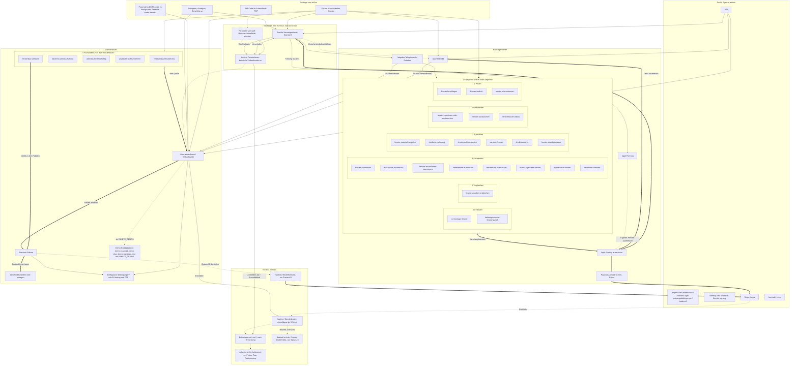
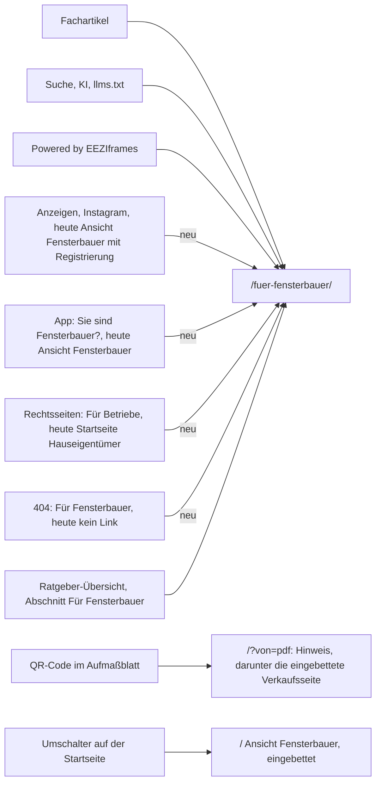

# 5. Informationsarchitektur

Ergebnis 5 des Website-Blueprints (MASTER-PROMPT V4), Phase E. Stand 24.10.2026, Arbeitszweig `claude/design-dna-styleguide`,
gelesen bis Commit `9a95493`. Planungsdokument: Das Repository wurde nur gelesen, gebaut wurde nichts. Die Architektur folgt aus den
Inhalten (PA, SI) und der Kette der Kaufentscheidung (EA), nicht aus der Gestaltung. Die Design-Grammatik (Phase B) entsteht parallel;
sie darf die visuelle Ausführung verfeinern, nicht die Ordnung der Inhalte. Die konkurrierenden Konzepte in Phase F dürfen von dieser
Ausgangsbasis abweichen (5.7.4).

**Grundlage**

| Kürzel | Datei |
|---|---|
| PA | [01-projektanalyse.md](01-projektanalyse.md); „PA-Frage n“ = Frage n in PA 1.11 |
| SI, CP | [bestand/seiten-und-inhalte.md](bestand/seiten-und-inhalte.md), [bestand/conversion-pfade.md](bestand/conversion-pfade.md) |
| RE | [03-recherche.md](03-recherche.md): Erkenntnisse E1–E19, Regeln R1–R14, Tests T1–T19 |
| EA | [04-entscheidungsarchitektur.md](04-entscheidungsarchitektur.md): Zielhandlungen Z1, Z1a, Z1+, Z2a, Z2; Gruppen FB-1 bis FB-7, P-1, HE-1 bis HE-8, M-1 bis M-7; Stufen S0–S8 und B1–B5; Wege W1–W12, WH1–WH6; Zweifel F-01 bis F-36, H-01 bis H-13; Hypothesen H-D1 bis H-D15; Abweichungen AB-1 bis AB-11; offene Punkte O-1 bis O-27 |
| DNA | `docs/design-dna/03-design-dna.md`: Konstruktionsformel 5.1, Prinzipien Nr. 1–11 (5.2), Stellschrauben und Dialekte 5.3, Signature-Effekte 5.4, Abgrenzung 5.5 |
| SG | technischer Styleguide `docs/design-dna/04-styleguide-0-einleitung.md` und `-10-1.md` bis `-10-10.md` (Arbeitsstand); „SG 10.1/5“ = Abschnitt 10.1, Regel 5 |
| VGL | `docs/design-dna/02-vergleich.md` (Statistik, Stilcluster) |
| SKILL, DR, GEST, SEO | `.claude/skills/premium-gestaltung/SKILL.md`, `…/designrichtung.md`, `docs/GESTALTUNG.md`, `docs/SEO.md` |
| VK, PB, AGB, NB | `web/fuer-fensterbauer/index.html`, `web/konfigurator-bedingungen/index.html`, `web/agb/index.html`, `web/nutzungsbedingungen/index.html` |

**Hinweis zur Design-DNA.** Wie in EA: `04-styleguide.md` liegt nur als Teildateien vor, `05-ergebnis-b-styleguide.md` liegt auf
diesem Zweig nicht vor. Abschnitt 10.9 (Technische Designparameter, gilt bei Abweichung) kam nach dem Schreiben hinzu; die hier
verwendeten Zahlen (Kopfzeile höchstens 8 % der Höhe, freie Fläche im ersten Bildschirm mindestens ein Drittel, Fokusträger 15 bis 35 %
der Fläche) stimmen mit ihm überein, eine vollständige Abgleichung steht aus. Die Gestaltungsangaben stützen sich auf DNA 5.1 bis 5.5 und die Pflichtregeln der vorliegenden
Styleguide-Abschnitte. Die DNA beruht auf Desktop-Standbildern (0 von 15 Mobilansichten, DNA 5.5); jede Angabe zum Telefon ist
Neuentwurf.

**Kennzeichnungen**

- `Datei:Zeile` ist ein Beleg im Repository; ohne Beleg steht **[Hypothese]**.
- **Textentwurf**: neuer Wortlaut, nur aus belegten Fakten gebildet; braucht die Freigabe des Inhabers. Wo die Anrede der
  Hauseigentümer offen ist (EA O-13), sind Entwürfe ohne Anrede formuliert.
- **V**: verbindlich (Vorgabe des Inhabers, DNA 5.2, Pflichtregel SG, Regel RE 3.5.1, Recht, Prüfsuite). **H**: Hypothese, wird erst
  nach Prüfung zur Regel.
- **Abweichung von bestehender Regel – Freigabe durch den Inhaber nötig** markiert jeden Vorschlag gegen eine Regel in GEST oder DR;
  gesammelt in 5.7.2 (IA-AB-1 bis IA-AB-12). Abweichungen, die EA schon begründet hat, tragen ihre dortige Nummer (AB-n).
- **K01 bis K37** sind die Bereiche aus 5.5. **V1 bis V14** und **H1 bis H7** sind die Abschnitte der Verkaufsseite und der Ansicht
  Hauseigentümer aus 5.4.
- Bildschirm n am Telefon = Bereich y von (n − 1) × 844 bis n × 844 bei 390 × 844; am Schreibtisch 1280 × 800. Alle Lagen und Längen
  sind geplant, nicht gemessen.
- Schriftgrößen nur aus der Skala 13, 15, 17, 24, 40, am Telefon 32 statt 40 (SKILL:69).

**Methode.** Die Architektur ordnet den Bestand (PA 1.5, SI 1–3) entlang der Ketten S0–S8 und B1–B5 aus EA 4.4. Geprüft wurde jede
Entscheidung aus simulierten Perspektiven: Inhaber eines kleinen Fensterbaubetriebs, Büro eines Betriebs, B2B-Vertrieb,
Hauseigentümer vor dem Fenstertausch, Suchmaschine und KI-Crawler ohne JavaScript, Prüfung der Barrierefreiheit. Das ist eine
Analysemethode, keine Nutzerstudie. Im Repository gibt es keine Nutzerforschung, Besucherzahlen, Geräteanteile oder Konversionsraten
(PA, „Was es nicht gibt“). Aussagen über Wirkung sind Hypothesen; Wahrscheinlichkeiten werden nicht angegeben.

---

## 5.1 Entscheidungen: welche Seiten benötigt werden, welche zusammengelegt werden, welche entfallen oder nur noch erreichbar bleiben

### 5.1.1 Leitentscheidungen

1. **Alle öffentlichen Adressen bleiben.** 39 Adressen stehen in `SEITEN` und damit in der Sitemap (`functions/seo.js:19-58` samt
   `PAKETE_SEITEN` mit `/konfigurator-bedingungen/`; SEO „Freigabe“ Nr. 3 nennt noch 38), dazu Anker, die aus gedruckten
   Aufmaßblättern, E-Mails und Kundenlinks aufgerufen werden (PA 1.10 Nr. 2). Keine Adresse wird umbenannt, keine Weiterleitung wird
   nötig.
2. **Keine neue indexierbare Seite in der Ausgangsbasis.** Jeder Inhalt, den die Kette braucht, findet auf einer bestehenden Adresse
   Platz (5.1.4). Neue Pfade bräuchten Einträge in `SEITEN`, `istSeite()` und `run_worker_first` (`functions/seo.js:82`,
   `wrangler.jsonc:25`; CP 13 Nr. 23) und würden Suchbegriffe zwischen eigenen Seiten aufteilen.
3. **Eine Quelle je Inhalt.** Die Verkaufsseite bleibt die eine Quelle für `/fuer-fensterbauer/` und `/#fensterbauer` (SKILL:63-64;
   PA 1.10 Nr. 1). Preise und Merkmale nur aus `web/assets/pakete.js`, Ablauf nur aus `web/assets/instanzregeln.js` (PA 1.10 Nr. 7). Der
   Inhalt eines Aufmaßes bzw. einer Anfrage steht heute in vier Fassungen (SI 5.3) und wird eine Liste (K15).
4. **Zwei Zielgruppen, getrennte Pfade, je ein leiser Wechsel.** „Zwei Ansichten, nie gemischt“ (GEST:188). Im Inhalt der Fensterbauer
   steht kein Element für Hauseigentümer und umgekehrt, außer der Wechselkarte am Ende und dem Umschalter (EA 4.1.5); Menü und Fuß
   verlinken beide Bereiche als Navigation (5.3.3, 5.3.5). Wie weit das auf `/fuer-fensterbauer/` gelten soll, das Kunden von
   Essential-Betrieben über „Powered by“ erreichen, ist offen (EA HE-8, O-27; IA-O-16).
5. **Altbestand: Service, keine Akquise.** Tarife, Tour, „So funktioniert es für Betriebe“ und Registrierung bleiben für
   Bestandsbetriebe erreichbar, werden aber an keiner öffentlichen Stelle mehr beworben (`docs/instanzen/BAUPLAN.md:657` E28;
   SKILL:25). Wie weit, hängt an EA O-4.
6. **Verkaufsfläche kurz, Wissen getrennt.** Ratgeber-Form (Kasten „Kurz gesagt“, Quellenliste, Wissenskarten, lange Fragen) bleibt auf
   Ratgeber- und Fachseiten und verlässt den Verkaufsfluss (SKILL:29-30).
7. **Feste Erwartungen der Prüfsuite sind Randbedingung.** Die Verkaufsseite muss ein h1 mit grünem Wort, die h2-IDs `die-idee`,
   `so-funktioniert-es`, `pakete`, `ablauf`, `demos`, `bestellen`, `haeufige-fragen`, die Sätze „ohne ihn programmieren zu lassen“,
   „Ihr eigenes Baby“, „3 bis 5 Werktage“, den Ablauf in den sechs Wörtern der Statusleiste und mindestens sechs Fragen zu Domain,
   Kündigung, Datenschutz, Kunde und Website tragen (`scripts/pruefen-instanzen/29.mjs:110-118`). Dazu Eyebrow und h1 der Startseite
   wörtlich und kein Link von der Verkaufsseite auf `/#tour` oder `/#fensterbauer` (PA 1.10). Die Architektur hält alle ein.

### 5.1.2 Entscheidung je Seite

| Seite oder Bereich | Heute | Entscheidung | Begründung | SEO und Technik |
|---|---|---|---|---|
| `/` Startseite, Rahmen | eine Adresse, zwei Ansichten, Standard „Hauseigentümer“ (`web/assets/portal.js:398`) | **bleibt.** Standard bleibt „Hauseigentümer“; Kopf, Bänder und Fuß werden je Ansicht bereinigt (5.4.1) | Google rendert die Standardansicht, ihr Titel beginnt mit „Fenster selbst ausmessen“ (`web/index.html:6`; SEO „Startseite und App“); Fensterbauer werden direkt auf `/fuer-fensterbauer/` gelenkt (5.2.2), Wiederkehrende sehen ihre gespeicherte Ansicht. Für diese Phase keine Abweichung (EA AB-1); die Alternative „Weiche“ ist Spielraum für Phase F | Eyebrow und h1 bleiben wörtlich (Prüfsuite); Prio 1.0 bleibt |
| `/#hauseigentuemer` | Startbild, Zahlenleiste, „Was im Aufmaß steckt“, „Auch ganz groß“, 9 Ratgeber-Karten, Karte für Fensterbauer (SI 3.2) | **bleibt, wird umgebaut** zu H1–H7 (5.4.3) | Kette B1–B4 (EA 4.4.4); Karten mit Strichsymbolen gegen SKILL:41; Seite endet heute mit dem Wechsel statt einer Messaufforderung (PA 1.9/4) | Textfassung ohne JavaScript erhält dieselbe Abschnittsfolge (K08) |
| `/#fensterbauer` (alt `#betriebe`) | eingebettete Verkaufsseite mit Kopf, Pilotband, Fuß und `?von=pdf`-Band des Altbestands (SI 3.3) | **bleibt als Einbettung**, Kopf und Fuß wie im Kontext Fensterbauer (K01, K07); kein Einstieg von außen zeigt mehr dorthin | SKILL:63-64 verlangt die Einbettung; zwei Geschäftsmodelle in einer Ansicht (CP 12/1) → EA AB-2, IA-AB-1 | gleiche Quelle; Sprungmarken scrollen in der Einbettung ohne Anker-Änderung (CP 13 Nr. 3) |
| `?von=pdf` | Ansicht Fensterbauer mit Band „kostenlos registrieren … Die ersten 3 Aufmaße sind frei“ (`web/assets/portal.js:849`) | **bleibt** (gedruckte QR-Codes), Inhalt neu: Hinweis K34 vor der eingebetteten Verkaufsseite, mit dem Weg zur Übernahme per Code | FB-4 hat das Ergebnis in der Hand (EA H-D6); heute führt der Weg in die Registrierung des Altbestands (W7). Der Code-Weg bleibt in jedem Fall, weil das Aufmaßblatt ihn Käufern verspricht (AGB:33 § 2 (2)); Form und Ton hängen an O-4 | Parameter wählt weiter die Ansicht Fensterbauer (`web/assets/portal.js:1976`) |
| `/fuer-fensterbauer/` | Verkaufsseite, 15 Abschnitte, ≈ 19 Telefon-Bildschirme, Pakete auf Bildschirm 11 (PA 1.8) | **bleibt, wird umgebaut** zu V1–V14 (5.4.2); Hauptweg aller Fensterbauer | Kette S1–S7; Pakete spätestens ab Bildschirm 5 bis 6 (EA H-D2); Reihenfolge nach EA AB-3 und IA-AB-2, mit zwei Abweichungen von AB-3: Live-Demos (V6) stehen als kompakter Abschnitt am Ende des Produktbeweises vor den Paketen, das Formular (V11) erst nach Kundenschutz und Ablauf (IA-H-7; EA 4.3.2/7 sah es direkt nach dem Risikoblock) | Titel, Beschreibung, Canonical, h1 bleiben; die sieben Pflicht-h2 bleiben h2; JSON-LD `SoftwareApplication` mit drei `Offer` und `FAQPage` bleibt (SEO „Was umgesetzt ist“) |
| Abschnitte der Verkaufsseite | siehe 5.1.3 | teils zusammengelegt, teils aus dem Fluss gelöst | – | alle heutigen IDs bleiben als Anker erhalten (5.1.5) |
| `/fuer-fensterbauer/<thema>/` (5 Fachartikel) | Ratgeber-Aufbau, 4 bis 6 Knöpfe zur Verkaufsseite (SI 3.8) | **bleiben** als Zubringer für FB-1; Kopf im Kontext Fensterbauer; zwei einheitliche Handlungsbausteine (K36) | Such-Einstieg mit der Brille „Aufmaß“ (EA FB-1); W5: Ziel ist der Seitenanfang, beim Artikel „Fensterbau-Software“ `#pakete` | URL, h1, JSON-LD unverändert; Fuß „lang“ (K07) |
| `/konfigurator-bedingungen/` | Paketbedingungen mit AV-Vertrag, zwei PDF-Fassungen je Datum (SI 5.3) | **bleibt** als Absicherungsseite; trägt die vollständige Merkmalstabelle (PB:41 § 2 (2)), die auf der Verkaufsseite nur noch gruppiert erscheint (EA AB-6); Kopf im Kontext Fensterbauer, Ring „Pakete ansehen“ → `/fuer-fensterbauer/#pakete` (heute Link „Pakete“ → `/fuer-fensterbauer/`) | Mitentscheider brauchen Inhalte ohne die Seite (EA M-4, M-5); `#kundenschutz` ist Ziel des Kundenschutz-Abschnitts | ältere PDF-Fassung vom 22.10.2026 nur noch erreichbar, nicht verlinkt (heute schon so, SI 5.3) |
| `/app/` | Mess-App mit Startbild, Textfassung, `#ausmessen`, `#fuehrung`, `#k-…` | **bleibt**; Gegenstand dieser Planung nur als Schnittstelle (5.4.4 f) | Abschluss Z2 liegt in der App (EA 4.1.1) | Link „Sie sind Fensterbauer?“ zeigt auf `/fuer-fensterbauer/` (IA-AB-4) |
| `/ratgeber/` und 23 Artikel | Weg in sechs Schritten, Ratgeber-Aufbau (SI 3.7, 3.8) | **bleiben** in Adresse, Gliederung und Aufbau; nur Kopf, Handlungsbausteine und Ziel der App-Knöpfe werden vereinheitlicht | Such- und KI-Zubringer (SEO), „jede zusätzliche Seite im Besuch ist eine Chance, dass jemand misst“ (SEO „Leseführung“); Ratgeber dürfen Ratgeber sein | Fuß „lang“ mit allen Artikeln bleibt (interne Verlinkung) |
| Altbestand ohne eigene Adresse: „So funktioniert es“, „Preise“, „Tour“, Registrierung (SI 3.4) | über Kopf, Fuß, Pilotband und `/#tour` erreichbar | **nur noch erreichbar:** aus dem Betriebsbereich nach der Anmeldung, über den Anker `/#tour` und über `?von=pdf`, solange die Übernahme per Code nur mit einem Betriebskonto geht (AGB:33 § 2 (2); Form nach O-4); nicht mehr in Kopf, Fuß oder Bändern | E28; CP 12/1. Funktionen und Zusagen des Altbestands bleiben unverändert (PA 1.10 Nr. 10) | Anker bleiben funktionsfähig; die Fußlinks „So funktioniert es für Betriebe“, „Tour“, „Preise für Betriebe“ entfallen (IA-AB-1) |
| Betriebsbereich auf `/` (angemeldet) | Projekte, Nachrichten, Abrechnung | **bleibt** unverändert | Service für Bestandsbetriebe (EA 4.1.3) | – |
| `/partner/` Kundenkonto | Anmeldung mit Code, Bestellung, Status bis Live; noindex | **bleibt**; Anmeldeseite wird Weiche für die drei Anmeldungen (K37); in Zustand A führt „Noch kein Paket?“ zu `/fuer-fensterbauer/#pakete` statt in das Bestellformular | drei Anmeldungen für Fensterbauer (CP 5.4); W10 ist in Zustand A nicht sinnvoll | noindex und kein Zwischenspeicher bleiben (PA 1.10 Nr. 9) |
| `/betrieb/` (nur auf Domains der Betriebe) | Dashboard Signature | **unverändert**; von eeziframes.com nur über die Weiche K37 als Hinweis „unter Ihrer Domain“ erwähnt, nicht verlinkt | eeziframes.com verlinkt die Domains der Kunden nicht (SEO „Konfigurator-Instanzen“) | – |
| Rechtsseiten (6) | Kopf „Für Betriebe“ → `/` (Ansicht Hauseigentümer), „App“ (`web/agb/index.html:17`) | **bleiben**; Kopf im neutralen Kontext mit „Für Fensterbauer“ → `/fuer-fensterbauer/` und „Fenster ausmessen“ → `/app/`; Fuß „kurz“ | „Für Betriebe“ landet heute bei den Hauseigentümern (SI 5.4) | Pflichtseiten, Widerruf-Knopf in jedem Fuß (PA 1.10 Rechtliches) |
| `/404` | Fuß ohne „Für Fensterbauer“, Nutzungsbedingungen, Cookies (`web/404.html:25`) | **bleibt**; Kopf neutral, Fuß „kurz“ wie überall | einheitliche Fußzeile | `noindex` bleibt |
| `/zentrale/` | intern | **unverändert**, nicht verlinkt | – | noindex |
| Demo-Domains `demo-essential`, `demo-plus`, `demo-signature.eeziframes.com` | vorbereitet, verlinkt erst mit `PAKETE_DEMOS=1` (`docs/INSTANZEN.md:310`) | **Ziel des Abschnitts V6** und der Demo-Links an den Karten, sobald freigeschaltet | W3, F-22 | Instanzen zählen nicht zur Freigabe von eeziframes.com (SEO) |
| System: `sitemap.xml`, `robots.txt`, `llms.txt`, `og.png` | vorhanden | **bleiben**; Verkaufsseite bekommt ein eigenes Vorschaubild statt des Bildes der Hauseigentümer (SI 5.6; Material: IA-O-8) | `og.png` zeigt „Fenster ausmessen. Selbst. eezi.“ auch für die Verkaufsseite | `llms.txt` liest Preise weiter aus derselben Quelle |

### 5.1.3 Verkaufsseite: was zusammengelegt wird, was entfällt

| Nr. heute (SI 3.5) | Abschnitt heute | Neu | Begründung |
|---|---|---|---|
| 1 | Startbild mit „Kurz gesagt“ | **V1**, ohne Kasten „Kurz gesagt“; sein Satz (VK:61) eröffnet V3 | erster Bildschirm höchstens etwa 40 Wörter (SG 10.1, Tabelle „Textmenge“); Kasten ist Ratgeber-Form (PA 1.9/2) |
| 2 | Leiste A (Elementarten) | **V2**, direkt unter V1, scrollgekoppelt statt Dauerschleife | Inhaber mag Leisten (SKILL:121); R2, EA AB-8 |
| 3 | Leiste B (Kennzahlen) | **V7**, als Auftakt der Pakete, nur geklärte Zahlen | Zahlen gehören an die Entscheidung (R5); „0 Zeilen Code“ und „5 Minuten“ sind offen (EA O-10, O-11); IA-AB-7 |
| 4 | Die Idee | **V3**, mit Gegenüberstellung als Bild | S2 |
| 5 | So funktioniert es (Bühne über 3,3 Bildschirme) | **V4**, dieselben fünf Stationen ohne Anheftstrecke, ≈ 1,3 Bildschirme | EA AB-10; PA 1.8 |
| 6 | Was in jeder Anfrage steht | **V5**, Produktbeweis mit echtem Aufmaßblatt | S3; eine Fassung der Liste (SI 5.3) |
| 7 | Warum Kunden selbst planen | **entfällt als Abschnitt.** Die vier Marktzahlen mit Quellen stehen zugeklappt in V13 (Anker `#warum-kunden-selbst-planen` bleibt dort); das Foto `fb-kunden-planen.webp` wird frei | Nebenaussage mit den meisten Belegen (SKILL:24; PA 1.9/4); Zahlen beschreiben die Branche, nicht das Produkt; für Suchmaschinen und KI bleiben Zahlen mit Quellen auf der Seite (SEO, GEO-Studie). Hängt an PA-Frage 6; IA-AB-2 |
| 8 | Ihre Kunden bleiben Ihre Kunden | **V9**, nach den Paketen; Platzhalterbild entfällt | S5; Platzhalter über halbe Bildschirmhöhe (PA 1.8) |
| 9 | Die Pakete mit Kasten „Vorläufige Preise“ und Vergleich | **V8**, früher (ab Bildschirm 6); Kasten wird ein Satz (EA AB-4); Vergleich gruppiert (EA AB-6); dazu Risikoblock und Gesprächsweg | S4, S5; R1, R8, R9 |
| 10 | Von der Bestellung bis zum Livegang | **V10**, mit Anbieterblock | S5 |
| 11 | Live-Demos | **V6**, kompakt direkt nach dem Produktbeweis; h2 `#demos` bleibt in beiden Zuständen | W3 „Probieren“ gehört an S3; Pflicht-h2 |
| 12 | Bestellen oder anfragen | **V11**, nach Kundenschutz und Ablauf; Platzhalterbild entfällt | S6; Kartenknöpfe springen direkt hierher |
| 13 | Häufige Fragen (10) | **V12**, acht Fragen; „Unterschied der Pakete“ und „Dauer“ sind im Fluss beantwortet (V8, V10) | Antworten stehen dort, wo der Zweifel entsteht (EA 4.6.3); Prüfsuite verlangt mindestens sechs |
| 14 | Wissen für Fensterbauer (5 Karten) | **V13**, als Linkzeile zugeklappt; die fünf Links stehen zusätzlich im Fuß | Ratgeber-Form auf der Verkaufsfläche (PA 1.9/2) |
| 15 | Quellen | **V13**, zugeklappt | Belege bleiben prüfbar (R7) |
| neu | – | **V14** Abschluss mit kompakter Paketwahl | Seite endet heute mit Quellen und Linkliste (PA 1.9/4); EA H-D7 |

### 5.1.4 Geprüft und nicht vorgesehen: neue Seiten

| Kandidat | Urteil | Begründung |
|---|---|---|
| Eigene Seite je Paket (`/fuer-fensterbauer/essential/` …) | nein | Merkmalsfülle bei unsicherer Präferenz überfordert, nicht die Zahl der Pakete (E8); Unterschiede sind klein und markenbezogen (VK:236); drei dünne Seiten konkurrierten mit der Verkaufsseite um dieselben Suchbegriffe |
| Eigene Preisseite `/preise/` | nein | würde S4 von S2 und S3 trennen; „Preise“ ist heute der Name der Altbestand-Tarife im Kopf (CP 5.4), eine gleichnamige Seite verlängerte die Verwechslung „Plus“ (PA-Frage 23) |
| Eigene Seite für Hauseigentümer (`/fuer-hauseigentuemer/`) | nein | doppelt zur Standardansicht von `/`, die für die B2C-Suchbegriffe steht (SEO „Suchbegriffe“) |
| Kontaktseite `/kontakt/` | nein in der Ausgangsbasis | Kontaktangaben stehen im Impressum; ob Telefon und Person auf der Verkaufsseite erscheinen, ist offen (EA O-9); für Hauseigentümer gibt es keinen Kontaktweg (O-19). Der Anbieterblock K28 trägt den Inhalt auf der Verkaufsseite |
| „Über eeziframes“ | nein in der Ausgangsbasis | außer den Angaben des Impressums kein Inhalt im Repository; Vertrauen entsteht über Offenlegung und prüfbare Fakten (E14) → K28 |
| Vergleichsseiten gegen benannte Anbieter | nein | RE 3.3.4; der Gegner ist der bisherige Arbeitsweg (RE 3.3.2) |
| Landingpage für Suchbegriffe um „Fenster-Konfigurator“ | offen | keine erhobenen Suchbegriffe (`docs/SEO.md:38`, `:45`; PA-Frage 28); erst nach einer Recherche (IA-O-11) |
| Seite für Fensterhändler | offen | Unterschiede zu Fensterbauern nicht belegt (EA O-22) |
| Kurzfassung der Pakete für Mitentscheider | als **PDF**, nicht als Seite [Hypothese] | EA H-D13, RE T12; ein PDF-Generator für die Paketbedingungen ist vorhanden (`scripts/bedingungen-pdf.mjs`); verlinkt im Risikoblock K22 (IA-O-6) |
| Anmeldeseite `/anmelden/` | nein | die Weiche passt auf die bestehende Anmeldeseite von `/partner/` (K37), ohne neuen Pfad |

### 5.1.5 SEO-Belange

- **Adressen und Signale:** Keine Adresse ändert sich; Sitemap, Canonical, `run_worker_first`, `istSeite()` und IndexNow brauchen
  keine Anpassung. Nach dem Umbau bekommt jede geänderte Seite einen neuen `stand` (SEO „Pflege“).
- **Anker:** Die sieben Pflicht-IDs bleiben an h2. Alle übrigen heutigen IDs der Verkaufsseite (`was-in-jeder-anfrage-steht`,
  `warum-kunden-selbst-planen`, `kundenschutz`, `vergleich`, `frage`, `quellen`, `wissen-fuer-fensterbauer`, `paket-essential`,
  `paket-plus`, `paket-signature`) bleiben an der Stelle erhalten, an die ihr Inhalt wandert, damit Links aus den Fachartikeln
  (`#pakete`, `#demos`, `#so-funktioniert-es`, SI 2.5) und von außen nicht ins Leere zeigen.
- **Häufige Fragen:** JSON-LD bleibt wortgleich mit der sichtbaren Fassung (PA 1.10); bei acht statt zehn Fragen werden beide Fassungen
  zusammen gekürzt.
- **Textfassungen:** Startseite und App behalten ihre Textfassung für Crawler ohne JavaScript (SEO „Startseite und App“). Heute weichen
  Textfassung und Ansicht im Inhalt ab (SI 5.3). Neu folgen beide derselben Abschnittsfolge; die Form darf sich unterscheiden
  (Steckbrief-Tabelle nur in der Textfassung), der Inhalt nicht (K08).
- **Interne Verlinkung:** Ratgeber und Fachartikel behalten den langen Fuß mit allen Artikeln. Startseite, Verkaufsseite, Rechtsseiten
  und 404 bekommen den kurzen Fuß; er verlinkt weiter die fünf Fachartikel und die Ratgeber-Übersicht (K07, IA-H-6).
- **Belege für KI-Antworten:** Zahlen mit Quellen steigern die Sichtbarkeit in generierten Antworten (SEO, GEO-Studie). Deshalb bleiben
  die Marktzahlen samt Quellen auf der Verkaufsseite, zugeklappt in V13, statt zu entfallen.
- **Vorschaubild:** eigenes Bild für `/fuer-fensterbauer/` (heute das der Hauseigentümer, SI 5.6).
- **Einbettung:** Google rendert auf `/` die Standardansicht; der Inhalt der Ansicht Fensterbauer zählt dort nicht als doppelter
  Inhalt. Canonical der Verkaufsseite bleibt `/fuer-fensterbauer/`.
- **Nettopreise auf eingebetteter Seite:** Die rechtliche Frage aus EA O-25 (BGH I ZR 99/08, RE 3.4.3) bleibt offen; die Architektur
  hält die Pakete wenigstens aus der Ansicht Hauseigentümer heraus (5.6).

---

## 5.2 Ebene 1 – Website-Architektur

### 5.2.1 Sitemap mit Verbindungen

Durchgezogen: Navigation. Doppelt: Weg zur Zielhandlung. Gestrichelt: nur erreichbar, bedingt oder Rückkehr. Rechtsseiten und Fuß hängen
an jeder Seite; ihre Kanten sind der Lesbarkeit halber weggelassen.

### 5.2.2 Lenkung der Einstiege für Fensterbauer

Heute zeigen Anzeigen und die App auf die Ansicht Fensterbauer der Startseite mit dem Kopf des Altbestands, die Rechtsseiten mit „Für
Betriebe“ auf die Ansicht Hauseigentümer (EA S0, W12; `docs/ZENTRALE.md:83`; `web/assets/app.js:2781`; `web/agb/index.html:17`); wohin
die Instagram-Highlights verlinken, steht nicht im Repository. Neu zeigt jeder Einstieg, den eeziframes selbst setzt, auf die eine
Adresse der Verkaufsseite. Nur zwei Einstiege bleiben auf `/`: der Umschalter und der QR-Code.

### 5.2.3 Nutzerwege je Besuchergruppe

Gruppen und Stufen aus EA 4.2 und 4.4; Wege aus EA 4.5. „→“ trennt Stationen. Die Spalte „Rückweg“ nennt den Weg, wenn der Besucher
nicht abschließt.

| Gruppe | Einstieg | Weg durch die Architektur | Ziel | Rückweg, Ausstieg | Bedingung |
|---|---|---|---|---|---|
| **FB-1** Fachfrage | Suche → Fachartikel | Artikel („Kurz gesagt“, Antwort) → Handlungsbaustein K36 → `/fuer-fensterbauer/` V1 → V3 → V4 → V5 → V8 → Karte → V11 | Z1a, später Z1 | Browser-Zurück zum Artikel; die fünf Artikel im Fuß und in V13 | W5: Ziel Seitenanfang, nicht `#pakete` |
| **FB-2** sucht Software oder Konfigurator | Suche, KI-Assistent | `/fuer-fensterbauer/` V1 (Preiszeile) → Schnellweg „Pakete ansehen“ → V8 mit Risikoblock → Karte → V11; oder Fachartikel „Fensterbau-Software“ → `#pakete` | Z1a, Z1 | Menü-Sprungmarken zurück zu V4/V5 | W2, W9 |
| **FB-3** sah „Powered by“ | Link aus Essential-Konfigurator, neuer Tab | V1 → V8 (Vergleich, Gruppe „Ihre Marke“: Hinweis auf eeziframes je Paket) → Karte Essential Plus oder Signature → V11 | Z1+, Z1a | Tab schließen führt zurück zum Konfigurator | W8; entsteht erst mit Kunden (EA FB-3) |
| **FB-4** hat ein Aufmaßblatt in der Hand | QR-Code → `/?von=pdf` | Hinweis K34 („Was Sie mit dem Blatt tun können“) → eingebettete Verkaufsseite V1 → V5 (das Blatt wiedererkennen) → V8 → V11 | Z1a; Aufmaß per Code übernehmen (Service, AGB:33 § 2 (2)) | Umschalter; Hinweis-Link „Aufmaß per Code übernehmen“ (immer; Ziel und Ton nach O-4) | W7, EA H-D6, O-4 |
| **FB-5** angestoßen ohne Kontext | Anzeige, Instagram | neu direkt `/fuer-fensterbauer/` V1 → V3 → … | Z1a | Logo führt zum Anfang der Verkaufsseite | W12; Anzeigen- und Instagram-Ziel ändern (IA-O-3) |
| **FB-5** über die Startseite | `/` → Umschalter | Ansicht Fensterbauer (Einbettung) V1 → … | Z1a | Umschalter zurück | W6 ohne Altbestand-Kopf (IA-AB-1) |
| **FB-6** Prüfer kurz vor dem Kauf | wiederkehrend, direkt | Kopf-Knopf oder Menü „Pakete“ → V8 → Paketbedingungen (PDF) → V6 Demo (ab `PAKETE_DEMOS`) → V8 → Karte | Z1, Z1+ | Gesprächsweg K23 „Unsicher, welches Paket passt?“ → V11 | W2, W3, W4 |
| **FB-7** Bestandsbetrieb | `/` oder Lesezeichen | auf `/`: Fuß „Anmelden“ (beide Ansichten) oder in der Ansicht Fensterbauer Kopf bzw. Menü „Anmelden“ → das Anmeldeblatt des Betriebsbereichs öffnet sich direkt, ohne Umweg über `/partner/` (5.3.2); von anderen Seiten „Anmelden“ → Weiche K37 → Betriebskonto; für ein Paket zusätzlich → `/fuer-fensterbauer/` | Service; ggf. Z1 | – | W11; VK:244. Die gespeicherte Wahl der Ansicht hilft nur im selben Browser (GEST:191) |
| **P-1** Paketkunde | Lesezeichen, Mail, „Kundenkonto“ | „Anmelden“ → `/partner/` (auf `/` über die Zeile im Anmeldeblatt, 5.3.2); Signature-Team → `/betrieb/` auf eigener Domain | Service; Z1+ über „Paketwechsel anfragen“ | – | CP 5.4; EA P-1 |
| **M-1, M-4, M-5** Mitentscheider | Link oder PDF vom Kollegen | `/fuer-fensterbauer/#pakete` → Risikoblock → Paketbedingungen mit AV-Vertrag (PDF); Kurzfassung als PDF (IA-O-6) | Freigabe im Betrieb | – | EA M-1 bis M-5 (Hypothesen) |
| **HE-1** Problem am Fenster | Suche → Ratgeber „Prüfen“ | Artikel → „Dein Weg“ → nächster Schritt → … → Ausmessen-Artikel → App | U5, später Z2a | Weg in sechs Schritten | Absicht niedrig: Handlungsbaustein leise (EA 4.3.4/7) |
| **HE-2** vor Entscheidung oder Auswahl | Suche → „Entscheiden“, „Auswählen“ | Artikel → Weg → App | U5, Z2a | wie HE-1 | – |
| **HE-3** will messen | Suche → `/ratgeber/fenster-ausmessen/`, `/app/` oder `/` | Anleitung oder Startseite H1 → „Jetzt ausmessen“ → `/app/#ausmessen` → Paywall → Kasse | **Z2a, Z2** | Führung als Zwischenschritt (WH3) | R12, R13 |
| **HE-4** Angebote, Einbau | Suche → „Vergleichen“, „Einbauen“ | Artikel → Weg | U5 | – | Aufmaßblatt meist zu spät |
| **HE-5** direkt, KI, Empfehlung | `/` | H1 → H2 (Bildfolge) → H3 (Kosten, Sicherheit) → H6 → App; oder H1 → Führung | Z2a | H4 Ratgeber-Weg | WH1, WH3 |
| **HE-6** vom Betrieb eingeladen | `/app/#k-…` oder Domain des Betriebs | App des Betriebs; kein Weg zu Angeboten von eeziframes | keine Kaufhandlung | – | Kundenschutz (GEST:370-379) |
| **HE-7** wiederkehrend mit gesichertem Aufmaß | `/`, Lesezeichen, anderes Gerät | Menü oder Fuß „Gesichertes Aufmaß öffnen“ (**Textentwurf**) → `/app/` Startbild → „Schon ein Aufmaß gesichert? Anmelden“ (`web/assets/app.js:2773`) → eigenes Aufmaß → Paywall bzw. Blatt | Z2 | – | IA-AB-10; „Jetzt ausmessen“ beginnt ein neues Fenster (`web/assets/app.js:6560-6562`) und führt an der Anmeldung vorbei |
| **HE-8** Kunde eines Essential-Betriebs | „Powered by EEZIframes“ im Konfigurator, neuer Tab | `/fuer-fensterbauer/` V1 …; kein eigener Weg, keine Ansprache als Hauseigentümer | keine | Tab schließen führt zurück zum Konfigurator des Betriebs | EA HE-8, O-27; IA-O-16 |
| Crawler ohne JavaScript | `/`, `/app/`, alle statischen Seiten, `llms.txt` | Textfassungen und statisches HTML | Zitat, Verweis | – | PA 1.10 Nr. 3, 4 |

---

## 5.3 Navigation

### 5.3.1 Grundsätze

| Nr. | Grundsatz | Begründung |
|---|---|---|
| N1 | Drei Kopf-Kontexte statt sieben Kopfzeilen: **Hauseigentümer**, **Fensterbauer**, **neutral** (SI 2.1). Der Kontext folgt der Seite, nicht der Herkunft | sieben Fassungen heute (SI 5.4); Erwartbarkeit (E2) |
| N2 | Kopf am Telefon eine Zeile, 56 px (6,6 % von 844), nur Logo, ein Handlungsknopf und Menü; am Schreibtisch 64 px (8 % von 800) | SG 10.1, Tabelle: Kopfzeile höchstens 8 % der Höhe; heute 117 px auf `/` (PA 1.8) |
| N3 | Der Kopf trägt nie eine zweite Cream-Pille: Im Kontext Fensterbauer ist sein Knopf immer Ring; im Kontext Hauseigentümer wird er Ring, solange im Inhalt eine Cream-Pille sichtbar ist | GEST:456; `web/assets/portal.js:551-562`; R6 |
| N4 | Der Kopfknopf erscheint erst, wenn der Handlungsknopf des Startbilds mit gleichem Ziel aus dem Bild ist [Hypothese] | heute steht dasselbe Ziel bis zu dreimal auf einem Bildschirm (PA 1.8, Startseite) |
| N5 | Am Telefon gibt es ein Menü; ohne JavaScript führt „Menü“ als Sprungmarke zur Navigation im Fuß | heute gar kein Menü, Textlinks unter 640 px ausgeblendet (`web/assets/ratgeber.css:15`) |
| N6 | Der Umschalter steht nur auf `/`; auf allen anderen Seiten wechselt man über Menü, Fuß oder die Wechselkarte | der Umschalter schaltet Ansichten einer Adresse; auf anderen Adressen wäre er ein Link mit Verhaltensbruch |
| N7 | Logo, Preise und Kontakt an erwartbaren Orten: Logo oben links, Preise bei den Paketen, Kontakt im Fuß und im Anbieterblock | E2; R6 |
| N8 | Name, Wortmarke und Logo bleiben unverändert | Auftrag; GEST:7 |
| N9 | Ziele ab 44 px, Fokus nie vollständig unter dem klebenden Kopf (`scroll-padding-top` mindestens Kopfhöhe) | R10; WCAG 2.4.11 |

### 5.3.2 Kopfzeile je Kontext

| Kontext | Seiten | Telefon 390, eine Zeile 56 px | Schreibtisch 1280, 64 px | Handlungsknopf |
|---|---|---|---|---|
| **Hauseigentümer** | `/` Ansicht Hauseigentümer, `/ratgeber/` und 23 Artikel, Textfassungen von `/` und `/app/` | links Logo (Ziel 44 × 44, → `/`); rechts Handlungsknopf (≈ 150 × 44 px, 15 px fett) und Menü (44 × 44) | Logo; auf `/` der Umschalter direkt daneben; Textlinks 15 px „Ratgeber“, „Für Fensterbauer“; rechts der Handlungsknopf | „Fenster ausmessen“ → `/app/#ausmessen`, mit angefangenem Aufmaß „Aufmaß fortsetzen“ (heute so, GEST:192); Cream, wenn keine andere Cream-Pille sichtbar ist |
| **Fensterbauer** | `/fuer-fensterbauer/`, 5 Fachartikel, `/konfigurator-bedingungen/`, `/` Ansicht Fensterbauer | links Logo (→ `/fuer-fensterbauer/`, auf `/` → Anfang der Ansicht) [Hypothese IA-H-5]; rechts Ring-Knopf und Menü | Logo; auf `/` Umschalter; Sprungmarken 15 px „So funktioniert es“, „Ablauf“, „Fragen“; rechts „Anmelden“ (Textlink 15 px) und Ring-Knopf | Ring „Pakete ansehen“ → `#pakete` (außerhalb der Verkaufsseite → `/fuer-fensterbauer/#pakete`); in Zustand A ab V8 „Frage stellen“ → `#bestellen` [Hypothese IA-H-12] |
| **neutral** | Rechtsseiten, 404 | Logo (→ `/`), Menü | Logo; „Für Fensterbauer“ → `/fuer-fensterbauer/`, „Fenster ausmessen“ → `/app/` | keiner |
| Konto | `/partner/` | wie heute: Logo → `/fuer-fensterbauer/`, angemeldet → Übersicht des Kundenkontos (`web/partner/index.html:22`; `web/assets/partner.js:111`) | wie heute | – |
| App | `/app/` | eigener Kopf der App, nicht Gegenstand dieser Planung | – | – |

**Begründung Kontext Fensterbauer.** „Preise“, „Anmelden“ und „Kostenlos starten“ des Altbestands entfallen (EA AB-2). „Anmelden“
bleibt als leiser Textlink, weil Bestands- und Paketkunden einen Weg brauchen (EA 4.1.3), aber nicht als Pille. **Ziel von „Anmelden“:**
Auf `/` öffnet es wie heute das Anmeldeblatt des Betriebsbereichs, ergänzt um eine Zeile **Textentwurf** „Konfigurator-Paket
bestellt? Zum Kundenkonto“ (→ `/partner/`); auf allen anderen Seiten führt es zur Weiche K37 auf `/partner/`. So kommen
Bestandsbetriebe, die ihr Konto heute tatsächlich nutzen (im Kundenkonto gibt es in Zustand A nur Bestellentwürfe), ohne Umweg über
`/partner/` in ihr Konto (EA FB-7). Die drei Sprungmarken
bedienen den Schnellweg (W2) und Prüfer (FB-6), ohne „Pakete“ doppelt zum Ring-Knopf zu führen.

**Begründung Logo.** Auf `/partner/` führt das Logo schon heute zur Verkaufsseite. Im Kontext Fensterbauer liefe ein Logo auf `/` ohne
gespeicherte Wahl in die Ansicht Hauseigentümer (`web/assets/portal.js:398`). Gegenrisiko: Erwartung „Logo = Startseite“ (E2).

### 5.3.3 Menü am Telefon

- **Form:** Blatt, das von unten bis etwa 85 % der Höhe aufzieht [Hypothese IA-H-13: Einträge im Daumenbereich, E18]; Einblenden
  200 bis 300 ms ohne Überschwingen (SG 10.7, Tabelle „Ein- und Ausblenden“; SG 10.7/2); flache, opake Fläche ohne Schatten (DNA Nr. 6,
  9); darunter der Inhalt abgedunkelt. Schließen über „Schließen“ (44 × 44) oben rechts im Blatt, Wischen nach unten, Escape und Tippen
  auf den abgedunkelten Rand. Fokus bleibt im Blatt, kehrt beim Schließen auf den Menü-Knopf zurück.
- **Einträge:** 17 px, Zeilen 52 px, Haarlinien dazwischen; Gruppenüberschriften 13 px in der Technikstimme.
- **Ohne JavaScript:** „Menü“ ist ein Link auf die Navigation im Fuß (`#navigation`).
- **Ruhige Fassung:** Blatt erscheint ohne Bewegung.

| Kontext | Inhalt des Menüs, in dieser Reihenfolge |
|---|---|
| Hauseigentümer | Segment „Hauseigentümer · Fensterbauer“ (auf `/` schaltet es die Ansicht, sonst Link) · „Fenster ausmessen“ · „Führung starten“ · **Textentwurf** „Gesichertes Aufmaß öffnen“ → `/app/` (Startbild der App mit „Schon ein Aufmaß gesichert? Anmelden“, `web/assets/app.js:2773`; für EA HE-7, **IA-AB-10**) · „Ratgeber“ mit den sechs Schritten als Unterzeilen 15 px · „Für Fensterbauer“ |
| Fensterbauer | Segment wie oben · Sprungmarken „So funktioniert es“, „Was in jeder Anfrage steht“, „Pakete“, „Ablauf“, „Fragen“ · „Paketbedingungen“ · „Wissen für Fensterbauer“ (→ V13 bzw. Liste der fünf Artikel) · „Anmelden“ · Kontakt (E-Mail; Telefon nur nach O-9) |
| neutral | Segment · „Für Fensterbauer“ · „Fenster ausmessen“ · „Ratgeber“ |

### 5.3.4 Umschalter zwischen Zielgruppen

- **Ort:** nur auf `/`. Schreibtisch: Segment neben dem Logo (heute so, GEST:190). Telefon: nicht mehr als eigene, klebende Zeile,
  sondern als Glas-Segment (Höhe 44 px, Breite ≈ 260 px) oben über dem Foto des Startbilds, y ≈ 68 bis 112; es scrollt mit der Seite
  weg und steht zusätzlich im Menü (**IA-AB-3**). Damit beginnt das Foto bei y = 56 statt 268 (PA 1.8).
- **Verhalten bleibt:** Anker `#hauseigentuemer`, `#fensterbauer`, `#betriebe`; Wechsel ohne Verlaufseintrag; Wahl im Browser
  gespeichert; Wechsel springt an den Anfang der Ansicht (GEST:191; CP 11).
- **Reihenfolge und Beschriftung:** „Hauseigentümer · Fensterbauer“ wie heute; ob die Hauptzielgruppe vorn stehen soll, ist offen
  (IA-O-10).
- **Gestaltung:** Glas über gesättigtem Bildinhalt mit heller Haarkante, ohne Schatten (DNA 5.4 „Glas mit Hintergrundunschärfe“;
  DNA Nr. 6); das gewählte Segment in Tinte (GEST:190), nicht als zweite Cream-Pille (heute wirkt es wie eine, PA 1.8).
- **Wechselkarte am Ende jeder Ansicht** (K06) bleibt als zweiter, leiser Wechsel (GEST:192, :193).

### 5.3.5 Fußzeile

Eine Inhaltsquelle, zwei Längen. Heute gibt es acht Fußfassungen mit unterschiedlichen Lücken (SI 2.2).

| Länge | Seiten | Gruppen | Begründung |
|---|---|---|---|
| **kurz** | `/` (beide Ansichten), `/fuer-fensterbauer/`, `/konfigurator-bedingungen/`, Rechtsseiten, 404, Fuß der App | „Für Fensterbauer“: Konfigurator-Pakete, Paketbedingungen, die fünf Fachartikel, Anmelden · „Für Hauseigentümer“: Fenster ausmessen, Führung, Gesichertes Aufmaß öffnen (→ `/app/`, IA-AB-10), Ratgeber, Anleitung Fenster ausmessen · „eeziframes“: Anbieter (Impressum), E-Mail `ask@eeziframes.com` (Telefon nach O-9) · Recht: AGB, Nutzungsbedingungen, Datenschutz, Cookies, Impressum · Knopf „Vertrag widerrufen“ (Pille 44 px) · Stand-Hinweis zum Server nur ohne Server | rund 20 statt 39 Links auf der Verkaufsfläche (PA 1.9/2); jede Zielgruppe findet ihren Bereich |
| **lang** | 23 Ratgeber, 5 Fachartikel, `/ratgeber/` | wie heute aus `scripts/ratgeber-bausteine.mjs`: „Ratgeber“ (alle Artikel), „Für Fensterbauer“ (Verkaufsseite, fünf Artikel, Paketbedingungen), „Mehr“ (Startseite, App, Recht, Widerruf) | interne Verlinkung der Ratgeber (SEO „Was umgesetzt ist“) |

Entfallen in allen Fassungen: „So funktioniert es für Betriebe“, „Tour für Fensterbauer“, „Preise für Betriebe“ (`web/assets/portal.js:482`;
IA-AB-1). Der Satz zur Pilotphase erscheint nur ohne Server (PA, Abgleich).

### 5.3.6 Wege zurück

| Von | Zurück über | Ziel |
|---|---|---|
| Verkaufsseite, tief gescrollt | Kopf-Knopf, Menü-Sprungmarken; Browser-Zurück nach einem Sprung (Sprungmarken auf der eigenständigen Seite erzeugen einen Verlaufseintrag) | V8 bzw. Ausgangsstelle |
| Verkaufsseite, eigenständig | Logo; Brotkrumen „Startseite › Für Fensterbauer“ über dem Fuß statt am Seitenanfang [Hypothese IA-H-10] | `/fuer-fensterbauer/` bzw. `/` |
| Verkaufsseite, eingebettet | Umschalter; Wechselkarte „Ihre eigenen Fenster ausmessen?“ | `/#hauseigentuemer` |
| Fachartikel | Brotkrumen (44-px-Ziele statt heute 60 × 16 px, PA 1.8); Handlungsbaustein | `/fuer-fensterbauer/` |
| Ratgeber-Artikel | Brotkrumen; Block „Dein Weg zu neuen Fenstern“ | `/ratgeber/`, nächster Schritt |
| Paketbedingungen | Kopf-Knopf „Pakete ansehen“ | `/fuer-fensterbauer/#pakete` |
| Formular nach dem Senden | Dank mit Ring „Zurück zu den Paketen“ und Link „Paketbedingungen“ | `#pakete` |
| Demo-Konfigurator | öffnet in neuem Tab [Hypothese]; Tab schließen | Verkaufsseite bleibt offen |
| App | Startbild: „Zur Startseite“, „Sie sind Fensterbauer?“ (→ `/fuer-fensterbauer/`, IA-AB-4); im Messen die feste untere Leiste | `/`, Verkaufsseite |
| Stripe | Rückkehradressen unverändert (PA 1.10 Nr. 8) | Kundenkonto, App |
| Kundenkonto | Logo | `/fuer-fensterbauer/` |
| 404 | „Zur Startseite“, „Zur App“, neu „Für Fensterbauer“ | `/`, `/app/`, Verkaufsseite |

### 5.3.7 Navigation innerhalb der Verkaufsseite

- Abschnittsnummern 01 bis 14 in der Technikstimme an jeder Abschnittsüberschrift (GEST, Designrichtung 23.10.2026) dienen als
  Orientierung beim Überfliegen (E1).
- Die Fortschrittslinie unter dem Kopf (2 px, `web/assets/verkauf.js:448`) bleibt nur auf der Verkaufsseite, als Orientierung über
  12 bis 13 Bildschirme; GEST:41 sagt dazu „gibt es nicht“ (PA-Frage 27), die Entscheidung liegt beim Inhaber.
- Sprungmarken im Kopf (Schreibtisch) und im Menü (Telefon) zeigen auf V4, V10, V12 bzw. V4, V5, V8, V10, V12.
- In der Einbettung scrollen alle Sprungmarken innerhalb der Ansicht, ohne den Anker `#fensterbauer` zu ändern (CP 13 Nr. 3).

### 5.3.8 Ohne JavaScript, ruhige Fassung, Einbettung

- Ohne JavaScript: Kopf mit Logo, Textlinks und Knopf; „Menü“ als Sprungmarke; Umschalter als zwei Links auf `/#hauseigentuemer` und
  `/#fensterbauer`, deren Textfassung die Ansicht Hauseigentümer zeigt (heute so); Wischreihe der Pakete als lesbare Liste.
- Ruhige Fassung: Menü, Umschalter und Kopf-Knopf erscheinen ohne Bewegung; Fortschrittslinie steht still.
- Einbettung: Kopf und Fuß gehören zur Startseite, nicht zur Verkaufsseite; die Verkaufsseite darf deshalb keine Navigation enthalten,
  die in der Einbettung doppelt erschiene (Brotkrumen werden dort heute schon entfernt, GEST:193).

---

## 5.4 Ebene 2 – Page Architecture der wichtigsten Seiten

Je Seite zuerst eine Übersicht, dann die Abschnitte mit **Funktion**, **Nutzerfrage**, **Inhalt**, **Hervorhebung**, **visueller
Erklärung** und **Entscheidungsunterstützung**. Für jede Seite gelten die DNA-Prinzipien Nr. 1–11 und die Konstruktionsformel
(Grund → Kulisse → ein Fokusträger → flache Bedienschicht) als V; je Abschnitt ist genannt, welche variablen Stellschrauben und welcher
Signature-Effekt (höchstens einer je Stufe, keiner in S4 und S6; EA 4.4.5, H-D10) vorgesehen sind.

### 5.4.1 Startseite `/`: Rahmen und Weiche

**Aufgabe.** Eine Adresse, zwei Ansichten. Die Startseite ist für Hauseigentümer der Einstieg (5.4.3) und für Fensterbauer, die über den
Umschalter oder den QR-Code kommen, die eingebettete Verkaufsseite (5.4.2). Standard bleibt „Hauseigentümer“ (5.1.2).

| Nr. | Rahmenteil | Funktion | Inhalt | Lage und Größe | Entscheidungsunterstützung |
|---|---|---|---|---|---|
| R1 | Bänder (K04) | Stand der Seite melden | Pilotleiste nur ohne Server (`web/assets/gemeinsam.js:347-357`); Einführungsband auf `/` **entfällt**, der Preis steht in der Preiszeile von H1 (**IA-AB-6**); in der Ansicht Fensterbauer kein Band (heute so) | höchstens ein Band über dem Kopf, 40 px | heute vier Bänder vor dem Foto, Foto ab y = 268 (PA 1.8). Geht die Website nach dem 17.11.2026 online, entfällt die Frage, weil der Einführungspreis dann endet (PA 1.2) |
| R2 | Kopf (K01) mit Umschalter (K03) | Orientierung, Zielgruppe wählen | Kontext je Ansicht (5.3.2) | 56 px Telefon; Umschalter als Glas über dem Foto | N1–N6 |
| R3 | Hinweis `?von=pdf` (K34) | FB-4 abholen | 5.4.4 a | nur in der Ansicht Fensterbauer mit Parameter, vor V1, höchstens 180 px | W7 |
| R4 | Ansicht | Hauptinhalt | Hauseigentümer H1–H7 (5.4.3) oder Fensterbauer V1–V14 (5.4.2) | – | – |
| R5 | Wechselkarte (K06) | leiser Wechsel | Hauseigentümer: „Für Fensterbauer · Ihr eigener Fensterkonfigurator.“ (`web/assets/portal.js:790`; Angleichung an die Schreibweise „Fenster-Konfigurator“ der Verkaufsseite als **Textentwurf**); Fensterbauer: „Ihre eigenen Fenster ausmessen?“ (`:791`) | Ende der Ansicht, ≈ 0,3 Bildschirme | EA 4.1.5 |
| R6 | Fuß kurz (K07) | Recht, Wechsel, Kontakt | 5.3.5 | ≈ 0,8 Bildschirme | – |
| R7 | Textfassung (K08) | Crawler ohne JavaScript | Abschnitte H1–H6 in Textform, Steckbrief „eeziframes auf einen Blick“ (`web/index.html:69-80`), danach Block „Für Fensterbauer“ mit VK:61 und Links auf `/fuer-fensterbauer/` und `#pakete`, drei bis vier Fragen | – | SEO „Startseite und App“ |

### 5.4.2 Seite für Fensterbauer: `/fuer-fensterbauer/` (eingebettet auch in `/#fensterbauer`)

**Ziel:** Z1 (Zustand B), bis dahin Z1a; Z1+ über die Empfehlung. **Hauptgruppen:** FB-2, FB-6, dann FB-3, FB-4 (EA 4.2.4).
**Länge:** Telefon ≈ 12,5 Bildschirme (heute 19), Schreibtisch ≈ 10 (heute 16,7) [Hypothese IA-H-2]. **Pakete:** Telefon ab Bildschirm 6
(EA H-D2: spätestens 5 bis 6), Schreibtisch ab Bildschirm 4 bis 5 (EA S4 nennt 4).

**Übersicht**

| Nr. | Abschnitt | Anker | Stufe | Telefon (y ungefähr) | Schreibtisch | Cream-Pille im Abschnitt |
|---|---|---|---|---|---|---|
| V1 | Startbild | – | S1 | 0–844, Bildschirm 1 | Bildschirm 1 | „Pakete ansehen“ |
| V2 | Leiste Elementarten | – | S1 | 844–924 | Bildschirm 2 oben | – |
| V3 | Die Idee | `#die-idee` (h2) | S2 | 924–1.900 | 2 | – |
| V4 | So funktioniert es | `#so-funktioniert-es` (h2) | S3 | 1.900–3.000 | 2–3 | – |
| V5 | Was in jeder Anfrage steht | `#was-in-jeder-anfrage-steht` | S3 | 3.000–4.100 | 3–4 | – |
| V6 | Live-Demos | `#demos` (h2) | S3 → S4 | 4.100–4.350 | 4 | – |
| V7 | Leiste Kennzahlen | – | S4 | 4.350–4.480 | 4 | – |
| V8 | Die Pakete mit Vergleich, Verkaufsstand, Risikoblock, Gesprächsweg | `#pakete` (h2), `#paket-…`, `#vergleich` | S4, S5 | 4.480–6.000, Bildschirme 6–8 | 4–6 | Knopf der empfohlenen Karte |
| V9 | Ihre Kunden bleiben Ihre Kunden | `#kundenschutz` | S5 | 6.000–6.600 | 6–7 | – |
| V10 | Von der Bestellung bis zum Livegang, Anbieter | `#ablauf` (h2) | S5 | 6.600–7.530 | 7 | – |
| V11 | Bestellen oder anfragen | `#bestellen` (h2), `#frage` | S6 | 7.530–8.460 | 8 | „Frage senden“ |
| V12 | Häufige Fragen | `#haeufige-fragen` (h2) | S5 | 8.460–9.050 | 9 | – |
| V13 | Hintergrund (zugeklappt) | `#warum-kunden-selbst-planen`, `#quellen`, `#wissen-fuer-fensterbauer` | – | 9.050–9.350 | 9 | – |
| V14 | Abschluss: kompakte Paketwahl | – | S6 | 9.350–9.860 | 10 | Zeile des empfohlenen Pakets |
| – | Brotkrumen, Fuß kurz | – | – | bis ≈ 10.600 | 10 | – |

**V1 Startbild** (S1 Zuordnen; Telefon Bildschirm 1, Schreibtisch Bildschirm 1)

- **Funktion:** Zielgruppe, Hauptaussage, nächster Schritt und Preisniveau ohne Scrollen (R12).
- **Nutzerfrage:** „Ist das für Betriebe wie meinen, und worum geht es in einem Satz?“
- **Inhalt:** Kicker „Für Fensterbauer und Fensterhändler“ (VK:56); h1 „Ihr eigener Fenster-Konfigurator, unter Ihrer Marke“, grün
  „Marke“ (VK:57, Prüfsuite wörtlich); Haken-Chips in einer Zeile, **Textentwurf** (gekürzt aus VK:58): „Ihre Domain · Ihre Marke ·
  Anfrage als PDF“; Cream „Pakete ansehen“ → `#pakete`; Ring „Konfigurator ausprobieren“ → `#demos` (VK:63); Preiszeile 13 px
  (**Textentwurf** aus EA S1, Hypothese RE T1): „Ab 29 € im Monat, netto, plus Einrichtung · vorläufige Preise“; Meldungsstapel mit
  drei als „Beispiel“ gekennzeichneten Meldungen (VK:55, K10). Entfällt: Kasten „Kurz gesagt“; Chip „Kunden planen selbst“ (SKILL:24).
  Rund 31 Wörter außerhalb des Kopfes.
- **Hervorhebung:** Fokusträger ist der Astronaut am Bullauge im Foto `fb-sessel.webp` (SKILL:120). Größtes Textelement h1 32 px; die
  Cream-Pille ist die einzige gefüllte Fläche der Bedienschicht; Preiszeile in der Nebenfarbe, kleiner als alles andere.
- **Visuelle Erklärung:** Telefon: Foto über die volle Breite 390 × 500 px (y 56–556, 59 % der Höhe; heute 655 px; GEST:447 nennt 540
  bis 640 px, **IA-AB-12**); sein unteres Viertel blendet in den Grund `#161616` aus; Kicker und h1 ziehen rund 100 px (GEST:447: 128 px)
  in diesen Rand (y ≈ 450–575, h1 in drei Zeilen); Chips 36 px
  (y ≈ 591), Cream 52 px (y ≈ 647), Ring 52 px (y ≈ 711), Preiszeile (y ≈ 779); am unteren Rand schaut die obere Haarlinie der Leiste
  V2 herein (y ≈ 820, Fortsetzungssignal, SG 10.7/10). Meldungen als Glas oben links im Foto, ≈ 250 × 120 px, ohne den Astronauten zu
  verdecken (SKILL:87). Frei von Text, Bedienelementen und Fokusträger bleibt mehr als ein Drittel des Bildschirms: die dunkle Wand um das
  Bullauge (SG 10.1/3). Ebenen: Grund → Foto als Bühne, kantenlos (DNA Nr. 4) → Glas-Meldungen (Signature-
  Effekt „Glas mit Hintergrundunschärfe“, vorhanden) → flache Bedienschicht (DNA Nr. 1). Dialekt B (Objekt im gestalteten Licht: Erdlicht
  aus dem Bullauge, DR). Bewegung nur im Motiv: langsamer Zoom beim Laden, das Foto bleibt beim Scrollen zurück (GEST:447); die Meldungen
  fallen dreimal ein und bleiben stehen (R2; EA AB-8). Ruhige Fassung: Endbild mit drei gestapelten Meldungen. Schreibtisch: Text links
  über 5 von 12 Spalten, Foto rechts über 7, bis an den Rand angeschnitten; Pille im ersten 800-px-Bildschirm.
- **Entscheidungsunterstützung:** S1 vollständig (Zielgruppe, Produkt, Preisniveau, Weg); Schnellweg W2 für K3-Besucher; F-33 nur über
  den Kicker (Unterschiede zum Händler offen, O-22).

**V2 Leiste Elementarten** (S1; Telefon 80 px)

- **Funktion:** Breite des Konfigurators zeigen, ohne Text.
- **Nutzerfrage:** „Kann der Konfigurator, was meine Kunden brauchen?“ (F-14, teilweise)
- **Inhalt:** Elementarten aus dem Konfigurator mit Zeichnung im Stil des Aufmaßblatts (VK:66-68). Welche Liste gilt, ist offen
  (PA-Frage 29); Haustür und Dachfenster sind nicht enthalten (`docs/SEO.md:47`).
- **Hervorhebung:** keine; Einträge in der Mitte hell, zum Rand leiser (heute so).
- **Visuelle Erklärung:** Leiste über die volle Breite, Haarlinien oben und unten, Namen 15 px. Nach DR Baustein 9 („Kacheln mit echten
  Bildern statt Strichsymbolen, gewölbt, ein Lichtkegel in der Mitte benennt das Element darunter“) tragen die Einträge, sobald Material
  vorliegt, Renderings der Elemente aus dem eigenen Konfigurator; bis dahin die Zeichnungen im Stil des Aufmaßblatts, 24 px (heute so).
  Bewegt sich nur mit dem Scrollen und reagiert auf das Scrolltempo, keine Dauerschleife (EA AB-8; SKILL:44; R2). Ruhige Fassung: steht,
  mit Finger wischbar.
- **Entscheidungsunterstützung:** Breite als Bild; die Sortimentsfrage F-14 bleibt ohne Zusage (O-17).

**V3 Die Idee** `#die-idee` (S2 Verstehen; Telefon ≈ 1,15 Bildschirme)

- **Funktion:** Warum ein eigener Konfigurator, und was er anders macht als Kontaktformular und Hersteller-Konfigurator.
- **Nutzerfrage:** „Was bekomme ich genau, und warum ist das besser als mein Kontaktformular?“
- **Inhalt:** h2 „Die Idee: der Fenster-Konfigurator Ihrer Wahl“, grün „Wahl“ (VK:74); Lead 17 px, höchstens drei Zeilen: VK:61 („Ihr
  eigener Fenster-Konfigurator, ohne ihn programmieren zu lassen. Jede Anfrage kommt als Aufmaßblatt-PDF.“); vier Punkte je eine Zeile
  15 px: Kein Programmierauftrag · Professioneller Auftritt · „Ihr eigenes Baby“ · Anfragen mit Maßen statt Einzeiler (VK:75-81,
  Prüfsuite); Zeile zu F-02 aus VK:239: „Nein. Ihr Konfigurator ist selbst eine Seite unter Ihrer Domain.“ als Antwort unter der Frage
  „Brauchen Sie eine Website?“ (**Textentwurf** für die Frageform); Zeile zu F-08 (**Textentwurf** EA H-D4): „Ihr Konfigurator ist Ihr
  Werkzeug: Wir vermitteln keine Kunden. Den Link teilen Sie dort, wo Ihre Kunden Sie finden.“
- **Hervorhebung:** das Bild der Gegenüberstellung ist Fokusträger; Lead hell, Punkte grau mit hellen Schlüsselwörtern.
- **Visuelle Erklärung:** Gegenüberstellung als ein Bild (RE T14, H): hinten eine Kontaktformular-Nachricht als Einzeiler,
  **Textentwurf** „Bitte um Angebot für 3 Fenster“, als „Beispiel“ gekennzeichnet; davor, gegen ihn versetzt und ihn zu etwa einem Drittel
  überdeckend, die erste Seite eines Aufmaßblatts; Anfang und Ende des Einzeilers bleiben lesbar (SG 10.1/6). Telefon: Bild 358 × 300 px
  über dem Text. Signature-Effekt „Teilüberdeckung als Vorher-nachher-Vergleich“ (DNA 5.4), einziger der Stufe (H). Grund ruhig, Dialekt
  C. Bewegung: die vordere Ebene tritt einmal auf, 600 ms (DR 3.5); ruhige Fassung: beide Ebenen stehen.
- **Entscheidungsunterstützung:** F-01, F-02, F-08; Vorteile 1 und 2 aus EA 4.3.1/4.

**V4 So funktioniert es** `#so-funktioniert-es` (S3 Sehen; Telefon ≈ 1,3 Bildschirme)

- **Funktion:** Was der Kunde des Betriebs erlebt und was beim Betrieb ankommt.
- **Nutzerfrage:** „Wie sieht das für meinen Kunden aus?“
- **Inhalt:** h2 „So funktioniert es“; fünf Stationen in je einer Zeile 15 px (VK:87-93): Kunde kommt über den Link oder Knopf auf die
  Domain des Betriebs · plant selbst mit Fotos, Maßen, Wünschen · sendet · der Betrieb bekommt das Aufmaßblatt per E-Mail · Angebot und
  Feinaufmaß. Zeile zu F-10 aus VK:240: Der Kunde sieht nur den Betrieb, keine Preise, keine Werbung. Ein Beispielbetrieb, eine
  Beispielfamilie und eine Beispieldomain auf der ganzen Seite, gekennzeichnet („Fensterbau Brandt“, „Familie Weber“; PA-Frage 25).
- **Hervorhebung:** ein Telefon mit dem Konfigurator als Fokusträger; die aktive Station in Schriftfarbe mit grünem Strich, die übrigen
  zurückgenommen.
- **Visuelle Erklärung:** Geräte-Bühne (DR Baustein 8; K14): Telefon 220 × 450 px, darin echte Bildschirme des Konfigurators unter der
  Beispieldomain (vor Einsatz neu aufzunehmen, PA 1.7; bis dahin die vorhandene Miniatur in HTML/CSS). Der Bildschirm wechselt, während der
  Abschnitt durch den Bildschirm zieht, ohne Anheftstrecke (EA AB-10); Station 4 zeigt statt des Telefons die Aufmaßblatt-Karte. Kein
  Signature-Effekt (der der Stufe S3 liegt in V5); plastischer Körper als variable Stellschraube (DNA 5.3). Den „weichen Bodenschatten“
  aus DR Baustein 8 ersetzt eine Verankerung über Licht oder Anschnitt (DNA 5.3 „Verankerung“; EA AB-7). Ruhige Fassung: fünf
  Standbilder nebeneinander bzw. am Telefon untereinander als kleine Bildfolge.
- **Entscheidungsunterstützung:** F-10, F-34 (teilweise); Vorteil 3 vorbereitet.

**V5 Was in jeder Anfrage steht** `#was-in-jeder-anfrage-steht` (S3 Produktbeweis; Telefon ≈ 1,3 Bildschirme)

- **Funktion:** Beweis am echten Ergebnis statt Behauptung.
- **Nutzerfrage:** „Was landet bei mir im Postfach, und reicht das fürs Angebot?“
- **Inhalt:** h2 „Was in jeder Anfrage steht“, grün „Anfrage“; sieben Inhalte als Beschriftungen (VK:123-131): Maueröffnung mit drei
  Breiten und drei Höhen, Fensterelement, Fotos und Einbausituation (KI nur mit Einwilligung), Teilung und Öffnung, Material, Farbe, Glas,
  Sonnenschutz und Montage, Klärungsliste. Zeile zu F-09 (PB:44 § 2 (4); VK:245): „Die Maße im Aufmaßblatt sind Angaben Ihrer Kunden; vor
  der Fertigung messen Sie selbst nach (Feinaufmaß).“ Diese Liste ist die eine Fassung des Inhaltskatalogs (K15), die auch H2 nutzt.
- **Hervorhebung:** das echte Aufmaßblatt `web/bilder/tour-aufmassblatt-15.webp` als Fokusträger, am Telefon ≈ 330 px breit (85 %).
- **Visuelle Erklärung:** mindestens drei Ebenen (DNA Nr. 2): Grund mit Messraster, zum Rand ausgeblendet und kontrastarm (DNA Nr. 11) →
  Aufmaßblatt → Bestellmaß-Karte als Glas, das Blatt teilweise überdeckend → Beschriftungen 13 px frontal. Signature-Effekt
  „Material-Explosionsansicht mit HUD-Annotation“ (DNA 5.4; EA H-D9, H): Die Schichten Maße · Fotos · Klärungsliste lösen sich mit dem
  Scrollfortschritt des Abschnitts, jede mit haarfeiner Führungslinie; nur das Motiv bewegt sich. Tiefe über Verdeckung und Unschärfe,
  nicht über Schlagschatten (EA AB-7). Ruhige Fassung: das auseinandergezogene Endbild.
- **Entscheidungsunterstützung:** F-09, F-15; EA H-D3 (Produktbeweis vor Marktzahlen).

**V6 Live-Demos** `#demos` (S3 → S4; Telefon ≈ 0,3 Bildschirme)

- **Funktion:** Probieren, ohne den Weg zu den Paketen zu verlieren (W3).
- **Nutzerfrage:** „Kann ich das vorher ausprobieren?“ (F-22)
- **Inhalt:** h2 „Live-Demos“ (Pflicht-h2). **Zustand A** (`PAKETE_DEMOS` fehlt): zwei Zeilen, **Textentwurf** aus VK:209 und R14:
  „Die Demos je Paket schalten wir in Kürze frei. Bis dahin zeigt ‚Konfigurator ausprobieren‘ die Fassung für Hauseigentümer auf
  eeziframes.com, mit Preis; unter Ihrer Domain trägt er Ihren Namen und zeigt keine Preise.“ Ring „Konfigurator ausprobieren“ → `/app/`
  [Hypothese: neuer Tab]. **Mit Demos:** drei Zeilen je 56 px (Paketname 17 px, Satz 13 px, Pfeil) zu `demo-essential`, `demo-plus`,
  `demo-signature.eeziframes.com` (`docs/INSTANZEN.md:310`).
- **Hervorhebung:** keine Cream-Pille (die gehört V1 und V8).
- **Visuelle Erklärung:** flach, Dialekt C; mit Demos je Zeile eine Miniatur des Beispielbilds aus K19 (48 × 30 px).
- **Entscheidungsunterstützung:** F-22; verhindert, dass Fensterbauer unvorbereitet in Paywall und Du-Anrede der App geraten (PAK B7).

**V7 Leiste Kennzahlen** (S4 Auftakt; Telefon ≈ 130 px)

- **Funktion:** Feste Fakten unmittelbar vor der Paketwahl.
- **Nutzerfrage:** „Was ist fest, bevor ich auf die Preise schaue?“
- **Inhalt:** nur geklärte Kennzahlen (VK:69-71): „3 Pakete, ein Konfigurator“, „1 PDF je Anfrage, per E-Mail“, „3–5 Werktage bis zum
  Livegang“ (meist, O-8), „0 € Gebühr je Anfrage“. „0 Zeilen Code“ und „5 Minuten je Fenster“ ruhen bis zur Klärung (EA O-10, O-11).
- **Hervorhebung:** Zahl in der Titelrolle 32 px, Beschriftung 15 px zweizeilig (GEST:451).
- **Visuelle Erklärung:** Leiste in Cream mit dunkler Schrift, Maßstab-Stücke zwischen den Zahlen (heute so); nur scrollgekoppelt (EA
  AB-8). **IA-AB-7.**
- **Entscheidungsunterstützung:** F-05 vorab; dieselben Fakten stehen zusätzlich statisch in V8 und V10 (R5).

**V8 Die Pakete** `#pakete` (S4 Bewerten mit S5-Kern; Telefon ≈ 1,8 Bildschirme, ab Bildschirm 6)

- **Funktion:** Preis, Paketwahl und die Risikofakten an einem Ort.
- **Nutzerfrage:** „Was kostet das im Monat und einmalig, welches Paket passt, und was riskiere ich?“
- **Inhalt, in dieser Reihenfolge:**
  1. h2 „Die Pakete“, grün „Pakete“ (VK:171); Leitsatz VK:172 „Drei Pakete, ein Konfigurator: Sie entscheiden, wie sehr er Ihre Marke
     trägt.“; **Textentwurf** (EA 4.3.3, aus VK:236): „In allen Paketen: Ihre eigene Domain, der volle Konfigurator und jede Anfrage als
     Aufmaßblatt-PDF per E-Mail.“
  2. Namensleiste (Telefon): drei Segmente je ≥ 44 px, Kurzname 13 px (Schreibweise nach PA-Frage 22) und Monatspreis 15 px; Tippen
     springt zur Karte; der Zeiger gleitet mit dem Wischen (R9; GEST:452). Sie steht über statt wie heute unter der Reihe (EA AB-11).
  3. Drei Paketkarten K19 aus `web/assets/pakete.js:42-67`, aufsteigend; am Telefon Wischreihe ab der empfohlenen Karte (SKILL:121-122).
  4. Vergleich K20, gruppiert, zugeklappt (EA AB-6).
  5. Verkaufsstand K21, ein Satz unter den Karten, kleiner als die Preise (EA AB-4), **Textentwurf**: „Vorläufige Preise, Stand
     22.10.2026.“ (`web/assets/pakete.js:15-17`). Die Aussage „bleibt für Ihren Vertrag fest“ erst nach EA O-7.
  6. Risikoblock K22 mit **Textentwurf** aus EA 4.3.1 (PB:48, :54, :60, :69, :70), darunter Link „Paketbedingungen mit AV-Vertrag“ und,
     falls gewünscht, „Pakete als PDF“ (IA-O-6).
  7. Gesprächsweg K23: Ring, **Textentwurf** (EA S6): „Unsicher, welches Paket passt? Rückruf oder Nachricht“ → `#frage` mit Paket „Noch
     offen“ (`functions/pakete-seite.js:177-182`).
  8. Rechtshinweis 13 px: netto, nur für Unternehmer nach § 14 BGB (VK:188).
- **Hervorhebung:** die empfohlene Karte mit 2-px-Rand in Cream, Pille „Empfohlen“ auf dem Rand und dem einzigen Cream-Knopf; die anderen
  Knöpfe Ring; kein grüner Schein (EA AB-5). Welche Karte empfohlen wird, entscheidet der Inhaber (O-5).
- **Visuelle Erklärung:** Kartenraster als Ordnungsfigur (DNA 5.3: 6 von 15); je Karte das Beispielbild im Browserrahmen als Fokusträger,
  unten in der Karte unter Preis und Knopf, wie der Inhaber es mag und wie es heute steht (SKILL:121-122; GEST:452).
  Karten frontal, ohne Eigenmaterial, ohne Leuchten (DNA Nr. 1, 9, 10). Kein Signature-Effekt (EA H-D10). Wischen: Karten folgen dem
  Finger und laufen mit Trägheit aus, ohne Überschwingen (SG 10.7/2; EA AB-9); das Beispielbild bleibt leicht hinter seiner Karte zurück
  und holt auf (H). Schreibtisch: drei Karten nebeneinander, Zeilen geteilt (Preise, Knöpfe und Beispiele auf einer Höhe), Karte ohne
  aufgeklappte Leistungsliste höchstens ≈ 640 px, damit Preis und Knopf in einem 800-px-Bildschirm stehen (EA S4).
- **Entscheidungsunterstützung:** F-05, F-06, F-23 (Leitsatz, Empfehlungsgrund), F-24 (Gruppe „Ihre Marke“ im Vergleich), F-25 (Wechsel;
  ob an den Karten, O-26), F-26 (Richtwerte im Vergleich), F-30 (Steuerzeile; O-6); R1, R8, R9.

**V9 Ihre Kunden bleiben Ihre Kunden** `#kundenschutz` (S5; Telefon ≈ 0,7 Bildschirme)

- **Funktion:** Die Frage nach der Loyalität des Anbieters beantworten.
- **Nutzerfrage:** „Spricht eeziframes meine Kunden an oder verkauft meine Anfragen?“ (F-10, F-11)
- **Inhalt:** h2 wörtlich „Ihre Kunden bleiben Ihre Kunden“ (VK:159); vier Zusagen im Wortlaut der Prüfsuite (VK:160-166): Nur Ihr
  Betrieb · Nur an Sie · In Ihrem Auftrag · Kein Weiterverkauf; Link „Paketbedingungen § 10“ → `/konfigurator-bedingungen/#kundenschutz`.
  Platz für die Antwort auf F-12 (Aufmaßblatt für Hauseigentümer), sobald O-15 entschieden ist; bis dahin keine Aussage.
- **Hervorhebung:** die vier Zusagen als gleichrangige Kacheln mit grünem Haken; „Zusage“, nicht „Garantie“ (GEST:379).
- **Visuelle Erklärung:** Telefon 2 × 2 Kacheln je 171 × ≈ 120 px; Schreibtisch vier in einer Reihe. Kein Bild: das Platzhalterbild
  `fb-kundenschutz.webp` entfällt, der freie Raum zählt zum Negativraum (DNA Nr. 8). Flach, kein Signature-Effekt.
- **Entscheidungsunterstützung:** F-10, F-11; Vorteil 3 (EA 4.3.1/4).

**V10 Von der Bestellung bis zum Livegang** `#ablauf` (S5; Telefon ≈ 1,1 Bildschirme)

- **Funktion:** Ablauf, Dauer, Mitwirkung und wer dahintersteht.
- **Nutzerfrage:** „Wie viel Arbeit habe ich, wann geht es los, wer steckt dahinter?“ (F-19, F-20)
- **Inhalt:** h2 „Von der Bestellung bis zum Livegang“, grün „Livegang“; sechs Schritte in den Wörtern der Statusleiste: Bestellt,
  Bezahlt, In Einrichtung, Domain gesichert, Zur Freigabe, Live (`web/assets/instanzregeln.js:74-77`; Prüfsuite); „meist 3 bis 5 Werktage
  nach der Zahlung“ (VK:193; O-8); was der Betrieb bereithält, **Textentwurf** aus EA 4.3.1: „Sie brauchen: die Angaben Ihres Unternehmens
  fürs Impressum, eine Wunsch-Domain oder unseren Vorschlag und bis zu drei E-Mail-Adressen für Ihre Anfragen. Logo und Fotos für Plus und
  Signature können Sie bis zur Freigabe nachreichen.“ (EA H-D5). Danach Anbieterblock K28: **Textentwurf** „eeziframes ist ein Angebot von
  Patrick Kies, Herzebrock-Clarholz.“ (PB:33 § 1) mit E-Mail; Telefon und Bild der Person erst nach O-9 bzw. mit Material.
- **Hervorhebung:** der aktive Schritt grün; die Dauer als einzige Zahl in der Titelrolle.
- **Visuelle Erklärung:** Ablauf-Maßstab (K27; DR Baustein 7): senkrechter Maßstab links mit sechs Strichmarken und Ziffern 01–06 in der
  Technikstimme 13 px, Text rechts 15 px je ein bis zwei Zeilen. Signature-Effekt „Scroll-Hinweis mit Fortschrittslinie“ (DNA 5.4; H): der
  grüne Strich wächst mit dem Scrollfortschritt. Ruhige Fassung: voller Strich.
- **Entscheidungsunterstützung:** F-19, F-20, F-07 (Vorschau und Freigabe; Erstattung bei Nichtfreigabe offen, O-16).

**V11 Bestellen oder anfragen** `#bestellen`, Formular `#frage` (S6 Handeln; Telefon ≈ 1,1 Bildschirme)

- **Funktion:** Abschluss Z1a (Zustand A) bzw. Vorbereitung und Nebenweg (Zustand B).
- **Nutzerfrage:** A: „Lohnt es sich, jetzt anzufragen, und was passiert dann?“ B: „Was muss ich für die Bestellung bereithaben?“
- **Inhalt:** h2 „Bestellen oder anfragen“. **Zustand A:** ein Satz, **Textentwurf** aus VK:220: „Die Bestellung schalten wir in Kürze frei.
  Bis dahin fragen Sie unverbindlich an; wir antworten in der Regel innerhalb eines Werktags.“ (O-8); h3 „Paket unverbindlich anfragen“;
  Formular K32 mit Name, Firma, E-Mail, Telefon, Paket (aus der Karte vorgewählt), Frage (`functions/pakete-seite.js:173-197`); Satz zum
  Datenschutz mit Link auf `/datenschutz/#pakete`; Cream „Frage senden“. **Zustand B:** Block K33 „Für die Bestellung brauchen Sie …“
  (EA H-D1), Hinweis, dass bestellt wird über die Knöpfe der Karten; Formular als „Vorher eine Frage?“ mit Ring-Knopf, solange eine
  Bestell-Pille im Bildschirm steht.
- **Hervorhebung:** in Zustand A ist „Frage senden“ die Cream-Pille des Bildschirms.
- **Visuelle Erklärung:** flach und ruhig, Dialekt C, kein Bild (das Platzhalterbild `fb-frage.webp` entfällt), kein Signature-Effekt.
  Felder 52 px, Schrift 17 px, Beschriftung 15 px fett, Feldumrisse mindestens 3:1 (R10); Telefon eine Spalte, Schreibtisch zwei.
  Bewegung nur als Rückmeldung, 220 ms (DR 3.5).
- **Entscheidungsunterstützung:** F-17, F-32 (Telefon nach O-9), F-18 (Preisbindung offen, O-7); RE T10 (Pflicht nur E-Mail und Paket, H).

**V12 Häufige Fragen** `#haeufige-fragen` (S5; Telefon ≈ 0,7 Bildschirme)

- **Funktion:** Restzweifel sammeln, die im Fluss keinen Platz haben.
- **Nutzerfrage:** „Und was ist mit …?“
- **Inhalt:** acht Fragen aus VK:236-245, zugeklappt: Kosten, Domain, Website nötig, was der Kunde sieht, Datenschutz, Kündigung und
  Wechsel, Bestandskunden mit Kundenlinks, Genauigkeit. Entfallen, weil im Fluss beantwortet: Unterschied der Pakete (V8), Dauer (V10).
  JSON-LD wortgleich.
- **Hervorhebung:** keine; Fragen 17 px, Zeilen 52 px.
- **Visuelle Erklärung:** Liste mit Haarlinien; Öffnen als Rückmeldung 220 ms.
- **Entscheidungsunterstützung:** F-02, F-04, F-06, F-10, F-16, F-25, F-31, F-09; Pflichtfragen der Prüfsuite.

**V13 Hintergrund** (ohne Stufe; Telefon ≈ 0,35 Bildschirme)

- **Funktion:** Belege und Wissen erreichbar halten, ohne den Fluss zu verlängern.
- **Nutzerfrage:** „Woher stammen die Zahlen, wo lese ich mehr?“
- **Inhalt:** h2 **Textentwurf** „Hintergrund“; drei zugeklappte Zeilen: „Zahlen zum Handwerk“ (`#warum-kunden-selbst-planen`; 9,9 Wochen,
  97.482, 65,14 € mit § 632 BGB, 68 %; VK:150-155), „Quellen“ (`#quellen`; VK:259-266), „Wissen für Fensterbauer“
  (`#wissen-fuer-fensterbauer`; fünf Fachartikel als Textlinks).
- **Hervorhebung, visuelle Erklärung:** keine; drei Zeilen à 52 px.
- **Entscheidungsunterstützung:** Prüfbarkeit (R7, E14); Zubringer zurück zu FB-1-Inhalten.

**V14 Abschluss** (S6; Telefon ≈ 0,6 Bildschirme)

- **Funktion:** Die Seite endet mit einer Handlung (EA H-D7).
- **Nutzerfrage:** „Ich habe genug gesehen, wie geht es weiter?“
- **Inhalt:** Überschrift aus VK:172 gekürzt, **Textentwurf**: „Drei Pakete, ein Konfigurator.“; drei Zeilen je 56 px mit Kurzname 17 px,
  Monatspreis 17 px und Einrichtung 13 px; die Zeile des empfohlenen Pakets trägt die Cream-Pille „… anfragen“ bzw. „… bestellen“, die
  beiden anderen einen Ring; darunter Ring „Frage stellen“ → `#frage`. In der Einbettung folgt die Wechselkarte K06.
- **Hervorhebung:** eine Cream-Pille.
- **Visuelle Erklärung:** flach; kein Signature-Effekt.
- **Entscheidungsunterstützung:** fängt Besucher auf, die nach S5 entschieden haben; Paket wird ins Formular übernommen.

**Zustände der Seite**

| Ort | Zustand A (heute) | Zustand B (`PAKETE_OFFEN=1`) | zusätzlich mit Demos (`PAKETE_DEMOS=1`) |
|---|---|---|---|
| V1 | Cream „Pakete ansehen“, Ring „Konfigurator ausprobieren“, Preiszeile mit „vorläufige Preise“ solange `VORLAEUFIG` | gleich | Ring **Textentwurf** „Live-Demo ansehen“ |
| V6 | Satz mit Hinweis auf die Fassung für Hauseigentümer | gleich | drei Demo-Zeilen |
| V8 Karten | Cream „Essential Plus anfragen“, sonst Ring „… anfragen“ (Knopftexte `functions/pakete-seite.js:109-131`) | „… bestellen“ → `/partner/#bestellen/<paket>` | kleiner Link „Demo“ je Karte (RE T11, H) |
| V8 Verkaufsstand | „Vorläufige Preise, Stand …“ | entfällt mit `VORLAEUFIG = false` | – |
| V11 | Formular als Abschluss | Block „Für die Bestellung brauchen Sie …“, Formular als Nebenweg | – |
| V14 | „… anfragen“ | „… bestellen“ | – |
| JSON-LD | `PreOrder` | `InStock` | – |

**Vorbehalte in Zustand A.** Jeder steht genau dort, wo er wirkt, als Satz in Nebengröße und nie als Kasten: „vorläufige Preise“ in der
Preiszeile von V1 und unter den Karten in V8, „Demos in Kürze“ in V6, „Bestellung in Kürze“ am Formular in V11. Keiner ist größer als ein
Preis (EA AB-4; PA 1.9/4). Mit `PAKETE_OFFEN`, `PAKETE_DEMOS` und `VORLAEUFIG = false` verschwinden sie einzeln von selbst.

### 5.4.3 Einstieg für Hauseigentümer: Ansicht `/#hauseigentuemer`

**Ziel:** Z2a, dann Z2 in der App. **Hauptgruppen:** HE-3, HE-5. **Länge:** Telefon ≈ 6,3 Bildschirme (heute 7,4), Schreibtisch ≈ 4.
**Anrede:** offen (EA O-13); Entwürfe ohne Anrede.

| Nr. | Abschnitt | Stufe | Telefon (y ungefähr) | Cream-Pille |
|---|---|---|---|---|
| H1 | Startbild | B1 | 0–844 | „Jetzt ausmessen“ |
| H2 | Was im Aufmaß steckt | B2 | 844–2.200 | – |
| H3 | Was es kostet, was mit den Daten geschieht | B2, B3 | 2.200–2.880 | – |
| H4 | Aus dem Ratgeber: der Weg in sechs Schritten | Zubringer | 2.880–3.390 | – |
| H5 | Häufige Fragen | B3 | 3.390–3.900 | – |
| H6 | Abschluss: Messaufforderung | B4 | 3.900–4.320 | „Jetzt ausmessen“ |
| H7 | Wechselkarte Fensterbauer | – | 4.320–4.570 | – |

**H1 Startbild** (B1 Zuordnen; Telefon Bildschirm 1)

- **Funktion:** Zuordnen, Zutrauen, Start und Preis ohne Scrollen (R12, R13).
- **Nutzerfrage:** „Ist das für mich, und schaffe ich das?“ (H-01)
- **Inhalt:** Eyebrow „In Minuten zum Aufmaß für jeden Fensterbauer“ und h1 „Fenster ausmessen. Selbst. eezi.“, grün „eezi.“
  (`web/assets/portal.js:852`, Prüfsuite wörtlich); Lead 17 px, zwei Zeilen, aus `web/index.html:58` gekürzt: „Zwei Fotos und die Maße
  mit dem Zollstock, jeder Schritt erklärt.“ („etwa fünf Minuten je Fenster“ erst nach O-11); Cream „Jetzt ausmessen“ → `/app/#ausmessen` (mit angefangenem Aufmaß „Aufmaß fortsetzen“); Ring
  „Führung starten“ → `/app/#fuehrung`; Preiszeile 13 px, **Textentwurf** aus `web/index.html:61-62`: „Messen kostenlos, ohne Konto ·
  Aufmaßblatt 7,99 € bis 17.11.2026, danach 12,99 €“ (nach dem Stichtag nur „Aufmaßblatt 12,99 €“; **IA-AB-6**). Rund 40 Wörter.
  Die Chips „Maße, Öffnungsart, Farbe, Glas“ wandern nach H2.
- **Hervorhebung:** Foto `start-hauseigentuemer.webp` (Waschbär misst Maueröffnung) als einziger Fokusträger, randlos (GEST:34; DNA Nr.
  3, 4); Cream-Pille im Daumenbereich.
- **Visuelle Erklärung:** Telefon: Glas-Umschalter y ≈ 68–112 über dem Foto; Foto 390 × 520 px (y 56–576); Eyebrow und h1 im
  ausgeblendeten unteren Rand (y ≈ 440–546, h1 zwei Zeilen); Lead y ≈ 562–606; Cream 52 px y ≈ 626; Ring 52 px y ≈ 690; Preiszeile
  y ≈ 758–790. Ebenen: Grund → Foto als Bühne → Glas-Umschalter → Bedienschicht. Der heutige Aufbau der Überschrift Wort für Wort
  (`web/assets/portal.js:769`, `:852`) ist Bewegung in der Bedienschicht, zu der die Überschrift gehört (DNA, Begriff „Bedienschicht“;
  DNA 5.1 Nr. 7); er entfällt, die Überschrift steht ab dem ersten Bild. Bewegung nur im Motiv: wie in V1 ein langsamer Zoom des Fotos
  beim Laden (H), sonst Ruhe. Kein Signature-Effekt außer dem Glas des Umschalters. Schreibtisch: Text links
  über 5 Spalten, Foto rechts über 7.
- **Entscheidungsunterstützung:** H-01 (Lead, Führung), H-02 (Preiszeile), H-03 (ohne Konto); R12 erfüllt in einem Bildschirm.

**H2 Was im Aufmaß steckt** (B2 Verstehen; Telefon ≈ 1,6 Bildschirme)

- **Funktion:** Das Ergebnis zeigen, nicht beschreiben.
- **Nutzerfrage:** „Was bekomme ich am Ende?“
- **Inhalt:** h2 „Was im Aufmaß steckt.“ mit Zusatz „je Fenster, wie beim Termin vor Ort“ (`web/assets/portal.js:779`); Bildfolge
  Foto → Maß → Modell → Blatt mit je einer 15-px-Zeile; darunter die eine Fassung des Inhaltskatalogs (K15, dieselbe wie V5); Messangabe
  aus `web/index.html:59`: „Je Fenster drei Breiten und drei Höhen der Maueröffnung, dazu das Rahmenmaß. Es zählt das kleinste Maß.“
  (statt „vier Maße“ oder „8 Maße“, bis O-11 entschieden ist); Elementarten als Chips in einer Wischzeile (`web/assets/portal.js:783`;
  Liste nach PA-Frage 29); Zeile zu H-06: „Grundlage für Angebote, kein Bestellmaß“ (AGB:35 § 2 (4)). „Auch ganz groß.“ mit Platzhalter
  `gross.webp` entfällt als eigener Abschnitt (**IA-AB-5**).
- **Hervorhebung:** das Bild der aktuellen Station; am Ende das echte Aufmaßblatt.
- **Visuelle Erklärung:** Bildfolge (K17; RE T18, H) als eine Bühne 358 × 420 px: 1 Foto eines Fensters mit Sucher (App-Bildschirm),
  2 Maueröffnung mit orangen Maßlinien, 3 3-D-Modell des Fensters (vorgerenderte Bildfolge aus der eigenen WebGL-Bühne, PA 1.7),
  4 Aufmaßblatt `tour-aufmassblatt-15.webp` (gekennzeichnetes Beispiel). Scrollgekoppelt ohne Anheften; nur das Motiv bewegt sich; einziger
  inszenierter Signature-Effekt im B2C-Pfad neben dem Glas des Umschalters in H1 (Neuentwurf im Sinn von DNA 5.4, „zeitliche Effekte“). Nicht als „Handy zu Briefumschlag“ (SKILL:125).
  Ruhige Fassung: vier Standbilder in einem 2 × 2 Raster. Material: App-Bildschirme neu aufnehmen (PA 1.7).
- **Entscheidungsunterstützung:** H-06, H-11; widerspruchsfreie Maßangabe (O-11).

**H3 Was es kostet, was mit den Daten geschieht** (B2, B3; Telefon ≈ 0,8 Bildschirme)

- **Funktion:** Preis und Absicherung vor dem Aufwand (R13; RE T19).
- **Nutzerfrage:** „Was kostet es, brauche ich ein Konto, was passiert mit den Fotos meines Hauses?“ (H-02, H-03, H-04)
- **Inhalt:** h2 **Textentwurf** „Was es kostet.“; drei Zeilen mit Preis als Held 24 px und Beschriftung 15 px (AGB:34, :55;
  `web/index.html:61`): „0 € Messen, Fotos, 3-D-Modell“ · „7,99 € Aufmaßblatt als PDF, bis 17.11.2026, danach 12,99 €“ · „0 € über den
  Link des eigenen Fensterbauers“. Darunter Vertrauenszeile K29, drei Zeilen mit Haken, **Textentwurf** aus `web/index.html:62`, `:78`:
  „Fotos und Eingaben bleiben ohne Konto auf dem Gerät.“ · „Die KI wertet Fotos nur mit Einwilligung aus.“ · „Zum Kauf:
  E-Mail und Code, kein Passwort.“ (EA H-D11). „Server in Frankfurt“ steht nicht in der KI-Zeile: Die KI-Auswertung läuft über
  Anthropic Ireland und wird auch in den USA verarbeitet (`web/datenschutz/index.html:51`); die Zeile darf keinen anderen Eindruck
  erwecken (R7). Ersetzt die Zahlenleiste mit „5 Min.“ und „8 Maße“ (O-11; **IA-AB-5**).
- **Hervorhebung:** die Preise als größte Elemente des Abschnitts; kein Countdown (R13).
- **Visuelle Erklärung:** Zeilen statt Kacheln, an einer gemeinsamen linken Kante (DNA Nr. 3); flach, kein Signature-Effekt.
- **Entscheidungsunterstützung:** H-02, H-03, H-04, H-07 (keine Vermittlung, AGB:35).

**H4 Aus dem Ratgeber** (Zubringer; Telefon ≈ 0,6 Bildschirme)

- **Funktion:** Unentschlossene in den Weg der Ratgeber führen.
- **Nutzerfrage:** „Ich bin noch nicht so weit, wo fange ich an?“
- **Inhalt:** h2 „Aus dem Ratgeber.“ (`web/assets/portal.js:857`; heutige Kartenliste `:786`); sechs Schritte Prüfen, Entscheiden, Auswählen, Ausmessen, Vergleichen,
  Einbauen mit Zahl der Artikel (3, 3, 6, 8, 1, 2) → `/ratgeber/#schritt-1` bis `#schritt-6`; Link „Alle Ratgeber“. Ersetzt neun
  Artikelkarten in wechselnder Auswahl (SI 5.2).
- **Hervorhebung:** Schritt 4 „Ausmessen“ als einziger hell hervorgehoben (er führt zur App).
- **Visuelle Erklärung:** Telefon 2 × 3 Kacheln je 171 × 88 px: Ziffer 13 px Technikstimme, Name 17 px, Zahl 13 px; Schreibtisch eine
  Reihe; flach (K35).
- **Entscheidungsunterstützung:** HE-1, HE-2, HE-4; [Hypothese IA-H-15].

**H5 Häufige Fragen** (B3; Telefon ≈ 0,6 Bildschirme)

- **Inhalt:** vier Fragen, in Ansicht und Textfassung gleich: „Kann ich meine Fenster selbst ausmessen?“, „Was kostet eeziframes?“, „Wie
  kommt mein Aufmaß zum Fensterbauer?“ (`web/index.html:93-95`), „Brauche ich ein Konto oder eine App aus dem Store?“ (`web/app/index.html:81`).
  Die Antwort auf „Was kostet eeziframes?“ nennt heute auch die Pakete; in der Ansicht Hauseigentümer nur der Teil zu Messen und
  Aufmaßblatt (5.6).
- **Funktion, Hervorhebung, Gestaltung:** wie V12; offen bleibt H-05 „Nimmt mein Fensterbauer das an?“ ohne Zusage (O-20).

**H6 Abschluss: Messaufforderung** (B4; Telefon ≈ 0,5 Bildschirme)

- **Funktion:** Die Ansicht endet mit dem Start, nicht mit dem Wechsel (EA H-D12; PA 1.9/4).
- **Inhalt:** **Textentwurf** „Das erste Fenster ausmessen.“; Cream „Jetzt ausmessen“, Ring „Führung starten“; Preiszeile wie in H1.
- **Visuelle Erklärung:** Ausschnitt des Fotos aus H1 als schmales Band (390 × 200 px) hinter der Überschrift, in den Grund ausgeblendet;
  flach, kein Signature-Effekt.

**H7 Wechselkarte Fensterbauer** (K06)

- **Inhalt:** „Für Fensterbauer · Ihr eigener Fensterkonfigurator.“ (`web/assets/portal.js:790`; Schreibweise wie R5); Ring **Textentwurf** „Zur Seite für
  Fensterbauer“ schaltet die Ansicht und springt an ihren Anfang. Heute steht hier eine Cream-Pille „Pakete ansehen“, die die Startseite
  verlässt; als Ring konkurriert sie nicht mit H6.

### 5.4.4 Weitere Conversion-Flächen

**a) Hinweis `?von=pdf` (K34), vor V1 in der Ansicht Fensterbauer**

- **Funktion:** FB-4 abholen, der ein Aufmaßblatt in der Hand hat (EA H-D6).
- **Inhalt:** Glas-Karte, höchstens 180 px hoch: Titel aus `web/assets/portal.js:849` „Sie halten ein eeziframes-Aufmaß in der Hand?“;
  zwei Zeilen, **Textentwurf** aus PB:44 und AGB:35: „Das Blatt ist ein PDF, Sie brauchen kein Konto, um es zu lesen. Die Maße sind Angaben
  Ihres Kunden; das Feinaufmaß bleibt bei Ihnen.“; dritte Zeile immer: Link „Aufmaß per Code übernehmen“ → heute Anmeldung bzw.
  Registrierung im Betriebsbereich, weil das Aufmaßblatt seinen Käufern „einen Code, mit dem ein Fensterbauer das Aufmaß übernehmen
  kann“ verspricht (AGB:33 § 2 (2)); Ziel und Ton (etwa ohne „Die ersten 3 Aufmaße sind frei“) hängen an O-4. Darunter beginnt V1 mit „Pakete ansehen“ (**Textentwurf** als Überleitung: „Solche Anfragen
  unter Ihrem eigenen Namen: siehe unten.“).
- **Hervorhebung:** keine Cream-Pille in der Karte, damit V1 seine behält.
- **Gestaltung:** Glas über dem oberen Fotorand von V1, Haarkante, ohne Schatten; ruhige Fassung ohne Einblenden.

**b) Formular-Zustände und Bestätigung (S7, K32)**

- Fehler am Feld mit Satz, Fokus auf das erste fehlerhafte Feld; ohne JavaScript dieselben Sätze auf eigener Seite (heute so).
- Dank ersetzt das Formular, `role="status"`, Fokus auf den Dank (PA 1.10 Nr. 14): „Danke, Ihre Frage ist da. Wir melden uns in der Regel
  innerhalb eines Werktags.“ (CP 5.5); dazu Ring „Zurück zu den Paketen“ und Link „Paketbedingungen“. Lottie-Haken einmal, ruhige Fassung
  mit Endbild (EA S7).
- Ohne Datenbank darf das Formular nicht mit 503 und Variablennamen antworten (`functions/api/router.js:85-86`; EA O-3): Vorbedingung des
  Livegangs, nicht der Architektur.

**c) Paketbedingungen `/konfigurator-bedingungen/` als Absicherungsseite**

- Kopf im Kontext Fensterbauer mit Ring „Pakete ansehen“ → `/fuer-fensterbauer/#pakete`.
- Oben eine Zeile mit den zwei PDF-Links (Paketbedingungen, AV-Vertrag) und, falls gewünscht, der Kurzfassung (IA-O-6).
- Vollständige Merkmalstabelle § 2 (2) bleibt hier (EA AB-6); Anker `#kundenschutz` bleibt.
- Hinweis „Entwurf zur anwaltlichen Prüfung“ bleibt sichtbar, solange er zutrifft (PA 1.10 Rechtliches).

**d) Anmelde-Weiche auf `/partner/` (K37)**

- Anmeldeseite des Kundenkontos bleibt; darunter zwei Zeilen, **Textentwurf**: „Sie nutzen eeziframes mit Kundenlinks? Zum Betriebskonto“
  (→ Anmeldung im Betriebsbereich auf `/`) und „Signature-Dashboard: unter Ihrer Domain, Adresse /betrieb/“ (Hinweis ohne Link, weil die
  Domain des Betriebs unbekannt ist).
- Gegenstück auf `/`: „Anmelden“ öffnet dort direkt das Anmeldeblatt des Betriebsbereichs mit der Zeile „Konfigurator-Paket bestellt?
  Zum Kundenkonto“ (5.3.2), damit Bestandsbetriebe nicht über `/partner/` zurück auf `/` geschickt werden.
- In Zustand A führt „Noch kein Paket? Paket wählen und bestellen“ (`web/assets/partner.js:132`) zu `/fuer-fensterbauer/#pakete` statt in
  das Bestellformular (W10).

**e) Fachartikel und Ratgeber als Zubringer (K36)**

- Fachartikel: zwei Handlungsbausteine statt vier bis sechs Knöpfen: einer nach „Kurz gesagt“, einer am Ende; Ziel `/fuer-fensterbauer/`
  (Anfang), beim Artikel „Fensterbau-Software“ `#pakete` (W5). **Textentwurf** für den Baustein: „Ihr eigener Fenster-Konfigurator: Ihre
  Kunden planen unter Ihrer Domain, Sie bekommen jede Anfrage als Aufmaßblatt-PDF.“ mit Cream „Konfigurator für Fensterbauer“.
- Ratgeber: Knöpfe in die App mit einheitlichem Ziel (`/app/` oder `/app/#ausmessen`, IA-O-7); in der Stufe „Prüfen“ als Ring (EA
  4.3.4/7); Abschnitt „Für Fensterbauer“ der Übersicht `/ratgeber/` bleibt (SI 3.7).
- Aufbau der Ratgeber und Fachartikel bleibt (Inhaltsverzeichnis mit Lesezeit, Quellen, Weg): Das sind Ratgeber, keine Verkaufsflächen
  (SKILL:29-30 gilt für Verkaufsflächen).

**f) App-Startbild (Schnittstelle zur App)**

- Preis außerhalb des oberen Bands vor dem ersten Messschritt (R13), Konto-Hinweis zum Kauf (EA H-D11), „Sie sind Fensterbauer?“ →
  `/fuer-fensterbauer/` (IA-AB-4). Die übrige Gestaltung der App liegt außerhalb dieser Planung.

---

## 5.5 Ebene 3 – Component Architecture

### 5.5.1 Regeln für alle Bereiche (V)

- **Konstruktion:** Grund → optional Kulisse → genau ein Fokusträger → flache, frontale Bedienschicht (DNA 5.1); mindestens drei Ebenen
  dort, wo ein Bild trägt (DNA Nr. 2); kein Schlagschatten als Tiefenmittel, kein Eigenmaterial und kein Leuchten in der Bedienschicht
  (DNA Nr. 6, 9, 10); ein Formsystem mit höchstens vier Radienstufen (DNA Nr. 5); Grund untergeordnet (DNA Nr. 11).
- **Marke:** dunkle Bühne, Karten mit 2-px-Rand, eine Cream-Pille je Bildschirm, ein grünes Wort je Überschrift, Inter, Größen nur aus der
  Skala, Ziele ab 44 px, kein Querscrollen (SKILL:68-71).
- **Bewegung:** nur im Motiv, nie in der Bedienschicht (DNA 5.3 „Bewegung“); höchstens ein Drittel der Elemente gleichzeitig (R4);
  Dauerbewegung endet nach höchstens 5 s oder ist anhaltbar (R2); jede Bewegung mit ruhiger Fassung, deren Endbild als Standbild trägt (R3).
- **Technik:** keine fremden Server (SKILL:60); Stufe 2 (WebGL, Bildfolgen) nur mit Ersatzfassung und erst bei Annäherung (R11);
  Schleifen nur im Bild (SKILL:61).
- **Robustheit:** ohne JavaScript lesbar und bedienbar; jeder Bereich der Verkaufsseite funktioniert eingebettet und nach Neuaufbau
  (`Verkauf.auf`, SKILL:63-64; CP 13 Nr. 1–4).
- **Ehrlichkeit:** Beispiele gekennzeichnet, jede Zahl aus einer Quelle (R7).
- **Daten:** eine Stelle je Wahrheit (PA 1.10 Nr. 7).

### 5.5.2 Rahmen

| Nr. | Bereich | Einsatz | Aufbau in Grundzügen | Inhalt und Quelle | Zustände, Rückfall | Gestaltung |
|---|---|---|---|---|---|---|
| K01 | Kopfzeile | alle Seiten außer App | eine Zeile: Logo links, rechts Handlungsknopf und Menü (Telefon) bzw. Links, „Anmelden“, Knopf (Schreibtisch); drei Kontexte (5.3.2) | Knopfziele aus 5.3.2 | Knopf erscheint, wenn der gleichzielige Knopf im Inhalt aus dem Bild ist (H); ohne JavaScript immer sichtbar | V: 56/64 px, flach, kein Schatten; Fortschrittslinie 2 px nur auf der Verkaufsseite (PA-Frage 27) |
| K02 | Menü | Telefon, alle Seiten mit K01 | Blatt von unten, Gruppen mit 13-px-Überschrift, Einträge 17 px in 52-px-Zeilen | 5.3.3 | ohne JavaScript Sprungmarke zum Fuß; ruhige Fassung ohne Bewegung | V: opak, flach; H: Blatt von unten |
| K03 | Zielgruppen-Umschalter | nur `/` | Segment mit zwei Teilen je ≥ 44 px; Schreibtisch neben dem Logo, Telefon als Glas über dem Startbild | Anker, Speicher `aufmass.portal.v1` (`web/assets/portal.js:21`, `:399-402`) | ohne JavaScript zwei Links | Glas über Bildinhalt mit Haarkante (DNA 5.4); gewähltes Segment in Tinte, nicht Cream |
| K04 | Hinweisbänder | Pilotleiste nur ohne Server; Einführungsband auf App und Ratgeber bis 17.11.2026 | volle Breite, 40 px, eine Zeile | `web/assets/gemeinsam.js:326-357`; `functions/seo.js:139-171` | enden von selbst | höchstens ein Band je Seite |
| K05 | Brotkrumen | Ratgeber, Fachartikel; Verkaufsseite über dem Fuß (H) | eine Zeile 13 px, Ziele mit 44 px Höhe | Pfad der Seite; JSON-LD `BreadcrumbList` | in der Einbettung entfernt (heute so) | Haarlinie oben |
| K06 | Wechselkarte | Ende jeder Ansicht von `/` | helle Karte, Kicker 13 px, Satz 17 px, Ring | `web/assets/portal.js:787-791` | – | einzige helle Fläche der Ansicht; Ring statt Cream |
| K07 | Fußzeile | alle Seiten; kurz oder lang (5.3.5) | Gruppen in Spalten (Schreibtisch) bzw. untereinander (Telefon); Widerruf-Knopf 44 px | eine Inhaltsquelle für beide Längen | ohne JavaScript vollständig; trägt `#navigation` | ruhig, Haarlinie oben |
| K08 | Textfassung ohne JavaScript | `/`, `/app/` | gleiche Abschnittsfolge wie die Ansicht, als HTML im ersten Abruf | `web/index.html:43-99`; `web/app/index.html` | wird beim Zeichnen ersetzt | Ratgeber-Gestaltung (heute so) |

### 5.5.3 Erzählen und Beweisen

| Nr. | Bereich | Einsatz | Aufbau in Grundzügen | Inhalt und Quelle | Zustände, Rückfall | Gestaltung |
|---|---|---|---|---|---|---|
| K09 | Startbild B2B (Hero) | V1 | Foto als Bühne (Telefon 390 × 500 px), Text im ausgeblendeten Fotorand, Chips, zwei Knöpfe, Preiszeile; Schreibtisch 5 : 7 Spalten | VK:55-63; `web/assets/pakete.js` für „ab 29 €“ | ohne JavaScript ohne Zoom und Stapel; Foto mit Breite und Höhe gegen Springen (CLS) | V: Foto ≤ 300 KB im ersten Bildschirm (R11); Dialekt B |
| K10 | Meldungsstapel | V1 | drei Glas-Meldungen übereinander, neueste vorn; Zeile „Beispiel“ | VK:55 | fällt dreimal ein, steht dann (R2); `aria-hidden` (heute so) | Signature „Glas mit Hintergrundunschärfe“; verdeckt kein Hauptmotiv |
| K11 | Startbild B2C | H1 | wie K09 mit Foto `start-hauseigentuemer.webp` 390 × 520 px | `web/assets/portal.js:852-853`; `web/index.html:58-62` | Preiszeile wechselt am Stichtag von selbst (`functions/seo.js:139-171`) | V wie K09 |
| K12 | Leiste | V2 (Elementarten), V7 (Kennzahlen) | volle Breite; Einträge mit Zeichnung bzw. Zahl und Beschriftung; Satz wird geklont, bis er die Breite deckt | VK:66-71; Zahlen nur geklärt | scrollgekoppelt, ohne Dauerschleife (EA AB-8); ruhig: steht, wischbar | Klone `aria-hidden` (heute so) |
| K13 | Gegenüberstellung vorher/nachher | V3 | zwei Ebenen: Einzeiler hinten, Aufmaßblatt-Seite vorn, ein Drittel überdeckend | **Textentwurf** Einzeiler, Aufmaßblatt-Bild | ruhig: beide Ebenen stehen | Signature „Teilüberdeckung“ (H) |
| K14 | Produktdemonstration: Geräte-Bühne | V4 | Telefon 220 × 450 px mit Bildschirmen des Konfigurators unter Beispieldomain; fünf Stationen als Zeilen; Station 4 Aufmaßblatt-Karte | VK:87-93; Bildschirmaufnahmen (neu, PA 1.7) | Wechsel während des Durchziehens, ohne Anheften (EA AB-10); ruhig: fünf Standbilder | plastischer Körper (DNA 5.3); kein Signature-Effekt |
| K15 | Aufmaßblatt-Szene mit Inhaltskatalog | V5; Katalog auch in H2 | Messraster-Grund → Aufmaßblatt → Glas-Karte Bestellmaß → Beschriftungen 13 px mit Führungslinien | VK:123-145; `tour-aufmassblatt-{10,15,20}.webp`; Katalog einmal gepflegt (SI 5.3) | Explosionsansicht scrollgekoppelt (H); ruhig: Endbild | Signature „Explosionsansicht mit HUD-Annotation“ (H); kein Schlagschatten (EA AB-7) |
| K16 | Demo-Zugang | V6 | Zustand A: zwei Zeilen und Ring; mit Demos drei Zeilen je 56 px mit Miniatur | VK:209-210; `docs/INSTANZEN.md:310` | schaltet über `PAKETE_DEMOS` | flach |
| K17 | B2C-Bildfolge | H2 | eine Bühne 358 × 420 px, vier Stationen mit je einer Zeile | App-Bildschirme, vorgerendertes Modell, Aufmaßblatt | scrollgekoppelt ohne Anheften; ruhig: 2 × 2 Standbilder; ohne Grafikchip vorgerenderte Bilder | Signature im B2C-Pfad (H); nicht „Handy zu Briefumschlag“ |

### 5.5.4 Entscheiden

| Nr. | Bereich | Einsatz | Aufbau in Grundzügen | Inhalt und Quelle | Zustände, Rückfall | Gestaltung |
|---|---|---|---|---|---|---|
| K18 | Paketübersicht | V8 | h2, Leitsatz, Satz „In allen Paketen“, Namensleiste (Telefon), Wischreihe bzw. drei Spalten | VK:171-172; `web/assets/pakete.js` | ohne JavaScript Liste untereinander mit Preisen (Prüfsuite 29.1) | Kartenraster; kein Signature-Effekt |
| K19 | Paketkarte mit Beispielbild | V8 | von oben: Name 24 px · Empfehlungsgrund 15 px (nur empfohlene Karte, RE T4) · Monatspreis 32 px mit „im Monat“ 15 px · Einrichtung 15 px mit Satz zum Inhalt · Steuerzeile 13 px · nur die Unterschiede als drei bis vier Haken 15 px (**IA-AB-11**) · Knopf 52 px · darunter, unten in der Karte, das Beispielbild im Browserrahmen (Telefon ≈ 278 × 210 px, etwa ein Drittel der Karte; IA-H-14), das beim Wischen leicht gegen die Karte läuft (SKILL:121-122: „Beispielbild darunter, das sichtbar mitwischt“; GEST:452); Karte ≈ 310 × 640 px | `web/assets/pakete.js:42-67`; Satz zur Einrichtung aus PB:58-64 (**Textentwurf**, z. B. „Einrichtung einmalig 199 €: Anruf, Anlage, Domain, Gestaltung, Vorschau zur Freigabe.“); `BEISPIEL_BILD` | Beispielbild fehlt (O-12): Skizze ohne Text (heute so); Knopftext je Zustand | empfohlene Karte: Cream-Rand, Pille „Empfohlen“, Cream-Knopf; kein Schein (EA AB-5) |
| K20 | Vergleichsmatrix | V8, zugeklappt | Gruppen „Ihre Marke“ (Gestaltung; Logo, Farbe, Startseite; Fotos; Hinweis auf eeziframes), „Gefunden werden“ (Suchmaschinen), „Team und Einladungen“ (Dashboard, 5 Zugänge), „Daten“ (Aufbewahrung, Originalfotos, Absender), „Richtwerte“ (KI-Auswertungen, Anfragen je Tag); ≈ 12 Zeilen; „nicht enthalten“ statt „nein“ | `web/assets/pakete.js:71-99`; volle Tabelle PB:41 § 2 (2) | Telefon: je Gruppe Umschalter der drei Pakete oder fester Kopf aus drei Kurznamen, kein Querscrollen (R9; RE T7); ohne JavaScript offen als Tabelle mit festem Kopf aus drei Kurznamen (SKILL:62) | EA AB-6 |
| K21 | Verkaufsstand-Hinweis | V8 unter den Karten; V11 | ein Satz 15 px, kleiner als die Preise | `web/assets/pakete.js:15-17`; VK:220 | verschwindet mit `VORLAEUFIG = false` bzw. `PAKETE_OFFEN=1` | EA AB-4 |
| K22 | Risikoblock | V8 direkt unter den Karten | fünf Zeilen 15 px mit grünem Haken, die Grenze ohne Haken in der Nebenfarbe, Link 44 px „Paketbedingungen mit AV-Vertrag“ | **Textentwurf** EA 4.3.1 aus PB:48, :54, :60, :69, :70 | – | flach, R8 |
| K23 | Gesprächsweg | V8 unter dem Risikoblock | ein Ring-Knopf mit Satz | **Textentwurf** EA S6 | Formular mit „Noch offen“ | leise, R6 |
| K24 | Abschluss-Paketwahl | V14 | drei Zeilen je 56 px: Kurzname, Monatspreis, Einrichtung, Knopf; Ring „Frage stellen“ | `web/assets/pakete.js` | Knopftext je Zustand | eine Cream-Pille |
| K25 | Kosten B2C | H3 | drei Zeilen: Preis 24 px links an gemeinsamer Kante, Beschriftung 15 px | AGB:34, :55; `web/config.js:12-14` | Stichtag ändert die Zeile von selbst | Zeilen statt Kacheln; kein Countdown |

### 5.5.5 Absichern

| Nr. | Bereich | Einsatz | Aufbau in Grundzügen | Inhalt und Quelle | Zustände, Rückfall | Gestaltung |
|---|---|---|---|---|---|---|
| K26 | Kundenschutz-Zusagen | V9 | vier Kacheln mit Haken und je zwei Zeilen; Link § 10 | VK:160-166, PB:84-86 (Wortlaut der Prüfsuite) | – | flach, ohne Bild |
| K27 | Ablauf-Maßstab | V10 | senkrechter Maßstab mit sechs Marken, Ziffern 01–06, Schrittwort fett, ein Satz je Schritt | `web/assets/instanzregeln.js:72-77`; `functions/pakete-seite.js:141-164` | ruhig: voller Strich | Signature „Fortschrittslinie“ (H) |
| K28 | Anbieterblock | V10 | eine Zeile Anbieter, E-Mail; später Telefon und Bild der Person | PB:33; `web/impressum/index.html:31-33` | Telefon und Bild nach O-9 bzw. Material | ohne Zähler, Logos, Siegel (R7) |
| K29 | Vertrauenszeile B2C | H3; App-Startbild | drei Zeilen mit Haken | `web/index.html:62`, `:78`; CP 3 | – | Anrede nach O-13 |
| K30 | Häufige Fragen | V12 (8), H5 (4), Ratgeber | `details` mit Zusammenfassung 17 px, Zeilen 52 px | VK:236-245; `web/index.html:93-95` | JSON-LD wortgleich | Haarlinien |
| K31 | Hintergrund | V13 | drei zugeklappte Zeilen mit Ankern | VK:150-155, :250-266 | – | leise |

### 5.5.6 Handeln

| Nr. | Bereich | Einsatz | Aufbau in Grundzügen | Inhalt und Quelle | Zustände, Rückfall | Gestaltung |
|---|---|---|---|---|---|---|
| K32 | Anfrageformular mit Dank | V11 | sechs Felder, Paket vorgewählt, Datenschutz-Satz, Cream „Frage senden“; Dank ersetzt das Formular | `functions/pakete-seite.js:173-197`; `web/assets/verkauf.js:19-90` | mit und ohne JavaScript; Honigtopf, Bremse; einzige Eingabe der Seite (GEST:455) | Felder 52 px, Umrisse ≥ 3:1 (R10) |
| K33 | Bestell-Vorbereitung | V11, nur Zustand B | Satz „Für die Bestellung brauchen Sie …“ und Hinweis auf die Kartenknöpfe | **Textentwurf** EA 4.3.1 | – | flach |
| K34 | Hinweis `?von=pdf` | `/` Ansicht Fensterbauer | Glas-Karte ≤ 180 px mit Titel und zwei bis drei Zeilen | `web/assets/portal.js:849`; PB:44; AGB:33, :35 | dritte Zeile (Code-Übernahme) immer, Ziel und Ton nach O-4 | kein Cream |
| K35 | Ratgeber-Weg | H4 | sechs Kacheln (Telefon 2 × 3) mit Ziffer, Name, Zahl der Artikel | `scripts/ratgeber-bausteine.mjs` (`WEG`) | – | flach; Schritt „Ausmessen“ hervorgehoben |
| K36 | Handlungsbaustein in Ratgeber und Fachartikeln | Ratgeber, Fachartikel | Satz 17 px und Knopf; zwei je Fachartikel | SI 3.8 | Ziel nach IA-O-7 bzw. W5 | Cream; in der Stufe „Prüfen“ Ring |
| K37 | Anmelde-Weiche | `/partner/` Anmeldeseite; auf `/` als Zeile im Anmeldeblatt des Betriebsbereichs | Anmeldung mit Code, darunter zwei Zeilen zu Betriebskonto und Dashboard; auf `/` umgekehrt eine Zeile zum Kundenkonto | `web/assets/partner.js:131-136` | „Noch kein Paket?“ je Zustand | wie Kundenkonto |

### 5.5.7 Dosierung der Signature-Effekte über die Website

Höchstens einer je Stufe, keiner in den Entscheidungsflächen S4 und S6 (EA 4.4.5, H-D10). Alles andere trägt die verbindliche DNA allein.

| Ort | Signature-Effekt (DNA 5.4) | Stand |
|---|---|---|
| V1 | Glas mit Hintergrundunschärfe (Meldungen) | vorhanden |
| V3 | Teilüberdeckung als Vorher-nachher-Vergleich | H |
| V5 | Material-Explosionsansicht mit HUD-Annotation | H |
| V10 | Scroll-Hinweis mit Fortschrittslinie | H |
| H2 | scrollgekoppelte Bildfolge im Motiv (zeitlicher Effekt, Neuentwurf) | H |
| K03 auf `/` | Glas des Umschalters über dem Startbild (gleicher Effekt wie V1) | H |
| V2, V4, V6–V9, V11–V14, H1 (außer dem Glas des Umschalters K03), H3–H7 | keiner | – |

---

## 5.6 Was auf die Startseite gehört und was auf Unterseiten

| Inhalt | Startseite, Ansicht Hauseigentümer | Startseite, Ansicht Fensterbauer | Unterseite | Begründung |
|---|---|---|---|---|
| Hauptaussage B2C, Start in die App | H1, H6 | – | App-Startbild | R12; Standardansicht für die B2C-Suchbegriffe |
| Hauptaussage B2B | nur Wechselkarte H7 (ein Satz) | V1 (eingebettet) | `/fuer-fensterbauer/` | Trennung der Zielgruppen; eine Quelle |
| Paketpreise, Paketkarten | **nein** | V8 (eingebettet) | `/fuer-fensterbauer/`, `llms.txt` | Trennung; Nettopreise nicht in der Verbraucheransicht (EA O-25) |
| Vollständiger Paketvergleich | nein | gruppiert in V8 | `/konfigurator-bedingungen/` § 2 (2) | EA AB-6 |
| Preis Aufmaßblatt | H1-Zeile, H3 | – | App, Ratgeber (Band bis 17.11.2026) | R13 |
| Inhalt eines Aufmaßes bzw. einer Anfrage | H2 | V5 | `/ratgeber/aufmassblatt-fenster/` | eine Fassung des Katalogs (SI 5.3) |
| Elementarten | Chips in H2 | Leiste V2 | `llms.txt` | Breite als Bild |
| Ratgeber | Weg in sechs Schritten (H4) | – | `/ratgeber/` und 23 Artikel | Zubringer; gelesen wird auf den Unterseiten |
| Fachartikel | – | Linkzeile in V13 | 5 Seiten, Fuß | Ratgeber-Form nicht auf der Verkaufsfläche |
| Marktzahlen mit Quellen | – | zugeklappt in V13 | teilweise in Fachartikeln (§ 632 BGB in „Aufmaß kostenpflichtig“, Stundensatz nach Preisatlas in „Geplatzter Aufmaßtermin“; SEO), in Tour und Führung (SI 5.3) | Nebenbeleg (PA 1.9/4); bleibt für KI-Zitate auf der Seite |
| Kundenschutz | – | V9 | Paketbedingungen § 10 | S5 |
| Ablauf bis Live | – | V10 | Kundenkonto, Statusleiste | S5; gleiche Wörter |
| Häufige Fragen | 4 (H5) | 8 (V12) | je Ratgeber und Fachartikel eigene | Zweifel je Zielgruppe |
| Anbieter, Kontakt | Fuß | V10 (K28), Fuß | Impressum | F-20 |
| Führung ohne eigene Maße | Ring in H1 und H6 | – | App | U4 |
| Demos | – | V6 | `demo-*.eeziframes.com` | ab `PAKETE_DEMOS` |
| Anmelden | nicht im Kopf (GEST:192); im Fuß unter „Für Fensterbauer“; für Hauseigentümer mit Konto „Gesichertes Aufmaß öffnen“ in Menü und Fuß (IA-AB-10) | Kopf, leise; öffnet auf `/` das Anmeldeblatt | `/partner/` mit Weiche; Anmeldung der Hauseigentümer im Startbild der App | Service, keine Akquise |
| Altbestand: Tarife, Tour, Registrierung | nein | nein; nur der Code-Weg im Hinweis K34 bei `?von=pdf` (AGB:33 § 2 (2)) | Betriebsbereich nach Anmeldung | E28 |
| Rechtstexte | Fuß | Fuß | Rechtsseiten | Pflicht |

**Begründung in drei Sätzen.** Die Startseite ist zuerst Einstieg der Hauseigentümer, weil Google ihre Standardansicht rendert und sie
für die B2C-Suchbegriffe steht; die Fensterbauer, die Hauptzielgruppe sind, bekommen ihre eigene, direkt angesteuerte Adresse und auf `/`
dieselbe Seite eingebettet. Was auf der Startseite steht, beantwortet nur die Fragen B1 bis B4 und führt in die App oder in den Weg der
Ratgeber; alles, was gelesen statt überflogen wird, liegt auf Unterseiten (Ratgeber, Fachartikel, Paketbedingungen). Für Fensterbauer
gibt es keine „Startseiten-Kurzfassung“ der Verkaufsseite, weil sie eine zweite, abweichende Fassung derselben Aussagen wäre (SI 5.3 zeigt,
wohin das führt).

---

## 5.7 Hypothesen und offene Fragen

### 5.7.1 Hypothesen dieser Phase

Prüfwege wie in EA 4.7.1: Gespräche und Lesetests mit Fensterbauern, Bildschirmzählung bei 390 × 844, Statistik der Zentrale, Search
Console nach der Freigabe. Vergleichstests sind nicht eingerichtet.

| Nr. | Hypothese | Grundlage | Gegenrisiko | Prüfweg |
|---|---|---|---|---|
| IA-H-1 | Die bestehende Adressmenge genügt; keine neue indexierbare Seite ist nötig | 5.1.4 | keine eigene Seite für mögliche Suchbegriffe um „Fenster-Konfigurator“ | Recherche (IA-O-11), Search Console |
| IA-H-2 | Die Verkaufsseite passt in ≈ 12,5 Telefon-Bildschirme, Pakete ab Bildschirm 6 | 5.4.2; EA H-D2 | weniger Erklärung für FB-1 | Bildschirmzählung am Prototyp |
| IA-H-3 | Alle Einstiege, die eeziframes setzt, auf `/fuer-fensterbauer/` zu lenken, verhindert Verwechslung mit dem Altbestand | 5.2.2; EA W12 | Anzeigen verlieren die Registrierung als Ziel | Herkunft und Anfragen in der Statistik (EA O-2) |
| IA-H-4 | Ein Kopf von 56 px mit Menü und ein nicht klebender Umschalter lassen das Startbild bei y = 56 statt 268 beginnen, ohne dass Besucher den Wechsel vermissen | 5.3.2, 5.3.4; SG 10.1 | Umschalter beim Scrollen nicht sichtbar | Gespräche: „Wie kommen Sie zur Seite für Fensterbauer?“ |
| IA-H-5 | Logo im Kontext Fensterbauer → `/fuer-fensterbauer/` hält Fensterbauer in ihrem Pfad | 5.3.2; `/partner/` macht es schon | Erwartung „Logo = Startseite“ (E2) | Gespräche |
| IA-H-6 | Der kurze Fuß auf Verkaufsflächen schadet den Ratgebern nicht | Ratgeber verlinken sich weiter gegenseitig | weniger Links von einer Seite mit Prio 0.9 | Search Console vorher/nachher |
| IA-H-7 | Formular nach Kundenschutz und Ablauf (V11) trägt besser als direkt nach dem Risikoblock | Kette S5 → S6; Kartenknöpfe springen direkt | längerer Weg für Scrollende | Phase F als Variante; „Formular begonnen“ (Erfassung fehlt) |
| IA-H-8 | Ein Hinweis `?von=pdf`, der das Blatt erklärt und zu den Paketen überleitet, führt FB-4 eher zu Z1a | EA H-D6 | Bestandsweg „Code übernehmen“ wird leiser | Herkunft „QR-Code“ und Anfragen danach |
| IA-H-9 | Die Anmelde-Weiche auf `/partner/` ordnet die drei Anmeldungen ohne neue Seite | CP 5.4 | Bestandsbetriebe suchen „Anmelden“ auf `/` | Rückfragen, Gespräche |
| IA-H-10 | Brotkrumen über dem Fuß statt am Anfang entlasten den ersten Bildschirm, ohne dass Suchmaschinen den Pfad verlieren | SG 10.1 Textmenge | Konvention „Brotkrumen oben“ | Search Console (Pfadanzeige) |
| IA-H-11 | Die Kennzahlenleiste wirkt vor den Paketen stärker als nach dem Startbild | R5; E5 | Leiste im Startbereich vermisst | Gespräche |
| IA-H-12 | Ein Kopfknopf, der erst nach dem Startbild erscheint und ab V8 in Zustand A „Frage stellen“ heißt, vermeidet doppelte Ziele | PA 1.8 | Kopf wechselt sichtbar | Sichtprüfung, Gespräche |
| IA-H-13 | Ein Menü als Blatt von unten ist am Telefon besser erreichbar als von oben | E18 | ungewohnter als ein Menü von oben | Gespräche, Sichtprüfung |
| IA-H-14 | Ein Beispielbild über etwa ein Drittel der Karte, unten unter dem Knopf, hält Bild, Preis und Knopf in einer Ansicht; EA nannte die Hälfte | EA S4; SKILL:121-122 | Bild zu klein für die Markenunterschiede | Lesetest „Was bekomme ich mit Plus zusätzlich?“ (EA H-D8) |
| IA-H-15 | Der Weg in sechs Schritten auf der Startseite führt mehr Unentschlossene in die Ratgeber als neun wechselnde Artikelkarten | SEO „Leseführung“ | Artikel mit Suchbezug weniger sichtbar | Statistik: Aufrufe der Ratgeber von `/` |
| IA-H-16 | Gleiche Abschnittsfolge in Textfassung und Ansicht verbessert Zitate durch KI-Assistenten | SEO; SI 5.3 | – | Beobachtung in KI-Antworten (SEO „Nach der Freigabe“ Nr. 6) |

### 5.7.2 Abweichungen von bestehenden Regeln

Jede Zeile: **Abweichung von bestehender Regel – Freigabe durch den Inhaber nötig.** Aus EA übernommen und hier angewandt: AB-2 (Kopf der
Ansicht Fensterbauer), AB-3 (Reihenfolge der Verkaufsseite), AB-4 (Verkaufsstand als Satz), AB-5 (Empfehlung ohne Schein), AB-6
(gruppierter Vergleich), AB-7 (Tiefe ohne Schlagschatten), AB-8 (Leisten scrollgekoppelt, Stapel endet), AB-9 (Wischen ohne
Überschwingen), AB-10 (keine Anheftstrecken), AB-11 (Namensleiste über der Wischreihe). AB-3 wird mit zwei Abweichungen angewandt:
Live-Demos stehen als kompakter Abschnitt vor den Paketen (V6), das Formular nach Kundenschutz und Ablauf (V11; IA-H-7). Neu in dieser
Phase:

| Nr. | Bestehende Regel | Vorschlag | Begründung |
|---|---|---|---|
| IA-AB-1 | Fußzeile der Startseite mit „So funktioniert es für Betriebe“ und „Preise für Betriebe“, Tour im Fuß (GEST:194; `web/assets/portal.js:482`) | diese Links entfallen in allen Fußfassungen; der Altbestand ist über „Anmelden“ und den Betriebsbereich erreichbar | Erweiterung von EA AB-2 auf den Fuß; E28; zwei Geschäftsmodelle in einer Ansicht (CP 12/1). Hängt an O-4 |
| IA-AB-2 | Abschnitte der Verkaufsseite „in dieser Reihenfolge“, darunter „Kurz gesagt“, „Warum Kunden selbst planen“, Wissenskarten, Quellen (GEST:447) | „Kurz gesagt“ entfällt (Satz eröffnet V3); „Warum Kunden selbst planen“ entfällt als Abschnitt, Zahlen zugeklappt in V13; Wissen und Quellen zugeklappt in V13 | Nebenaussage (SKILL:24); Ratgeber-Form auf Verkaufsfläche (SKILL:29-30); Länge (H-D2). Ergänzt EA AB-3 |
| IA-AB-3 | Umschalter am Telefon „als eigene, volle Zeile der klebenden Kopfzeile“ (GEST:190) | Glas-Segment über dem Startbild, scrollt weg; zusätzlich im Menü | Kopf höchstens 8 % der Höhe (SG 10.1); heute 117 px, Foto ab y = 268 (PA 1.8) |
| IA-AB-4 | „die App verlinkt unten ‚Sie sind Fensterbauer?‘ direkt in deren Ansicht“ (GEST:194) | Link auf `/fuer-fensterbauer/` | eine Adresse für alle Einstiege (5.2.2); heute landet der Link beim Kopf des Altbestands (SI 5.4) |
| IA-AB-5 | Ansicht Hauseigentümer: „Hero … (h1), Kennzahlen, ‚Was im Aufmaß steckt‘, Ratgeber als Karten, am Ende die helle Karte …“ (GEST:192) | Kennzahlenleiste entfällt (Zahlen offen, O-11); „Was im Aufmaß steckt“ als Bildfolge statt Symbolkarten; „Auch ganz groß“ als Chips in H2; Ratgeber als Weg in sechs Schritten; neu H3 Kosten und Daten; Messaufforderung H6 vor der hellen Karte, die einen Ring statt einer Cream-Pille trägt | Strichsymbole gegen SKILL:41; Ende mit Wechsel statt Start (PA 1.9/4; EA H-D12); widersprüchliche Zahlen (PA 1.9/4) |
| IA-AB-6 | „der Einführungspreis steht nur im Band ganz oben“ (GEST:14, Tabellenzeile Startseite) | auf `/` steht er in der Preiszeile des Startbilds, das Band entfällt dort; App und Ratgeber behalten das Band | dasselbe Ziel dreimal auf einem Bildschirm (PA 1.8); R5, R13. Entfällt, wenn die Website nach dem 17.11.2026 online geht |
| IA-AB-7 | „Leisten unter dem Startbild: zwei waagerechte Leisten“ mit sechs Kennzahlen (GEST:451) | Leiste Elementarten bleibt unter dem Startbild; Leiste Kennzahlen wandert vor die Pakete und zeigt nur geklärte Zahlen | R5; „0 Zeilen Code“ und „5 Minuten“ offen (EA O-10, O-11) |
| IA-AB-8 | Verkaufsseite: „‚Ihre Kunden bleiben Ihre Kunden‘ mit `fb-kundenschutz` 16:10“, „Bestellen mit dem Foto `fb-frage` neben dem Formular“, „Demos als Karten in Paketfarbe“, „Wissen (fünf Karten in einer Reihe)“ (GEST:447); Ansicht Hauseigentümer mit `gross.webp` (`web/assets/portal.js:785`; Bildplätze in `docs/BILDER.md`) | die Bildplätze `fb-kundenschutz`, `fb-frage` und `gross` entfallen; Demos in Zustand A als zwei Zeilen statt Karten; Wissen als Linkzeile in V13 | alle drei Bilder sind Platzhalter mit Alt-Texten zu Motiven, die nicht zu sehen sind (PA 1.9/2); freier Raum als Negativraum (DNA Nr. 8); Demos gibt es in Zustand A noch nicht (R14) |
| IA-AB-9 | Kopf der Fachartikel mit Cream „Pakete ansehen“ (SI 2.1) und Startseiten-Karte „Pakete ansehen“ (GEST:192), heute in Cream (SI 3.2) | im Kontext Fensterbauer ist der Kopfknopf immer Ring; die Karte am Ende der Ansicht Hauseigentümer trägt einen Ring | eine Cream-Pille je Bildschirm (SKILL:71); Handlungsbausteine im Inhalt tragen die Cream-Pille |
| IA-AB-10 | Ansicht Hauseigentümer: „Kopfzeile: „Ratgeber“ und „Fenster ausmessen“ (in die App). Kein „Anmelden“, kein „Starten“.“ (GEST:192) | Kopf bleibt so; im Menü (am Telefon Teil des Kopfs) und im Fuß steht leise **Textentwurf** „Gesichertes Aufmaß öffnen“ → `/app/` | Wer sein Aufmaß mit E-Mail und Code gesichert hat (EA HE-7), findet die Anmeldung nur im Startbild der App (`web/assets/app.js:2773`); „Jetzt ausmessen“ (`/app/#ausmessen`) beginnt ein neues Fenster und führt daran vorbei (`:6560-6562`). Kein „Anmelden“ im Wortlaut, damit sich Hauseigentümer nicht in den Betriebsbereich verirren (GEST:188) |
| IA-AB-11 | Paketkarten mit „den Leistungen als Liste mit grünen Haken“, am Telefon unter „Leistungen ansehen“ aufklappbar (GEST:452) | je Karte nur die drei bis vier Unterschiede zum Nachbarpaket als Haken; das Gemeinsame steht einmal als Satz über den Karten, alle Merkmale im gruppierten Vergleich K20 | EA 4.3.3/5 und AB-6 (nur Unterschiede); Karte bleibt ≤ 640 px, damit Preis und Knopf in einem Bildschirm stehen (EA S4); Merkmalsfülle bei unsicherer Präferenz überfordert (RE E8) |
| IA-AB-12 | Startbild der Verkaufsseite am Telefon: „das Bild oben über die ganze Breite (540 bis 640 px hoch), Kicker und Überschrift ziehen 128 px in seinen ausgeblendeten unteren Rand“ (GEST:447) | Foto 500 px hoch, Text zieht rund 100 px in den Rand; Kopf 56 px, keine Brotkrumen über dem Foto | Die Cream-Pille „Pakete ansehen“ und die Preiszeile müssen in den ersten 844 px stehen (SG 10.1, Mobil; R12); heute liegt die erste Cream-Pille bei y = 949 (PA 1.8). Der Fokusträger (Astronaut am Bullauge) bleibt ganz im Bild; das ist vor dem Bau am echten Foto zu prüfen (SKILL:87) |

### 5.7.3 Offene Fragen

| Nr. | Frage | Grundlage | Betrifft |
|---|---|---|---|
| IA-O-1 | Bleibt die Verkaufsseite an zwei Orten (eigene Adresse und Einbettung in `/#fensterbauer`), oder führt die Ansicht Fensterbauer künftig nur zur Adresse? SKILL:63-64 verlangt heute die Einbettung | PA-Frage 2; EA O-23 | 5.1.2, 5.4.1 |
| IA-O-2 | Wird der Altbestand neuen Betrieben noch angeboten? Davon hängen Ton und Ziel des Hinweises `?von=pdf`, Anmelde-Weiche, Fuß und das Ziel des QR-Codes ab; dass der Code-Weg bleibt, steht fest (AGB:33 § 2 (2)) | EA O-4 | K34, K37, IA-AB-1 |
| IA-O-3 | Sollen Anzeigen und Instagram künftig auf `/fuer-fensterbauer/` zeigen, und folgt die Instagram-Linie den Paketen? | `docs/ZENTRALE.md:83`; PA-Frage 26 | 5.2.2 |
| IA-O-4 | Telefonnummer und Person auf der Verkaufsseite; Kontaktweg für Hauseigentümer? | EA O-9, O-19 | K28, Fuß, Menü |
| IA-O-5 | Sie oder du für Hauseigentümer? | EA O-13 | H1–H7, Textentwürfe |
| IA-O-6 | Soll eine Kurzfassung der Pakete als PDF entstehen (Mitentscheider)? | EA H-D13; RE T12 | K22, Paketbedingungen |
| IA-O-7 | Ziel der App-Knöpfe in Ratgebern: `/app/` (Startbild mit Erklärung) oder `/app/#ausmessen` (direkt messen)? | EA WH2; CP 3 | K36 |
| IA-O-8 | Eigenes Vorschaubild für die Verkaufsseite: welches Motiv? | SI 5.6 | 5.1.5 |
| IA-O-9 | Welche festen Erwartungen der Prüfsuite dürfen mit der neuen Architektur bewusst angepasst werden (Zahl der Fragen, Kopfknopf, Lage von „Live-Demos“)? | PA 1.10; `scripts/pruefen-instanzen/29.mjs` | V6, V12, K01 |
| IA-O-10 | Bleibt im Umschalter „Hauseigentümer“ vorn, obwohl Fensterbauer die Hauptzielgruppe sind? | GEST:190; PA 1.3 | K03 |
| IA-O-11 | Soll eine Recherche zu Suchbegriffen um „Fenster-Konfigurator“ klären, ob eine eigene Landingpage nötig ist? | PA-Frage 28 | 5.1.4 |
| IA-O-12 | Sind Fensterhändler eine eigene Gruppe mit eigener Ansprache? | EA O-22 | V1, 5.1.4 |
| IA-O-13 | Material: Beispielbilder je Paket, Bildschirme des Konfigurators, Dashboard-Bild, Bildfolge der App, Bild der Person | EA O-12; PA 1.7 | K14, K17, K19, K28 |
| IA-O-14 | Wie und wo beantwortet die Seite F-12 (Aufmaßblatt für Hauseigentümer) und F-13 (Kunde behält seine Anfrage als PDF)? | EA O-15, O-18 | V9 |
| IA-O-15 | Soll „Warum Kunden selbst planen“ wirklich aus dem Fluss gehen, und dürfen die frei werdenden Fotos (`fb-kunden-planen.webp`, ungenutzt `start-fensterbauer.webp`) an anderer Stelle stehen? | PA-Frage 6, 24 | IA-AB-2, V4 |
| IA-O-16 | Kunden eines Essential-Betriebs landen über „Powered by EEZIframes“ auf `/fuer-fensterbauer/` (EA HE-8). Bleiben dort Fußgruppe „Für Hauseigentümer“ und Ratgeber-Links, oder entfallen sie auf der eigenständigen Seite (die Einbettung auf `/` behält Umschalter und Wechselkarte)? | EA O-27; PB:80 § 9 (1) | 5.1.1 Nr. 4, 5.3.5, K07 |

### 5.7.4 Spielraum für Phase F

Die konkurrierenden Konzepte dürfen von dieser Ausgangsbasis abweichen, insbesondere bei:

- **Rolle der Startseite:** Standardansicht „Hauseigentümer“ (hier) gegenüber einem ersten Bildschirm als Weiche mit zwei Wegen, davon
  einer Cream und einer Ring (EA AB-1).
- **Lage der Pakete:** ab Bildschirm 6 (hier) gegenüber unmittelbar nach V3 mit Produktbeweis danach.
- **Lage des Formulars:** nach V10 (hier) gegenüber direkt nach dem Risikoblock (EA 4.3.2/7).
- **Kopf und Menü:** Blatt von unten (hier) gegenüber Menü von oben; Kopfknopf mit wechselndem Text gegenüber festem.
- **Produktbeweis:** Geräte-Bühne und Explosionsansicht (hier) gegenüber einer einzigen Szene, die beides verbindet.
- **Ansicht Hauseigentümer:** Bildfolge (hier) gegenüber einem kurzen, stummen Video aus der App.

Unverändert gelten für jedes Konzept: die Adressen und Anker aus 5.1, die Zielhandlungen aus EA 4.1, die festen Erwartungen der Prüfsuite
(5.1.1 Nr. 7), die Regeln R1–R14 und die verbindliche DNA.
