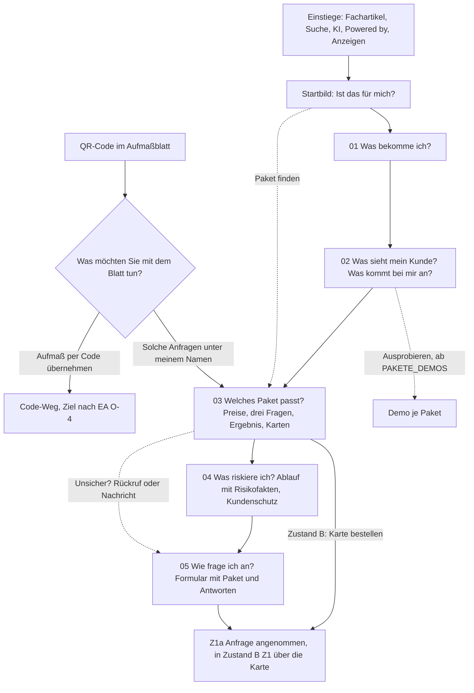
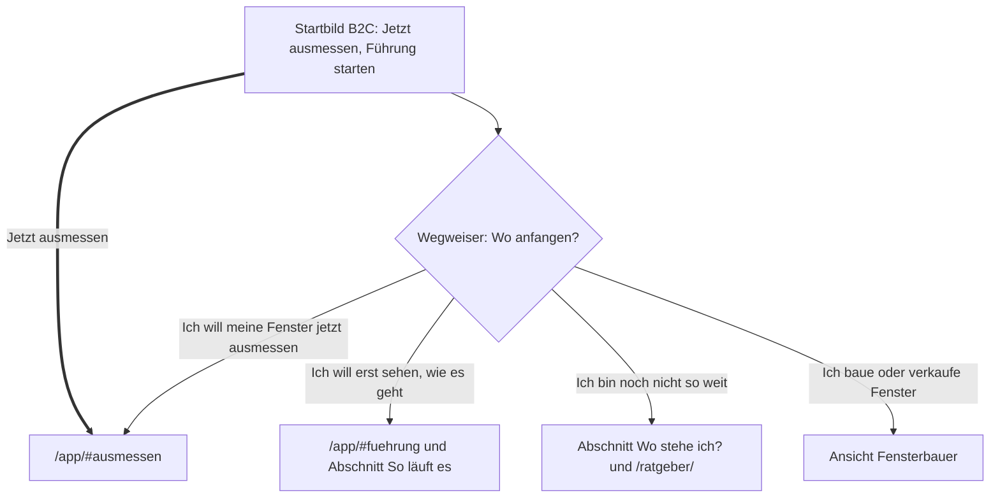

# Konzept C – Guided Decision Experience

Ergebnis 6c des Website-Blueprints (MASTER-PROMPT V4), Phase F und G. Stand 24.10.2026, Arbeitszweig `claude/design-dna-styleguide`.
Planungsdokument: Das Repository wurde nur gelesen, gebaut und geändert wurde nichts. Konzept C ist eines von vier konkurrierenden
Konzepten (A Immersive Product Experience, B Conversion-First, C Guided Decision, D eigener Ansatz). Es beruht auf derselben Design-DNA
und denselben Inhalten wie die anderen und unterscheidet sich in Informationsdramaturgie, Komposition und Nutzerführung. Über Inhalt und
Gestalt der Konzepte A, B und D trifft dieses Dokument keine Aussage; abgegrenzt wird nur gegen ihre Richtung laut Auftrag und gegen die
Ausgangsbasis aus [05-informationsarchitektur.md](../05-informationsarchitektur.md).

**Grundlage**

| Kürzel | Datei |
|---|---|
| PA | [01-projektanalyse.md](../01-projektanalyse.md) und [bestand/](../bestand/) |
| DG | [02-design-grammatik.md](../02-design-grammatik.md): Grundregeln G1–G9, Abschnittstypen T0–T14, Stufen 1–4, DG-AB-n, DG-E-n, DG-H-n |
| RE | [03-recherche.md](../03-recherche.md): Erkenntnisse E1–E19, Regeln R1–R14, Tests T1–T19 |
| EA | [04-entscheidungsarchitektur.md](../04-entscheidungsarchitektur.md): Z1, Z1a, Z1+, Z2a, Z2; FB-1 bis FB-7, HE-1 bis HE-8, M-1 bis M-7; Stufen S0–S8, B1–B5; Zweifel F-nn, H-nn; H-D-n; AB-n; O-n |
| IA | [05-informationsarchitektur.md](../05-informationsarchitektur.md): Abschnitte V1–V14, H1–H7, Bereiche K01–K37, IA-AB-n, IA-H-n, IA-O-n |
| DNA | `docs/design-dna/03-design-dna.md` (5.1 Konstruktionsformel, 5.2 Prinzipien Nr. 1–11, 5.3 Stellschrauben und Dialekte, 5.4 Signature-Effekte, 5.5 Abgrenzung) |
| SG | `docs/design-dna/04-styleguide.md` (10.1–10.10; „SG 10.7/2“ = Abschnitt 10.7, Regel 2) |
| DNA-B, PROMPT, VGL | `docs/design-dna/05-ergebnis-b-styleguide.md` (B.1–B.8), `06-design-prompt.md` (Ansichtstypen, Teil 1–10), `02-vergleich.md` (Statistik, Stilcluster) |
| SKILL, DR, GEST | `.claude/skills/premium-gestaltung/SKILL.md` (Anforderung), `…/designrichtung.md` (Regel), `docs/GESTALTUNG.md` (Regel) |
| VK, PB | `web/fuer-fensterbauer/index.html`, `web/konfigurator-bedingungen/index.html` |

**Kennzeichnungen**

- **[V]** verbindlich: Vorgabe des Inhabers (SKILL), DNA-Prinzip, Pflichtregel aus SG, Regel aus RE 3.5.1, Recht, Prüfsuite oder eine in DG
  festgelegte Hausregel. **[H]** Gestaltungshypothese dieses Konzepts; wird erst nach Prüfung (Telefon-Video, Sichtprüfung durch den
  Inhaber, Lesetest mit Fensterbauern) zur Regel. Hypothesen dieses Konzepts heißen **KC-H-n**, gesammelt im letzten Kapitel.
- **Textentwurf**: neuer Wortlaut, nur aus belegten Fakten gebildet, braucht die Freigabe des Inhabers. Antwortzeilen stehen in der
  Ich-Form des Besuchers; damit umgehen sie die offene Anrede der Hauseigentümer (EA O-13).
- **Abweichung von bestehender Regel – Freigabe durch den Inhaber nötig** markiert jeden Vorschlag gegen eine Regel in GEST oder DR,
  nummeriert als **KC-AB-n** und gesammelt am Ende von „Anwendung der Design-DNA“. Abweichungen aus EA, IA und DG, die C übernimmt, tragen
  ihre dortige Nummer.
- Bildschirm n am Telefon = y von (n − 1) × 844 bis n × 844 bei 390 × 844; am Schreibtisch 1280 × 800. „Bildschirmhöhen“ in Tabellen
  zählen ab dem Seitenanfang. Alle Lagen und Maße sind geplant, nicht gemessen.
- Schriftgrößen nur 13, 15, 17, 24, 40, am Telefon 32 statt 40 (SKILL:69). Intensität „Stufe 1–4“ nach DG 2.4.2.
- **Methode.** Geprüft wurde jede Entscheidung aus simulierten Perspektiven (Inhaber eines kleinen Fensterbaubetriebs, Büro eines
  Betriebs, B2B-Vertrieb, Hauseigentümer vor dem Fenstertausch, Prüfung der Barrierefreiheit, Crawler ohne JavaScript). Das ist eine
  Analysemethode, keine Nutzerstudie. Im Repository gibt es keine Nutzerforschung, Besucherzahlen oder Konversionsraten (PA). Aussagen
  über Wirkung sind Hypothesen; Wahrscheinlichkeiten werden nicht genannt.

---

## Leitidee und für wen es am besten passt

**Leitidee.** Die Website fragt so, wie der eigene Konfigurator fragt: wenige klare Fragen, jede mit „Weiß ich noch nicht“, und auf jede
Antwort antwortet ein Bild, so wie im Konfigurator „das Modell auf jede Wahl antwortet“ (GEST:60). Jeder Abschnitt beginnt mit der Frage,
die ein Fensterbauer an dieser Stelle hat, und gibt darauf eine sichtbare Antwort; an der Stelle der Paketwahl führt ein Paketberater mit
drei Passungsfragen zu einem begründeten Ergebnis, das in die Anfrage übernommen wird. So erlebt der Fensterbauer an seiner eigenen
Kaufentscheidung, was das Produkt seinen Kunden bietet: aus einer vagen Absicht wird eine Anfrage mit Antworten statt eines Einzeilers
(VK:80). Der Weg ist geführt, aber nie erzwungen: Preise stehen vor der ersten Frage, jede Frage lässt sich überspringen, und ohne
JavaScript ist alles als normale Seite lesbar.

**Kernfigur des Konzepts.** Ein wiederkehrendes Paar aus **Antwortbühne** (Bildschicht: ein echtes Bild, das sich mit der Wahl ändert)
und **Antwortzeilen** (Bedienschicht: drei bis vier gleich hohe Zeilen, eine davon „Weiß ich noch nicht“). Es steht im Paketberater
(Seite für Fensterbauer), im Wegweiser (Startseite) und, als Stationsliste, in den beiden Produktvorführungen. Am Telefon steht die Bühne
oben und die Zeilen darunter; am Schreibtisch stehen die Zeilen links über fünf Spalten und die Bühne rechts über sieben.

**Abgrenzung nach Richtung** (aus den Titeln im Auftrag, nicht aus den Inhalten der anderen Konzepte):

| | Konzept C setzt | Konzept C setzt nicht |
|---|---|---|
| Dramaturgie | Fragen in der Reihenfolge der Kaufentscheidung (EA S1–S6), sichtbar als Kapitel 01–05 | eine durchgehende Bild-Erzählung über viele Bildschirme; die Preise als ersten Inhalt |
| Inszenierung | Antwort auf eine Handlung des Besuchers (Antippen, Wischen); Scroll-Szenen nur im Startbild und in der Leiste | an das Scrollen gekoppelte Szenen in jedem Abschnitt |
| Entscheidungshilfe | Passungsfragen, „Weiß ich noch nicht“, Ergebnis mit Grund und Unterschied zum nächsthöheren Paket | Entscheidung allein über Markierung „Empfohlen“ und Vergleichstabelle |

**Für wen es am besten passt** (Gruppen aus EA 4.2; Eignung ist eine Einschätzung aus simulierten Perspektiven, **[H]**)

| Gruppe | Eignung | Warum |
|---|---|---|
| FB-2 sucht Software oder Konfigurator (K2, Absicht mittel) | hoch | kennt die Lösungsart, aber nicht die eigene Präferenz zwischen den Paketen; genau dort verschärft sich Überforderung (RE E8, Chernev 2015). Merkmal für Merkmal zu entscheiden senkte in Experimenten die empfundene Schwierigkeit gegenüber der Wahl ganzer Alternativen (RE E19, Valenzuela, Dhar & Zettelmeyer 2009; Konsumgüter, Übertragung **[H]**) |
| FB-6 Prüfer kurz vor dem Kauf | hoch | Risikofakten stehen an dem Schritt des Ablaufs, an dem sie gelten; das Ergebnis des Paketberaters landet im Formular (RE E17, keine doppelte Eingabe) |
| FB-3 sah „Powered by“ | hoch | seine erste Frage „Geht es ohne diesen Hinweis?“ (EA FB-3) ist Frage 2 des Paketberaters |
| M-1, M-4, M-5 Mitentscheider | mittel bis hoch | das Ergebnis lässt sich als Link weitergeben (optional, KC-H-11); Bedingungen als PDF bleiben (EA H-D13) |
| FB-4 hat ein Aufmaßblatt in der Hand | mittel bis hoch | der Hinweis bei `?von=pdf` fragt „Was möchten Sie mit dem Blatt tun?“ mit zwei Antworten (EA H-D6) |
| FB-1 Fachfrage, K1, Absicht niedrig | mittel | braucht zuerst Verstehen (S2, S3); Fragen zur Paketwahl kommen für ihn früh genug erst in Kapitel 03 |
| FB-5 ohne Kontext | mittel | die Kapitelfragen erklären die Seite beim Überfliegen (RE E1, Lesen entlang der Überschriften) |
| HE-2, HE-5 Hauseigentümer, unentschlossen | hoch | der Wegweiser der Startseite ordnet sie in einem Tipp einem Weg zu (Messen, Führung, Ratgeber) |
| HE-3 will messen | hoch, unverändert | „Jetzt ausmessen“ steht im ersten Bildschirm wie bisher (RE R12) |

---

## Website-Architektur

### Seiten

Alle Adressen, Anker und Einstiege aus IA 5.1 bleiben; keine neue indexierbare Seite (IA-H-1). Der Paketberater ist ein Teil von
`#pakete`, keine eigene Seite: Eine Seite `/fuer-fensterbauer/paket-finden/` trennte die Passungsfrage von Preis und Risikofakten (EA S4,
S5) und teilte Suchbegriffe (IA 5.1.4).

| Adresse | Rolle in Konzept C | Änderung gegenüber IA |
|---|---|---|
| `/` Startseite, Ansicht Hauseigentümer (Standard) | Bildschirm 1: Startbild B2C, unverändert in Eyebrow und h1 (Prüfsuite); Bildschirm 2: **Wegweiser** „Wo anfangen?“ mit vier Antworten, darunter der Einstieg für Hauseigentümer als Antwortabschnitte | neuer Abschnitt Wegweiser; Glas-Umschalter über dem Foto am Telefon entfällt (dafür Antwort 4 und Menü); Wechselkarte am Ende entfällt; H2 als Stationsliste zum Antippen statt scrollgekoppelt; H3 mit Bild der Kaufvorschau der App; H4 mit Weg-Maßstab |
| `/#fensterbauer` und `?von=pdf` | eingebettete Seite für Fensterbauer, unverändert eine Quelle (SKILL:63–64) | Hinweis bei `?von=pdf` als Karte mit zwei Antworten (C-Hinweis), opak über dem Startbild |
| `/fuer-fensterbauer/` | fünf Kapitel als Fragen (01 Was bekomme ich? · 02 Was sieht mein Kunde? · 03 Welches Paket passt? · 04 Was riskiere ich? · 05 Wie frage ich an?), Paketberater in Kapitel 03 | siehe „Abweichungen von IA“ unten |
| `/konfigurator-bedingungen/` | Absicherung, unverändert | jeder Risikofakt in Kapitel 04 verlinkt auf seinen Paragrafen |
| `/partner/` | Kundenkonto, unverändert; in Zustand B führen die Kartenknöpfe wie heute zu `/partner/#bestellen/<paket>` | keine; die Antworten des Paketberaters werden in Zustand B nicht übertragen (kein Feld dafür, kein Umbau des Bestellformulars) |
| Fachartikel, Ratgeber, `/app/`, Rechtsseiten, 404 | unverändert wie IA | – |

### Navigation

- **Kopf am Telefon** (Seite für Fensterbauer und Einbettung), 56 px: links Logo (Ziel 44 × 44), rechts der **Kapitel-Knopf** (≈ 88 × 44 px:
  Kapitelzahl „02/05“ in der Technikstimme 13 px und Menüzeichen) und, sobald die Cream-Pille des Startbilds aus dem Bild ist, ein Ring
  „Paket finden“ (≈ 124 × 44 px, 15 px fett; N3, N4 aus IA). An der Unterkante des Kopfs liegt ein Maßstab aus 1-px-Haarlinie mit fünf
  Strichmarken; erreichte Kapitel werden als Zustand grün (220 ms), es gibt keinen fortlaufend wachsenden Strich (DG-E-7 Option B; SG
  10.10 Nr. 14). **KC-AB-2.**
- **Kopf am Schreibtisch**, 64 px: Logo; fünf Kapitel als Textziele 15 px „01 Idee · 02 So funktioniert es · 03 Pakete · 04 Absicherung ·
  05 Anfrage“ (**Textentwurf**), die Nummer in der Technikstimme, das aktive Kapitel in `--text` mit grüner Nummer, die übrigen `--muted`;
  darunter derselbe Maßstab mit den Marken unter den Einträgen; rechts „Anmelden“ (Textziel 15 px) und Ring „Paket finden“. Bei 1024 px
  nur die Nummern 01–05 und der Name des aktiven Kapitels.
- **Menü am Telefon** (Blatt von unten nach IA K02; Einfahren als plattformübliches Sheet nach PROMPT Teil 5, bei „weniger Bewegung“ nur
  Deckkraft): Gruppe „Ihr Weg“ mit den fünf Kapitelfragen als Zeilen à 52 px (Nummer 13 px Technikstimme, Frage 17 px), das aktuelle Kapitel
  mit `aria-current`; darunter „Häufige Fragen“, „Paketbedingungen“, „Wissen für Fensterbauer“, „Anmelden“, Kontakt, Segment „Hauseigentümer ·
  Fensterbauer“. Im Kontext Hauseigentümer wie IA 5.3.3.
- **Kopf der Startseite**: wie IA 5.3.2 (Kontext Hauseigentümer), ohne Kapitel-Knopf; die Ansicht ist mit rund 6,6 Bildschirmen kurz genug.
  In der Ansicht Fensterbauer auf `/` trägt der Kopf der Startseite Kapitel-Knopf und Maßstab, weil die eingebettete Seite ihn braucht.
- **Fuß**: wie IA 5.3.5 (kurz bzw. lang).

### Wege

### Abweichungen von IA (Phase F darf abweichen, IA 5.7.4)

| Nr. | IA | Konzept C | Begründung |
|---|---|---|---|
| C-IA-1 | Abschnittsnummern 01–14 je Abschnitt (IA 5.3.7) | Kapitelnummern 01–05, Kicker als Frage des Besuchers, h2 als Antwort | Lesen entlang der Überschriften (RE E1): wer nur Kicker liest, liest die Kette S2–S6; KC-AB-1 |
| C-IA-2 | V4 Geräte-Bühne scrollgekoppelt, V5 Explosionsansicht scrollgekoppelt | Kapitel 02 mit zwei Ansichten: Stationsliste zum Antippen (C4), Aufmaßblatt mit einmaliger Explosion und Inhaltszeilen zum Antippen (C5) | Vorführung, die der Besucher selbst steuert, erzeugt stärkere Vorstellung der eigenen Nutzung als dieselbe Information passiv (RE E12, Schlosser 2003); IA 5.7.4 erlaubt eine verbindende Szene |
| C-IA-3 | V7 Kennzahlen-Leiste vor den Paketen | entfällt als Band; „0 € Gebühr je Anfrage“ und „1 PDF je Anfrage“ in der Zeile „In allen Paketen“, „3 bis 5 Werktage“ im Ablauf | Entscheidendes statisch an der Stelle der Entscheidung (RE R5); KC-AB-7 |
| C-IA-4 | V8 Karten ab der empfohlenen Karte, Risikoblock K22 unter den Karten | Paketberater zwischen Preisen und Karten; Karten ab der passenden Karte; unter den Karten eine Zeile mit drei Risikofakten, die Einzelheiten am Ablauf in Kapitel 04 | R8 bleibt erfüllt (Fakten bei den Paketen), die ausführliche Fassung steht dort, wo sie zeitlich gilt; KC-AB-5, KC-AB-8 |
| C-IA-5 | V9 Kundenschutz vor V10 Ablauf | Ablauf mit Risikofakten (C8) vor Kundenschutz (C9) | die Risikofakten schließen direkt an die Karten an (EA S5 beginnt mit dem Risiko) |
| C-IA-6 | V11 Formular mit Paketvorwahl | zusätzlich das Feld „Frage“ mit den Antworten des Paketberaters vorbefüllt, frei änderbar | keine erneute Eingabe bereits gemachter Angaben (RE R10, WCAG 3.3.7); kein neues Feld, keine Änderung an `POST /api/partner/frage` |
| C-IA-7 | Kopf mit drei Sprungmarken (Schreibtisch), Menü mit Sprungmarken | Kapitelanzeige mit fünf Kapiteln, Menü als Fragenliste | Orientierung über 13 Bildschirme ohne Lesefortschritt als laufende Linie |
| C-IA-8 | Startseite H1 mit Glas-Umschalter, H7 Wechselkarte am Ende | Wegweiser in Bildschirm 2 mit der Antwort „Ich baue oder verkaufe Fenster“; kein Glas-Umschalter am Telefon, keine Wechselkarte | ein leiser Wechsel bleibt ein leiser Wechsel, steht aber dort, wo 74 % der Betrachtungszeit liegen (RE E1, Status S); KC-AB-9 |
| C-IA-9 | Hinweis `?von=pdf` als Glas-Karte mit Text und Link | opake Karte mit zwei Antwortzeilen über dem Startbild | FB-4 trifft eine Entscheidung (Code übernehmen oder Pakete), keine Lektüre; das Glasbudget von V1 bleibt bei den Meldungen |

Unverändert gelten für Konzept C: Adressen und Anker (IA 5.1), Zielhandlungen (EA 4.1), feste Erwartungen der Prüfsuite (h1 der
Verkaufsseite wörtlich, die sieben h2-IDs, „ohne ihn programmieren zu lassen“, „Ihr eigenes Baby“, „3 bis 5 Werktage“, Ablauf in den sechs
Wörtern der Statusleiste in Reihenfolge, mindestens sechs Pflichtfragen, Preise ohne JavaScript, „Signature anfragen“ wählt das Paket vor;
`scripts/pruefen-instanzen/29.mjs:94-118`), Regeln R1–R14 und die verbindliche DNA.

---

## Seitenaufbau der Hauptseiten

### Seite für Fensterbauer `/fuer-fensterbauer/` (eingebettet auch in `/#fensterbauer`)

**Ziel** Z1 (Zustand B), bis dahin Z1a; Z1+ über Ergebnis und Unterschied zum nächsthöheren Paket. **Länge** Telefon ≈ 13 Bildschirme bis
zum Fuß (heute 19), Schreibtisch ≈ 10 (heute 16,7). **Pakete** Telefon ab Bildschirmhöhe 5,45, Schreibtisch ab 4,35 (EA H-D2: spätestens
5 bis 6 bzw. 4).

| Nr. | Abschnitt (Anker) | Kicker (**Textentwurf**) | Kette | Telefon (Bildschirmhöhen) | Schreibtisch | Stufe | Cream-Pille |
|---|---|---|---|---|---|---|---|
| C1 | Startbild | „Für Fensterbauer und Fensterhändler“ (VK:56) | S1 | 0–1,0 | 0–0,95 | 4 | „Paket finden“ |
| C2 | Leiste Elementarten | – | S1 → S3 | 0,9–1,25 | 0,95–1,2 | 3 | – |
| C3 | Die Idee `#die-idee` | 01 · WAS BEKOMME ICH? | S2 | 1,35–2,5 | 1,3–2,1 | 2 | – |
| C4 | Vom Knopf ins Postfach `#so-funktioniert-es` | 02 · WAS SIEHT MEIN KUNDE? | S3 | 2,6–3,75 | 2,2–3,1 | 4 | – |
| C5 | Was in jeder Anfrage steht `#was-in-jeder-anfrage-steht` | 02 · WAS KOMMT BEI MIR AN? | S3 | 3,85–4,95 | 3,2–4,0 | 3 | – |
| C6 | Live-Demos `#demos` | 02 · KANN ICH ES AUSPROBIEREN? | S3 → S4 | 5,05–5,35 | 4,05–4,25 | 1 | – |
| C7 | Die Pakete mit Paketberater `#pakete`, `#paket-…`, `#vergleich` | 03 · WELCHES PAKET PASST? | S4 | 5,45–7,75 | 4,35–6,0 | 2 | Knopf der passenden bzw. empfohlenen Karte |
| C8 | Von der Bestellung bis zum Livegang `#ablauf` | 04 · WAS RISKIERE ICH? | S5 | 7,85–8,95 | 6,1–6,9 | 2 | – |
| C9 | Ihre Kunden bleiben Ihre Kunden `#kundenschutz`, Anbieter | 04 · UND MEINE KUNDEN? | S5 | 9,05–9,8 | 7,0–7,6 | 2 | – |
| C10 | Bestellen oder anfragen `#bestellen`, `#frage` | 05 · WIE FRAGE ICH AN? | S6 | 9,9–11,0 | 7,7–8,5 | 1 | „Frage senden“ |
| C11 | Häufige Fragen `#haeufige-fragen` | FRAGEN | S5 | 11,1–11,8 | 8,6–9,2 | 1 | – |
| C12 | Hintergrund (`#warum-kunden-selbst-planen`, `#quellen`, `#wissen-fuer-fensterbauer`) | HINTERGRUND | – | 11,9–12,25 | 9,3–9,5 | 1 | – |
| C13 | Abschluss | – | S6 | 12,35–12,95 | 9,6–10,1 | 2 | Zeile des passenden bzw. empfohlenen Pakets |
| – | Brotkrumen, Fuß kurz | – | – | 13,0–13,8 | 10,1–10,6 | – | – |

**C1 Startbild** (S1; Gewicht: ein voller Bildschirm, höchste Stufe der Seite)

- **Funktion:** Zuordnen, Hauptaussage, Preisniveau, nächster Schritt ohne Scrollen (RE R12).
- **Inhalt:** Kicker (VK:56); h1 „Ihr eigener Fenster-Konfigurator, unter Ihrer Marke“, grün „Marke“ (VK:57, Prüfsuite wörtlich); Haken-Chips
  in einer Zeile „Ihre Domain · Ihre Marke · Anfrage als PDF“ (**Textentwurf** IA); Cream **Textentwurf** „Paket finden“ mit Pfeil im Kreis →
  `#pakete` (setzt den Fokus auf Frage 1 des Paketberaters); Ring **Textentwurf** „Ausprobieren“ → `#demos` (VK:63 gekürzt); Preiszeile 13 px
  „Ab 29 € im Monat, netto, plus Einrichtung · vorläufige Preise“ (**Textentwurf** IA; RE T1); Meldungsstapel mit drei als „Beispiel“
  gekennzeichneten Meldungen (VK:55), endet nach der dritten (EA AB-8). Rund 38 Wörter außerhalb des Kopfs. **KC-AB-3.**
- **Komposition Telefon:** Kopf 0–56 flächenlos über dem dunklen oberen Bildrand, Scrim `#161616` 60 % → 0 über 96 px (DG T0). Foto
  `fb-sessel.webp` y 0–556 (66 % der Höhe; ab y = 0 nur bei ruhigem oberem Rand, sonst y 56–556; DG-E-11), unteres Viertel in `#161616`
  ausgeblendet. Glas-Stapel rechts oben y ≈ 72–160, ≈ 220 px breit (56 % der Breite), Papierflieger links frei (GEST:447). Kicker y ≈ 456,
  h1 drei Zeilen y ≈ 476–577 im Auslauf; Chips y ≈ 593–629 (36 px); Cream (≈ 196 × 52) und Ring (≈ 154 × 52) nebeneinander y ≈ 645–697
  im Daumenbereich; Preiszeile y ≈ 709–725; ab y ≈ 760 schneidet die Leiste C2 an (84 px ≈ 10 %). Frei bleiben die dunkle Wand um das
  Bullauge und die Ausläufe (≥ 33 %, SG 10.1/3).
- **Komposition Schreibtisch:** Text links über 5 von 12 Spalten (x ≈ 120–533), Foto ab x ≈ 553 bis an den Fensterrand (≈ 57 % der
  Breite), y 0–760; h1 40 px in zwei bis drei Zeilen; Cream und Ring nebeneinander im ersten Bildschirm; Leiste ab y ≈ 740 angeschnitten.

**C2 Leiste Elementarten** (S1 → S3; ≈ 0,3 Bildschirme)

- **Funktion:** Breite des Konfigurators ohne Text (F-14 teilweise, ohne Zusage zum Sortiment, EA O-17).
- **Inhalt und Komposition:** wie DG T2 (V2): echte Bilder der Elementarten aus dem eigenen Modell, sobald aufgenommen, bis dahin die
  Zeichnungen im Stil des Aufmaßblatts; Mitte 1,25-fach unter einem Lichtkegel, Name nur unter dem Kegel (15 px, frontal); Telefon 144 px
  hoch, Schreibtisch 176 px; versetzt sich nach dem Scrolltempo und läuft mit Trägheit aus, keine Dauerschleife. Liste der Elementarten
  nach PA-Frage 29.
- **Rolle in C:** Die Leiste nimmt den Lichtstreifen aus dem Startbild auf (Rahmenbruch nach DG-E-4 A) und ist der einzige Abschnitt,
  der sich allein mit dem Scrollen bewegt, bevor die Seite in die Kapitel wechselt.

**C3 Kapitel 01 „Was bekomme ich?“** `#die-idee` (S2; ≈ 1,15 Bildschirme)

- **Funktion:** Was der Fensterbauer bekommt und was es gegenüber Kontaktformular und Hersteller-Konfigurator anders macht.
- **Inhalt:** h2 „Die Idee: der Fenster-Konfigurator Ihrer Wahl“, grün „Wahl“ (VK:74); Held: Gegenüberstellung als ein Bild (hinten
  Einzeiler „Bitte um Angebot für 3 Fenster“, **Textentwurf**, „Beispiel“; vorn die erste Seite des Aufmaßblatts, überdeckt den Einzeiler
  zu höchstens einem Drittel; DG T3 Fassung A); Lead VK:61 in höchstens drei Zeilen; vier Punkte je eine Zeile (VK:75-81, darin „Ihr eigenes
  Baby“, Prüfsuite); zwei **Kurzantworten** im Frage-Antwort-Satz der Seite: „Brauche ich eine Website? Nein. Ihr Konfigurator ist selbst
  eine Seite unter Ihrer Domain.“ (VK:239; Frageform **Textentwurf**) und „Bringt eeziframes mir Kunden? Nein. Ihr Konfigurator ist Ihr
  Werkzeug; den Link teilen Sie dort, wo Ihre Kunden Sie finden.“ (**Textentwurf** nach EA H-D4, VK:239).
- **Komposition:** Telefon: Bild 358 × 300 direkt unter der h2, Lesestapel darunter; Schreibtisch: Text links über 5 Spalten, Bild rechts
  über 7. Kurzantworten als zwei Zeilen: Frage 15 px `--muted`, Antwort 17 px, das Wort „Nein.“ fett in `--text`.

**C4 Kapitel 02 „Was sieht mein Kunde?“** `#so-funktioniert-es` (S3; ≈ 1,15 Bildschirme)

- **Funktion:** Vorführen, was der Kunde des Betriebs erlebt, im Tempo des Besuchers.
- **Inhalt:** h2 „So funktioniert es“; **Stationsliste** mit fünf Stationen (VK:87-93; Stationswort und Satz **Textentwurf**, gekürzt): 01
  Knopf „Ihr Kunde kommt über Ihren Link oder Knopf auf Ihre Domain.“ · 02 Planen „Er plant selbst: Fotos, Maße, Wünsche.“ · 03 Senden „Er
  sendet seine Anfrage und bekommt sie als PDF.“ (VK:240) · 04 Postfach „Sie bekommen das Aufmaßblatt per E-Mail.“ · 05 Angebot „Sie
  kalkulieren und fahren erst zum Feinaufmaß, wenn der Auftrag kommt.“ (VK:92); darunter eine Zeile zu F-10: „Ihr Kunde sieht nur Ihren
  Betrieb: keine Preise, keine Werbung.“ (VK:240). Ein Beispielbetrieb, eine Beispielfamilie, eine Beispieldomain auf der ganzen Website
  (DG G7; PA-Frage 25).
- **Held:** ein Telefon mit echten Bildschirmen je Station: 01 Startansicht der Instanz „Fensterplaner von Fensterbau Brandt“ (GEST:460,
  „Beispiel“), 02 das Modell bei der Wahl der Öffnungsart, das Fenster öffnet sich einmal (Bildfolge aus der eigenen WebGL-Bühne), 03 der
  Bildschirm nach dem Senden mit „Meine Anfrage als PDF“, 04 die E-Mail an den Betrieb mit dem PDF-Anhang, 05 die erste Seite des
  Aufmaßblatts. Kein Flieger, kein Umschlag (SKILL:125).
- **Komposition Telefon:** Kopf des Abschnitts y 0–130; Telefon 200 × 410 px mittig (≈ 25 % der Fläche) y ≈ 146–556 vor einem Lichtraum
  (Bildschirm als Quelle, Cream ≤ 12 %, Lichthof 1–1,5 × Telefonbreite) über Messraster, zum Rand und unter Text ausgeblendet; Stationsliste
  y ≈ 572–812, fünf Zeilen à 44 px, die aktive Zeile 64 px mit ihrem Satz in 15 px. Wischen über dem Telefon wechselt die Station.
- **Komposition Schreibtisch:** Stationsliste links über 5 Spalten (Zeilen à 64 px), rechts über 7 Spalten ein Browserfenster mit der
  Startansicht unter der Beispieldomain (≈ 600 × 375), davor das Telefon (≈ 240 × 490), das die linke untere Ecke des Browsers um ein
  Drittel seiner Breite überdeckt (Verdeckung). Kein Anheften.
- **Ohne Bedienung lesbar:** Alle fünf Stationen stehen als Text in der Liste; wer nicht tippt, liest den Ablauf vollständig und sieht
  Station 01.

**C5 Kapitel 02 „Was kommt bei mir an?“** `#was-in-jeder-anfrage-steht` (S3; ≈ 1,1 Bildschirme)

- **Funktion:** Beweis am echten Ergebnis.
- **Inhalt:** h2 „Was in jeder Anfrage steht“, grün „Anfrage“; Held das echte Aufmaßblatt `web/bilder/tour-aufmassblatt-15.webp`
  („Beispiel“); sieben **Inhaltszeilen** (VK:123-131: Maueröffnung mit drei Breiten und drei Höhen · Fensterelement · Fotos und
  Einbausituation · Teilung und Öffnung · Material, Farbe, Glas · Sonnenschutz und Montage · Klärungsliste), die eine Fassung des
  Inhaltskatalogs (IA K15); Zeile zu F-09 (PB:44 § 2 (4)): „Die Maße im Aufmaßblatt sind Angaben Ihrer Kunden; vor der Fertigung messen Sie
  selbst nach.“
- **Komposition Telefon:** Blatt 330 px breit (85 %), ≈ 313 px hoch, um −2° gedreht, Bestellmaß-Karte opak `#1f1f1f` mit Lichtkante über
  dem unteren Drittel; Inhaltszeilen darunter, sieben Zeilen à 44 px. Beim ersten Eintritt lösen sich die Schichten Maße · Fotos ·
  Klärungsliste einmal um 0 / 28 / 56 px nach oben und 0 / 12 / 24 px nach rechts (DG T5) und bleiben stehen; Antippen einer Inhaltszeile
  hebt die zugehörige Schicht um weitere 12 px in Lichtrichtung und nimmt die übrigen auf 50 % Deckkraft zurück.
- **Komposition Schreibtisch:** Inhaltszeilen links (5 Spalten), Blatt rechts (7 Spalten), Führungslinien 1 px von der aktiven Zeile zur
  Schicht.

**C6 Live-Demos** `#demos` (S3 → S4; ≈ 0,3 Bildschirme): wie IA V6 (Zustand A zwei Zeilen mit dem offenen Hinweis auf die Fassung für
Hauseigentümer und Ring „Konfigurator ausprobieren“; mit `PAKETE_DEMOS` drei Zeilen à 56 px). Pflicht-h2 bleibt.

**C7 Kapitel 03 „Welches Paket passt?“** `#pakete` (S4; ≈ 2,3 Bildschirme, der Kern des Konzepts)

- **Funktion:** Preise zuerst, dann die eigene Lage klären, dann das passende Paket mit Grund, dann alle Karten.
- **Inhalt in dieser Reihenfolge:**
  1. h2 „Die Pakete“, grün „Pakete“ (VK:171); Leitsatz VK:172 „Drei Pakete, ein Konfigurator: Sie entscheiden, wie sehr er Ihre Marke
     trägt.“
  2. **Namensleiste** mit drei Segmenten (Kurzname 13 px nach PA-Frage 22, Monatspreis 15 px fett), Tippen springt zur Karte und überspringt
     den Paketberater (R9; EA AB-11).
  3. Zeile „In allen Paketen“ (**Textentwurf** aus EA 4.3.3 und VK:70, :237): „In allen Paketen: Ihre eigene Domain, der volle
     Konfigurator, jede Anfrage als Aufmaßblatt-PDF per E-Mail. Keine Gebühr je Anfrage.“
  4. **Paketberater**: Antwortbühne und drei Fragen (Logik unten), danach das Ergebnis mit Grund und dem Unterschied zum nächsthöheren Paket,
     daneben „Antworten ändern“ und, optional, „Auswahl als Link weitergeben“ (KC-H-11).
  5. Drei Paketkarten (IA K19, aus `web/assets/pakete.js:42-67`), am Telefon als Wischreihe ab der passenden Karte, ohne Antworten ab der
     empfohlenen; das Beispielbild unten in der Karte wischt mit und läuft leicht nach (SKILL:121-122).
  6. Vergleich gruppiert, zugeklappt (IA K20; EA AB-6).
  7. **Zeile mit drei Risikofakten** direkt unter den Karten (R8), **Textentwurf** aus PB:48, :54, :69: „Vertrag erst mit Ihrer Zahlung ·
     Monatsabo erst ab Livegang · monatlich kündbar“, dazu Link „Was nach der Anfrage passiert“ → `#ablauf`.
  8. Verkaufsstand als ein Satz, kleiner als die Preise: „Vorläufige Preise, Stand 22.10.2026.“ (EA AB-4; `web/assets/pakete.js:15-17`).
  9. Gesprächsweg Ring **Textentwurf** „Unsicher, welches Paket passt? Rückruf oder Nachricht“ → `#frage` mit Paket „Noch offen“
     (`functions/pakete-seite.js:177-182`) und den bisherigen Antworten.
  10. Rechtshinweis 13 px: netto, nur für Unternehmer nach § 14 BGB (VK:188).
- **Komposition Telefon:** Kopf, Leitsatz, Namensleiste und Zeile „In allen Paketen“ belegen ≈ 310 px und scrollen weg. Danach steht der
  Paketberater als **ein Block von ≈ 560 px**: Antwortbühne 358 × 200 px (≈ 22 % der Bildschirmfläche) und darunter die Fragekarte
  (≈ 350 px). Liegt die Bühne unter dem Kopf (y ≈ 56–256), steht die Karte bei y ≈ 272–622; Bühne und Antworten sind gleichzeitig zu sehen.
  Die Fragekarte: opak `#1f1f1f`, 2-px-Ring `#2b2b2b`, Radius 24, Innenabstand 16; oben „FRAGE 1 VON 3“ in der Technikstimme mit einem
  Maßstab aus drei Marken; Frage 17 px fett in höchstens zwei Zeilen; drei bis vier Antwortzeilen à 56 px (Pille, Text 17 px links,
  Markierungskreis 22 px rechts). Eine beantwortete Frage schrumpft auf eine Zusammenfassungszeile von 44 px („Aussehen · In Ihrem Design ·
  ändern“), die nächste öffnet sich darunter. Nach Frage 3 steht in der Karte das Ergebnis (≈ 150 px), darunter folgen die Karten.
- **Komposition Schreibtisch:** Kopf, Leitsatz und Namensleiste über die volle Spalte; darunter der Paketberater im Split: Fragekarte
  links über 5 Spalten (alle drei Fragen untereinander, ≈ 420 × 460 px), Antwortbühne rechts über 7 Spalten (Browserfenster ≈ 600 × 375,
  davor ein Telefon ≈ 150 × 300 mit derselben Ansicht, das die linke untere Ecke um ein Drittel seiner Breite überdeckt). Darunter die drei
  Karten nebeneinander, Zeilen über `subgrid` auf gleicher Höhe, Karte ohne aufgeklappte Liste ≤ 640 px, damit Preis und Knopf in einem
  800-px-Bildschirm stehen (EA S4).

**Paketberater: Logik und Ehrlichkeitsregeln** (**[V]** für die Regeln, **Textentwurf** für den Wortlaut)

| Frage | Antwortzeile | Merkmal in `web/assets/pakete.js` | Folge |
|---|---|---|---|
| 1 „Wie soll Ihr Konfigurator aussehen?“ | „Im eeziframes-Design, mit meinem Namen“ | `gestaltung: 'standard'` | keine Einschränkung |
| | „In meinem Design: Logo, Firmenfarbe, Fotos“ | `gestaltung: 'eigen'`, `logo`, `farbe`, `fotos`, `startansicht` | mindestens das Paket mit diesen Merkmalen |
| | „Weiß ich noch nicht“ | Wert des empfohlenen Pakets | wie Empfehlung |
| 2 „Wie sichtbar darf eeziframes sein?“ | „Ein deutlicher Hinweis ist in Ordnung“ | `kennzeichnung: 'deutlich'` zulässig | keine Einschränkung |
| | „Höchstens ein kleiner Hinweis im Fuß“ | `kennzeichnung: 'dezent'` oder `'keine'` | mindestens das Paket mit diesem Merkmal |
| | „Gar keiner, auch nicht im PDF und in E-Mails“ | `kennzeichnung`, `pdfKennzeichnung`, `mailKennzeichnung: 'keine'` | das Paket mit diesen Merkmalen |
| | „Weiß ich noch nicht“ | Wert des empfohlenen Pakets | wie Empfehlung |
| 3 „Laden Sie Kunden persönlich ein?“ | „Ja: mit Einladungslinks und Fortschritt, für mein Team“ | `dashboard`, `einladungslinks`, `fortschritt`, `zugaenge` | das Paket mit diesen Merkmalen |
| | „Nein, ich teile einfach meinen Link“ | – | keine Einschränkung |
| | „Weiß ich noch nicht“ | Wert des empfohlenen Pakets | wie Empfehlung |

- **Ergebnis:** das günstigste Paket, das alle gewählten Merkmale hat. Abgefragt werden Merkmale, nie Paketnamen; so verlangt es die Regel im
  Kopf von `web/assets/pakete.js` („Code fragt Merkmale ab …, nie den Schlüssel des Pakets“). Verschiebt der Inhaber ein Merkmal, folgt der
  Paketberater ohne Änderung.
- **„Weiß ich noch nicht“** setzt den Wert des Pakets ein, das der Inhaber empfiehlt (EA O-5; heute Plus per Konstante,
  `functions/pakete-seite.js:32-33`), und sagt das in der Zeile selbst: Unterzeile 13 px **Textentwurf** „Dann gilt unsere Empfehlung.“
  Voreinstellungen wirken, wenn sie als Empfehlung gelesen werden (RE E9, Jachimowicz 2019); hier ist die Empfehlung offen benannt.
- **Keine Vorauswahl** einer Antwort, kein Countdown, keine Verlustformulierung (R7; RE E13).
- **Ergebnisblock:** Kicker 13 px grün „PASST ZU IHREN ANTWORTEN“, Paketname 17 px fett in Versalien wie vorgegeben („EEZI Essential Plus“),
  Grund 15 px aus den gewählten Antworten (**Textentwurf** z. B. „Weil Ihre Kunden Ihr Logo, Ihre Farbe und Ihre Fotos sehen sollen.“),
  Unterschied zum nächsthöheren Paket 15 px `--text2` aus den abweichenden Merkmalen mit `vergleich: true` und der Preisdifferenz (**Text-
  entwurf** z. B. „Mit Signature zusätzlich: kein Hinweis auf eeziframes, Dashboard mit Einladungslinks. +25 € im Monat, +80 € Einrichtung.“;
  Differenzen aus PAK 1.1, eigene Rechnung nach `web/assets/pakete.js:44-60`; RE T5). Beim höchsten Paket entfällt die Zeile. Ein Hinweis auf
  den späteren Wechsel nach oben (PB:71) steht hier erst nach Entscheidung von EA O-26.
- **Kennzeichen an der Karte:** Nach dem Ergebnis trägt die passende Karte die Pille „Passt zu Ihren Antworten“ und den einzigen
  Cream-Knopf; die Pille „Empfohlen“ entfällt dann, damit nie zwei Markierungen gleichzeitig stehen (Empfehlungsschilder können die Zahl
  erwogener Optionen erhöhen, RE E9, Goodman 2013, Status N). Ohne Antworten und ohne JavaScript bleibt „Empfohlen“ mit Grund (RE T4).
  **KC-AB-5.**
- **Antwortbühne:** zeigt die Startansicht des Konfigurators so, wie sie das jeweils passende Paket trägt: eeziframes-Design mit Namen und
  „Powered by EEZIframes“ im Fuß → eigenes Design mit Logo, Farbe und Foto, kleiner Hinweis im Fuß → ohne Hinweis, dahinter angeschnitten
  eine Karte des Dashboards (eingeladen · in Bearbeitung · eingereicht). Vor der ersten Antwort steht die Ansicht des empfohlenen Pakets mit
  der Zeile „Beispiel“. Bis echte Bilder vorliegen (EA O-12), zeichnet die vorhandene Skizze aus den Merkmalen (`skizze(m)` in
  `functions/pakete-seite.js:99-104`) die Stufen, ohne Text; ab dann Bildschirmaufnahmen der Instanz-Startansicht aus `web/assets/einladung.js`
  unter der Beispieldomain `ihr-name-fenster.de` (DG-H-7).
- **Ohne JavaScript:** statt der Fragen eine Entscheidungshilfe aus drei Zeilen (**Textentwurf**): „Ihr Name im eeziframes-Design genügt:
  EEZI Essential“ · „Ihr Logo, Ihre Farbe, Ihre Fotos, Startseite in Suchmaschinen: EEZI Essential Plus“ · „Kein Hinweis auf eeziframes,
  Einladungslinks fürs Team: EEZI Signature“; darunter die Karten mit Preisen (Prüfsuite 29.1). Dieselbe Hilfe liest ein Crawler.

**C8 Kapitel 04 „Was riskiere ich?“** `#ablauf` (S5; ≈ 1,1 Bildschirme)

- **Funktion:** Ablauf, Dauer und alle Ausstiegspunkte an einer Linie: was wann passiert und wo der Betrieb noch zurück kann.
- **Inhalt:** h2 „Von der Bestellung bis zum Livegang“, grün „Livegang“; Dauer als Zahl in der Titelrolle „3–5“ 32 px mit „Werktage nach der
  Zahlung, meist“ 15 px (VK:193; Prüfsuite „3 bis 5 Werktage“ im Lesetext daneben; ob gemessen, ist offen, EA O-8); der **Ablauf-Maßstab** mit
  sechs Marken in den Wörtern der Statusleiste (`web/assets/instanzregeln.js:74-77`) und je Schritt ein Satz und, wo einer gilt, ein Risikofakt
  (**Textentwurf** nur aus PB):

  | Schritt | Satz | Risikofakt (Haken grün) bzw. Grenze (ohne Haken, `--text2`) | Beleg |
  |---|---|---|---|
  | Bestellt | Sie wählen Ihr Paket und geben Ihre Angaben ein. | Noch kein Vertrag. | PB:48 |
  | Bezahlt | Mit Ihrer Zahlung der Einrichtung beginnt der Vertrag. | – | PB:48, :53 |
  | In Einrichtung | Wir legen Ihren Konfigurator an und gestalten ihn. | Bis hierhin stornieren Sie mit voller Erstattung. Grenze: Ab Beginn der Einrichtung wird sie nicht erstattet. | PB:58-59, :70 |
  | Domain gesichert | Ihre Wunsch-Domain bis 25 € Jahrespreis ist enthalten. | – | PB:64 |
  | Zur Freigabe | Sie sehen Ihren Konfigurator in einer Vorschau und geben ihn frei. | – | PB:60 |
  | Live | Erst jetzt beginnt das Monatsabo. | Monatlich kündbar, ohne Mindestlaufzeit. | PB:54, :69 |

  Darunter, was der Betrieb bereithält (**Textentwurf** EA 4.3.1, H-D5) und Link „Paketbedingungen mit AV-Vertrag“ (44-px-Ziel). Die
  Erstattung bei Nichtfreigabe bleibt ohne Aussage, bis EA O-16 entschieden ist.
- **Komposition Telefon:** Maßstab an der linken Kante x 16–40, ≈ 560 px hoch, Marken im Abstand von ≈ 104 px, Ziffern 01–06 in der
  Technikstimme; Schritte rechts ab x 56: Schrittwort 17 px fett, Satz 15 px, Risikofakt 15 px. Erreichte Marken werden grün, sobald ihr
  Schritt die Bildschirmmitte passiert (Zustand, 220 ms; DG T8). Schreibtisch: Maßstab links, Schritte über 7 Spalten, Dauer links oben.

**C9 Kapitel 04 „Und meine Kunden?“** `#kundenschutz`, Anbieter (S5; ≈ 0,75 Bildschirme)

- **Inhalt:** h2 wörtlich „Ihre Kunden bleiben Ihre Kunden“ (VK:159; ohne grünes Wort, GEST:450); vier Zusagen im Wortlaut der Prüfsuite (VK:160-
  166) als Ankerkachel über volle Breite und drei kleinere Kacheln (DG-AB-11); Link „Paketbedingungen § 10“; Anbieterblock **Textentwurf**
  „eeziframes ist ein Angebot von Patrick Kies, Herzebrock-Clarholz.“ mit E-Mail (PB:33; Telefon und Bild nach EA O-9). F-12 und F-13 ohne
  Aussage bis EA O-15, O-18.
- **Komposition:** Held **[H]** die Startansicht einer Instanz, die nur den Beispielbetrieb zeigt, 358 × 240 px (DG T6, DG-H-7); ohne dieses
  Bild ist die erste Kachel der Anker (DG-E-1).

**C10 Kapitel 05 „Wie frage ich an?“** `#bestellen`, `#frage` (S6; ≈ 1,1 Bildschirme): wie IA V11 mit Zustand A und B, ergänzt um die
Vorbelegung: Paket aus Ergebnis oder Karte, Feld „Frage“ mit **Textentwurf** „Meine Antworten aus der Paketberatung: in meinem Design;
Hinweis höchstens im Fuß; ohne Dashboard.“, frei änderbar. Ohne Antworten bleibt das Feld leer. Cream „Frage senden“ volle Breite am Telefon.
Dank ersetzt das Formular, Fokus auf den Dank (PA 1.10 Nr. 14).

**C11 Häufige Fragen** `#haeufige-fragen` (≈ 0,7 Bildschirme): acht Fragen wie IA V12, Zeilen mit Haarlinien (DG-AB-19), JSON-LD wortgleich.

**C12 Hintergrund** (≈ 0,35 Bildschirme): drei zugeklappte Zeilen wie IA V13 (Zahlen zum Handwerk mit Quellen, Quellen, Wissen für
Fensterbauer).

**C13 Abschluss** (S6; ≈ 0,6 Bildschirme): **Textentwurf** „Drei Pakete, ein Konfigurator.“; drei Zeilen à 56 px mit Kurzname 17 px,
Monatspreis 17 px und Einrichtung 13 px; die Zeile des passenden Pakets (sonst des empfohlenen) trägt die Cream-Pille „… anfragen“ bzw. „…
bestellen“; darunter Ring „Frage stellen“ und, wenn beantwortet, Textziel „Antworten ändern“ → zurück zum Paketberater. Held: Ausschnitt des
Startbilds als ruhige Klammer 390 × 240 px, ausgeblendet (DG-H-8). In der Einbettung folgt der Fuß der Startseite.

**Zustände der Seite in C**

| Ort | Zustand A (heute) | Zustand B (`PAKETE_OFFEN=1`) | zusätzlich `PAKETE_DEMOS=1` |
|---|---|---|---|
| C1 | Cream „Paket finden“, Ring „Ausprobieren“, Preiszeile mit „vorläufige Preise“ | gleich | Ring **Textentwurf** „Live-Demo ansehen“ |
| C7 Ergebnis | „Passt zu Ihren Antworten“, Karte mit Cream „… anfragen“ | Cream „… bestellen“ → `/partner/#bestellen/<paket>`; darunter **Textentwurf** EA H-D1 „Für die Bestellung brauchen Sie …“ | kleiner Link „Demo“ je Karte (RE T11) |
| C7 Verkaufsstand | „Vorläufige Preise, Stand …“ | entfällt mit `VORLAEUFIG = false` | – |
| C10 | Formular als Abschluss, mit Antworten vorbefüllt | Formular als „Vorher eine Frage?“ mit Ring, solange eine Bestell-Pille im Bildschirm steht | – |
| C13 | „… anfragen“ | „… bestellen“ | – |

### Startseite `/` (Rahmen und die ersten zwei Bildschirme)

**Aufgabe in C:** eine Weiche, die fragt, statt umzuschalten. Bildschirm 1 bedient den häufigsten Fall direkt (messen), Bildschirm 2 ordnet
alle übrigen in einem Tipp zu. Eyebrow und h1 bleiben wörtlich (Prüfsuite); Standard bleibt die Ansicht Hauseigentümer (IA 5.1.2).

| Nr. | Teil | Funktion | Inhalt | Gewicht (Telefon) | Stufe | Cream |
|---|---|---|---|---|---|---|
| R1 | Bänder | Stand melden | Pilotleiste nur ohne Server; Einführungsband auf `/` entfällt, Preis steht im Startbild (IA-AB-6) | höchstens 40 px | – | – |
| R2 | Kopf | Orientierung | Kontext Hauseigentümer (IA 5.3.2), am Schreibtisch mit Umschalter neben dem Logo | 56 px | 1 | Kopfknopf nur, wenn keine Cream im Bild |
| H-C1 | Startbild B2C | B1: Ist das für mich, schaffe ich das? | Eyebrow „In Minuten zum Aufmaß für jeden Fensterbauer“, h1 „Fenster ausmessen. Selbst. eezi.“, grün „eezi.“ (Prüfsuite); Lead „Zwei Fotos und die Maße mit dem Zollstock, jeder Schritt erklärt.“ (**Textentwurf** IA aus `web/index.html:58`); Cream „Jetzt ausmessen“, Ring „Führung starten“; Preiszeile 13 px „Messen kostenlos, ohne Konto · Aufmaßblatt 7,99 € bis 17.11.2026, danach 12,99 €“ (nach dem Stichtag „Aufmaßblatt 12,99 €“) | 0–1,0 | 3 | „Jetzt ausmessen“ |
| H-C2 | **Wegweiser** | B1 → B2: Welcher Weg passt zu mir? | Kicker „01 · WO ANFANGEN?“, h2 **Textentwurf** „Wo anfangen?“, grün „anfangen“; Antwortbühne; vier Antwortzeilen (unten); unter der gewählten Zeile ein Antwortfeld mit einem Satz und einem Knopf | 0,92–2,0 | 2 | nur im Antwortfeld von Antwort 1 |
| R4 | Einstieg für Hauseigentümer | B2–B4 | siehe nächster Unterabschnitt | 2,1–6,55 | – | – |
| R6 | Fuß kurz | Recht, Kontakt | IA K07 | ≈ 0,8 | 1 | – |
| R7 | Textfassung ohne JavaScript | Crawler | dieselbe Abschnittsfolge; der Wegweiser als Liste aus vier Links mit ihren Antwortsätzen | – | – | – |

**Wegweiser: Antworten** (Ich-Form, **Textentwurf**; Belege für die Antwortsätze in Klammern)

| Antwortzeile | Antwortfeld (ein Satz) | Knopf | Antwortbühne |
|---|---|---|---|
| „Ich will meine Fenster jetzt ausmessen.“ | „Zwei Fotos und die Maße mit dem Zollstock, jeder Schritt erklärt. Messen kostenlos, ohne Konto.“ (`web/index.html:58`, `:61-62`) | Cream „Jetzt ausmessen“ → `/app/#ausmessen` (mit angefangenem Aufmaß „Aufmaß fortsetzen“) | erster Messschritt der App im Telefon (Bildschirmaufnahme, neu) |
| „Ich will erst sehen, wie es geht.“ | „Die Führung zeigt ein Beispielfenster vom Foto bis zum Aufmaßblatt, ohne eigene Maße.“ (`web/assets/app.js:6302-6539`) | Ring „Führung starten“ → `/app/#fuehrung`; Textziel „So läuft es“ → H-C3 | 3-D-Modell des Beispielfensters (Bildschirmaufnahme der Führung) |
| „Ich bin noch nicht so weit.“ Unterzeile 13 px: „tauschen oder reparieren, welches Fenster“ | „Der Ratgeber führt in sechs Schritten vom ersten Zweifel bis zum Einbau.“ (`docs/SEO.md:93`) | Ring „Zum Ratgeber-Weg“ → H-C5 | eine Zeichnung aus den Ratgebern (weiße Karte, Orange und Blau) |
| „Ich baue oder verkaufe Fenster.“ | „Ihr eigener Fenster-Konfigurator, unter Ihrer Marke.“ (VK:57) | Ring „Zur Seite für Fensterbauer“ → schaltet die Ansicht und springt an ihren Anfang | Ausschnitt `fb-sessel.webp` (Astronaut am Bullauge) |

Vor der ersten Wahl zeigt die Bühne die erste Seite des Aufmaßblatts mit „Beispiel“ (das Ergebnis, das alle Wege gemeinsam haben). Die
gewählte Zeile trägt den Zustand „aktiv“ als Ring in Schriftfarbe mit grünem Haken (KC-AB-6), sie öffnet ihr Antwortfeld direkt unter sich
(Höhe wechselt sofort, Inhalt blendet in 220 ms über Deckkraft ein; DG-E-14 Option A); höchstens ein Antwortfeld ist offen.

### Einstieg für Hauseigentümer (Ansicht `/#hauseigentuemer` unterhalb des Wegweisers)

**Ziel** Z2a, dann Z2 in der App. **Länge** Telefon ≈ 6,6 Bildschirme bis zum Fuß (heute 7,4), Schreibtisch ≈ 4,8. Abschnittsnummern wie
DG 2.3.17, Kicker als Frage in der Ich-Form.

| Nr. | Abschnitt | Kicker (**Textentwurf**) | Kette | Telefon | Schreibtisch | Stufe | Cream |
|---|---|---|---|---|---|---|---|
| H-C3 | So läuft es (Was im Aufmaß steckt) | 02 · WIE LÄUFT DAS AB? | B2 | 2,1–3,6 | 1,8–2,6 | 3 | – |
| H-C4 | Was es kostet, wer die Fotos sieht | 03 · WAS KOSTET ES? | B2, B3 | 3,7–4,45 | 2,7–3,2 | 2 | – |
| H-C5 | Der Weg zu neuen Fenstern | 04 · WO STEHE ICH? | Zubringer | 4,55–5,2 | 3,3–3,7 | 2 | – |
| H-C6 | Häufige Fragen | 05 · FRAGEN | B3 | 5,3–5,95 | 3,8–4,3 | 1 | – |
| H-C7 | Abschluss | – | B4 | 6,05–6,55 | 4,4–4,8 | 2 | „Jetzt ausmessen“ |

- **H-C3 So läuft es** (B2; ≈ 1,5 Bildschirme): h2 „Was im Aufmaß steckt.“ mit Zusatz „je Fenster, wie beim Termin vor Ort“
  (`web/assets/portal.js:779`); Held eine Bühne 358 × 420 px (≈ 45 % der Bildschirmfläche) mit vier Stationen Foto → Maß → Modell → Blatt
  (App-Bildschirm mit Sucher; Maueröffnung mit orangen Maßlinien; 3-D-Modell, das sich bei Station 3 einmal öffnet; `tour-aufmassblatt-15.webp`
  mit „Beispiel“); darunter die Stationen als Auswahlgruppe aus vier Pillen à 84 × 44 px und je ein Satz 17 px; dann die eine Fassung des
  Inhaltskatalogs (IA K15), die Messangabe aus `web/index.html:59` („Je Fenster drei Breiten und drei Höhen der Maueröffnung, dazu das
  Rahmenmaß. Es zählt das kleinste Maß.“), Elementarten als Chips in einer Wischzeile (Liste nach PA-Frage 29) und die Zeile „Grundlage für
  Angebote, kein Bestellmaß“ (AGB:35 § 2 (4)). Wischen über der Bühne oder Antippen der Pille wechselt die Station; nicht als „Handy zu
  Briefumschlag“ (SKILL:125). Schreibtisch: Bühne rechts (7 Spalten), Pillen und Sätze links.
- **H-C4 Was es kostet** (B2, B3; ≈ 0,75 Bildschirme): h2 **Textentwurf** „Was es kostet.“, grün „kostet“; Held **[H]** die Kaufvorschau der
  App mit verschwommenen Maßen (`web/assets/app.js:3241-3510`; Bildschirmaufnahme so zugeschnitten, dass kein Preis im Bild steht, weil der
  Preis am Stichtag nur im Live-Text wechselt, `functions/seo.js:139-171`), 358 × 220 px; drei Zeilen wie IA H3 (Preis 24 px an gemeinsamer
  linker Kante, Beschriftung 15 px) und die Vertrauenszeile mit drei Haken (IA K29; ohne „Server in Frankfurt“ neben der KI-Zeile,
  `web/datenschutz/index.html:51`).
- **H-C5 Der Weg zu neuen Fenstern** (Zubringer; ≈ 0,65 Bildschirme): h2 **Textentwurf** „Der Weg zu neuen Fenstern.“, grün „Weg“; Held ein
  waagerechter Maßstab mit sechs Marken (Ziffern 1–6), die Marke 4 „Ausmessen“ grün und 1,25-fach; darunter 2 × 3 Kacheln à 171 × 88 px
  mit Ziffer, Name, Zahl der Artikel (3, 3, 6, 8, 1, 2) → `/ratgeber/#schritt-1` bis `#schritt-6` (IA K35); „Ausmessen“ als einzige
  hervorgehobene Kachel.
- **H-C6 Häufige Fragen:** vier Fragen wie IA H5.
- **H-C7 Abschluss** (B4): **Textentwurf** „Das erste Fenster ausmessen.“; Cream „Jetzt ausmessen“, Ring „Führung starten“, Preiszeile wie
  H-C1; Ausschnitt des Fotos aus H-C1 als Band 390 × 200 px hinter der Überschrift, in den Grund ausgeblendet (IA H6). Keine Wechselkarte
  mehr; der Weg zu den Fensterbauern steht im Wegweiser und im Menü (KC-AB-9).

---

## Unterscheidungsmerkmale

### Erster Bildschirm

- **Seite für Fensterbauer, Telefon:** Foto 390 × 556 px (66 % der Höhe) als einziger Held, Text im unteren Drittel, Cream und Ring
  **nebeneinander** in einer Zeile bei y ≈ 645–697, Preiszeile bei y ≈ 709, Leiste ab y ≈ 760 angeschnitten. Der Cream-Text verspricht keinen
  Inhalt, sondern einen Weg: „Paket finden“. Der Kopf zeigt noch keine Kapitelzahl; sie erscheint mit Kapitel 01.
- **Seite für Fensterbauer, Schreibtisch:** Split 5 : 7, h1 40 px links, Foto rechts bis an den Rand; im Kopf stehen ab dem ersten Bild die
  fünf Kapitel als Wegweiser über die Seite (0,95 Bildschirme vor dem ersten Kapitel).
- **Startseite, Telefon:** Foto 390 × 520 px, h1 zwei Zeilen, Cream „Jetzt ausmessen“ und Ring „Führung starten“ nebeneinander (je ≈ 171 ×
  52 px) bei y ≈ 621–673, Preiszeile in zwei Zeilen bis y ≈ 725; ab y ≈ 760 schneidet der Wegweiser mit Haarlinie, Kicker „01 · WO
  ANFANGEN?“ und der Oberkante der ersten Antwortzeile an (84 px ≈ 10 %). Kein Glas-Umschalter über dem Foto.

### Informationsdichte

- Höchstens eine Frage je Telefon-Bildschirm, höchstens vier Antworten je Frage, höchstens 40 Wörter je Bildschirm außerhalb der
  Navigation; Ausnahmen sind die Arbeitsflächen Karten (≈ 45 Wörter je Karte), Formular und geöffnete Häufige Fragen.
- Gegenüber IA weniger parallele Elemente je Bildschirm, aber eine Bedienebene mehr: Die Information der Kennzahlen-Leiste wandert in Zeilen
  an der Entscheidung (C-IA-3), der Risikoblock wird über den Ablauf verteilt (C-IA-4). Die Seite ist am Telefon gleich lang wie die
  Ausgangsbasis (≈ 13 gegenüber ≈ 12,5 Bildschirmen), die zusätzliche Länge des Paketberaters (≈ 0,6) gleicht die Zusammenlegung von Ablauf
  und Risikoblock teilweise aus.

### Bild-Text-Verhältnis

| Ansicht | Bildanteil am Bildschirm (Telefon) | Text- und Bedienanteil |
|---|---|---|
| C1, H-C1 Startbild | 60–66 % Foto | ≈ 20 % |
| C4 Stationsliste | ≈ 25 % Telefon plus Lichtraum ≈ 40 % | ≈ 30 % Liste |
| C5 Aufmaßblatt | ≈ 35 % Blatt | ≈ 37 % Inhaltszeilen |
| C7 Paketberater in Arbeitsposition | ≈ 24 % Antwortbühne | ≈ 41 % Fragekarte |
| C8 Ablauf | ≈ 7 % Maßstab, Hauptelement über die Höhe | ≈ 55 % |
| H-C2 Wegweiser | ≈ 24 % Antwortbühne | ≈ 35 % Antwortzeilen |

Konzept C ist damit in den Entscheidungszonen ausgeglichener als bildgetragene Richtungen: Bild und Bedienung stehen etwa im Verhältnis 1 : 1,7,
das Bild bleibt aber in jeder Ansicht das Hauptelement (DG G4), weil es die Antwort zeigt.

### Stärke und Ort der Inszenierung

- **Stufe 4 nur zweimal:** C1 Startbild (Licht aus dem Bullauge, Glas-Meldungen, Tiefe beim Scrollen) und C4 Stationsliste (Bildschirm als
  Lichtquelle, das Fenster öffnet sich bei Station 02). Alles Übrige liegt bei Stufe 1–3.
- **Auslöser:** Außer im Startbild und in der Leiste setzt jede Motivbewegung eine Handlung des Besuchers voraus: Antippen einer Station,
  einer Inhaltszeile, einer Antwort; Wischen der Karten. Inszenierung ist in C **Antwort**, nicht Kulisse.
- **Ruhe an der Entscheidung:** C7 bis C10 tragen keine inszenierende Signature (DG 2.4.2, Dosierregel 1); Bewegung dort ist der Bildwechsel
  der Antwortbühne (600 ms Überblendung mit 12 px Tiefenversatz in der Bildschicht) und der Nachlauf des Beispielbilds beim Wischen.

### Platzierung der Handlungsaufforderungen

| Ort | Cream | Ring oder Textziel |
|---|---|---|
| C1 | „Paket finden“ → Paketberater | „Ausprobieren“ → `#demos` |
| Kopf (ab Kapitel 01) | – | „Paket finden“ |
| C6 | – | „Konfigurator ausprobieren“ |
| C7 | Knopf der passenden Karte (ohne Antworten: der empfohlenen) | übrige Karten; „Unsicher, welches Paket passt? Rückruf oder Nachricht“ |
| C10 | „Frage senden“ | – |
| C13 | Zeile des passenden bzw. empfohlenen Pakets | „Frage stellen“, „Antworten ändern“ |
| H-C1, H-C7 | „Jetzt ausmessen“ | „Führung starten“ |
| H-C2 | „Jetzt ausmessen“ nur im Antwortfeld von Antwort 1 | „Führung starten“, „Zum Ratgeber-Weg“, „Zur Seite für Fensterbauer“ |

Die gewählte Antwort ist nie Cream; so bleibt es auch dann bei einer Cream-Fläche je Bildschirm, wenn Fragekarte und Ergebnis zugleich zu
sehen sind (KC-AB-6).

### Darstellung des Angebots

- **Zeitpunkt:** Preissignal im ersten Bildschirm (Preiszeile); alle drei Monatspreise in der Namensleiste zu Beginn von Kapitel 03, vor der
  ersten Frage (RE R1, R9, E11); Einrichtung, Steuerzeile und Unterschiede an den Karten.
- **Art:** Das Angebot erscheint als **Antwort auf die eigenen Bedingungen** des Besuchers: Ergebnis mit Grund, Unterschied zum
  nächsthöheren Paket, Karte mit dem Kennzeichen „Passt zu Ihren Antworten“ als erste Karte der Wischreihe. Die Karten selbst bleiben die
  vollständige, vergleichbare Darstellung (IA K19).

### Art der Entscheidungsunterstützung

- **Passung statt Merkmalsliste:** drei Fragen zu den Merkmalsgruppen „Ihre Marke“, „Hinweis auf eeziframes“, „Team und Einladungen“, die
  einzigen, in denen sich die Pakete für den Betrieb spürbar unterscheiden (VK:236; `web/assets/pakete.js:42-67`). Richtwerte, Absender,
  Aufbewahrung bleiben im zugeklappten Vergleich (EA 4.3.3/9).
- **Unsicherheit erlaubt:** „Weiß ich noch nicht“ in jeder Frage, nach dem Vorbild der App (GEST:112, `.qoffen`), führt offen zur Empfehlung.
- **Zweifel an ihrem Ort:** Kurzantworten in Kapitel 01, Risikofakten an den Schritten des Ablaufs, Kundenschutz direkt danach (EA 4.6.3).
- **Beratung als zweiter Weg:** Gesprächsweg unter den Karten mit den Antworten im Formular (RE E15, T9).

### Übergänge

- **Rahmen:** Jedes Kapitel öffnet mit Haarlinie, Kapitelnummer und Frage im Kicker; die Frage des nächsten Kapitels schneidet am Fuß des
  vorigen Bildschirms an (Fortsetzungssignal 8–25 %). Im Kopf springt die Kapitelzahl, wenn die Haarlinie das obere Drittel passiert.
- **Motivfaden:** Das Aufmaßblatt aus Kapitel 01 (vorn in der Gegenüberstellung) ist in C4 Station 05 der Telefonbildschirm und in C5 der
  Held: Es wird von Kapitel zu Kapitel größer (≈ 230 px → 200 px Telefon → 330 px), ohne dass es animiert über eine Abschnittskante läuft.
- **Bildschicht über Kanten:** nur der Lichtstreifen aus C1 in die Leiste C2 (DG-E-4 A) und die Überdeckung des Fotofußes durch die Leiste
  (DG 2.3.17/4).
- **Innerhalb einer Ansicht:** Wechsel der Antwortbühne als Überblendung 600 ms; Wechsel einer Station 500–700 ms (Szenenwechsel im Motiv,
  SG 10.9); Bedienschicht nur über Deckkraft (220–320 ms).

---

## Anwendung der Design-DNA

### Verbindliche Merkmale überall (DNA 5.1, 5.2; SG Pflichtregeln; DG 2.4.1)

| Prinzip | Umsetzung in Konzept C |
|---|---|
| Nr. 1 Frontale Bedienschicht | Fragekarte, Antwortzeilen, Stationsliste, Kapitelanzeige frontal; Perspektive nur in Foto, Render, Gerät; Karten nie gekippt |
| Nr. 2 Tiefe über Verdeckung, ≥ 3 Ebenen | Antwortbühne: Browserfenster und Telefon überdecken sich (Schreibtisch); Bestellmaß-Karte über dem Blatt; Gegenüberstellung; Leiste über dem Fotofuß. Fragekarte über Grund mit Ring: flacher Stapel aus drei Ebenen |
| Nr. 3 Ein Anker, eine Linie | linke Spaltenkante (x = 16 px Telefon; Beginn der 12-Spalten-Spalte am Schreibtisch); Antwortzeilen, Kicker, Kapitelmaßstab fluchten; im Blinzeltest eines Bildschirms im Paketberater ist der Fleck die Antwortbühne, nicht die Fragekarte (hellster Wert der Karte ist der 2-px-Ring, Text 17 px) |
| Nr. 4 Ein Raum | Fotos randlos ausgelaufen; Antwortbühne ist ein Objekt der Szene (Browserrahmen als Gerät, kein gerahmtes Foto neben Text) |
| Nr. 5 Ein Formsystem | Vollrundung: Antwortzeilen und Stationspillen als Pillen; vier Radien voll · 24 · 18 · 12 (DG-AB-8) |
| Nr. 6 Kein tragender Schatten | auf dunklem Grund Lichtkante statt Schatten; Begleitschatten nur der Bestellmaß-Karte auf dem weißen Blatt |
| Nr. 7 Maßstabssprung | Hauptelement am Telefon immer ein Bild, Objekt oder Maßstab (DG G4); höchstens drei Größenstufen je Ansicht: in C7 Bild · 32 (h2, Preis) · 17/15/13 |
| Nr. 8 Negativraum | erster Bildschirm ≥ 33 % frei; Paketberater-Block mit 16 px Innenabstand und 24 px zwischen Bühne und Karte; zwischen Kapiteln 96/128 px |
| Nr. 9, 10 Kein Material, kein Licht an der Bedienschicht | Fragekarte opak `#1f1f1f` mit 2-px-Ring, kein Glas (kein Bild darunter), kein Schein an der gewählten Antwort; Licht nur im Bild |
| Nr. 11 Grund untergeordnet | `#161616`; Lichtraum nur in C1 und C4, Messraster nur in C4 und C5, nie unter Lesetext |
| Bewegung (DNA 5.3, SG 10.10 Nr. 14) | Bildschicht bewegt sich, Bedienschicht wechselt nur Zustände; ein bewegter Träger je Ansicht; autonome Bewegung endet nach höchstens 5 s; ruhige Fassung zeigt Endbilder |

**Ansichtstypen nach PROMPT:** Startbilder, Stationslisten, Aufmaßblatt und Paketberater sind Bühnenansichten (ein Hauptmotiv); Formular,
Häufige Fragen und Hintergrund sind Arbeitsansichten, in denen Anker und Maßstabssprung Ziel und nicht Pflicht sind (DG-E-1 Option C); das
Menüblatt ist ein vorübergehender Zustand.

### Variable Merkmale je Abschnitt

| Abschnitt | Stufe | Dialekt | Fokusträger (Anteil am Bildschirm) | Ebenen | Licht | Material | Bewegung (Träger, Auslöser) | Technikstufe |
|---|---|---|---|---|---|---|---|---|
| C1 | 4 | B | Astronaut am Bullauge, 25–35 % | 4 | 3, Erdlicht, Quelle Bullauge, Blau | Foto, Glas vermittelnd | Foto beim Laden, Meldungen, Maßlinie nacheinander bis 4,1 s; Tiefe beim Scrollen | 2 als Standard (Foto mit Tiefenkarte, DG-E-13), Ersatz Parallaxe |
| C2 | 3 | B (Reihe) | Bild unter dem Lichtkegel | 4 | 1, Kegel höchstens halb so hell wie C1 | echte Oberflächen | Versatz nach Scrolltempo, Trägheit ≤ 1,2 s | 1 |
| C3 | 2 | C | Aufmaßblatt vor dem Einzeiler, ≈ 25 % | 3 | 0 | Papier | vordere Ebene einmal 600 ms | 1 |
| C4 | 4 | B (Gerät) | Telefon, ≈ 25 % | 4 | 3, Bildschirm als Quelle, Cream | Glasfront, Bildschirminhalte | Station auf Antippen und Wischen; Bildfolge bei Station 02 einmal | 1, Bildfolge auf `<canvas>` mit Poster |
| C5 | 3 | B (Vitrine) | Blatt, ≈ 35 % | 4 | 0, Hellwert des Papiers | Papier, Druck, Haken | Explosion einmal beim Eintritt (900 ms, gestaffelt, mit Trägheit); Hervorhebung auf Antippen | 1 |
| C6 | 1 | C | – (Arbeitsansicht) | 3 | 0 | – | keine | 1 |
| C7 | 2 | C | Antwortbühne, ≈ 22–24 %; je Karte das Beispielbild | 3–4 | 0 | Bildschirmaufnahmen im Browserrahmen | Überblendung der Bühne 600 ms auf Antwort; Wischen mit Trägheit, Beispielbild bis 24 px Nachlauf, Feder ≤ 3 % | 1 |
| C8 | 2 | C | Ablauf-Maßstab über ≈ 560 px Höhe | 3 | 0 | – | Marken werden grün (Zustand) | 1 |
| C9 | 2 | C | Instanz-Startansicht oder Ankerkachel | 3 | 0 | – | Haken einmal gezogen | 1 |
| C10–C12 | 1 | C | – (Arbeitsansicht) | 3 | 0 | – | Rückmeldung 220 ms, Lottie-Haken nach dem Senden | 1 |
| C13 | 2 | C | Bildausschnitt aus C1 | 3 | aus dem Bild | – | keine | 1 |
| H-C1 | 3 | B | Waschbär an der Maueröffnung | 3–4 | 2, Tageslicht in der Öffnung | Foto | Foto beim Laden 900 ms | 1 |
| H-C2 | 2 | C | Antwortbühne, ≈ 24 % | 3 | 0 | Bildschirmaufnahmen, Zeichnung | Überblendung auf Antwort | 1 |
| H-C3 | 3 | B | Bühne 358 × 420, ≈ 45 % | 3–4 | Licht der Station | Foto, Modell, Papier | Station auf Antippen und Wischen; Modell öffnet einmal | 1, Bildfolge mit Poster |
| H-C4 | 2 | C | Kaufvorschau der App | 3 | 0 | – | keine | 1 |
| H-C5 | 2 | C | Weg-Maßstab | 3 | 0 | – | keine | 1 |

### Signature-Effekte (DNA 5.4) und Budget (DG 2.4.2, 2.4.3)

| Abschnitt | Stufe | inszenierend | informierend | Budget eingehalten |
|---|---|---|---|---|
| C1 | 4 | Glas mit Hintergrundunschärfe (Meldungen), Lichtübertrag des Erdlichts samt Rahmenbruch in die Leiste (DG-E-4 A) | Maßlinie am Bullauge | ja (≤ 2 am selben Fokusträger, ≤ 1) |
| C2 | 3 | Schärfestaffelung an den Rändern | – | ja |
| C4 | 4 | Lichtquelle mit Lichtraum (Bildschirm), Bildfolge (Fenster öffnet) – beide am Telefon | Messraster | ja |
| C5 | 3 | Material-Explosionsansicht mit Annotation (einmal beim Eintritt) | Messraster | ja |
| C7 | 2 | – | Frage-Fortschritt (drei Marken) | ja |
| C8 | 2 | – | Ablauf-Maßstab | ja |
| H-C3 | 3 | Bildfolge (Modell öffnet) | – | ja |
| H-C5 | 2 | – | Weg-Maßstab | ja |
| alle übrigen | 1–2 | – | – | ja |

- **Dosierregeln:** Lichtraum in C1 und C4, nicht in Folge (Dosierregel 3); Glas nur in C1 (≤ 2 Flächen am Telefon: nur die vorderste
  Meldung mit Live-Unschärfe, dazu der Wert der Maßlinie; DG T1); Bildfolge je Seite einmal (C4 bzw. H-C3); kein Riesenwort (DG-E-3).
- **Rhythmus** (DG 2.3.17/6, Dosierregel 2): Seite für Fensterbauer 4 · 3 · 2 · 4 · 3 · 1 · 2 · 2 · 2 · 1 · 1 · 1 · 2; höchstens zwei Abschnitte
  der Stufe ≥ 3 in Folge (C1–C2, C4–C5), die zwei Stufe-4-Abschnitte sind durch C2 und C3 getrennt. Startseite 3 · 2 · 3 · 2 · 2 · 1 · 2;
  Höchststufe 3 (Dosierregel 5).
- **Kapitelanzeige im Kopf:** zählt wie die Abschnittsnummern als ruhender Teil des Rahmens außerhalb des Budgets (DG 2.4.2, „Abschnittsnummern
  und Budget“); dass sie die Ruhe nicht stört, ist Hypothese (KC-H-6, analog DG-H-1).

### Neue Bausteine des Konzepts und ihre Einordnung

| Baustein | Schicht | DNA-Grundlage | Regeln |
|---|---|---|---|
| Antwortzeile | Bedienschicht | DNA-B B.3.8 Auswahlgruppe (Ref 02, 03, 12, 13, 14) | Pille 56 px, Text 17 px, Markierungskreis 22 px; Zustand „aktiv“ über Kontur 2 px in `--text` und grünen Haken (Füllung gegen Kontur, Ref 14); „Weiß ich noch nicht“ mit gestricheltem Ring wie `.qoffen` (GEST:112); keine Skalierung, kein Versatz |
| Fragekarte | Bedienschicht | DNA-B B.3.10 Inhaltskarte | opak `#1f1f1f`, 2-px-Ring, Radius 24; keine Bewegung außer Höhenwechsel nach Eingabe ohne Animation und Einblenden 220 ms |
| Antwortbühne | Bildschicht (Fokusträger) | DNA 5.3 Plastischer Körper, Gerät; DR Baustein 8 | echte Bildschirmaufnahmen oder Skizze aus Merkmalen; `aria-hidden`, Inhalt steht im Ergebnistext; Überblendung 600 ms, Poster = aktueller Zustand |
| Stationsliste | Bedienschicht steuert Bildschicht | DNA-B B.3.11 Objektreihe (Steuerung in der Bedienschicht, `scroll-snap`, ohne Feder) | fünf Zeilen à 44 px, aktive Zeile 64 px mit Satz; Tastatur und Wischen; kein Selbstlauf |
| Kapitelanzeige | Rahmen (Bedienschicht, Z 40) | DNA 5.4 Kapitelstruktur mit Ziffernleiste (Ref 15), Scroll-Hinweis mit Linie (Ref 09, 15); DR Baustein 7 | ruhend, Marken wechseln als Zustand; keine laufende Linie (DNA-B B.3.12) |
| Ablauf-Maßstab mit Risikofakten | Bildschicht (Maßstab) und Bedienschicht (Text) | DR Baustein 7; DG T8 | Ziffern 13 px Technikstimme; Schrittwörter der Statusleiste; Risikofakten nur aus PB |

### Abweichungen von bestehenden Regeln (KC-AB)

Jede Zeile: **Abweichung von bestehender Regel – Freigabe durch den Inhaber nötig.** Übernommen werden außerdem, soweit hier nicht anders
gesagt: EA AB-2 bis AB-11, IA-AB-1 bis IA-AB-12 und DG-AB-1 bis DG-AB-19.

| Nr. | Bestehende Regel | Vorschlag in C | Begründung |
|---|---|---|---|
| KC-AB-1 | „Jeder Abschnitt beginnt mit einer Haarlinie und seiner Nummer in der Technikstimme (01 bis 11 …)“ (GEST:450) | Nummern je Kapitel 01–05; Unterabschnitte eines Kapitels tragen dieselbe Nummer; der Kicker nennt die Frage des Besuchers | die Nummer zeigt den Fortschritt in der Entscheidung, nicht die Zahl der Abschnitte; die Fragen machen die Kette beim Überfliegen lesbar (RE E1) |
| KC-AB-2 | „Parallaxe, Neigen per Maus und Lesefortschritt gibt es nicht“ (GEST:41); zugleich „an der Unterkante der Kopfzeile ein feiner Maßstab, der sich mit dem Lesefortschritt grün füllt“ (GEST:450) | Kapitelanzeige „02/05“ im Kopf und Maßstab mit fünf Marken, die als Zustand grün werden; kein fortlaufendes Füllen | löst den Widerspruch zwischen beiden Regeln (PA-Frage 27) nach DG-E-7 Option B; keine laufende Bedienlinie (SG 10.10 Nr. 14; DNA-B B.3.12); Orientierung über 13 Bildschirme |
| KC-AB-3 | „im Startbild „Pakete ansehen““ (GEST:456); Ring „Konfigurator ausprobieren“ (GEST:447, VK:63) | Cream „Paket finden“, Ring „Ausprobieren“; Kopf-Ring „Paket finden“ | die Pille führt in den Paketberater, an dessen Anfang ohnehin alle Preise stehen; zwei kurze Texte passen am Telefon nebeneinander, damit Preiszeile und Leiste im ersten Bildschirm bleiben |
| KC-AB-4 | „So funktioniert es als Scroll-Bühne“ (GEST:447, :448; Katalog 9 „Scrollgebunden“, GEST:38) | Stationsliste, die der Besucher antippt oder wischt; „Was in jeder Anfrage steht“ im selben Kapitel mit Inhaltszeilen zum Antippen | Vorführung im eigenen Tempo (RE E12); Scrolltempo nie verändert, keine Anheftstrecke (DG-AB-13); jede Station steht ohne Bedienung als Text da |
| KC-AB-5 | „die Reihe beginnt beim empfohlenen Paket“; Pille „Empfohlen“ an Plus (GEST:452) | Reihe beginnt beim Paket, das zu den Antworten passt; dessen Karte trägt dann „Passt zu Ihren Antworten“ und den Cream-Knopf, „Empfohlen“ entfällt in diesem Zustand | ein Grund aus den eigenen Antworten statt einer Position (RE E9: wirksam ist ein Grund, nicht das Etikett); nie zwei Markierungen zugleich; ohne Antworten bleibt die Regel unverändert |
| KC-AB-6 | „gewählt in Segmenten und Chips ist ebenfalls Cream“ (GEST:24); „Umschalter … die gewählte Seite in Tinte“ (GEST:190); DG 2.2.10 Kanal „aktiv = Füllung“ | auf der Website ein Kanal „aktiv“ für alle Auswahlgruppen: Kontur 2 px in Schriftfarbe, bei Antworten zusätzlich grüner Haken im Markierungskreis; Cream nur noch Hauptaktion; die App behält ihre Regel | im Paketberater stehen gewählte Antworten, Ergebnis und Cream-Knopf gleichzeitig im Bild; mit Cream-Füllung entstünden mehrere Cream-Flächen (SKILL:71); Füllung gegen Kontur ist belegt (Ref 14); der Haken entspricht der gedrückten Zeile der App (GEST:112) |
| KC-AB-7 | „Die zweite [Leiste] direkt darunter in Cream mit dunkler Schrift“ mit sechs Kennzahlen (GEST:451) | entfällt als Band; geklärte Zahlen stehen als Text an der Entscheidung (Zeile „In allen Paketen“, Dauer im Ablauf) | RE R5; offene Zahlen „0 Zeilen Code“ und „5 Minuten“ (EA O-10, O-11); erweitert IA-AB-7 und DG-AB-7 |
| KC-AB-8 | Ablauf als Zeitleiste mit gezogenen Strichsymbolen je Schritt (GEST:448) | Ablauf als Maßstab mit Ziffern, Satz und Risikofakt je Schritt, ohne Symbole | Strichsymbole nur als Nebensache (SKILL:41); die Risikofakten gehören an den Zeitpunkt, an dem sie gelten (RE R8 bleibt mit der Zeile unter den Karten erfüllt) |
| KC-AB-9 | Zwei Ansichten, nie gemischt; Umschalter am Telefon als volle Zeile der klebenden Kopfzeile; am Ende der Ansicht Hauseigentümer die helle Karte für Fensterbauer (GEST:188, :190, :192) | Wegweiser in Bildschirm 2 mit der Antwort „Ich baue oder verkaufe Fenster“ als leiser Wechsel; kein Umschalter in der Kopfzeile am Telefon (im Menü bleibt er); helle Karte am Ende entfällt | Kopf höchstens 8 % der Höhe (SG 10.1; IA-AB-3); der eine leise Wechsel steht in den ersten zwei Bildschirmen statt am Ende (RE E1); die Antwort ist eine Zeile unter vier, kein Inhalt für Fensterbauer in der Ansicht |

---

## Phase G – Visuelle Dramaturgie der Hauptseite

### Seite für Fensterbauer

**1. Erster Seitenaufruf**

- **Telefon:** Mit dem ersten HTML stehen Kopf, Kicker, h1, Chips, Cream, Ring und Preiszeile fertig da; sie blenden nicht ein (DG T1).
  0–0,9 s: Foto blendet auf und zoomt von 1,04 auf 1 (Bildschicht; LCP-Kandidat Foto ≤ 200 KB oder h1). 0,9 / 1,6 / 2,3 s: die drei
  Glas-Meldungen fallen rechts oben ein (je 600 ms, `--e-out`, ohne Abprallen). 2,9–4,1 s: die Maßlinie am Bullauge zeichnet sich, ihr
  Wert zählt mit (Bildschicht). Ab 4,1 s bewegt sich nichts mehr von selbst. Im Kopf: Logo und Menüknopf; der Ring „Paket finden“ ist
  ausgeblendet, solange die Cream-Pille des Startbilds im Bild ist (IA N4).
- **Schreibtisch:** gleiche Folge; im Kopf stehen von Anfang an die fünf Kapitel „01 Idee … 05 Anfrage“ in `--muted`, keines aktiv.
- **Ruhige Fassung:** Endbild sofort: drei Meldungen gestapelt, Maßlinie fertig, kein Zoom. **Ohne JavaScript:** Foto, Text, Knöpfe,
  Preiszeile, statischer Stapel, keine Maßlinie.

**2. Aufmerksamkeitserzeuger**

- Erster Reiz ist der hellste und einzige farbige Lichtkern: das Erdlicht im Bullauge (Blau, einzige Lichtfarbe des Bildschirms). Zweiter
  Reiz ist der Bewegungsbeginn der ersten Meldung bei 0,9 s (RE E5); er liegt rechts oben, weit weg von h1 und Cream, und endet nach der
  dritten Meldung. Im Blinzeltest bei 390 × 844 bleibt ein Fleck: Bullauge mit Figur (DG-H-12 prüft, dass die Cream-Pille kein zweiter ist).

**3. Erste Information**

- Lesefolge Telefon von oben nach unten: Kicker „Für Fensterbauer und Fensterhändler“ (Zuordnen, 13 px grün) → h1 (32 px, drei Zeilen,
  grün „Marke“) → Chips „Ihre Domain · Ihre Marke · Anfrage als PDF“ → Cream „Paket finden“ und Ring „Ausprobieren“ → Preiszeile „Ab 29 € im
  Monat …“. Die erste Zahl der Seite ist ein Preis, keine Kennzahl.
- Schreibtisch: dieselbe Folge links; die Kapitel im Kopf zeigen zusätzlich, dass die Seite in fünf Fragen führt.

**4. Position des Hauptmotivs**

- **Telefon:** Foto über die volle Breite y 0–556; Bullauge mit Astronaut im oberen Bildteil bis zur Mitte, Fokusträger 25–35 % der Fläche
  (am echten Foto zu prüfen, SKILL:87); Glas-Meldungen rechts oben, Papierflieger links frei; Text im ausgeblendeten unteren Viertel.
- **Schreibtisch:** Foto rechts über 7 Spalten bis an den Fensterrand, Bullauge rechts der Mitte bei etwa 70 % der Breite; Text links über
  5 Spalten auf dunklem Grund.
- **Im weiteren Verlauf** wandert der Held von Kapitel zu Kapitel immer an dieselbe Stelle: am Telefon oben unter dem Abschnittskopf, am
  Schreibtisch rechts. Wer einmal verstanden hat, dass „rechts bzw. oben antwortet“, findet die Antwort in jedem Kapitel am gleichen Ort.

**5. Layoutveränderung beim Scrollen**

- **Telefon:** Das Foto bleibt beim Scrollen zurück (Faktor 0,85–0,9; Glasschicht 1,0, solange die Meldungen dabei ohne Live-Unschärfe
  stehen, DG T1); die Leiste schiebt sich über den ausgeblendeten Fotofuß und versetzt sich nach dem Scrolltempo. Ab Kapitel 01 ändert sich
  das Layout nicht mehr durch Scrollen, sondern durch Handlungen: In C4 wechselt der Telefonbildschirm auf Antippen, in C5 hebt sich eine
  Schicht, in C7 wächst die Fragekarte mit jeder Antwort um eine Zusammenfassungszeile und öffnet die nächste Frage. Nichts wird angeheftet.
- **Schreibtisch:** Der Split 5 : 7 bleibt über alle Kapitel; in C7 tauschen die Seiten nicht: Fragen links, Antwortbühne rechts, wie Text
  links und Foto rechts im Startbild. Die Kapitelanzeige im Kopf wechselt den aktiven Eintrag.

**6. Einleitung des Folgeabschnitts**

- Am Fuß jedes Bildschirms, in dem ein Kapitel endet, schneidet die Haarlinie des nächsten mit Kapitelnummer und Frage an (8–25 % der
  Höhe). Die Frage ist die Einleitung: „02 · WAS SIEHT MEIN KUNDE?“ steht unter der zweiten Kurzantwort von Kapitel 01, „03 · WELCHES PAKET
  PASST?“ unter den Demos, „04 · WAS RISKIERE ICH?“ unter der Zeile mit den drei Risikofakten.
- Besondere Anschlüsse: C1 → C2 über Überdeckung und den Lichtstreifen (Rahmenbruch); C4 Station 05 zeigt das Aufmaßblatt, das C5 als Held
  vergrößert aufnimmt; C7 endet mit „Vertrag erst mit Ihrer Zahlung · Monatsabo erst ab Livegang · monatlich kündbar“ und dem Link auf
  `#ablauf`, C8 beginnt mit genau diesen Schritten am Maßstab.

**7. Einsatz von Tiefe und Material**

- C1: vier Ebenen (Grund mit Lichtübertrag → Foto → Glas-Meldungen → Bedienschicht); Material im Foto.
- C2: Bilder der Elementarten mit Schärfestaffelung zum Rand.
- C3: Papier des Aufmaßblatts vor der Einzeiler-Karte, Verdeckung zu höchstens einem Drittel.
- C4: Telefon mit Glasfront im Lichtraum über Messraster; am Schreibtisch Telefon vor Browserfenster (Verdeckung um ein Drittel der
  Telefonbreite); 1-px-Lichtkante statt Schatten.
- C5: Blatt mit Schichten, die sich in Lichtrichtung heben (Lichtrichtung nach Haus-Token oben rechts nach links unten, DG 2.2.0;
  Lichtkanten oben und rechts); Begleitschatten der Bestellmaß-Karte nur auf dem weißen Papier (≤ 8 von 255 Tonwerten).
- C7: flach (Dialekt C); Tiefe nur in der Antwortbühne (Browserrahmen, am Schreibtisch Telefon davor) und im Nachlauf des Beispielbilds.
- C8 bis C13: flache Stapel aus Grund, Karte bzw. Maßstab und Schrift.

**8. Bewusste Reduktion**

- Keine Kennzahlen-Leiste, kein Riesenwort, keine Lottie-Schleifen, kein Glas außer im Startbild, kein Licht ab Kapitel 03.
- Je Frage höchstens vier Antworten, je Ansicht eine Frage; Vergleich, Häufige Fragen und Hintergrund zugeklappt.
- Kein Cream im Kopf, keine Cream-Füllung für gewählte Antworten.
- Die Entscheidungszone (C7 bis C10) trägt keine inszenierende Signature; wer dort ist, sieht Preis, Antwort, Karte und Knopf.

**9. Zeitpunkt und Art der Angebotsdarstellung**

- Preiszeile im ersten Bildschirm (Telefon y ≈ 709, Schreibtisch unter den Knöpfen).
- Alle drei Monatspreise in der Namensleiste zu Beginn von Kapitel 03: Telefon bei Bildschirmhöhe ≈ 5,5, Schreibtisch ≈ 4,4; danach drei
  Fragen, Ergebnis mit Grund und Unterschied, die Karten mit Einrichtung, Steuerzeile und Unterschieden; direkt darunter die drei
  Risikofakten. Das Angebot erscheint als Antwort auf die Lage des Besuchers, nicht als Liste, die er selbst durchkämmen muss.
- Zweite Gelegenheit: C13 mit der Zeile des passenden Pakets.

**10. Hinführung zur Handlung**

- Folge der Cream-Pillen: „Paket finden“ (C1) → Knopf der passenden Karte (C7) → „Frage senden“ (C10) → Zeile des passenden Pakets (C13).
  Zwischen ihnen tragen Ring-Knöpfe die Nebenwege: „Ausprobieren“, „Paket finden“ im Kopf, „Unsicher? Rückruf oder Nachricht“, „Frage
  stellen“.
- Der Schritt von der Entscheidung zur Anfrage verlangt keine erneute Eingabe: Paket und Antworten stehen im Formular, der Besucher ergänzt
  Name und E-Mail (RE E17). **[H]** Für den Inhaber kommt die Paketanfrage damit so an, wie die Anfrage eines Endkunden beim Fensterbauer:
  mit Antworten statt eines Einzeilers (KC-H-12).

### Startseite, Bildschirme 1 und 2

| Punkt | Bildschirm 1 (Startbild B2C) | Bildschirm 2 (Wegweiser) |
|---|---|---|
| 1 Erster Seitenaufruf | Text, Cream, Ring, Preiszeile stehen ab dem ersten Bild; Foto `start-hauseigentuemer.webp` blendet 900 ms auf und zoomt langsam; keine Überschrift Wort für Wort (DG 2.2.8); Kopfknopf ausgeblendet, solange „Jetzt ausmessen“ im Bild ist | erscheint beim Scrollen ohne Einblenden der Bedienschicht; die Antwortbühne blendet einmal 400 ms über Deckkraft ein (SG 10.9 Folgeabschnitt) |
| 2 Aufmerksamkeitserzeuger | Tageslicht in der Maueröffnung neben dem Waschbären (warmes Licht aus dem Foto, keine CSS-Lichtfläche) | die Antwortbühne mit dem weißen Aufmaßblatt (Papierweiß als einziger großer Hellwert) |
| 3 Erste Information | Eyebrow → h1 „Fenster ausmessen. Selbst. eezi.“ → Lead → Cream und Ring → Preiszeile | Kicker „01 · WO ANFANGEN?“ → h2 → vier Antworten in der Ich-Form |
| 4 Position des Hauptmotivs | Telefon: Foto y 0–520 (oder 56–576), Öffnung mit Waschbär im oberen Bildteil; Schreibtisch: Foto rechts über 7 Spalten | Telefon: Bühne 358 × 200 px direkt unter der h2 (y ≈ 940–1.140 der Seite); Schreibtisch: Bühne rechts über 7 Spalten (≈ 560 × 350), Antworten links über 5 |
| 5 Layoutveränderung beim Scrollen | Foto bleibt zurück (0,85–0,9) | keine; Veränderung nur auf Antippen: die gewählte Zeile öffnet ihr Antwortfeld darunter, die Bühne wechselt das Bild (600 ms) |
| 6 Einleitung des Folgeabschnitts | ab y ≈ 760 schneiden Haarlinie, Kicker und erste Antwortzeile des Wegweisers an | ab y ≈ 1.610 schneidet der Kicker „02 · WIE LÄUFT DAS AB?“ an |
| 7 Tiefe und Material | drei bis vier Ebenen: Grund → Foto → Bedienschicht (Text im Auslauf) | Grund → Bühne (Bild im Rahmen) → Antwortzeilen auf Grund; keine Verdeckung der Zeilen |
| 8 Bewusste Reduktion | keine Bänder vor dem Foto, kein Glas-Umschalter, keine Kennzahlen | vier Antworten, ein offenes Antwortfeld, ein Knopf je Antwort |
| 9 Angebotsdarstellung | Preiszeile mit Datum des Einführungspreises, ohne Countdown (RE R13) | im Antwortfeld von Antwort 1 „Messen kostenlos, ohne Konto“; der Preis des Blatts steht in H-C4 vollständig |
| 10 Hinführung zur Handlung | Cream „Jetzt ausmessen“ (HE-3), Ring „Führung starten“ | Cream nur bei Antwort 1, sonst Ring; Antwort 4 schaltet in die Ansicht Fensterbauer |

---

## Scroll Experience Timeline

### Seite für Fensterbauer – Telefon 390 × 844

| Phase | Scrollbereich (Bildschirmhöhen) | Sichtbare Inhalte | Visuelles Hauptobjekt | Kamera, räumliche Komposition | Bewegung und Übergang | Informationshierarchie | Handlungsaufforderung | Funktion in der Kaufentscheidung |
|---|---|---|---|---|---|---|---|---|
| P0 Startbild C1 | 0–1,0 | Kopf, Foto, Glas-Meldungen, Kicker, h1, Chips, Cream, Ring, Preiszeile, Anschnitt der Leiste | Astronaut am Bullauge mit Erdlicht | fotografischer Standpunkt; Bild oben 66 %, Text im ausgeblendeten unteren Viertel; vier Ebenen | Ladefolge bis 4,1 s; beim Scrollen bleibt das Foto zurück | Kicker → h1 (32) → Chips → Knöpfe → Preiszeile (13) | Cream „Paket finden“ und Ring „Ausprobieren“ bei y ≈ 645–697 | S1 Zuordnen, Preisniveau, Schnellweg |
| P1 Leiste C2 | 0,9–1,25 | Bilder der Elementarten, Name unter dem Lichtkegel | Bild in der Mitte unter dem Kegel | frontale Reihe, Ränder unscharf und ausgeblendet, läuft über beide Bildschirmränder | Versatz nach Scrolltempo, Trägheit ≤ 1,2 s; überdeckt den Fotofuß; Lichtstreifen aus C1 | Name 15 px | keine | S1 → S3: Breite des Produkts |
| P2 Kapitel 01 C3 | 1,35–2,5 | Kicker-Frage, h2, Gegenüberstellung, Lead, vier Punkte, zwei Kurzantworten | Aufmaßblatt vor Einzeiler | frontal, zwei Bildebenen, Blatt 80 % der Breite um 48 px versetzt | vordere Ebene einmal 600 ms; Kapitelzahl im Kopf springt auf 01 | Frage (13) → Antwort h2 (32) → Lead (17) → Punkte (15) | keine; Kopf-Ring „Paket finden“ erscheint | S2 Verstehen; F-01, F-02, F-08 |
| P3 Kapitel 02 C4 | 2,6–3,75 | Kicker-Frage, h2, Telefon, Stationsliste, Zeile zu F-10 | Telefon im Lichtraum | Gerät frontal, mittig, Lichtraum dahinter, Messraster im Grund | Station auf Antippen oder Wischen (Bildschirm blendet 220 ms über); Station 02 öffnet das Fenster einmal; Kapitelzahl 02 | Stationswort (17) → Satz (15) | keine | S3 Sehen: was der Kunde erlebt |
| P4 Kapitel 02 C5 | 3,85–4,95 | Kicker-Frage, h2, Aufmaßblatt mit Bestellmaß-Karte, sieben Inhaltszeilen, Zeile zu F-09 | Aufmaßblatt | Draufsicht, −2°; Schichten heben sich nach oben rechts | Explosion einmal beim Eintritt (900 ms), danach Hervorhebung auf Antippen | Inhaltszeilen (15), Beschriftung (13) | keine | S3 Produktbeweis; F-09, F-15 |
| P5 Demos C6 | 5,05–5,35 | Kicker-Frage, h2, zwei Zeilen, Ring | – (Arbeitsansicht) | flach | keine | Satz (15) | Ring „Konfigurator ausprobieren“ | S3 → S4 Probieren (F-22) |
| P6a Kapitel 03, Preise | 5,45–5,85 | Kicker-Frage, h2, Leitsatz, Namensleiste, „In allen Paketen“ | Namensleiste mit drei Preisen (in dieser Phase Hauptinformation) | flach, linke Kante | Kapitelzahl 03 | Preise (15 fett) → Leitsatz (17) | Segmente der Namensleiste (Sprung zur Karte) | S4 Bewerten: Kosten früh und vollständig |
| P6b Paketberater | 5,85–6,6 | Antwortbühne, Fragekarte mit Frage 1 bis 3, Zusammenfassungszeilen, Ergebnis | Antwortbühne (Startansicht des passenden Pakets) | Bühne oben (≈ 22 %), Karte darunter; beide gleichzeitig im Bild | Überblendung der Bühne 600 ms je Antwort; Karte wächst um 44 px je Antwort; keine Auto-Scroll-Bewegung | Frage (17 fett) → Antworten (17) → Ergebnis (17 fett, Grund 15) | Antwortzeilen; „Antworten ändern“ | S4 Passung: Präferenz klären (Z1+) |
| P6c Karten | 6,6–7,4 | Wischreihe ab der passenden Karte, Beispielbild, Vergleich zugeklappt | Beispielbild der Karte | Karte 310 px, Nachbarn schauen je 40 px herein, treten über Deckkraft zurück | Wischen mit Trägheit, Beispielbild läuft bis 24 px nach (Feder ≤ 3 %) | Preis (32) → Einrichtung (15) → Unterschiede (15) | Cream an der passenden Karte, Ring an den übrigen | S4 Bewerten, Z1a/Z1 |
| P6d Risikozeile, Stand, Gespräch | 7,4–7,75 | drei Risikofakten, Verkaufsstand, Gesprächsweg, Rechtshinweis | – | flach | keine | Risikofakten (15 mit Haken) | Ring „Unsicher, welches Paket passt?“ | S5 Absichern (R8), W4 |
| P7 Kapitel 04 C8 | 7,85–8,95 | Kicker-Frage, h2, Dauer „3–5“, Ablauf-Maßstab mit sechs Schritten und Risikofakten, Mitwirkung, Link Paketbedingungen | Maßstab | linke Kante x 16–40, Schritte rechts | Marken werden grün beim Passieren der Mitte; Kapitelzahl 04 | Dauer (32) → Schrittwort (17) → Satz und Risikofakt (15) | Link „Paketbedingungen mit AV-Vertrag“ | S5 Risiko und Dauer; F-06, F-07, F-19 |
| P8 Kapitel 04 C9 | 9,05–9,8 | Kicker-Frage, h2, Instanz-Startansicht, vier Zusagen, Anbieter | Instanz-Startansicht (oder Ankerkachel) | Bild oben, Kacheln darunter | Haken einmal gezogen | Ankerkachel → drei Kacheln (15) | Link „Paketbedingungen § 10“ | S5 Loyalität; F-10, F-11, F-20 |
| P9 Kapitel 05 C10 | 9,9–11,0 | Kicker-Frage, h2, Satz zum Verkaufsstand, Formular mit Paket und Antworten | – (Arbeitsansicht) | eine Spalte | Rückmeldung 220 ms; Dank mit Lottie-Haken; Kapitelzahl 05 | Beschriftung (15 fett) → Feld (17) | Cream „Frage senden“ | S6 Handeln (Z1a) |
| P10 Häufige Fragen C11 | 11,1–11,8 | acht Fragen | – | Zeilen mit Haarlinien | Öffnen 220 ms | Frage (17 fett) | keine | S5 Restzweifel |
| P11 Hintergrund C12 | 11,9–12,25 | drei zugeklappte Zeilen | – | flach | keine | Zeile (17) | keine | Prüfbarkeit (R7) |
| P12 Abschluss C13 | 12,35–12,95 | Bildklammer, Überschrift, drei Paketzeilen | Bildausschnitt aus C1 | Band oben, Zeilen darunter | keine | Überschrift (32) → Zeilen (17) | Cream an der Zeile des passenden Pakets, Ring „Frage stellen“ | S6 zweite Gelegenheit (EA H-D7) |
| Fuß | 13,0–13,8 | Brotkrumen, Fuß kurz | – | – | – | – | „Vertrag widerrufen“ | Recht, Kontakt |

### Seite für Fensterbauer – Schreibtisch 1280 × 800 (wo abweichend)

| Phase | Scrollbereich (Bildschirmhöhen) | Sichtbare Inhalte, Abweichung | Hauptobjekt | Kamera, räumliche Komposition | Bewegung und Übergang | Handlungsaufforderung |
|---|---|---|---|---|---|---|
| P0 | 0–0,95 | wie Telefon; im Kopf fünf Kapitel | Astronaut am Bullauge | Split 5 : 7, Foto bis an den Rand, h1 40 px | wie Telefon; Tiefe nach DG-E-13 (2,5-D mit Ersatz) | Cream und Ring nebeneinander links |
| P1 | 0,95–1,2 | Leiste 176 px hoch | Bild unter dem Kegel | volle Fensterbreite | wie Telefon | – |
| P2 | 1,3–2,1 | Text links, Gegenüberstellung rechts | Aufmaßblatt | Split 5 : 7 | wie Telefon; aktives Kapitel im Kopf 01 | Kopf-Ring |
| P3 | 2,2–3,1 | Stationsliste links, Browser und Telefon rechts | Telefon vor Browserfenster | Telefon überdeckt die linke untere Browserecke um ein Drittel seiner Breite; Lichtraum hinter dem Telefon | Station auf Klick oder Pfeiltasten; kein Anheften | – |
| P4 | 3,2–4,0 | Inhaltszeilen links, Blatt rechts mit Führungslinien | Aufmaßblatt | Split 5 : 7 | Explosion einmal, Hervorhebung bei Hover und Fokus über den Zustandskanal, Hebung erst bei Klick | – |
| P5 | 4,05–4,25 | wie Telefon | – | eine Zeile | – | Ring |
| P6 | 4,35–6,0 | Namensleiste über volle Spalte; Fragekarte links mit allen drei Fragen untereinander, Antwortbühne rechts; darunter drei Karten nebeneinander | Antwortbühne (Browser ≈ 600 × 375, Telefon davor) | Split 5 : 7, dann drei Spalten mit `subgrid` | Überblendung der Bühne 600 ms; Karten ohne Wischen | Cream an der passenden Karte; Preis und Knopf jeder Karte in einem 800-px-Bildschirm |
| P7 | 6,1–6,9 | Dauer und Maßstab links, Schritte über 7 Spalten | Maßstab | Split | wie Telefon | Link Paketbedingungen |
| P8 | 7,0–7,6 | Instanz-Startansicht rechts über 6 Spalten, Kacheln links 2 × 2 mit Ankerkachel | Instanz-Startansicht | Split | wie Telefon | – |
| P9 | 7,7–8,5 | Formular in zwei Spalten, Hinweis links | – | Split | wie Telefon | Cream „Frage senden“ |
| P10–P12 | 8,6–10,1 | wie Telefon, Zeilen höchstens 820 px breit | – | eine Spalte | – | wie Telefon |

### Startseite und Einstieg für Hauseigentümer – Telefon 390 × 844

| Phase | Scrollbereich (Bildschirmhöhen) | Sichtbare Inhalte | Visuelles Hauptobjekt | Kamera, räumliche Komposition | Bewegung und Übergang | Informationshierarchie | Handlungsaufforderung | Funktion in der Entscheidung |
|---|---|---|---|---|---|---|---|---|
| S0 Startbild H-C1 | 0–1,0 | Kopf, Foto, Eyebrow, h1, Lead, Cream, Ring, Preiszeile, Anschnitt des Wegweisers | Waschbär an der Maueröffnung | fotografischer Standpunkt; Bild oben 62 %, Text im Auslauf | Foto 900 ms, langsamer Zoom; Foto bleibt beim Scrollen zurück | Eyebrow (13) → h1 (32) → Lead (17) → Knöpfe → Preiszeile (13) | Cream „Jetzt ausmessen“, Ring „Führung starten“ bei y ≈ 621–673 | B1 Zuordnen, Zutrauen, Preis (R12, R13) |
| S1 Wegweiser H-C2 | 0,92–2,0 | Kicker, h2, Antwortbühne, vier Antworten, ein offenes Antwortfeld | Antwortbühne | Bühne oben, Antworten darunter an der linken Kante | Bühne wechselt auf Antwort (600 ms); Antwortfeld öffnet sofort, Inhalt 220 ms | h2 (32) → Antworten (17) → Antwortsatz (17) | Cream nur bei Antwort 1, sonst Ring | B1 → B2: Weg wählen (Messen, Führung, Ratgeber, Fensterbauer) |
| S2 So läuft es H-C3 | 2,1–3,6 | Kicker, h2, Bühne mit vier Stationen, Pillen, Satz, Inhaltskatalog, Messangabe, Elementarten-Chips | Bühne 358 × 420 | Bühne oben, Pillen darunter | Station auf Antippen oder Wischen; Modell öffnet einmal bei Station 3 | Satz (17) → Katalog (15) | keine | B2 Was bekomme ich? (H-06, H-11) |
| S3 Was es kostet H-C4 | 3,7–4,45 | Kicker, h2, Kaufvorschau, drei Preiszeilen, Vertrauenszeile | Kaufvorschau der App | Bild oben, Zeilen an gemeinsamer Kante | keine | Preis (24) → Beschriftung (15) → Haken-Zeilen (15) | keine | B2, B3 Kosten, Konto, Fotos (H-02, H-03, H-04) |
| S4 Weg H-C5 | 4,55–5,2 | Kicker, h2, Weg-Maßstab, 2 × 3 Kacheln | Weg-Maßstab mit hervorgehobener Marke 4 | waagerecht über die Spaltenbreite | keine | Name (17) → Zahl der Artikel (13) | Kacheln als Links in die Ratgeber | Zubringer für HE-1, HE-2, HE-4 |
| S5 Häufige Fragen H-C6 | 5,3–5,95 | vier Fragen | – | Zeilen | Öffnen 220 ms | Frage (17 fett) | keine | B3 Restzweifel |
| S6 Abschluss H-C7 | 6,05–6,55 | Fotoband, Überschrift, Cream, Ring, Preiszeile | Fotoband aus H-C1 | Band hinter der Überschrift | keine | Überschrift (32) → Knöpfe | Cream „Jetzt ausmessen“, Ring „Führung starten“ | B4 Handeln (Z2a) |
| Fuß | 6,6–7,4 | Fuß kurz | – | – | – | – | „Vertrag widerrufen“ | Recht, Kontakt |

### Startseite und Einstieg für Hauseigentümer – Schreibtisch 1280 × 800 (wo abweichend)

| Phase | Scrollbereich | Abweichung vom Telefon |
|---|---|---|
| S0 | 0–0,95 | Kopf mit Umschalter neben dem Logo (aktiv als Kontur, KC-AB-6); Text links über 5 Spalten, Foto rechts über 7 bis an den Rand; Cream und Ring nebeneinander; Wegweiser schneidet ab y ≈ 730 an |
| S1 | 1,0–1,7 | Antworten links über 5 Spalten, Antwortbühne rechts über 7 (≈ 560 × 350); das Antwortfeld öffnet unter der gewählten Zeile links |
| S2 | 1,8–2,6 | Bühne rechts, Pillen und Sätze links |
| S3–S6 | 2,7–4,8 | wie Telefon in Split 5 : 7; H-C5 als eine Reihe aus sechs Kacheln |

---

## Stärken, Risiken, Aufwand (grob), Leistungsrisiken, Barrierefreiheit

### Stärken

- **Entscheidungshilfe dort, wo die Forschung Überforderung erwartet:** bei unsicherer Präferenz und mehreren nicht-numerischen Merkmalen
  (RE E8, E9, E19). Die drei Fragen bündeln die Unterschiede auf drei Merkmalsgruppen; Richtwerte und Daten treten zurück.
- **Ehrlich ohne Belege von Dritten:** Das Ergebnis leitet sich nur aus `web/assets/pakete.js` ab; die Empfehlung bei Unsicherheit ist offen
  benannt; nichts wird versprochen, was nicht gebaut ist (R7, R14).
- **Das Produktprinzip als Seitenprinzip:** Fragen mit „Weiß ich noch nicht“, ein Bild, das auf jede Wahl antwortet, eine Anfrage mit
  Antworten statt eines Einzeilers. Der Fensterbauer erlebt die Haltung des Produkts, ohne dass sie behauptet wird (Messlatte SKILL:38).
- **Kurze Wege trotz Führung:** Preise vor der ersten Frage, Namensleiste als Sprung zur Karte, Schnellweg aus dem Startbild; Pakete ab
  Bildschirmhöhe 5,45 am Telefon.
- **Weniger Last für Scroll-Technik:** keine Anheftstrecken, Bewegung an Handlungen gebunden; die Seite funktioniert in der Einbettung und
  ohne JavaScript als normale Folge von Abschnitten.
- **Risikofakten mit Zeitbezug:** „bis hierhin Storno mit voller Erstattung“ steht an dem Schritt, an dem es gilt, statt in einem Block.
- **Weiche auf der Startseite ohne zweite Startseite:** Der Wegweiser hilft Unentschlossenen (HE-2, HE-5) und Fensterbauern auf `/`, ohne die
  Ansicht für Suchmaschinen zu ändern.

### Risiken

| Risiko | Herkunft | Gegenmaßnahme in C |
|---|---|---|
| Der Paketberater führt bei manchen Antworten zu Essential und senkt damit den Anteil höherer Pakete; Spannung zu „zum höheren Paket hinführen“ (SKILL:50) | Logik „günstigstes passendes Paket“ | Unterschied zum nächsthöheren Paket im Ergebnis; „Weiß ich noch nicht“ führt zur Empfehlung des Inhabers; Messung über das Paketfeld (KC-H-2) |
| Die Seite wirkt wie ein Formular oder eine Anwendung, nicht wie eine hochwertige Verkaufsfläche | Fragekarte und Antwortzeilen sind Bedienschicht | Antwortbühne mit echtem Material als Held jeder Ansicht; höchstens eine Frage je Bildschirm; Inhaber prüft im Telefon-Video (KC-H-10) |
| Zu wenig Bewegung „mit Physik und Reaktion auf die Scrollgeschwindigkeit“ für die Erwartung des Inhabers (SKILL:43-44) | Inszenierung an Handlungen gebunden | Startbild und Leiste reagieren auf das Scrollen; Explosion mit Trägheit; Nachlauf des Beispielbilds; Varianten im Video vorlegen |
| Besucher tippen die Stationsliste nicht an und sehen nur Station 01 | nutzergeführte Vorführung | alle Stationen stehen als Text; Station 01 zeigt bereits das Ergebnis des Kunden (Startansicht unter seiner Domain) |
| Zwei Markierungen oder wechselnde Markierungen verwirren („Empfohlen“ gegenüber „Passt zu Ihren Antworten“) | KC-AB-5 | nie beide zugleich; Lesetest (KC-H-3) |
| Kapitelanzeige wird als Inhaltsverzeichnis gelesen (SKILL:29-30 lehnt Inhaltsverzeichnisse auf Verkaufsflächen ab) | Kopf mit Kapiteln | keine Liste im Inhalt, keine Lesezeit, nur Zahl und Maßstab im Kopf; die Liste steht nur im Menü; Inhaber entscheidet (KC-H-6) |
| Wer auf `/` am Telefon als Fensterbauer landet, sieht im ersten Bildschirm keinen Weg | KC-AB-9 | Antwort 4 im Wegweiser ab y ≈ 760 angeschnitten, Menü; alle eigenen Einstiege zeigen auf `/fuer-fensterbauer/` (IA 5.2.2) |
| Vorbefülltes Feld „Frage“ irritiert oder wird als fremder Text gelesen | C-IA-6 | Text beginnt mit „Meine Antworten aus der Paketberatung:“ und ist frei änderbar; Prüfung im Gespräch (KC-H-8) |
| Material fehlt (Instanz-Bildschirme, App-Bildschirme, E-Mail-Ansicht, Bildfolge) | EA O-12, PA 1.7 | Skizzen aus den Merkmalen für die Antwortbühne; vorhandene Miniaturen bis zur Neuaufnahme; kein Platzhalter als Hauptbild (DG 2.2.11) |
| Prüfsuite verlangt Anpassungen (neue Bausteine, Kopf, Kanal „aktiv“) | feste Erwartungen nur teilweise berührt | alle festen Erwartungen aus 29.mjs bleiben erfüllt; neue Prüfungen statt geänderter (IA-O-9) |

### Prüfung aus simulierten Perspektiven (Analysemethode, keine Nutzerstudie)

| Perspektive | Positiv | Kritisch |
|---|---|---|
| Inhaber eines kleinen Fensterbaubetriebs | „Welches Paket?“ ist nach drei Antworten beantwortet; Risiko am Zeitstrahl verständlich | Fragen kosten Zeit; will vielleicht nur Preise sehen → Namensleiste und Sprung |
| Büro eines Betriebs | Ergebnis lässt sich weitergeben (optional), Antworten stehen im Formular | entscheidet nicht selbst; braucht die Paketbedingungen als PDF (vorhanden) |
| B2B-Vertrieb | qualifiziert Anfragen ohne Vertriebsgespräch | Ergebnis Essential lässt Umsatz liegen → Unterschiedszeile |
| Hauseigentümer vor dem Fenstertausch | Wegweiser ohne Fachsprache, „Ich bin noch nicht so weit“ als erlaubte Antwort | will vielleicht nur messen → Cream im ersten Bildschirm |
| Barrierefreiheit | alles per Tastatur, keine Zeitgrenzen, Inhalt ohne Bewegung vollständig | automatischer Fokuswechsel nach einer Antwort muss angekündigt und geprüft werden |
| Crawler ohne JavaScript | Entscheidungshilfe und Karten als Text, gleiche Abschnittsfolge | Ergebnislogik nicht sichtbar; ohne Belang für die Suche |

### Aufwand (grob)

Grobe Schätzung in Personentagen für die Umsetzung nach Freigabe, ohne Material des Inhabers und ohne Rechtsprüfung; nicht belastbar, nur zum
Vergleich der Konzepte.

| Baustein | Umfang | Schätzung |
|---|---|---|
| Texte (Kapitelfragen, Antworten, Ergebnis, Risikofakten, Wegweiser) mit Freigaben | Entwürfe liegen hier vor | 1–2 PT plus Abstimmung |
| Paketberater: Logik aus `MERKMALE`, Zustände A und B, Ergebnis, Kennzeichen an der Karte, Reihe ab der passenden Karte, Formular-Vorbelegung, Fassung ohne JavaScript im Generator `functions/pakete-seite.js`, Einbettung mit zwei Wurzeln | mittel bis groß | 3–5 PT |
| Antwortbühne mit Skizzen, später Bildschirmaufnahmen | klein | 1–2 PT |
| C4 Stationsliste mit Telefon, Wischen, Lichtraum, Bildfolge | mittel | 3–4 PT |
| C5 Explosion und Inhaltszeilen | mittel | 2–3 PT |
| Kapitelanzeige in Kopf und Menü (Seite, Startseite in der Ansicht Fensterbauer, 1024 px) | klein bis mittel | 2 PT |
| C8 Ablauf-Maßstab mit Risikofakten im Baustein `ablauf` (Reihenfolge der Statuswörter für die Prüfsuite) | klein | 1–2 PT |
| Startseite: Wegweiser, Textfassung, H-C3 bis H-C5 in `portal.js` und `web/index.html` | mittel | 4–6 PT |
| Hinweis `?von=pdf` mit zwei Antworten | klein | 0,5–1 PT |
| Prüfsuite: neue Prüfungen (Kanal „aktiv“, eine Cream je Bildschirm im Paketberater, Fassung ohne JavaScript, Einbettung) | mittel | 2–3 PT |
| Telefon-Videos und Varianten für den Inhaber | klein | 2 PT |
| **Summe** | | **≈ 21–31 PT** |

**Material vom Inhaber bzw. aus dem eigenen Code** (Anfrage nach SKILL 7): drei Bildschirmaufnahmen der Instanz-Startansicht (Essential,
Plus, Signature) unter `ihr-name-fenster.de` und eine des Dashboards; App-Bildschirme für die Stationen (Startansicht, Modell mit Öffnungsart,
„Gesendet“), die Kaufvorschau mit verschwommenen Maßen ohne Preis im Bild, der erste Messschritt, das Modell der Führung; eine Ansicht der
E-Mail an den Betrieb mit PDF-Anhang; eine vorgerenderte Bildfolge „Fenster öffnet“ (≤ 40 Bilder); Bilder der Elementarten aus dem Modell.

### Leistungsrisiken

| Stelle | Risiko | Maßnahme | Budget |
|---|---|---|---|
| C1 | LCP durch Foto und optionale Tiefenkarte (Stufe 2) | Foto ≤ 200 KB mit festen Maßen, `fetchpriority="high"`; WebGL erst nach dem LCP, am Telefon erst nach bestandener Leistungsprüfung (DG-E-13) | LCP ≤ 2,5 s, ≤ 350 KB bis LCP |
| C4 | Bildfolge und fünf Bildschirme | Bildschirme ≤ 50 KB je Stück, Bildfolge ≤ 40 Bilder und ≤ 800 KB, geladen, wenn der Abschnitt einen Bildschirm entfernt ist; bei `Save-Data` nur Poster | INP ≤ 200 ms beim Stationswechsel; Bild vor dem Wechsel mit `decode()` dekodieren |
| C5 | vier Schichten mit Alphakanal | zusammen ≤ 250 KB, `loading="lazy"` | – |
| C7 | Bildwechsel der Antwortbühne nach einem Tipp | alle drei Zustände (Skizzen sind HTML/CSS, ohne Last) bzw. Bilder ≤ 90 KB vorladen, sobald Kapitel 03 naht | Rückmeldung der Antwortzeile sofort (≤ 100 ms), Überblendung danach |
| Kopf | Beobachter für fünf Kapitel | ein IntersectionObserver, keine Scroll-Ereignisse | – |
| Startseite | `portal.js` trägt schon ≈ 547 KB Skripte synchron (PA 1.7) | Wegweiser ohne Bibliothek, Bilder der Antwortbühne erst nach erster Wahl oder bei Annäherung | JavaScript im ersten Bildschirm ≤ 100 KB als Ziel (SG 10.8) bleibt ein Umbauthema der Startseite |
| Einbettung | doppelte Beobachter oder Ereignisse nach Neuaufbau | Initialisierung in `Verkauf.auf(behälter)` idempotent; Zustand der Antworten je Seitenaufruf, optional in `sessionStorage` für den Wechsel zwischen Ansichten | – |
| Layout | Wachsen der Fragekarte verschiebt Inhalt | Verschiebung folgt einer Eingabe und zählt nicht als unerwartete Verschiebung; trotzdem keine Bilder ohne feste Maße | CLS ≤ 0,1 |

### Barrierefreiheit

- **Paketberater:** jede Frage als `fieldset` mit `legend`, Antworten als echte `input type="radio"` in gestalteten Zeilen (Pfeiltasten in der
  Gruppe, Leertaste wählt); Ziele 56 px. Nach einer Antwort erscheint die nächste Frage; der Fokus geht auf ihre Legende, „Frage 2 von 3“ wird
  angesagt (`aria-live="polite"` am Fortschritt). Ob dieser Fokuswechsel als unerwarteter Kontextwechsel wirkt (WCAG 3.2.2), ist mit
  Bildschirmleser zu prüfen (KC-H-14); Ersatz ist ein Knopf „Weiter“ je Frage.
- **Ergebnis:** `role="status"`, Ergebnistext vollständig (Paket, Grund, Unterschied); die Antwortbühne ist `aria-hidden`, weil der Text ihre
  Aussage trägt (DG G1).
- **Stationsliste und Inhaltszeilen:** Knöpfe mit `aria-pressed` bzw. `aria-controls`; Wischen hat die Tipp-Alternative (WCAG 2.5.7); die
  Bühne ist dekorativ, der Text der aktiven Zeile beschreibt sie.
- **Kapitelanzeige:** Menüknopf mit zugänglichem Namen „Kapitel 2 von 5: Was sieht mein Kunde? Menü öffnen“; Kapitelwechsel werden nicht
  angesagt (keine laufende Ansage beim Scrollen); im Menü `aria-current="location"`.
- **Zustände ohne Farbe:** gewählt = Kontur 2 px plus Haken; Kontrast Kontur `--text` gegen `#1f1f1f` und `#161616` deutlich über 3:1; Fokus
  als eigene 2-px-Kontur, nie vom Kopf verdeckt (`scroll-padding-top` ≥ 56/64 px; WCAG 2.4.11).
- **Weniger Bewegung:** keine Explosion (Endbild auseinandergezogen und beschriftet), keine Bildfolge (Poster mit geöffnetem Fenster), keine
  Tiefe beim Scrollen, Überblendungen ≤ 200 ms oder Schnitt, Meldungen stehen.
- **Ohne JavaScript:** Entscheidungshilfe in drei Zeilen, alle Stationen und Inhalte als Text, Wegweiser als vier Links mit ihren Sätzen,
  Formular mit Fehlerseite (heute so).
- **Zoom und Umbruch:** Antwortzeilen brechen bei 200 % Text auf zwei Zeilen um und wachsen in der Höhe; kein Querscrollen bis 320 px; die
  Namensleiste wird bei großer Schrift zu drei Zeilen untereinander.
- **Sprache:** Fragen und Antworten in kurzen Hauptsätzen, Ich-Form für Antworten; keine Zeitgrenzen, kein Druck.

---

## Annahmen, die getestet werden müssten

Prüfwege wie in EA 4.7.1: Gespräche und Lesetests mit Fensterbauern, Telefon-Video bei 390 × 844 für den Inhaber, Bildschirmzählung,
Paketfeld der Anfragen, Statistik der Zentrale nach Ergänzung (EA O-2). Vergleichstests sind nicht eingerichtet; zusätzliche Zählungen
laufen nur über die eigene Statistik, nie über fremde Dienste (SKILL:60).

| Nr. | Annahme | Grundlage | Gegenrisiko | Prüfweg |
|---|---|---|---|---|
| KC-H-1 | Drei Passungsfragen helfen Fensterbauern mit unsicherer Präferenz, ein Paket zu wählen, und senken den Anteil „Noch offen“ im Paketfeld | RE E8, E19 (Konsumgüter, Übertragung) | Fragen werden übersprungen; Ergebnis wird nicht geglaubt | Lesetest „Welches Paket passt zu Ihnen und warum?“; Anteil „Noch offen“ vorher und nachher |
| KC-H-2 | Der Paketberater senkt den Anteil von Plus und Signature nicht | SKILL:50; Unterschiedszeile; Empfehlung bei Unsicherheit | Ergebnis Essential bei sparsamen Antworten | Paketfeld der Anfragen bzw. Bestellungen je Paket vorher und nachher |
| KC-H-3 | „Passt zu Ihren Antworten“ statt „Empfohlen“ wird verstanden und als sachlicher Grund gelesen | RE E9 | Besucher vermisst die Empfehlung des Anbieters | Gespräche: Bedeutung beider Kennzeichen in eigenen Worten |
| KC-H-4 | Besucher nutzen die Stationsliste und verstehen den Ablauf ohne Scroll-Szene | RE E12 | nur Station 01 gesehen | Bildschirmaufnahmen in Gesprächen; Zählung „Station gewechselt“ in der eigenen Statistik |
| KC-H-5 | Kicker als Fragen machen die Kette beim Überfliegen lesbar | RE E1 | Fragen wirken wie Ratgeber | Lesetest: nur Überschriften und Kicker lesen, Hauptaussage und Ablauf wiedergeben |
| KC-H-6 | Die Kapitelanzeige orientiert, ohne als Inhaltsverzeichnis zu wirken, und stört die Ruhe nicht | DG-E-7 B; DG-H-1 | Inhaber sieht darin ein Inhaltsverzeichnis (SKILL:29-30) | Sichtprüfung durch den Inhaber, Video mit und ohne Anzeige |
| KC-H-7 | Der Wegweiser führt Unentschlossene häufiger in Führung oder Ratgeber und Fensterbauer auf `/` zu ihrer Seite | RE E1 | wird überscrollt; Fensterbauer vermissen den Umschalter am Telefon | Zählung der vier Antworten; Gespräch „Wie kommen Sie zur Seite für Fensterbauer?“ |
| KC-H-8 | Ein mit den Antworten vorbefülltes Feld „Frage“ erhöht abgeschickte Anfragen und irritiert nicht | RE E17 | Text wirkt fremd oder wird gelöscht | „Formular begonnen → gesendet“ (Erfassung fehlt, EA O-2); Gespräche |
| KC-H-9 | Risikofakten an den Schritten des Ablaufs werden besser behalten als ein Block | RE E12, R8 | Fakten werden übersehen, weil sie verteilt sind | Lesetest: „Bis wann können Sie stornieren? Ab wann zahlen Sie monatlich?“ |
| KC-H-10 | Der Inhaber empfindet C als hochwertig und „heutig“ genug | SKILL:38-39 | wirkt wie eine Anwendung | Telefon-Video, zwei Varianten der Antwortbühne (Skizze und Bildschirmaufnahme) |
| KC-H-11 | Ein Link mit den Antworten hilft Mitentscheidern (optional) | EA H-D13, RE T12 | Zusatzelement ohne Nutzen | Abrufe solcher Links; Gespräche mit Betrieben, in denen zwei Personen entscheiden |
| KC-H-12 | Anfragen mit Antworten sind für den Inhaber leichter zu beantworten als freie Fragen | EA 4.2.4/2 (Analogie zum Produkt) | Antworten passen nicht zur eigentlichen Frage | Auswertung der eingegangenen Anfragen durch den Inhaber |
| KC-H-13 | Antwortzeilen in der Ich-Form lesen sich natürlich und lösen die offene Anrede der Hauseigentümer | EA O-13 | Mischung aus Ich-Form und Sie-Form wirkt uneinheitlich | Lesetest |
| KC-H-14 | Der Fokuswechsel nach einer Antwort ist für Bildschirmleser verständlich | WCAG 3.2.2 | Desorientierung | Test mit VoiceOver und TalkBack; Ersatz „Weiter“-Knopf |
| KC-H-15 | Der Bildwechsel der Antwortbühne bleibt auf einem mittleren Android-Telefon unter 200 ms Reaktionszeit | RE E16, R11 | Ruckeln nach dem Tipp | Messung INP am Gerät |
| KC-H-16 | FB-4 wählt über die zwei Antworten im Hinweis `?von=pdf` häufiger die Pakete | EA H-D6 | Code-Weg wird leiser | Herkunft „QR-Code“ und Anfragen danach |

**Offene Punkte, die Konzept C betreffen** (Verweise auf vorhandene Fragen): welches Paket bei „Weiß ich noch nicht“ gilt (EA O-5); ob der
Hinweis auf den Wechsel nach oben an das Ergebnis darf (EA O-26); Erstattung bei Nichtfreigabe (EA O-16); Kurznamen in der Namensleiste
(PA-Frage 22); gemessene Dauer „3 bis 5 Werktage“ (EA O-8); Material (EA O-12); ob die Prüfsuite neue Prüfungen für Paketberater und
Kanal „aktiv“ bekommt (IA-O-9); Zählung von Antworten und Stationswechseln in der eigenen Statistik (EA O-2).
