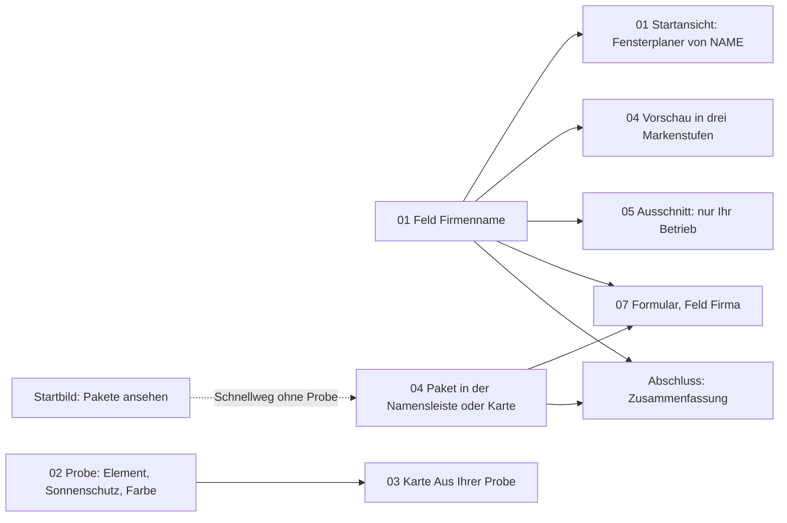

# Konzept D – Eigener Ansatz für dieses Geschäftsmodell

**Arbeitstitel: „Probefahrt unter eigenem Namen“** (Textentwurf, nur intern, erscheint nicht auf der Seite).

Ergebnis 6, Teil D, des Website-Blueprints (MASTER-PROMPT V4), Phasen F und G. Stand 24.10.2026, Arbeitszweig
`claude/design-dna-styleguide`, gelesen bis Commit `a4d6843`. Planungsdokument: Das Repository wurde nur gelesen, gebaut oder geändert
wurde nichts. Die Konzepte A bis C lagen beim Schreiben noch nicht vor; die Abgrenzung stützt sich auf ihre Aufträge (Titel und Richtung)
und ist abzugleichen, sobald sie vorliegen.

**Grundlage**

| Kürzel | Datei |
|---|---|
| PA, EA, IA, RE | [01-projektanalyse.md](../01-projektanalyse.md), [04-entscheidungsarchitektur.md](../04-entscheidungsarchitektur.md), [05-informationsarchitektur.md](../05-informationsarchitektur.md), [03-recherche.md](../03-recherche.md) (Erkenntnisse E1–E19, Regeln R1–R14, Tests T1–T19, Lücken WET-H1–H8) |
| DG | [02-design-grammatik.md](../02-design-grammatik.md) (Bild- und Bedienschicht G1, Abschnittstypen T0–T14, Stufen 1–4, DG-AB-n, DG-E-n, DG-H-n) |
| DNA, SG, DNA-B, PROMPT, VGL | `docs/design-dna/03-design-dna.md` (Formel 5.1, Prinzipien Nr. 1–11, Stellschrauben und Dialekte 5.3, Signature-Effekte 5.4), `04-styleguide.md` (10.1–10.10; „SG 10.7/4“ = Abschnitt 10.7, Regel 4), `05-ergebnis-b-styleguide.md`, `06-design-prompt.md`, `02-vergleich.md` |
| SKILL, DR, GEST | `.claude/skills/premium-gestaltung/SKILL.md` (Anforderungen des Inhabers), `…/designrichtung.md` und `docs/GESTALTUNG.md` (heutige Regeln, dürfen hinterfragt werden) |
| VK, PB | `web/fuer-fensterbauer/index.html`, `web/konfigurator-bedingungen/index.html` |

**Kennzeichnungen**

- `Datei:Zeile` ist ein Beleg. **[V]** verbindlich (DNA-Prinzip, Pflichtregel SG, Anforderung SKILL, Recht, Prüfsuite oder eine in diesem
  Konzept überall gleich gesetzte Wahl). **[H]** Hypothese oder experimentelle Gestaltungsentscheidung; wird erst nach Prüfung zur Regel.
- **Textentwurf**: neuer Wortlaut, nur aus belegten Fakten gebildet; braucht die Freigabe des Inhabers.
- **Abweichung von bestehender Regel – Freigabe durch den Inhaber nötig**: Vorschlag gegen eine Regel aus GEST oder DR; gesammelt als
  D-AB-1 bis D-AB-13 im Abschnitt „Anwendung der Design-DNA“. Hypothesen dieses Konzepts heißen D-H-1 bis D-H-16.
- Telefon 390 × 844 ist die Hauptansicht; „Bildschirm n“ = y von (n − 1) × 844 bis n × 844. Schreibtisch 1280 × 800. Alle Lagen sind
  geplant, nicht gemessen. Schriftgrößen nur 13, 15, 17, 24, 40, am Telefon 32 statt 40 (SKILL:69).
- **Beispielbetrieb, Beispielfamilie**: „Fensterbau Brandt“ und „Familie Weber“ wie im echten Beispiel-Aufmaßblatt
  (`web/bilder/tour-aufmassblatt-15.webp`, Alt-Text VK); Vereinheitlichung offen (PA-Frage 25).

**Methode.** Geprüft aus simulierten Perspektiven: Inhaber eines kleinen Fensterbaubetriebs am Telefon zwischen zwei Baustellen, Büro
eines Betriebs am Schreibtisch, Fensterhändler ohne eigene Montage, B2B-Vertrieb, Hauseigentümer vor dem Fenstertausch, Suchmaschine ohne
JavaScript, Prüfung der Barrierefreiheit, Leistungsprüfung auf einem mittleren Android-Telefon. Das ist eine Analysemethode, keine
Nutzerstudie. Im Repository gibt es keine Nutzerforschung, Besucherzahlen oder Konversionsraten (PA, „Was es nicht gibt“); jede Aussage
über Wirkung ist Hypothese, Wahrscheinlichkeiten werden nicht genannt.

---

## Leitidee und für wen es am besten passt

### Leitidee

Die Seite verkauft einen Konfigurator, also führt sie einen vor, statt ihn zu beschreiben. Der Fensterbauer tippt seinen Firmennamen ein
und sieht ihn sofort auf der Startansicht seines eigenen Fensterplaners; dann plant er in drei Griffen als sein eigener Kunde ein Fenster,
sieht, was als Anfrage bei ihm ankäme, und stellt an genau dieser Vorschau ein, wie sehr der Konfigurator seine Marke tragen soll: Das ist
die Paketwahl. Ein einziges Objekt, das Telefon mit seinem Konfigurator, trägt die Seite durch die Kapitel 01 bis 04 und nimmt mit, was er
eingegeben und gewählt hat, bis ins Anfrageformular. Was sich vorführen lässt (eigene Marke und Domain, „nur Ihr Betrieb“, Anfrage mit
Maßen und Klärungsliste, Unterschied der Pakete), wird vorgeführt; was sich nicht vorführen lässt (Vertrag, Kosten, Ablauf), steht knapp
als Text daneben.

### Warum gerade dieses Geschäftsmodell

1. **Das Produkt ist selbst eine Webseite.** Die Verkaufsseite kann ein echtes Stück des Produkts zeigen, nicht nur ein Bild davon. Bei den
   gesichteten Konfigurator-Anbietern für Betriebe war außer einem Endkunden-Shop keine frei zugängliche Vorführung zu sehen (RE 3.3.3,
   WET-H5).
2. **Es gibt keine Belege von außen.** Keine Kunden, Stimmen, Logos oder Referenzen (SKILL:49; EA F-21). Vertrauen muss aus prüfbaren
   Fakten und aus der Vorführung kommen (RE E12, E14); die Messlatte des Inhabers ist ohnehin, dass der Fensterbauer an der Seite merkt,
   dass eeziframes Webdesign und Digitales beherrscht (SKILL:38).
3. **Die Pakete unterscheiden sich in einer sichtbaren Größe.** „Sie unterscheiden sich darin, wie sehr der Konfigurator Ihre Marke
   trägt“ (VK:236; der Konfigurator ist in allen gleich, `web/assets/pakete.js:75`). Das ist ein Bildunterschied, kein Tabellenunterschied;
   Merkmalsfülle bei unsicherer Präferenz überfordert (RE E8, T15; EA H-D8).
4. **Die heutige Vorführung zeigt das Falsche.** „Konfigurator ausprobieren“ führt in die App für Hauseigentümer mit Preis, Paywall und
   Du-Anrede (PA 1.9/4; EA PAK B7); die Demos je Paket hängen an `PAKETE_DEMOS` (EA O-3). D bringt die Vorführung auf die Seite: ohne
   Preise, in Sie-Anrede, unter dem Namen des Besuchers oder des Beispielbetriebs.
5. **Selbst Gestaltetes wird höher bewertet** (RE E19, Franke und Piller; ob das für eine Vorschau mit dem eigenen Namen gilt, ist D-H-2).
   Der eingegebene Name und die Paketwahl wandern ins Formular, damit nichts zweimal eingegeben wird (RE E17; WCAG 3.3.7).
6. **Die Hauptaussage bleibt die des Inhabers.** Kapitel 01 und 04 handeln von der eigenen Marke, das Planen als Kunde in Kapitel 02 ist
   bewusst verkürzt und nur Mittel zum Zweck; „Kunden messen selbst“ wird nicht Hauptaussage (SKILL:23-24; EA 4.3.1/4).

### Abgrenzung zu A bis C

Spalten A bis C nach Auftrag und Titel, nicht nach den fertigen Dokumenten.

| Achse | A Immersive Product Experience | B Conversion-First | C Guided Decision | **D Probefahrt unter eigenem Namen** |
|---|---|---|---|---|
| Grundfrage der Dramaturgie | „Wie wirkt das Produkt?“ | „Was kostet es, wo kaufe ich?“ | „Welches Paket passt zu mir?“ | „Wie fühlt sich mein Konfigurator an, und was kommt bei mir an?“ |
| Rolle des Besuchers | schaut zu; Szenen hängen am Scrollen | entscheidet früh; liest wenig | beantwortet Fragen zu seinem Betrieb | bedient: Name eingeben, drei Griffe, Marke einstellen |
| Was den Beweis trägt | Inszenierung des Produkts | Offenheit von Preis und Vertrag | Passung der Empfehlung | Reaktion des Produkts auf die eigene Eingabe, Ergebnis in eigenem Namen |
| Ort der Inszenierung | autonome, scrollgebundene Szenen | kaum | in der Führung durch Fragen | in der Antwort des Geräts auf Tippen; autonome Bewegung nur im Startbild |
| Darstellung des Angebots | nach der Inszenierung | sehr früh, als Raster | als Ergebnis der Fragen | als Markenregler an der eigenen Vorschau |
| Was die Seite sich merkt | nichts | ggf. die Paketwahl | Antworten | Name, Probe, Paket bis ins Formular |

**Warum D eine echte Alternative ist.** (1) **Informationsdramaturgie**: Tun → Ergebnis → Wahl → Absicherung, statt Versprechen → Beweis →
Preis (A), Preis → Begründung (B) oder Bedarf → Empfehlung (C). (2) **Visuelle Komposition**: ein wiederkehrendes Gerät als einziger
Fokusträger über vier Kapitel, Bedienelemente immer darunter, kaum Fotobühnen nach dem Startbild. (3) **Nutzerführung**: Die Eingaben des
Besuchers verändern, was er auf den folgenden Bildschirmen sieht; die Seite ist ab Kapitel 01 persönlich. Keines der drei anderen Konzepte
lässt den Besucher das verkaufte Produkt selbst bedienen.

### Für wen es am besten passt

Gruppen nach EA 4.2; die Einschätzung ist Hypothese.

| Gruppe | Passung | Warum | Schwäche und Ausgleich |
|---|---|---|---|
| FB-2 sucht Software oder Konfigurator | sehr gut | will wissen, was er bekommt und was es kostet; sieht beides am eigenen Namen | Probe kostet Zeit → Preiszeile im Startbild, Schnellweg „Pakete ansehen“ |
| FB-5 ohne Kontext (Instagram, Anzeige, Umschalter) | sehr gut | versteht durch Tun schneller als durch Lesen [H] | muss zum Mitmachen eingeladen werden → Ring „Selbst ausprobieren“ im ersten Bildschirm |
| FB-3 sah „Powered by EEZIframes“ | gut | sieht im Markenregler sofort, wie der Hinweis bei Plus leiser wird und bei Signature verschwindet | – |
| FB-4 hat ein Aufmaßblatt in der Hand | gut | erkennt in Kapitel 03 sein Blatt wieder und erlebt in 01 und 02, wie so ein Blatt unter eigenem Namen entsteht | Hinweis bei `?von=pdf` verweist zusätzlich auf die Probe |
| FB-6 Prüfer kurz vor dem Kauf | mittel | will Preise, Bedingungen, Ablauf; braucht die Probe nicht | Kopf-Ring „Pakete ansehen“ auf jedem Bildschirm, Menü-Sprungmarken |
| FB-1 Fachfrage (Aufmaß, Haftung) | mittel | kommt mit der Brille „Aufmaß“; Kapitel 03 beantwortet sie | Fachartikel bleiben Zubringer |
| M-1, M-4, M-5 Mitentscheider | schwach | eine Probe lässt sich nicht weiterreichen | Paketbedingungen als PDF (vorhanden), Kurzfassung als PDF offen (IA-O-6) |
| HE-3, HE-5 Hauseigentümer, die messen wollen | gut | Probemessung auf der Startseite nimmt den Zweifel „Schaffe ich das?“ (EA H-01) | – |
| HE-1, HE-2, HE-4 | mittel | brauchen eher Ratgeber | Ratgeber-Weg bleibt |
| FB-7, P-1, HE-8, Crawler | neutral | Service bzw. keine Kaufhandlung; Crawler lesen die Textfassung | – |

---

## Website-Architektur

D übernimmt die Adressen, Anker, Kopf-Kontexte, das Menü, den kurzen und langen Fuß, die Textfassungen und die Lenkung der Einstiege aus
IA 5.1 bis 5.3. Es ändert den Aufbau zweier Seiten und wie sie Eingaben des Besuchers weitertragen.

### Seiten

| Seite | in D | Abweichung von IA |
|---|---|---|
| `/` Startseite, Rahmen | eine Adresse, zwei Ansichten, Standard „Hauseigentümer“ | keine im Rahmen; die Weiche im ersten Bildschirm (EA AB-1) ist nicht der Hebel von D und wird nicht vorgeschlagen |
| `/#hauseigentuemer` | Einstieg Hauseigentümer, 8 Abschnitte | Probemessung (H2) und Wischreihe echter App-Bildschirme (H3) statt Bildfolge; Wechselkarte mit neuem Satz |
| `/#fensterbauer`, `?von=pdf` | Einbettung der Verkaufsseite | Hinweis K34 mit einem zusätzlichen Link zur Probe |
| `/fuer-fensterbauer/` | Hauptseite, sieben Kapitel und vier Anhänge | Aufbau, Folge, Paketdarstellung, zweite Eingabe, Vorbefüllung des Formulars (D-IA-1 bis D-IA-8) |
| 5 Fachartikel | Zubringer, Ziel Seitenanfang (W5) | nur der Satz im Handlungsbaustein lädt zur Probe ein (Textentwurf, unten) |
| `/konfigurator-bedingungen/`, `/app/`, `/ratgeber/` und 23 Artikel, `/partner/`, Rechtsseiten, 404 | wie IA | keine |
| Demo-Domains | Ziel im Anhang „Live-Demos“, sobald `PAKETE_DEMOS` gesetzt ist | keine |
| neue Seiten | keine | keine; die Probe braucht keine eigene Adresse |

### Abweichungen von 05-informationsarchitektur.md

- **D-IA-1 Kapitel statt V1–V14.** Die Verkaufsseite wird zu Startbild, Leiste, sieben Kapiteln (01 Ihr Name, 02 Ihr Kunde, 03 Ihr
  Postfach, 04 Ihre Marke, 05 Ihre Kunden, 06 Ihr Start, 07 Ihre Anfrage) und vier Anhängen (Live-Demos, Häufige Fragen, Hintergrund,
  Abschluss). Die Kapitelwörter sind **Textentwurf**. Inhaltlich entsprechen 01 = V3, 02 = V4, 03 = V5, 04 = V8, 05 = V9, 06 = V10,
  07 = V11; V7 (Kennzahlen-Leiste) entfällt (D-AB-5), V6 (Live-Demos) wird Anhang von 02, V14 wird eine persönliche Zusammenfassung.
- **D-IA-2 Zweite Eingabe.** Kapitel 01 trägt ein Feld „Ihr Firmenname“ ohne Formular und ohne Versand (D-AB-1).
- **D-IA-3 Vorbefüllung.** Das eine Anfrageformular (Kapitel 07) übernimmt Firmenname und zuletzt angesehenes Paket; das Paket wird wie
  heute aus der Karte vorgewählt (`functions/pakete-seite.js:113-115`), der Name ist neu.
- **D-IA-4 Vorführung auf der Seite.** Der Ring im Startbild führt zur Probe in Kapitel 02 statt zu `#demos` und weiter in die App
  (D-AB-4). Die App für Hauseigentümer bleibt im Anhang „Live-Demos“ als Nebenweg mit ehrlichem Hinweis (R14).
- **D-IA-5 Paketdarstellung.** Karten ohne eigenes Bild und ohne Hakenliste, eine gemeinsame Vorschau darunter mit Anmerkungen; der
  gruppierte Vergleich (K20) bleibt zugeklappt für Daten und Richtwerte (D-AB-2, D-AB-3).
- **D-IA-6 Kopf.** Kapitelanzeige „04 / 07“ als Zustand zwischen Logo und Ring (D-AB-8). Sonst Kontext „Fensterbauer“ nach IA 5.3.2.
- **D-IA-7 Ansicht Hauseigentümer.** H2 Probemessung, H3 App-Wischreihe; H4 bis H7 entsprechen IA H3 bis H6; H8 Wechselkarte.
- **D-IA-8 Hinweis `?von=pdf`.** Zusätzliche Zeile mit Link zur Probe, **Textentwurf**: „So ein Blatt unter Ihrem eigenen Namen:
  ausprobieren“ → `#die-idee`; der Weg „Aufmaß per Code übernehmen“ bleibt (AGB:33 § 2 (2); IA 5.4.4 a).

Handlungsbaustein der Fachartikel, **Textentwurf** (aus IA 5.4.4 e): „Ihr eigener Fenster-Konfigurator: Probieren Sie ihn unter Ihrem
Namen aus. Jede Anfrage kommt als Aufmaßblatt-PDF.“ mit Cream „Konfigurator für Fensterbauer“ → `/fuer-fensterbauer/` (Seitenanfang, W5).

### Was die Seite sich merkt

| Wert | Woher | Wohin | Speicherung | Ohne Eingabe, ohne JavaScript |
|---|---|---|---|---|
| Firmenname | Feld in 01, höchstens 60 Zeichen | 01, 04, 05 (Bild), 07 (Feld Firma), Abschluss | nur im Arbeitsspeicher der Seite; für den Neuaufbau der Einbettung (`Verkauf.auf`, SKILL:63-64) zusätzlich `sessionStorage` dieses Tabs [H]; nichts wird gesendet, bevor das Formular abgeschickt wird | „Fensterbau Brandt · Beispiel“ |
| Probe | Wahlknöpfe in 02 | 02 (Bild), 03 (Karte) | wie oben | Balkontür, Raffstore „Weiß ich noch nicht“, Anthrazitgrau |
| Paket | Namensleiste, Karte | 07 (Paketfeld), Abschluss | wie oben | das empfohlene Paket (O-5) |

**[V]** Was der Besucher eingibt, verlässt den Browser nur über das Anfrageformular und nur, wenn er es absendet. Ob die
Datenschutzerklärung dazu einen Satz braucht, prüft der Inhaber (Frage 4 am Ende).

### Zustände

| Ort | Zustand A (heute) | Zustand B (`PAKETE_OFFEN=1`) | zusätzlich mit Demos |
|---|---|---|---|
| Startbild | Cream „Pakete ansehen“, Ring „Selbst ausprobieren“ (**Textentwurf**), Preiszeile mit „vorläufige Preise“ | gleich | gleich; Demos erscheinen im Anhang |
| 02 Probe | „Probeanfrage senden“ verschickt nichts | gleich | gleich |
| Live-Demos | zwei Zeilen und Ring zur App für Hauseigentümer (neuer Tab) | gleich | drei Zeilen zu `demo-essential`, `demo-plus`, `demo-signature.eeziframes.com` |
| 04 Karten | Cream „Essential Plus anfragen“, sonst Ring „… anfragen“ (`functions/pakete-seite.js:109-131`) | „… bestellen“ → `/partner/#bestellen/<paket>`; der Name wird dorthin **nicht** übernommen (nicht gebaut) | kleiner Link „Demo“ je Karte (RE T11) |
| 04 Verkaufsstand | „Vorläufige Preise, Stand 22.10.2026.“ unter der Vorschau | entfällt mit `VORLAEUFIG = false` | – |
| 07 | Formular als Abschluss, Satz „Bestellung in Kürze“ | Block „Für die Bestellung brauchen Sie …“ (EA 4.3.1), Formular als „Vorher eine Frage?“ | – |
| Abschluss | „… anfragen“ | „… bestellen“ | – |

### Randbedingungen, die D unverändert einhält

- Adressen, Canonical, Sitemap, `llms.txt`; ein h1 je Seite; h1 der Verkaufsseite wörtlich mit grünem „Marke“; die Pflicht-h2 `die-idee`,
  `so-funktioniert-es`, `pakete`, `ablauf`, `demos`, `bestellen`, `haeufige-fragen`; die Sätze „ohne ihn programmieren zu lassen“, „Ihr
  eigenes Baby“, „3 bis 5 Werktage“; Ablauf in den sechs Wörtern der Statusleiste; mindestens sechs Pflichtfragen
  (`scripts/pruefen-instanzen/29.mjs:110-118`). Alle übrigen Anker der Verkaufsseite bleiben (IA 5.1.5).
- Eine Quelle, zwei Orte: Jedes Element der Probe funktioniert eingebettet in `/#fensterbauer` und nach Neuaufbau (SKILL:63-64; PA 1.10
  Nr. 1).
- Ohne JavaScript lesbar und bedienbar; Preise ohne JavaScript sichtbar; das Formular geht ohne JavaScript ab (Prüfsuite 29.1/29.2).
- Keine fremden Server; Bibliotheken nur aus `web/vendor/` (SKILL:60). Die Probe braucht keine neue Bibliothek.
- Rechtliches nach PA 1.10 (netto, nur Unternehmer, Hinweise auf Stand und Entwurf, Kundenschutz im Wortlaut von PB § 10).

---

## Seitenaufbau der Hauptseiten

Gewicht = geplante Länge in Bildschirmhöhen und Anteil an der Seite; „Stufe“ = Kette aus EA 4.4.

### Startseite `/`: Rahmen

| Nr. | Rahmenteil | Funktion | Inhalt | Gewicht |
|---|---|---|---|---|
| R1 | Bänder | Stand melden | Pilotleiste nur ohne Server; kein Einführungsband auf `/` (IA-AB-6) | 0 bzw. 40 px |
| R2 | Kopf mit Umschalter | Orientierung, Zielgruppe | Telefon 56 px: Logo, Kopfknopf (Ring, solange eine Cream-Pille im Bild ist), Menü; Umschalter als Glas-Segment über dem Foto (y 68–112, scrollt weg, steht auch im Menü; IA K03) | 56 px |
| R3 | Hinweis `?von=pdf` | FB-4 abholen | Glas-Karte ≤ 180 px nach IA 5.4.4 a, dazu der Link zur Probe (D-IA-8) | nur mit Parameter |
| R4 | Ansicht | Hauptinhalt | Hauseigentümer H1–H8 (unten) oder Fensterbauer (Verkaufsseite eingebettet) | – |
| R5 | Wechselkarte | leiser Wechsel | Hauseigentümer → Fensterbauer, **Textentwurf**: „Für Fensterbauer · Dieses Werkzeug, unter Ihrer Marke.“; Fensterbauer → Hauseigentümer: „Ihre eigenen Fenster ausmessen?“ (`web/assets/portal.js:791`) | 0,3 |
| R6 | Fuß kurz | Recht, Wege, Kontakt | IA 5.3.5 | 0,9 |
| R7 | Textfassung | Crawler | Abschnittsfolge wie die Ansicht; Probemessung als Zeichnung mit allen drei Werten und dem Satz aus `web/index.html:59` | – |

### Seite für Fensterbauer `/fuer-fensterbauer/` (eingebettet auch in `/#fensterbauer`)

**Ziel:** Z1 in Zustand B, bis dahin Z1a; Z1+ über die Empfehlung und den Markenregler. **Länge:** Telefon ≈ 13 Bildschirme (IA 12,5,
heute 19), Schreibtisch ≈ 10,5 (IA 10, heute 16,7) [H]. **Pakete:** Telefon ab Bildschirm 6, Schreibtisch ab Bildschirm 5. Der Mehrweg
gegenüber IA (≈ 0,5 Bildschirme) ist die Probe.

| Nr. | Abschnitt | Anker | Stufe | Funktion | Inhalt in Kürze | Gewicht Telefon | Schreibtisch | Cream |
|---|---|---|---|---|---|---|---|---|
| V1 | Startbild | – | S1 | zuordnen, Preissignal, zwei Wege | Foto, drei Meldungen, Kicker, h1, drei Chips, Cream, Ring, Preiszeile | 1,0 (8 %) | 1,0 | „Pakete ansehen“ |
| V2 | Leiste Elementarten | – | S1 | Breite zeigen | Elementarten mit Zeichnung bzw. Render | 0,17, liegt im Anschnitt von V1 | 0,2 | – |
| 01 | Ihr Name | `#die-idee` | S2 | eigene Marke und Domain erleben | Feld, Gerät mit Startansicht, drei Punkte | 1,2 (9 %) | 1,1, Gerät klebt | – |
| 02 | Ihr Kunde | `#so-funktioniert-es` | S3 | erleben, was der Kunde tut und sieht | Probe in drei Schritten, Zeile „nur Ihr Betrieb“ | 1,05 (8 %) | 1,1, Gerät klebt weiter | – |
| – | Live-Demos (Anhang zu 02) | `#demos` | S3 → S4 | Nebenweg zur ganzen App bzw. zu den Demos | zwei Zeilen, Ring | 0,3 | 0,2 | – |
| 03 | Ihr Postfach | `#was-in-jeder-anfrage-steht` | S3 | Ergebnis zeigen | Meldung, Blatt mit Explosionsansicht, Karte „Aus Ihrer Probe“, sieben Inhalte, Feinaufmaß | 1,25 (10 %) | 1,3, Szene klebt ≤ 1,5 | – |
| 04 | Ihre Marke | `#pakete`, `#paket-essential`, `#paket-plus`, `#paket-signature`, `#vergleich` | S4 mit S5-Kern | Preis, Paket, Risiko | Namensleiste, Karten, Vorschau mit Anmerkungen, Vergleich, Verkaufsstand, Risikoblock, Gesprächsweg, Rechtshinweis | 1,9 (15 %) | 1,5 | Knopf der empfohlenen Karte |
| 05 | Ihre Kunden | `#kundenschutz` | S5 | Loyalität des Anbieters | Ausschnitt der eigenen Vorschau, vier Zusagen, § 10 | 0,75 | 0,7 | – |
| 06 | Ihr Start | `#ablauf` | S5 | Ablauf, Dauer, Mitwirkung, Anbieter | Maßstab mit sechs Schritten, Dauer, „Sie brauchen“, Anbieterblock | 1,1 | 0,8 | – |
| 07 | Ihre Anfrage | `#bestellen`, `#frage` | S6 | Abschluss Z1a bzw. Vorbereitung Z1 | Formular, vorbefüllt | 1,1 | 0,9 | „Frage senden“ |
| – | Häufige Fragen | `#haeufige-fragen` | S5 | Restzweifel | acht Fragen (IA V12) | 0,65 | 0,6 | – |
| – | Hintergrund | `#warum-kunden-selbst-planen`, `#quellen`, `#wissen-fuer-fensterbauer` | – | Belege | drei zugeklappte Zeilen (IA V13) | 0,3 | 0,25 | – |
| – | Abschluss | – | S6 | zweite Gelegenheit | persönliche Zusammenfassung | 0,5 | 0,45 | „… anfragen“ |
| – | Brotkrumen, Fuß kurz | – | – | Orientierung | IA K05, K07 | 0,9 | 0,7 | – |

**V1 Startbild** (S1; Telefon Bildschirm 1)

- **Funktion:** Zielgruppe, Hauptaussage, Preisniveau und zwei Wege ohne Scrollen (R12): direkt zu den Paketen oder selbst ausprobieren.
- **Inhalt:** Foto `fb-sessel.webp` (Astronaut am Bullauge, SKILL:120); Glas-Stapel mit drei als „Beispiel“ gekennzeichneten Meldungen,
  **Textentwurf** nach dem Format der echten Meldung (`functions/api/eingang.js:217`): „Neue Anfrage: Familie Weber · 4 Positionen“,
  „Aufmaßblatt als PDF · im Postfach“, „Klärungsliste · 2 Punkte offen“; Kicker „Für Fensterbauer und Fensterhändler“ (VK:56); h1 wörtlich
  (VK:57); drei Chips, **Textentwurf** aus VK:58: „Ihre Domain · Ihre Marke · Anfrage als PDF“; Cream „Pakete ansehen“ → `#pakete`; Ring
  **Textentwurf** „Selbst ausprobieren“ → `#so-funktioniert-es`; Preiszeile 13 px, **Textentwurf** (IA V1): „Ab 29 € im Monat, netto, plus
  Einrichtung · vorläufige Preise“. Rund 32 Wörter in der Bedienschicht, dazu die Meldungen.
- **Telefon:** Kopf 0–56 flächenlos mit Scrim (DG T0), nur Logo und Menü (der Ring erscheint erst, wenn „Pakete ansehen“ aus dem Bild ist,
  IA N4). Foto y 0–556 (66 % der Höhe), unteres Viertel in `#161616` ausgeblendet. Glas-Stapel 220 px breit oben über einer ruhigen
  Bildzone, die weder Bullauge noch Gesicht, Papierflieger oder Telefon verdeckt (SKILL:87; Lage am echten Foto prüfen). Kicker y ≈ 456,
  h1 drei Zeilen y ≈ 476–577, Chips eine Zeile y ≈ 593–629, Cream (x 16–188) und Ring (x 200–374) nebeneinander y ≈ 645–697, Preiszeile
  y ≈ 709–725, Leiste ab y ≈ 760 angeschnitten.
- **Schreibtisch:** Text links über 5 von 12 Spalten (x ≈ 120–533), Foto rechts ab x ≈ 553 bis an den Fensterrand; Leiste ab y ≈ 700
  angeschnitten (12 %).
- **Ohne JavaScript, ruhig:** Foto, Text, Knöpfe, drei stehende Meldungen; keine Maßlinie, kein Zoom.

**V2 Leiste Elementarten** (S1; Telefon 144 px)

- Wie IA V2 und DG T2, aber **ohne Lichtkegel** (Stufe 2, D-AB-6): das mittlere Element 1,25-fach und in `--text`, die übrigen in
  `--muted`; Versatz nur nach Scrolltempo, Trägheit ≤ 1,2 s, keine Dauerschleife (EA AB-8). Sobald vorhanden, echte Renderings der
  Elementarten aus der eigenen WebGL-Bühne statt der Zeichnungen (DR Baustein 9). Ruhig: steht, wischbar.

**01 Ihr Name** `#die-idee` (S2 Verstehen; Kapitelzeile **Textentwurf** „01 · IHR NAME“)

- **Funktion:** „Unter Ihrer Marke“ und „unter Ihrer Domain“ an der Startansicht erleben, die sein Kunde sehen würde.
- **Inhalt:** h2 wörtlich „Die Idee: der Fenster-Konfigurator Ihrer Wahl“, grün „Wahl“ (VK:74). Lead 17 px, **Textentwurf**: „Tippen Sie
  Ihren Firmennamen ein. So begrüßt Ihr Konfigurator Ihre Kunden.“ Feld mit Beschriftung „Ihr Firmenname“ (15 px fett), freiwillig,
  `autocomplete="organization"`; Hinweis 13 px, **Textentwurf**: „Nur eine Vorschau auf diesem Gerät. Nichts wird gesendet.“ Gerät mit
  der Startansicht einer Instanz in der Stufe Essential: Adresszeile mit Beispieladresse nach dem Muster aus VK:238 („ihr-name-fenster.de“,
  aus dem eingegebenen Namen gebildet, Zusatz „Beispiel“) [H], Zeichen, „Fensterplaner von …“ (`web/assets/einladung.js:172`), Titel, Knopf
  „Erstes Fenster ausmessen“ (`:247`) als Bild. Bildunterschrift 13 px **Textentwurf**: „So sieht Ihr Kunde Ihren Konfigurator · Beispiel“.
  Darunter drei Punkte, je zwei Zeilen 15 px, gekürzt aus VK:75-81: „Kein Programmierauftrag: Ihr eigener Fenster-Konfigurator, ohne ihn
  programmieren zu lassen.“ (VK:61) · „Ihr eigenes Baby: Startseite, Begrüßung, Ansprechpartner und Bilder bestimmen Sie; Sie geben frei,
  bevor es online geht.“ (VK:79) · „Ihr Werkzeug: Wir vermitteln keine Kunden. Den Link teilen Sie dort, wo Ihre Kunden Sie finden.“
  (**Textentwurf** EA H-D4). Die Antwort auf F-02 steht als Bild in der Adresszeile und als Satz in den Fragen (VK:239).
- **Telefon:** Haarlinie und Kapitelzeile, h2 drei Zeilen, Lead zwei Zeilen, Feld 358 × 52 px, darunter das Gerät 300 × 420 px auf der
  Achse (x 45–345, ≈ 38 % der Bildschirmfläche); es zeigt nur den oberen Teil der Startansicht und ragt mit ≤ 10 % seiner Höhe über die
  Kapitelkante in den Abstand vor 02 (Rahmenbruch nur am Telefon; am Schreibtisch trägt ihn der Flug, G.1 Nr. 6). Beim Antippen des
  Felds rollt die Seite so, dass Feld und Kopf des Geräts über der Tastatur stehen [H, D-H-5].
- **Schreibtisch:** Text, Feld und Punkte links über fünf Spalten; rechts die Geräte-Bühne (DR Baustein 8): Browserfenster 560 × 360 mit
  der Startansicht am Schreibtisch, davor das Telefon 220 × 450, das die linke untere Ecke des Browsers zu etwa 30 % überdeckt; beide
  tragen den Namen. Die Bühne klebt ab hier (G.1 Nr. 5).
- **Ohne JavaScript:** Feld ausgeblendet (`hidden`), Gerät mit „Fensterbau Brandt · Beispiel“. **Ruhig:** Name wechselt ohne Überblendung.

**02 Ihr Kunde** `#so-funktioniert-es` (S3 Sehen; „02 · IHR KUNDE“)

- **Funktion:** Erleben, was der Kunde des Betriebs tut und was er sieht; zeigen, dass „Weiß ich noch nicht“ erlaubt ist und in der
  Klärungsliste landet (VK:130).
- **Inhalt:** h2 **Textentwurf** „So funktioniert es: planen wie Ihr Kunde“, grün „Kunde“. Lead **Textentwurf**: „Drei Griffe wie im
  Konfigurator. Fotos und Maße kommen dort dazu.“ Schrittanzeige in der Technikstimme „SCHRITT 1 / 3 · ELEMENT“ mit drei Strichmarken.
  Gerät mit dem Konfigurator unter dem Namen aus 01; im Bildschirm das gerenderte Fenster aus der eigenen Bühne. Drei Wahlschritte nur mit
  Optionen, die es gibt (R14; `web/assets/modell.js:17`, `:108`): (1) Element „Fenster“, „Balkontür“, „Hebe-Schiebe-Tür“; (2) Sonnenschutz
  „Ohne“, „Raffstore“, „Weiß ich noch nicht“; (3) Farbe außen „Verkehrsweiß“, „Anthrazitgrau“, „Golden Oak“. Ring „Weiter“, im dritten
  Schritt Ring **Textentwurf** „Probeanfrage senden“; danach zeigt das Gerät die Bestätigung des Konfigurators, und eine Statuszeile
  (**Textentwurf**) sagt: „Probe gesendet, verschickt wurde nichts. Was bei Ihnen ankäme: Kapitel 03.“ mit Link. Zeile zu F-10 (VK:242
  gekürzt): „Ihr Kunde sieht nur Ihren Betrieb: keine Preise, keine Werbung, keine anderen Betriebe.“ Ablaufzeile in der Technikstimme
  (aus VK:87-93): „LINK · PLANEN · SENDEN · AUFMASSBLATT BEI IHNEN · ANGEBOT UND FEINAUFMASS“, die aktive Station hell.
- **Telefon:** Gerät 300 × 400 an derselben Stelle wie in 01 (x 45–345), darunter drei Wahlpillen in einer Zeile (je ≥ 44 px hoch, bei
  200 % Text zweizeilig), darunter Ring „Weiter“; Gerät ≈ 36 % der Fläche, Bedienung ≈ 12 %. Kein Anheften.
- **Schreibtisch:** Die Geräte-Bühne aus 01 klebt weiter; das Browserfenster tritt über Tonwert zurück (60 %), das Telefon zeigt die
  Schritte; Wahlknöpfe und Text links.
- **Ohne JavaScript:** drei Standbilder untereinander (Balkontür, Raffstore „Weiß ich noch nicht“, Anthrazitgrau) mit je einer Zeile;
  keine Knöpfe. **Ruhig:** Bildwechsel als Schnitt oder ≤ 200 ms Überblendung; Raffstore steht im Endbild.

**Live-Demos** `#demos` (Anhang zu 02, ohne Kapitelnummer)

- h2 „Live-Demos“ (Pflicht-h2). Zustand A, **Textentwurf** aus VK:209: „Die Demos je Paket schalten wir in Kürze frei. Die ganze App gibt
  es bis dahin in der Fassung für Hauseigentümer, mit Preis.“ Ring **Textentwurf** „App für Hauseigentümer öffnen“ → `/app/` in neuem Tab
  [H]. Mit Demos: drei Zeilen je 56 px zu den Demo-Domains. Flach, Stufe 1.

**03 Ihr Postfach** `#was-in-jeder-anfrage-steht` (S3 Produktbeweis; „03 · IHR POSTFACH“)

- **Funktion:** Beweis am Ergebnis; F-15, F-09; der Bogen von der eigenen Probe zur Anfrage im Postfach.
- **Inhalt:** h2 „Was in jeder Anfrage steht“, grün „Anfrage“ (IA V5). Meldung, opak (`#1f1f1f`, Radius 18, Lichtkante, grüner Punkt),
  Titel „Neue Anfrage“ (`functions/api/eingang.js:108`), Zeile **Textentwurf** „Familie Weber · über Fensterplaner von … · Beispiel“.
  Das echte Aufmaßblatt `tour-aufmassblatt-15.webp` (Beispiel, −2° gedreht); seine Schichten Maße · Fotos · Klärungsliste lösen sich als
  Explosionsansicht (DG T5). Karte **Textentwurf** „Aus Ihrer Probe“ (opak, Radius 12, Lichtkante), sie überdeckt das untere Drittel des
  Blatts: „Pos. 1 · Balkontür · Anthrazitgrau · Sonnenschutz: mit dem Kunden zu klären“ (je nach Wahl). Darunter die sieben Inhalte als
  Begriffe in zwei Spalten 15 px (VK:123-131: Maueröffnung, Fensterelement, Fotos und Einbausituation, Teilung und Öffnung, Material Farbe
  Glas, Sonnenschutz und Montage, Mit dem Kunden zu klären), die vollen Sätze in einem Aufklapper; Zeile zu F-09 (PB:44 § 2 (4); VK:245):
  „Die Maße sind Angaben Ihrer Kunden; vor der Fertigung messen Sie selbst nach (Feinaufmaß).“ Brücke 15 px, **Textentwurf**: „Wie sehr
  soll er Ihre Marke tragen?“ → `#pakete`.
- **Telefon:** Meldung 300 × 64 über dem Blatt auf dem Messraster; Blatt 330 px breit (85 %); Beschriftungen 13 px links an
  Führungslinien. Kein Anheften: Die Schichten lösen sich, während das Blatt durch den Bildschirm zieht.
- **Schreibtisch:** Liste links, Szene rechts, angeheftet ≤ 1,5 Bildschirmhöhen, davon ≥ ⅓ Ruhe.
- **[H] Name im Blatt:** Den Kopf des Beispielblatts mit dem eingegebenen Namen zu überschreiben (Canvas) ist möglich, wenn der Kopf des
  Bildes eine ruhige Fläche hat; sonst bleibt „Fensterbau Brandt“, und die Karte trägt den Namen (D-H-9).
- **Ohne JavaScript, ruhig:** auseinandergezogenes, beschriftetes Endbild; Karte „Aus Ihrer Probe“ mit den Beispielwerten.

**04 Ihre Marke** `#pakete` (S4 Bewerten mit S5-Kern; „04 · IHRE MARKE“)

- **Funktion:** Preis, Paket und Risiko an einem Ort; der Unterschied der Pakete als Bild am eigenen Namen.
- **Inhalt, in dieser Reihenfolge:**
  1. h2 „Die Pakete“, grün „Pakete“ (VK:171); Leitsatz VK:172; **Textentwurf** (EA 4.3.3, VK:236-237): „In allen Paketen: Ihre eigene
     Domain, der volle Konfigurator und jede Anfrage als Aufmaßblatt-PDF per E-Mail. Keine Gebühr je Anfrage.“
  2. Nur wenn kein Name eingegeben wurde: Textlink 44 px **Textentwurf** „Mit Ihrem Namen ansehen“ → `#die-idee`.
  3. Namensleiste (Telefon): drei Segmente je ≥ 44 px mit Kurzname 13 px und Monatspreis 15 px; Tippen wählt das Paket (R9; EA AB-11).
  4. Kartenreihe, aufsteigend, am Telefon zum Wischen ab der empfohlenen Karte (SKILL:121-122). Karte von oben: Paketname (Größe nach
     DG-E-2), Empfehlungsgrund 15 px nur an der empfohlenen Karte (**Textentwurf** EA 4.3.3, falls Plus empfohlen bleibt), Monatspreis
     32 px mit „im Monat“ 15 px, Einrichtung 15 px mit einem Satz zum Inhalt (**Textentwurf** nach IA K19 aus PB:58-64), Steuerzeile
     13 px, Knopf 52 px. Keine Hakenliste (D-AB-3). Karte ≈ 310 × 300 px.
  5. Vorschau („Beispielbild darunter, das sichtbar mitwischt“, SKILL:121-122): ein Gerät mit der Startansicht unter dem eigenen Namen in
     der Markenstufe der Karte, die gerade in der Mitte steht. Essential: eeziframes-Design, Name als Text, im Fuß deutlich „Powered by
     EEZIframes“; Plus: Logo, Firmenfarbe, Fotos, eigener Titel, im Fuß klein „Konfigurator von eeziframes“; Signature: wie Plus ohne
     Hinweis, dazu ein Ausschnitt des Dashboards (GEST:460; `web/assets/pakete.js:42-67`). Links daneben Anmerkungen in der
     Technikstimme mit Führungslinien zum Gerät: „Gestaltung“, „Logo, Farbe, Startseite“, „Fotos“, „Hinweis auf eeziframes“, „In
     Suchmaschinen“, „Dashboard“, je mit dem Wert des Pakets („nicht enthalten“ statt „nein“, RE T7). Bildunterschrift **Textentwurf**
     „Vorschau mit Ihrem Namen · Beispiel“.
  6. Vergleich K20, zugeklappt, nur noch die Gruppen „Daten“ und „Richtwerte“ und die volle Liste (EA AB-6).
  7. Verkaufsstand 15 px: „Vorläufige Preise, Stand 22.10.2026.“ (`web/assets/pakete.js:15-17`; EA AB-4).
  8. Risikoblock K22, **Textentwurf** EA 4.3.1 (PB:48, :54, :60, :69, :70), Link „Paketbedingungen mit AV-Vertrag“.
  9. Gesprächsweg K23: Ring **Textentwurf** „Unsicher, welches Paket passt? Rückruf oder Nachricht“ → `#frage` mit „Noch offen“.
  10. Rechtshinweis 13 px (VK:188).
- **Telefon:** Nach dem Sprung von „Pakete ansehen“ stehen h2, Leitsatz, Satz „In allen Paketen“, Namensleiste und die empfohlene Karte
  mit Preis und Cream-Knopf im ersten Bildschirm; die Vorschau beginnt bei y ≈ 634 im Anschnitt (≈ 25 %). Vorschau-Block 358 × 460:
  Anmerkungen x 16–140, Gerät 220 × 440 x 154–374; die Kartenreihe überdeckt die Oberkante der Vorschau um 16 px.
- **Schreibtisch:** drei Karten nebeneinander in 1040 px, Preis und Knopf jeder Karte in einem 800-px-Bildschirm (EA S4); darunter die
  Vorschau-Bühne über die volle Spalte: Anmerkungen links (5 Spalten), rechts Browserfenster 560 × 360 und Telefon 200 × 400; darüber ein
  Segment „Vorschau: Essential · Essential Plus · Signature“, gewähltes Segment in Tinte, nicht Cream (GEST:190); ein Klick auf eine Karte
  wählt ebenfalls.
- **Ohne JavaScript:** Karten untereinander mit Preisen (Prüfsuite 29.1), unter jeder Karte ihr Vorschaubild mit Beispielname und die
  Anmerkungen als Liste. **Ruhig:** Vorschau wechselt ohne Wischgrenze.

**05 Ihre Kunden** `#kundenschutz` (S5; „05 · IHRE KUNDEN“)

- h2 wörtlich „Ihre Kunden bleiben Ihre Kunden“ (VK:159). Held: Ausschnitt der eigenen Vorschau (Telefon 358 × 200, oben angeschnitten),
  Kopf „Fensterplaner von …“ ohne Preise und Werbung, „Beispiel“; vier Zusagen im Wortlaut der Prüfsuite (VK:160-166) als Ankerkachel
  über die volle Breite und drei Kacheln darunter (DG-AB-11); Link „Paketbedingungen § 10“. Platz für F-12, sobald O-15 entschieden ist.
  Schreibtisch: Held rechts über 6 Spalten, Kacheln links.

**06 Ihr Start** `#ablauf` (S5; „06 · IHR START“)

- Wie IA V10 und DG T8: h2 „Von der Bestellung bis zum Livegang“, grün „Livegang“; Maßstab mit sechs Marken in den Wörtern der
  Statusleiste (`web/assets/instanzregeln.js:74-77`); „meist 3 bis 5 Werktage nach der Zahlung“ (VK:193; O-8); „Sie brauchen …“
  (**Textentwurf** EA 4.3.1); Anbieterblock K28 (**Textentwurf** „eeziframes ist ein Angebot von Patrick Kies, Herzebrock-Clarholz.“,
  PB:33 § 1, mit E-Mail; Telefon nach O-9).

**07 Ihre Anfrage** `#bestellen`, `#frage` (S6; „07 · IHRE ANFRAGE“)

- h2 „Bestellen oder anfragen“; Zustand A ein Satz (**Textentwurf** aus VK:220, IA V11); h3 „Paket unverbindlich anfragen“ (`#frage`);
  Formular K32 mit Name, Firma (vorbefüllt aus 01, Hinweis 13 px **Textentwurf** „aus Ihrer Vorschau übernommen“), E-Mail, Telefon
  (freiwillig), Paket (vorgewählt aus 04), Frage; Datenschutzsatz; Cream „Frage senden“. Flach, Stufe 1, kein Bild. Dank ersetzt das
  Formular (IA 5.4.4 b).

**Anhänge**

- **Häufige Fragen** `#haeufige-fragen`: acht Fragen wie IA V12, JSON-LD wortgleich.
- **Hintergrund**: drei zugeklappte Zeilen wie IA V13.
- **Abschluss** (S6): h2 **Textentwurf** „Aus der Probe wird Ihr Konfigurator.“, grün „Konfigurator.“; Karte (`#1f1f1f`, Ring, Radius 24):
  links eine Mini-Vorschau 96 × 192 der zuletzt angesehenen Markenstufe mit dem Namen, rechts „Fensterplaner von …“ 17 px fett, „EEZI
  Essential Plus · 39 € im Monat“ 15 px, „199 € Einrichtung, netto, nur für Unternehmer“ 13 px (Werte aus `web/assets/pakete.js`);
  darunter Cream „Essential Plus anfragen“ → `#frage`, Ring „Anderes Paket wählen“ → `#pakete`. In der Einbettung folgt die Wechselkarte.

### Einstieg für Hauseigentümer: Ansicht `/#hauseigentuemer`

**Ziel:** Z2a, dann Z2 in der App. **Länge:** Telefon ≈ 6,7 Bildschirme (IA 6,3, heute 7,4), Schreibtisch ≈ 4,5. **Anrede** offen
(EA O-13); Entwürfe ohne Anrede.

| Nr. | Abschnitt | Stufe | Funktion | Inhalt | Gewicht Telefon | Cream |
|---|---|---|---|---|---|---|
| H1 | Startbild | B1 | zuordnen, Zutrauen, Start, Preis | wie IA H1: Foto `start-hauseigentuemer.webp`, Eyebrow und h1 wörtlich, Lead, Ring „Führung starten“, Preiszeile | 1,0 | „Jetzt ausmessen“ |
| H2 | 01 · Probemessung | B1/B2 | den Zweifel „Schaffe ich das?“ durch einen Handgriff nehmen | Zeichnung der Maueröffnung, drei Breiten zum Antippen, das kleinste wird markiert | 0,8 | „Jetzt ausmessen“ |
| H3 | 02 · In der App | B2 | Ergebnis und Weg zeigen | Wischreihe aus vier echten App-Bildschirmen | 0,85 | – |
| H4 | 03 · Kosten und Daten | B2/B3 | Preis und Absicherung vor dem Aufwand | IA H3 | 0,7 | – |
| H5 | 04 · Aus dem Ratgeber | Zubringer | Unentschlossene in den Weg führen | IA H4 | 0,6 | – |
| H6 | Häufige Fragen | B3 | Restzweifel | IA H5 | 0,6 | – |
| H7 | Abschluss | B4 | mit dem Start enden | IA H6 | 0,45 | „Jetzt ausmessen“ |
| H8 | Wechselkarte | – | leiser Wechsel | R5, Ring | 0,3 | – |

**H2 Probemessung** (Kapitelzeile **Textentwurf** „01 · PROBEMESSUNG“)

- **Funktion:** Das Produkt führt seine wichtigste Regel selbst vor, statt sie zu erklären (EA H-01; RE E6, T18).
- **Inhalt:** h2 **Textentwurf** „Dreimal messen. Das kleinste zählt.“, grün „zählt.“; weiße Karte mit der Maueröffnung von innen,
  abgeleitet aus `web/bilder/messpunkte.svg`, nur die drei orangen Breiten (Orange = Maueröffnung, GEST:24); drei Knöpfe „Oben“, „Mitte“,
  „Unten“ (je ≥ 44 px); ein Tipp zeichnet die Maßlinie, ihr Wert zählt mit (Bildschicht, DG-AB-3): Beispielwerte 1.236, 1.231, 1.234 mm,
  „Beispiel“; nach dem dritten Wert markiert ein Etikett „kleinstes Maß“ 1.231 mm. Satz 17 px aus `web/index.html:59`: „Je Fenster drei
  Breiten und drei Höhen der Maueröffnung, dazu das Rahmenmaß. Es zählt das kleinste Maß, Abweichungen werden markiert.“ Cream „Jetzt
  ausmessen“ → `/app/#ausmessen`.
- **Telefon:** Karte 358 × 300 (Papierweiß ist der einzige Hellwert), Knöpfe in einer Zeile darunter, Satz drei Zeilen, Cream ≈ y 1.380
  (Bildschirm 2). **Schreibtisch:** Karte rechts 560 × 470 (7 Spalten), Text und Knöpfe links.
- **Ohne JavaScript, ruhig:** alle drei Linien mit Werten, das kleinste markiert.

**H3 In der App** („02 · IN DER APP“)

- h2 **Textentwurf** „Vier Schritte, jeder erklärt.“, grün „erklärt.“ (nach `web/index.html:58`); Wischreihe aus vier neu aufgenommenen
  App-Bildschirmen (Fotos · Maße · Modell · Aufmaßblatt), je 220 × 440, Nachbarn schauen 40 px herein, eine Zeile 15 px je Bild; darüber
  eine Leiste mit vier Segmenten als Tipp-Alternative (WCAG 2.5.7). Nicht „Handy zu Briefumschlag“, nicht der vom Inhaber abgelehnte Satz
  „Vom Foto zum Aufmaßblatt, so sieht es Ihr Kunde.“ (SKILL:125). Ohne JavaScript: 2 × 2 Standbilder.

---

## Unterscheidungsmerkmale

1. **Erster Bildschirm.** Am Telefon wie die Ausgangsbasis gebaut (Foto 66 % der Höhe, Text im unteren Drittel), aber mit zwei
   gleich großen Wegen nebeneinander im Daumenbereich (Cream „Pakete ansehen“ und Ring „Selbst ausprobieren“, je ≈ 45 % der Breite,
   y 645–697) statt eines Rings, der die Seite verlässt. Die Meldungen erzählen die Paketwirklichkeit (Anfrage, PDF, Klärungsliste) und
   enden nach drei. Am Schreibtisch Split 5 : 7; das Telefon im Foto ist schon der spätere Hauptdarsteller.
2. **Informationsdichte.** ≈ 13 Telefon-Bildschirme; in den Kapiteln 01 bis 04 höchstens etwa 40 Wörter je Bildschirm, weil Wahl und
   Vorschau Text ersetzen; in 05 bis 07 bis etwa 60. Die Merkmalsliste der Pakete schrumpft von 17 Vergleichszeilen (heute) auf sechs
   Anmerkungen am Bild, der Rest ist zugeklappt.
3. **Bild-Text-Verhältnis.** Kapitel 01 bis 04: Gerät oder Blatt 35 bis 45 % der Bildschirmfläche, Lesetext ≤ 15 %, Bedienung 10 bis 15 %;
   Kapitel 05: Bild ≈ 25 %; Kapitel 06: Maßstab ≈ 20 %; Kapitel 07, Fragen und Hintergrund: 0 %. Bild und Text kippen also einmal: vorn
   zeigt die Seite, hinten sichert sie ab.
4. **Stärke und Ort der Inszenierung.** Drei Höhepunkte: Startbild (Stufe 4, autonom bis 4,1 s), Kapitel 01 (der Gerätebildschirm geht an,
   Stufe 3), Kapitel 03 (Explosionsansicht, Stufe 3). Dazwischen ist die Seite visuell ruhig (Stufe 2), aber reagiert: Die Wirkung entsteht
   aus der Antwort des Produkts auf Tippen und Wischen, nicht aus Kamerafahrten. Entscheidungs- und Arbeitsflächen (04, 07, Abschluss)
   tragen keine inszenierende Signature.
5. **Platzierung der Handlungsaufforderungen.** Cream an vier Orten, nie zwei in einem Bildschirm: Startbild, Knopf der empfohlenen Karte,
   „Frage senden“, Abschluss. Die Knöpfe der Probe sind Ringe und stehen unter dem Gerät. Der Kopf trägt ab Kapitel 01 den Ring „Pakete
   ansehen“ als Schnellweg auf jedem Bildschirm, ab Kapitel 04 „Frage stellen“ (IA-H-12).
6. **Darstellung des Angebots.** Als Markenregler: dieselbe Startansicht mit dem eigenen Namen in drei Stufen; Preise ohne Wischen in der
   Namensleiste; Karte nur mit Preis, Einrichtung, Steuer und Knopf; Unterschiede am Bild beschriftet; Risikofakten direkt darunter.
7. **Art der Entscheidungsunterstützung.** Erfahrend statt erklärend: F-10 (keine Preise, keine Werbung) zeigt das Gerät in 02 und 05,
   F-15 das Blatt in 03, F-23 und F-24 die Anmerkung „Hinweis auf eeziframes: deutlich / dezent / keiner“ in 04. Was sich nicht zeigen
   lässt (Vertrag, Storno, Kündigung, Ablauf, Anbieter), steht als kurzer Text mit Beleg.
8. **Übergänge.** Telefon: Das Gerät kehrt in 01, 02 und 04 an derselben Stelle wieder (Achse, 300 bzw. 220 px breit), jedes Kapitel
   öffnet mit Haarlinie und „0n · IHR …“, jedes Gerät wird an der Kapitelkante angeschnitten oder ragt darüber. Schreibtisch: Das Telefon
   fliegt aus dem Foto in die Geräte-Bühne, die über 01 und 02 stehen bleibt, während ihr Bildschirm die Szene wechselt; in 04 löst sich
   die Bühne in Kartenreihe und Vorschau auf.

---

## Anwendung der Design-DNA

**Konstruktionsformel** (DNA 5.1) auf jeder Bühne: Grund `#161616` → optional Lichtraum oder Messraster → genau ein Fokusträger (Foto,
Gerät, Blatt, Zeichnung, Maßstab) → flache Bedienschicht. Für D entscheidend ist die Lesart aus PROMPT („Ein antippbarer Fokusträger
bleibt Motiv; nur seine Trefferfläche und sein Fokusrahmen gehören zur Bedienschicht“): Das Gerät ist Bild, auch wenn es auf Eingaben
reagiert; bedient wird es ausschließlich über DOM-Knöpfe darunter.

### Verbindliche Merkmale überall

| Nr. | Prinzip (DNA 5.2) | Umsetzung in D | Wo D es besonders prüfen muss |
|---|---|---|---|
| 1 | Frontale Bedienschicht | Feld, Wahlpillen, Namensleiste, Karten, Knöpfe frontal; Drehung nur am Gerät (Eintritt, Flug) | Was im Gerätebild wie ein Knopf aussieht, ist Bild: `aria-hidden`, keine Trefferfläche |
| 2 | ≥ 3 Ebenen, Verdeckung | Verdeckungen: Adresszeile über dem Bildschirmrand (01), Telefon vor Browser (Schreibtisch), Karte „Aus Ihrer Probe“ über dem Blatt (03), Kartenreihe über der Vorschau (04), Kicker und h1 im Fotoauslauf (V1) | Kapitel 07 und Fragen: flacher Stapel aus Grund, Linie, Schrift (DG 2.2.1) |
| 3 | ein Anker, eine Ordnungslinie | ein Gerät je Bildschirm; Text an der linken Kante, Gerät auf der Achse nur, weil es mittig steht (DG 2.2.6) | Kapitel 04: Preis und Vorschau konkurrieren → Vorschau ohne Licht, Preis als einzige große Schrift |
| 4 | Bild und Seite ein Raum | Gerät und Blatt stehen frei auf dem Grund, keine Fotokarte | – |
| 5 | ein Formsystem | voll · 24 · 18 · 12 (DG-AB-8); die Kontur des Geräts gehört zum Motiv | Wahlpillen und Chips haben dieselbe Pillenform wie Knöpfe |
| 6 | kein tragender Schlagschatten | Lichtkante, Anschnitt, Verdeckung; Begleitschatten nur unter der Karte „Aus Ihrer Probe“ auf dem weißen Blatt (DG 2.2.4) | Geräte-Bühne ohne Bodenschatten (D-AB-10) |
| 7 | Maßstabssprung ≥ 3× | Gerät 400–420 px gegen 13-px-Beschriftung (Versalhöhe ≈ 9,5 px) | Kapitel 07: DG-E-1 C (Arbeitsfläche als dokumentierte Ausnahme) |
| 8 | Negativraum ≥ ⅓ | Telefon, Kapitel 01: Gerät ≈ 38 %, Text und Feld ≈ 21 %, frei ≈ 41 % | Kapitel 04 ist der dichteste Bildschirm (frei ≈ 35 %); deshalb Karte ohne Hakenliste |
| 9, 10 | kein UI-Material, kein UI-Licht | Lichtraum nur hinter dem Gerätebildschirm; empfohlene Karte ohne Schein (EA AB-5) | – |
| 11 | Grund untergeordnet | ein Helligkeitszentrum je Bildschirm, hinter dem Anker; Messraster nur in 03, nie unter Text | – |

Dazu die Pflichtregeln aus SG und DG 2.1.2: höchstens drei Größenstufen je Ansicht, keine Bewegung der Bedienschicht über Zustandswechsel
hinaus (SG 10.10 Nr. 14), Bedienschicht als DOM, LCP nie Canvas (SG 10.8/1, /5), WCAG 2.2 AA, Budgets nach SG 10.8.

### Variable Merkmale je Abschnitt

Ansichtstyp nach PROMPT (a Bühne, b Arbeitsansicht); Stufe nach DG 2.4.2; Intensitäten auf der DNA-Skala 0–4.

| Abschnitt | Typ | Stufe | Dialekt | Fokusträger (Anteil Telefon) | Ausdrucksträger | gewählte Stellschrauben | Bewegung (Ort, Auslöser) | Technik |
|---|---|---|---|---|---|---|---|---|
| V1 Startbild | a | 4 | B | Astronaut am Bullauge, 25–35 % | Objekt im Licht (Erdlicht, D3 3) | Foto als Bühne kantenlos, Licht mit Quelle, Glas über Bild, Feindetail Maßlinie | Ladeauftritt 0–4,1 s, dann Stand; Telefon (Schreibtisch) fliegt scrollgekoppelt | Stufe 1; 2,5-D des Fotos (DG-E-13) in D nicht, Budget liegt beim Flug |
| V2 Leiste | a | 2 | B (Reihe) | mittleres Element | – | Anschnitt über beide Ränder, Tonwert statt Licht | Versatz nach Scrolltempo, Trägheit | Stufe 1 |
| 01 Ihr Name | a | 3 | B (Gerät) | Gerät, ≈ 38 % | Objekt im Licht (Bildschirm als Quelle, D3 2) | plastischer Körper (Gerät, D7 3), Lichtraum Cream ≤ 12 %, Verankerung über Anschnitt | Eintritt aus −14° scrollgekoppelt; Bildschirm geht einmal an (600 ms); Name blendet beim Tippen über (220 ms, im Bild) | Stufe 1 (Aufnahme, Canvas für den Namen) |
| 02 Ihr Kunde | a | 2 | B (Gerät) | Gerät mit Render, ≈ 36 % | – (Wirkung über die Reaktion) | Material im Render (Profil, Glas, Lamellen, D2 3 im Bild), Studiolicht eingebacken | auf Tippen: Überblendung 500 ms, Licht folgt 50 ms später, Fenster setzt sich 8 px; Raffstore fährt einmal (Bildfolge 1,2 s, Lamellen um 12 ms versetzt, eingebacken) | Stufe 1 (vorgerenderte Standbilder und eine Bildfolge auf Canvas mit Poster) |
| Live-Demos | b | 1 | C | – | – | – | – | Stufe 0 |
| 03 Ihr Postfach | a | 3 | B (Vitrine) | Blatt, ≈ 35 % | Material (Papier, D2 3) | Messraster, Feindetail (Führungslinien), Verdeckung | Meldung fällt einmal ein (600 ms); Schichten lösen sich scrollgekoppelt mit Trägheit | Stufe 1 |
| 04 Ihre Marke | a | 2 | C | Monatspreis (Headline-Stufe) und Vorschau | – | Kartenraster als Ordnungsfigur, Verdeckung, Anmerkungen | Wischen nativ mit `scroll-snap`; Vorschau wischt mit (Grenze folgt dem Finger, Nachlauf ≤ 24 px, Feder ≤ 3 %, Bildschicht) | Stufe 1 (Wischgrenze nur über `transform`) |
| 05 Ihre Kunden | a | 2 | C | Vorschau-Ausschnitt | – | Ankerkachel | Haken einmal gezogen | Stufe 1 |
| 06 Ihr Start | a | 2 | C | Maßstab | – | Haarlinien, Technikstimme | Marken werden grün als Zustand | Stufe 1 |
| 07, Fragen, Hintergrund | b | 1 | C | – | – | – | nur Rückmeldung | Stufe 0/1 |
| Abschluss | a | 2 | C | Mini-Vorschau | – | Karte mit Ring | – | Stufe 1 |
| H1 Startbild | a | 3 | B | Waschbär an der Öffnung | Objekt im Licht (Tageslicht) | Foto kantenlos, Glas-Umschalter | Foto 900 ms | Stufe 1 |
| H2 Probemessung | a | 2 | C | Zeichnung (Papierweiß) | – | Bedeutungsfarbe Orange, Feindetail | Maßlinie zeichnet sich auf Tippen, Wert zählt (Bildschicht) | Stufe 1 (SVG) |
| H3 In der App | a | 2 | C | mittlerer App-Bildschirm | – | Reihe mit Anschnitt | Wischen nativ | Stufe 1 |
| H4–H8 | a/b | 1–2 | C | wie IA | – | – | – | Stufe 0/1 |

**Rhythmus** (DG 2.3.17/6 und Dosierregel 2): Verkaufsseite 4 · 2 · 3 · 2 · 1 · 3 · 2 · 2 · 2 · 1 · 1 · 1 · 2. Höchstens ein Abschnitt der
Stufe ≥ 3 folgt auf einen anderen der Stufe ≥ 3 nie direkt; zwei Stufe-4-Abschnitte gibt es nicht. Ansicht Hauseigentümer: 3 · 2 · 2 · 2 ·
2 · 1 · 2 · 2, Höchststufe 3 (Dosierregel 5).

### Signature-Effekte nur gezielt

| Effekt (DNA 5.4) | Klasse (DG 2.4.2) | Ort | Bedingung in D | Ersatz |
|---|---|---|---|---|
| Glas mit Hintergrundunschärfe | inszenierend | V1 Meldungen (nur die vorderste mit Live-Unschärfe); H1 Umschalter | über Bildinhalt, Haarkante, kein Schatten; am Telefon nicht über bewegtem Motiv | Ersatzfüllung |
| Rahmenbruch | inszenierend | V1 → 01: Telefon verlässt das Foto (Schreibtisch, Flug); Gerät ragt ≤ 10 % über die Kapitelkante (Telefon) | genau ein Objekt über eine Kante, Bedienelemente bleiben im Rahmen | Gerät steht, kein Flug |
| Lichtquelle mit Lichtraum | inszenierend | 01: Gerätebildschirm als Quelle, Cream ≤ 12 %, Lichthof ≈ 1,2 × Gerätbreite | Quelle sichtbar, ein Zentrum hinter dem Anker; nicht im Bildschirm direkt davor (V1 hat Erdlicht im Foto, keinen CSS-Lichtraum) | statischer Verlauf |
| Material-Explosionsansicht mit Annotation | inszenierend | 03 | ein Objekt mit Schichten, haarfeine Führungslinien | auseinandergezogenes Endbild |
| Maßlinie mit Wert | informierend | V1 Bullauge; H2 | nie über Gesicht oder Hände | fertige Linie |
| Messraster | informierend | 03 | ≤ 1,3 : 1, unter Text ausgeblendet | gleich |
| Anmerkungen an der Vorschau (technische Mikroschicht) | informierend | 04 | Technikstimme, 1-px-Führungslinien, nie über dem Gerät | Liste |
| Kapitelziffern, Schrittmaßstab | informierend | Kapitelzeilen 01–07, Kopf „04 / 07“, Schrittanzeige in 02 | ruhend, Klein-UI an der Ordnungslinie; außerhalb des Budgets wie DG 2.4.2 | – |
| Fortschritts-Maßstab | informierend | 06 | Marken als Zustand | alle Marken stehen |

**Bewusst nicht eingesetzt:** Staub im Lichtkegel, Lichtübertrag des Erdlichts in die Leiste, Riesenwort, Schärfestaffelung der Leiste,
scrollgekoppelte Bildfolge (die Bildfolge in 02 läuft nur auf Tippen), Kantenlicht, Kennzahl-Kachel, Parallaxe am Telefon, Echtzeit-3D.
Grund: Die Ausdruckslast liegt bei der Reaktion des Produkts; jede weitere Inszenierung wäre ein zweiter Reiz neben der Probe (RE E3).

### Verbindliche Regeln dieses Konzepts und experimentelle Hypothesen

**Verbindlich in D [V]**

1. Vorgeführt wird nur, was es gibt (R14): Optionen aus `web/assets/modell.js`, Startansicht aus `web/assets/einladung.js`,
   Anfrageinhalt aus VK:123-131, Paketmerkmale aus `web/assets/pakete.js`. Keine Vorbelegung je Betrieb (nicht gebaut, BAUPLAN:717).
2. Jede Vorführung trägt „Beispiel“ oder „Vorschau“; die Probeanfrage verschickt nichts und sagt das.
3. Alles, was die Probe zeigt, steht zusätzlich als Text (ohne JavaScript, Vorlesen, Crawler).
4. Die Probe ist Angebot, nie Pflicht: Der Weg zu den Paketen ist auf jedem Bildschirm einen Tipp entfernt.
5. Eingaben bleiben im Browser, bis das Formular abgeschickt wird.
6. Bedienelemente der Probe stehen unter dem Gerät, nie darauf; das Gerät hat keine Trefferfläche.
7. Am Telefon keine Anheftstrecke (DG-AB-13); das Gerät kehrt an derselben Stelle wieder.
8. Entscheidungs- und Arbeitsflächen (04, 07, Abschluss) ohne inszenierende Signature (DG 2.4.2, Dosierregel 1).

**Experimentelle Gestaltungshypothesen [H]** (Prüfung in D-H-1 bis D-H-16): Namensfeld und Vorschau; Flug bzw. Wiedererkennung des
Telefons; Wischgrenze der Vorschau; Anmerkungen statt Hakenliste; Karte „Aus Ihrer Probe“; Raffstore-Bildfolge auf Tippen; Kapitelanzeige
im Kopf; Name im Kopf des Aufmaßblatts; Probemessung; persönliche Zusammenfassung am Ende; Beispieladresse aus dem Namen.

**Was D von den Wünschen des Inhabers unverändert übernimmt** (SKILL:120-122): Startbild mit Foto, Benachrichtigungen und Haken-Chips;
die Astronauten-Bildwelt; die Leiste unter dem Startbild; Pakete am Telefon zum Wischen mit einem Beispielbild darunter, das sichtbar
mitwischt; Fenstermodell und Lamellen mit viel Realismus (Kapitel 02).

### Abweichungen von bestehenden Regeln

Jede Zeile: **Abweichung von bestehender Regel – Freigabe durch den Inhaber nötig.** Übernommen und angewandt aus EA und IA: AB-2, AB-4,
AB-5, AB-6, AB-7, AB-8, AB-9, AB-10, AB-11, IA-AB-1, IA-AB-3, IA-AB-4, IA-AB-6, IA-AB-8, IA-AB-9, IA-AB-10, IA-AB-12; aus DG: DG-AB-1 bis
DG-AB-5, DG-AB-8 bis DG-AB-17, DG-AB-19.

| Nr. | Bestehende Regel | Vorschlag in D | Begründung | Rückfall ohne Freigabe |
|---|---|---|---|---|
| D-AB-1 | „Anfrageformular (die einzige Eingabe auf den Seiten für Fensterbauer)“ (GEST:455); Prüfsuite lässt auf `/fuer-fensterbauer/` außer `vk-form` kein `input` zu (`scripts/pruefen.mjs:1789-1797`) | Feld „Ihr Firmenname“ in Kapitel 01, ohne `form`, ohne Versand; die Prüfsuite bekommt eine bewusste Ausnahme genau für dieses Feld | „unter Ihrer Marke“ wird am eigenen Namen sichtbar (D-H-1, D-H-2); Name wandert ins Formular (RE E17) | D ohne Eingabe: fester Beispielbetrieb, alles andere bleibt |
| D-AB-2 | Paketkarte mit eigener „Beispielseite“ unten in der Karte; „Karte und Beispiel sind ein Stück“ (GEST:452) | Karten ohne eigenes Bild, eine gemeinsame Vorschau unter der Reihe, die beim Wischen sichtbar mitwischt | erfüllt SKILL:121-122 wörtlich; Karte ≈ 300 statt ≤ 640 px hoch; die Vorschau trägt den eigenen Namen | Bild je Karte wie IA K19 |
| D-AB-3 | Leistungen als Liste mit grünen Haken in der Karte (GEST:452) | Unterschiede als Anmerkungen an der Vorschau, keine Hakenliste | RE E8, T7; geht weiter als IA-AB-11 | drei bis vier Haken je Karte (IA-AB-11) |
| D-AB-4 | Ring „Konfigurator ausprobieren“ im Startbild und Karte in „Live-Demos“ führen in die App (VK:63, :210; GEST:447) | Ring **Textentwurf** „Selbst ausprobieren“ → Kapitel 02; App nur als Nebenweg im Anhang „Live-Demos“ mit Hinweis „mit Preis“ | EA PAK B7; R14 | Ring wie IA V1 |
| D-AB-5 | zwei Leisten unter dem Startbild, die zweite in Cream mit Kennzahlen (GEST:451) | nur die Leiste Elementarten; Kennzahlen als Text an der Stelle der Entscheidung (04, 06) | RE E5, R5; DG-AB-7; offene Zahlen (EA O-10, O-11) | Kennzahlen-Leiste vor den Paketen (IA V7) |
| D-AB-6 | Leiste 1 mit Lichtschlitz und Lichtkegel in der Mitte (GEST:450; DR Baustein 9) | Mitte über Größe und Tonwert, kein Lichtkegel | Rhythmus: sonst drei Abschnitte der Stufe ≥ 3 in Folge (V1, V2, 01) | 01 auf Stufe 2 ohne Lichtraum |
| D-AB-7 | „Jeder Abschnitt beginnt mit einer Haarlinie und seiner Nummer (01 bis 11)“ (GEST:450) | Nummern nur an den sieben Kapiteln; Anhänge mit Haarlinie ohne Nummer | Kapitel sind Schritte der Probe und der Absicherung; die Anhänge zählen nicht mit | durchnummerieren 01 bis 11 |
| D-AB-8 | „Parallaxe, Neigen per Maus und Lesefortschritt gibt es nicht“ (GEST:41, :448) | Kapitelanzeige „04 / 07“ im Kopf als Zustand, keine laufende Linie | DG-E-7 B; DG-AB-15 | ohne Anzeige |
| D-AB-9 | „Abschnitte in dieser Reihenfolge“ (GEST:447) | Folge der sieben Kapitel | eigene Dramaturgie; erweitert EA AB-3 | – |
| D-AB-10 | Geräte-Bühne „Studiolicht von oben, weicher Bodenschatten“ (DR Baustein 8); „Schatten wirft nur, was schwebt: … Geräte“ (DR 3.1) | Gerät ohne Schatten; Lichtkante 1 px, Verankerung über Anschnitt und Lichtraum | DNA Nr. 6; SG 10.4/7; DG-AB-1 | – |
| D-AB-11 | Meldungen „Neue Anfrage → Projekt angelegt → Bereit fürs Angebot“, alle 3,4 s neu (GEST:447) | drei Meldungen, die enden; Wortlaut nach dem Paketweg: Anfrage, PDF, Klärungsliste (**Textentwurf**) | EA AB-8; „Projekte bei eeziframes anlegen“ ist kein Thema mehr (SKILL:25) | bisheriger Wortlaut, endend |
| D-AB-12 | Ansicht Hauseigentümer mit „Kennzahlen, ‚Was im Aufmaß steckt‘, Ratgeber als Karten“ (GEST:192) | Probemessung und App-Wischreihe statt Karten; sonst IA | SKILL:41 (echtes Material statt Symbole); RE E6 | Bildfolge nach IA H2 |
| D-AB-13 | DR 3.2 „Riesenschrift … höchstens einmal je Seite“ und DR 3.3 „Je Seite bricht mindestens einmal etwas aus seinem Rahmen“ | kein Riesenwort; Rahmenbruch am Telefon nur schwach (Gerät ragt ≤ 10 % über die Kapitelkante) | DG-AB-18; Rhythmus; die Ausdruckslast liegt bei der Probe | – |

Zu prüfen, ohne dass eine Regel bricht: Die Firmenfarbe in der Vorschau (Plus, Signature) ist Bildinhalt einer Beispielseite, keine
Markenfarbe von eeziframes; sie muss ≥ 4,5 : 1 gegen `#161616` erreichen (wie `Instanzregeln.akzent`, GEST:460) und den Anteil
„kräftig ≤ 5 %“ je Bildschirm einhalten (DR 3.1).

---

## Phase G – Visuelle Dramaturgie der Hauptseite

### G.1 Seite für Fensterbauer

1. **Erster Seitenaufruf.** Telefon: Kopf flächenlos über dem Scrim; das Foto ist das LCP-Element (≤ 300 KB, feste Abmessungen), Kicker,
   h1, Chips, Knöpfe und Preiszeile stehen ab dem ersten Bild als Live-Text. 0–0,9 s: Foto blendet ein und zoomt von 1,04 auf 1.
   0,9 / 1,6 / 2,3 s: je eine Meldung fällt in den Glas-Stapel (600 ms, `--e-out`, ohne Abprallen). 2,9–4,1 s: die Maßlinie am Bullauge
   zeichnet sich, ihr Wert zählt bis 1.200 mm. Ab 4,1 s steht alles. Das Telefon im Foto bleibt dunkel, damit das Erdlicht der einzige
   Lichtreiz ist. Schreibtisch: gleiche Folge; die Telefon-Ebene wird nach dem LCP geladen.
2. **Aufmerksamkeitserzeuger.** Das Erdlicht im Bullauge (einziger farbiger Reiz, blau) als Anker oben rechts; der erste Bewegungsbeginn
   ist die Meldung bei 0,9 s neben dem Anker. Blickweg: Bullauge → Meldung → h1 links unten → Cream-Pille. Nicht der Knopf zieht zuerst,
   sondern das Motiv (RE E5: Bewegungsbeginn neben der Überschrift, aber nur dreimal).
3. **Erste Information.** Kicker „Für Fensterbauer und Fensterhändler“, dann das h1 (32 px, drei Zeilen), dann drei Chips, dann die
   Preiszeile 13 px. Wer nur das liest, weiß: für Betriebe, eigener Konfigurator unter eigener Marke, ab 29 € im Monat (R12).
4. **Position des Hauptmotivs.** Telefon: Bullauge im rechten Viertel des Fotos (≈ x 290–390, y 120–330), Astronaut diagonal davor, Foto
   oben über 66 % der Höhe; Text im unteren Drittel an der linken Kante. Schreibtisch: Foto rechts über ≈ 57 % der Breite bis an den Rand,
   Bullauge oben rechts, Text links über fünf Spalten.
5. **Layoutveränderung beim Scrollen.** Telefon: vom Foto oben mit Text darunter (Diagonale) über das Band der Leiste zur Achse: In 01, 02
   und im Vorschau-Block von 04 steht das Gerät mittig bzw. rechts, Kopf und Bedienung an der linken Kante darüber und darunter; ab 05
   wieder linke Kante und flache Flächen. Schreibtisch: Der Split 5 : 7 bleibt durchgehend, die rechte Spalte wechselt ihren Inhalt:
   Foto → klebende Geräte-Bühne (01, 02, zusammen ≈ 2,2 Bildschirmhöhen, je Szene ≤ 1,2 mit ≥ ⅓ Ruhe) → Blatt (03, eigene Szene ≤ 1,5) →
   über die volle Spalte Kartenreihe und Vorschau (04) → Held (05) → Formular zweispaltig (07).
6. **Einleitung des Folgeabschnitts.** Telefon: Die Leiste schneidet bei y ≈ 760 an (10 %). Das Gerät in 01 kommt in der Schräglage des
   Telefons im Foto herein (−14° → 0°, Größe 0,94 → 1, mit Trägheit über die ersten 40 % seines Wegs) und ragt unten ≤ 10 % über die
   Kapitelkante; jedes Kapitel öffnet mit Haarlinie und Kapitelzeile in Grün; 02 endet mit dem Knopf, der nach 03 führt; 03 endet mit der
   Brücke „Wie sehr soll er Ihre Marke tragen?“. Schreibtisch: Das Telefon im Foto löst sich beim Scrollen (0 bis 0,7 Bildschirmhöhen) aus
   dem Bild, wächst, dreht sich frontal und landet in der Geräte-Bühne; das Foto steht dabei ohne Parallaxe, damit nur ein Träger sich
   bewegt (SG 10.7/4). Der Browser blendet nach der Landung ein (600 ms).
7. **Einsatz von Tiefe und Material.** V1: vier Ebenen (Grund, Foto, Glas, Bedienschicht). 01: Lichtraum Cream hinter dem Bildschirm,
   Gerät, Adresszeile überdeckt den Bildschirmrand, Bedienschicht. 02: Material ausschließlich im Render (Profil, Glas, Lamellen). 03:
   Papier auf Messraster, Explosionsansicht, Karte „Aus Ihrer Probe“ überdeckt das untere Drittel. 04: flach, Tiefe nur über die
   Verdeckung der Vorschau durch die Kartenreihe. Ab 05: flach, Licht 0–1.
8. **Bewusste Reduktion.** 02 bekommt kein Licht und kein Raster, damit die Antwort des Geräts der einzige Reiz ist. 04 keine
   inszenierende Signature, kein Schein, keine Hakenliste. 07 ohne Bild. Weggelassen gegenüber IA und DG: Kennzahlen-Leiste, Staub,
   Lichtübertrag, Lichtkegel der Leiste, scrollgekoppelte Bildfolge in „So funktioniert es“.
9. **Zeitpunkt und Art der Angebotsdarstellung.** Preissignal im ersten Bildschirm (Preiszeile). Pakete ab Telefon-Bildschirm 6
   (y ≈ 4.650), Schreibtisch ab Bildschirm 5 (y ≈ 3.850); über „Pakete ansehen“ und den Kopf-Ring jederzeit. Art: Namensleiste mit drei
   Preisen ohne Wischen, Karte mit Preis 32 px, Einrichtung, Steuer und Knopf; darunter die eigene Startansicht in der Stufe der Karte mit
   sechs Anmerkungen; Risikofakten unmittelbar darunter.
10. **Hinführung zur Handlung.** Jede Cream-Pille führt ins Formular, mit vorgewähltem Paket und vorgetragenem Namen: Startbild (über die
    Pakete), empfohlene Karte, „Frage senden“, Abschluss. Der leise Weg „Unsicher, welches Paket passt?“ steht unter dem Risikoblock. Die
    Seite endet mit der persönlichen Zusammenfassung statt mit einer Linkliste (EA H-D7).

### G.2 Startseite, Bildschirme 1 und 2 (Standardansicht Hauseigentümer)

1. **Erster Seitenaufruf.** Kopf 56 px (Logo, Ring „Fenster ausmessen“, solange die Cream-Pille im Bild ist, Menü); Glas-Umschalter
   y 68–112 über dem Foto; Foto `start-hauseigentuemer.webp` y 0–500 blendet in 900 ms ein; Eyebrow und h1 stehen sofort (kein
   Wort-für-Wort-Aufbau, DG 2.2.8). Keine Bänder vor dem Foto (IA R1).
2. **Aufmerksamkeitserzeuger.** Tageslicht in der Maueröffnung rechts (Anker); der Waschbär mit Zollstock zeigt durch seine Handlung zur
   Öffnung (RE E3).
3. **Erste Information.** Eyebrow und h1 wörtlich, Lead zwei Zeilen „Zwei Fotos und die Maße mit dem Zollstock, jeder Schritt erklärt.“
   (IA H1), Preiszeile **Textentwurf** IA H1.
4. **Position des Hauptmotivs.** Öffnung im rechten Drittel (≈ x 260–390, y 60–480), Figur rechts der Mitte; Text links unten
   (Eyebrow y ≈ 404, h1 y ≈ 424–525, Lead y ≈ 541–585).
5. **Layoutveränderung beim Scrollen.** Bildschirm 2 wechselt vom Foto als Bühne zur weißen Zeichnungskarte als Held über die volle Breite
   (358 × 300), Bedienung darunter an der linken Kante.
6. **Einleitung des Folgeabschnitts.** Bei y ≈ 760 schneiden Haarlinie, Kapitelzeile „01 · PROBEMESSUNG“ und die Oberkante der weißen
   Karte an (10 %).
7. **Einsatz von Tiefe und Material.** Bildschirm 1: Grund, Foto, Glas-Umschalter, Bedienschicht. Bildschirm 2: Papierweiß als einziger
   Hellwert auf dunklem Grund, orange Maßlinien als Bedeutungsfarbe; Wert-Etiketten liegen über den Linien (Verdeckung).
8. **Bewusste Reduktion.** Kein CSS-Licht, keine Parallaxe, kein Band; Bildschirm 2 trägt nur Karte, drei Knöpfe, einen Satz und eine
   Pille.
9. **Zeitpunkt und Art der Angebotsdarstellung.** Preiszeile im ersten Bildschirm (vor dem 18.11.2026 mit Einführungspreis, danach
   „Aufmaßblatt 12,99 €“); vollständig in H4 bei ≈ Bildschirm 3,5.
10. **Hinführung zur Handlung.** Bildschirm 1: Cream „Jetzt ausmessen“ (y ≈ 605–657) und Ring „Führung starten“ nebeneinander.
    Bildschirm 2: nach der Probemessung Cream „Jetzt ausmessen“ (y ≈ 1.380) → `/app/#ausmessen`.

---

## Scroll Experience Timeline

Bereich in Bildschirmhöhen ab Seitenanfang; Abschnitte überlappen im Anschnitt.

### Seite für Fensterbauer, Telefon (390 × 844)

| Bereich | sichtbare Inhalte | visuelles Hauptobjekt | Kamera, räumliche Komposition | Bewegung und Übergang | Informationshierarchie | Handlungsaufforderung | Funktion in der Kaufentscheidung |
|---|---|---|---|---|---|---|---|
| 0–1,0 | Kopf, Foto, Meldungen, Kicker, h1, Chips, Knöpfe, Preiszeile, Anschnitt Leiste | Bullauge mit Erdlicht | Foto oben 66 %, Diagonale Anker oben rechts → Text unten links; 4 Ebenen | Ladeauftritt 0–4,1 s, dann Stand; Foto ohne Parallaxe | h1 32 > Knöpfe 17 > Chips, Preiszeile 13 | Cream „Pakete ansehen“, Ring „Selbst ausprobieren“, y 645–697 | S1 zuordnen; Preissignal; Schnellweg W2 |
| 0,9–1,1 | Leiste Elementarten | mittleres Element | Band über beide Ränder | Versatz nach Scrolltempo, Trägheit ≤ 1,2 s | Name 15 fett | – | Breite des Konfigurators (F-14 teilweise) |
| 1,2–2,4 | Kapitel 01: h2, Lead, Feld, Gerät, Punkte | Gerät mit „Fensterplaner von …“ | Achse, Gerät 77 % der Breite, Lichtraum dahinter | Gerät dreht beim Eintritt in die Senkrechte; Bildschirm geht einmal an; Name blendet beim Tippen über; Kopf zeigt „01 / 07“ | h2 > Gerät > Feld > Punkte | Feld; keine Cream; Kopf-Ring „Pakete ansehen“ | S2 verstehen: eigene Marke, Domain, kein Programmierauftrag |
| 2,5–3,9 | Kapitel 02 und Live-Demos | Gerät mit Fenstermodell | Achse, Gerät an derselben Stelle wie in 01 | auf Tippen: Bildwechsel 500 ms, Raffstore fährt einmal; keine Scrollkopplung | Schrittanzeige > Gerät > Wahl > Zeile „nur Ihr Betrieb“ | Ring „Weiter“ bzw. „Probeanfrage senden“; Ring Demos | S3 sehen: was der Kunde erlebt (F-10, F-22, F-34) |
| 4,0–5,4 | Kapitel 03: Meldung, Blatt, Karte „Aus Ihrer Probe“, Inhalte, Feinaufmaß | Aufmaßblatt | Vitrine auf Messraster, Karte überdeckt unteres Drittel | Meldung fällt einmal ein; Schichten lösen sich scrollgekoppelt | Blatt > Beschriftungen 13 > Inhalte 15 | Link „Wie sehr soll er Ihre Marke tragen?“ | S3 Produktbeweis (F-15, F-09) |
| 5,5–7,4 | Kapitel 04: Namensleiste, Karte, Vorschau mit Anmerkungen, Vergleich, Risiko, Gesprächsweg | Preis der mittleren Karte, darunter die Vorschau | Kartenraster oben, Vorschau darunter (Anmerkungen 1 : Gerät 2), Verdeckung 16 px | Wischen nativ; Vorschau wischt mit; Anmerkungswerte wechseln über Deckkraft | Preis 32 > Vorschau > Anmerkungen 13 > Risiko 15 | Cream am Knopf der empfohlenen Karte; Ring Gesprächsweg | S4 bewerten, S5-Kern; Z1+ |
| 7,5–8,3 | Kapitel 05: Vorschau-Ausschnitt, vier Zusagen | Vorschau-Ausschnitt | Held oben angeschnitten, Ankerkachel | Haken einmal gezogen | Zusagen | Link § 10 | S5 absichern (F-10, F-11) |
| 8,4–9,5 | Kapitel 06: Maßstab, Schritte, Dauer, Anbieter | Maßstab | linke Kante, Maßstab senkrecht | Marken werden grün als Zustand | Dauer als einzige große Zahl | – | S5 (F-19, F-20) |
| 9,6–10,7 | Kapitel 07: Formular, vorbefüllt | – | flach | Rückmeldung 220 ms | Felder | Cream „Frage senden“ | S6 handeln: Z1a |
| 10,8–11,9 | Häufige Fragen, Hintergrund | – | Zeilen mit Haarlinien | Öffnen 220 ms | Fragen 17 | – | Restzweifel, Belege |
| 12,0–12,5 | Abschluss | Mini-Vorschau | Karte | – | Name, Paket, Preis | Cream „… anfragen“, Ring „Anderes Paket wählen“ | S6 zweite Gelegenheit |
| 12,5–13,4 | Brotkrumen, Fuß | – | – | – | – | Ring „Vertrag widerrufen“ | Orientierung, Recht |

### Seite für Fensterbauer, Schreibtisch (1280 × 800)

| Bereich | sichtbare Inhalte | visuelles Hauptobjekt | Kamera, räumliche Komposition | Bewegung und Übergang | Informationshierarchie | Handlungsaufforderung | Funktion |
|---|---|---|---|---|---|---|---|
| 0–1,0 | Startbild, Anschnitt Leiste | Bullauge | Split 5 : 7, Foto bis an den Rand | Ladeauftritt wie Telefon | h1 40 > Knöpfe > Chips | Cream und Ring nebeneinander im ersten Bildschirm | S1 |
| 0,0–0,7 | Telefon löst sich aus dem Foto | Telefon | Flug in die rechte Spalte, ×≈ 11, Drehung frontal | scrollgekoppelt, Trägheit; Foto ohne Parallaxe | – | – | Übergang S1 → S2 |
| 0,9–1,2 | Leiste | mittleres Element | volle Fensterbreite | nach Scrolltempo | – | – | Breite |
| 1,3–2,4 | Kapitel 01 links, Geräte-Bühne rechts klebend | Telefon vor Browser, beide mit Namen | Geräte-Bühne, Telefon überdeckt Browser zu ≈ 30 % | Browser blendet ein; Name über Deckkraft | h2 > Bühne > Feld | – | S2 |
| 2,4–3,6 | Kapitel 02 und Live-Demos links, Bühne klebt weiter | Telefon mit Fenstermodell | Browser tritt auf 60 % Tonwert zurück | auf Klick: Bildwechsel; Raffstore einmal | Schritt > Telefon > Wahl | Ring „Weiter“, „Probeanfrage senden“ | S3 |
| 3,6–4,8 | Kapitel 03: Liste links, Blatt rechts | Blatt | Szene klebt ≤ 1,5, ≥ ⅓ Ruhe | Explosion scrollgekoppelt | Blatt > Beschriftungen | – | S3 Beweis |
| 4,8–6,3 | Kapitel 04: drei Karten in einer Reihe, darunter Vorschau-Bühne mit Segment | Preise, dann Vorschau | Kartenreihe über 12 Spalten; Vorschau: Anmerkungen 5, Geräte 7 Spalten | Segment oder Kartenklick wechselt die Stufe, Wischgrenze läuft 600 ms | Preis 40 > Vorschau > Anmerkungen | Cream an der empfohlenen Karte; Preis und Knopf in einem Bildschirm | S4, S5-Kern |
| 6,3–7,0 | Kapitel 05 | Vorschau-Ausschnitt rechts | Kacheln links 2 × 2 mit Ankerkachel | Haken | Zusagen | – | S5 |
| 7,0–7,8 | Kapitel 06 | Maßstab links | Schritte über 7 Spalten | Zustand | Dauer | – | S5 |
| 7,8–8,7 | Kapitel 07 | – | Formular zweispaltig | Rückmeldung | Felder | Cream „Frage senden“ | S6 |
| 8,7–10,5 | Fragen, Hintergrund, Abschluss, Fuß | Mini-Vorschau im Abschluss | Spalte 820 px für Fragen | – | – | Cream im Abschluss | Restzweifel, zweite Gelegenheit |

### Startseite, Ansicht Hauseigentümer, Telefon

| Bereich | sichtbare Inhalte | visuelles Hauptobjekt | Kamera, räumliche Komposition | Bewegung und Übergang | Informationshierarchie | Handlungsaufforderung | Funktion |
|---|---|---|---|---|---|---|---|
| 0–1,0 | Kopf, Glas-Umschalter, Foto, Eyebrow, h1, Lead, Knöpfe, Preiszeile, Anschnitt H2 | Licht in der Maueröffnung | Foto oben 59 %, Text unten links | Foto 900 ms, sonst Ruhe | h1 32 > Lead 17 > Preiszeile 13 | Cream „Jetzt ausmessen“, Ring „Führung starten“ | B1 zuordnen, Zutrauen, Preis |
| 0,9–1,7 | Probemessung | weiße Zeichnung | Karte volle Breite, Bedienung darunter | Tipp: Linie zeichnet sich, Wert zählt; Etikett „kleinstes Maß“ als Zustand | h2 > Zeichnung > Satz | Knöpfe „Oben“, „Mitte“, „Unten“; Cream „Jetzt ausmessen“ | B1/B2: H-01 „Schaffe ich das?“ |
| 1,8–2,7 | App-Wischreihe | mittlerer App-Bildschirm | Reihe mit Anschnitt | Wischen nativ | Bild > Zeile 15 | – | B2: was am Ende herauskommt |
| 2,8–3,5 | Kosten und Daten | Preise 24 px | Zeilen an gemeinsamer Kante | – | Preise > Vertrauenszeilen | – | B2/B3 (H-02 bis H-04) |
| 3,6–4,3 | Ratgeber-Weg | Kachel „Ausmessen“ | 2 × 3 Kacheln | – | Schrittnamen | – | Zubringer |
| 4,4–5,0 | Häufige Fragen | – | Zeilen | Öffnen | Fragen | – | B3 |
| 5,1–5,5 | Abschluss | Fotoband 390 × 200 | Band, Text darüber | – | h2 | Cream „Jetzt ausmessen“, Ring „Führung starten“ | B4 |
| 5,6–6,7 | Wechselkarte, Fuß | helle Karte | – | – | Kicker, Satz | Ring „Zur Seite für Fensterbauer“ | leiser Wechsel |

### Startseite, Schreibtisch (nur, wo abweichend)

| Bereich | Abweichung vom Telefon |
|---|---|
| 0–1,0 | Split 5 : 7, Foto rechts randlos; Umschalter neben dem Logo statt über dem Foto |
| 1,0–1,8 | Probemessung als Split: Zeichnung rechts 560 × 470, Knöpfe und Satz links |
| 1,8–2,6 | App-Bildschirme vier nebeneinander statt Wischreihe; keine Leiste nötig |
| 2,6–4,5 | wie IA (Zeilen, eine Reihe Ratgeber-Kacheln, Fragen 820 px, Abschluss, Wechselkarte) |

---

## Stärken, Risiken, Aufwand (grob), Leistungsrisiken, Barrierefreiheit

### Stärken

- **Beweis ohne Belege von außen:** Die Seite zeigt das Produkt, statt Kunden zu zitieren, die es nicht gibt (SKILL:49; RE E14).
- **Hauptaussage am eigenen Namen:** „unter Ihrer Marke“ und „unter Ihrer Domain“ werden in Kapitel 01 sichtbar, nicht behauptet.
- **Paketunterschied als Bild:** Der Markenregler beantwortet F-23 und F-24 an einem Objekt; die Tabelle wird zur Nebensache (RE E8).
- **Löst B7:** Fensterbauer landen nicht mehr in Paywall und Du-Anrede der App für Hauseigentümer.
- **Keine Doppeleingabe:** Name und Paket wandern ins Formular (RE E17).
- **Wünsche des Inhabers erfüllt:** Startbild mit Meldungen und Chips, Leiste, mitwischendes Beispielbild, realistisches Fenstermodell mit
  Lamellen; „Bewegung mit Sinn“ (SKILL:45): jede Bewegung antwortet auf den Besucher oder zeigt einen Gegenstand (RE E6).
- **Mobil zuerst:** Tippen und Wischen sind die natürlichen Gesten am Telefon; keine Anheftstrecken.
- **Ein Weg für FB-4:** Wer ein Aufmaßblatt in der Hand hat, erlebt in 01 bis 03, wie es unter eigenem Namen entsteht.

### Risiken und Gegenmittel

| Risiko | Gegenmittel |
|---|---|
| Wirkt als Spielerei; Prüfer (FB-6) fühlen sich aufgehalten | Schnellweg im Startbild und im Kopf auf jedem Bildschirm; Probe in drei Griffen; Pakete trotzdem ab Bildschirm 6 |
| Missverständnis „so einfach ist das echte Produkt“ oder „das ist schon alles“ | Lead in 02 nennt Fotos und Maße; Kapitel 03 zeigt die sieben Inhalte; Live-Demos als Weg zur ganzen App |
| „Probeanfrage senden“ wird für eine echte Anfrage gehalten | Wortlaut „Probe“, Statuszeile „verschickt wurde nichts“; Ring statt Cream |
| Eingabe eines Firmennamens wirkt wie Datenerhebung | Hinweis am Feld, nichts wird gesendet; freiwillig; Rückfall D-AB-1 |
| Vorschau weicht vom echten Produkt ab, sobald sich `einladung.js` oder `modell.js` ändern | Aufnahmen per Skript aus dem Code erzeugen und bei Änderungen neu aufnehmen; Prüfpunkt in der Prüfsuite [H] |
| „Kunden planen selbst“ rückt wieder in die Mitte (SKILL:24) | Kapitel 02 ist das kürzeste der Probe; Überschriften der Kapitel 01 und 04 tragen die Marke |
| Beispieladresse aus dem Namen ist vergeben | Zusatz „Beispiel“, Muster aus VK:238 „sofern sie frei ist“; Rückfall feste Adresse „ihr-name-fenster.de“ |
| Abweichung zwischen Beispielblatt („Fensterbau Brandt“) und eingegebenem Namen | Name im Kopf des Blatts überschreiben (D-H-9) oder Karte „Aus Ihrer Probe“ trägt den Namen |
| Mehr Bewegungsanfänge als in IA | je Bildschirm höchstens ein bewegter Träger; autonom nur im Startbild ≤ 5 s; sonst nur auf Eingabe |
| Eigenmächtige Umdeutung (SKILL:21-22: „Bauen, was er beschreibt“) | D ist ein Vorschlag; gebaut wird erst nach Wahl des Inhabers, bei ambitionierten Elementen zuerst Varianten als Video (SKILL:78) |
| Rechtsfrage Nettopreise auf der eingebetteten Seite bleibt (EA O-25) | wie IA; unverändert offen |

### Aufwand (grob)

Schätzung in Arbeitstagen für eine Person, ohne Material des Inhabers und ohne Freigabeschleifen; dient nur dem Vergleich der Konzepte.

| Teil | Inhalt | Schätzung |
|---|---|---|
| Startbild und Leiste | Ring-Ziel, Chips, Preiszeile, endende Meldungen, Leiste ohne Lichtkegel | 1–2 |
| Telefon-Ebene und Flug | freigestelltes Telefon über dem Foto, Flug am Schreibtisch, Eintritt am Telefon, ruhige Fassung | 2–3 |
| Kapitel 01 | Feld, Canvas-Name, Aufnahmen der Startansicht (Telefon, Schreibtisch), Einbettung, Prüfsuite-Ausnahme | 2–3 |
| Kapitel 02 | 18 Standbilder und 3 Bildfolgen aus der WebGL-Bühne (Playwright, `?gl=voll`, DG-H-6 ungeprüft), Zustandslogik, Fassung ohne JavaScript | 4–6 |
| Kapitel 03 | Explosionsansicht, Karte „Aus Ihrer Probe“, optional Name im Blatt | 2–3 |
| Kapitel 04 | drei Markenstufen × Telefon und Schreibtisch aufnehmen, Dashboard-Ausschnitt, Wischgrenze, Anmerkungen, Synchronisierung mit Namensleiste und Karten | 4–5 |
| Kapitel 05–07, Anhänge | weitgehend wie IA, dazu Vorbefüllung und Zusammenfassung | 3–4 |
| Ansicht Hauseigentümer | Probemessung, App-Wischreihe, Rest wie IA | 3–4 |
| Prüfung | Prüfsuite, ruhige Fassungen, Telefon-Videos, Messungen am mittleren Android-Telefon | 3–4 |
| **Summe** | | **≈ 24–34** |

Der größte Unsicherheitsposten sind die vorgerenderten Fensterbilder: Ob die Bühne ohne Grafikchip in tragbarer Qualität rendert, ist
ungeprüft (DG-H-6; SKILL:113).

### Leistungsrisiken

| Element | Last (Schätzung) | Budget | Gegenmittel |
|---|---|---|---|
| Erster Bildschirm | wie heute: Foto ≤ 300 KB, Live-Text | ≤ 300 KB Bilder, ≤ 350 KB bis LCP, JS ≤ 100 KB (SG 10.8; R11) | Telefon-Ebene (≤ 40 KB) und Skript der Probe erst nach dem LCP |
| Kapitel 01 | 1–2 Aufnahmen je ≤ 60 KB, Canvas | INP ≤ 200 ms | Name erst nach `document.fonts.ready` zeichnen; Zeichnen entprellt |
| Kapitel 02 | 18 Standbilder je ≤ 35 KB (≈ 630 KB), eine Bildfolge ≤ 40 Bilder ≤ 600 KB | Bildfolge ≤ 60 Bilder, ≤ 3 MB mobil | erst bei Annäherung laden; nur die Bildfolge der gewählten Elementart; `img.decode()` vor dem Wechsel |
| Kapitel 03 | Blatt (vorhanden) und Ebenen | – | wie IA |
| Kapitel 04 | 3 Vorschauen Telefon je ≤ 60 KB, 3 Schreibtisch je ≤ 90 KB, Dashboard ≤ 60 KB | – | Wischgrenze nur über `transform` (Container und gegenläufiger Inhalt), nie `clip-path` animiert |
| Glas | eine Live-Unschärfe im Startbild | ≤ 2 Flächen am Telefon | sonst opak |
| Gesamte Seite nach vollständigem Scrollen | ≈ 2,0–2,6 MB | – | bei `Save-Data` und „weniger Bewegung“ nur Standbilder (Stufe 0) |
| Einbettung auf `/` | `portal.js` lädt heute ≈ 547 KB Skripte synchron (TD 1.4) | – | Skript der Probe ≈ 15–25 KB, dynamisch nachgeladen; nichts davon im ersten Bildschirm der Ansicht Hauseigentümer |

### Barrierefreiheit

- **Probe ist Zusatz:** Jede gezeigte Information steht auch als Text; wer die Probe überspringt, verliert nichts.
- **Feld:** sichtbare Beschriftung, Hinweis mit `aria-describedby`, freiwillig, keine Prüfung, `autocomplete="organization"`. Eine
  höfliche Live-Region sagt die Vorschau an („Vorschau zeigt jetzt: Fensterplaner von …“).
- **Wahlknöpfe:** Gruppe mit Namen, `aria-pressed`, Schrittanzeige als Text („Schritt 2 von 3“); das Gerätebild hat einen Alt-Text mit dem
  Zustand („Balkontür in Anthrazitgrau mit Raffstore, Vorschau“).
- **Kein Ziehen als einziger Weg:** Wischgrenze der Vorschau auch über Namensleiste bzw. Segment (WCAG 2.5.7); Wischreihe der App ebenso.
- **Fokus:** nie unter dem klebenden Kopf (`scroll-padding-top` ≥ 56 px); kein automatisches Springen; „Probeanfrage senden“ bleibt
  fokussiert, die Statuszeile (`role="status"`) nennt den Link nach 03.
- **Weniger Bewegung:** kein Flug, keine Drehung, keine Bildfolge; Zustände wechseln als Schnitt oder ≤ 200 ms Überblendung;
  Explosionsansicht und Maßlinien als Endbild; Meldungen stehen.
- **Kontrast:** Anmerkungen, Beschriftungen und Wahlpillen ≥ 4,5 : 1 bzw. Konturen ≥ 3 : 1; Text im Gerätebild ist Bild und zusätzlich
  im DOM vorhanden.
- **Farbe nie allein:** Paketstufen sind beschriftet, das kleinste Maß hat ein Etikett, nicht nur eine Farbe.
- **200 % Text:** Wahlpillen und Chips brechen um, kein Querscrollen bis 320 px.
- **Tastatur:** Feld, Wahlpillen, Weiter, Namensleiste, Segment und Karten in Lesefolge; Gerät und Dekorebenen `aria-hidden`,
  `pointer-events: none`.

### Material, das fehlt

- **Vom Inhaber** (SKILL 7, mit Zweck, Format, Freistellung, Licht): das Telefon aus `fb-sessel.webp` freigestellt (PNG mit Alpha) in der
  Schräglage des Fotos und frontal, gleiches Modell, Bildschirm als einfarbig grüne Fläche zum Einsetzen, Licht der Schräglage passend zum
  Erdlicht, frontal neutral; ohne Text und Wasserzeichen. Freigabe für `start-fensterbauer.webp` (Bär in der Werkstatt) als Foto des
  Beispielbetriebs in der Plus-Vorschau (PA-Frage 24).
- **Eigene Aufnahmen aus dem Code:** Startansicht einer Instanz in drei Stufen mit Beispielbetrieb (`web/assets/einladung.js`), Telefon und
  Schreibtisch; Bestätigung nach dem Senden; Dashboard `/betrieb/` mit Beispieldaten; 18 Standbilder und 3 Raffstore-Bildfolgen aus der
  WebGL-Bühne; vier App-Bildschirme für H3 (PA 1.7: neu aufzunehmen).
- **Vorhanden:** `tour-aufmassblatt-15.webp`, `messpunkte.svg`, Fotos der Startbilder, Zeichnungen der Leiste.

---

## Annahmen, die getestet werden müssten

Prüfwege wie in EA 4.7.1 und DG 2.6.2: Gespräche und Lesetests mit Fensterbauern, Telefon-Video bei 390 × 844 und Test des Inhabers am
eigenen Telefon (SKILL:113), Bildschirmzählung, Statistik der Zentrale (ein Trichter für die Verkaufsseite fehlt, EA O-2), Messung am
mittleren Android-Telefon. Vergleichstests sind nicht eingerichtet.

| Nr. | Annahme | Grundlage | Gegenrisiko | Prüfweg | Wenn nicht bestätigt |
|---|---|---|---|---|---|
| D-H-1 | Wer seinen Namen auf der Startansicht sieht, kann „Was bekomme ich?“ treffender beantworten als nach dem Lesen | RE E6, E14; SKILL:38 | Name lenkt vom Angebot ab | Lesetest: Hauptaussage in eigenen Worten, mit und ohne Feld | Feld entfällt, Beispielbetrieb bleibt (D-AB-1 Rückfall) |
| D-H-2 | Die Vorschau mit eigenem Namen erhöht die Bereitschaft, ein Paket anzufragen, und verschiebt die Wahl nach oben | RE E19 (Übertragung ungeprüft) | Besitzgefühl ohne Kaufabsicht | Paketfeld der Anfragen; Anteil Anfragen mit eingegebenem Namen (zählen ohne Inhalt) | Vorschau ohne Namen, nur Markenstufen |
| D-H-3 | Fensterbauer tippen auf einer Verkaufsseite überhaupt einen Namen ein | – (keine Daten) | Feld bleibt leer | Gespräche; anonym gezählt: Feld benutzt ja oder nein | wie D-H-1 |
| D-H-4 | Drei Griffe genügen, damit der Besucher versteht, was sein Kunde tut | RE E6 | Probe wirkt banal | Lesetest „Was macht Ihr Kunde, was bekommen Sie?“ | Probe durch Bildfolge nach IA V4 ersetzen |
| D-H-5 | Am Telefon stehen Feld und Kopf des Geräts bei offener Tastatur gemeinsam im Bild | Layout 01 | Tastatur verdeckt die Vorschau | Telefon-Video mit offener Tastatur | Vorschau aktualisiert sich erst nach „Fertig“ |
| D-H-6 | Am Schreibtisch wird der Flug als „das Telefon aus dem Bild“ erkannt; am Telefon genügt die gleiche Schräglage | SKILL:45 („gehen in den nächsten Abschnitt über“) | bleibt unbemerkt oder wirkt verspielt | Sichtprüfung des Inhabers, zwei Varianten als Video | ohne Flug; Gerät erscheint ruhig |
| D-H-7 | Der Markenregler erklärt die Paketunterschiede schneller als Hakenlisten und Tabelle | EA H-D8; RE T7, T15 | Anmerkungen zu klein | Lesetest „Was bekomme ich mit Plus zusätzlich?“: Zeit und richtige Antworten | Haken je Karte (IA-AB-11) |
| D-H-8 | Die Wischgrenze wird als „mitwischendes Beispielbild“ im Sinne des Inhabers empfunden | SKILL:121-122 | Inhaber wollte das Bild in der Karte | Telefon-Video mit beiden Fassungen | Bild je Karte (GEST:452) |
| D-H-9 | Der Name lässt sich im Kopf des Beispielblatts sauber einsetzen | Bildaufbau `tour-aufmassblatt-15.webp` | sichtbare Flickstelle | Probeaufnahme | Name nur in der Karte „Aus Ihrer Probe“ |
| D-H-10 | Die Probe verlängert den Weg zu den Paketen nicht spürbar: Pakete ab Telefon-Bildschirm 6, Schnellweg wird genutzt | EA H-D2 | längerer Weg für Scrollende | Bildschirmzählung am Prototyp; Erreichen von `#pakete` (Erfassung fehlt) | Kapitel 02 kürzen oder nach 04 verschieben |
| D-H-11 | „Probeanfrage senden“ wird nicht mit einer echten Anfrage verwechselt | Wortlaut, Statuszeile | Besucher hält sich für erledigt | Gespräche mit Bildschirmaufnahme | Knopf heißt „Ergebnis ansehen“ |
| D-H-12 | Die Vorbefüllung des Formulars senkt Abbrüche und wird nicht als übergriffig empfunden | RE E17; WCAG 3.3.7 | „Woher kennt die Seite meinen Namen?“ | Gespräche; Formular begonnen → gesendet (Erfassung fehlt) | Vorbefüllung nur des Pakets |
| D-H-13 | Die Probemessung nimmt Hauseigentümern den Zweifel „Schaffe ich das?“ und führt eher in die App | EA H-01; RE E6, T18 | wirkt wie Hausaufgabe | Trichter App geöffnet → Kasse → gekauft vorher und nachher; Gespräche | Zeichnung als Standbild mit Satz |
| D-H-14 | Die Kapitelanzeige „04 / 07“ im Kopf hilft beim Überfliegen und stört nicht | DG-E-7 | wirkt wie Fortschrittszwang | Sichtprüfung | ohne Anzeige |
| D-H-15 | Die vorgerenderten Fensterbilder erreichen am Telefon die Anmutung, die der Inhaber an Lamellen und Modell mag | SKILL:122; DG-H-6 | Qualität ohne Grafikchip | Probeaufnahme von 60 Bildern, Test am Telefon des Inhabers | weniger Zustände, dafür bessere Bilder |
| D-H-16 | Auf einem mittleren Android-Telefon bleiben LCP ≤ 2,5 s und INP ≤ 200 ms bei jeder Wahl | RE E16; R11 | Ruckeln beim Bildwechsel | Messung, 75. Perzentil | Standbilder statt Bildfolge |

**Was D vom Inhaber voraussetzt**

1. Grundsatz: Soll die Verkaufsseite das Produkt selbst vorführen, wie hier beschrieben (SKILL:27: größere eigene Ideen erst vorschlagen)?
2. Freigaben D-AB-1 bis D-AB-13, vor allem die zweite Eingabe (D-AB-1) und die gemeinsame Vorschau statt Bild je Karte (D-AB-2).
3. Welches Paket empfohlen wird und mit welchem Grund (EA O-5); davon hängen Startposition der Reihe, Abschluss und Vorbefüllung ab.
4. Ob die Datenschutzerklärung einen Satz zur Vorschau braucht, obwohl nichts übertragen wird.
5. Beispielbetrieb, Beispielfamilie und Beispieladresse (PA-Frage 25; VK:238), Foto des Beispielbetriebs (PA-Frage 24), freigestelltes
   Telefon als Material.
6. Anrede der Hauseigentümer (EA O-13) für die Probemessung.
