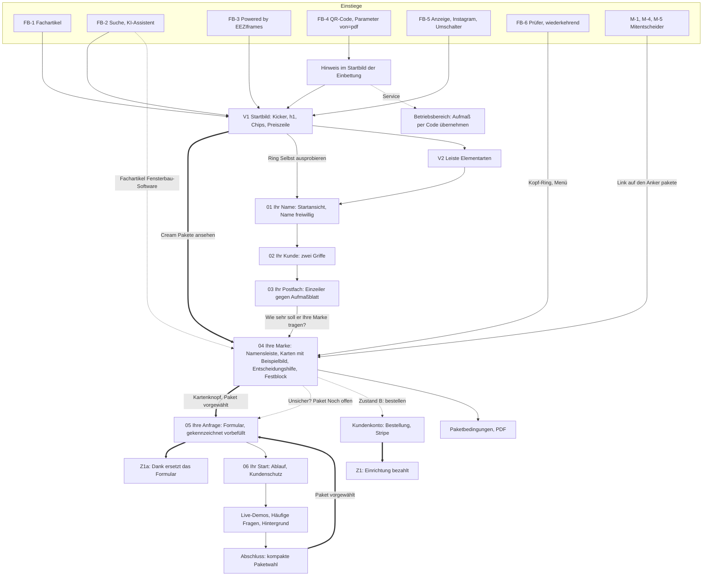

# 8. Zielarchitektur

Ergebnis 6 (finale Website-Sitemap, Navigation und Nutzerwege) und Ergebnis 7 (Page-by-Page Blueprint) des Website-Blueprints
(MASTER-PROMPT V4), Phase H. Stand 24.10.2026, Arbeitszweig `claude/design-dna-styleguide`. Planungsdokument: Das Repository wurde nur
gelesen; gebaut oder geändert wurde nichts.

**Was dieses Kapitel festlegt.** Es übersetzt die vorläufig bevorzugte Architektur E aus dem Expertenvergleich (EV 7.5) in eine
vollständige Website: alle Seiten und ihre Verbindungen, die Navigation, die Wege je Besuchergruppe und für jede Seite die Reihenfolge
sämtlicher Abschnitte mit Ziel, Nutzerfrage, vorbereiteter Entscheidung, Gewicht und Intensitätsstufe der Design-Grammatik. Wo EV offen
lässt oder sich widerspricht, entscheidet dieses Kapitel und sagt es an Ort und Stelle (**Festlegung 8**). Phase I spezifiziert danach
jeden Abschnitt, der hier als „wesentlich“ geführt ist, einzeln; die IDs (z. B. `fb-06-pakete-karten`) sind ihre Schlüssel.

**Vorbehalt.** E ist eine vorläufige, knappe Wahl (EV 7.3.1, 7.5.1). Sie hängt an der Grundsatzfreigabe des Inhabers (SKILL:27), an
einer bestandenen Materialprobe (EV Ü7; DG-H-6), an der Bewertung von E mit demselben Raster wie A bis D und am Test gegen die
Alternative C′ (EV 7.5.11, 7.6). Die Sitemap (8.1), die Navigation (8.2) und alle Seiten außer den Kapiteln 01 bis 04 der Seite für
Fensterbauer gelten unverändert auch für C′ und den Rückfall B′; was sich dort ändert, steht in 8.3.2 g.

**Grundlage**

| Kürzel | Datei |
|---|---|
| PA | [01-projektanalyse.md](01-projektanalyse.md); „PA-Frage n“ = Frage n in PA 1.11 |
| SI, CP | [bestand/seiten-und-inhalte.md](bestand/seiten-und-inhalte.md), [bestand/conversion-pfade.md](bestand/conversion-pfade.md) |
| DG | [02-design-grammatik.md](02-design-grammatik.md): Schichtregeln G1–G9, Abschnittstypen T0–T14 (2.3), Stufen 1–4 (2.4.2), Dosierregeln, DG-AB-n, DG-E-n, DG-H-n |
| RE | [03-recherche.md](03-recherche.md): Erkenntnisse E1–E19, Regeln R1–R14, Tests T1–T19 |
| EA | [04-entscheidungsarchitektur.md](04-entscheidungsarchitektur.md): Zielhandlungen Z1, Z1a, Z1+, Z2a, Z2, U1–U6; Gruppen FB-1 bis FB-7, P-1, HE-1 bis HE-8, M-1 bis M-7; Stufen S0–S8, B1–B5; Wege W1–W12, WH1–WH6; Zweifel F-nn, H-nn; AB-n; O-n |
| IA | [05-informationsarchitektur.md](05-informationsarchitektur.md): Bereiche K01–K37, IA-H-n, IA-AB-n, IA-O-n |
| KA–KD | [06-konzepte/konzept-a.md](06-konzepte/konzept-a.md) bis [konzept-d.md](06-konzepte/konzept-d.md) |
| EV | [07-expertenvergleich.md](07-expertenvergleich.md): Übereinstimmungen Ü1–Ü15, Widersprüche W1–W13, Architektur E (7.5) mit [V] E-1 bis E-13, H-E1 bis H-E10, E-AB-1 bis E-AB-10; C′ und B′ (7.6) |
| DNA, SG, VGL | `docs/design-dna/03-design-dna.md` (Formel 5.1, Prinzipien Nr. 1–11, Signature-Effekte 5.4), `04-styleguide.md` (10.1–10.10; „SG 10.7/4“ = Abschnitt 10.7, Regel 4), `05-ergebnis-a-gesamtdefinition.md`, `02-vergleich.md` |
| SKILL, DR, GEST | `.claude/skills/premium-gestaltung/SKILL.md` (Anforderungen des Inhabers), `…/designrichtung.md`, `docs/GESTALTUNG.md` (heutige Regeln, dürfen hinterfragt werden) |
| VK, PB | `web/fuer-fensterbauer/index.html`, `web/konfigurator-bedingungen/index.html` |

**Kennzeichnungen**

- `Datei:Zeile` ist ein Beleg. **[V]** verbindlich: Anforderung des Inhabers, DNA-Prinzip, Pflichtregel des Styleguides, Recht,
  Prüfsuite oder verbindliche Regel von E (EV 7.5.8). **[H]** Hypothese oder experimentelle Gestaltungsentscheidung; sie hat einen Rückfall
  und wird erst nach Prüfung zur Regel.
- **Textentwurf**: neuer Wortlaut, nur aus belegten Fakten gebildet; braucht die Freigabe des Inhabers. Wörtliche Bestandstexte tragen
  einen Beleg.
- **Abweichung von bestehender Regel – Freigabe durch den Inhaber nötig**: Vorschlag gegen eine Regel aus GEST oder DR; gesammelt in
  8.4.5. Name, Wortmarke und Logo bleiben unverändert (GEST:7).
- **Festlegung 8**: Entscheidung dieses Kapitels, wo EV offen ist oder sich widerspricht, mit Begründung.
- **Stufe** = Intensitätsstufe der Design-Grammatik (DG 2.4.2): 1 ruhig, 2 klar, 3 gestaltet, 4 inszeniert. **Typ** = Abschnittstyp
  T0–T14 (DG 2.3).
- **Gewicht** = geplante Länge in Bildschirmhöhen (BH) bei 390 × 844, Anteil an der Seitenlänge und der Bildschirm, in dem der
  Abschnitt bei der realen Höhe von ≈ 664 px liegt (untere Grenze einer Schätzung, EV X9). Alle Lagen sind geplant, nicht gemessen.
- Telefon 390 × 844 ist die Hauptansicht (SKILL:28), danach Schreibtisch 1280 × 800. Schriftgrößen nur 13, 15, 17, 24, 40, am Telefon 32
  statt 40 (SKILL:69).
- **wesentlich** = der Abschnitt braucht in Phase I eine eigene Gestaltungsspezifikation. Muster (Rechtsseiten, Ratgeber) stehen als ein
  gemeinsamer Abschnitt.

**Methode und Grenzen.** Die Architektur ordnet den Bestand (PA, SI) entlang der Entscheidungsketten S0–S8 und B1–B5 (EA 4.4) und
übernimmt die Folge von E. Simulierte Perspektiven (EV 7.2) sind eine Analysemethode, keine Nutzerstudie. Im Repository gibt es keine
Nutzerforschung, Besucherzahlen, Trichter für die Pakete oder Konversionsraten (PA, „Was es nicht gibt“; EA O-2). Aussagen über Wirkung
sind Hypothesen; dieses Kapitel nennt keine Wahrscheinlichkeiten.

---

## 8.1 Finale Website-Sitemap

### 8.1.1 Leitentscheidungen

1. **Alle öffentlichen Adressen bleiben [V].** 39 Adressen stehen in `SEITEN` (`functions/seo.js:19-58`); dazu Anker, die aus gedruckten
   Aufmaßblättern, E-Mails und Kundenlinks aufgerufen werden (PA 1.10 Nr. 2). Keine Adresse wird umbenannt, keine Weiterleitung, keine
   neue indexierbare Seite (IA 5.1.1, IA-H-1). E braucht keine eigene Adresse; die Probe lebt auf der Seite für Fensterbauer.
2. **Eine Quelle, zwei Orte [V].** Die Seite für Fensterbauer steht auf `/fuer-fensterbauer/` und eingebettet in `/#fensterbauer`; jedes
   Element funktioniert an beiden Orten und nach Neuaufbau (SKILL:63-64; `Verkauf.auf`). Ob das dauerhaft so bleibt, ist offen (IA-O-1).
3. **Zwei Zielgruppen, getrennte Wege, je ein leiser Wechsel [V]** (GEST:188; EA 4.1.5): Umschalter auf `/`, Wechselkarte am Ende jeder
   Ansicht, Menü und Fuß verlinken beide Bereiche als Navigation.
4. **Altbestand: Service, keine Akquise [V]** (IA 5.1.1 Nr. 5; SKILL:25). Tarife, Tour, „So funktioniert es für Betriebe“ und
   Registrierung bleiben erreichbar, werden aber an keiner öffentlichen Stelle mehr beworben. Wie weit, hängt an EA O-4.
5. **Ein Ziel für alle eigenen Einstiege [H, IA-H-3].** Jeder Einstieg, den eeziframes selbst setzt, zeigt auf `/fuer-fensterbauer/`
   (IA 5.2.2). Auf `/` bleiben nur der Umschalter und der QR-Code.
6. **Verkaufsfläche kurz, Wissen getrennt [V]** (SKILL:29-30). Was gelesen statt überflogen wird, steht auf Ratgeber, Fachartikeln und
   Paketbedingungen; auf der Seite für Fensterbauer nur zugeklappt.
7. **E ändert die Sitemap gegenüber IA nicht.** E ändert Reihenfolge und Inhalt der Seite für Fensterbauer und den Aufbau der Ansicht
   Hauseigentümer (8.3.2, 8.3.4).

### 8.1.2 Sitemap mit Verbindungen

Durchgezogen: Navigation. Doppelt: Weg zur Zielhandlung. Gestrichelt: bedingt, nur erreichbar oder Rückkehr. Rechtsseiten und Fuß hängen
an jeder Seite; ihre Kanten sind nur beispielhaft gezeigt.

```mermaid
flowchart TB
  subgraph AUSSEN["Einstiege von außen"]
    direction LR
    X1["Suche, KI-Assistenten, llms.txt"]
    X2["QR-Code im Aufmaßblatt-PDF"]
    X3["Powered by EEZIframes im Konfigurator eines Essential-Betriebs"]
    X4["Instagram, Anzeigen, Empfehlung"]
    X5["Lesezeichen, E-Mails aus Kundenkonto und Betriebsbereich"]
    X6["Kundenlink eines Betriebs"]
  end

  subgraph START["/ Startseite: eine Adresse, zwei Ansichten"]
    HE["Ansicht Hauseigentümer, Standard: H1 Startbild bis H7 Abschluss"]
    FBV["Ansicht Fensterbauer: Seite für Fensterbauer eingebettet"]
    VPDF["Parameter von=pdf: Hinweis im Startbild der Einbettung"]
  end

  subgraph FBB["Bereich Fensterbauer"]
    VK["/fuer-fensterbauer/ Startbild und Leiste"]
    K01["01 Ihr Name, Anker die-idee"]
    K02["02 Ihr Kunde, Anker so-funktioniert-es"]
    K03["03 Ihr Postfach, Anker was-in-jeder-anfrage-steht"]
    K04["04 Ihre Marke, Anker pakete, paket-essential, paket-plus, paket-signature, vergleich"]
    K05["05 Ihre Anfrage, Anker bestellen und frage"]
    K06["06 Ihr Start, Anker ablauf und kundenschutz"]
    ANH["Anhänge: Live-Demos, Häufige Fragen, Hintergrund, Abschluss"]
    PB["/konfigurator-bedingungen/ mit PDF und AV-Vertrag"]
    DEMO["demo-essential, demo-plus, demo-signature, erst mit PAKETE_DEMOS"]
    subgraph FA["5 Fachartikel unter /fuer-fensterbauer/"]
      FA1["erstaufmass-feinaufmass"]
      FA2["falsches-aufmass-haftung"]
      FA3["aufmass-kostenpflichtig"]
      FA4["geplatzter-aufmasstermin"]
      FA5["fensterbau-software"]
    end
  end

  subgraph HEB["Bereich Hauseigentümer"]
    APP["/app/ Startbild"]
    APPM["/app/ Einstieg ausmessen"]
    APPF["/app/ Führung"]
    APPK["/app/ Kundenlink k-…, kein Kauf bei eeziframes"]
    KASSE["Paywall, Aufmaß sichern, Kasse"]
    RG["/ratgeber/ Weg in sechs Schritten"]
    subgraph RGW["23 Ratgeber-Artikel unter /ratgeber/"]
      subgraph P1["1 Prüfen"]
        R01["fenster-beschlagen"]
        R02["fenster-undicht"]
        R03["fenster-alter-erkennen"]
      end
      subgraph P2["2 Entscheiden"]
        R04["fenster-reparieren-oder-austauschen"]
        R05["fenster-austauschen"]
        R06["fenstertausch-altbau"]
      end
      subgraph P3["3 Auswählen"]
        R07["fenster-material-vergleich"]
        R08["dreifachverglasung"]
        R09["fenster-oeffnungsarten"]
        R10["uw-wert-fenster"]
        R11["din-links-rechts"]
        R12["fenster-standardmasse"]
      end
      subgraph P4["4 Ausmessen"]
        R13["fenster-ausmessen"]
        R14["balkontuer-ausmessen"]
        R15["fenster-mit-rollladen-ausmessen"]
        R16["kellerfenster-ausmessen"]
        R17["fensterbank-ausmessen"]
        R18["bruestungshoehe-fenster"]
        R19["aufmassblatt-fenster"]
        R20["bestellmass-fenster"]
      end
      subgraph P5["5 Vergleichen"]
        R21["fenster-angebot-vergleichen"]
      end
      subgraph P6["6 Einbauen"]
        R22["ral-montage-fenster"]
        R23["lueftungskonzept-fenstertausch"]
      end
    end
  end

  subgraph KONTEN["Konten, noindex"]
    PARTNER["/partner/ Kundenkonto, Anmeldeseite als Weiche"]
    BEST["/partner/ Bestellformular, nur Zustand B"]
    BBR["Betriebsbereich auf /, nach Anmeldung"]
    ALT["Altbestand: So funktioniert es, Preise, Tour, Registrierung"]
    DASH["/betrieb/ auf der Domain des Betriebs, nur Signature"]
  end

  subgraph RAND["Recht, System, extern"]
    IMP["/impressum/"]
    DS["/datenschutz/"]
    CK["/cookies/"]
    AGB["/agb/"]
    NB["/nutzungsbedingungen/"]
    WID["/widerruf/"]
    F404["404"]
    SYS["sitemap.xml, robots.txt, llms.txt, og.png"]
    STRIPE["Stripe-Kasse"]
    ZEN["/zentrale/ intern"]
  end

  X1 --> VK
  X1 --> FA
  X1 --> RGW
  X1 --> HE
  X1 --> APP
  X2 -.-> VPDF
  VPDF --> FBV
  X3 --> VK
  X4 -->|"neu"| VK
  X4 --> HE
  X5 -.-> PARTNER
  X5 -.-> BBR
  X6 -.-> APPK

  HE <-->|"Umschalter und Wechselkarte"| FBV
  FBV -.-|"eine Quelle"| VK
  HE ==>|"Jetzt ausmessen"| APPM
  HE -->|"Führung starten"| APPF
  HE -->|"Ratgeber-Weg"| RG
  HE -.->|"Gesichertes Aufmaß öffnen, Menü und Fuß"| APP

  VK ==>|"Pakete ansehen, Cream"| K04
  VK -->|"Selbst ausprobieren, Ring"| K01
  K01 --> K02
  K02 --> K03
  K03 -->|"Wie sehr soll er Ihre Marke tragen?"| K04
  K04 ==>|"Kartenknopf, Paket vorgewählt"| K05
  K04 -.->|"Zustand B: bestellen"| BEST
  BEST ==> STRIPE
  STRIPE -.->|"Rückkehr"| PARTNER
  K05 --> K06
  K06 --> ANH
  ANH ==>|"Abschluss: Paket anfragen"| K05
  K04 --> PB
  K06 -->|"Paketbedingungen § 10"| PB
  PB -->|"Pakete ansehen"| K04
  ANH -.->|"ab PAKETE_DEMOS"| DEMO
  ANH -.->|"Zustand A: App in neuem Tab"| APP

  FA ==> VK
  FA5 ==>|"direkt zu den Paketen"| K04
  VK -->|"Anmelden"| PARTNER
  FBV -->|"Anmelden auf /: Anmeldeblatt"| BBR
  VPDF -.->|"Aufmaß per Code übernehmen"| BBR
  PARTNER -.-> BBR
  PARTNER -.->|"Hinweis, kein Link"| DASH
  BBR -.-> ALT

  RG --> RGW
  RGW ==>|"Handlungsbaustein, Ziel nach IA-O-7"| APPM
  RG -->|"Für Fensterbauer"| VK
  APP ==> APPM
  APPF -.->|"Eigenes Fenster ausmessen"| APPM
  APPM ==> KASSE
  KASSE ==> STRIPE
  STRIPE -.->|"Rückkehr"| APP
  APP -->|"Sie sind Fensterbauer?"| VK

  F404 --> HE
  F404 --> APP
  F404 --> VK
  IMP -->|"Kopf neutral: Für Fensterbauer"| VK

  classDef bedingt stroke-dasharray: 5 5
  class ALT,DEMO,BEST,VPDF,DASH,APPK bedingt
```

### 8.1.3 Seiten im Überblick

| Nr. | Seite | URL | Zweck | Zielgruppe | Zielhandlung | Herkunft der Inhalte | Stand in der Zielarchitektur |
|---|---|---|---|---|---|---|---|
| S1 | Startseite, Rahmen | `/` | eine Adresse, zwei Ansichten: Einstieg der Hauseigentümer, Einbettung für Fensterbauer | beide | Weiche, keine eigene | `web/assets/portal.js`, `web/index.html`; Kopf und Fuß nach IA K01, K07 | bleibt; Kopf 56 px, Umschalter als Glas über dem Foto (IA-AB-3), kein Einführungsband auf `/` (IA-AB-6); 8.3.3 |
| S2 | Ansicht Hauseigentümer | `/#hauseigentuemer` (Standard, `portal.js:398`) | zuordnen, Zutrauen, Ergebnis und Preis zeigen, in die App führen | HE-3, HE-5; dann HE-1, HE-2 | Z2a (Z2 in der App); U4, U5 | `portal.js:779-786`, `:852-857`; `web/index.html:58-62`, `:93-95`; `web/app/index.html:81`; Probemessung aus KD, Preisetikett KB-4 aus KB; Textentwürfe gekennzeichnet | umgebaut zu H1–H7; 8.3.4 |
| S3 | Ansicht Fensterbauer | `/#fensterbauer` (alt `#betriebe`) | dieselbe Seite für Fensterbauer, eingebettet | FB-5 über den Umschalter, FB-4 | Z1a, Z1 | eine Quelle mit S5 (`portal.js:792-844`) | bleibt; Kopf im Kontext Fensterbauer ohne Altbestand (EA AB-2); Meldungsstapel rückt unter den Umschalter (8.3.3) |
| S4 | Hinweis zum Aufmaßblatt | `/?von=pdf` | FB-4 abholen, Code-Übernahme auffindbar halten | FB-4 | Z1a; Service „Aufmaß per Code übernehmen“ (AGB:33 § 2 (2)) | `portal.js:849`; PB:44; AGB:35 | Hinweis im Startbild der Einbettung statt Band davor (Festlegung 8, Z-AB-1); 8.3.3 |
| S5 | Seite für Fensterbauer | `/fuer-fensterbauer/` | Konfigurator-Pakete verkaufen: Produkt bedienen, Ergebnis beweisen, Paket wählen, anfragen | FB-2, FB-6; dann FB-3, FB-4, FB-5, FB-1 | Z1 (Zustand B), Z1a (Zustand A), Z1+ | VK; `functions/pakete-seite.js` (Bausteine); `web/assets/pakete.js` (Preise, Merkmale); `web/assets/instanzregeln.js` (Ablauf); `web/assets/einladung.js` (Startansicht); `web/bilder/tour-aufmassblatt-15.webp`; Textentwürfe aus EV 7.5.3 | umgebaut nach E: Startbild, Leiste, sechs Kapitel, vier Anhänge; 8.3.2 |
| S6 | Fachartikel | `/fuer-fensterbauer/erstaufmass-feinaufmass/` | Fachfrage „Erstaufmaß, Grobaufmaß, Feinaufmaß“ beantworten, zur Seite für Fensterbauer führen | FB-1 | U5, dann S5 (Seitenanfang, W5) | Bestand (SI 3.8) | Aufbau bleibt; zwei Handlungsbausteine (K36); Kopf Kontext Fensterbauer; 8.3.5 |
| S7 | Fachartikel | `/fuer-fensterbauer/falsches-aufmass-haftung/` | „Wer haftet, wenn Fenster nicht passen?“ | FB-1 | U5, dann S5 | Bestand | wie S6 |
| S8 | Fachartikel | `/fuer-fensterbauer/aufmass-kostenpflichtig/` | „Aufmaß kostenlos oder kostenpflichtig?“ | FB-1 | U5, dann S5 | Bestand | wie S6 |
| S9 | Fachartikel | `/fuer-fensterbauer/geplatzter-aufmasstermin/` | „Was ein geplatzter Termin kostet“ | FB-1 | U5, dann S5 | Bestand | wie S6 |
| S10 | Fachartikel | `/fuer-fensterbauer/fensterbau-software/` | „Fensterbau-Software im Überblick“ | FB-2 (K2) | U5, dann `#pakete` (W5, Ausnahme) | Bestand | wie S6; Handlungsbaustein zielt auf `#pakete` |
| S11 | Paketbedingungen | `/konfigurator-bedingungen/` | Absicherung: Vertrag, AV-Vertrag als PDF, vollständige Merkmalstabelle § 2 (2), Kundenschutz § 10 | FB-6, M-1, M-4, M-5 | U3 | PB; `scripts/bedingungen-pdf.mjs` | bleibt; Kopf Fensterbauer mit Ring „Pakete ansehen“ → `/fuer-fensterbauer/#pakete`; 8.3.6 |
| S12 | Demo-Konfiguratoren | `demo-essential`, `demo-plus`, `demo-signature.eeziframes.com` | Probieren je Paket | FB-6 | U1 | `docs/INSTANZEN.md:310` | bedingt: erst mit `PAKETE_DEMOS=1`; öffnen in neuem Tab [H] |
| S13 | App | `/app/`, `#ausmessen`, `#fuehrung`, `#k-…` | messen, Aufmaßblatt kaufen; Kundenlinks der Betriebe | HE-3, HE-5, HE-7; HE-6 | Z2a, Z2; U4 | `web/app/index.html`, `web/assets/app.js` | App unverändert; nur das Startbild als Schnittstelle (8.3.10); „Sie sind Fensterbauer?“ → S5 (IA-AB-4) |
| S14 | Ratgeber-Übersicht | `/ratgeber/` | Weg in sechs Schritten | HE-1, HE-2, HE-4 | U5, dann Z2a | `web/ratgeber/index.html` | bleibt; Platzhalter nicht mehr als Hauptbild (DG 2.4.1); 8.3.5 |
| S15 | Ratgeber, Schritt 1 Prüfen | `/ratgeber/fenster-beschlagen/`, `/fenster-undicht/`, `/fenster-alter-erkennen/` | Problem am Fenster einordnen | HE-1 | U5 | Bestand (SI 3.8) | Aufbau bleibt; Handlungsbaustein leise (Ring) |
| S16 | Ratgeber, Schritt 2 Entscheiden | `/ratgeber/fenster-reparieren-oder-austauschen/`, `/fenster-austauschen/`, `/fenstertausch-altbau/` | Entscheidung reparieren oder tauschen | HE-2 | U5, Z2a | Bestand | Aufbau bleibt |
| S17 | Ratgeber, Schritt 3 Auswählen | `/ratgeber/fenster-material-vergleich/`, `/dreifachverglasung/`, `/fenster-oeffnungsarten/`, `/uw-wert-fenster/`, `/din-links-rechts/`, `/fenster-standardmasse/` | Auswahl von Material, Glas, Öffnung | HE-2 | U5, Z2a | Bestand | Aufbau bleibt |
| S18 | Ratgeber, Schritt 4 Ausmessen | `/ratgeber/fenster-ausmessen/`, `/balkontuer-ausmessen/`, `/fenster-mit-rollladen-ausmessen/`, `/kellerfenster-ausmessen/`, `/fensterbank-ausmessen/`, `/bruestungshoehe-fenster/`, `/aufmassblatt-fenster/`, `/bestellmass-fenster/` | Messanleitung, direkter Weg in die App | HE-3 | Z2a | Bestand | Aufbau bleibt; App-Knöpfe mit einheitlichem Ziel (IA-O-7) |
| S19 | Ratgeber, Schritt 5 Vergleichen | `/ratgeber/fenster-angebot-vergleichen/` | Angebote prüfen | HE-4 | U5 | Bestand | Aufbau bleibt |
| S20 | Ratgeber, Schritt 6 Einbauen | `/ratgeber/ral-montage-fenster/`, `/lueftungskonzept-fenstertausch/` | Einbau verstehen | HE-4 | U5 | Bestand | Aufbau bleibt |
| S21 | Kundenkonto | `/partner/` (noindex), `#bestellen/<paket>`, `#bestellung/<id>` | Anmelden mit Code; in Zustand B Bestellung und Status bis Live | P-1; FB-6 in Zustand B; FB-7 über die Weiche | Z1 (Zustand B); Service | `web/partner/index.html`, `web/assets/partner.js` | Anmeldeseite wird Weiche K37; „Noch kein Paket?“ in Zustand A → `/fuer-fensterbauer/#pakete`; 8.3.8 |
| S22 | Betriebsbereich und Altbestand | `/` angemeldet; `/#tour`; Bildschirme ohne eigene Adresse | Service für Bestandsbetriebe | FB-7 | Service | `portal.js:867-963`, `:1436-1592` | nur noch erreichbar; nicht in Kopf, Fuß, Bändern (IA-AB-1) |
| S23 | Dashboard Signature | `/betrieb/` auf der Domain des Betriebs | Team, Einladungslinks | P-1 (Signature) | Service | `web/betrieb/index.html` | unverändert; in der Weiche nur als Hinweis ohne Link |
| S24 | Impressum | `/impressum/` | Anbieterangaben, Kontakt | alle | – | `web/impressum/index.html` | Muster Rechtsseite (8.3.7) |
| S25 | Datenschutz | `/datenschutz/` | Datenschutzerklärung; Anker `#pakete` als Ziel aus dem Formular | alle | – | `web/datenschutz/index.html` | Muster Rechtsseite |
| S26 | Cookies | `/cookies/` | Cookie-Hinweise | alle | – | `web/cookies/index.html` | Muster Rechtsseite |
| S27 | AGB | `/agb/` | Vertrag Aufmaßblatt für Verbraucher | Hauseigentümer | – | `web/agb/index.html` | Muster Rechtsseite |
| S28 | Nutzungsbedingungen | `/nutzungsbedingungen/` | Vertrag Aufmaß-Link-Modell (Altbestand) | Bestandsbetriebe | – | `web/nutzungsbedingungen/index.html` | Muster Rechtsseite |
| S29 | Widerruf | `/widerruf/` | Widerrufsformular, ohne JavaScript nutzbar (CP P7) | alle | – | `web/widerruf/index.html` | Muster Rechtsseite mit Formular |
| S30 | Fehlerseite | 404 (noindex) | Wege zurück | alle | – | `web/404.html` | drei Wege, Fuß kurz; 8.3.9 |
| S31 | Zentrale | `/zentrale/` (noindex) | interner Bereich des Inhabers | intern | – | `web/zentrale/index.html` | unverändert, nicht verlinkt |
| S32 | System | `sitemap.xml`, `robots.txt`, `llms.txt`, `og.png` | Auffindbarkeit, Vorschaubild | Suchmaschinen, KI | Zitat, Verweis | `functions/seo.js` | bleibt; eigenes Vorschaubild für S5 (IA-O-8) |

Nicht als Seite, sondern als PDF geplant und offen: Kurzfassung der Pakete für Mitentscheider (IA 5.1.4; IA-O-6).

### 8.1.4 Anker der Seite für Fensterbauer

Alle heutigen IDs bleiben dort, wohin ihr Inhalt wandert (IA 5.1.5). Die sieben Pflicht-IDs bleiben an h2 [V] (`scripts/pruefen-instanzen/29.mjs:110-118`).

| Anker | heute (SI 2.4) | in der Zielarchitektur | angesprungen von |
|---|---|---|---|
| `die-idee` (h2, Pflicht) | Die Idee | 01 Ihr Name, h2 „Die Idee: der Fenster-Konfigurator Ihrer Wahl“ | Ring „Selbst ausprobieren“ im Startbild, Menü |
| `so-funktioniert-es` (h2, Pflicht) | So funktioniert es | 02 Ihr Kunde | Fachartikel, Menü, Kopf-Sprungmarke am Schreibtisch |
| `was-in-jeder-anfrage-steht` | gleich | 03 Ihr Postfach | Menü |
| `pakete` (h2, Pflicht) | Die Pakete | 04 Ihre Marke | Cream im Startbild, Kopf-Ring, Textziel in 03, Fachartikel „Fensterbau-Software“, Paketbedingungen, `/partner/` in Zustand A |
| `paket-essential`, `paket-plus`, `paket-signature` | Paketkarten | Karten in 04 | Namensleiste, Entscheidungshilfe |
| `vergleich` | Vergleich | zugeklappt in 04 (Block 04.2) | – |
| `bestellen` (h2, Pflicht), `frage` | Bestellen oder anfragen | 05 Ihre Anfrage | Kartenknöpfe, Gesprächsweg, Kopf-Ring ab 04, Abschluss |
| `ablauf` (h2, Pflicht) | Von der Bestellung bis zum Livegang | 06 Ihr Start, Block 06.1 | Menü, Kopf-Sprungmarke |
| `kundenschutz` | Ihre Kunden bleiben Ihre Kunden | 06 Ihr Start, Block 06.2 | Menü |
| `demos` (h2, Pflicht) | Live-Demos | Anhang Live-Demos | heute Ring im Startbild; künftig nur Menü und Fluss (E-AB-3) |
| `haeufige-fragen` (h2, Pflicht) | Häufige Fragen | Anhang Häufige Fragen | Menü, Kopf-Sprungmarke |
| `warum-kunden-selbst-planen`, `quellen`, `wissen-fuer-fensterbauer` | eigene Abschnitte | Anhang Hintergrund, je eine zugeklappte Zeile, die sich beim Ansprung öffnet [H] | Fachartikel, Quellenverweise |

### 8.1.5 Lenkung der Einstiege

| Einstieg | heute | Ziel in der Zielarchitektur | Änderung außerhalb der Website |
|---|---|---|---|
| Fachartikel | `/fuer-fensterbauer/` und Anker | Seitenanfang; „Fensterbau-Software“ → `#pakete` (W5) | – |
| Suche, KI, `llms.txt` | Seite für Fensterbauer | unverändert | – |
| Powered by EEZIframes | Seite für Fensterbauer, neuer Tab | unverändert (PB:80 § 9 (1)) | – |
| Anzeigen, Instagram | `/?…#fensterbauer` mit Registrierung (`docs/ZENTRALE.md:83`) | `/fuer-fensterbauer/` | Ziele umstellen (IA-O-3; PA-Frage 26) |
| App „Sie sind Fensterbauer?“ | `/#fensterbauer` (`web/assets/app.js:2308`) | `/fuer-fensterbauer/` (IA-AB-4) | – |
| Rechtsseiten „Für Betriebe“ | `/`, also Ansicht Hauseigentümer (`web/agb/index.html:17`) | „Für Fensterbauer“ → `/fuer-fensterbauer/` | – |
| 404 | kein Link | „Für Fensterbauer“ → `/fuer-fensterbauer/` | – |
| Ratgeber-Übersicht, Abschnitt „Für Fensterbauer“ | Seite für Fensterbauer | unverändert | – |
| QR-Code im Aufmaßblatt | `/?von=pdf` | unverändert; Hinweis neu (8.3.3) | Werbeblock im PDF „3 Projekte kostenlos“ (`web/assets/blatt.js:664`, `:694`) hängt an EA O-4 |
| Umschalter auf `/` | Ansicht Fensterbauer | unverändert | – |

---

## 8.2 Navigation und Nutzerwege je Besuchergruppe

### 8.2.1 Grundsätze

| Nr. | Grundsatz | Grundlage |
|---|---|---|
| N1 [V] | Drei Kopf-Kontexte statt sieben Kopfzeilen: Hauseigentümer, Fensterbauer, neutral; dazu Konto und App mit eigenem Kopf. Der Kontext folgt der Seite, nicht der Herkunft | IA 5.3.1; SI 2.1 |
| N2 [V] | Kopf am Telefon eine Zeile, 56 px (6,6 % von 844); am Schreibtisch 64 px (8 % von 800) | SG 10.1 (Kopfzeile ≤ 8 %) |
| N3 [V] | Der Kopf trägt nie eine zweite Cream-Pille: im Kontext Fensterbauer immer Ring; im Kontext Hauseigentümer Ring, solange im Inhalt eine Cream-Pille sichtbar ist | SKILL:71; GEST:399 (`kopfCta`) |
| N4 [H] | Der Kopfknopf erscheint erst, wenn der Knopf des Startbilds mit gleichem Ziel aus dem Bild ist, und ist ausgeblendet, solange sein Ziel selbst im Bild ist | IA-H-12; PA 1.8 |
| N5 [V] | Ein dauerhafter Handlungsträger: der Kopf-Ring mit Zielwechsel. Keine Kaufleiste am unteren Rand | EV W9; EA 4.3.1/7 |
| N6 [V] | Keine Kapitelanzeige im Kopf („02 / 06“) | EV Ü15; SKILL:29-30 |
| N7 [V] | Am Telefon gibt es ein Menü; ohne JavaScript ist „Menü“ eine Sprungmarke zur Navigation im Fuß (`#navigation`) | IA N5; heute kein Menü (`web/assets/ratgeber.css:15`) |
| N8 [V] | Der Umschalter steht nur auf `/`; überall sonst wechselt man über Menü, Fuß oder Wechselkarte | IA N6 |
| N9 [V] | Der Ring im Startbild führt auf eine Stelle der Seite, nie in die App | E-11; EV Ü1 |
| N10 [V] | In Entscheidungsflächen keine Rücklinks gegen die Leserichtung | E-4; RE E2, E3 |
| N11 [V] | Logo oben links, Preise bei den Paketen, Kontakt im Fuß und am Formular | RE E2, R6; EV Ü5 |
| N12 [V] | Ziele ab 44 px; Fokus nie vollständig unter dem klebenden Kopf (`scroll-padding-top` ≥ Kopfhöhe) | R10; WCAG 2.4.11 |
| N13 [V] | Name, Wortmarke und Logo bleiben unverändert | Auftrag; GEST:7 |

### 8.2.2 Kopf je Kontext (`rh-01-kopf`)

| Kontext | Seiten | Telefon 390, 56 px | Schreibtisch 1280, 64 px | Handlungsknopf |
|---|---|---|---|---|
| **Hauseigentümer** | `/` Ansicht Hauseigentümer; `/ratgeber/` und 23 Artikel; Textfassungen von `/` und `/app/` | Logo links (Ziel 44 × 44, → `/`); rechts Knopf ≈ 150 × 44 (15 px fett) und Menü 44 × 44 | Logo; auf `/` der Umschalter direkt daneben; Textlinks 15 px „Ratgeber“, „Für Fensterbauer“; rechts der Knopf | „Fenster ausmessen“ → `/app/#ausmessen`, mit angefangenem Aufmaß „Aufmaß fortsetzen“ (GEST:192); Cream nur, wenn keine Cream-Pille im Inhalt sichtbar ist |
| **Fensterbauer** | `/fuer-fensterbauer/`; 5 Fachartikel; `/konfigurator-bedingungen/`; `/` Ansicht Fensterbauer | Logo (→ `/fuer-fensterbauer/`, auf `/` → Anfang der Ansicht) [H, IA-H-5]; rechts Ring ≈ 150 × 44 und Menü | Logo; auf `/` Umschalter; Sprungmarken 15 px „So funktioniert es“, „Ablauf“, „Fragen“; rechts Textlink „Anmelden“ und Ring | Ring „Pakete ansehen“ → `#pakete` (auf anderen Seiten → `/fuer-fensterbauer/#pakete`); erscheint, sobald die Cream des Startbilds aus dem Bild ist. In Zustand A wechselt er zu **Textentwurf** „Paket anfragen“ → `#frage`, sobald die Namensleiste den Kopf erreicht, und ist ausgeblendet, solange das Formular im Bild ist [H, IA-H-12]. **Festlegung 8:** EV 7.5.2 setzt den Wechsel „nach dem Paketblock“; dann zeigte der Ring während der Karten auf den Abschnitt, in dem der Besucher schon ist. In Zustand B bleibt „Pakete ansehen“, weil bestellt wird, wo gewählt wird (E-3) |
| **neutral** | Rechtsseiten, 404 | Logo (→ `/`), Menü | Logo; „Für Fensterbauer“ → `/fuer-fensterbauer/`, „Fenster ausmessen“ → `/app/` | keiner |
| Konto | `/partner/` | wie heute: Logo → `/fuer-fensterbauer/`; angemeldet → Übersicht (`web/partner/index.html:22`) | wie heute | – |
| App | `/app/` | eigener Kopf der App, nicht Gegenstand dieser Planung | – | – |

**Darstellung [V].** Auf Bühnen (Startbilder V1, H1) liegt der Kopf flächenlos über einem Scrim aus `#161616` (60 % → 0 über 96 px);
über Inhalt opak `#161616` mit Haarlinie unten (DG T0; DG-AB-10). Er klebt (GEST:428) und springt bei Übergängen nie (SG 10.7/5). Kein
Schatten, kein halbtransparenter Kopf über Text. **Lesefortschritt:** Die heutige 2-px-Linie (`web/assets/verkauf.js:448`) entfällt in der
Grundfassung (GEST:41 „gibt es nicht“; DG-AB-15); als begründete Ausnahme nur nach Freigabe (DG-E-7; PA-Frage 27). **Festlegung 8**, weil
IA sie offen ließ und E jede Kapitelanzeige im Kopf ausschließt (Ü15).

### 8.2.3 Menü am Telefon (`rh-02-menue`)

- **Form [V/H]:** opakes Blatt `#1f1f1f` im unteren Bereich, bis ≈ 85 % der Höhe, Einträge im Daumenbereich [H, IA-H-13]; 1-px-Lichtkante
  oben, Scrim dahinter, kein Schatten (DG-AB-1). Es erscheint über Deckkraft in 220 ms (Austritt 165 ms), ohne Gleiten (DG T0); ein
  Gleiten von unten nur nach Entscheidung DG-E-12, weil es Bewegung der Bedienschicht wäre (SG 10.7/1).
- **Bedienung:** Schließen mit Knopf 44 × 44 oben rechts im Blatt, Wischen nach unten, Escape, Tippen auf den Rand. Fokus bleibt im Blatt
  und kehrt beim Schließen auf den Menü-Knopf zurück.
- **Satz:** Gruppenköpfe 13 px Technikstimme, Einträge 17 px in 52-px-Zeilen, Haarlinien dazwischen. Kapitelnummern 13 px vor den
  Sprungmarken der Seite für Fensterbauer.
- **Ohne JavaScript:** „Menü“ ist ein Link auf `#navigation` im Fuß. **Ruhige Fassung:** ohne Bewegung.

| Kontext | Inhalt des Menüs, in dieser Reihenfolge |
|---|---|
| Hauseigentümer | Segment „Hauseigentümer · Fensterbauer“ (auf `/` schaltet es die Ansicht, sonst Link) · „Fenster ausmessen“ · „Führung starten“ · **Textentwurf** „Gesichertes Aufmaß öffnen“ → `/app/` (IA-AB-10) · „Ratgeber“ mit den sechs Schritten als Unterzeilen 15 px · „Für Fensterbauer“ |
| Fensterbauer | Segment · Sprungmarken „01 Die Idee“, „02 So funktioniert es“, „03 Was in jeder Anfrage steht“, „04 Pakete“, „05 Anfragen“, „06 Ablauf“, „Fragen“ (Kurzbezeichnungen, wo sie von der h2 abweichen: **Textentwurf**) · „Paketbedingungen“ · „Wissen für Fensterbauer“ (→ Hintergrund) · „Anmelden“ · Kontakt `ask@eeziframes.com` (Telefon nach EA O-9) |
| neutral | Segment · „Für Fensterbauer“ · „Fenster ausmessen“ · „Ratgeber“ |

### 8.2.4 Umschalter und Wechselkarte (`st-02-umschalter`, `st-04-wechselkarte`)

- **Ort:** nur auf `/`. Schreibtisch: Segment neben dem Logo (GEST:190). Telefon: Glas-Segment 284 × 44 px über dem Foto des Startbilds,
  x 16–300, y 68–112 (Segmente 150 und 126 × 36 px, 4 px Einzug, Schrift 15/20; Maße nach `st-02`, K-29 in 11.6.3); es scrollt mit der
  Seite weg und steht zusätzlich im Menü (IA-AB-3). Damit beginnt das Foto direkt unter dem Kopf statt bei y = 268 (PA 1.8).
- **Ebenen (K-39, 11.5.1):** Glasfläche der Spur auf Z 25 zwischen Foto und Bedienschicht; Wörter, Segmentzustand und Trefferflächen auf
  Z 30.
- **Verhalten bleibt [V]:** Anker `#hauseigentuemer`, `#fensterbauer`, `#betriebe`; Wechsel ohne Verlaufseintrag; Wahl im Browser
  gespeichert; Wechsel springt an den Anfang der Ansicht (GEST:191).
- **Gestaltung:** Glas `#1f1f1f` 60 %, Unschärfe 24 px, Sättigung 100 % (DG-AB-17), 1-px-Kante, kein Schatten; Zustände nach K-3
  (11.6.3): gewählt = Füllung `--surface3` mit innerer 2-px-Kontur `--text`, Schrift 700 `--text`; nicht gewählt ohne Fläche, Schrift 500
  `--text2`; nie als zweite Cream-Pille (GEST:190; Abweichung DS-AB-4 von GEST:24 „gewählt in Cream“ – Freigabe durch den Inhaber nötig). Prüfpunkt: Erwartung der Prüfsuite an den Umschalter (`scripts/pruefen.mjs:213`) mit dem
  Glas-Segment abgleichen (IA-O-9). Reihenfolge „Hauseigentümer · Fensterbauer“ bleibt, bis IA-O-10 entschieden ist.
- **Wechselkarte** am Ende jeder Ansicht als zweiter, leiser Wechsel (GEST:192-193): Hauseigentümer → Fensterbauer mit **Textentwurf**
  (aus KD, EV 7.5.10) „Für Fensterbauer · Dieses Werkzeug, unter Ihrer Marke.“ und Ring **Textentwurf** „Zur Seite für Fensterbauer“
  (schaltet die Ansicht und springt an ihren Anfang); Fensterbauer → Hauseigentümer „Ihre eigenen Fenster ausmessen?“
  (`web/assets/portal.js:791`) mit Ring „Zur Ansicht für Hauseigentümer“.

### 8.2.5 Fuß und Brotkrumen (`rh-03-brotkrumen-fuss`)

Eine Inhaltsquelle, zwei Längen (IA 5.3.5). Heute gibt es acht Fußfassungen mit unterschiedlichen Lücken (SI 2.2).

| Länge | Seiten | Gruppen |
|---|---|---|
| **kurz** | `/` (beide Ansichten), `/fuer-fensterbauer/`, `/konfigurator-bedingungen/`, Rechtsseiten, 404, Fuß der App | „Für Fensterbauer“: Konfigurator-Pakete, Paketbedingungen, die fünf Fachartikel, Anmelden · „Für Hauseigentümer“: Fenster ausmessen, Führung, Gesichertes Aufmaß öffnen (IA-AB-10), Ratgeber, Anleitung Fenster ausmessen · „eeziframes“: Anbieter (Impressum), E-Mail `ask@eeziframes.com` (Telefon nach EA O-9) · Recht: AGB, Nutzungsbedingungen, Datenschutz, Cookies, Impressum · Knopf „Vertrag widerrufen“ (Ring 44 px, GEST:438) · Satz zum Server nur ohne Server |
| **lang** | 23 Ratgeber, 5 Fachartikel, `/ratgeber/` | wie heute aus `scripts/ratgeber-bausteine.mjs`: „Ratgeber“ (alle Artikel), „Für Fensterbauer“ (Seite, fünf Artikel, Paketbedingungen), „Mehr“ (Startseite, App, Recht, Widerruf) |

**Brotkrumen:** eine Zeile 13 px mit 44-px-Zielen und Haarlinie oben. Auf der Seite für Fensterbauer über dem Fuß [H, IA-H-10]; auf
Ratgebern und Fachartikeln oben wie heute (IA K05). **Festlegung 8:** DG 2.3.15 nennt „Brotkrumen (nach IA unten)“ auch für Ratgeber; IA
setzt die Lage über dem Fuß nur für die Seite für Fensterbauer. In der Einbettung auf `/` entfallen sie (GEST:193). Ob auf
`/fuer-fensterbauer/` die Gruppe „Für Hauseigentümer“ bleibt, obwohl Kunden von Essential-Betrieben dort landen, ist offen (IA-O-16).

### 8.2.6 Navigation innerhalb der Seite für Fensterbauer

- **Kapitelzeilen** an der Haarlinie, 13 px grün in der Technikstimme, **Textentwurf** „01 · IHR NAME“, „02 · IHR KUNDE“, „03 · IHR
  POSTFACH“, „04 · IHRE MARKE“, „05 · IHRE ANFRAGE“, „06 · IHR START“; Anhänge ohne Nummer (E-AB-10). Kein Fragetonfall (EV W3). Ob sie wie
  ein Inhaltsverzeichnis wirken, prüft der Inhaber (H-E8; Rückfall: nur Nummern).
- **Übergänge in Leserichtung:** 03 endet mit dem Textziel **Textentwurf** „Wie sehr soll er Ihre Marke tragen?“ → `#pakete`; sonst führt
  das Scrollen. Kein Kapitel verweist zurück (E-4).
- **Sprungmarken:** Kopf am Schreibtisch → 02, 06, Fragen; Menü am Telefon → 01 bis 06, Fragen. In der Einbettung scrollen sie innerhalb der
  Ansicht, ohne den Anker `#fensterbauer` zu ändern (GEST:193).
- **Was die Seite weiterträgt [V]:** der Firmenname aus 01 (freiwillig) und das Paket aus dem Kartenknopf, beide nur ins Formular (05) und
  in den Abschluss; „gewählt“ heißt auf einen Kartenknopf getippt, nie „zuletzt angesehen“ (E-3). Eingaben verlassen den Browser nur über
  das Formular und nur beim Absenden (E-10).

### 8.2.7 Wege zurück

| Von | Zurück über | Ziel |
|---|---|---|
| Seite für Fensterbauer, tief gescrollt | Kopf-Ring, Menü-Sprungmarken; Browser-Zurück nach einem Sprung (auf der eigenständigen Seite erzeugen Sprungmarken einen Verlaufseintrag) | 04 bzw. Ausgangsstelle |
| Seite für Fensterbauer, eigenständig | Logo; Brotkrumen „Startseite › Für Fensterbauer“ über dem Fuß | Seitenanfang bzw. `/` |
| Seite für Fensterbauer, eingebettet | Umschalter; Wechselkarte | `/#hauseigentuemer` |
| Formular nach dem Senden | Dank mit Ring „Zurück zu den Paketen“ und Link „Paketbedingungen“ | `#pakete` |
| Fachartikel, Ratgeber | Brotkrumen; Handlungsbaustein; beim Ratgeber Block „Dein Weg zu neuen Fenstern“ | Übersicht, nächster Schritt, Seite für Fensterbauer |
| Paketbedingungen | Kopf-Ring „Pakete ansehen“ | `/fuer-fensterbauer/#pakete` |
| Demo-Konfigurator | öffnet in neuem Tab [H]; Tab schließen | Seite für Fensterbauer bleibt offen |
| App | Startbild: „Zur Startseite“, „Sie sind Fensterbauer?“ → `/fuer-fensterbauer/` | `/`, Seite für Fensterbauer |
| Stripe | Rückkehradressen unverändert (PA 1.10 Nr. 8) | Kundenkonto, App |
| Kundenkonto | Logo | `/fuer-fensterbauer/` |
| 404 | „Zur Startseite“, „Zur App“, neu „Für Fensterbauer“ | `/`, `/app/`, Seite für Fensterbauer |

### 8.2.8 Nutzerwege je Besuchergruppe

Gruppen nach EA 4.2, Wege nach EA 4.5. Bildschirme bei 390 × 664 nach 8.3.2 (linear: Pakete auf Bildschirm 6, Formular auf Bildschirm 9).
Ob Besucher diese Wege so gehen, ist ungeprüft (EV 7.6.3).

| Gruppe | Einstieg | Weg durch die Architektur | Navigationsmittel | Ziel | Weg bis Pakete / Formular | Rückweg, Ausstieg | Bedingung, Hypothese |
|---|---|---|---|---|---|---|---|
| **FB-1** Fachfrage | Suche → Fachartikel | Artikel → Handlungsbaustein → V1 → V2 → 01 → 02 → 03 (Lead VK:80 beantwortet die Brille „Aufmaß“) → 04 → Kartenknopf → 05 | Cream im Handlungsbaustein, Textziel in 03 | Z1a, später Z1 | linear: Bildschirm 6 / 9 | Browser-Zurück; Fachartikel im Fuß und im Hintergrund | W5: Ziel Seitenanfang |
| **FB-2** sucht Software oder Konfigurator | Suche, KI-Assistent | V1 (Preiszeile „Ab 29 € im Monat …“) → Cream „Pakete ansehen“ → 04 (Satz „In allen Paketen“, Namensleiste mit drei Preisen, empfohlene Karte) → 04.3 Festblock → Kartenknopf → 05; oder Fachartikel „Fensterbau-Software“ → `#pakete` | Cream V1, Kopf-Ring | Z1a, Z1 | Pakete nach einem Tipp; Formular nach ≈ 3 weiteren Bildschirmen | Menü-Sprungmarken zurück zu 01–03 | W2, W9; H-E1 |
| **FB-3** sah „Powered by“ | Link im Essential-Konfigurator, neuer Tab | V1 → Schnellweg → 04: Anmerkung „HINWEIS AUF EEZIFRAMES: …“ je Karte, Unterschiedszeile → Karte Essential Plus oder Signature → 05 | Cream V1 | Z1+, Z1a | wie FB-2 | Tab schließen | W8; Gruppe entsteht erst mit Kunden (EA FB-3) |
| **FB-4** hat ein Aufmaßblatt | QR-Code → `/?von=pdf` | Hinweis im Startbild der Einbettung (Code-Weg) → V1 → 03 (erkennt das Blatt, Zeile zum Feinaufmaß) → 04 → 05 | Hinweis-Link, Menü | Z1a; Service Code-Übernahme | linear: 6 / 9 | Umschalter; „Aufmaß per Code übernehmen“ (immer; Ziel und Ton nach EA O-4) | W7; IA-H-8; Z-AB-1 |
| **FB-5** ohne Kontext | Anzeige, Instagram (neu direkt) | `/fuer-fensterbauer/` V1 → Ring „Selbst ausprobieren“ → 01 (Name freiwillig) → 02 (zwei Griffe) → 03 → 04 → 05 | Ring V1, Textziele | Z1a | linear: 6 / 9 | Logo → Seitenanfang | W12 mit neuem Ziel (IA-O-3); H-E1, H-E2 |
| **FB-5** über die Startseite | `/` → Umschalter | Einbettung V1 → wie oben | Umschalter | Z1a | linear: 6 / 9 | Umschalter zurück, Wechselkarte | W6 ohne Altbestand-Kopf (EA AB-2) |
| **FB-6** Prüfer kurz vor dem Kauf | wiederkehrend, direkt | Kopf-Ring oder Menü „Pakete“ → 04 → Vergleich aufklappen → Festblock → Paketbedingungen (PDF) → Live-Demos (ab `PAKETE_DEMOS`) → 04 → Kartenknopf → 05; oder Gesprächsweg → 05 mit „Noch offen“ | Kopf-Ring, Menü, Links | Z1, Z1+ | Pakete nach einem Tipp | Gesprächsweg | W2, W3, W4 |
| **FB-7** Bestandsbetrieb | `/`, Lesezeichen | auf `/`: Fuß „Anmelden“ oder in der Ansicht Fensterbauer Kopf bzw. Menü „Anmelden“ → Anmeldeblatt des Betriebsbereichs mit der Zeile **Textentwurf** „Konfigurator-Paket bestellt? Zum Kundenkonto“; von anderen Seiten → Weiche K37 → Betriebskonto; für ein Paket zusätzlich → S5 | „Anmelden“ | Service; ggf. Z1 | – | – | W11; VK:244 (Frage zu Bestandskunden) |
| **P-1** Paketkunde | Lesezeichen, E-Mail, „Anmelden“ | `/partner/`; Team bei Signature → `/betrieb/` auf der eigenen Domain | „Anmelden“ | Service; Z1+ über „Paketwechsel anfragen“ | – | – | CP 5.4 |
| **M-1, M-4, M-5** Mitentscheider | Link oder PDF vom Kollegen | `/fuer-fensterbauer/#pakete` → Festblock → Paketbedingungen mit AV-Vertrag (PDF); Kurzfassung als PDF offen (IA-O-6) | Anker | Freigabe im Betrieb | – | – | EA M-1 bis M-5 (Hypothesen); die Probe lässt sich nicht weiterreichen (KD) |
| **HE-1** Problem am Fenster | Suche → Ratgeber „Prüfen“ | Artikel → „Dein Weg“ → nächster Schritt → … → Ausmessen-Artikel → App | Handlungsbaustein als Ring (EA 4.3.4/7) | U5, später Z2a | – | Weg in sechs Schritten | – |
| **HE-2** vor Entscheidung oder Auswahl | Suche → „Entscheiden“, „Auswählen“ | Artikel → Weg → App | Handlungsbaustein | U5, Z2a | – | wie HE-1 | – |
| **HE-3** will messen | Suche → Messanleitung, `/app/` oder `/` | H1 Cream „Jetzt ausmessen“ → `/app/#ausmessen` → Paywall → Kasse | Cream H1, H2, H7; Kopf | **Z2a, Z2** | Start im ersten Bildschirm | Führung (WH3) | R12, R13 |
| **HE-4** Angebote, Einbau | Suche → „Vergleichen“, „Einbauen“ | Artikel → Weg | – | U5 | – | – | Aufmaßblatt meist zu spät |
| **HE-5** direkt, KI, Empfehlung | `/` | H1 → H2 Probemessung → H3 Aufmaßblatt und Preis → H4 Daten und Konto → H7 → App; oder H1 → Führung | Cream H1, H2, H7; Ring „Führung starten“ in H1 und H4 | Z2a | – | H5 Ratgeber-Weg | WH1, WH3; H-E10 |
| **HE-6** vom Betrieb eingeladen | `/app/#k-…` oder Domain des Betriebs | App des Betriebs; kein Weg zu Angeboten von eeziframes | – | keine Kaufhandlung | – | – | Kundenschutz (GEST:370-379) |
| **HE-7** wiederkehrend mit gesichertem Aufmaß | `/`, Lesezeichen, anderes Gerät | Menü oder Fuß „Gesichertes Aufmaß öffnen“ → `/app/` Startbild → „Schon ein Aufmaß gesichert? Anmelden“ (`web/assets/app.js:2773`) | Menü, Fuß | Z2 | – | – | IA-AB-10; `/app/#ausmessen` führt an der Anmeldung vorbei (`:6560-6562`) |
| **HE-8** Kunde eines Essential-Betriebs | „Powered by EEZIframes“, neuer Tab | `/fuer-fensterbauer/` V1 …; keine Ansprache als Hauseigentümer | – | keine | – | Tab schließen | EA O-27; IA-O-16 |
| Crawler ohne JavaScript | `/`, `/app/`, statische Seiten, `llms.txt` | Textfassungen in derselben Abschnittsfolge wie die Ansichten (K08); statisches HTML | – | Zitat, Verweis | – | – | PA 1.10 Nr. 3, 4; IA-H-16 |

### 8.2.9 Schaubild: Wege der Fensterbauer durch die Seite

---

## 8.3 Page-by-Page Blueprint

### 8.3.0 Lesehinweis und Konstanten

Je Seite steht zuerst die **Übersicht** (Reihenfolge sämtlicher Abschnitte mit Nummer, ID, Name und Anker, Ziel, Nutzerfrage,
vorbereiteter Entscheidung, Gewicht, Stufe und Typ), dann die **Komposition** je Abschnitt am Telefon (Held mit Größe und Flächenanteil,
Ebenenfolge in Z-Stufen, Bedienschicht und Handlung, Bewegung und Signature, Schreibtisch, Herkunft), dann Zustände und die Prüfung gegen
die Regeln. Was über die ganze Website gilt, steht hier einmal und wird nicht wiederholt (DG 2.4.1, alle [V]):

- **Konstruktion:** Grund → (Kulisse) → genau ein Fokusträger → flache, frontale Bedienschicht (DNA 5.1). Z-Stufen 0 Grund · 10 Kulisse ·
  20 Bild · 25 vermittelnde Bildschicht (Glas, Bildkarten) · 30 Bedienschicht · 40 Kopf und Menü. Tiefe über Verdeckung, nie über
  Schlagschatten auf dunklem Grund (DNA Nr. 2, 6; DG-AB-1). Bildschicht darf Perspektive, Licht, Unschärfe, Physik und Federn bis 3 %;
  Bedienschicht nur Zustände über Füllung, Kontur, Farbe, Deckkraft (G1; SG 10.7/1-3).
- **Raum:** linke Ordnungslinie bei x = 16 (Spalte 1040 px am Schreibtisch); Achse nur bei mittigem Motiv (G5). Abstand zwischen Abschnitten
  96 px Telefon, 128 px Schreibtisch (G6). Ein Held je Bildschirm (G3). Mindestens ein Drittel freie Fläche im ersten Bildschirm (SG 10.1/3).
  Hauptelement am Telefon nicht textlich (G4), sonst DG-E-1.
- **Marke:** Grund `#161616`; Karten `#1f1f1f` mit 2-px-Ring; eine Cream-Fläche je Bildschirm (SKILL:71); ein grünes Wort je Überschrift;
  Inter; höchstens drei Größenstufen je Ansicht; „Beispiel“ an jedem erfundenen Material, ein Beispielbetrieb „Fensterbau Brandt“, eine
  Beispielfamilie „Familie Weber“ (G7; PA-Frage 25).
- **Satzbau je Abschnitt:** Haarlinie → (Kapitelzeile) → h2 32 px, höchstens zwei Zeilen → Held → Lesestapel höchstens drei Zeilen 17 px
  je Block → Handlung (G2).
- **Bewegung:** ein bewegter Träger je Ansicht, auch beim Laden nacheinander (SG 10.7/4; E-2); autonome Bewegung endet nach ≤ 5 s; ruhige
  Fassung = Endbild; ohne JavaScript lesbar und bedienbar; Schleifen nur im Bild (SKILL:61-62).
- **Technik:** keine fremden Server (SKILL:60); leichteste Technik zuerst; WebGL-Bildfolgen nur mit Ersatz und erst bei Annäherung.

**Stufen der Design-Grammatik (DG 2.4.2) in Kürze**

| Stufe | Hauptelement | inszenierende Signature | Bewegung | Bildanteil | typischer Einsatz |
|---|---|---|---|---|---|
| 1 ruhig | Typografie (DG-E-1) | 0 | Zustand, Einblenden über Deckkraft | 0–20 % | Fragen, Formular, Unterseiten, Fließtext |
| 2 klar | Bild, Objekt, Maßstab, Beispielbild | 0 (informierend ≤ 1) | + Wischen, einmalige Motivbewegung | 20–50 % | Pakete, Ablauf, Vertrauen, Abschluss |
| 3 gestaltet | Objekt oder Materialszene, 15–35 % | 1 | + scrollgekoppelte Motivbewegung, Physik im Motiv | 30–60 % | Leiste, Produktbeweis, Startbild Hauseigentümer |
| 4 inszeniert | Figur, Render oder Gerät im Licht, 25–35 % | ≤ 2 am selben Fokusträger | + Ladeauftritt, Tiefe der Bildebenen | 50–100 % | Startbild der Seite für Fensterbauer |

Dosierregeln [V]: Entscheidungs- und Arbeitsflächen nie über Stufe 2 und ohne inszenierende Signature; höchstens zwei Abschnitte der Stufe 4
je Seite, nie hintereinander; höchstens zwei Abschnitte der Stufe ≥ 3 in Folge; jede inszenierende Signature höchstens einmal je Seite
(Glas und Lichtraum an höchstens zwei Orten, nie in Folge); erster Bildschirm einer Verkaufsfläche Stufe 3 oder 4 (DG 2.4.2).

### 8.3.1 Rahmen (alle Seiten)

| Nr. | ID | Abschnitt | Ziel | Nutzerfrage | vorbereitete Entscheidung | Gewicht | Stufe · Typ |
|---|---|---|---|---|---|---|---|
| R-1 | `rh-01-kopf` | Kopfzeile, drei Kontexte (8.2.2) | Orientierung, ein dauerhafter Handlungsträger | „Wo bin ich, wie komme ich zum Wichtigsten?“ | Schnellweg zu Paketen bzw. in die App | 56 px Telefon, 64 px Schreibtisch, klebt | 1 · T0 |
| R-2 | `rh-02-menue` | Menü-Blatt am Telefon (8.2.3) | alle Wege im Daumenbereich | „Wo finde ich …?“ | Sprung an die passende Stelle | Blatt ≤ 85 % der Höhe, nur auf Abruf | 1 · T0 |
| R-3 | `rh-03-brotkrumen-fuss` | Brotkrumen und Fuß, kurz oder lang (8.2.5) | Recht, Wechsel, Kontakt, interne Verlinkung | „Wer steckt dahinter, wo ist das Kleingedruckte?“ | Anbieter prüfen, Zielgruppe wechseln | ≈ 0,9 BH (kurz) | 1 · T0 |

### 8.3.2 Seite für Fensterbauer `/fuer-fensterbauer/` (eingebettet auch in `/#fensterbauer`)

**Ziel:** Z1 in Zustand B, bis dahin Z1a; Z1+ über Empfehlung und Unterschiedszeile. **Hauptgruppen:** FB-2, FB-6, dann FB-3, FB-4, FB-5,
FB-1 (EA 4.2.4). **Länge:** Telefon ≈ 11,8 BH (heute ≈ 19, PA 1.8), Schreibtisch ≈ 9–10 BH (Überschlag; heute 16,7). **Pakete:** bei 844 px auf Bildschirm 5, bei
664 px auf Bildschirm 6; **Formular:** bei 664 px auf Bildschirm 9; Schreibtisch Pakete bei ≈ 4,0 BH (EA H-D2 [H]: Telefon spätestens
Bildschirm 5 bis 6, Schreibtisch ab 4). **Leitidee:** Der Besucher bedient das verkaufte Produkt, bevor er die Pakete sieht; der
Unterschied der Pakete ist ein Zustand derselben Startansicht (EV 7.5.1).

#### a) Übersicht

| Nr. | ID | Abschnitt, Anker | Ziel | Nutzerfrage | vorbereitete Entscheidung | Gewicht (BH · Anteil · Bildschirm bei 664) | Stufe · Typ |
|---|---|---|---|---|---|---|---|
| – | `rh-01-kopf` | Kopf, Kontext Fensterbauer | Orientierung, Schnellweg | – | – | 56 px, klebt | 1 · T0 |
| V1 | `fb-01-startbild` | Startbild | zuordnen; Hauptaussage, Preisniveau und Weg ohne Scrollen (EA S1; R12, T1; E-1) | „Ist das für Betriebe wie meinen, worum geht es, was kostet es ungefähr?“ | ausprobieren (Ring) oder direkt zu den Paketen (Cream) | 0,82 · 7 % · 1 | 4 · T1 |
| V2 | `fb-02-leiste-elementarten` | Leiste Elementarten | Breite des Konfigurators ohne Text zeigen | „Kann der Konfigurator, was meine Kunden brauchen?“ (F-14, teilweise) | Sortiment passt grundsätzlich | 0,17 · 1 % · 2 | 3 · T2 |
| 01 | `fb-03-ihr-name` | Ihr Name `#die-idee` | verstehen: eigener Konfigurator unter eigener Domain und Marke, ohne Programmierauftrag (EA S2) | „Was bekomme ich genau, und sieht das nach meinem Betrieb aus?“ | eigener Konfigurator statt Kontaktformular oder Hersteller-Konfigurator (F-01, F-02, F-08) | 1,05 · 9 % · 2–3 | 2 · T3 (Objektfassung) |
| 02 | `fb-04-ihr-kunde` | Ihr Kunde `#so-funktioniert-es` | sehen und selbst bedienen, was der Kunde erlebt (EA S3) | „Wie sieht das für meinen Kunden aus, und taugt das?“ | gut genug für meine Kunden (F-10, F-34) | 0,97 · 8 % · 3–4 | 3 · T4 |
| 03 | `fb-05-ihr-postfach` | Ihr Postfach `#was-in-jeder-anfrage-steht` | Produktbeweis am echten Ergebnis (EA S3) | „Was landet bei mir im Postfach, und reicht das fürs Angebot?“ | Anfragen sind brauchbar, besser als Einzeiler (F-09, F-15) | 1,20 · 10 % · 4–6 | 3 · T5 |
| 04.1 | `fb-06-pakete-karten` | Ihre Marke: Kopf, Namensleiste, Kartenreihe `#pakete`, `#paket-…` | Preis und Markenstufe bewerten (EA S4) | „Was kostet es im Monat und einmalig, welches Paket passt?“ | Paketwahl; Z1+ über Empfehlungsgrund und Unterschiedszeile | 1,10 · 9 % · 6–7 | 2 · T7 |
| 04.2 | `fb-07-entscheidungshilfe-vergleich` | Entscheidungshilfe, Vergleich, Verkaufsstand `#vergleich` | unsichere Präferenz auflösen, ohne zweiten Mechanismus | „Welches passt, wenn ich unsicher bin? Was unterscheidet sie genau?“ | Paketwahl bei unsicherer Präferenz (F-23, F-24, F-26) | 0,25 · 2 % · 7–8 | 1 · T7 (Textteil) |
| 04.3 | `fb-08-festblock-gespraechsweg` | Festblock, Gesprächsweg, Rechtshinweis | Risiko am Ort der Entscheidung senken (EA S5-Kern; R8) | „Was riskiere ich, und was, wenn ich unsicher bin?“ | Risiko tragbar → anfragen; oder Gespräch statt Entscheidung (W4) | 0,55 · 5 % · 8 | 1 · T6 |
| 05 | `fb-09-anfrage` | Ihre Anfrage `#bestellen`, `#frage` | Abschluss Z1a (Zustand A) bzw. Nebenweg „Vorher eine Frage?“ (Zustand B) | A: „Lohnt es sich, jetzt anzufragen, und was passiert dann?“ B: „Was muss ich bereithaben?“ | Anfrage senden | 1,10 · 9 % · 9–10 | 1 · T10 |
| 06.1 | `fb-10-ablauf` | Ihr Start: Ablauf `#ablauf` | Aufwand, Dauer, Mitwirkung, Rücktrittsgrenze (EA S5) | „Wie viel Arbeit habe ich, wann geht es los, bis wann kann ich zurück?“ | Zeitplan und Mitwirkung tragbar (F-19, F-07) | 0,90 · 8 % · 10–11 | 2 · T8 |
| 06.2 | `fb-11-kundenschutz` | Ihr Start: Kundenschutz `#kundenschutz` | Loyalität des Anbieters belegen | „Spricht eeziframes meine Kunden an oder verkauft meine Anfragen?“ | Vertrauen in den Anbieter (F-10, F-11) | 0,60 · 5 % · 11–12 | 2 · T6 |
| A1 | `fb-12-live-demos` | Live-Demos `#demos` | Probieren, ohne den Weg zu verlieren (W3) | „Kann ich das vorher ausprobieren?“ (F-22) | Probieren vor dem Kauf | 0,25 · 2 % · 12 | 1 · T4-Anhang |
| A2 | `fb-13-haeufige-fragen` | Häufige Fragen `#haeufige-fragen` | Restzweifel sammeln | „Und was ist mit …?“ | Restzweifel ausräumen | 0,65 · 6 % · 12–13 | 1 · T9 |
| A3 | `fb-14-hintergrund` | Hintergrund `#warum-kunden-selbst-planen`, `#quellen`, `#wissen-fuer-fensterbauer` | Belege und Wissen erreichbar halten | „Woher stammen die Zahlen, wo lese ich mehr?“ | Prüfbarkeit (R7) | 0,30 · 3 % · 13–14 | 1 · T9-artig |
| A4 | `fb-15-abschluss` | Abschluss: kompakte Paketwahl | mit einer Handlung enden (EA H-D7) | „Ich habe genug gesehen, wie geht es weiter?“ | endgültige Paketwahl, Anfrage | 0,50 · 4 % · 14 | 2 · T11 |
| – | `rh-03-brotkrumen-fuss` | Brotkrumen, Fuß kurz | – | – | – | 0,90 · 8 % · 14–15 | 1 · T0 |

Die Anteile ergeben 96 %; der Rest sind Abschnittsabstände. In der Einbettung auf `/` folgt nach dem Abschluss die Wechselkarte
(`st-04-wechselkarte`); bei `?von=pdf` trägt das Startbild den Hinweis (`st-03-hinweis-von-pdf`).

**Gegenüber EV 7.5.2 gegliedert, nicht verändert (Festlegung 8):** Kapitel 04 ist in drei Blöcke geteilt, weil Kartenreihe, textliche
Entscheidungshilfe und Festblock verschiedene Abschnittstypen sind (T7, T7-Text, T6) und je eine eigene Spezifikation brauchen;
Kapitel 06 in Ablauf (T8) und Kundenschutz (T6) aus demselben Grund. Reihenfolge, Lagen und Stufen bleiben wie in EV.

#### b) Komposition je Abschnitt (Telefon 390 × 844)

**V1 `fb-01-startbild` · Stufe 4 · T1**

- **Held:** Astronaut am Bullauge im Foto `fb-sessel.webp`, eigener Telefonzuschnitt (EV X6); Foto 390 × 420 (y 0–420; 50 % der Höhe bei
  844, 63 % bei 664); Fokusträger 25–35 % der Fläche; Anker = Bullauge mit Erdlicht im rechten Viertel. Frei bleibt mehr als ein Drittel:
  die dunkle Wand um das Bullauge.
- **Ebenen:** 0 Grund `#161616` mit Lichtübertrag des Erdlichts als Keil über die Unterkante (Zeichnungsblau ≤ 12 %) → 20 Foto, unteres
  Viertel in den Grund ausgeblendet → 25 Glas-Stapel 220 px breit, y ≈ 72–176, drei Meldungen „Beispiel“, nur die vorderste mit
  Live-Unschärfe → 30 Bedienschicht → 40 Kopf flächenlos über Scrim.
- **Bedienschicht:** Kicker 13 „Für Fensterbauer und Fensterhändler“ (y ≈ 324; VK:56) · h1 32 in drei Zeilen „Ihr eigener
  Fenster-Konfigurator, unter Ihrer Marke“, grün „Marke“ (y ≈ 344–445; VK:57, Prüfsuite wörtlich) · drei Chips 36 px **Textentwurf**
  „Ihre Domain · Ihre Marke · Anfrage als PDF“ (y ≈ 461–497) · Preiszeile 13 **Textentwurf** „Ab 29 € im Monat, netto, plus Einrichtung ·
  vorläufige Preise“ (y ≈ 509–525) · Cream 52 „Pakete ansehen“ → `#pakete` (y ≈ 541–593) · Ring 52 **Textentwurf** „Selbst ausprobieren“ →
  `#die-idee` (y ≈ 605–657; bei 664 knapp, zulässig nach E-1) · Leiste ab y ≈ 690 angeschnitten. Höchstens etwa 40 Wörter.
- **Bewegung:** Ladeauftritt nacheinander: Foto 0–0,9 s (Deckkraft, Zoom 1,04 → 1) · Meldungen bei 0,9 / 1,6 / 2,3 s (je 600 ms, ohne
  Abprallen) · Maßlinie am Bullauge 2,9–4,1 s, ihr Wert zählt in der Bildschicht (DG-AB-3); beim ersten Scrollen springt alles in den
  Endzustand (E-2). Foto-Tiefe 0,88 beim Scrollen, endet, sobald die Leiste die untere Bildschirmhälfte erreicht. Bedienschicht steht ab
  dem ersten Bild.
- **Signature:** inszenierend 2 am Fokusträger: Glas mit Hintergrundunschärfe; Lichtübertrag als einziger Rahmenbruch der Seite, endet im
  Kegel von V2 (DG-E-4 A). Informierend: Maßlinie.
- **Schreibtisch:** Split 5 : 7; Text x ≈ 120–533, h1 40; Foto ab x ≈ 553 bis an den Rand (≈ 57 % der Breite), y 0–760; Cream und Ring
  nebeneinander im ersten 800-px-Bildschirm.
- **Herkunft:** VK:55-63; „ab 29 €“ aus `web/assets/pakete.js`; Meldungen **Textentwurf** (KD, E-AB-4): „Neue Anfrage: Familie Weber ·
  4 Positionen“, „Aufmaßblatt als PDF · im Postfach“, „Klärungsliste · 2 Punkte offen“.
- **Prüfpunkte:** Der Stapel verdeckt weder Gesicht noch Bullauge noch Papierflieger (SKILL:87) – nur mit eigenem Zuschnitt lösbar (EV X6);
  Preiszeile und Cream bei 390 × 664 ganz im Bild (E-1); H-E7 (420 px tragen die Wirkung; Rückfall 480 px).

**V2 `fb-02-leiste-elementarten` · Stufe 3 · T2**

- **Held:** mittleres Element 90 × 90 px (1,25-fach), scharf unter dem Lichtkegel; übrige 72 × 72 px, Abstand 24 px, zum Rand 40 %
  Deckkraft und 2 px Unschärfe; Leiste 144 px hoch über beide Bildschirmränder.
- **Ebenen:** 0 Grund mit Haarlinien oben und unten → 20 Reihe aus Renderings der Elementarten aus der eigenen Bühne (fehlen; bis dahin
  Zeichnungen im Stil des Aufmaßblatts, 24 px, GEST:451) → 25 Lichtschlitz mit Kegel in der Farbe des Erdlichts, höchstens halb so hell wie
  der Lichtkern von V1 → 30 Name des mittleren Elements 15 px fett, frontal.
- **Bedienschicht:** nur der Name; keine Handlung.
- **Bewegung:** Versatz nach Scrolltempo (Faktor 0,42), Auslauf mit Trägheit ≤ 1,2 s; die Bilder wölben sich zum Rand (Bildschicht), die
  Namen wechseln nur über Deckkraft (DG-AB-6); mit dem Finger wischbar. Die Leiste steht, sobald das Gerät aus 01 den unteren Rand erreicht
  (E-2). Keine Dauerschleife (DG-AB-5).
- **Signature:** Schärfestaffelung (1). Der Kegel zählt als Ende des Lichtübertrags von V1; gilt diese Auslegung nicht, entfällt er (EV
  W5; D-AB-6).
- **Schreibtisch:** 176 px hoch, Bilder 96 px, volle Fensterbreite.
- **Herkunft:** VK:66-68; welche Liste gilt, ist offen (PA-Frage 29); Material IA-O-13.

**01 `fb-03-ihr-name` · Stufe 2 · T3 (Objektfassung)**

- **Held:** Gerät 300 × 420 px auf der Mittelachse (x 45–345), ≈ 38 % der Fläche, ohne Schatten, mit 1-px-Lichtkante. Sein Bildschirm zeigt
  die Startansicht der Stufe Essential: Adresszeile fest „ihr-name-fenster.de · Beispiel“ (VK:238; E-12), „Fensterplaner von Fensterbau
  Brandt“ (`web/assets/einladung.js:172`), Knopf „Erstes Fenster ausmessen“ als Bild. Das Gerät ist Bild ohne Trefferfläche.
- **Ebenen:** 0 Grund → 20 Gerät mit Startansicht (HTML-Miniatur oder Aufnahme, H-E9) → 30 Bedienschicht → 40 Kopf. Kein Lichtraum, kein
  Überstand über die Kapitelkante.
- **Bedienschicht** (von oben, linke Kante x = 16): Haarlinie, Kapitelzeile „01 · IHR NAME“ · h2 32 wörtlich „Die Idee: der
  Fenster-Konfigurator Ihrer Wahl“, grün „Wahl“ (VK:74) · Lead 17 **Textentwurf** „So begrüßt Ihr Konfigurator Ihre Kunden, unter Ihrer
  Domain.“ · Gerät · Textziel 44 px **Textentwurf** „Mit Ihrem Namen ansehen“; erst ein Tipp öffnet an derselben Stelle das Feld „Ihr
  Firmenname“ (358 × 52, Schrift 17, `enterkeyhint="done"`) mit Hinweis 13 **Textentwurf** „Nur eine Vorschau auf diesem Gerät. Nichts
  wird gesendet.“ · drei Punkte 15: „Kein Programmierauftrag“ mit dem Pflichtsatz „… ohne ihn programmieren zu lassen“ (VK:61), „Ihr eigenes
  Baby“ (VK:79), „Ihr Werkzeug, ohne Kundenvermittlung“ (**Textentwurf**, EA H-D4).
- **Bewegung:** Der Gerätebildschirm geht einmal an (600 ms), sobald das Gerät zu ≥ 60 % im Bild ist und die Leiste steht. Der Name
  erscheint erst nach „Fertig“ (Überblendung 220 ms). Kein scrollgekoppelter Eintritt.
- **Signature:** keine.
- **Schreibtisch:** Text links über 5 Spalten; rechts Browserfenster 560 × 360 mit Domain, davor das Telefon 220 × 450, das die linke untere
  Ecke des Browsers zu ≈ 30 % überdeckt; die Bühne klebt ≤ 1,1 BH, davon ≥ ⅓ Ruhe, und löst sich am Kapitelende (E-8).
- **Herkunft:** VK:61, :74, :78-79, :238; `web/assets/einladung.js:172`. Abweichungen E-AB-2 (Feld), E-AB-8 (Gerät statt vier Karten).
- **Rückfall:** ohne Feld, Startansicht des Beispielbetriebs (H-E2).

**02 `fb-04-ihr-kunde` · Stufe 3 · T4**

- **Held:** dasselbe Gerät auf derselben Achse, oben angeschnitten: sichtbar die unteren 240 px (300 × 240), im Bildschirm das gerenderte
  Fenster aus der eigenen Bühne als Nahaufnahme (Render-Voreinstellung „Vitrine“, EV X6). Andere Kadrierung statt Wiederholung (EV W11).
- **Ebenen:** 0 Grund mit Lichtfleck in Cream (≤ 12 % Deckkraft, Durchmesser ≈ 360 px = 1,2 × Gerätebreite, Zentrum 30–40 % der Gerätehöhe
  unter dem Gerät) → 20 Gerät mit Render → 30 Bedienschicht.
- **Bedienschicht:** Kapitelzeile „02 · IHR KUNDE“ · h2 „So funktioniert es“ (Pflichtanker) · Lead 17 **Textentwurf** „Zwei Griffe wie bei
  Ihrem Kunden. Fotos und Maße kommen dort dazu.“ · Gerät · zwei Wahlgruppen untereinander, Beschriftung 13 Technikstimme „ELEMENT“ mit
  „Fenster“, „Balkontür“, „Hebe-Schiebe-Tür“ und „SONNENSCHUTZ“ mit „Ohne“, „Raffstore“, „Weiß ich noch nicht“, je Zeile 358 × 52 als Knopf
  mit `aria-pressed`, „gewählt“ über Füllung, nicht Cream · Zeile 15 aus VK:240 (gekürzt) „Ihr Kunde sieht nur Ihren Betrieb: keine Preise,
  keine Werbung, keine anderen Betriebe.“ Kein „Weiter“, keine Schrittanzeige, kein Senden (E-7).
- **Bewegung:** je Tipp Bildwechsel 500 ms, das Licht folgt 50 ms später; höchstens zwei Reaktionen je Tipp. Bei „Raffstore“ fährt statt der
  Überblendung die Bildfolge einmal (1,2 s, Lamellen um 12 ms versetzt, eingebacken). Keine Scrollkopplung. Leistungsmechanik aus KA:
  Vorrat ± 6 dekodierte Bilder, Rückfall auf Einzelbild bei Median-Bildzeit über 25 ms, Pixeldichte ≤ 1,5.
- **Signature:** Lichtraum (1, der zweite und letzte Lichtort der Seite). **Auslegung zu bestätigen:** Die Bildfolge auf Tippen gilt als
  Antwort auf eine Eingabe, nicht als zweite inszenierende Signature; gilt das nicht, wird sie zur Überblendung zweier Standbilder.
- **Schreibtisch:** Wahlgruppen links über 5 Spalten, Gerät rechts über 7, nicht angeheftet.
- **Ohne JavaScript, ruhig:** zwei Standbilder (Fenster ohne und mit Raffstore) mit je einer Zeile.
- **Herkunft:** VK:240; Optionen nur, die es gibt (`README.md:3`, `web/assets/app.js:1368`, `web/index.html:60`); Bilder aus der
  Materialprobe (EV Ü7, T-1). **Rückfall:** Probe als zwei Standbilder ohne Bedienung (H-E1).

**03 `fb-05-ihr-postfach` · Stufe 3 · T5**

- **Held:** echtes Aufmaßblatt `web/bilder/tour-aufmassblatt-15.webp`, 330 px breit (85 %), um −2° gedreht, ≈ 35 % der Fläche;
  Papierweiß ist der einzige große Hellwert.
- **Ebenen:** 0 Grund mit Messraster (≤ 1,3 : 1, unter Text ausgeblendet) → 20 hinten links eine opake Karte mit dem Einzeiler
  (≈ 250 × 120, x 16–266) → 20 das Blatt, es überdeckt die Einzeiler-Karte zu ≈ 60 %, Anfang und Ende des Einzeilers bleiben lesbar
  (SG 10.1/6) → 20 seine Schichten Maße · Fotos · Klärungsliste → 25 Karte „Aus Ihrer Probe“ (opak `#1f1f1f`, Lichtkante) über dem unteren
  Drittel des Blatts → 30 Bedienschicht.
- **Bedienschicht:** Kapitelzeile „03 · IHR POSTFACH“ · h2 „Was in jeder Anfrage steht“, grün „Anfrage“ · Lead wörtlich VK:80
  („Anfragen, mit denen Sie rechnen können: …“) · Beschriftungen 13 links an Führungslinien · die sieben Inhalte als Aufklapper (VK:123-131;
  die eine Fassung des Katalogs K15) · Zeile zum Feinaufmaß (PB:44 § 2 (4)) · Dateiname (GEST:450) · Textziel **Textentwurf** „Wie sehr soll
  er Ihre Marke tragen?“ → `#pakete`.
- **Bewegung:** Das Blatt blendet einmal über den Einzeiler ein (600 ms, 24 px aus Lichtrichtung), wenn seine Oberkante y ≈ 600 erreicht;
  die Schichten lösen sich, wenn die Blattmitte die Bildschirmmitte erreicht (0 / 28 / 56 px nach oben, 0 / 12 / 24 px nach rechts, mit
  Trägheit, ohne Anheften).
- **Signature:** Explosionsansicht mit Annotation (1); informierend Messraster.
- **Schreibtisch:** Liste links über 5 Spalten, Szene rechts über 7. **Festlegung 8:** ohne Anheften als Grundfassung, damit die Pakete am
  Schreibtisch bei ≈ 4,0 BH beginnen (EA H-D2; EV 7.5.7 Nr. 14); angeheftet ≤ 1,2 BH mit ≥ ⅓ Ruhe nur als Variante.
- **Herkunft:** VK:80, :123-131; PB:44; Einzeiler **Textentwurf** (EA S2) „Bitte um Angebot für 3 Fenster · Beispiel“; Karte „Aus Ihrer
  Probe“ **Textentwurf** (KD), z. B. „Pos. 1 · Balkontür · Sonnenschutz: mit dem Kunden zu klären“, folgt der Wahl in 02, ohne Wahl der
  Standardfassung. Der eingegebene Name erscheint nicht im Blatt (E-12).

**04.1 `fb-06-pakete-karten` · Stufe 2 · T7**

- **Held:** je Karte das Beispielbild im Browserrahmen, 278 × ≈ 250 px (≈ 40 % der Kartenhöhe), mit der Startansicht in der Markenstufe
  des Pakets. Die Headline-Stufe der Ansicht ist der Monatspreis 32 („Zahl als Held“).
- **Ebenen:** 0 Grund → 20 Beispielbild (Bildschicht) → 30 Karte `#1f1f1f` mit 2-px-Ring, Namensleiste → 40 Kopf.
- **Bedienschicht nach dem Sprung von „Pakete ansehen“ (bei 390 × 664 ganz im Bild):** Kapitelzeile „04 · IHRE MARKE“ und h2 „Die Pakete“
  (VK:171) · Leitsatz VK:172 · Satz **Textentwurf** (EA 4.3.3) „In allen Paketen: Ihre eigene Domain, der volle Konfigurator und jede
  Anfrage als Aufmaßblatt-PDF per E-Mail. Keine Gebühr je Anfrage.“ in höchstens zwei Zeilen · Namensleiste (drei Segmente ≥ 44 px, Kurzname
  13, Monatspreis 15) · empfohlene Karte bis einschließlich Knopf (endet bei y ≈ 634).
- **Karte** 310 × ≈ 640 px; die Nachbarn schauen je 40 px herein und treten über Deckkraft zurück (nicht skaliert); die Reihe beginnt an der
  empfohlenen Karte. Inhalt von oben: Pille „Empfohlen“ als Kontur auf dem Rand · Paketname 24 · Empfehlungsgrund 15, einzeilig
  (**Textentwurf**; welcher Grund, entscheidet der Inhaber, EA O-5) · Monatspreis 32 mit „im Monat“ 15 · Unterschiedszeile 15, einzeilig
  (**Textentwurf**, z. B. „+10 € gegenüber Essential: Ihr Design“) · Einrichtung 15 mit einem Satz zum Inhalt (R1) · Steuerzeile 13 ·
  Knopf 52 (Cream nur an der empfohlenen Karte, sonst Ring) · Beispielbild · ein bis zwei Anmerkungen 13 in der Technikstimme über die
  volle Kartenbreite, z. B. „HINWEIS AUF EEZIFRAMES: DEZENT IM FUSS“ · bei Signature zusätzlich die zweite Achse **Textentwurf** „FÜR IHR
  TEAM: DASHBOARD · EINLADUNGSLINKS · 5 ZUGÄNGE · UNTERLAGEN BIS VERTRAGSENDE“ (`web/assets/pakete.js:59-66`; E-6) · „Leistungen ansehen“
  44 px klappt die volle Liste aller drei Karten auf (GEST:452).
- **Bewegung:** Wischreihe nativ mit `scroll-snap`, ohne Überschwingen (DG-AB-4); das Beispielbild läuft ≤ 24 px nach und holt mit Feder
  ≤ 3 % auf (Bildschicht); der Zeiger der Namensleiste folgt als Zustand. Kein Auftritt, kein Wisch-Hinweis (E-13).
- **Signature:** keine (Dosierregel 1).
- **Schreibtisch:** drei Karten nebeneinander in 1040 px, Zeilen über `subgrid` auf gleicher Höhe; Preis und Knopf jeder Karte im ersten
  800-px-Bildschirm des Abschnitts (EA S4); kein Segment.
- **Herkunft:** `web/assets/pakete.js:42-67` (Preise 29/99, 39/199, 64/279 €, Merkmale, Empfehlung); VK:171-172, :236. Beispielbild als
  HTML-Miniatur je Markenstufe (H-E9) oder per Skript erzeugte Aufnahmen aus `Einladung.html` im Platz `BEISPIEL_BILD`; Plus und Signature
  mit neutralem Monogramm „Beispiel“ statt eines erfundenen Logos; der Name aus 01 nur, wenn eingegeben. Abweichung E-AB-9 (kein Schein).

**04.2 `fb-07-entscheidungshilfe-vergleich` · Stufe 1 · T7 (Textteil)**

- **Held:** keiner; Textteil der Entscheidungsfläche (DG-E-1).
- **Bedienschicht:** Entscheidungshilfe in drei Zeilen ≥ 44 px, Satz 15 und Paketname 15 fett als Link zur Karte, **Textentwurf**: „Ihr
  Name im eeziframes-Design genügt: EEZI Essential“ · „Ihr Logo, Ihre Farbe, Ihre Fotos: EEZI Essential Plus“ · „Ganz ohne Hinweis, mit Team
  und Einladungslinks: EEZI Signature“; sie ist zugleich die Fassung ohne JavaScript. Darunter der Vergleich als `details`, zugeklappt
  (52 px): Gruppen „Ihre Marke“, „Gefunden werden“, „Team und Einladungen“, „Daten“, „Richtwerte“, ≈ 12 Zeilen, „nicht enthalten“ statt
  „nein“; am Telefon fester Kopf aus drei Kurznamen, Zeilen umbrechen, kein Querscrollen (R9; RE T7). Darunter der Verkaufsstand als ein Satz
  15, kleiner als die Preise: „Vorläufige Preise, Stand 22.10.2026.“ (`web/assets/pakete.js:15-17`; EA AB-4).
- **Bewegung:** Öffnen über Deckkraft 220 ms.
- **Herkunft:** `web/assets/pakete.js:15-17`, `:71-99`; volle Tabelle in PB § 2 (2).

**04.3 `fb-08-festblock-gespraechsweg` · Stufe 1 · T6**

- **Held:** keiner; flacher Stapel an der linken Kante (DG-E-1).
- **Bedienschicht:** Festblock mit fünf Zeilen 15 mit grünem Haken (Vertrag erst mit Zahlung, Abo ab Livegang, Vorschau und Freigabe,
  Storno bis zum Beginn der Einrichtung mit voller Erstattung, monatlich kündbar) und der ehrlichen Grenze ohne Haken in `--text2` (danach
  keine Erstattung), Wortlaut **Textentwurf** aus EA 4.3.1 (PB:48, :54, :60, :69, :70); Link 44 „Paketbedingungen mit AV-Vertrag“ ·
  Gesprächsweg: Ring 52 **Textentwurf** „Unsicher, welches Paket passt? Rückruf oder Nachricht“ → `#frage` mit Paket „Noch offen“
  (`functions/pakete-seite.js:177-182`) · Rechtshinweis 13: netto, nur für Unternehmer nach § 14 BGB (VK:188). Kein Rücklink nach oben (E-4).
- **Bewegung:** keine; kein Auftritt.

**05 `fb-09-anfrage` · Stufe 1 · T10**

- **Held:** keiner (DG-E-1); das Platzhalterbild `fb-frage.webp` entfällt.
- **Bedienschicht:** Kapitelzeile „05 · IHRE ANFRAGE“ · h2 „Bestellen oder anfragen“ · in Zustand A ein Satz **Textentwurf** (aus VK:220)
  „Die Bestellung schalten wir in Kürze frei. Bis dahin fragen Sie unverbindlich an; wir antworten in der Regel innerhalb eines Werktags.“
  (Werktag ungemessen, EA O-8) · h3 „Paket unverbindlich anfragen“ (`#frage`) · Felder 52 px, Schrift 17, Beschriftung 15 fett: Name · Firma
  (nur vorbefüllt, wenn in 01 eingegeben, mit Hinweis 13 **Textentwurf** „aus Ihrer Vorschau übernommen · entfernen“) · E-Mail · Telefon
  (freiwillig) · Paket (vorgewählt nur nach Tipp auf einen Kartenknopf, sonst „Noch offen“; E-3) · Frage · Datenschutzsatz mit Link
  `/datenschutz/#pakete` · Cream „Frage senden“ über die volle Breite · direkt darunter die Anbieterzeile 15 **Textentwurf** (aus PB:33 § 1)
  „Es antwortet eeziframes, Patrick Kies, Herzebrock-Clarholz“ mit E-Mail; Telefon erst nach EA O-9. Feldumrisse ≥ 3 : 1 (R10). Pflicht nur
  E-Mail und Paket [H, RE T10].
- **Dank:** ersetzt das Formular, `role="status"`, Fokus auf den Dank: „Danke, Ihre Frage ist da. Wir melden uns in der Regel innerhalb
  eines Werktags.“ (CP 5.5); Ring „Zurück zu den Paketen“, Link „Paketbedingungen“; Lottie-Haken einmal (Bildschicht), ruhige Fassung mit
  Endbild.
- **Zustand B:** Block **Textentwurf** „Für die Bestellung brauchen Sie …“ (EA 4.3.1) mit Hinweis, dass am Kartenknopf bestellt wird;
  Formular als „Vorher eine Frage?“ mit Ring, solange eine Bestell-Pille im Bildschirm steht.
- **Bewegung:** Rückmeldung 220 ms; Fehler über Rand, Satz und Fokus auf das erste Feld, kein Rütteln (DG-AB-3).
- **Schreibtisch:** zwei Spalten, Hinweis links.
- **Herkunft:** `functions/pakete-seite.js:173-197`; `web/assets/verkauf.js:19-90`; VK:215-232. Vorbedingung des Livegangs, nicht der
  Architektur: keine Antwort 503 mit Variablennamen ohne Datenbank (`functions/api/router.js:85-86`; EA O-3).

**06.1 `fb-10-ablauf` · Stufe 2 · T8**

- **Held:** senkrechter Maßstab an der linken Kante (x 16–40), ≈ 480 px hoch: Strichskala 1 px, alle 8 px ein feiner, alle 40 px ein
  kräftiger Strich, sechs Marken mit Ziffern 01–06 (13, Technikstimme), Markenabstand ≈ 88 px.
- **Ebenen:** 0 Grund → 20 Maßstab (Bildschicht) → 30 Schritte → 40 Kopf.
- **Bedienschicht:** Kapitelzeile „06 · IHR START“ · h2 „Von der Bestellung bis zum Livegang“, grün „Livegang“ (Pflichtanker) · rechts ab
  x = 56 je Marke das Schrittwort 17 fett in den Wörtern der Statusleiste „Bestellt“, „Bezahlt“, „In Einrichtung“, „Domain gesichert“, „Zur
  Freigabe“, „Live“ (`web/assets/instanzregeln.js:74-77`, Prüfsuite) und ein Satz 15 · an den Marken die Risikofakten, wo sie gelten, z. B.
  bei „In Einrichtung“ **Textentwurf** „Bis hierhin stornieren Sie mit voller Erstattung“ (PB:70); die Grenze ohne Haken · „meist 3 bis 5
  Werktage nach der Zahlung“ als einzige Zahl in der Titelrolle (VK:193; EA O-8) · **Textentwurf** „Sie brauchen: …“ (EA 4.3.1).
- **Bewegung:** erreichte Marken werden grün, sobald ihr Schritt die Bildschirmmitte passiert (Zustand, 220 ms); kein wachsender Strich
  (DG-AB-15).
- **Signature:** informierend: Fortschritts-Maßstab.
- **Schreibtisch:** Maßstab links, Schritte über 7 Spalten.
- **Herkunft:** `web/assets/instanzregeln.js:74-77`; `functions/pakete-seite.js:141-164`; VK:192-203; PB:70.

**06.2 `fb-11-kundenschutz` · Stufe 2 · T6**

- **Held:** Ankerkachel über die volle Breite (358 × ≈ 120, zwei Zeilen) mit der ersten Zusage; darunter drei Kacheln untereinander (je
  358 × ≈ 96, zwei Zeilen). Kein Geräte-Held (EV 7.4 Nr. 14), kein Bild; das Platzhalterbild `fb-kundenschutz.webp` entfällt, der freie Raum
  zählt zum Negativraum (DNA Nr. 8).
- **Ebenen:** 0 Grund → 30 Kacheln `#1f1f1f` mit 2-px-Ring, Haken, Text → 40 Kopf.
- **Bedienschicht:** Haarlinie ohne eigene Nummer (Teil von Kapitel 06) · h2 wörtlich „Ihre Kunden bleiben Ihre Kunden“ (VK:159) · vier
  Zusagen im Wortlaut der Prüfsuite „Nur Ihr Betrieb:“, „Nur an Sie:“, „In Ihrem Auftrag:“, „Kein Weiterverkauf:“ (VK:160-166), Kennwort fett,
  15 · Link 44 „Paketbedingungen § 10“ → `/konfigurator-bedingungen/#kundenschutz`. „Zusage“, nicht „Garantie“ (GEST:379).
- **Bewegung:** Haken werden einmal gezogen (500 ms, Bildschicht der Kachel).
- **Schreibtisch:** Ankerkachel über zwei Spalten, die drei übrigen darunter (DG-AB-11).
- **Herkunft:** VK:159-166; PB:84-86. Platz für die Antwort auf F-12, sobald EA O-15 entschieden ist; bis dahin keine Aussage.

**A1 `fb-12-live-demos` · Stufe 1 · T4-Anhang**

- h2 „Live-Demos“ (Pflicht). **Zustand A:** zwei Zeilen 15, **Textentwurf** (aus IA V6 und KD, R14): Die Demos je Paket folgen; bis dahin
  zeigt die Fassung für Hauseigentümer auf eeziframes.com den Konfigurator mit Preis, unter der Domain eines Betriebs trägt er dessen Namen
  und zeigt keine Preise. Ring **Textentwurf** „App für Hauseigentümer öffnen“ → `/app/` in neuem Tab [H]. **Mit `PAKETE_DEMOS=1`:** drei
  Zeilen je 56 px (Paketname 17, Satz 13, Pfeil) mit Miniatur des Beispielbilds 48 × 30 → `demo-essential`, `demo-plus`,
  `demo-signature.eeziframes.com`. Flach, keine Cream, kein Effekt.

**A2 `fb-13-haeufige-fragen` · Stufe 1 · T9**

- Acht Fragen aus VK:236-245 ohne „Unterschied der Pakete“ und „Dauer“, die im Fluss beantwortet sind (IA V12): Kosten, Domain, Website nötig,
  was der Kunde sieht, Datenschutz, Kündigung und Wechsel, Bestandskunden mit Kundenlinks, Genauigkeit. `details`-Zeilen 52 px mit
  Haarlinien statt Karten (DG-AB-19); Zusammenfassung 17 fett, Antwort 17 `--text2`, höchstens fünf Zeilen; „+“/„–“ als 24-px-Strich rechts;
  Öffnen 220 ms über Deckkraft. JSON-LD `FAQPage` wortgleich (PA 1.10). Schreibtisch Zeilenbreite ≤ 820 px. Dieselbe Spezifikation gilt für
  `he-06` und die Fragen der Ratgeber.

**A3 `fb-14-hintergrund` · Stufe 1 · T9-artig**

- h2 **Textentwurf** „Hintergrund“; drei zugeklappte Zeilen 52 px wie A2: „Zahlen zum Handwerk“ (`#warum-kunden-selbst-planen`; 9,9 Wochen,
  97.482, 65,14 € mit § 632 BGB, 68 %; VK:150-155), „Quellen“ (`#quellen`; VK:259-266), „Wissen für Fensterbauer“
  (`#wissen-fuer-fensterbauer`; fünf Fachartikel als Textlinks). Die Zahlen bleiben für Suchmaschinen und KI-Zitate auf der Seite (IA 5.1.5).

**A4 `fb-15-abschluss` · Stufe 2 · T11**

- **Held:** Mini-Vorschau 96 × 192 px der Markenstufe des Pakets der Cream-Zeile (mit dem Namen aus 01, falls eingegeben), links neben dem
  Zeilenstapel und genau so hoch wie er (3 × 56 + 2 × 12 = 192 px). **Festlegung 8:** EV 7.5.3 nennt eine Mini-Vorschau „in jeder Zeile“;
  96 × 192 passt nicht in 56 px hohe Zeilen, und drei Vorschauen wären drei Helden.
- **Bedienschicht:** h2 **Textentwurf** (KD) „Aus der Probe wird Ihr Konfigurator.“ · drei Zeilen je 250 × 56 px, jede Zeile ein Knopf:
  Kurzname 17 fett und Monatspreis 17 in der ersten, Einrichtung 13 in der zweiten Zeile; Cream nur an der Zeile des Pakets, dessen Kartenknopf
  getippt wurde, sonst an der Zeile mit „Empfohlen“; die beiden anderen als Ring (E-3). Ziel: `#frage` mit vorgewähltem Paket, in Zustand B
  `/partner/#bestellen/<paket>`. Kein zusätzlicher Ring nach oben (E-4).
- **Bewegung:** keine außer Zustand. **Schreibtisch:** Vorschau links über 3 Spalten (160 × 320), Zeilen rechts über 6.
- **Herkunft:** `web/assets/pakete.js`; Knopftexte `functions/pakete-seite.js:109-131`.

#### c) Schreibtisch 1280 × 800 in Kürze

Gleiche Folge, Split 5 : 7 an derselben Ordnungslinie. Angeheftet wird nur die Geräte-Bühne in 01 (≤ 1,1 BH, ≥ ⅓ Ruhe); 02 ohne Anheften,
03 in der Grundfassung ohne Anheften (Festlegung 8). Keine Bühne klebt über zwei Kapitel (E-8). In 04 drei Karten mit ihren Bildern
nebeneinander, Preis und Knopf jeder Karte in einem Bildschirm. Pakete bei ≈ 4,0 BH. Formular zweispaltig. Das Browserfenster mit Domain
(01) gibt es nur am Schreibtisch (EV 7.4 Nr. 22). Nichts wird überdimensioniert (SKILL:28): h1 und h2 40 px, Spalte 1040 px.

#### d) Zustände

| Ort | Zustand A (heute) | Zustand B (`PAKETE_OFFEN=1`) | zusätzlich mit Demos (`PAKETE_DEMOS=1`) |
|---|---|---|---|
| V1 | Cream „Pakete ansehen“, Ring „Selbst ausprobieren“, Preiszeile mit „vorläufige Preise“, solange `VORLAEUFIG` | gleich | gleich (der Ring bleibt auf der Seite, E-11) |
| Kopf-Ring | ab 04 „Paket anfragen“ → `#frage` | bleibt „Pakete ansehen“ | – |
| 04.1 Karten | Cream „Essential Plus anfragen“ an der empfohlenen Karte, sonst Ring „… anfragen“ → `#frage` mit Vorwahl (`functions/pakete-seite.js:109-131`) | „… bestellen“ → `/partner/#bestellen/<paket>`; der Name aus 01 wird dorthin nicht übernommen | kleiner Link „Demo“ je Karte (RE T11 [H]) |
| 04.2 Verkaufsstand | „Vorläufige Preise, Stand 22.10.2026.“ | entfällt mit `VORLAEUFIG = false` | – |
| 05 | Formular als Abschluss, Satz „Bestellung in Kürze“ | Block „Für die Bestellung brauchen Sie …“, Formular „Vorher eine Frage?“ | – |
| A1 Live-Demos | zwei Zeilen und Ring zur App (neuer Tab) | gleich | drei Demo-Zeilen |
| A4 Abschluss | „… anfragen“ | „… bestellen“ | – |
| JSON-LD | `PreOrder` | `InStock` | – |

Vorbehalte in Zustand A stehen jeweils dort, wo sie wirken, als Satz in Nebengröße, nie als Kasten und nie größer als ein Preis (EA AB-4).

#### e) Prüfung gegen die Regeln

| Regel | Quelle | Seite für Fensterbauer | Ergebnis |
|---|---|---|---|
| Erster Bildschirm einer Verkaufsfläche Stufe 3 oder 4 | DG Dosierregel 4 | V1 Stufe 4 | erfüllt |
| Höchstens zwei Abschnitte der Stufe 4, nicht hintereinander | DG Dosierregel 2 | nur V1 | erfüllt |
| Höchstens zwei Abschnitte der Stufe ≥ 3 in Folge | DG 2.3.17/6 | 4 · 3 · 2 · 3 · 3 · 2 · 1 · 2 · 1 · 1 · 1 · 2 (Kapitel 04 und 06 je als ein Abschnitt) | erfüllt |
| Entscheidungs- und Arbeitsflächen ≤ Stufe 2, ohne inszenierende Signature | DG Dosierregel 1 | 04: 2 / 1 / 1; 05: 1; A4: 2 | erfüllt |
| Lichtraum bzw. Lichtübertrag an ≤ 2 Orten, nie in Folge | DG Dosierregel 3 | V1 und 02, dazwischen 01 | erfüllt |
| Höchstens ein Rahmenbruch | DG 2.4.3 | Lichtübertrag V1 → V2 | erfüllt |
| Budget je Abschnitt | DG 2.4.2 | V1 2, V2 1, 01 0, 02 1, 03 1, übrige 0 inszenierende Signaturen | erfüllt unter den Auslegungen DG-E-4 A (Kegel) und „Bildfolge auf Tippen = Antwort“ (02) |
| Ein bewegter Träger je Ansicht | SG 10.7/4; E-2 | Ladeauftritt nacheinander, springt beim ersten Scrollen in den Endzustand; Foto-Tiefe endet vor der Leiste; Leiste steht, sobald das Gerät eintritt; in 03 erst der Auftritt des Blatts, dann die Explosion | erfüllt (geplant) |
| Telefon ohne Anheftstrecke; Schreibtisch ≤ 1,2 BH je Szene | SG 10.7 Mobil; E-8 | Telefon keine; Schreibtisch nur 01 (≤ 1,1) | erfüllt |
| Eine Cream-Fläche je Bildschirm | SKILL:71 | V1, empfohlene Karte (≈ 5,1 BH), „Frage senden“ (≈ 7,2 BH), Abschluss (≈ 10,6 BH); Kopf nur Ring | erfüllt |
| Preissignal und Cream bei 390 × 664 ohne Scrollen | E-1 | Preiszeile y ≈ 509–525, Cream y ≈ 541–593 | erfüllt (geplant) |
| Pakete am Telefon spätestens Bildschirm 5 bis 6 | EA H-D2 [H] | Bildschirm 5 (844) bzw. 6 (664) | erfüllt, knapp |
| Keine Eingabe außer dem Formular | GEST:455; `scripts/pruefen.mjs:1789-1797` | Namensfeld in 01 | Abweichung E-AB-2 |
| Feste Erwartungen der Prüfsuite | `scripts/pruefen-instanzen/29.mjs:110-118` | h1 wörtlich mit grünem „Marke“; sieben Pflicht-h2; „ohne ihn programmieren zu lassen“ und „Ihr eigenes Baby“ in 01; „3 bis 5 Werktage“ und die sechs Statuswörter in 06.1; acht Fragen (≥ 6); kein Link auf `/#tour` oder `/#fensterbauer` | erfüllt; Lage von Live-Demos und Kapitelnummern mit der Prüfsuite abgleichen (IA-O-9) |
| Ohne JavaScript lesbar und bedienbar, Preise ohne JavaScript | SKILL:62; Prüfsuite 29.1/29.2 | Probe als zwei Standbilder; Feld `hidden`; Karten mit Bild und Preis als Liste; Entscheidungshilfe als Text | erfüllt |
| Einbettung und Neuaufbau | SKILL:63-64 | Zustand je Wurzel, `sessionStorage` in `try/catch`, Bindung idempotent in `Verkauf.auf` (EV X9) | geplant, zu prüfen |

#### f) Hypothesen dieser Seite

Es gelten H-E1 bis H-E9 aus EV 7.5.8 mit ihren Rückfällen. Die wichtigsten für die Architektur: H-E1 (zwei Griffe kosten keinen spürbaren
Weg; Rückfall Standbilder), H-E2 (das Namensfeld wird geöffnet; Rückfall ohne Feld), H-E3 und H-E4 (Bild in der Karte, Unterschiedszeile
und Gruppe „Für Ihr Team“ machen die Wahl begründbar; Rückfall zwei bis drei Haken je Karte), H-E6 (Formular direkt nach den Paketen
schadet Unentschlossenen nicht; Rückfall Formular nach 06).

#### g) Rückfälle und Alternativen

Sitemap, Anker, Kopf, Menü, Kapitel 04.2 bis A4 und alle übrigen Seiten bleiben in jeder Fassung gleich; die Alternativen ändern nur, was
der Besucher vor den Paketen tut (EV 7.6).

| Fassung | Was sich ändert | Auslöser |
|---|---|---|
| E ohne Feld | 01 ohne Textziel und Feld; Abschluss und Formular ohne Name; E-AB-2 entfällt | H-E2 trägt nicht (T-3) |
| E mit Standbildern | 02 zeigt zwei Standbilder statt Render und Bildfolge; Lichtraum bleibt | Materialprobe für Bildfolgen scheitert (T-1) |
| E, Formular nach 06 | Reihenfolge 04 → 06 → 05 → Anhänge (Lage nach IA) | Entscheidung des Inhabers (E-AB-7) oder H-E6 trägt nicht |
| **C′ „Die Seite fragt“** | 01 bis 02 werden die Kundensicht als Stationsliste (aktive Station nächst der Bildschirmmitte, ohne Anheften); über den Karten ein Paketberater mit zwei Fragen und Antwortbühne ≥ 35 %; Kicker als kurze Besucherfragen; keine Eingabe außer Antwortknöpfen und Formular | Test E gegen C′ (T-2, T-4) |
| **B′ „Angebot zuerst“** | Folge: Startbild mit Preisreihe → kompakte Gegenüberstellung ≤ 0,6 BH → Pakete → Festblock und Gesprächsweg → Formular → Kundensicht und Beweis → Ablauf und Kundenschutz → Anhänge | Material trägt nicht, auch nicht als Standbild (T-1), oder jeder Schritt vor den Paketen kostet Besucher (T-5) |

### 8.3.3 Startseite `/`: Rahmen, Umschalter, Einbettung

**Aufgabe.** Eine Adresse, zwei Ansichten. Standard bleibt „Hauseigentümer“ (`web/assets/portal.js:398`; Google rendert diese Ansicht,
ihr Titel beginnt mit „Fenster selbst ausmessen“, IA 5.1.2). Fensterbauer kommen über den Umschalter oder den QR-Code in die Einbettung.

| Nr. | ID | Rahmenteil | Ziel | Nutzerfrage | vorbereitete Entscheidung | Gewicht | Stufe · Typ |
|---|---|---|---|---|---|---|---|
| R1 | `st-01-baender` | Hinweisband | Stand der Seite melden | – | – | 0 px; 40 px nur ohne Server | 1 · K04 |
| R2 | `rh-01-kopf` + `st-02-umschalter` | Kopf mit Glas-Umschalter | Orientierung, Zielgruppe wählen | „Bin ich in der richtigen Ansicht?“ | Ansicht wechseln oder bleiben | 56 px Kopf; Glas 284 × 44 im Foto (K-29) | 1 · T0; Glas zählt im Budget des Startbilds |
| R3 | `st-03-hinweis-von-pdf` | Hinweis zum Aufmaßblatt (nur Ansicht Fensterbauer mit `?von=pdf`) | FB-4 abholen | „Was mache ich mit diesem Blatt, bekomme ich solche Anfragen auch unter meinem Namen?“ | Code übernehmen (Service) oder weiter zur Seite | ≤ 168 px im Foto, kein eigener Platz | Teil von V1 (Stufe 4) |
| R4 | – | Ansicht | Hauseigentümer H1–H7 (8.3.4) oder Fensterbauer (8.3.2, eingebettet) | – | – | – | – |
| R5 | `st-04-wechselkarte` | Wechselkarte am Ende jeder Ansicht | leiser Wechsel | „Ich bin eigentlich Fensterbauer bzw. will eigene Fenster messen“ | Ansicht wechseln | 0,30 BH | 2 · T11 |
| R6 | `rh-03-brotkrumen-fuss` | Fuß kurz, ohne Brotkrumen | Recht, Wechsel, Kontakt | – | – | ≈ 0,9 BH | 1 · T0 |
| R7 | `st-05-textfassung` | Textfassung ohne JavaScript | Crawler und Besucher ohne JavaScript | – | – | – | 1 · K08 |

**Komposition**

- **`st-01-baender`:** Pilotleiste nur ohne Server (`web/assets/gemeinsam.js:347-357`), höchstens ein Band, 40 px. Das Einführungsband
  entfällt auf `/`; der Preis steht in der Preiszeile von H1 (IA-AB-6; endet ohnehin am 17.11.2026). Der Satz der Pilotleiste „Zum
  Kennenlernen gibt es die Tour“ (`gemeinsam.js:349`) entfällt, weil der Altbestand nicht mehr beworben wird (IA 5.1.1 Nr. 5; Festlegung 8).
- **`st-02-umschalter`:** siehe 8.2.4. In der Ansicht Fensterbauer liegen Umschalter (y 68–112) und Meldungsstapel sonst übereinander; der
  Stapel rückt deshalb in der Einbettung auf y ≈ 124–228 (Lage am Telefonzuschnitt prüfen, SKILL:87). Glasflächen gleichzeitig: Umschalter
  und vorderste Meldung = 2 (Grenze am Telefon, DG 2.4.1).
- **`st-03-hinweis-von-pdf` (Festlegung 8, Z-AB-1):** IA K34 setzt eine Glas-Karte bis 180 px vor bzw. über das Startbild. Davor würde sie
  Cream und Preiszeile bei 664 px aus dem ersten Bildschirm schieben (E-1). Deshalb ersetzt der Hinweis bei `?von=pdf` den Meldungsstapel an
  dessen Ort: Glas-Karte ≤ 260 × 168 px, y ≈ 124–292; Titel 15 fett in zwei Zeilen „Sie halten ein eeziframes-Aufmaß in der Hand?“
  (`portal.js:849`); eine Zeile 13 **Textentwurf** (aus PB:44, AGB:35) „Das Blatt ist ein PDF, lesbar ohne Konto. Das Feinaufmaß bleibt bei
  Ihnen.“; Link-Zeile 44 px „Aufmaß per Code übernehmen“ → Anmeldung bzw. Registrierung im Betriebsbereich (AGB:33 § 2 (2); Ziel und Ton nach
  EA O-4, ohne „Die ersten 3 Aufmaße sind frei“, falls der Altbestand neuen Betrieben nicht mehr angeboten wird). Keine Cream; das Startbild
  behält seine. Glasfläche auf Z 25, Titel, Zeile und Link-Zeile samt Trefferfläche auf Z 30 (K-39, 11.5.1). Die Beispiel-Meldungen
  braucht FB-4 nicht, er hält das echte Blatt in der Hand. Prüfpunkt: verdeckt nichts vom Hauptmotiv
  (SKILL:87). **Rückfall:** Hinweis als eigene Zeile über dem Foto (≤ 96 px), Foto dann 360 px hoch, damit E-1 hält.
- **`st-04-wechselkarte`:** dunkle, opake Karte `--surface` (`#1f1f1f`) mit Ring 2 px `--line`, 358 × ≈ 200 px, als einzige Fläche über
  Grundniveau in ihrem Bildschirm (K-40, 11.4.2; so ist „hell“ in GEST:192-193, IA K06 und DG T11 zu lesen); kein Papierweiß, das bleibt
  Papier und der Ankerkachel in H5 vorbehalten. Primär nur im Bildschirm ohne H7 bzw. A4; neben deren Cream ist sie sekundär (ein Held je
  Bildschirm, G3). Kicker 13, Satz 17, Ring 52 (Texte in 8.2.4); keine Cream (IA-AB-9).
- **`st-05-textfassung`:** gleiche Abschnittsfolge wie die Ansicht Hauseigentümer (K08): H1 bis H7 in Textform, die Probemessung als
  Zeichnung mit allen drei Werten und dem Satz aus `web/index.html:59`, danach Steckbrief „eeziframes auf einen Blick“
  (`web/index.html:69-80`), Block „Für Fensterbauer“ mit VK:61 und Links auf `/fuer-fensterbauer/` und `#pakete`, drei bis vier Fragen.
  „Server in Frankfurt“ steht nicht neben der KI-Auswertung (`web/datenschutz/index.html:51`; IA H3).

### 8.3.4 Ansicht Hauseigentümer `/#hauseigentuemer`

**Ziel:** Z2a, dann Z2 in der App. **Hauptgruppen:** HE-3, HE-5 (EA 4.2.2). **Länge:** Telefon ≈ 7,1 BH mit Fuß (heute 7,4), Schreibtisch
≈ 4,5. **Höchststufe 3** (DG Dosierregel 5 [H]). **Anrede:** offen (EA O-13); Entwürfe ohne Anrede. **Vorbehalt:** Kein Kriterium der
Bewertungsmatrix misst die Startseite; sie wird vor Phase I eigens bewertet (EV W13, 7.5.11 Nr. 4).

**Festlegung 8 zum Aufbau.** EV 7.5.10 setzt die Probemessung (aus KD) als einzigen Held von Bildschirm 2 und das Aufmaßblatt mit
Preisetikett (aus KB) in einen eigenen Abschnitt; den Rest lässt EV offen. Diese Architektur übernimmt dafür den Aufbau von KB (HB2, HB3) mit
der Probemessung davor. Die in IA und DG geplante scrollgekoppelte Bildfolge „Foto → Maß → Modell → Blatt“ (IA H2; DG T4, Stufe 3) entfällt:
Probemessung und Aufmaßblatt zeigen Messprinzip und Ergebnis schon, eine dritte Darstellung desselben Wegs verlängert die Seite, und die
Startseite trägt die schwerste Ladelast (DG Dosierregel 5). Rückfall: Bildfolge statt H4-Maßstab, sobald App-Bildschirme vorliegen.

#### a) Übersicht

| Nr. | ID | Abschnitt | Ziel | Nutzerfrage | vorbereitete Entscheidung | Gewicht (BH · Anteil · Bildschirm bei 664) | Stufe · Typ |
|---|---|---|---|---|---|---|---|
| – | `rh-01-kopf` + `st-02-umschalter` | Kopf, Kontext Hauseigentümer, Glas-Umschalter | Orientierung | – | – | 56 px | 1 · T0 |
| H1 | `he-01-startbild` | Startbild | zuordnen, Zutrauen, Start und Preis ohne Scrollen (EA B1; R12, R13; E-1) | „Ist das für mich, und schaffe ich das?“ (H-01) | jetzt messen oder erst zusehen (Führung) | 0,92 · 13 % · 1 | 3 · T1 |
| H2 | `he-02-probemessung` | 01 · Probemessung | den Zweifel „Schaffe ich das?“ durch einen Handgriff nehmen (KD; H-E10) | „Schaffe ich das, und worauf kommt es beim Messen an?“ | Zutrauen → Messen beginnen (Z2a) | 0,86 · 12 % · 2–3 | 2 · T4 (interaktiv) |
| H3 | `he-03-aufmassblatt-preis` | 02 · Was im Aufmaß steckt: Aufmaßblatt und Preis | Ergebnis mit Preisschild zeigen (EA B2) | „Was bekomme ich am Ende, und was kostet es?“ (H-02, H-06) | Preis und Ergebnis akzeptabel | 1,20 · 17 % · 3–4 | 2 · T5-artig, statisch |
| H4 | `he-04-ablauf-daten` | 03 · So geht es, und was mit den Daten geschieht | Aufwand einschätzbar machen, Datenfrage beantworten (EA B2, B3) | „Wie läuft es ab, was passiert mit den Fotos meines Hauses, brauche ich ein Konto?“ (H-03, H-04) | Vertrauen → starten oder Führung | 0,75 · 11 % · 5–6 | 2 · T8-artig |
| H5 | `he-05-ratgeber-weg` | Aus dem Ratgeber: Weg in sechs Schritten | Unentschlossene in den Weg führen | „Ich bin noch nicht so weit, wo fange ich an?“ | weiterlesen (U5) statt Absprung | 0,55 · 8 % · 6 | 2 · K35 |
| H6 | `he-06-haeufige-fragen` | Häufige Fragen | Restzweifel | „Und was ist mit …?“ | Restzweifel ausräumen | 0,60 · 8 % · 6–7 | 1 · T9 |
| H7 | `he-07-abschluss` | Abschluss: Messaufforderung | mit dem Start enden (EA H-D12) | „Fange ich jetzt an?“ | Z2a | 0,45 · 6 % · 7–8 | 2 · T11 |
| – | `st-04-wechselkarte` | Wechselkarte Fensterbauer | leiser Wechsel | „Ich bin Fensterbauer – wo geht es weiter?“ | Ansicht wechseln | 0,30 · 4 % · 8 | 2 · T11 |
| – | `rh-03-brotkrumen-fuss` | Fuß kurz | – | – | – | 0,90 · 13 % · 8–10 | 1 · T0 |

Rhythmus 3 · 2 · 2 · 2 · 2 · 1 · 2 · 2: Höchststufe 3, nie zwei Abschnitte der Stufe ≥ 3 in Folge. Cream: H1, H2, H7.

#### b) Komposition je Abschnitt (Telefon 390 × 844)

**H1 `he-01-startbild` · Stufe 3 · T1**

- **Held:** Waschbär an der Maueröffnung im Foto `start-hauseigentuemer.webp`, Foto 390 × 420 (y 0–420), unteres Viertel in den Grund
  ausgeblendet; Anker = Tageslicht in der Öffnung; Fokusträger ≈ 25–35 % der Fläche.
- **Ebenen:** 0 Grund → 20 Foto → 25 Glasfläche des Umschalters 284 × 44 (x 16–300, y 68–112) → 30 Bedienschicht samt Wörtern und
  Trefferflächen des Umschalters (K-39) → 40 Kopf flächenlos über Scrim.
- **Bedienschicht:** Eyebrow 13 „In Minuten zum Aufmaß für jeden Fensterbauer“ (y ≈ 330) · h1 32 in zwei Zeilen „Fenster ausmessen. Selbst.
  eezi.“, grün „eezi.“ (y ≈ 350–426; beide wörtlich, Prüfsuite) · Lead 17 in zwei Zeilen **Textentwurf** (IA H1, aus `web/index.html:58`)
  „Zwei Fotos und die Maße mit dem Zollstock, jeder Schritt erklärt.“ (y ≈ 442–488) · Preiszeile 13 in zwei Zeilen **Textentwurf** (aus
  `web/index.html:61-62`) „Messen kostenlos, ohne Konto · Aufmaßblatt 7,99 € bis 17.11.2026, danach 12,99 €“, nach dem Stichtag nur
  „Aufmaßblatt 12,99 €“ (y ≈ 500–534; über den Knöpfen nach EV 7.5.10) · Cream 52 „Jetzt ausmessen“ → `/app/#ausmessen`, mit angefangenem
  Aufmaß „Aufmaß fortsetzen“ (y ≈ 550–602) · Ring 52 „Führung starten“ → `/app/#fuehrung` (y ≈ 614–666) · Anschnitt von H2 ab y ≈ 776 (8 %).
  Rund 40 Wörter.
- **Bewegung:** Foto 900 ms Deckkraft, Zoom 1,03 → 1 [H]; die Überschrift steht ab dem ersten Bild (der Aufbau Wort für Wort entfällt,
  DG 2.2.8). Sonst Ruhe.
- **Signature:** inszenierend 1: Glas des Umschalters.
- **Schreibtisch:** Split 5 : 7, Umschalter neben dem Logo im Kopf, Foto rechts randlos, Cream und Ring nebeneinander im ersten Bildschirm.
- **Prüfpunkte:** Preiszeile und Cream bei 664 im Bild (E-1); Glas-Umschalter verdeckt weder Figur noch Öffnung (SKILL:87).

**H2 `he-02-probemessung` · Stufe 2 · T4 (interaktiv)**

- **Held:** weiße Zeichnungskarte 358 × 300 px (≈ 32 % der Fläche), Maueröffnung von innen, abgeleitet aus `web/bilder/messpunkte.svg`, nur
  die drei orangen Breiten (Orange = Maueröffnung, GEST:24); Papierweiß ist der einzige Hellwert.
- **Ebenen:** 0 Grund → 20 Karte mit Zeichnung → 20 Maßlinien mit Wert-Etiketten über den Linien (Verdeckung) → 30 Bedienschicht.
- **Bedienschicht:** Kapitelzeile **Textentwurf** „01 · PROBEMESSUNG“ · h2 **Textentwurf** (KD) „Dreimal messen. Das kleinste zählt.“, grün
  „zählt.“ · Karte · drei Knöpfe „Oben“, „Mitte“, „Unten“ je 114 × 44 in einer Zeile (Ring, `aria-pressed`) · Satz 17 aus `web/index.html:59`
  „Je Fenster drei Breiten und drei Höhen der Maueröffnung, dazu das Rahmenmaß. Es zählt das kleinste Maß, Abweichungen werden markiert.“ ·
  Cream 52 „Jetzt ausmessen“ → `/app/#ausmessen` bei y ≈ 1.410–1.462, also ≥ 844 px unter der Cream von H1 (sonst Ring; Prüfpunkt).
- **Bewegung:** ein Tipp zeichnet die Maßlinie, ihr Wert zählt mit (Bildschicht, DG-AB-3): Beispielwerte 1.236, 1.231 und 1.234 mm mit
  „Beispiel“ (KD); nach dem dritten Wert markiert ein Etikett „kleinstes Maß“ 1.231 mm (Zustand).
- **Signature:** informierend: Maßlinie mit Wert.
- **Schreibtisch:** Karte rechts 560 × 470 px (7 Spalten), Text und Knöpfe links.
- **Ohne JavaScript, ruhig:** alle drei Linien mit Werten, das kleinste markiert.
- **Rückfall:** Zeichnung als Standbild mit Satz (H-E10).

**H3 `he-03-aufmassblatt-preis` · Stufe 2 · T5-artig, statisch**

- **Held:** echtes Aufmaßblatt `tour-aufmassblatt-15.webp` („Beispiel“), 290 px breit, um −2° gedreht, unten in den Grund ausgeblendet;
  belegt beim Durchlauf ≈ 37 % des Bildschirms. Darauf das Preisetikett (KB-4): opake Karte `#1f1f1f`, Radius 12, 1-px-Lichtkante,
  152 × 76 px über der rechten unteren Ecke, ≤ 15 % Überdeckung, nie über Kopfzeile oder Maßen des Blatts; Inhalt „AUFMASSBLATT · PDF“
  13 Technikstimme und Preis 32 mit „einmalig“ 15 (Bildschicht, `aria-hidden`; der Preis steht zusätzlich in den Preiszeilen).
- **Ebenen:** 0 Grund → 20 Blatt → 25 Preisetikett → 30 Bedienschicht.
- **Bedienschicht:** Kapitelzeile **Textentwurf** „02 · DAS AUFMASSBLATT“ · h2 „Was im Aufmaß steckt.“ mit Zusatz 15 „je Fenster, wie beim
  Termin vor Ort“ (`web/assets/portal.js:779`) · Szene 358 × 340 · drei Preiszeilen an gemeinsamer linker Kante, Betrag 17 fett, Beschriftung
  15 (K25; AGB:34, :55; `web/index.html:61`): „0 € Messen, Fotos, 3-D-Modell“ · „7,99 € Aufmaßblatt als PDF, bis 17.11.2026, danach 12,99 €“ ·
  „0 € über den Link des eigenen Fensterbauers“ · die eine Fassung des Inhaltskatalogs (K15), sieben Zeilen 15, dieselbe wie in 03 der Seite
  für Fensterbauer · Elementarten als Chips 36 px in einer Wischzeile (`portal.js:783`; Liste nach PA-Frage 29) · Zeile „Grundlage für
  Angebote, kein Bestellmaß“ (AGB:35 § 2 (4)). Kein Countdown (R13).
- **Bewegung:** Das Blatt legt sich einmal ab (600 ms, 24 px aus Lichtrichtung, Bildschicht); Text blendet einmal über Deckkraft ein.
- **Signature:** keine; kein Licht (Kontrast über das Papierweiß).
- **Schreibtisch:** Szene rechts über 7 Spalten (Blatt ≈ 420 px breit), Preiszeilen und Katalog links über 5.

**H4 `he-04-ablauf-daten` · Stufe 2 · T8-artig**

- **Held:** waagerechter Maßstab 358 × 64 px mit vier Marken 01–04 (Ziffern 13 Technikstimme), darunter je ein Wort **Textentwurf** „Foto ·
  Maß · Modell · Blatt“; sobald neu aufgenommene App-Bildschirme vorliegen (PA 1.7), stattdessen vier Miniaturen 80 × 164 px in einer Reihe
  (x 16–374, Abstand 12).
- **Ebenen:** 0 Grund → 20 Maßstab bzw. Miniaturen → 30 Bedienschicht.
- **Bedienschicht:** Kapitelzeile **Textentwurf** „03 · DATEN UND KONTO“ · h2 „Fotografieren. Messen. Wünschen.“, grün „Wünschen.“
  (`web/assets/app.js:2772`) · Maßstab · Vertrauenszeile K29 mit drei Haken 15 **Textentwurf** (IA H3, aus `web/index.html:62`, `:78`):
  „Fotos und Eingaben bleiben ohne Konto auf dem Gerät.“ · „Die KI wertet Fotos nur mit Einwilligung aus.“ · „Zum Kauf: E-Mail und Code, kein
  Passwort.“ („Server in Frankfurt“ nicht in der KI-Zeile, `web/datenschutz/index.html:51`) · Ring 52 „Führung starten“ (U4).
- **Bewegung:** nur einmaliges Einblenden über Deckkraft. Nicht „Handy zu Briefumschlag“ (SKILL:125).
- **Schreibtisch:** Maßstab bzw. Miniaturen rechts über 7 Spalten, Text links.

**H5 `he-05-ratgeber-weg` · Stufe 2 · K35**

- **Held:** Ankerkachel „4 Ausmessen“ (hervorgehoben, sie führt zur App; nach Freigabe H5-AB-1 in Papierweiß `--papier` ohne Ring, sonst
  `--surface` mit Ring 2 px `--muted`; nie neben einer zweiten Papierfläche im selben Bildschirm, K-40 in 11.4.2) in einem Raster 2 × 3 aus Kacheln je 171 × 88 px: Ziffer 13
  Technikstimme, Name 17, Zahl der Artikel 13 (Prüfen 3, Entscheiden 3, Auswählen 6, Ausmessen 8, Vergleichen 1, Einbauen 2) →
  `/ratgeber/#schritt-1` bis `#schritt-6`.
- **Bedienschicht:** h2 „Aus dem Ratgeber.“ (`portal.js:857`); Link „Alle Ratgeber“. Flach, keine Signature.
- **Schreibtisch:** eine Reihe aus sechs Kacheln. **Variante:** Wischzeile aus sechs Pillen 44 px (KB HB5, ≈ 0,3 BH) [H, IA-H-15].

**H6 `he-06-haeufige-fragen` · Stufe 1 · T9** (Gestaltung wie `fb-13`)

- Vier Fragen, in Ansicht und Textfassung gleich: „Kann ich meine Fenster selbst ausmessen?“, „Was kostet eeziframes?“, „Wie kommt mein Aufmaß
  zum Fensterbauer?“ (`web/index.html:93-95`), „Brauche ich ein Konto oder eine App aus dem Store?“ (`web/app/index.html:81`). Die Antwort auf
  „Was kostet eeziframes?“ nennt hier nur Messen und Aufmaßblatt, keine Paketpreise (IA 5.6; EA O-25). „Nimmt mein Fensterbauer das an?“
  bleibt ohne Zusage (EA O-20).

**H7 `he-07-abschluss` · Stufe 2 · T11**

- **Held:** Bildband 390 × 200 px aus dem Foto von H1 (Öffnung im Rohbau), oben und unten in den Grund ausgeblendet.
- **Bedienschicht:** h2 **Textentwurf** (IA H6) „Das erste Fenster ausmessen.“ im Auslauf des Bands · Cream 52 „Jetzt ausmessen“ · Preiszeile
  wie H1. Eine Handlung; der Ring „Führung starten“ steht in H1 und H4.
- **Bewegung:** keine; kein Auftritt.

### 8.3.5 Fachartikel und Ratgeber (Muster)

**Geltung:** fünf Fachartikel unter `/fuer-fensterbauer/` (Kontext Fensterbauer, Anrede Sie) und 23 Ratgeber unter `/ratgeber/`
(Kontext Hauseigentümer, Anrede du, EA O-13). Ratgeber dürfen Ratgeber sein: Inhaltsverzeichnis mit Lesezeit, „Kurz gesagt“, Quellen und
lange Fragen bleiben (SKILL:29-30 gilt für Verkaufsflächen; IA 5.4.4 e). Adresse, Gliederung und Aufbau bleiben; vereinheitlicht werden
Kopf, Handlungsbausteine und Ziel der App-Knöpfe.

| Nr. | ID | Abschnitt | Ziel | Nutzerfrage | vorbereitete Entscheidung | Gewicht | Stufe · Typ |
|---|---|---|---|---|---|---|---|
| – | `rh-01-kopf` | Kopf je Kontext | Orientierung | – | – | 56 px | 1 · T0 |
| A-1 | `ar-01-artikelkopf` | Artikelkopf: Brotkrumen, Eyebrow mit Datum, h1, „Kurz gesagt“, führende Zeichnung | Antwort zuerst | „Steht hier die Antwort auf meine Frage?“ | weiterlesen | ≈ 1 BH | 2 · T13 Kopf |
| A-2 | `ar-02-handlungsbaustein` | Handlungsbaustein 1, direkt nach „Kurz gesagt“ | Brücke zum Angebot | Fachartikel: „Gibt es dafür eine Lösung für meinen Betrieb?“ Ratgeber: „Kann ich das selbst messen?“ | Seite für Fensterbauer öffnen bzw. App starten | ≈ 0,25 BH | 1 · K36 |
| A-3 | `ar-03-fliesstext` | Inhaltsverzeichnis mit Lesezeit, 8–12 h2-Abschnitte mit Tabellen, Kästen „Gut zu wissen“ / „Häufiger Fehler“, Zeichnungen, Zwischenknopf | lesen, verstehen | „Wie genau geht das?“ | – | 5–10 BH (≈ 760–1.730 Wörter, SI 3.8) | 1 · T13 Fließtext |
| A-4 | `fb-13-haeufige-fragen` (Muster) | Häufige Fragen | Restzweifel | „Und was ist mit …?“ | – | ≈ 0,7 BH | 1 · T9 |
| A-5 | `ar-04-weg-block` | Block „Dein Weg zu neuen Fenstern“ und „Weiterlesen“ (nur Ratgeber) | nächster Schritt | „Was kommt danach?“ | im Weg weiterlesen | ≈ 0,8 BH | 1 |
| A-6 | `ar-02-handlungsbaustein` | Handlungsbaustein 2 am Ende | zweite Gelegenheit | wie A-2 | wie A-2 | ≈ 0,25 BH | 1 · K36 |
| A-7 | `ar-03-fliesstext` | Quellen, Stand mit Haftungssatz | Prüfbarkeit | „Woher stammt das?“ | – | ≈ 0,4 BH | 1 |
| – | `rh-03-brotkrumen-fuss` | Fuß lang | interne Verlinkung | – | – | ≈ 1,5 BH | 1 · T0 |

- **`ar-01-artikelkopf`:** Brotkrumen oben (44-px-Ziele statt heute 60 × 16 px, PA 1.8; Festlegung 8 in 8.2.5); Eyebrow 13 „Ratgeber · Stand
  21. Oktober 2026“ bzw. für Fachartikel entsprechend; h1 32/40 mit grünem Wort; „Kurz gesagt“ 17; Held ist die führende Zeichnung des
  Artikels als weiße Karte (Papierweiß als Fokusreiz) oder ein echtes Foto randlos; kein Platzhalter als größte Fläche (DG 2.3.15). Keine
  Bewegung, keine Signature. Der Kopf trägt keine Cream, wenn eine im Inhalt steht (IA-AB-9).
- **`ar-02-handlungsbaustein` (K36):** Satz 17 und Knopf 52. Fachartikel: **Textentwurf** (IA 5.4.4 e) „Ihr eigener Fenster-Konfigurator:
  Ihre Kunden planen unter Ihrer Domain, Sie bekommen jede Anfrage als Aufmaßblatt-PDF.“ mit Cream „Konfigurator für Fensterbauer“ →
  `/fuer-fensterbauer/` (Seitenanfang; beim Artikel „Fensterbau-Software“ → `#pakete`, W5). Zwei statt heute vier bis sechs Knöpfe.
  Ratgeber: Knopf in die App mit einheitlichem Ziel (`/app/` oder `/app/#ausmessen`, IA-O-7); in der Stufe „Prüfen“ als Ring, weil die
  Absicht dort niedrig ist (EA 4.3.4/7).
- **`ar-03-fliesstext`:** Vorlage bleibt (17 Text, 24 Zwischentitel, 15 Bildunterschrift, 13 Label; GEST:29); Zeichnungen `figure.rg-bild`
  in Karten (Fotokarte nur hier, DG-AB-9); keine Bewegung (GEST:426).
- **`ar-04-weg-block`:** sechs Schritte, der aktuelle markiert, der nächste mit Bild; die Fotos `weg-*.webp` sind Platzhalter und stehen nicht
  als Hauptbild, bis Material vorliegt (DG 2.4.1).
- **Übersicht `/ratgeber/` (`ar-05-ratgeber-uebersicht`, Muster):** Kopf nach `ar-01` (Platzhalter `ratgeber.webp` nicht als Hauptbild) →
  sechs Schritte als Abschnitte mit ihren Artikeln → „Für Fensterbauer“ (Brücke zur Seite für Fensterbauer, bleibt, SI 3.7) → „Selbst messen“
  als Handlungsbaustein → Fuß lang. Kopf Stufe 2, sonst Stufe 1.
- **Einführungsband** (K04) bis 17.11.2026 auf Ratgebern und App, höchstens ein Band (IA K04).

### 8.3.6 Paketbedingungen `/konfigurator-bedingungen/`

| Nr. | ID | Abschnitt | Ziel | Nutzerfrage | vorbereitete Entscheidung | Gewicht | Stufe · Typ |
|---|---|---|---|---|---|---|---|
| – | `rh-01-kopf` | Kopf Kontext Fensterbauer, Ring „Pakete ansehen“ → `/fuer-fensterbauer/#pakete` | Rückweg zur Entscheidung | – | – | 56 px | 1 · T0 |
| P-1 | `pb-01-kopf-pdf-zeile` | h1, Stand, Zeile mit den PDF-Links (Paketbedingungen, AV-Vertrag; Kurzfassung falls IA-O-6), Hinweis „Entwurf zur anwaltlichen Prüfung“, solange er zutrifft | Vertrag ohne Gespräch klären, weitergeben | „Wo steht das verbindlich, kann ich es weiterreichen?“ | Bedingungen akzeptabel; Weitergabe an Mitentscheider | ≈ 0,5 BH | 1 · T12 |
| P-2 | `pb-02-merkmalstabelle` | § 2 (2) vollständige Merkmalstabelle | alle Merkmale je Paket nachlesen | „Was genau ist in welchem Paket?“ | Detailprüfung der Wahl | ≈ 2 BH | 1 · T12 |
| P-3 | `pb-03-bedingungstext` | Paragraphen mit `#kundenschutz` (§ 10) und Anlage AV-Vertrag | Vertragstext | „Was gilt bei Storno, Kündigung, Daten?“ | – | lang | 1 · T12 (Muster `re-01`) |
| – | `rh-03-brotkrumen-fuss` | Fuß kurz | – | – | – | ≈ 0,9 BH | 1 · T0 |

- **`pb-02-merkmalstabelle`:** Telefon: fester Kopf aus drei Kurznamen (13 px Technikstimme), je Merkmal eine Zeilenüberschrift 15 fett über
  die volle Breite und darunter die drei Werte in drei Spalten à ≈ 114 px (15 px), Zeilen umbrechen, kein Querscrollen (WCAG 1.4.10;
  SKILL:71). Schreibtisch: vier Spalten. Der Wortlaut der Tabelle bleibt wie in PB:41 § 2 (2), denn er ist Vertragstext.
- Die ältere PDF-Fassung vom 22.10.2026 bleibt nur erreichbar, nicht verlinkt (SI 5.3). Ohne Glas, Licht, Signature (DG T12).

### 8.3.7 Rechtsseiten (Muster: Impressum, Datenschutz, Cookies, AGB, Nutzungsbedingungen, Widerruf)

| Nr. | ID | Abschnitt | Ziel | Nutzerfrage | vorbereitete Entscheidung | Gewicht | Stufe · Typ |
|---|---|---|---|---|---|---|---|
| – | `rh-01-kopf` | Kopf neutral: Logo → `/`, Menü; am Schreibtisch „Für Fensterbauer“, „Fenster ausmessen“ | Orientierung, Weg zurück | – | – | 56 px | 1 · T0 |
| L-1 | `re-01-rechtsseite` | h1, Stand, Text mit Zwischentiteln; bei `/widerruf/` das Formular | Pflichtangaben lesbar machen | „Wer ist der Anbieter, was gilt?“ | – | je Seite | 1 · T12 |
| – | `rh-03-brotkrumen-fuss` | Fuß kurz mit „Vertrag widerrufen“ | – | – | – | ≈ 0,9 BH | 1 · T0 |

- **`re-01-rechtsseite`:** h1 32/40, Zwischentitel 24, Text 17, Nebentext 15, Label 13 (GEST:29); Spalte ≤ 820 px; Tabellen ohne
  Querscrollen; Anker bleiben (z. B. `/datenschutz/#pakete` als Ziel aus dem Formular). `/widerruf/`: Formular mit drei Pflichtfeldern, ohne
  JavaScript nutzbar (CP P7); Felder 52 px wie im Anfrageformular. Kein Glas, kein Licht, keine Signature, keine Bewegung außer Zuständen.
  Hinweise wie „Entwurf zur anwaltlichen Prüfung“ bleiben sichtbar, solange sie zutreffen (PA 1.10; PA-Frage 18).

### 8.3.8 Kundenkonto `/partner/`, Anmeldeseite als Weiche

| Nr. | ID | Abschnitt | Ziel | Nutzerfrage | vorbereitete Entscheidung | Gewicht | Stufe · Typ |
|---|---|---|---|---|---|---|---|
| – | Kopf Konto | Logo → `/fuer-fensterbauer/` (wie heute) | – | – | – | – | – |
| K-1 | `pa-01-anmelde-weiche` | Anmeldung mit Code und Weiche zu den anderen Anmeldungen (K37) | die drei Anmeldungen ordnen, ohne neue Seite (IA-H-9) | „Wo melde ich mich an?“ | richtiges Konto wählen | ≈ 1 BH | 1 · T12 |

- Kicker „Konfigurator-Pakete“, h1 „Ihr Kundenkonto.“, Satz, E-Mail-Feld und „Code schicken“ (`web/assets/partner.js:131-136`); darunter
  zwei Zeilen **Textentwurf** (IA 5.4.4 d): „Sie nutzen eeziframes mit Kundenlinks? Zum Betriebskonto“ (→ Anmeldung im Betriebsbereich auf
  `/`) und „Signature-Dashboard: unter Ihrer Domain, Adresse /betrieb/“ (Hinweis ohne Link). „Noch kein Paket? Paket wählen und bestellen“ →
  in Zustand A `/fuer-fensterbauer/#pakete` statt ins Bestellformular (W10). Das Kundenkonto behält die Skala des Betriebsbereichs
  (GEST:458) und liegt außerhalb der Grammatik; noindex und kein Zwischenspeicher bleiben (PA 1.10 Nr. 9).

### 8.3.9 Fehlerseite 404

| Nr. | ID | Abschnitt | Ziel | Nutzerfrage | vorbereitete Entscheidung | Gewicht | Stufe · Typ |
|---|---|---|---|---|---|---|---|
| – | `rh-01-kopf` | Kopf neutral | – | – | – | 56 px | 1 · T0 |
| N-1 | `nf-01-fehlerseite` | Fehlermeldung mit drei Wegen | zurückführen, nicht verlieren | „Wo bin ich gelandet, wohin jetzt?“ | Zielgruppe wählen | ≈ 1 BH | 1 · T12 |
| – | `rh-03-brotkrumen-fuss` | Fuß kurz | – | – | – | ≈ 0,9 BH | 1 · T0 |

- Kicker „Fehler 404“, h1 „Diese Seite gibt es nicht.“, Satz zu Kundenlinks (`web/404.html:19-23`); drei Ring-Knöpfe 52 px untereinander:
  „Zur Startseite“, „Zur App“, neu „Für Fensterbauer“ (IA 5.3.6); keine Cream, weil hier keine Zielhandlung liegt. Bild: eine echte Figur aus
  der Bildwelt, sobald vorhanden; bis dahin kein Bild, der Platzhalter `fehler.webp` steht nicht als Hauptbild (DG T12, 2.4.1). noindex.

### 8.3.10 App-Startbild `/app/` (Schnittstelle)

| Nr. | ID | Abschnitt | Ziel | Nutzerfrage | vorbereitete Entscheidung | Gewicht | Stufe · Typ |
|---|---|---|---|---|---|---|---|
| AP-1 | `ap-01-startbild-schnittstelle` | Startbild der App | Start ins Messen, Preis und Konto vor dem ersten Schritt; Rückweg für Fensterbauer | „Was kostet es, brauche ich ein Konto, bin ich hier richtig?“ | Messen beginnen (Z2a) oder zur Seite für Fensterbauer | 1 BH | 2 · T14 |

- Foto `app-start.webp` randlos, unten ausgeblendet; Eyebrow, Überschrift, Preiszeile außerhalb des Bands (R13), Cream „Fenster ausmessen“,
  „Schon ein Aufmaß gesichert? Anmelden“ (`web/assets/app.js:2773`), Konto-Hinweis zum Kauf (EA H-D11); Foto, Überschrift und Pille auf einem
  Bildschirm. Links unten „Anleitung“, „Sie sind Fensterbauer?“ → `/fuer-fensterbauer/` (IA-AB-4), „Zur Startseite“. Die App selbst behält ihre
  Skala (GEST:27) und liegt außerhalb dieser Planung (DG T14).

### 8.3.11 Dosierung über die Website

| Ort | Stufe | inszenierende Signature | informierende Signature | Licht | Glasflächen |
|---|---|---|---|---|---|
| `fb-01` Startbild | 4 | Glas der Meldungen; Lichtübertrag als Rahmenbruch | Maßlinie | Erdlicht, Quelle im Bild (Intensität 3) | ≤ 2 (in der Einbettung mit Umschalter) |
| `fb-02` Leiste | 3 | Schärfestaffelung | – | Kegel = Ende des Lichtübertrags | – |
| `fb-03` Ihr Name | 2 | – | – | 1-px-Lichtkante am Gerät | – |
| `fb-04` Ihr Kunde | 3 | Lichtraum | – | Lichtfleck Cream ≤ 12 % | – |
| `fb-05` Ihr Postfach | 3 | Explosionsansicht | Messraster | – | – |
| `fb-06` bis `fb-09` | ≤ 2 | – | – | – | – |
| `fb-10` Ablauf | 2 | – | Fortschritts-Maßstab | – | – |
| `fb-11` bis `fb-15` | ≤ 2 | – | – | – | – |
| `he-01` Startbild | 3 | Glas des Umschalters | – | Tageslicht im Foto | 1 |
| `he-02` Probemessung | 2 | – | Maßlinie mit Wert | – | – |
| `he-03` bis `he-07`, Wechselkarte | ≤ 2 | – | – | – | – |
| Ratgeber, Fachartikel | Kopf 2, sonst 1 | – | – | – | – |
| Paketbedingungen, Rechtsseiten, Kundenkonto, 404 | 1 | – | – | – | – |
| App-Startbild | 2 | – | – | Licht im Raum aus dem Foto | – |

Abschnittsnummern an den Haarlinien (Seite für Fensterbauer, Ansicht Hauseigentümer) zählen außerhalb des Budgets (DG 2.4.2; DG-H-1).
Glas steht an zwei Orten (Startbild Fensterbauer, Umschalter), Lichtraum bzw. Lichtübertrag an zwei Orten der Seite für Fensterbauer (V1, 02),
jede übrige inszenierende Signature einmal. Bewusst nicht eingesetzt: Staub (nur als Variante anstelle des Lichtübertrags), Riesenwort (DG T3
Fassung B), scrollgekoppelte Bildfolgen, Kantenlicht, Kapitelanzeige, Flug des Telefons, Formanschluss Telefon → Blatt (E-9).

### 8.3.12 Abschnittsliste für Phase I

„wesentlich = ja“: eigene Gestaltungsspezifikation in Phase I. „nein“: folgt einem genannten Muster oder ist ohne eigene Gestaltung.

| Seite | Pos. | ID | Abschnitt | wesentlich |
|---|---|---|---|---|
| Rahmen (alle Seiten) | 1 | `rh-01-kopf` | Kopfzeile in drei Kontexten mit Ring und Zielwechsel | ja |
| Rahmen | 2 | `rh-02-menue` | Menü-Blatt am Telefon | ja |
| Rahmen | 3 | `rh-03-brotkrumen-fuss` | Brotkrumen und Fuß, kurz und lang | ja |
| Startseite `/` | 1 | `st-01-baender` | Hinweisband (nur Pilotleiste ohne Server) | nein |
| Startseite `/` | 2 | `st-02-umschalter` | Kopf mit Glas-Umschalter | ja |
| Startseite `/` | 3 | `st-03-hinweis-von-pdf` | Hinweis zum Aufmaßblatt im Startbild der Einbettung | ja |
| Startseite `/` | 4 | `st-04-wechselkarte` | Wechselkarte am Ende jeder Ansicht | ja |
| Startseite `/` | 5 | `st-05-textfassung` | Textfassung ohne JavaScript (Ratgeber-Vorlage) | nein |
| Ansicht Hauseigentümer | 1 | `he-01-startbild` | Startbild | ja |
| Ansicht Hauseigentümer | 2 | `he-02-probemessung` | 01 · Probemessung | ja |
| Ansicht Hauseigentümer | 3 | `he-03-aufmassblatt-preis` | 02 · Was im Aufmaß steckt: Aufmaßblatt und Preis | ja |
| Ansicht Hauseigentümer | 4 | `he-04-ablauf-daten` | 03 · So geht es, und was mit den Daten geschieht | ja |
| Ansicht Hauseigentümer | 5 | `he-05-ratgeber-weg` | Aus dem Ratgeber: Weg in sechs Schritten | ja |
| Ansicht Hauseigentümer | 6 | `he-06-haeufige-fragen` | Häufige Fragen (Gestaltung wie `fb-13`) | nein |
| Ansicht Hauseigentümer | 7 | `he-07-abschluss` | Abschluss: Messaufforderung | ja |
| Seite für Fensterbauer | 1 | `fb-01-startbild` | V1 Startbild | ja |
| Seite für Fensterbauer | 2 | `fb-02-leiste-elementarten` | V2 Leiste Elementarten | ja |
| Seite für Fensterbauer | 3 | `fb-03-ihr-name` | 01 Ihr Name | ja |
| Seite für Fensterbauer | 4 | `fb-04-ihr-kunde` | 02 Ihr Kunde | ja |
| Seite für Fensterbauer | 5 | `fb-05-ihr-postfach` | 03 Ihr Postfach | ja |
| Seite für Fensterbauer | 6 | `fb-06-pakete-karten` | 04.1 Ihre Marke: Kopf, Namensleiste, Karten | ja |
| Seite für Fensterbauer | 7 | `fb-07-entscheidungshilfe-vergleich` | 04.2 Entscheidungshilfe, Vergleich, Verkaufsstand | ja |
| Seite für Fensterbauer | 8 | `fb-08-festblock-gespraechsweg` | 04.3 Festblock, Gesprächsweg, Rechtshinweis | ja |
| Seite für Fensterbauer | 9 | `fb-09-anfrage` | 05 Ihre Anfrage mit Dank | ja |
| Seite für Fensterbauer | 10 | `fb-10-ablauf` | 06.1 Ablauf-Maßstab | ja |
| Seite für Fensterbauer | 11 | `fb-11-kundenschutz` | 06.2 Kundenschutz | ja |
| Seite für Fensterbauer | 12 | `fb-12-live-demos` | Live-Demos | ja |
| Seite für Fensterbauer | 13 | `fb-13-haeufige-fragen` | Häufige Fragen (Muster für alle Fragenlisten) | ja |
| Seite für Fensterbauer | 14 | `fb-14-hintergrund` | Hintergrund (Gestaltung wie `fb-13`) | nein |
| Seite für Fensterbauer | 15 | `fb-15-abschluss` | Abschluss: kompakte Paketwahl | ja |
| Fachartikel und Ratgeber (Muster) | 1 | `ar-01-artikelkopf` | Artikelkopf | ja |
| Fachartikel und Ratgeber (Muster) | 2 | `ar-02-handlungsbaustein` | Handlungsbaustein (zweimal je Artikel) | ja |
| Fachartikel und Ratgeber (Muster) | 3 | `ar-03-fliesstext` | Fließtext, Quellen, Stand (bestehende Vorlage) | nein |
| Fachartikel und Ratgeber (Muster) | 4 | `ar-04-weg-block` | Block „Dein Weg zu neuen Fenstern“ (bestehend) | nein |
| Fachartikel und Ratgeber (Muster) | 5 | `ar-05-ratgeber-uebersicht` | Übersicht `/ratgeber/` (aus `ar-01` bis `ar-04`) | nein |
| Paketbedingungen | 1 | `pb-01-kopf-pdf-zeile` | h1, Stand, PDF-Zeile, Entwurfshinweis | nein |
| Paketbedingungen | 2 | `pb-02-merkmalstabelle` | vollständige Merkmalstabelle ohne Querscrollen | ja |
| Paketbedingungen | 3 | `pb-03-bedingungstext` | Vertragstext (Muster `re-01`) | nein |
| Rechtsseiten (Muster) | 1 | `re-01-rechtsseite` | Rechtsseite, bei `/widerruf/` mit Formular | ja |
| Kundenkonto `/partner/` | 1 | `pa-01-anmelde-weiche` | Anmeldeseite als Weiche | ja |
| 404 | 1 | `nf-01-fehlerseite` | Fehlerseite mit drei Wegen | ja |
| App-Startbild (Schnittstelle) | 1 | `ap-01-startbild-schnittstelle` | Startbild der App als Schnittstelle | ja |

---

## 8.4 Was gegenüber der heutigen Website wegfällt, zusammengelegt oder verschoben wird

„Art“: **entfällt** · **zusammengelegt** · **verschoben** · **umgebaut** (Inhalt bleibt, Form ändert sich) · **neu**. Die Spalte „Freigabe“
nennt die Abweichung, die der Inhaber freigeben muss (8.4.5).

### 8.4.1 Seite für Fensterbauer (heute 15 Abschnitte, ≈ 2.190 Wörter, ≈ 19 Telefon-Bildschirme; SI 3.5, PA 1.8)

| Nr. heute | heute | in der Zielarchitektur | Art | Begründung | Freigabe |
|---|---|---|---|---|---|
| 1 | Kasten „Kurz gesagt“ im Startbild | entfällt; der Pflichtsatz VK:61 steht in 01 | entfällt, verschoben | erster Bildschirm ≤ 40 Wörter und Platz bei 664 px; Ratgeber-Form (PA 1.9/2) | E-AB-5 |
| 1 | fünf Chips „Ihre Domain, Kunden planen selbst, PDF per E-Mail, Ihre Marke, Ihre Kunden“ | drei Chips **Textentwurf** „Ihre Domain · Ihre Marke · Anfrage als PDF“ | zusammengelegt | „Kunden planen selbst“ ist nicht die Hauptaussage (SKILL:24) | E-AB-5 |
| 1 | Ring „Konfigurator ausprobieren“ → `#demos` → App mit Paywall und Du-Anrede | Ring „Selbst ausprobieren“ → `#die-idee` | umgebaut | Irrweg in den Kaufpfad der Hauseigentümer (PAK B7; E-11) | E-AB-3 |
| 1 | Meldungen „Neue Anfrage → Projekt angelegt → Bereit fürs Angebot“, alle 3,4 s neu | Meldungen nach dem Paketweg, enden nach der dritten | umgebaut | Plattform ist kein Thema mehr (SKILL:25); autonome Bewegung ≤ 5 s (R2) | E-AB-4, EA AB-8 |
| 1 | Foto 390 × 655 px (78 % der Höhe), erste Cream bei y = 949 | Foto 420 px, eigener Zuschnitt; Cream bei y ≈ 541 | umgebaut | E-1; R12 | E-AB-1 |
| 1 | Staub im Lichtkegel | nur noch Variante anstelle des Lichtübertrags | entfällt (Grundfassung) | Budget der Stufe 4 (DG 2.4.3) | – |
| – | – | Preiszeile „Ab 29 € im Monat …“ im Startbild | neu | Preissignal im ersten Bildschirm (R12, T1) | – |
| 2 | Leiste A, Laufband 30 px/s mit Symbolen | V2: scrollgekoppelt, Lichtkegel, Schärfestaffelung, Renderings sobald Material | umgebaut | „Laufband reicht nicht“ (SKILL:44); Dauerschleife gegen R2 | EA AB-8, DG-AB-5, DG-AB-6 |
| 3 | Leiste B, Kennzahlen in Cream, Zahlen rollen | entfällt; Fakten statisch: „Keine Gebühr je Anfrage“ und „Anfrage als PDF“ im Satz über den Karten, „ein Konfigurator, drei Pakete“ im Leitsatz, „3 bis 5 Werktage“ in 06.1; „0 Zeilen Code“ und „5 Minuten“ ruhen bis zur Klärung (EA O-10, O-11) | entfällt | Wiederholung in Bandform (RE E5); Fakten an die Entscheidung (R5); EV Ü12 | E-AB-6 |
| 4 | Die Idee, vier Punkte ohne Bild | 01 Ihr Name: Gerät mit Startansicht und drei Punkten; „Anfragen mit Maßen statt Einzeiler“ (VK:80) wird Lead von 03; „Professioneller Auftritt“ (VK:78) zeigt das Gerät | umgebaut, teils verschoben | Bild statt Text (SKILL:29); Inhaltslücke von KD geschlossen (EV 7.4 Nr. 13) | E-AB-8 |
| 5 | So funktioniert es: Telefon-Bühne über 3,3 BH, Lottie-Zeichen `messen`, `senden`, `eingang`, `fertig`, `fotos`, Papierflieger, Konfetti | 02 Ihr Kunde: Probe mit zwei Griffen, ≈ 1 BH; die fünf Stationen verteilen sich (Domain → 01, selbst planen → 02, Postfach und Feinaufmaß → 03); Lottie-Schleifen und Konfetti entfallen | umgebaut | keine Anheftstrecke (EA AB-10; SG 10.7); Bewegung mit Sinn (SKILL:45) | EA AB-10 |
| 6 | Was in jeder Anfrage steht, mit Bestellmaß-Karte | 03 Ihr Postfach: Gegenüberstellung mit dem Einzeiler, Explosionsansicht, Karte „Aus Ihrer Probe“ statt Bestellmaß-Karte | umgebaut | Produktbeweis (EA S3); Gegenüberstellung aus KA, KB, KC | – |
| 7 | Warum Kunden selbst planen: Foto `fb-kunden-planen.webp`, Chips, vier Zahlen, die hochzählen | entfällt als Abschnitt; Zahlen mit Quellen zugeklappt im Hintergrund (Anker bleibt); Foto wird frei | entfällt, verschoben | Nebenaussage (SKILL:24); Zahlen bleiben für KI-Zitate (IA 5.1.5); kein Hochzählen (DG-AB-3) | IA-AB-2 (PA-Frage 6, IA-O-15) |
| 8 | Ihre Kunden bleiben Ihre Kunden, Platzhalter `fb-kundenschutz.webp` über eine halbe Bildschirmhöhe | 06.2 hinter Formular und Ablauf; Ankerkachel und drei Kacheln, kein Bild | verschoben, umgebaut | S5; Platzhalter (PA 1.8) | E-AB-7, IA-AB-8 |
| 9 | Die Pakete auf Bildschirm 11: Kasten „Vorläufige Preise“, Leistungslisten, Vergleich mit 17 Zeilen, Skizzen statt Beispielbildern, grüner Schein, Namensleiste unter der Reihe, einmaliger Wisch-Hinweis mit Federn, Lottie `farbwechsel` | 04 auf Bildschirm 5–6; Kasten → Satz; Liste hinter „Leistungen ansehen“; Unterschiedszeile und Anmerkungen am Beispielbild; Vergleich gruppiert (≈ 12 Zeilen); Beispielbild statt Skizze; kein Schein; Namensleiste oben; kein Wisch-Hinweis; kein `farbwechsel` | umgebaut, verschoben | EA S4, S5; R1, R8, R9; EV Ü4–Ü6 | EA AB-4, AB-6, AB-9, AB-11, E-AB-9 |
| – | – | Empfehlungsgrund, Unterschiedszeile, Gruppe „Für Ihr Team“ bei Signature, Entscheidungshilfe, Festblock, Gesprächsweg | neu | RE T4, T5, R8, T9; E-6 | – |
| 10 | Von der Bestellung bis zum Livegang, Zeitleiste füllt sich beim Scrollen | 06.1 Maßstab, Marken als Zustand, Risikofakten an den Marken; hinter dem Formular | verschoben, umgebaut | E-AB-7; kein laufender Strich (DG-AB-15) | E-AB-7 |
| 11 | Live-Demos (→ `/app/`) | Anhang nach 06; kein Ring mehr aus dem Startbild dorthin | verschoben | Probieren als Nebenweg (W3) | E-AB-3, E-AB-7 |
| 12 | Bestellen oder anfragen: Kasten „Bestellung bald möglich“, Platzhalter `fb-frage.webp`, Chips „Rückruf, Nachricht, Unverbindlich“ | 05 direkt nach den Paketen; Satz statt Kasten; kein Bild; Vorbefüllung; Anbieterzeile am Formular | verschoben, umgebaut | EA 4.3.2/7; EV Ü5, Ü9 | E-AB-7, EA AB-4, IA-AB-8 |
| 13 | Häufige Fragen, zehn | acht; „Unterschied der Pakete“ und „Dauer“ beantwortet der Fluss | zusammengelegt | Antwort am Ort des Zweifels (EA 4.6.3); Prüfsuite verlangt ≥ 6 | IA-O-9 |
| 14 | Wissen für Fensterbauer, fünf Karten | zugeklappt im Hintergrund; die fünf Links zusätzlich im Fuß | zusammengelegt | Ratgeber-Form auf der Verkaufsfläche (SKILL:29-30) | IA-AB-2, IA-AB-8 |
| 15 | Quellen | zugeklappt im Hintergrund | zusammengelegt | Belege bleiben prüfbar (R7) | IA-AB-2 |
| – | Seite endet mit Quellen und Linkliste | Abschluss mit kompakter Paketwahl | neu | EA H-D7 | – |
| Kopf | „Ratgeber“, „Kundenkonto“, Ring „Pakete ansehen“, Lesefortschritt 2 px | Kontext Fensterbauer: Menü, „Anmelden“ zur Weiche, Ring mit Zielwechsel; Lesefortschritt entfällt in der Grundfassung | umgebaut | N1–N6; GEST:41 | DG-AB-15 (nur als Ausnahme) |
| Querschnitt | Auftritt aller Karten und Bänder: 24 px aufwärts, 0,98 → 1 (GEST:448) | Bedienschicht blendet nur über Deckkraft ein; Entscheidungsflächen ohne Auftritt | umgebaut | SG 10.7/1; E-13 | DG-AB-2 |
| Querschnitt | Nummern 01 bis 11 an jeder Haarlinie (GEST:450) | 01 bis 06 mit Kapitelwort, Anhänge ohne Nummer | umgebaut | ein Benennungssystem (EV W3) | E-AB-10 |

### 8.4.2 Startseite `/` (beide Ansichten), Bänder, Kopf, Fuß

| heute | in der Zielarchitektur | Art | Begründung | Freigabe |
|---|---|---|---|---|
| bis zu vier Bänder vor dem Foto, Einführungsband „Noch N Tage“ auf `/` | höchstens die Pilotleiste ohne Server; Preis in der Preiszeile von H1 | entfällt, verschoben | Foto beginnt heute bei y = 268 (PA 1.8); R13 | IA-AB-6 |
| Pilot-Hinweis „… Zum Kennenlernen gibt es die Tour.“ in der Ansicht Fensterbauer | Satz zur Tour entfällt | entfällt | Altbestand nicht bewerben (IA 5.1.1 Nr. 5) | – (Festlegung 8) |
| Umschalter als eigene, klebende Zeile am Telefon (Kopf 117 px) | Glas-Segment über dem Foto, scrollt weg, im Menü | umgebaut | Kopf ≤ 8 % der Höhe (SG 10.1) | IA-AB-3 |
| Kopf der Ansicht Fensterbauer mit „Preise“, „Anmelden“, „Kostenlos starten“ / „Starten“ (Cream) | Kontext Fensterbauer (8.2.2) | umgebaut | zwei Geschäftsmodelle in einer Ansicht (CP 12/1) | EA AB-2 |
| Hero Hauseigentümer: Überschrift baut sich Wort für Wort auf, Chips „Maße, Öffnungsart, Farbe, Glas“, Text mit „vier Maße“, Zeile „Führung: ein Fenster in zwei Minuten …“ | H1: Überschrift steht sofort; Chips entfallen (Inhalt in H3); Lead ohne Maßzahl; Preiszeile neu; Zeile zur Führung entfällt | umgebaut | Bewegung der Bedienschicht (DG 2.2.8); widersprüchliche Zahlen (PA-Frage 20; EA O-11) | IA-AB-5 |
| Zahlenleiste „5 Min.“, „8 Maße“, „7,99 €“, Zahlen zählen hoch | entfällt | entfällt | Zahlen ungeklärt (EA O-11); Preis steht in H1 und H3 | IA-AB-5, DG-AB-3 |
| „Was im Aufmaß steckt“: acht Kacheln mit Strichsymbolen, Fensterzeichnung mit vier Maßen und Plaketten | H3: echtes Aufmaßblatt mit Preisetikett und der einen Fassung des Inhaltskatalogs; das Messprinzip zeigt H2 | umgebaut, zusammengelegt | echtes Material statt Symbole (SKILL:41); eine Fassung des Katalogs (SI 5.3) | IA-AB-5 |
| „Auch ganz groß.“ mit Platzhalter `gross.webp` und zehn Chips | Abschnitt entfällt; Elementarten als Chips in H3 | zusammengelegt | Platzhalter (PA 1.9/2) | IA-AB-5, IA-AB-8 |
| „Aus dem Ratgeber.“, neun wechselnde Karten | Weg in sechs Schritten (H5) | umgebaut | Leseführung (IA-H-15) | IA-AB-5 |
| helle Karte „Für Fensterbauer“ mit Cream „Pakete ansehen“, verlässt die Startseite | Wechselkarte mit Ring, schaltet die Ansicht; Satz **Textentwurf** aus KD | umgebaut | eine Cream je Bildschirm; Messaufforderung vor dem Wechsel (EA H-D12) | IA-AB-9 |
| – | H2 Probemessung, H4 Ablauf und Daten, H6 Häufige Fragen in der Ansicht, H7 Messaufforderung | neu | EA B1–B4; H-E10 | IA-AB-5 |
| Band bei `?von=pdf` „kostenlos registrieren … Die ersten 3 Aufmaße sind frei.“ | Hinweis im Startbild der Einbettung; Code-Weg bleibt; Ton nach EA O-4 | umgebaut, verschoben | E-1; FB-4 (EA H-D6) | Z-AB-1 |
| Fuß mit „So funktioniert es für Betriebe“, „Tour für Fensterbauer“, „Preise für Betriebe“ | entfallen | entfällt | Altbestand nicht bewerben | IA-AB-1 |
| Textfassung mit anderem Inhalt als die Ansicht (SI 5.3) | gleiche Abschnittsfolge wie die Ansicht; Steckbrief nur in der Textfassung | umgebaut | IA-H-16; K08 | – |

### 8.4.3 Übrige Seiten und Querschnitt

| heute | in der Zielarchitektur | Art | Begründung | Freigabe |
|---|---|---|---|---|
| sieben Kopfzeilen, am Telefon ohne Menü (SI 2.1) | drei Kontexte plus Konto und App; Menü-Blatt am Telefon | zusammengelegt | N1, N7 | – |
| acht Fußfassungen (SI 2.2) | zwei Längen aus einer Quelle | zusammengelegt | IA 5.3.5 | IA-AB-1 |
| Rechtsseiten: „Für Betriebe“ → `/` (Ansicht Hauseigentümer), „App“ | Kopf neutral: „Für Fensterbauer“ → `/fuer-fensterbauer/`, „Fenster ausmessen“ → `/app/` | umgebaut | SI 5.4 | – |
| App: „Sie sind Fensterbauer?“ → `/#fensterbauer` | → `/fuer-fensterbauer/` | umgebaut | eine Adresse für alle Einstiege | IA-AB-4 |
| Fachartikel: vier bis sechs Knöpfe, Kopf-Knopf in Cream | zwei Handlungsbausteine; Kopf-Knopf als Ring | zusammengelegt | eine Cream je Bildschirm | IA-AB-9 |
| Ratgeber: App-Knöpfe auf `/app/` oder `/app/#ausmessen` | ein einheitliches Ziel | umgebaut | CP 3 | – (IA-O-7) |
| Paketbedingungen: Kopf-Link „Pakete“ → `/fuer-fensterbauer/` | Ring „Pakete ansehen“ → `#pakete`; PDF-Zeile oben | umgebaut | Rückweg an die Entscheidung (EA M-4, M-5) | – |
| Kundenkonto: „Noch kein Paket?“ → Bestellformular, auch in Zustand A | in Zustand A → `/fuer-fensterbauer/#pakete`; Anmeldeseite als Weiche | umgebaut | W10; drei Anmeldungen (CP 5.4) | – |
| 404: Fuß ohne „Für Fensterbauer“, Nutzungsbedingungen, Cookies; Platzhalter `fehler.webp` | Fuß kurz; „Für Fensterbauer“ als dritter Weg; Bild erst mit echter Figur | umgebaut | einheitlicher Fuß | – |
| Bildplätze `fb-kundenschutz`, `fb-frage`, `gross` (Platzhalter) | entfallen | entfällt | Platzhalter mit Alt-Texten zu Motiven, die nicht zu sehen sind (PA 1.9/2) | IA-AB-8 |
| `fb-kunden-planen.webp`, ungenutzt `start-fensterbauer.webp` | frei; Einsatz offen | – | PA-Frage 24; IA-O-15 | – |
| Platzhalter `ratgeber.webp`, `weg-*.webp` als Hauptbilder | nicht mehr als Hauptbild, bis Material vorliegt | umgebaut | kein Platzhalter als Hauptbild (DG 2.4.1) | – |
| Vorschaubild `og.png` der Hauseigentümer auch für die Seite für Fensterbauer | eigenes Vorschaubild für S5 | neu | SI 5.6 | – (IA-O-8) |
| Lottie-Schleifen auf der Seite für Fensterbauer | entfallen; Lottie-Haken nur einmalig im Dank und in 06.2 | entfällt | Bewegung mit Sinn (SKILL:45); ein bewegter Träger | DG-AB-2 |
| Schlagschatten `--float` an Glas, Blättern, Geräten | 1-px-Lichtkante, Verdeckung | umgebaut | DNA Nr. 6 | DG-AB-1 |

### 8.4.4 Aus den Planungsständen bewusst nicht übernommen

Nicht Bestand, aber in IA, DG oder den Konzepten geplant; hier nicht in der Grundfassung (Begründungen in EV 7.5.5, sonst angegeben):

| Element | aus | Grund |
|---|---|---|
| Kennzahlen-Leiste vor den Paketen (V7) | IA, DG T2 | RE R5, E5; EV Ü12 |
| Live-Demos vor den Paketen (V6), Formular nach dem Ablauf (V11) | IA | E-AB-7; Formular nach 06 bleibt Rückfall |
| „So funktioniert es“ als Geräte-Bühne der Stufe 4 mit scrollgekoppelter Bildfolge | DG T4 (V4) | Bewegung auf Eingabe statt Scrollkopplung (EV X7); 02 auf Stufe 3 |
| Riesenwort als „Die Idee“ (Fassung B) | DG T3 | Rhythmus (DG 2.3.18) und Budget |
| scrollgekoppelte Bildfolge der Ansicht Hauseigentümer (H2) | IA, DG T4 | Festlegung 8 in 8.3.4 |
| Klebende Telefonbühne, Probierfenster mit Regler, 2,5-D-Tiefe des Startfotos | KA | SG 10.7 (Mobil); `input` gegen GEST:455; kein Tiefenkartenpfad |
| Kaufleiste, Preisreihe im Startbild, Formular vor dem Beweis | KB | zweiter Handlungsträger; Preisreihe nur Testvariante (B-H-1); Leitidee E |
| Paketberater mit drei Fragen, Wegweiser ohne Umschalter, Kapitelanzeige | KC | Überschneidung der Fragen; Prüfsuite; SKILL:29-30 |
| Gemeinsame Vorschau mit Wischgrenze, Flug des Telefons, „Probeanfrage senden“, Schrittanzeige, „Weiter“, Beispieladresse aus dem Namen, Name im Aufmaßblatt, Rücklink in 04 | KD | E-5, E-7, E-4, E-12; fehlendes Material (EV X9) |
| Formanschluss Telefonbildschirm → Aufmaßblatt | KA, X7 | „Mag nicht: Handy zu Briefumschlag“ (SKILL:125); nur Variante (E-9) |
| Bullauge-Ausschnitt als Held im Abschluss | KA, DG T11 | zweiter Held neben der Mini-Vorschau |

### 8.4.5 Abweichungen von bestehenden Regeln (Sammlung)

Jede Zeile ist eine **Abweichung von bestehender Regel – Freigabe durch den Inhaber nötig**. Name, Wortmarke und Logo bleiben unverändert.

| Nr. | bestehende Regel | Vorschlag | Ort | Rückfall |
|---|---|---|---|---|
| E-AB-1 | Startfoto am Telefon 540–640 px (GEST:447) | 420 px, eigener Telefonzuschnitt | `fb-01` | 480 px, Preiszeile über den Chips |
| E-AB-2 | Anfrageformular als einzige Eingabe (GEST:455; `scripts/pruefen.mjs:1789-1797`) | Namensfeld in 01, ohne `form` und Versand; Ausnahme in der Prüfsuite genau für dieses Feld | `fb-03` | ohne Feld |
| E-AB-3 | Ring „Konfigurator ausprobieren“ → `#demos` (GEST:447; VK:63) | Ring „Selbst ausprobieren“ → `#die-idee` | `fb-01` | Ring „Kundensicht ansehen“ → 02 |
| E-AB-4 | Meldungen „Neue Anfrage → Projekt angelegt → Bereit fürs Angebot“ (GEST:447) | Meldungen nach dem Paketweg, enden nach der dritten | `fb-01` | – |
| E-AB-5 | „Kurz gesagt“ als Lead, vier bis fünf Chips (GEST:447; VK:58-61) | ohne Kasten, drei Chips | `fb-01`, `fb-03` | „Kurz gesagt“ als eine Zeile 15 px statt der Chips |
| E-AB-6 | zwei Leisten unter dem Startbild, die zweite mit Kennzahlen (GEST:451) | nur die Leiste Elementarten | `fb-02` | Leiste 2 als Stufe 2 direkt unter Leiste 1 |
| E-AB-7 | Folge Pakete → Ablauf → Demos → Bestellen (GEST:447) | Pakete → Formular → Ablauf mit Kundenschutz → Demos | `fb-06` bis `fb-12` | Formular nach 06 |
| E-AB-8 | „Die Idee“ als vier Karten (GEST:447, :450) | Gerät mit Startansicht und drei Punkten; VK:80 als Lead in 03 | `fb-03`, `fb-05` | vier Kacheln unter dem Gerät |
| E-AB-9 | grüner Schein an der empfohlenen Karte (GEST:452) | entfällt (= DG-AB-14, EA AB-5) | `fb-06` | – |
| E-AB-10 | Nummern 01 bis 11 an jeder Haarlinie (GEST:450) | 01 bis 06 mit Kapitelwort, Anhänge ohne Nummer | Seite für Fensterbauer | Nummern ohne Kapitelwort |
| EA AB-2 | Kopf der Ansicht Fensterbauer mit „Preise“, „Anmelden“, „Kostenlos starten“ (GEST:193) | Kontext Fensterbauer | `rh-01` | – |
| EA AB-4 | „Vorläufige Preise“ und „Bestellung bald möglich“ als Kästen (GEST:453) | je ein Satz, kleiner als die Preise | `fb-07`, `fb-09` | – |
| EA AB-6 | Vergleich mit 17 Zeilen (GEST:454) | gruppiert, ≈ 12 Zeilen, zugeklappt; volle Tabelle in den Paketbedingungen | `fb-07`, `pb-02` | – |
| EA AB-8, DG-AB-5 | Meldungen alle 3,4 s, Leisten dauernd 30 px/s (GEST:447, :451) | autonome Bewegung endet ≤ 5 s; Leisten nur mit Scrolltempo | `fb-01`, `fb-02` | – |
| EA AB-9, DG-AB-4 | Paketreihe läuft ein und federt zurück (GEST:452) | native Trägheit ohne Überschwingen; Feder nur im Beispielbild | `fb-06` | – |
| EA AB-10, DG-AB-13 | feste Bühne am Telefon bis zwei BH (DR 3.5) | Telefon ohne Anheften; Schreibtisch ≤ 1,2 BH je Szene (E-8) | `fb-03`, `fb-05` | – |
| EA AB-11 | Namensleiste unter der Reihe (heute; GEST:452) | über der Reihe | `fb-06` | – |
| IA-AB-1 | Fuß mit Links zum Altbestand (GEST:194; `portal.js:482`) | entfallen | `rh-03` | – |
| IA-AB-2 | „Warum Kunden selbst planen“, Wissen und Quellen als Abschnitte im Fluss (GEST:447) | zugeklappt im Hintergrund | `fb-14` | – |
| IA-AB-3 | Umschalter am Telefon als eigene Zeile des klebenden Kopfs (GEST:190) | Glas-Segment über dem Foto, scrollt weg, im Menü | `st-02` | – |
| IA-AB-4 | App verlinkt „Sie sind Fensterbauer?“ in deren Ansicht (GEST:194) | → `/fuer-fensterbauer/` | `ap-01` | – |
| IA-AB-5 | Ansicht Hauseigentümer: Hero, Kennzahlen, „Was im Aufmaß steckt“, Ratgeber als Karten, helle Karte (GEST:192) | H1–H7 nach 8.3.4 | `he-01` bis `he-07` | – |
| IA-AB-6 | Einführungspreis nur im Band (GEST:14) | Preiszeile im Startbild; Band entfällt auf `/` | `he-01`, `st-01` | entfällt nach dem 17.11.2026 von selbst |
| IA-AB-8 | Bildplätze `fb-kundenschutz`, `fb-frage`, `gross`; Demos als Karten; Wissen als fünf Karten (GEST:447) | entfallen; Demos als Zeilen; Wissen als Linkzeile | `fb-09`, `fb-11`, `fb-12`, `fb-14`, `he-03` | – |
| IA-AB-9 | Kopf der Fachartikel mit Cream; Startseiten-Karte „Pakete ansehen“ in Cream (GEST:192) | Ring | `rh-01`, `st-04` | – |
| IA-AB-10 | Ansicht Hauseigentümer „Kein Anmelden“ (GEST:192) | leise „Gesichertes Aufmaß öffnen“ in Menü und Fuß | `rh-02`, `rh-03` | – |
| DG-AB-1 | Schatten `--float` für Schwebendes (DR 3.1; GEST:24, :32) | 1-px-Lichtkante, Verankerung über Verdeckung | überall | – |
| DG-AB-2 | Auftritt 24 px aufwärts und 0,98 → 1 (DR 3.5; GEST:448) | Bedienschicht blendet nur über Deckkraft ein | überall | – |
| DG-AB-3 | Zahlen laufen hoch, Fehler rüttelt (GEST:39, :41, :450) | Zählen nur in der Bildschicht; Fehler über Rand, Satz, Fokus | `fb-01`, `he-02`, `fb-09` | – |
| DG-AB-15 | „Parallaxe … und Lesefortschritt gibt es nicht“ (GEST:41) | Foto-Tiefe 0,88 in V1 (Bildebene); Lesefortschritt entfällt, nur als Ausnahme nach Freigabe | `fb-01`, `rh-01` | ohne Foto-Tiefe |
| DG-AB-6, -8, -10, -11, -16, -17, -18, -19 | Leistenwölbung, Radien, halbtransparenter Kopf, Kacheln, Dauern, Glas-Sättigung, Rahmenbruch je Seite, Fragen als Karten (DG 2.5.3) | gelten unverändert wie in DG 2.5.3 | überall | wie DG 2.5.3 |
| **Z-AB-1** (neu) | Hinweis bei `?von=pdf` steht „davor“, vor dem Startbild der Einbettung (GEST:193) | Hinweis im Startbild an Stelle des Meldungsstapels, ≤ 260 × 168 px; Code-Weg bleibt | `st-03` | eigene Zeile über dem Foto ≤ 96 px, Foto 360 px |

### 8.4.6 Was unverändert bleibt

- alle 39 Adressen, Canonicals, Sitemap, `run_worker_first`, `istSeite()`, IndexNow; alle Anker (8.1.4); `noindex` auf Konten, 404 und
  Zentrale (IA 5.1.5);
- die festen Erwartungen der Prüfsuite (h1 der Startseite und der Seite für Fensterbauer wörtlich, sieben Pflicht-h2, Pflichtsätze,
  Statuswörter, mindestens sechs Fragen, kein Link von der Seite für Fensterbauer auf `/#tour` oder `/#fensterbauer`), soweit 8.4.5 nichts
  anderes vorschlägt (IA-O-9);
- eine Quelle je Wahrheit: Preise und Merkmale aus `web/assets/pakete.js`, Ablauf aus `web/assets/instanzregeln.js`, ein Inhaltskatalog
  (PA 1.10 Nr. 7);
- JSON-LD (`SoftwareApplication` mit drei `Offer`, `FAQPage` wortgleich), Textfassungen für Crawler, `llms.txt` aus derselben Quelle;
- Funktionen und Zusagen des Altbestands, Betriebsbereich, Kundenkonto, Dashboard, App mit Paywall und Kasse (PA 1.10 Nr. 10);
- Rechtliches: netto, nur Unternehmer, Hinweise auf vorläufige Preise und Entwurf, Kundenschutz im Wortlaut von PB § 10, Widerruf-Knopf in
  jedem Fuß;
- keine fremden Server, Bibliotheken nur aus `web/vendor/` (SKILL:60); die Zielarchitektur braucht keine neue Bibliothek.

### 8.4.7 Entscheidungen und Freigaben, an denen diese Architektur hängt

1. **Grundsatzfreigabe:** Soll die Seite für Fensterbauer das Produkt selbst vorführen (SKILL:27)? Dazu die Abweichungen in 8.4.5.
2. **Lage des Formulars:** direkt nach den Paketen (E) oder nach dem Ablauf (IA) – E-AB-7, H-E6.
3. **Ziel und Wortlaut des Rings im Startbild** – E-AB-3.
4. **Entscheidungshilfe:** statisch in drei Zeilen (E) oder Paketberater mit zwei Fragen (C′).
5. **Empfohlenes Paket und Grund der Empfehlung** (EA O-5).
6. **Altbestand und QR-Code:** Wird das Aufmaß-Link-Modell neuen Betrieben noch angeboten? Davon hängen Ton und Ziel von `st-03`, die Weiche
   und der Werbeblock im PDF ab (EA O-4; PA-Frage 3).
7. **Ansicht Hauseigentümer:** Aufbau nach 8.3.4 mit Probemessung und ohne Bildfolge (Festlegung 8); vor Phase I eigens bewerten (EV W13).
8. **Lesefortschritt** als Ausnahme oder nicht (PA-Frage 27; DG-AB-15).
9. **Prüfsuite:** Ausnahme für das Namensfeld, acht Fragen, Erwartung an den Umschalter, Lage der Live-Demos, Kapitelnummern (IA-O-9).
10. **Material** (anfragen nach SKILL Abschnitt 7, nicht erfinden): Telefonzuschnitt des Startfotos, Renderings der Elementarten, Materialprobe
    der Bildfolgen aus `buehne.js` in der Voreinstellung „Vitrine“ (EV 7.5.11 Nr. 3), Beispielbilder je Markenstufe oder Foto des
    Beispielbetriebs (PA-Frage 24), Monogramm, neu aufgenommene App-Bildschirme, Vorschaubild der Seite für Fensterbauer.
11. **Wortlaut:** Kurznamen der Pakete und Umgang mit „Plus“ im Altbestand (PA-Frage 22, 23); Anrede der Hauseigentümer (EA O-13); alle
    Textentwürfe dieses Kapitels.
12. **Recht:** Nettopreise in der Einbettung auf `/` (EA O-25); ob die Datenschutzerklärung einen Satz zur Vorschau mit dem Firmennamen
    braucht (KD).
13. **Einbettung dauerhaft** an zwei Orten oder nur die eigene Adresse (IA-O-1).
14. **Bewertung von E mit dem Raster** und Test gegen C′, bevor Phase I baut (EV 7.5.11 Nr. 4, 7.6.3).
