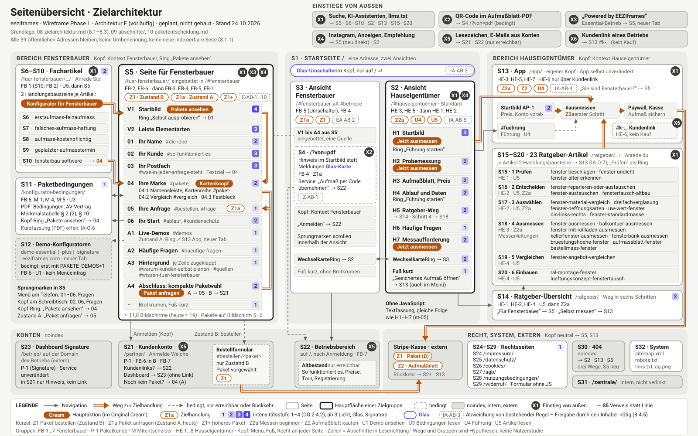
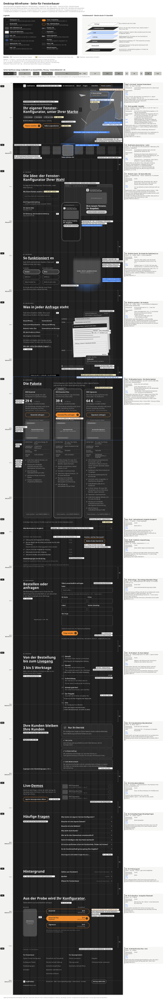
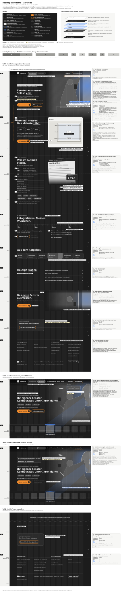
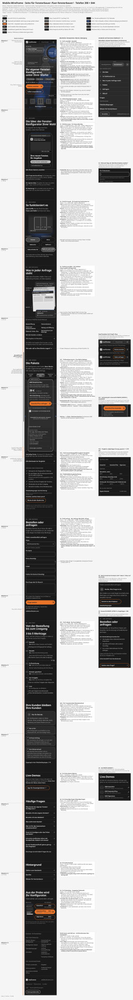
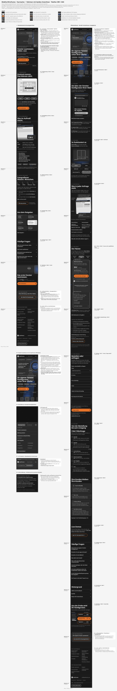
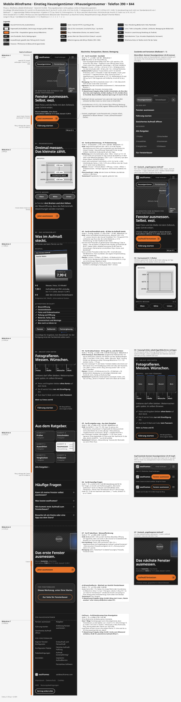
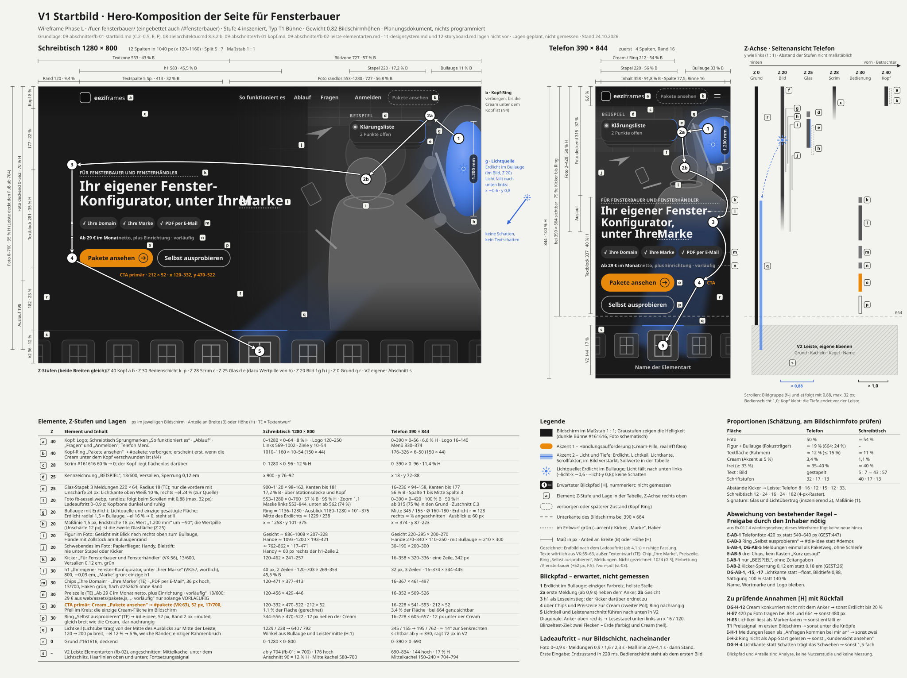
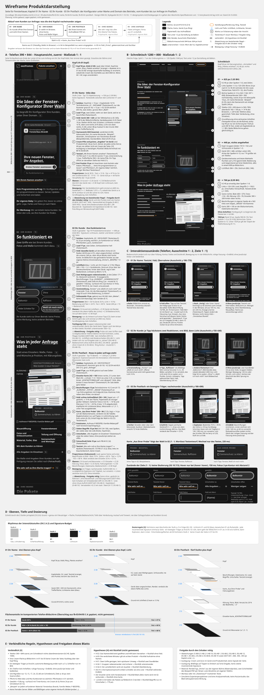
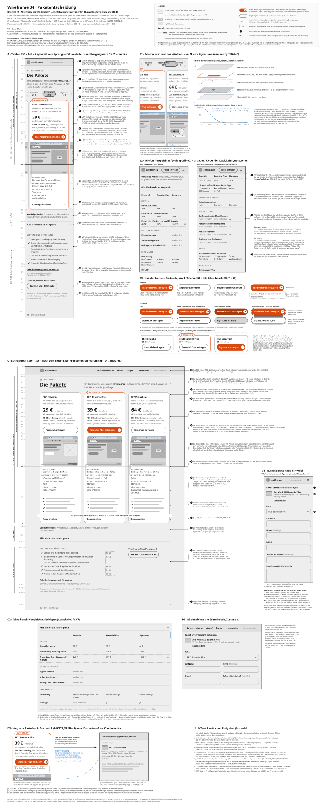
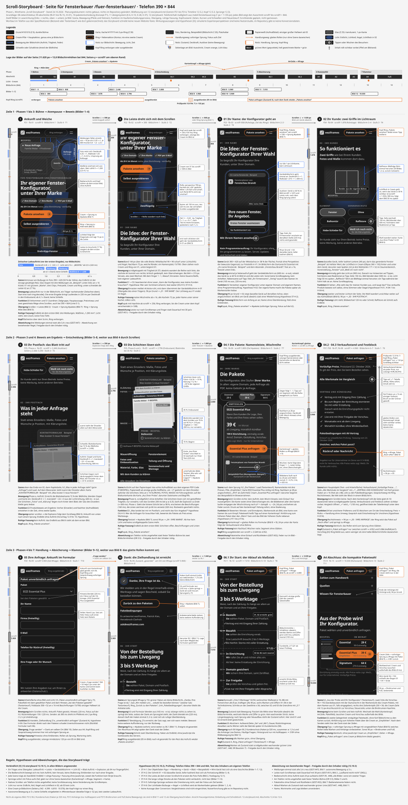

# 13. Wireframes und visuelle Planung

[← Übersicht](README.md)

Ergebnis 10 des Blueprints (Phase L). Die Wireframes zeigen die bevorzugte Architektur E ([07-expertenvergleich.md](07-expertenvergleich.md), Abschnitt 7.5) so, wie sie in der Zielarchitektur ([08-zielarchitektur.md](08-zielarchitektur.md)) und den Abschnitts-Spezifikationen ([09-abschnitte/](09-abschnitte/)) festgelegt ist. Sie erfinden nichts Neues: Reihenfolge, Proportionen, Ebenen und Handlungsaufforderungen stammen aus diesen Dokumenten, das Designsystem aus [11-designsystem.md](11-designsystem.md).

Alle Dateien sind handgezeichnete SVG-Grafiken, maßstäblich in Pixeln, und wurden nach dem Zeichnen gerendert und auf Überlappungen und Lesbarkeit geprüft. Sie sind Planungsskizzen, keine gestalteten Entwürfe: Graustufen stehen für Helligkeit, eine Akzentfarbe markiert die Handlungsaufforderungen, eine zweite Licht und Tiefe. Erwartete Blickpfade sind nummeriert und als Erwartung gekennzeichnet, nicht als gemessene Daten. Lagen und Anteile sind geplant, nicht gemessen. Texte in den Wireframes sind, wo nicht wörtlich aus dem Repository übernommen, Textentwurf.

| Nr. | Gefordert (MASTER-PROMPT V4, Phase L) | Datei |
|---|---|---|
| 1 | Vollständige Seitenübersicht | [wireframes/uebersicht.svg](wireframes/uebersicht.svg) |
| 2 | Struktureller Desktop-Wireframe der wichtigsten Seiten | [wireframes/desktop-fensterbauer.svg](wireframes/desktop-fensterbauer.svg), [wireframes/desktop-startseite.svg](wireframes/desktop-startseite.svg) |
| 3 | Struktureller Mobile-Wireframe | [wireframes/mobil-fensterbauer.svg](wireframes/mobil-fensterbauer.svg), [wireframes/mobil-startseite.svg](wireframes/mobil-startseite.svg), [wireframes/mobil-hauseigentuemer.svg](wireframes/mobil-hauseigentuemer.svg) |
| 4 | Detaillierte Hero-Komposition | [wireframes/hero.svg](wireframes/hero.svg) |
| 5 | Detaillierte Produkt- bzw. Leistungsdarstellung | [wireframes/produkt.svg](wireframes/produkt.svg) |
| 6 | Detaillierte Paket- bzw. Kaufentscheidungssektion | [wireframes/paket.svg](wireframes/paket.svg) |
| 7 | Storyboard der wesentlichen Scroll- und Abschnittsübergänge | [wireframes/storyboard.svg](wireframes/storyboard.svg) |

## 13.1 Seitenübersicht

Alle Seiten der Zielarchitektur mit ihren Verbindungen, Zielgruppen und Zielhandlungen. Textfassung und Tabelle: [08-zielarchitektur.md](08-zielarchitektur.md), Abschnitt 8.1.

## 13.2 Desktop (1280 breit)

Seite für Fensterbauer vollständig, Abschnitt für Abschnitt im 12-Spalten-Raster, mit Ebenen (Grund, Bild, Glas, Bedienschicht) als beschriftete Schichten.

Startseite vollständig, beide Ansichten (Hauseigentümer und Fensterbauer) mit Umschalter.

## 13.3 Telefon (390 breit, Bildschirmhöhe 844 als Hilfslinien)

Eigenständige Telefon-Komposition, keine verkleinerte Desktop-Fassung. Die Hilfslinie bei 664 px zeigt, was mit sichtbaren Browserleisten in den ersten Bildschirm passt.

## 13.4 Hero-Komposition der Seite für Fensterbauer

Schreibtisch und Telefon nebeneinander, Z-Achse als Seitenansicht, Proportionen bemaßt, Blickpfad nummeriert, Lichtquelle, Element- und Lagentabelle, Abweichungen von bestehenden Regeln mit Freigabevermerk. Spezifikation: [09-abschnitte/fb-01-startbild.md](09-abschnitte/fb-01-startbild.md).

## 13.5 Produkt- und Leistungsdarstellung

Der Konfigurator unter eigener Marke und Domain und der Weg vom Kunden zur Anfrage, für Schreibtisch und Telefon, mit Interaktionszuständen. Spezifikationen: [09-abschnitte/fb-03-ihr-name.md](09-abschnitte/fb-03-ihr-name.md), [fb-04-ihr-kunde.md](09-abschnitte/fb-04-ihr-kunde.md), [fb-05-ihr-postfach.md](09-abschnitte/fb-05-ihr-postfach.md).

## 13.6 Paketentscheidung

Das empfohlene Konzept P1 „Wischreihe mit Markenbild“ aus [10-paketentscheidung.md](10-paketentscheidung.md): Karten, Hervorhebung, Vergleich, Knöpfe, Rückmeldung nach der Auswahl und Weg zur Anfrage. Spezifikationen: [09-abschnitte/fb-06-pakete-karten.md](09-abschnitte/fb-06-pakete-karten.md), [fb-07-entscheidungshilfe-vergleich.md](09-abschnitte/fb-07-entscheidungshilfe-vergleich.md).

## 13.7 Scroll-Storyboard

Die wesentlichen Szenen und Übergänge der Seite für Fensterbauer im Telefon-Format. Textfassung mit Timeline: [12-storyboard.md](12-storyboard.md).

