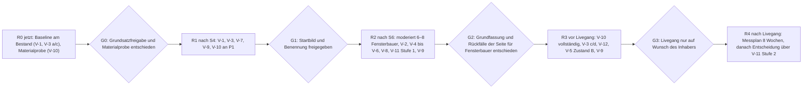

# 14. Realitätsprüfung und Testkonzept

Phase M des Website-Blueprints (MASTER-PROMPT V4): Realitätsprüfung der bevorzugten Architektur und Validierungsplan. Stand 24.10.2026,
Arbeitszweig `claude/design-dna-styleguide`. Planungsdokument: Das Repository wurde nur gelesen; gebaut oder geändert wurde nichts.

**Was dieses Kapitel leistet.** Es legt die bevorzugte Architektur E so, wie sie festgelegt ist (Zielarchitektur, 33
Abschnitts-Spezifikationen, Paketentscheidung, Designsystem, Storyboard, Wireframes), neben zehn Prüffelder: Verständlichkeit, visuelle
Hierarchie, Nutzerführung, Angebotstransparenz, Conversion-Pfad, mobile Bedienbarkeit, Konsistenz der Design-DNA, technische
Umsetzbarkeit, Performance und Barrierefreiheit nach WCAG 2.2 AA. Je Befund nennt es Ort und Beleg, eine Schwere, eine Gegenmaßnahme und
das Dokument, in dem sie festgelegt ist oder nachgezogen werden muss (14.2). Danach folgen die Festlegungen dieses Kapitels (14.3), eine
Übersicht nach Schwere (14.4) und ein Validierungsplan mit realen Nutzern für die wichtigsten offenen Hypothesen (14.5).

**Was es nicht ist.** Keine Nutzerstudie und kein Beleg. Die Befunde in 14.2 sind eine Prüfung am Papier: dasselbe Modell, das die
geprüften Dokumente geschrieben hat, liest sie gegen ihre eigenen Regeln und gegen die Anforderungen des Inhabers. Seine Fehler sind mit
denen der Dokumente korreliert (EV 7.7 Nr. 1). Ob ein Befund Besucher tatsächlich trifft, klärt erst der Plan in 14.5. Dieses Kapitel
nennt keine Conversion-Wahrscheinlichkeiten und keine erwarteten Steigerungen.

**Grundlage**

| Kürzel | Datei |
|---|---|
| PA, SI, CP, GM | [01-projektanalyse.md](01-projektanalyse.md); [bestand/seiten-und-inhalte.md](bestand/seiten-und-inhalte.md), [bestand/conversion-pfade.md](bestand/conversion-pfade.md), [bestand/geschaeftsmodell.md](bestand/geschaeftsmodell.md) |
| RE | [03-recherche.md](03-recherche.md): Erkenntnisse E1–E19, Regeln R1–R14, Tests T1–T19, offene Fragen 3.5.5 |
| EA | [04-entscheidungsarchitektur.md](04-entscheidungsarchitektur.md): Gruppen FB-n, HE-n, M-n; Stufen S0–S8; Zweifel F-nn; H-D-n; O-n |
| EV | [07-expertenvergleich.md](07-expertenvergleich.md): Architektur E (7.5), Regeln E-1 bis E-13, H-E1 bis H-E10, Testalternative C′ (7.6), Test T-1 bis T-7 (7.6.3) |
| ZA | [08-zielarchitektur.md](08-zielarchitektur.md): Sitemap, Navigation N1–N13, Abschnittsfolgen, Festlegung 8, E-AB-n |
| Spezifikation `xx-nn` | [09-abschnitte/](09-abschnitte/) (33 Dateien); „`fb-01` C“ = dort Abschnitt C |
| PE | [10-paketentscheidung.md](10-paketentscheidung.md): J-R-n, J-H-n, J-AB-n, J-O-n, Festlegungen 10-1 bis 10-4 |
| DS | [11-designsystem.md](11-designsystem.md): Festlegungen K-1 bis K-40, DS-AB-n, DS-H-n, Rangfolge bei Widerspruch, Anhang 11.A |
| ST | [12-storyboard.md](12-storyboard.md): Szenen FS1–FS15, HA1–HA6, SR1–SR4, Timeline 12.5/12.6, Abgleich 12.9, ST-H-n |
| WF | [13-wireframes.md](13-wireframes.md), `wireframes/*.svg` |
| IM | [15-implementierung.md](15-implementierung.md): Budgets und Messwerte 15.10, Prüfsuite 15.6, Reihenfolge S0–S9 (15.12), Risiken R1–R19 (15.13), 15-O-n |
| DNA, SG, DNA-B, VGL | `docs/design-dna/03-design-dna.md` (5.1–5.5), `04-styleguide.md` (10.1–10.10), `05-ergebnis-b-styleguide.md`, `02-vergleich.md` |
| SKILL, DR, GEST | `.claude/skills/premium-gestaltung/SKILL.md` (Anforderungen des Inhabers, verbindlich), `…/designrichtung.md`, `docs/GESTALTUNG.md` (heutige Regeln, dürfen hinterfragt werden) |
| Code | `web/assets/pakete.js`, `web/fonts/fonts.css`, `scripts/pruefen-instanzen/29.mjs` (P29), `scripts/pruefen.mjs` (PR), VK `web/fuer-fensterbauer/index.html`, PB `web/konfigurator-bedingungen/index.html` |

**Kennzeichnungen**

- `Datei:Zeile` ist ein Beleg. **[V]** verbindlich, **[H]** Hypothese oder experimentelle Gestaltungsentscheidung mit Rückfall; beides wie
  in ZA und DS.
- **RP-nn** ist ein Befund dieser Prüfung, **V-n** eine Validierung mit realen Nutzern, **14-O-n** eine offene Frage.
- **Festlegung 14-n**: Gegenmaßnahme, die dieses Kapitel neu festlegt, weil kein anderes Dokument sie trägt. Jede Festlegung, die etwas
  Sichtbares ändert, ist ein Vorschlag zur Freigabe durch den Inhaber (SKILL:27) und wird beim nächsten Abgleich (Phase N) in die
  genannten Dokumente nachgezogen; dieses Kapitel ändert keine andere Datei.
- **Textentwurf**: neuer Wortlaut für die Website, nur aus belegten Fakten; braucht die Freigabe des Inhabers. **Testskript (Entwurf)**:
  Wortlaut einer Testaufgabe, kein Seitentext.
- **Abweichung von bestehender Regel – Freigabe durch den Inhaber nötig**: Vorschlag gegen eine Regel aus GEST oder DR, hier als
  14-AB-n. Name, Wortmarke und Logo bleiben unverändert (GEST:7).

**Schwere** (Einschätzung der Folgen, keine Messung und keine Wahrscheinlichkeit)

| Schwere | Bedeutung |
|---|---|
| **kritisch** | verletzt Recht, Ehrlichkeit oder eine Mindestanforderung oder verhindert die Zielhandlung; kein Livegang ohne Lösung |
| **hoch** | gefährdet für eine Hauptgruppe Kernaussage, Paketwahl, Vertrauen oder Abschluss, oder macht eine Abnahme unmöglich |
| **mittel** | Reibung, Missverständnis, Inkonsistenz oder Mehraufwand mit klarer Gegenmaßnahme im Bau oder im Test |
| **niedrig** | Feinschliff, Dokumentpflege |

„ungeprüft“ hinter der Schwere heißt: Der Befund beruht auf einer Annahme über Besucher, die erst 14.5 prüft.

**Prüfweise.** Geprüft wird die Architektur E in der Fassung der Spezifikationen; wo Spezifikationen gemessen haben (Textbreiten,
Kartenmaße), gelten deren Werte, sonst die Planwerte aus ZA. Seitenlagen stammen aus ST 12.5 und WF (geplant, nicht gemessen).
Prüfansichten: Telefon 390 × 844 (Hauptansicht, SKILL:28), dieselbe Breite mit realer Höhe ≈ 664 px (EV X9), zusätzlich 375 × ≈ 553 px
als Schätzung für ein kleines Telefon mit sichtbaren Browserleisten (etwa iPhone SE) und 320 px für den Umbruch; Schreibtisch 1280 × 800
und 1024 × 768.

---

## 14.0 Ergebnis in Kürze

1. **In sich schlüssig, aber nur auf dem Papier geprüft.** E hält seine eigenen Dosierregeln, die Regel „eine Cream je Bildschirm“, „ein
   bewegter Träger“, die ruhige Fassung und die Fassung ohne JavaScript ein (ZA 8.3.2 e, ST 12.8). Gemessen ist fast nichts; die
   Voraussetzungen aus EV 7.5.11 (Grundsatzfreigabe, Materialprobe, Bewertung von E mit dem Raster, Test gegen C′) stehen weiter aus
   (RP-48).
2. **Vor jedem Livegang zu lösen (kritisch):** die Frage-Route antwortet ohne Datenbank mit 503 (RP-29); die Steuerzeile „netto zzgl.
   MwSt.“ hängt an der offenen Umsatzsteuerfrage (RP-20).
3. **Hoch:** Widersprüche zwischen Seite und Paketbedingungen (Kündigung, Preisbindung; RP-23), eine missverständliche Freigabe-Zeile
   ohne geklärte Erstattung (RP-22), Nettopreise in der Einbettung auf `/` (RP-21), Kundenschutz gegen den B2C-Verkauf auf derselben
   Domain (RP-24), fehlende Messung für jede Hypothese nach dem Livegang (RP-30), die Erwartung „Konfigurator mit Preisen“ (RP-01,
   ungeprüft), dazu die technischen Risiken aus IM (RP-48 bis RP-51, RP-55).
4. **Der Weg ist länger als geplant.** Die Seite misst 13,8 statt 11,8 Bildschirmhöhen; bei 664 px stehen die ersten Preise und der
   Kartenknopf in Bildschirm 7, „Frage senden“ in Bildschirm 11 (RP-31). Die Angabe „Pakete in Bildschirm 6“ zählt die Haarlinie, nicht
   die Preise.
5. **Mobil:** Die Regel E-1 (Preis und Cream im ersten Bildschirm) gilt nur für 664 px; bei ≈ 553 px fällt die Cream unter die Kante
   (RP-35, Festlegung 14-12).
6. **Design-DNA:** Der Fokusträger des Startbilds liegt mit 19–24 % unter der eigenen Stufe-4-Regel (RP-07); die Foto-Tiefe läuft
   praktisch nie und wird gestrichen (RP-43); zwischen ZA, PE, ST und den Spezifikationen stehen weitere Widersprüche in Wortlauten und
   Maßen (RP-46) → ein Textregister als einzige Freigabevorlage (Festlegung 14-17).
7. **Performance:** Die Seite für Fensterbauer liegt nach Plan knapp im Budget, wenn die Leiste nur ihre sichtbaren Bilder lädt (RP-56);
   die Startseite hält das Skriptbudget erst mit Stufe B (RP-55).
8. **Validierung:** zwölf Prüfungen in fünf Runden; Kern ist ein moderierter Test mit 6–8 Fensterbauern am Prototyp, ergänzt um
   Fünf-Sekunden-, First-Click- und Baumtest; A/B-Tests erst nach dem Livegang und nur unter festen Bedingungen (14.5).

---

## 14.2 Befunde je Prüffeld

### 14.2.1 Verständlichkeit

| Nr. | Befund (Ort, Beleg) | Schwere | Gegenmaßnahme | festgelegt in |
|---|---|---|---|---|
| RP-01 | **Erwartung „Konfigurator = Preisrechner“.** Kicker und h1 versprechen „Ihr eigener Fenster-Konfigurator“ (VK:57). Dass der Kunde des Betriebs **ohne Preise** plant und das Angebot vom Betrieb kommt, steht nur als Zeile 15 px in 02 („Ihr Kunde sieht nur Ihren Betrieb: keine Preise, …“, VK:240; FS4, Bildschirm 3–4) und als Bildinhalt im Gerät von 01 („Ihre neuen Fenster, Ihr Angebot.“). Wer über die Cream „Pakete ansehen“ springt (W2; FB-2, FB-3, FB-6 sind Hauptgruppen, ZA 8.3.2), sieht beides nicht; Lead, Karten und Datenblatt in 04 sagen es nicht. Dass Fensterbauer bei „Konfigurator“ an Preisrechner von Herstellern denken, ist eine Annahme. | hoch, ungeprüft | Erst prüfen (V-2, Erwartungsfrage vor dem Scrollen). **Festlegung 14-2 [H]**, falls die Erwartung bei mindestens 2 von 6–8 Teilnehmenden auftritt: Der Satz kommt an einen der zwei Orte, die der Inhaber wählt: (a) im Lead von 04 ersetzt **Textentwurf** „Ihr Kunde plant ohne Preise, das Angebot machen Sie.“ den Teil „keine Gebühr je Anfrage“ (der im Vergleich und in den Häufigen Fragen bleibt, VK:237), damit der Lead bei drei Zeilen bleibt; (b) als Antwort in A2 (Frage „was der Kunde sieht“, VK:236-245) und als Zeile im Datenblatt. Herkunft: VK:240, `web/assets/einladung.js` | nachzuziehen in `fb-06` B, PE 10.4 B |
| RP-02 | **„Anfrage“ ist doppelt belegt.** In 03 ist sie die Anfrage des Kunden beim Betrieb (h2 „Was in jeder Anfrage steht“, Meldung „Neue Anfrage: Familie Weber“, Datenblatt), in 05 die Frage des Fensterbauers an eeziframes (Kapitelzeile „05 · IHRE ANFRAGE“, h3 „Paket unverbindlich anfragen“, Kopf-Ring „Paket anfragen“). Wer über den Kopf-Ring springt, landet in „Ihre Anfrage“, obwohl er dort nichts empfängt, sondern etwas sendet. | mittel | **Festlegung 14-1 [H]:** Kapitelwort 05 **Textentwurf** „05 · IHRE FRAGE“; es passt zu „Frage senden“ und zum Dank „Danke, Ihre Frage ist da.“ (P29 29.1 prüft diesen Satz). Das Substantiv „Anfrage“ bleibt auf der Seite der Kundenanfrage vorbehalten; das Verb „anfragen“ (Kopf-Ring, h3, Kartenknöpfe) bleibt. Prüfung im Baumtest V-7 (Aufgabe 6) | nachzuziehen in ZA 8.2.6, `fb-09` B, `rh-02` (Menü) |
| RP-03 | **Zwei Benennungssysteme für dieselben Kapitel.** Kapitelzeile „01 · IHR NAME“ … „04 · IHRE MARKE“ (ZA 8.2.6), Menü „01 Die Idee“ … „04 Pakete“ (ZA 8.2.3). Gleiche Nummer, anderes Wort: Wer nach einem Menüsprung „04 · IHRE MARKE“ liest, muss die Zuordnung selbst leisten. Ob die Kapitelwörter wie ein Inhaltsverzeichnis wirken, ist offen (H-E8). | mittel | **Festlegung 14-3 [H]:** Bis zum Baumtest (V-7) trägt das Menü die Aufgabenwörter (Bestand ZA 8.2.3), weil ein Menü dem Finden dient; die Kapitelzeile bleibt. Die Fassung mit mehr direkten Treffern in V-7 wird Grundfassung für beide Orte; fällt die Kapitelfassung ab, gilt der Rückfall von E-AB-10 „Nummern ohne Kapitelwort“ | nachzuziehen in ZA 8.2.3, 8.2.6; `rh-02` |
| RP-04 | **Eyebrow der Ansicht Hauseigentümer** „In Minuten zum Aufmaß für jeden Fensterbauer“ (wörtlich, Prüfsuite; ZA 8.3.4 H1). Fensterbauer, die über die Marke auf `/` kommen, können ihn als Angebot für sich lesen und nicht umschalten; Hauseigentümer können zweifeln, ob sie gemeint sind (Annahme). | mittel, ungeprüft | Prüfung V-3 c/d und V-1 auf `/` mit beiden Gruppen. Wortlaut nur nach Test und Freigabe ändern; eine Änderung braucht die Anpassung der Prüfsuite (IM 15.6.1) | `he-01` B; RE 3.5.5 Frage 14 |
| RP-05 | **„Probe“ setzt 02 voraus.** Die Karte „Aus Ihrer Probe“ (03) und die h2 des Abschlusses „Aus der Probe wird Ihr Konfigurator.“ (A4, **Textentwurf**) sprechen von einer Erfahrung, die Besucher nach einem Sprung auf `#pakete` nicht gemacht haben. | niedrig | Prüfung in V-5 („Was ist mit ‚Probe‘ gemeint?“). Rückfall **Textentwurf** für die h2 in A4: „Ihr Konfigurator, unter Ihrer Marke.“ (aus VK:57, grün „Marke“); die Karte in 03 heißt ohne Tipp in 02 nur „BEISPIEL“ statt „PROBE · BEISPIEL“ | nachzuziehen bei Rückfall in `fb-15` B, `fb-05` B |
| RP-06 | **h2 von 05 „Bestellen oder anfragen“ in Zustand A**, obwohl nur angefragt werden kann; der Lead korrigiert sofort („Bestellen können Sie in Kürze“). | niedrig | **Festlegung 14-4:** In Zustand A trägt die h2 **Textentwurf** „Paket anfragen“ (grün „anfragen“), `id="bestellen"` bleibt; die Prüfsuite verlangt nur die ID (P29:111). Zustand B behält „Bestellen oder anfragen“. Die h3 „Paket unverbindlich anfragen“ (`#frage`) bleibt als Sprungziel | nachzuziehen in `fb-09` B, ZA 8.3.2 b (05) |

### 14.2.2 Visuelle Hierarchie

| Nr. | Befund (Ort, Beleg) | Schwere | Gegenmaßnahme | festgelegt in |
|---|---|---|---|---|
| RP-07 | **Fokusträger des Startbilds unter der eigenen Stufe-4-Regel.** Figur samt Bullauge ≈ 210 × 300 px = 19 % der Fläche bei 844, 24 % bei 664 (FS1); verlangt sind für Stufe 4 25–35 % (DG 2.4.2; DS 11.2.4; ZA V1). Rechnung: Fotofeld 390 × 420 = 163.800 px², davon Stapelzone x 0–252, y 60–190 (32.760 px²) und dunkler Auslauf y 315–420 (40.950 px²); für Figur und Bullauge bleiben ≈ 90.000 px², 25 % des Bildschirms wären 82.000 px². Die Regel ist neben E-1 (Foto 420 px) und dem Meldungsstapel praktisch nicht zu halten. Zugleich stehen zwölf Elemente im ersten Bildschirm (Etikett, drei Meldungen, Maßlinie, Kicker, h1 dreizeilig, drei Chips, Preiszeile, Cream, Ring, Leistenanschnitt) bei frei ≈ 35–40 % (Grenze ≥ 33 %, DNA Nr. 8). | mittel | **Festlegung 14-5 [H]:** Für Bühnen am Telefon gilt der Fokusträger ab 19 % als begründete Ausnahme, weil E-1 die Anforderung SKILL:86 („Steht das Wichtige zusammen auf einem Bildschirm?“, Rang 3 der DS-Rangfolge) umsetzt und damit DS 11.2.4 (Rang 4) vorgeht. Bedingungen: ein Anker (Erdlicht, DNA Nr. 3), Freifläche ≥ 33 %, kein weiteres Element im ersten Bildschirm, Blinzeltest in V-9. Die Materialanfrage A1 (Telefonzuschnitt) nennt als Ziel, Figur und Bullauge im Fotofeld so groß wie möglich zu stellen | nachzuziehen in DS 11.2.4, `fb-01` C, IM 15.11 (A1) |
| RP-08 | **Blickkonkurrenz im ersten Bildschirm.** Die erste Meldung fällt bei 0,9 s ein; Bewegungsbeginn zieht den Blick (RE E5), noch bevor das h1 gelesen ist. ST erwartet die Meldung an Platz 2 der Blickfolge, vor dem h1 (FS1, Informationshierarchie). Daneben der Anker Erdlicht und die Cream als größter Hellwert der Bedienschicht (DG-H-12). | mittel, ungeprüft | Prüfung V-1 („Was haben Sie zuerst angesehen?“, je zur Hälfte Standbild und Video). Rückfälle in dieser Reihenfolge: zwei statt drei Meldungen (I-H-1); erste Meldung erst bei 1,6 s [H] | `fb-01` F.1; I-H-1 |
| RP-09 | **Die Namensleiste trägt das Zeichen für „gewählt“, wählt aber nicht.** Ihr Zeiger ist Füllung `--surface3` mit innerer Tintenkontur (K-3; `fb-06`), also derselbe Zustand wie am Umschalter und an den Wahlzeilen in 02. Nach E-3 navigiert die Leiste nur; gewählt wird am Kartenknopf. Ein Zeichen, zwei Bedeutungen (PE E, Ablenkung 3). | mittel, ungeprüft | Prüfung J-H16 in V-4. **Festlegung 14-6 [H]**, falls mehr als 1 von 6 Teilnehmenden die Leiste für die Wahl hält: Der Zeiger wird ein Unterstrich 2 px `--text` unter Kurzname und Preis (≥ 3 : 1 gegen den Grund), ohne Füllung; „gewählt“ (K-3) bleibt Umschalter, Wahlzeilen und Menü-Segment vorbehalten | nachzuziehen bei Rückfall in DS 11.6.3, `fb-06` C |
| RP-10 | **Der Held von 04 steht nicht im ersten Bildschirm nach dem Sprung.** Das Beispielbild beginnt bei y 667 (PE 10.4 C): bei 664 px gar nicht sichtbar, bei 844 px 177 von 254 px; Bildanteil ≈ 15–16 % statt 20–50 % (Stufe 2; begründete Ausnahme PE C). Den Kern des Unterschieds (Markenstufe als Bild) erfährt der Besucher erst nach dem Scrollen; bis dahin trägt Text. | mittel | Keine Änderung vor dem Test, weil J-R2 (Preisblock und Knopf im ersten Bildschirm) vorgeht. Prüfung J-H11 in V-4 („Woran sehen Sie den Unterschied?“). Rückfälle: Datenblatt standardmäßig zu (Bild 38 % der Karte, `fb-06` G) oder Konzept P2 als Variante (PE 10.3) | PE 10.4 C; `fb-06` G |
| RP-11 | **Lange Strecke ohne Bildträger.** Von 04.2 bis A3 (Seiten-y ≈ 5.008–10.234, ≈ 6 BH) stehen nur Text, Zeilen und Kacheln; einziges Objekt ist der Maßstab in 06.1. Risiko gegen „Bild statt Text“ (SKILL:29) und DR 5 („Keine Textwände“). | mittel, ungeprüft | Prüfung ST-H-4/DS-H-1 im Video des Inhabers (V-9). Beim Bau Wörter je Bildschirm zählen; Richtwert [H] höchstens 60 Wörter je Bildschirm ohne Held (zugeklappte Inhalte zählen nicht). Rückfälle DS-H-1 | DS 11.10.2; ST 12.10.2 |
| RP-12 | **Zweiter Hellwert im Beispielbild:** Der Startknopf der App im eeziframes-Design (≈ 40 × 10 px im Bild) steht neben der Cream des Kartenknopfs (PE E, Ablenkung 1; K-11.4.2). | niedrig | Messung in S6 (`farbanteil.py`, Blinzeltest); Rückfall: Ausschnitt ohne hellen Knopf (PE E) | PE 10.4 E; DS 11.4.2 |

### 14.2.3 Nutzerführung

| Nr. | Befund (Ort, Beleg) | Schwere | Gegenmaßnahme | festgelegt in |
|---|---|---|---|---|
| RP-13 | **Der Kopf-Ring wechselt sechsmal seinen Zustand** (ST 12.5.3, 844 px): verborgen bis ≈ 538, „Pakete ansehen“ bis ≈ 3.549, aus bis ≈ 4.952, „Paket anfragen“ bis ≈ 5.084, aus bis ≈ 6.800, wieder „Paket anfragen“. Zwischen Reihe und Formular erscheint er für 132 px Scrollweg (664 px: 312, Schreibtisch: 67); bei zügigem Scrollen ein Aufblitzen gegen SKILL:48 (12.9 Nr. 7). | mittel | **Festlegung 14-7:** Der Vorschlag aus ST 12.9 Nr. 7 wird Grundfassung: Liegt zwischen zwei Sperrzonen weniger als eine halbe Bildschirmhöhe Scrollweg (Telefon 422 px, bei 664 px 332 px, Schreibtisch 400 px), bleibt der Ring dazwischen aus. In Zustand A ist er damit von ≈ 3.549 bis ≈ 6.800 aus; in dieser Strecke tragen Kartenknopf und „Frage senden“ die Cream. Erweiterung von J-AB-9: **Abweichung von bestehender Regel (GEST:456 „im Kopf der Seite nur ein Ring-Knopf“, dauerhaft sichtbar) – Freigabe durch den Inhaber nötig** (14-AB-2) | nachzuziehen in DS K-28, `rh-01` F, ST 12.5.3 |
| RP-14 | **Risiko- und Vertrauensinhalte stehen hinter dem Formular.** Ablauf mit Rücktrittsgrenze (06.1) und Kundenschutz (06.2) folgen erst nach 05 (E-AB-7). Wer linear liest und vor der Anfrage prüfen will, muss am Formular vorbei; der Festblock (04.3) deckt Vertrag und Storno ab, den Kundenschutz nicht. | mittel, ungeprüft | Prüfung H-E6 in V-5 und V-6 (Aufgabe „Bevor Sie anfragen: Finden Sie heraus, ob eeziframes Ihre Kunden anspricht“). Kein zusätzlicher Verweis in der Entscheidungsfläche (er wäre ein drittes Blickziel unter dem Festblock). Rückfall: „Formular nach 06“ (ZA 8.3.2 g; Rückfall von E-AB-7) | ZA 8.3.2 g |
| RP-15 | **Sofortige Sprünge ohne Übergang** (K-10): Die Cream des Startbilds versetzt die Seite um 3.800 px; Orientierung hängt an Kapitelzeile und Fokus auf der h2 (DS-H-8, ST-H-5). | niedrig, ungeprüft | Beobachtung in V-4 („Wo sind Sie jetzt?“). Rückfall: glattes Rollen mit pausierten Szenen (DS-H-8) | DS K-10 |
| RP-16 | **Die Startseite ist für Fensterbauer eine Weiche, die sie selbst finden müssen.** Standardansicht ist „Hauseigentümer“ (`web/assets/portal.js:398`); Fensterbauer über die Marke oder alte Lesezeichen sehen zuerst den Waschbären und „Jetzt ausmessen“. Der Umschalter (Glas 284 × 44, y 68–112) scrollt mit dem Foto weg; danach bleiben Menü-Segment und Wechselkarte am Ende (ZA 8.2.4). | mittel, ungeprüft | Prüfung V-3 c. Die Mittel sind geplant (Umschalter, Menü-Segment, Wechselkarte, am Schreibtisch „Für Fensterbauer“ im Kopf); ob `/` weiter mit der Ansicht Hauseigentümer öffnet, entscheidet der Inhaber (RE 3.5.5 Frage 14) | ZA 8.2.4; RE 3.5.5 |
| RP-17 | **Der QR-Weg (FB-4) führt in den Altbestand.** Der Hinweis bei `?von=pdf` im Startbild der Einbettung führt mit „Aufmaß per Code übernehmen“ zur Registrierung im Betriebsbereich (AGB:33 § 2 (2)), der sonst nicht mehr beworben wird; im selben Bildschirm steht die Cream „Pakete ansehen“. Ton und Ziel sind offen (EA O-4). | mittel | Entscheidung EA O-4 vor S4 (IM 15.12); bis dahin Link-Zeile ohne Werbesatz („3 Aufmaße frei“ entfällt, ZA `st-03`) | ZA 8.3.3; EA O-4 |
| RP-18 | **A1 Live-Demos führt in Zustand A in die App für Hauseigentümer** (Preise, Paywall, Du-Anrede; Ring „App für Hauseigentümer“ ↗, neuer Tab). Das ist der Irrweg, der E-AB-3 für den Ring im Startbild begründet (PAK B7); er bleibt als Nebenweg im Anhang. | niedrig | Kennzeichnung als Fassung für Hauseigentümer behalten (RE R14, `fb-12` B). In V-4 beobachten, ob Teilnehmende dort hängen bleiben; dann Ring entfernen, Satz bleibt | `fb-12`; RE R14 |
| RP-19 | **Rückruf ohne Telefonnummer.** Der Gesprächsweg heißt „Rückruf oder Nachricht“ (`fb-08`), das Formular hat „Telefon für Rückruf (freiwillig)“; die Nummer steht nur im Impressum (EA O-9; J-O-10). Wer „Rückruf“ liest, erwartet eine Nummer oder einen Termin. | mittel | Entscheidung O-9; bis dahin Ring **Textentwurf** „Frage stellen“ (Rückfall aus `fb-08` B und FS8) | `fb-08` B; EA O-9 |

### 14.2.4 Angebotstransparenz

| Nr. | Befund (Ort, Beleg) | Schwere | Gegenmaßnahme | festgelegt in |
|---|---|---|---|---|
| RP-20 | **Umsatzsteuer offen.** Jede Karte trägt „netto zzgl. MwSt. · nur für Unternehmer“ (`functions/pakete-seite.js:44`); ob 19 % oder die Kleinunternehmerregelung gilt, ist offen (J-O-3; `MWST`). Unter § 19 UStG wäre „zzgl. MwSt.“ falsch; Brutto zeigt die Bestellübersicht nur mit `MWST` (`web/assets/partner.js:289`). | kritisch (vor Livegang) | Entscheidung J-O-3; Steuerzeile aus einer Quelle (J-R17). Kein Livegang der neuen Seite, solange die Zeile nicht stimmt | PE 10.1.8 J-R17 |
| RP-21 | **Nettopreise in der Einbettung auf `/`**, einer Seite, die sich zuerst an Verbraucher richtet; die Preiszeile „Ab 29 € im Monat netto …“ steht im ersten Bildschirm der Einbettung. Ob die Unternehmer-Bestätigung beim Bestellen genügt, ist anwaltlich offen (J-O-4, EA O-25; BGH I ZR 99/08 nur Einordnung, keine Rechtsberatung). | hoch | Anwaltliche Prüfung vor Zustand B und vor jeder Werbung auf `/#fensterbauer`. Rückfall: Einbettung nur noch als eigene Adresse (ZA 8.4.7 Nr. 13; IA-O-1) | ZA 8.4.7 Nr. 12–13; PE J-O-4 |
| RP-22 | **Freigabe der Vorschau ohne geklärte Erstattung.** Der Festblock sagt „Live erst mit Ihrer Freigabe der Vorschau.“ (PB:60) neben „Bis zum Beginn der Einrichtung stornieren Sie mit voller Erstattung.“ und der Grenze „Danach wird die Einrichtungsgebühr nicht erstattet.“ (PB:70). Was geschieht, wenn der Betrieb die Vorschau nicht freigibt, sagt weder Seite noch Bedingung (J-O-5). Die Freigabe-Zeile kann als Ausstieg mit Erstattung gelesen werden, also als Zusage, die es nicht gibt (SKILL:49). | hoch, ungeprüft | Prüfung V-6 („Was passiert, wenn Ihnen die Vorschau nicht gefällt?“). Entscheidung J-O-5 vor Livegang; danach eine Frage in A2 mit dem entschiedenen Wortlaut. Bis dahin keine Ergänzung, die mehr verspricht als PB | PE J-O-5; `fb-08`, `fb-13` |
| RP-23 | **Seite und Paketbedingungen widersprechen sich.** Kündigung „zum Monatsende“ (VK:243) gegen „zum Ende des laufenden Abrechnungsmonats“ (PB:69; J-O-6). Preisbindung „bleibt für Ihren Vertrag fest“ (`functions/pakete-seite.js:89`; ebenso der Kommentar in `web/assets/pakete.js:7-8`) gegen den Änderungsvorbehalt mit sechs Wochen Ankündigung (PB:55; J-O-2). | hoch | Entscheidungen J-O-2 und J-O-6 vor Livegang. Bis dahin entfällt „bleibt fest“ im Verkaufsstand (J-R18), der Festblock nutzt „Monatlich kündbar, ohne Mindestlaufzeit“ (VK:243; J-R15) | PE 10.1.8 |
| RP-24 | **Kundenschutz gegen den Verkauf an Hauseigentümer.** Dieselbe Domain verkauft Hauseigentümern ein Aufmaßblatt, das sie an beliebig viele Betriebe schicken (`web/index.html:95`; F-12). Fensterbauer sehen das über den Umschalter auf `/` und über den Ring in A1. Die Antwort aus dem Bestand („Wir verkaufen keine Fenster, vermitteln keine Aufträge und messen nicht selbst.“, EA F-12; VK:159; AGB:35 § 2 (4)) hat auf der neuen Seite keinen Ort (ZA 06.2: „bis dahin keine Aussage“; EA O-15). | hoch, ungeprüft | Entscheidung EA O-15; danach eine Frage in A2 mit diesem Bestandswortlaut (A2 hätte dann neun Fragen, Prüfsuite verlangt ≥ 6). Prüfung in V-6 („Spricht eeziframes Ihre Kunden an?“) | ZA 8.3.2 (06.2); EA O-15 |
| RP-25 | **Ungemessene Zahlen als Zusage.** „in der Regel innerhalb eines Werktags“ (Lead 05, Gesprächsweg, Dank) und „meist 3 bis 5 Werktage“ (06.1) sind nicht als gemessen belegt (EA O-8). Die zweite steht in 06.1 als Kennzahl 32/34, als einzige große Zahl der zweiten Seitenhälfte (FS11); die Prüfsuite verlangt nur die Zeichenfolge (P29:113). | mittel | Inhaber bestätigt O-8 vor Livegang. **Festlegung 14-8:** Solange O-8 offen ist, steht „meist 3 bis 5 Werktage nach der Zahlung“ im Lesetext 17 px statt als Kennzahl 32 px; Anker von 06.1 bleibt der Maßstab | nachzuziehen in `fb-10` B/C; ST FS11 |
| RP-26 | **Vorbehalte häufen sich.** „vorläufig“ in der Preiszeile (V1), „Vorläufige Preise.“ im Verkaufsstand (04.2) und noch einmal im Fußsatz des Vergleichs, „Entwurf zur anwaltlichen Prüfung“ in der Standzeile des Festblocks (PB:28), „Bestellen können Sie in Kürze“ (05), „sobald eingerichtet“ (Signature-Absender). Jeder ist ehrlich und klein (EA AB-4); zusammen kann die Seite unfertig wirken. Wirkung ungeprüft (RE E14). | mittel, ungeprüft | Prüfung V-6 („Wie fertig wirkt das Angebot auf Sie?“). Vorbehalte nicht verstecken (R7), aber je Ort einmal: **Festlegung 14-9:** Der Fußsatz des Vergleichs lautet **Textentwurf** „Alle Preise netto zzgl. MwSt., nur für Unternehmer.“ ohne den Zusatz „Vorläufige Preise.“, weil der Verkaufsstand 24 px über dem Vergleich steht; P29 verlangt `<b>Vorläufige Preise.</b>` einmal (P29:46) und den Satz zur Steuer (29.1) | nachzuziehen in `fb-07` B, PE 10.4 B |
| RP-27 | **Der Hinweis auf eeziframes im Aufmaßblatt fehlt am Entscheidungsort.** 03 endet mit dem Textziel „Wie sehr soll es Ihre Marke tragen?“ (`fb-05`: „es“ = das Blatt; `fb-06` Kopf und ZA schreiben noch „er“). Die Karten nennen im Datenblatt aber nur den Hinweis in der App (`kennzeichnung`). Die Unterschiede im Blatt (`pdfKennzeichnung`: Untertitel und Fuß / nur Fuß / keiner) und in den E-Mails (`mailKennzeichnung`) stehen weder im Datenblatt noch im Vergleich, weil `vergleich: true` fehlt (`web/assets/pakete.js:84-85`); sie stehen nur in der vollen Tabelle der Paketbedingungen (`pb-02`). Die Frage, die 03 stellt, beantwortet 04 nicht. | mittel | **Festlegung 14-10:** Die Datenblattzeile „HINWEIS AUF EEZIFRAMES“ nennt App und Blatt, Werte aus `kennzeichnung` und `pdfKennzeichnung`, **Textentwurf**: Essential „App: ‚Powered by EEZIframes‘ · Blatt: Untertitel und Fuß“, Essential Plus „App und Blatt: kleiner Hinweis im Fuß“, Signature „keiner“. Die Zeile wird am Telefon zweizeilig (+22 px je Karte, alle Karten gleich hoch, J-R5). Zusätzlich `vergleich: true` für `pdfKennzeichnung` (Gruppe „Ihre Marke“); die Prüfsuite zieht die Zeile damit als Pflichtzeile nach (P29:31-33). Textziel überall „es“ | nachzuziehen in `fb-06` B, `fb-07` B, PE 10.4 B, ZA 8.2.6; Code `web/assets/pakete.js` (IM 15.3.2) |
| RP-28 | **Preiszeile des Startbilds ohne Betrag der Einrichtung** („Ab 29 € im Monat netto, plus Einrichtung · vorläufig“, `fb-01` B). R1 ist an den Karten erfüllt; im ersten Bildschirm bleibt ein Teil des Preises offen. | niedrig, ungeprüft | Variante [H] für V-1: **Textentwurf** „Ab 29 € im Monat + 99 € Einrichtung, netto · vorläufig“ zweizeilig (Werte aus `web/assets/pakete.js:44`); Lagen darunter + 17 px, Cream-Unterkante dann y ≈ 611, bei 664 px weiter im Bild. Dieser Rückfall ist in `fb-01` B schon vorgesehen | `fb-01` B |

### 14.2.5 Conversion-Pfad

| Nr. | Befund (Ort, Beleg) | Schwere | Gegenmaßnahme | festgelegt in |
|---|---|---|---|---|
| RP-29 | **Die einzige Zielhandlung in Zustand A kann scheitern.** Ohne Datenbank antwortet die Frage-Route mit 503 samt Variablennamen, ohne JavaScript als JSON (`functions/api/router.js:85-86`; IM R10; EA O-3). | kritisch (vor Livegang) | Datenbank vor dem Livegang; feste Sätze im Browser statt Servertext; HTML-Antwort für das Formular ohne JavaScript (IM 15-O-4); Prüfung N12 „kein Server-Text bei 503“ | IM 15.13 R10, 15.6.3 N12 |
| RP-30 | **Keine Messung nach dem Livegang.** Es gibt keinen Trichter für die Seite für Fensterbauer (EA O-2) und keinen Zähler für Paketanfragen (IM 15-O-5). Damit bleibt jede Hypothese dieses Blueprints nach dem Livegang unprüfbar, auch E gegen C′ und jeder spätere Vergleichstest. | hoch | **Festlegung 14-11:** Messplan 14.5.5 wird mit S3 gebaut und läuft ab dem Livegang; nur Zähler auf eigenem Server, ohne Kennung und ohne Eingaben (E-10) | 14.5.5; IM 15-O-5; RE 3.5.4 |
| RP-31 | **Der Weg ist länger als geplant.** ZA plante ≈ 11,8 BH, die gemessenen Spezifikationen ergeben 11.620 px = 13,8 BH (ST 12.5.2; heute ≈ 19 BH). Kapitel 04 misst 2,18 statt 1,9 BH (Karte 877 statt ≈ 640 px, K-38). Lagen bei 664 px: Haarlinie von 04 in Bildschirm 6, Namensleiste mit den ersten Preisen (Seiten-y 4.055) und Kartenknopf (4.399) in Bildschirm 7, h3 `#frage` (6.041) in Bildschirm 10, „Frage senden“ (6.818) in Bildschirm 11; ZA plante Formular in 9 (12.9 Nr. 12). EA H-D2 („Pakete spätestens ab Bildschirm 5 bis 6“) ist nur für die Haarlinie erfüllt, für die Preise um einen Bildschirm verfehlt. Wer springt, erreicht die Preise mit einem Tipp; der Befund trifft lineare Leser. | mittel | Keine Umdeutung von H-D2. Abnahme in S5 (IM 15.12: „gemessen“) misst zusätzlich die Lage der Namensleiste und von „Frage senden“. Kürzungen in dieser Reihenfolge, je mit Freigabe, wenn V-4/V-5 Längenprobleme zeigen oder die Messung die Planwerte überschreitet: (1) Datenblatt in der Karte standardmäßig zu (`fb-06` G; ≈ −200 px je Karte, Kapitel 04 ≈ −0,25 BH); (2) Abstand Band → 01 48 statt 96 px (Rückfall K-14; −48 px); danach B′ prüfen (ZA 8.3.2 g) | IM 15.12 S5; `fb-06` G; DS K-14 |
| RP-32 | **Zustand B: Medienbruch ins Kundenkonto.** Der Kartenknopf führt nach `/partner/#bestellen/<paket>` mit eigenem Kopf und sechs Schritten (CP 5.2); Schritt 1 fragt das Paket heute erneut ab (J-H9); Brutto erscheint erst in Schritt 6 und nur mit `MWST`. | mittel | J-O-13 (Bestätigung statt erneuter Wahl); Prüfung V-5 in Zustand B, sobald `PAKETE_OFFEN` vorbereitet ist (Runde R3) | PE 10.1.11–10.1.12 |
| RP-33 | **Hauseigentümer warten nach der Cream** (außerhalb des Planungsumfangs, aber im Pfad Z2a): „Jetzt ausmessen“ lädt `/app/` mit 1.414.022 B Skripten (IM 15.10.2). Auf einem mittleren Android-Telefon ist eine spürbare Pause zwischen Tipp und erstem Messschritt zu erwarten (Annahme, nicht gemessen; SKILL:32 „Keine Wartezeiten ohne sichtbares Zwischenergebnis“). | mittel, ungeprüft | Messung in V-10 (Zeit vom Tipp bis zur Bedienbarkeit von `/app/#ausmessen` mit Drosselung). Erst danach entscheiden; Option [H]: Startbild der App (`ap-01`) erscheint statisch vor den Skripten, wie Stufe A auf `/` (IM 15.10.3) | IM 15.10; `ap-01` |
| RP-34 | **Mitentscheider** (M-1, M-4, M-5) bekommen keine weiterreichbare Kurzfassung (IA-O-6, J-O-15); weiterreichbar sind der Link auf `#pakete` und das PDF der Paketbedingungen. Die Probe lässt sich nicht weitergeben. | niedrig, ungeprüft | Interviewfrage in V-6 („Wer entscheidet bei Ihnen mit, was würden Sie ihm schicken?“); Entscheidung J-O-15 nach dem Test | PE J-O-15 |

### 14.2.6 Mobile Bedienbarkeit

| Nr. | Befund (Ort, Beleg) | Schwere | Gegenmaßnahme | festgelegt in |
|---|---|---|---|---|
| RP-35 | **E-1 gilt nur bis 664 px Höhe.** Kleine Telefone mit sichtbaren Leisten zeigen ≈ 553 px (Schätzung für 375 × 667 in Safari). Dort liegen im Startbild der Seite für Fensterbauer die Cream (y 542–594) und der Ring unter der Kante, eingebettet auf `/` (+ 52 px) erst recht; im Startbild der Hauseigentümer ebenso (Cream y 550–602). Kein Dokument behandelt Höhen unter 664 px. | mittel | **Festlegung 14-12:** Die Fotohöhe der Bühnen nach Muster K1 folgt der kleinen sichtbaren Höhe: Foto = min(420 px, 100svh − a − 8 px), mindestens 300 px; a ist der Abstand von der Fotounterkante zur Unterkante der Cream (`fb-01` 174 px, eingebettet 226 px; `he-01` 182 px; `ap-01` nach seiner Lage). Ohne `svh`-Unterstützung 420 px. Gekürzt wird der dunkle Auslauf unten (`object-position` am Anker); die Materialanfrage A1 verlangt, dass Gesicht, Bullauge, Hände, Zollstock und Papierflieger auch bei 300 px Bildhöhe im Bild bleiben. Prüfung N6 zusätzlich bei 375 × 553. **Abweichung von bestehender Regel (GEST:447 „Startfoto am Telefon 540–640 px“; Erweiterung von E-AB-1) – Freigabe durch den Inhaber nötig** (14-AB-1) | nachzuziehen in `fb-01` C/G, `he-01` C/G, `ap-01` G, DS 11.6.6, IM 15.6.3 N6, 15.11 (A1, A2) |
| RP-36 | **Gestenkonflikt in der Leiste.** V2 übernimmt waagerechtes Ziehen ab 8 px (FS2), mitten in der senkrechten Scrollstrecke des ersten Bildschirms. Ein schräger Daumenwisch kann die Leiste statt der Seite bewegen. | mittel | **Festlegung 14-13:** Achsensperre: Die Leiste übernimmt eine Geste erst, wenn nach 8 px Weg \|Δx\| ≥ 2 · \|Δy\| ist, sonst gehört sie dem Scrollen; `touch-action: pan-y` am Band, das waagerechte Ziehen über Pointer Events. Prüfung in V-10: zehn senkrechte Daumenwische über das Band ohne ungewolltes Wischen | nachzuziehen in `fb-02` F, H |
| RP-37 | **Die Wischreihe ist nur über den Anschnitt (28 px je Seite) und die Namensleiste erkennbar;** einen Hinweis gibt es bewusst nicht (E-13). Die Namensleiste ist zugleich die Tipp-Alternative zum Wischen (R9; WCAG 2.5.7). | mittel, ungeprüft | Prüfung J-H16 in V-4 („Was kostet Signature?“ ohne Hinweis). Rückfall aus PE J-H16 (Leiste unter der Reihe, Preise im Lead) | PE 10.5.2 |
| RP-38 | **Feste Breiten ohne Reserve.** Gemessen in Chromium mit Inter: Chips im Startbild 355 von 358 px (`fb-01` B), Umschalter 284 px genau für „Hauseigentümer“ (122 px) und „Fensterbauer“ (98,4 px) in 15/700 (K-29); der Kartenknopf „Essential Plus anfragen“ 17/700 mit Pfeilkreis 28 px ist bei 360 px Breite offen (`fb-06`, Festlegungsliste), bei 320 px (Karteninnenbreite 200 px) zu breit; `.btn` steht heute auf `nowrap` (`fb-08` G). Safari rendert Schrift anders, 200 % Text und Textabstände nach WCAG 1.4.12 verbreitern zusätzlich. | mittel | **Festlegung 14-15:** Für jedes Element mit fester Breite gilt: Umbruch statt Abschneiden (`white-space: normal`, `min-height` statt `height`, Pfeilkreis rechts mittig), und einzeilig gemessene Elemente brauchen ≥ 8 px Reserve; fehlt sie, darf die Chip-Zeile zweizeilig werden (Lagen darunter + 44 px, E-1 bei 664 prüfen) und der Umschalter in der Höhe wachsen | nachzuziehen in `fb-01` B, `st-02` C, `fb-06` C/G, DS 11.6.2 |
| RP-39 | **Namensfeld und Bildschirmtastatur (01).** Das Feld (358 × 52) unter dem Gerät öffnet die Tastatur, die das Gerät verdeckt; die Wirkung (Name im Gerät) zeigt sich erst nach „Fertig“, wenn die Seite zur Absenderzeile rollt (FS3). iOS verschiebt beim Fokus selbst. | niedrig, ungeprüft | Telefon-Video auf iOS und Android (V-9, V-10); Nutzung in V-8 (H-E2) | `fb-03` F |
| RP-40 | **Querformat.** Kopf 56 px und klebender Tabellenkopf 44 px des geöffneten Vergleichs belegen bei einer sichtbaren Höhe von ≈ 300–340 px (Schätzung) rund ein Drittel. | niedrig | **Festlegung 14-14:** Der Tabellenkopf klebt nur bei `(min-height: 500px)`; darunter steht er einmal über der Tabelle | nachzuziehen in `fb-07` H, `pb-02` H |
| RP-41 | **Menü- und Kopfknopf oben rechts** liegen außerhalb des Daumenbereichs. | niedrig | angenommen: Das Menüblatt öffnet unten (`rh-02`), Hauptaktionen liegen im Inhalt im Daumenbereich (Cream y 542–594, Kartenknopf y 599–651) | `rh-01`, `rh-02` |

### 14.2.7 Konsistenz der Design-DNA

| Nr. | Befund (Ort, Beleg) | Schwere | Gegenmaßnahme | festgelegt in |
|---|---|---|---|---|
| RP-42 | **Die Telefonfassung ist Neuentwurf.** Die DNA stammt aus Desktop-Standbildern: 0 von 15 Mobilansichten, zeitliche Dimensionen mit n = 1–5, Interface-Physik (Feder, Trägheit) ohne Beleg (DNA 5.4 Schluss, 5.5 „Keine Mobil-Vorlage“). Dass die Telefonkompositionen die DNA treffen, ist abgeleitet, nicht beobachtet. | mittel | DNA-Abnahme je Bildschirm an Bildschirmfotos 390 × 844: Prüfliste DS 11.10.1 Nr. 1–20, DR 6, `farbanteil.py`, Blinzeltest, Urteil des Inhabers (V-9). Jede Bewegung bleibt als „Neuentwurf“ gekennzeichnet (ST, Kennzeichnungen) | DS 11.10; 14.5 V-9 |
| RP-43 | **Die Foto-Tiefe läuft praktisch nie.** Nach Festlegung 12-1 läuft sie nur, solange die Leiste nicht im Bild ist; bei 844 px und am Schreibtisch (800 px) ist die Leiste ab dem Laden sichtbar, bei 664 px nach 26 px Scrollweg (ST 12.9 Nr. 1, 12.8). Spezifikation, Bau (S4) und Abnahme („Foto-Tiefe endet vor der Leiste“) planen damit einen Effekt, den niemand sieht. | mittel | **Festlegung 14-16:** Die Foto-Tiefe entfällt aus der Grundfassung (= Rückfall „ohne Foto-Tiefe“ aus DG-AB-15). DG-AB-15 betrifft danach nur noch den Lesefortschritt, der wie GEST:41 entfällt; die Abweichung wird damit gegenstandslos. Tiefe tragen weiter Glas, Lichtübertrag, Schärfestaffelung, Explosion und die Feder im Beispielbild. ST-H-3 bleibt als Variante | nachzuziehen in ZA V1, `fb-01` F.2, DS 11.7.4, IM 15.12 S4 |
| RP-44 | **DNA-Konformität hängt an offenen Auslegungen:** Kegel in V2 als Ende des Lichtübertrags (DG-E-4 A), Bildfolge auf Tippen als Antwort statt zweite inszenierende Signature (`fb-04`), Cream und Grün im Gerätebild als Produktinhalt (FS3), Kapitelnummern außerhalb des Budgets (DG-H-1). Wird eine verneint, überschreiten V1, V2, 01 oder 02 ihr Budget. | mittel | Entscheidung in der Freigabeliste S0 (IM 15.12) mit den vorhandenen Rückfällen: Kegel entfällt; Überblendung zweier Standbilder; Gerätebild ohne Cream im sichtbaren Ausschnitt; Nummern ohne Grün | IM 15.12 S0; ZA 8.3.2 e |
| RP-45 | **Erwartung des Inhabers an Scroll-Szenen.** DR 1 beschreibt „Apple-ähnlich“ als „Szenen, die am Scrollen hängen (ein Objekt dreht oder öffnet sich, während der Text wechselt)“. Am Telefon hängen nur Leiste und Explosion am Scrollen; 02 reagiert bewusst auf Tippen, ab 04 bewegt sich nur, was der Finger führt (ST 12.1.2). Das Urteil „Technik von 2015“ (SKILL:38) fällt der Inhaber. | mittel, ungeprüft | Video der ganzen Seite für den Inhaber (V-9). Rückfälle DS-H-1 (01 als Stufe 3); eine scrollgekoppelte Bildfolge in 02 (ZA 8.4.4, bewusst nicht übernommen) nur nach bestandener Materialprobe und als Variante (SKILL:78) | DS-H-1; ZA 8.4.4 |
| RP-46 | **Widersprüche zwischen den Dokumenten, die weder Anhang 11.A noch ST 12.9 führt** (Tabelle unter diesem Abschnitt). Sie betreffen vor allem Textentwürfe, die die Prüfsuite teils wörtlich prüft, und Planmaße, die durch Messungen überholt sind. Beim Bau und bei der Freigabe stünden mehrere Fassungen nebeneinander. | mittel | **Festlegung 14-17:** Für Wortlaute und Maße gilt bis zur Freigabe die Abschnitts-Spezifikation, weil dort gemessen wurde (ihre „Festlegungen I“); DS hat in K-38 ebenso entschieden. ZA, PE und ST werden in Phase N auf diese Werte gezogen. Alle Textentwürfe kommen in **ein Textregister** (ID, Ort, Wortlaut, Beleg, Bindung an die Prüfsuite, Zustand A/B, Freigabe), das als einzige Vorlage in die Freigabeliste von S0 geht | nachzuziehen in ZA, PE, ST; Register in Phase N; IM 15.12 S0 |
| RP-47 | **Fehlende Dateien:** WF 13.7 verweist auf `wireframes/storyboard.svg`, die Datei fehlt; ST und WF verlinken „← Übersicht“ auf `README.md`, das im Blueprint-Ordner fehlt. | niedrig | in Phase N anlegen oder Verweise entfernen | WF 13.7; ST |

**Zu RP-46: Widersprüche, die noch nachzuziehen sind**

| Nr. | Gegenstand | Fassungen | maßgeblich nach Festlegung 14-17 |
|---|---|---|---|
| 1 | Chips im Startbild | ZA: „Ihre Domain · Ihre Marke · Anfrage als PDF“; `fb-01` B und FS1: „… · PDF per E-Mail“ (gemessen: 363 gegen 355 px) | `fb-01` |
| 2 | Preiszeile | ZA: „… · vorläufige Preise“; `fb-01`: „… · vorläufig“ (392 gegen 336 px) | `fb-01` |
| 3 | Paketkarte | ZA: 310 × ≈ 640, Nachbarn 40 px, Empfehlungsgrund und Unterschiedszeile; PE/K-38: 310 × 877, Nachbarn 28 px, „Wenn“-Satz statt Empfehlungsgrund, Unterschiedszeile nur Variante (10-2) | `fb-06` (K-38) |
| 4 | Entscheidungshilfe 04.2 | ZA: drei Zeilen; PE Festlegung 10-1: entfällt; die ID heißt weiter `fb-07-entscheidungshilfe-vergleich`; H-E3 (ZA 8.3.2 f) nennt noch die Unterschiedszeile | PE 10-1; H-E3 auf „Bild, ‚Wenn‘-Satz und Datenblatt“ umschreiben |
| 5 | Länge von Kapitel 04 | ZA 1,9 BH; PE 2,1 BH; ST 2,18 BH | ST (aus den gemessenen Spezifikationen) |
| 6 | Seitenlänge und Lagen | ZA: 11,8 BH, Formular Bildschirm 9 (664), Abschluss 14, Schreibtisch-Pakete 4,0 BH; ST/WF: 13,8 BH, 10, 16–17, 4,3 BH | ST, zu messen am Prototyp (RP-31) |
| 7 | Festblock | PE: Kennwort „VERTRAG IN KÜRZE“, Reihenfolge Vertrag → Abo → Vorschau → Storno → Grenze → kündbar; `fb-08`/FS8: „Vertrag und Kündigung“, Reihenfolge Vertrag → Storno → Grenze → Freigabe → Abo → kündbar | `fb-08` (ST 12.9 Nr. 5) |
| 8 | Gesprächsweg | ZA: Ring „Unsicher, welches Paket passt? Rückruf oder Nachricht“; PE: „… Fragen Sie uns“ mit Satz darunter; `fb-08`: Frage als Text, Ring „Rückruf oder Nachricht“ | `fb-08`, mit RP-19 |
| 9 | 03 Ihr Postfach | Einzeiler ZA „Bitte um Angebot für 3 Fenster“, `fb-05` „Was kosten 5 neue Fenster?“; Textziel „er“ (ZA, `fb-06`) gegen „es“ (`fb-05`); Lead ZA „wörtlich VK:80“, FS5 als gekürzter Textentwurf | `fb-05`, mit RP-27 |
| 10 | Lead von 05 | ZA: „Die Bestellung schalten wir in Kürze frei. …“; `fb-09`: „Bestellen können Sie in Kürze. …“ | `fb-09` |
| 11 | Verkaufsstand | ZA: „Vorläufige Preise, Stand 22.10.2026.“; PE: „… Es gilt der Preis, den Sie beim Bestellen sehen.“; `fb-07`: „**Vorläufige Preise.** Preisstand 22. Oktober 2026. …“ (P29:46 verlangt `<b>Vorläufige Preise.</b>`) | `fb-07` |
| 12 | Überdeckung in 01 am Schreibtisch | ZA: Telefon überdeckt ≈ 30 % der Browser-Ecke; FS3: ≈ 14 % | `fb-03` |
| 13 | Fokusträger V1 | ZA: 25–35 %; FS1: 19 % (844), 24 % (664) | Festlegung 14-5 |
| 14 | Kopf-Ring ausblenden | PE F und K-28: über `opacity`; `rh-01` F: zusätzlich `visibility: hidden` und `inert` | `rh-01` (sonst bliebe ein unsichtbarer Knopf fokussierbar, WCAG 2.4.7) |

### 14.2.8 Technische Umsetzbarkeit

| Nr. | Befund (Ort, Beleg) | Schwere | Gegenmaßnahme | festgelegt in |
|---|---|---|---|---|
| RP-48 | **Voraussetzungen und Material offen.** EV 7.5.11 verlangte vor Phase I Grundsatzfreigabe, Materialprobe, Bewertung von E mit dem Raster und den Test gegen C′; alle vier stehen aus (ZA 8.4.7 Nr. 1, 14). Kapitel 01–04 hängen an Material, das fehlt oder ungeprüft ist: Telefonzuschnitt, 14 Renderings der Elementarten, Bildfolge „Raffstore“ (30 Bilder), Beispielbilder je Markenstufe, Fotos eines Beispielbetriebs; die Renderings entstehen ohne Grafikchip (IM R4, R5). | hoch | **Festlegung 14-18:** Gate G0 (14.5.4): S4 und S5 werden nicht gebaut, bevor Grundsatzfreigabe und Materialprobe entschieden sind; S1 bis S3 sind davon unabhängig (IM 15.12). Rückfälle ZA 8.3.2 g („E mit Standbildern“, B′) | IM 15.12 S0; ZA 8.3.2 g |
| RP-49 | **Prüfsuite-Bindung.** 23 Prüfstellen, an 18 ändert sich die Erwartung; mehrere Textentwürfe kollidieren mit wörtlich geprüften Zeichenfolgen (IM 15.6.1, R2). | hoch | Freigabe der Prüfsuite-Änderungen als Block (IM 15-O-8); Wortlaut halten oder mit Freigabe anpassen (IM 15-4, 15-13); Spalte „Bindung an die Prüfsuite“ im Textregister (Festlegung 14-17) | IM 15.6 |
| RP-50 | **Einbettung und Neuaufbau.** Zustand und Bindungen können beim Neuaufbau in `/#fensterbauer` verloren gehen oder doppelt laufen (IM R3; SKILL:63-64). | hoch | Modulspeicher mit Spiegel in `sessionStorage`, idempotente Bindung, Prüfung N5 (IM 15.7) | IM 15.7 |
| RP-51 | **Assets ohne Versionskennung.** Neues HTML kann nach einer Veröffentlichung auf alte Skripte oder Stile treffen (IM R8). | hoch | Entscheidung IM 15-O-1 in S1 | IM 15.13 R8 |
| RP-52 | **Kein WebKit im Container** (IM R17). Ungeprüft bleiben bis zum Gerätetest unter anderem `backdrop-filter`, `svh` (Festlegung 14-12), `scroll-snap-stop`, `subgrid` und View Transitions zwischen Dokumenten (J-H10; nicht in jedem Browser vorhanden). | mittel | fortschreitende Verbesserung mit den Rückfällen der Spezifikationen; Gerätetest auf dem Telefon des Inhabers (IM 15-O-10) in jeder Runde ab R1 (V-10) | IM 15.13 R17 |
| RP-53 | **Namensvorschau und Speicher.** Firmenname, Probe, Wahl und Dank liegen unter `aufmass.vk.*` in `sessionStorage` (IM 15.4.5); Cookies-Seite und gegebenenfalls Datenschutzerklärung müssen das nennen (IM R11). | mittel | IM 15-O-7 vor S5 | IM 15.4.5 |
| RP-54 | **Zeichen außerhalb der Schrift.** „↗“ (U+2197) liegt in keinem der beiden Inter-Teilsätze (`web/fonts/fonts.css`, `unicode-range`) und erscheint in einer Systemschrift (A1-Ring, Zeilen mit neuem Tab nach K-31). | niedrig | **Festlegung 14-19:** „↗“ und Chevron als Inline-SVG wie das Menüzeichen (`rh-01`), `aria-hidden` | nachzuziehen in DS K-31, `fb-12` H |

### 14.2.9 Performance (Budgets)

Budgets [V] nach DS 11.9.2 und IM 15.10.1. Messwerte „heute“ sind mit `gzip -9` gemessen (IM 15.10.2, eigene Messung der HTML-Dateien am
24.10.2026); Planwerte sind Ziele, nicht gemessen.

| Budget | `/fuer-fensterbauer/` | `/` (beide Ansichten) | Stand |
|---|---|---|---|
| LCP ≤ 2,5 s (75. Perzentil, mobil) | LCP-Element Telefonzuschnitt ≤ 140 KB, vorgeladen mit `fetchpriority="high"`; Foto-Auftritt beginnt bei Deckkraft 0,35 nach `decode()` (K-7) | heute laufen 177.637 B Skripte synchron vor dem ersten Bild; Foto 180.138 B | Seite für Fensterbauer plausibel, ungemessen; Startseite Risiko bis Stufe A (IM 15-AB-1) |
| Übertragung bis LCP ≤ 350 KB | Überschlag: HTML 15,6 KB (heute) + Stile ≈ 30 KB + Schrift 48,3 KB (`inter-latin`, vorgeladen) + Foto ≤ 140 KB + sichtbare Renderings ≈ 30–60 KB ≈ 264–294 KB; die Skripte (`defer`, Ziel 35–40 KB) können davor fertig werden → bis ≈ 334 KB | HTML 4,1 KB + Foto ≤ 110 KB + Stile; Skripte s. u. | knapp im Budget; lädt die Leiste alle 14 Renderings sofort (je 6–12 KB, 84–168 KB), liegt die Seite bei ≈ 350–440 KB (RP-56) |
| JavaScript im ersten Bildschirm ≤ 100 KB gepackt | heute 71.889 B, Ziel ≈ 35–40 KB | heute 177.637 B; mit Stufe A vor dem Bild 15.414 B, aber alle Skripte laden sofort (`portal.js` 88.797 B, `modell.js` 50.450 B …) | Seite für Fensterbauer erfüllt nach Plan; Startseite erst mit Stufe B (RP-55) |
| Bilder im ersten Telefon-Bildschirm ≤ 300 KB; Fokus-Asset ≤ 200 KB | Foto ≤ 140 KB + Leiste | Foto ≤ 110 KB | erfüllbar mit Festlegung 14-20 |
| INP ≤ 200 ms | Tippen in 02 (Bildwechsel, Bildfolge mit `createImageBitmap`), Namensfeld, Kartenknopf (schreibt nur Zustand) | Umschalter: Neuaufbau der Ansicht (`render()`), in der Ansicht Fensterbauer eine Einbettung von 11.904 px Länge (ST 12.5.5) | Risiko an zwei Stellen (RP-57, RP-58) |
| CLS ≤ 0,1 | feste Bildmaße, reservierter Platz des Kopf-Rings, Namensfeld nur auf Tippen; Schrift mit `font-display: swap` | gleich | Restrisiko Schrifttausch im dreizeiligen h1 (RP-59) |
| Bildfolge ≤ 60 Bilder, ≤ 3 MB, erst bei Annäherung | Raffstore 30 Bilder (450 × 480) | – | erfüllbar |
| Schleifen nur im Bild | geplant (IntersectionObserver) | geplant | Prüfung N3 |

| Nr. | Befund (Ort, Beleg) | Schwere | Gegenmaßnahme | festgelegt in |
|---|---|---|---|---|
| RP-55 | **Die Startseite hält das Skriptbudget erst mit Stufe B.** Stufe A (statisches Startbild, `defer`) löst das LCP, lädt aber `portal.js` (88.797 B) und `modell.js` (50.450 B) sofort; Stufe B verlangt einen Eingriff in die globale Struktur von `portal.js` und ist als eigener Schritt nach S7 geplant (IM 15.10.2, 15-O-6). Über `/` laufen Hauseigentümer, Fensterbauer über den Umschalter und der QR-Weg. | hoch | Stufe A mit S7 (Freigabe IM 15-AB-1); Stufe B als Pflichtschritt vor jeder Werbung, die auf `/` zeigt (Einstiege lenkt ZA 8.1.5 ohnehin auf `/fuer-fensterbauer/`); Labormessung in V-10 | IM 15.10.3; 15-O-6 |
| RP-56 | **Die Leiste kann das Bildbudget sprengen.** Bei 844 px steht V2 im ersten Bildschirm (FS2). Werden alle 14 Renderings sofort geladen, kommen zum Foto 84–168 KB dazu. | mittel | **Festlegung 14-20:** Die Leiste lädt sofort nur die sichtbaren Kacheln (Mitte ± 2, fünf Bilder, ≈ 30–60 KB), die übrigen mit `loading="lazy"` beim ersten Scrollen; ohne JavaScript dieselbe Regel über `loading`. Prüfung N7 | nachzuziehen in `fb-02` H, IM 15.10.2 |
| RP-57 | **Der Ansichtswechsel auf `/` ist eine lange Aufgabe.** Nach K-5 wechselt das Segment seinen Zustand (150 ms), dann wird die Ansicht neu aufgebaut; beim Wechsel zur Ansicht Fensterbauer ist das die ganze Seite für Fensterbauer. Liegt der Neuaufbau in derselben Aufgabe wie der Tipp, verzögert er das nächste Bild (INP). | mittel | **Festlegung 14-21:** Erst den Zustand des Segments malen, dann den Neuaufbau in einer späteren Aufgabe ausführen (nach dem nächsten Bild); dasselbe für Wechselkarte und Menü-Segment. Labormessung des INP mit CPU-Drosselung in V-10 | nachzuziehen in `st-02` F/H, DS K-5 |
| RP-58 | **Bildfolge „Raffstore“ auf mittleren Telefonen.** 30 Bilder werden beim Tippen dekodiert und gezeigt (`fb-04`). | mittel | vorhandene Leistungsmechanik: Vorrat ± 6 dekodierte Bilder, Rückfall auf Einzelbild bei Median-Bildzeit über 25 ms, Pixeldichte ≤ 1,5 (ZA 02); Prüfung in der Materialprobe (T-1) | `fb-04` H; ZA 8.3.2 (02) |
| RP-59 | **Schrifttausch.** `font-display: swap` (`web/fonts/fonts.css`) zeigt bei langsamer Verbindung zuerst eine Ersatzschrift; bricht das dreizeilige h1 dann anders um, verschieben sich Chips, Preiszeile und Cream. | niedrig | **Festlegung 14-22 [H]:** Ersatzschrift mit angeglichenen Metriken (`size-adjust`, `ascent-override`, `descent-override` für eine lokale Systemschrift; keine fremde Quelle); Messung des CLS mit gedrosseltem Netz in V-10 | nachzuziehen in IM 15.10.3 |
| RP-60 | **Keine Felddaten.** Die Budgets gelten am 75. Perzentil echter Besuche; gemessen werden kann nur im Labor und am Telefon des Inhabers (IM 15.10.4). | mittel | Laborwerte als Abnahme; optionale anonyme Zählung der Web Vitals auf eigenem Server (14-O-4), Entscheidung des Inhabers | IM 15.10.4 |

### 14.2.10 Barrierefreiheit (WCAG 2.2 AA)

Stand der Planung je Kriterium; „erfüllt (geplant)“ heißt: Die Spezifikationen legen es fest, geprüft wird es in V-10.

| Kriterium | Stelle | Stand der Planung | Befund, Gegenmaßnahme | Schwere |
|---|---|---|---|---|
| 1.1.1 Nicht-Text-Inhalt | Beispielbilder, Gerät, Blatt, Probe, Preisetikett | erfüllt (geplant): Zustandsbilder mit wechselndem `alt` (`fb-04`), Dekor `aria-hidden`, Preis zusätzlich als Text (`he-03`) | – | – |
| 1.3.1 Info und Beziehungen | Wahlgruppen in 02 | `role="group"` mit Knöpfen `aria-pressed` (`fb-04` H) | **RP-61:** Ein Vorleseprogramm sagt nicht, dass je Gruppe nur eine Wahl gilt. Ein Radio-Muster mit `<input>` scheidet aus (Eingabe-Regel PR:1789-1797, E-AB-2). Gegenmaßnahme: Gruppenname mit „eine Auswahl“ ergänzen (`aria-label`), Zustand bleibt `aria-pressed` | niedrig |
| 1.3.1 | Namensleiste, Karten, Datenblatt, Vergleich | erfüllt (geplant): `nav` mit `aria-current`, `article` mit `h3`, `dl`, Tabelle mit `th scope="rowgroup"` (PE 10.4 H) | – | – |
| 1.4.1 Benutzung von Farbe | Empfehlung, Fehler, Ablauf-Marken | erfüllt (geplant): „Empfohlen“ als Text, Fehler mit Satz, Marken zusätzlich mit Ziffer und Wort | – | – |
| 1.4.3 Kontrast (Minimum) | Text auf Glas über Foto (Meldungen 13/500 `--text2`, Glas 60 %), Kicker und h1 im Fotoauslauf, Hinweis bei `?von=pdf` | Messung „gegen die ungünstigste Stelle“ je Stichbild in S6 (IM 15.12) | **RP-62:** ungemessen, weil Material fehlt; das Erdlicht und der Lichtkeil liegen hinter Text. Gegenmaßnahme: Messung je Zuschnitt (auch bei 300 px Fotohöhe, Festlegung 14-12); Rückfall Glas .65 bzw. Ersatzfüllung .85 (DS 11.5.3) | mittel |
| 1.4.4 Text vergrößern, 1.4.12 Textabstand | Umschalter, Chips, Namensleiste, Kartenknöpfe | Spezifikationen lassen Zeilen und Kacheln wachsen | Elemente mit gemessen exakter Breite: RP-38, Festlegung 14-15 | mittel |
| 1.4.10 Umbruch | 320 px | erfüllt (geplant), Ausnahme Kartenknopf bei 320–360 px | RP-38 | mittel |
| 1.4.11 Nicht-Text-Kontrast | Felder, Ring-Knöpfe, Fokus | K-1 und K-35: Kontur `--muted` (≈ 5,8 : 1); hängt an DS-AB-10 | **RP-63:** Wird DS-AB-10 abgelehnt, fällt der Rückfall auf `--line2` (1,6 : 1). Für Ring-Knöpfe ist das nach WCAG zulässig, weil der Text den Knopf erkennbar macht; für **Felder** nicht, dort ist der Umriss die einzige Erkennung. **Festlegung 14-23:** Feldumrisse brauchen ≥ 3 : 1 unabhängig vom Ausgang von DS-AB-10 (DS-Rangfolge Stufe 1; RE R10); verbietet GEST dort `--muted`, ist ein anderer Wert ≥ 3 : 1 zu wählen | mittel |
| 2.1.1 Tastatur | Wischreihe, Leiste, Probe, Namensfeld, Menü | erfüllt (geplant): Tab zum Kartenknopf rollt die Reihe (`scrollIntoView`), Leiste mit ← → (`fb-02` H), Menü als modaler Dialog | – | – |
| 2.2.2 Pausieren, Stoppen | Ladeauftritt V1 | erfüllt (geplant): endet nach 4,1 s, keine Schleife (ST 12.5.1) | – | – |
| 2.4.3 Fokusreihenfolge, 2.4.7 Fokus sichtbar | Kopf-Ring, Sprünge | erfüllt (geplant) nach `rh-01`: ausgeblendet `visibility: hidden` und `inert`; Fokus nach Sprüngen auf die Ziel-h2 | PE F und K-28 nennen nur Deckkraft (RP-46 Nr. 14); maßgeblich ist `rh-01` | niedrig |
| 2.4.11 Fokus nicht verdeckt (Minimum) | klebender Kopf, Tabellenkopf | `scroll-padding-top` 72/80 px (K-15) | im Querformat RP-40, Festlegung 14-14 | niedrig |
| 2.5.3 Beschriftung im Namen | Kopf-Ring mit wechselndem Text, Gesprächsweg | erfüllt (geplant): Name gleich sichtbarem Text (`rh-01`; `fb-08`) | – | – |
| 2.5.7 Ziehbewegungen | Wischreihe, Leiste, Menüblatt | erfüllt (geplant): Namensleiste als Tipp-Alternative, Leiste ohne Funktion, Menüblatt mit Schließen-Knopf | gilt nur, solange die Namensleiste bleibt (RP-37) | – |
| 2.5.8 Zielgröße (Minimum) | alle Ziele | ≥ 44 px (SKILL:71), über der Norm (24 px) | – | – |
| 3.2.6 Konsistente Hilfe | Kontakt | E-Mail im Fuß aller Seiten und am Formular (Anbieterzeile) | Reihenfolge im Fuß überall gleich halten (`rh-03`) | – |
| 3.3.1, 3.3.3 Fehler | Formular 05, Widerruf | erfüllt (geplant): Satz am Feld, Fokus auf das erste fehlerhafte Feld | – | – |
| 3.3.7 Redundante Eingabe | Firmenname aus 01, Paket aus der Karte | erfüllt (geplant): vorbefüllt und löschbar | in Zustand B wird der Name nicht ins Kundenkonto übernommen (ZA d); die Vorschau ist kein Teil des Bestellvorgangs, deshalb kein Verstoß (Auslegung) | niedrig |
| 3.3.8 Barrierearme Authentifizierung | Anmeldung mit Code per E-Mail (`/partner/`) | Bestand | **RP-64:** Einfügen des Codes erlauben, `autocomplete="one-time-code"`; in `pa-01` nicht genannt | niedrig |
| 4.1.2 Name, Rolle, Wert; 4.1.3 Statusmeldungen | Umschalter, Auswahlzeile, Dank, Probe | erfüllt (geplant): `aria-pressed`, `aria-live`, `role="status"` | – | – |
| Bewegung und Darstellung | „weniger Bewegung“, „weniger Transparenz“, `forced-colors` | erfüllt (geplant): Endbild ab dem ersten Bild, Glas deckend .95, Konturen als `border`/`outline` | – | – |
| Recht | B2C-Verkauf des Aufmaßblatts | offen, ob das Barrierefreiheitsstärkungsgesetz greift (RE 3.5.5 Frage 16) | **RP-65:** anwaltlich klären; bis dahin gilt WCAG 2.2 AA als Ziel für alle Seiten | mittel |

---

## 14.3 Festlegungen dieses Kapitels

Jede Festlegung ist eine Gegenmaßnahme zu einem Befund. Was Sichtbares ändert, ist ein Vorschlag zur Freigabe (SKILL:27) und hängt beim
Bau an einem Schalter mit dem Bestandswert als Rückfall (IM Festlegung 15-2).

| Nr. | Inhalt | zu | Art | nachzuziehen in |
|---|---|---|---|---|
| 14-1 | Kapitelwort 05 **Textentwurf** „05 · IHRE FRAGE“; „Anfrage“ nur für Kundenanfragen | RP-02 | [H] | ZA 8.2.6, `fb-09`, `rh-02` |
| 14-2 | Satz „Ihr Kunde plant ohne Preise, das Angebot machen Sie.“ (**Textentwurf**) nur, wenn V-2 die Erwartung „Preisrechner“ zeigt; Ort nach Wahl des Inhabers | RP-01 | [H] | `fb-06`, PE 10.4 B |
| 14-3 | Menü mit Aufgabenwörtern bis zum Baumtest; Ergebnis von V-7 gilt für Menü und Kapitelzeile | RP-03 | [H] | ZA 8.2.3, 8.2.6; `rh-02` |
| 14-4 | h2 von 05 in Zustand A **Textentwurf** „Paket anfragen“, `id="bestellen"` bleibt | RP-06 | [V nach Freigabe] | `fb-09` |
| 14-5 | Fokusträger der Bühnen am Telefon ab 19 % als begründete Ausnahme unter Bedingungen | RP-07 | [H] | DS 11.2.4, `fb-01` |
| 14-6 | Zeiger der Namensleiste als Unterstrich, falls J-H16 scheitert | RP-09 | [H] | DS 11.6.3, `fb-06` |
| 14-7 | Kopf-Ring bleibt zwischen zwei Sperrzonen aus, wenn sie weniger als 0,5 BH trennt (14-AB-2) | RP-13 | Abweichung, Freigabe nötig | DS K-28, `rh-01`, ST 12.5.3 |
| 14-8 | „meist 3 bis 5 Werktage“ als Lesetext statt Kennzahl, solange EA O-8 offen ist | RP-25 | [V] (Ehrlichkeit) | `fb-10` |
| 14-9 | Fußsatz des Vergleichs ohne zweites „Vorläufige Preise.“ (**Textentwurf**) | RP-26 | [V nach Freigabe] | `fb-07`, PE |
| 14-10 | Datenblatt nennt Hinweis in App und Blatt (**Textentwurf**); `pdfKennzeichnung` mit `vergleich: true`; Textziel „es“ | RP-27 | [V nach Freigabe] | `fb-06`, `fb-07`, PE, `web/assets/pakete.js` |
| 14-11 | Messplan 14.5.5 mit S3 bauen, ab Livegang zählen | RP-30 | [V] | IM 15.12 S3, 15-O-5 |
| 14-12 | Fotohöhe der Bühnen nach kleiner sichtbarer Höhe, 300–420 px; Prüfung bei 375 × 553 (14-AB-1) | RP-35 | Abweichung, Freigabe nötig | `fb-01`, `he-01`, `ap-01`, DS 11.6.6, IM N6 |
| 14-13 | Achsensperre der Leiste (\|Δx\| ≥ 2 · \|Δy\| nach 8 px; `touch-action: pan-y`) | RP-36 | [V] | `fb-02` |
| 14-14 | Tabellenkopf klebt nur ab 500 px sichtbarer Höhe | RP-40 | [V] | `fb-07`, `pb-02` |
| 14-15 | Umbruch statt Abschneiden; ≥ 8 px Reserve für einzeilig gemessene Elemente | RP-38 | [V] (WCAG 1.4.4, 1.4.10, 1.4.12) | `fb-01`, `st-02`, `fb-06`, DS 11.6.2 |
| 14-16 | Foto-Tiefe entfällt aus der Grundfassung | RP-43 | [V] | ZA V1, `fb-01`, DS 11.7.4, IM S4 |
| 14-17 | Wortlaute und Maße nach der Spezifikation; ein Textregister als einzige Freigabevorlage | RP-46 | [V] | ZA, PE, ST; Phase N |
| 14-18 | Gate G0: S4/S5 erst nach Grundsatzfreigabe und Materialprobe | RP-48 | [V] | IM 15.12 |
| 14-19 | „↗“ und Chevron als Inline-SVG | RP-54 | [V] | DS K-31, `fb-12` |
| 14-20 | Leiste lädt sofort nur die sichtbaren Kacheln | RP-56 | [V] | `fb-02`, IM 15.10 |
| 14-21 | Ansichtswechsel: erst Zustand malen, dann Neuaufbau | RP-57 | [V] | `st-02`, DS K-5 |
| 14-22 | Ersatzschrift mit angeglichenen Metriken | RP-59 | [H] | IM 15.10.3 |
| 14-23 | Feldumrisse ≥ 3 : 1 unabhängig von DS-AB-10 | RP-63 | [V] | DS K-35, 11.9.1 |

**Abweichungen dieses Kapitels.** Jede Zeile ist eine **Abweichung von bestehender Regel – Freigabe durch den Inhaber nötig.** Name,
Wortmarke und Logo bleiben unverändert.

| Nr. | bestehende Regel | Vorschlag | Begründung | Rückfall |
|---|---|---|---|---|
| 14-AB-1 | Startfoto am Telefon 540–640 px (GEST:447); E-AB-1 schlägt bereits 420 px vor | Fotohöhe min(420 px, 100svh − a − 8 px), mindestens 300 px | „Steht das Wichtige zusammen auf einem Bildschirm?“ (SKILL:86) auch auf kleinen Telefonen | 420 px fest (E-AB-1) |
| 14-AB-2 | „im Kopf der Seite nur ein Ring-Knopf“ (GEST:456), dauerhaft sichtbar; J-AB-9 blendet ihn an der Reihe aus | zusätzlich aus, solange zwei Sperrzonen weniger als 0,5 BH trennen | „nichts blinkt“ (SKILL:48) | Zustände nach K-28 |

Festlegung 14-16 macht eine bestehende Abweichung (DG-AB-15, Teil Foto-Tiefe) gegenstandslos.

---

## 14.4 Übersicht nach Schwere und was vor dem Bau zu entscheiden ist

| Schwere | Befunde |
|---|---|
| kritisch (2) | RP-20 Umsatzsteuer · RP-29 Frage-Route ohne Datenbank |
| hoch (11) | RP-01 Erwartung Preisrechner (ungeprüft) · RP-21 Nettopreise in der Einbettung · RP-22 Freigabe und Erstattung · RP-23 Widersprüche zu den Paketbedingungen · RP-24 Kundenschutz gegen B2C-Verkauf · RP-30 keine Messung · RP-48 Voraussetzungen und Material · RP-49 Prüfsuite · RP-50 Einbettung · RP-51 Asset-Versionen · RP-55 Skriptbudget der Startseite |
| mittel (37) | RP-02, RP-03, RP-04, RP-07, RP-08, RP-09, RP-10, RP-11, RP-13, RP-14, RP-16, RP-17, RP-19, RP-25, RP-26, RP-27, RP-31, RP-32, RP-33, RP-35, RP-36, RP-37, RP-38, RP-42, RP-43, RP-44, RP-45, RP-46, RP-52, RP-53, RP-56, RP-57, RP-58, RP-60, RP-62, RP-63, RP-65 |
| niedrig (15) | RP-05, RP-06, RP-12, RP-15, RP-18, RP-28, RP-34, RP-39, RP-40, RP-41, RP-47, RP-54, RP-59, RP-61, RP-64 |

**Entscheidungen, die Befunde auflösen**, in der Reihenfolge, in der der Bau sie braucht (Schritte nach IM 15.12):

| bis | Entscheidung | löst | Quelle der Frage |
|---|---|---|---|
| S0 | Grundsatzfreigabe; Materialprobe; Freigabeliste mit 14-AB-1, 14-AB-2 und den Festlegungen 14-1 bis 14-23; Auslegungen DG-E-4 A, „Bildfolge auf Tippen“, Gerätebild | RP-44, RP-48 | ZA 8.4.7 Nr. 1, 10; IM 15.12 S0 |
| S0 | Textregister freigeben, einschließlich der Zeichenfolgen der Prüfsuite | RP-46, RP-49 | Festlegung 14-17; IM 15-O-8 |
| S1 | Versionierung der Assets | RP-51 | IM 15-O-1 |
| S3 | Umsatzsteuer; Kündigungswortlaut; Preisbindung; Erstattung ohne Freigabe; Zahlen „Werktag“ und „3 bis 5 Werktage“; Rückruf und Telefonnummer | RP-19, RP-20, RP-22, RP-23, RP-25 | J-O-2, J-O-3, J-O-5, J-O-6; EA O-8, O-9 |
| S3 | Zähler für den Messplan; Datenbank der Frage-Route | RP-29, RP-30 | IM 15-O-4, 15-O-5 |
| S4 | Altbestand und QR-Weg | RP-17 | EA O-4 |
| vor Zustand B | Nettopreise in der Einbettung (anwaltlich); Kundenschutz gegen B2C-Verkauf | RP-21, RP-24 | J-O-4; EA O-15 |
| S7 | Stufe A der Startseite; Stufe B vor Werbung auf `/` | RP-55 | IM 15-AB-1, 15-O-6 |

---

## 14.5 Validierungsplan

### 14.5.1 Grundsätze

1. **Nur reale Menschen belegen.** Simulierte Perspektiven (EV 7.2), dieses Kapitel und die Bewertungsmatrizen in EV und PE sind keine
   Belege und werden in keinem Ergebnis als solche angeführt.
2. **Erfolgskriterien sind vorab festgelegte Entscheidungsschwellen**, keine Vorhersagen. Bei kleinen Gruppen werden Ergebnisse als „x von
   n“ berichtet, nie als Prozent. Ein bestandenes Kriterium heißt „kein Grund zum Rückfall gefunden“, nicht „wirkt“.
3. **Die Zielgruppe ist klein und schwer erreichbar.** Für Wahrnehmungs- und Benennungstests (Fünf-Sekunden-, First-Click- und Baumtest)
   dürfen Ersatzteilnehmende aus anderen Handwerksbetrieben einspringen; sie werden getrennt ausgewertet. Paketverständnis, Risiko und
   Nutzen (V-2, V-4 bis V-8) prüfen nur Fensterbauer und Fensterhändler.
4. **Keine fremden Server auf der Website** (SKILL:60). Prototypen laufen auf dem Vorschau-Server des Repositorys
   (`KI_ATTRAPPE=1 PORT=8788 node scripts/dev-server.mjs`, SKILL Abschnitt 8) oder als Bildschirmfotos; keine Analyse-Skripte in der
   Seite. Externe Testwerkzeuge nur mit Bildschirmfotos und nur nach Freigabe des Inhabers (14-O-3).
5. **Gestaltungsurteil bleibt beim Inhaber.** Nutzertests prüfen Verständnis und Bedienung; ob etwas hochwertig genug wirkt, entscheidet
   der Inhaber am eigenen Telefon (SKILL:78; EV T-6). Rechtsfragen entscheidet kein Test.
6. **Tempo.** Tests laufen neben dem Bau und halten kleine Änderungen nicht auf (SKILL:31-32); blockierend sind nur die Gates in 14.5.4.
7. **Baseline.** Die wichtigsten Aufgaben laufen einmal an der heutigen Seite (Runde R0), damit alt und neu mit denselben Aufgaben
   verglichen werden können, ohne Raten zu schätzen.

### 14.5.2 Prototyp-Stände

| Stand | Inhalt | ab |
|---|---|---|
| P0 | heutige Seite `/fuer-fensterbauer/` und `/` (Bestand) | sofort |
| P1 | Vorschau nach S3 und S4: Startbild, Leiste, Entscheidungsstrecke 04 bis A4 in Zustand A; fehlendes Material als gekennzeichneter Platzhalter, nur in der Vorschau (IM U8) | nach S4 |
| P2 | Vorschau nach S5 und S6 mit Material: ganze Seite in Zustand A, Zustand B schaltbar; als Variante die Paketwahl von C′ (Berater mit zwei Fragen über den Karten) hinter einem Schalter | nach S6 |
| P3 | Fassung vor dem Livegang, einschließlich Startseite (S7) | nach S8 |

### 14.5.3 Hypothesen, Methoden und Kriterien

Testskripte sind **Testskript (Entwurf)**. Aufwand in Personentagen (PT) ohne Rekrutierung, deren Vorlauf unbekannt ist (14-O-1).

| Nr. | Hypothese (Herkunft) | Methode | Teilnehmende | Aufgabe, Fragen | Erfolgskriterium | Aufwand | Runde | wenn nicht erfüllt |
|---|---|---|---|---|---|---|---|---|
| V-1 | **Erstbesucher verstehen das Angebot** aus dem ersten Bildschirm: für Fensterbaubetriebe, eigener Konfigurator unter eigener Marke und Domain, Preisniveau (RE T1; I-H-1; H-E7; RP-01, RP-07, RP-08, RP-28) | Fünf-Sekunden-Test, je Person zwei Darbietungen in wechselnder Reihenfolge: Standbild des Endzustands bei 390 × 844 und Video der ersten fünf Sekunden; auf dem Telefon gezeigt | 10 Fensterbauer oder Fensterhändler (Inhaber, Büro, Verkauf); bis zu 10 Ersatzteilnehmende getrennt | „Sie sehen gleich fünf Sekunden lang eine Seite.“ Danach: „Für wen ist das?“ – „Was bekommt man?“ – „Was kostet es ungefähr?“ – „Was haben Sie zuerst angesehen?“ – „Wohin würden Sie als Nächstes tippen?“ | ≥ 8 von 10 nennen Fensterbau- oder Fensterhandelsbetriebe; ≥ 7 von 10 nennen einen eigenen Konfigurator bzw. ein eigenes Planungswerkzeug unter eigenem Namen oder eigener Domain; ≥ 6 von 10 nennen einen Monatspreis; höchstens 2 von 10 beschreiben eine Vermittlungsplattform; die Meldungen werden nicht öfter als das h1 als Erstes genannt | Vorbereitung 0,5 PT, je Person 10 min, Auswertung 0,5 PT | R0 (P0), R1 (P1) | Rückfälle E-AB-5 („Kurz gesagt“ als Zeile), I-H-1 (zwei Meldungen), Chips-Wortlaut; Variante RP-28 |
| V-2 | **Der Hauptnutzen wird erkannt:** was im Postfach ankommt, was der Kunde sieht, dass er ohne Preise plant (H-E1; DG-H-5; ST-H-1; RE T14; RP-01) | moderierter Usability-Test am Prototyp P2 auf einem Telefon (Teil der Sitzung, 14.5.6); Erwartungsfrage vor dem Scrollen | 6–8 Fensterbauer mit Einfluss auf Software, gemischt: mit und ohne eigene Website, mit und ohne Konfigurator heute | vor dem Scrollen: „Was erwarten Sie: Was zeigt ein Konfigurator Ihren Kunden?“; dann frei bis 03 (höchstens 5 min); danach: „Was kommt bei Ihnen an, wenn ein Kunde ihn benutzt?“ – „Was sieht Ihr Kunde, was nicht?“ – „Was hätten Sie davon gegenüber heute?“ | ≥ 5 von 6 (bzw. 6 von 8) nennen ein Aufmaßblatt oder PDF mit Maßen und Fotos je Position; ≥ 5 von 6 nennen, dass der Kunde keine Preise sieht oder das Angebot vom Betrieb kommt; die Häufigkeit der Erwartung „Preisrechner“ entscheidet über Festlegung 14-2 | 15 min je Sitzung | R2 | Festlegung 14-2; wird der Nutzen auch nach 01–03 nicht wiedergegeben: „E ohne Probe“ bzw. B′ prüfen (ZA 8.3.2 g) |
| V-3 | **Die Paketauswahl wird gefunden**, auf der Seite und von der Startseite aus (RE R12; ZA N4; RP-04, RP-16) | First-Click-Test an Standbildern auf dem Telefon: (a) Startbild V1, (b) Bildschirm in der Mitte von 02 mit sichtbarem Kopf-Ring, (c) `/` in der Ansicht Hauseigentümer; (d) Gegenprobe mit Hauseigentümern auf `/` | (a)–(c) dieselben 10 wie V-1; (d) 5 Hauseigentümer | (a), (b) „Sie möchten wissen, was es im Monat kostet und welche Pakete es gibt. Wohin tippen Sie?“; (c) „Sie haben einen Fensterbaubetrieb und möchten sehen, was eeziframes Betrieben anbietet. Wohin tippen Sie?“; (d) „Sie möchten Ihr Fenster selbst ausmessen. Wohin tippen Sie?“ | (a) ≥ 8 von 10 auf „Pakete ansehen“; (b) ≥ 7 von 10 auf Kopf-Ring oder Menü; (c) ≥ 8 von 10 auf Umschalter, Menü oder „Für Fensterbauer“; (d) ≥ 4 von 5 auf „Jetzt ausmessen“; Zeit bis zum Tipp wird notiert, über 10 s gilt als Hinweis auf Suchaufwand | Vorbereitung 0,5 PT, je Person 5 min (mit V-1 in einer Sitzung von 15–20 min, auch per Videoanruf), Auswertung 0,5 PT | R0 (a, c an P0), R1, R3 (c, d an P3) | (a) Lage und Wortlaut der Cream; (c) Eyebrow, Umschalter, Standardansicht (RE 3.5.5 Frage 14) |
| V-4 | **Die Unterschiede der Pakete werden verstanden** und die Wahl begründet (H-E3, H-E4, J-H1, J-H3, J-H11, J-H12, J-H15, J-H16; RP-09, RP-10, RP-27, RP-37) | moderierter Test an P2, Telefon; 2 Teilnehmende zusätzlich am Schreibtisch (1280) | dieselben 6–8 wie V-2 | „Was kostet Signature im Monat und einmalig?“ (beobachtet: Namensleiste oder Wischen) – „Was bekommen Sie mit Essential Plus zusätzlich zu Essential?“ – „Wo sieht Ihr Kunde bei Essential einen Hinweis auf eeziframes, und steht er auch auf dem Aufmaßblatt?“ – „Welches Paket passt zu Ihrem Betrieb, und warum?“ – „Lohnt sich Signature für Sie?“ | Fragen 1–3 von ≥ 5 von 6 ohne Hilfe richtig; ≥ 4 von 6 begründen ihre Wahl mit einem Merkmal (Logo, Design, Hinweis, Team), nicht nur mit „empfohlen“ oder dem Preis; höchstens 1 von 6 hält die Namensleiste für die Wahl; ≥ 4 von 6 benennen die Markenstufe am Bild | 15 min je Sitzung | R2 | Rückfälle J-H1 (Haken je Karte), J-H11 (P2 als Variante), J-H16 und Festlegung 14-6; Berater als zugeklappte Hilfe über den Karten (EV T-4) |
| V-5 | **Der nächste Schritt wird ausgeführt und richtig verstanden** (H-E6; J-R23; RE T10; EV T-7; RP-02, RP-05, RP-06, RP-31, RP-32) | moderierter Test an P2 in Zustand A; Senden an die Attrappe des Vorschau-Servers, keine echte Zustellung; in R3 zusätzlich Zustand B bis Schritt 1 des Kundenkontos | dieselben 6–8 | „Fragen Sie das Paket an, das für Sie passt.“ – danach: „Was passiert jetzt? Haben Sie etwas gekauft?“ – Variante bei der Hälfte: „Sie sind unsicher, welches Paket. Was tun Sie?“ | ≥ 5 von 6 senden ohne Hilfe; 0 von 6 glauben, gekauft oder bezahlt zu haben; ≥ 5 von 6 sagen richtig, wer sich wie meldet; niemand beschreibt die Vorbefüllung als übergriffig; Fehler je Feld und Zeit bis „Frage senden“ werden notiert | 10 min je Sitzung | R2, R3 | „Formular nach 06“ (Rückfall E-AB-7); Wortlaut 05 (Festlegungen 14-1, 14-4); nur das Paket vorbefüllen (EV T-7) |
| V-6 | **Risiko und Vertrauen werden richtig eingeschätzt**, ohne falsche Zusagen herauszulesen (J-H2; F-12; RP-14, RP-22 bis RP-26, RP-34) | moderierter Test an P2, Fragen nach freiem Erkunden von 04.3 bis 06.2, ohne Hinweis, wo es steht | dieselben 6–8 | „Ab wann zahlen Sie monatlich?“ – „Wie lange sind Sie gebunden?“ – „Bis wann kommen Sie ohne Kosten zurück?“ – „Was passiert, wenn Ihnen die Vorschau nicht gefällt?“ – „Spricht eeziframes Ihre Kunden an?“ – „Wie fertig wirkt das Angebot auf Sie?“ – „Wer entscheidet bei Ihnen mit, was würden Sie ihm schicken?“ | Fragen 1–3 von ≥ 5 von 6 richtig nach PB; Frage 4: niemand nimmt eine Erstattung an, die die Bedingungen nicht zusagen (solange J-O-5 offen ist, ist „steht nicht da“ richtig); Fragen 5–7 qualitativ, jede Nennung von „unfertig“, „unsicher“ oder „gegen mich“ wird mit ihrem Auslöser notiert | 10 min je Sitzung | R2 | Entscheidungen J-O-2, J-O-5, J-O-6, EA O-15 vorziehen; Frage F-12 in A2; Vorbehalte bündeln (Festlegung 14-9); „Formular nach 06“ |
| V-7 | **Benennung und Orientierung tragen** (H-E8; RP-02, RP-03, RP-15) | Baumtest mit der Textstruktur von Menü (Kontext Fensterbauer) und Fuß, ohne Gestaltung; zwei Fassungen zufällig verteilt: A Aufgabenwörter („04 Pakete“), B Kapitelwörter („04 Ihre Marke“); als Kartenstapel oder schlichte Liste auf dem Vorschau-Server | 12–16 (je Fassung 6–8); Ersatzteilnehmende zulässig | „Wo erfahren Sie, wie lange es bis zum Start dauert?“ – „Wo steht, ob eeziframes Ihre Kunden anspricht?“ – „Wo finden Sie die Kündigungsfrist?“ – „Sie nutzen eeziframes schon mit Kundenlinks. Wo melden Sie sich an?“ – „Wo sehen Sie, was in einer Kundenanfrage steht?“ – „Wo stellen Sie eeziframes eine Frage?“ | je Aufgabe ≥ 6 von 8 direkte Treffer ohne Umweg in der besseren Fassung; die Fassung mit mehr direkten Treffern wird Grundfassung (Festlegung 14-3); Aufgaben 5 und 6 dürfen nicht verwechselt werden (Festlegung 14-1) | Vorbereitung 0,5 PT, je Person 10 min, Auswertung 0,5 PT | R1 | Rückfall E-AB-10 („Nummern ohne Kapitelwort“); Kapitelwort 05 |
| V-8 | **Probe und Namensfeld werden genutzt und helfen** (H-E1, H-E2; EV T-3; ST-H-1, ST-H-2; RP-39) | Beobachtung im moderierten Test, lautes Denken, keine Aufforderung zur Probe; Fragen danach | dieselben 6–8 | nach 01–03: „Ist das in 01 und 02 dasselbe Telefon?“ – „Was haben Sie gerade gesehen, in Ihren Worten?“ | ≥ 4 von 6 bedienen die Probe ungefragt; ≥ 3 von 6 öffnen das Namensfeld; ≥ 5 von 6 erkennen dasselbe Gerät; ≥ 5 von 6 geben die Folge „mein Konfigurator → was mein Kunde tut → was bei mir ankommt“ wieder | in der Sitzung enthalten | R2 | „E ohne Feld“; „E mit Standbildern“; bei schwachem V-2 zusätzlich C′ oder B′ (ZA 8.3.2 g) |
| V-9 | **Die Seite erfüllt die Messlatte des Inhabers** und die DNA am Telefon (EV T-6; DS-H-1, DS-H-10; ST-H-3, ST-H-4, ST-H-6; H-E5, H-E7, H-E8; DG-H-12; RP-07, RP-11, RP-42, RP-45) | Prüfung durch den Inhaber live auf der Vorschau und als Telefon-Video bei 390 × 844 und 390 × 664 (SKILL Abschnitt 8); Blinzeltest (Bildschirmfoto mit 8 px Weichzeichnung); `farbanteil.py` je Bildschirm; Prüfliste DS 11.10.1 | Inhaber; Blinzeltest zusätzlich 3–5 beliebige Personen | Inhaber: Urteil je Szene „passt“ oder „ändern“; Blinzeltest: „Welche zwei Stellen fallen zuerst auf?“ | Inhaber: jede Szene „passt“; Blinzeltest: Erde und Cream als die zwei stärksten Flecken bei ≥ 4 von 5; Farbanteile ≥ 80 % unbunt, ≤ 5 % kräftig, > 0,3 % farbig; Prüfliste ohne Verstoß | Inhaber 1–2 h je Runde; Videos 0,5 PT | R1, R2, R3 | Rückfälle DS-H-1, ST-H-3, H-E5, H-E7, H-E8 |
| V-10 | **Technik, Leistung und Barrierefreiheit halten unter realen Bedingungen** (EV T-1; Budgets 14.2.9; RP-35, RP-36, RP-52, RP-55 bis RP-60, 14.2.10) | Materialprobe (IM S0); Labor mit Playwright und Chromium (`/opt/node-tools`), CPU-Drosselung ×4 und gedrosseltes Mobilnetz; Gerätetest auf einem mittleren Android-Telefon und dem iPhone des Inhabers, kleine Höhe 375 × 553; Audit WCAG 2.2 AA: Tastatur, VoiceOver, TalkBack, 200 % Text, 320 px, `forced-colors`, „weniger Bewegung“, „weniger Transparenz“; Zeit vom Tipp „Jetzt ausmessen“ bis zur Bedienbarkeit der App | Prüfende; optional 1–2 Sitzungen mit Menschen, die ein Vorleseprogramm oder eine Vergrößerung nutzen (14-O-1) | Laborläufe je Seite; Daumentest: zehn senkrechte Wische über die Leiste | Labor: LCP ≤ 2,5 s, INP ≤ 200 ms (auch beim Ansichtswechsel), CLS ≤ 0,1, Übertragung bis LCP ≤ 350 KB, Bilder im ersten Bildschirm ≤ 300 KB, Skripte im ersten Bildschirm ≤ 100 KB; Median-Bildzeit ≤ 25 ms in Leiste und Bildfolge oder der Rückfall greift; Cream bei 375 × 553 im Bild; kein Verstoß gegen A/AA; kein ungewolltes Wischen der Leiste | Materialprobe 1–2 PT; Labor 1 PT je Stand; Audit 1–1,5 PT; Gerätetest 0,5 PT | R0 (Materialprobe), R1, R3 | Rückfälle der Spezifikationen; Festlegungen 14-12, 14-13, 14-20 bis 14-22; Stufe B (RP-55) |
| V-11 | **Architektur E trägt besser als die Testalternative C′** (EV T-2, T-4, T-5; H-E6; J-H5, J-H8) | Stufe 1 qualitativ: Vergleich im Gespräch, jede Person sieht die Paketwahl von E und von C′ in wechselnder Reihenfolge (P2-Schalter), Aufgaben aus V-4 in beiden. Stufe 2 quantitativ nach dem Livegang: A/B-Test nur unter den Bedingungen in 14.5.7, bevorzugt mit einem Faktor je Test | Stufe 1: dieselben 6–8; Stufe 2: alle Besuche von `/fuer-fensterbauer/`, zufällig zugeteilt | Stufe 1: „Mit welcher Fassung konnten Sie leichter entscheiden, und warum?“ | Stufe 1 nach EV T-4: Begründen in C′ mindestens 2 Personen mehr richtig als in E, kommt der Berater als zugeklappte Hilfe über die Karten von E; sonst bleibt E. Stufe 2: vorab festgelegter Mindestunterschied im Anteil „Frage gesendet je Aufruf“ (Zustand B: Bestellung), feste Laufzeit, kein vorzeitiger Abbruch | Stufe 1: Berater-Baustein ≈ 1–2 PT, 10 min je Sitzung; Stufe 2: Zuteilung im Worker und Auswertung ≈ 2–3 PT plus Laufzeit | R2; R4 | Stufe 2 entfällt, wenn die Bedingungen nicht erreichbar sind; dann bleibt es bei qualitativen Runden und Vorher-nachher-Zählung |
| V-12 | **Hauseigentümer trauen sich das Messen zu** und finden Preis und Start (H-E10; RE R13, T19; RP-04) | moderierter Kurztest an P3, Ansicht Hauseigentümer, Telefon | 5 Hauseigentümer, die in den nächsten zwei Jahren Fenster tauschen wollen | „Würden Sie Ihr Fenster selbst ausmessen? Warum (nicht)?“ (vor und nach H2) – „Was kostet es?“ – „Was passiert mit den Fotos Ihres Hauses?“ – „Fangen Sie an.“ | ≥ 4 von 5 nennen Preis und „ohne Konto“ richtig; ≥ 4 von 5 starten ohne Hilfe; die Antwort zur Selbstmessung wird vor und nach H2 verglichen (qualitativ) | 0,5 PT Vorbereitung, je Person 20 min, 0,5 PT Auswertung | R3 | Rückfall H-E10 (Zeichnung als Standbild); Preiszeile; Fassung B von H4 |

### 14.5.4 Ablauf in Runden mit Gates

| Runde | wann (Schritt nach IM 15.12) | Prüfungen | Gate und was es entscheidet |
|---|---|---|---|
| R0 | sofort, parallel zu S0 | V-1 und V-3 a/c an P0 mit 5 Fensterbauern; Materialprobe (V-10) | **G0** (Festlegung 14-18): Grundsatzfreigabe und Materialprobe entschieden; vorher kein Bau von S4 und S5 |
| R1 | nach S4 | V-1, V-3 a/b, V-7 an P1; V-9 für Startbild und Leiste; V-10 Gerätetest | **G1:** Startbild (Meldungen, Chips, Preiszeile, Fotohöhe), Benennung von Kapiteln und Menü |
| R2 | nach S6 | eine moderierte Sitzung je Person mit V-2, V-4, V-5, V-6, V-8 und V-11 Stufe 1; V-9 für die ganze Seite | **G2:** welche Rückfälle greifen (Feld, Standbilder, Formularlage, Berater, Datenblatt); bei schwachem V-2/V-8: C′ oder B′ |
| R3 | nach S8, vor dem Livegang | V-10 vollständig; V-3 c/d und V-12 an der Startseite; V-5 in Zustand B, falls `PAKETE_OFFEN` geplant ist; V-9 abschließend | **G3:** Livegang auf ausdrücklichen Wunsch des Inhabers (SKILL Abschnitt 5) |
| R4 | nach dem Livegang | Messplan 14.5.5 acht Wochen; Vorher-nachher-Zählung mit gleicher Kalenderlage | ob Bedingungen für V-11 Stufe 2 erfüllt sind |

### 14.5.5 Messplan ohne fremde Server (Festlegung 14-11)

Gezählt werden Ereignisse je Tag und Geräteart in der eigenen Statistik (`functions/api/statistik.js`, zählt heute Gerätearten), gesendet
mit `navigator.sendBeacon` an die eigene Herkunft, je Ereignis höchstens einmal je Aufruf. Keine Kennung, keine IP-Speicherung, keine
Cookies, keine Eingaben; das Formular bleibt der einzige Weg, auf dem Angaben den Browser verlassen (E-10). Datenschutzerklärung und
Cookies-Seite nennen die Zählung (14-O-4).

| Ereignis | Auslöser | Merkmal | prüft |
|---|---|---|---|
| `aufruf` | Seite geladen | eigenständig oder eingebettet; Zustand A/B | Nenner aller Anteile |
| `pakete` | Kapitel 04 einmal zu ≥ 50 % im Bild oder Sprung auf `#pakete` | Quelle: Startbild, Kopf, Menü, Textziel 03, Fuß, Einstieg mit Anker | EA H-D2; RE T1 |
| `probe` | erster Tipp auf eine Wahlzeile in 02 | – | H-E1; EV T-3 |
| `name` | Namensfeld geöffnet (ohne Inhalt) | – | H-E2 |
| `vergleich` | Vergleich geöffnet | – | J-H3 |
| `karte` | Tipp auf einen Kartenknopf | Paket | J-H5, J-H8; RE T4 |
| `gespraech` | Gesprächsweg getippt | – | RE T9 |
| `formular` | erste Eingabe in 05 | Paket vorgewählt ja/nein | RE T10; H-E6 |
| `gesendet` | Frage erfolgreich angekommen (Server) | Paket oder „Noch offen“ | Zielhandlung Z1a |
| `abschluss` | Tipp auf eine Zeile in A4 | Paket | EA H-D7 |
| `demo` | Demo geöffnet (ab `PAKETE_DEMOS`) | Paket | J-H7; RE T11 |
| `ansicht` | Wechsel auf `/` | Richtung | RP-16 |

Herkunft „Powered by“ ist ohne Merkmal am Link nicht erkennbar (EA O-2; W8) und bleibt offen.

### 14.5.6 Rekrutierung und Durchführung der moderierten Sitzung

- **Profil:** Inhaber, Geschäftsführung oder Büro mit Einfluss auf Software in Fensterbau- oder Fensterhandelsbetrieben; gemischt nach
  Größe, mit und ohne eigene Website, mit und ohne Konfigurator; wenn erreichbar 1–2 Bestandsbetriebe (FB-7). Nicht: Personen, die das
  Konzept kennen oder an eeziframes beteiligt sind.
- **Quellen:** Kontakte des Inhabers, Instagram-Kontakte, Fachhandel; Aufwandsentschädigung nach Entscheidung des Inhabers (14-O-1).
  Pilotbetriebe nur, wenn es sie gibt und sie zustimmen (GM 7.2 Frage 12).
- **Einwilligung:** schriftlich vor Beginn; Bildschirm- und Tonaufnahme nur mit Einwilligung, gespeichert lokal, gelöscht nach der
  Auswertung (14-O-2).
- **Gerät:** Telefon mit 390 px Breite (oder nächstliegend), Prototyp über den Vorschau-Server im lokalen Netz; Zustand vor jeder Sitzung
  zurückgesetzt (`sessionStorage` leer).

| Minute | Teil der Sitzung (60 min) | Prüfungen |
|---|---|---|
| 0–5 | Begrüßung, Einwilligung, „Wir testen die Seite, nicht Sie“ | – |
| 5–10 | Fragen zum Betrieb: Wie kommen Anfragen heute an? Welche Software, welche Website? Wer entscheidet mit? | Einordnung, V-6 Frage 7 |
| 10–15 | Fünf-Sekunden-Test und Erwartungsfrage (falls nicht in R1 erhoben) | V-1, V-2 |
| 15–27 | freies Erkunden bis Ende 03, lautes Denken; danach Fragen | V-2, V-8 |
| 27–40 | Aufgaben zur Paketwahl, dabei Variante C′ in wechselnder Reihenfolge | V-4, V-11 Stufe 1 |
| 40–50 | Anfrage senden; Fragen zu Risiko und Vertrauen | V-5, V-6 |
| 50–60 | offene Fragen, Dank, Aufwandsentschädigung | – |

### 14.5.7 Bedingungen für A/B-Tests (V-11 Stufe 2)

1. Der Messplan (14.5.5) läuft seit mindestens vier Wochen und liefert eine Basisrate p (etwa Anteil der Aufrufe mit `gesendet`).
2. Der Inhaber legt vorab den kleinsten Unterschied Δ fest, der geschäftlich zählt (14-O-5).
3. Die nötige Zahl der Aufrufe je Variante ist in höchstens acht Wochen erreichbar. Faustregel für α = 0,05 zweiseitig und Teststärke
   0,8: n ≈ 16 · p · (1 − p) / Δ² je Variante. **Rechenbeispiel mit frei gewählten Zahlen, keine Annahme über eeziframes:** p = 0,02 und
   Δ = 0,01 ergeben n ≈ 3.136 Aufrufe je Variante.
4. Zuteilung im Worker auf eigener Herkunft, ohne fremde Dienste; Merker je Sitzung in `sessionStorage`, auf der Cookies-Seite genannt.
5. Ein Faktor je Test (etwa Formular direkt nach den Paketen gegen nach 06, Berater zugeklappt ja/nein, Datenblatt offen/zu). Ein
   Gesamtvergleich E gegen C′ vermischt viele Unterschiede und taugt nur, wenn sich die Ergebnisse von R2 klar widersprechen.
6. Laufzeit und Auswertung vorher festlegen; kein Abbruch bei Zwischenständen. Sind 1–3 nicht erfüllt, gibt es keinen A/B-Test; dann
   gelten Vorher-nachher-Zählungen mit gleicher Kalenderlage, ausdrücklich als Hinweis und nicht als Beleg.

### 14.5.8 Auswertung und Rückfluss

- Je Aufgabe: erfüllt ohne Hilfe, erfüllt mit Hilfe, nicht erfüllt; Zitate mit Zeitstempel; Häufigkeit als „x von n“.
- Beobachtete Probleme bekommen eine Schwere nach der Skala dieses Kapitels, jetzt aus Beobachtung statt aus Einschätzung; ein Problem,
  an dem mindestens zwei Personen ohne Ausweg scheitern, gilt als kritisch.
- Jede Runde endet mit einer Liste: Kriterium erfüllt oder nicht, welcher Rückfall greift, welches Dokument sich ändert. Die Ergebnisse
  stehen in einem eigenen Dokument im Blueprint-Ordner; die Spezifikationen übernehmen nur entschiedene Änderungen.
- Ergebnisse von Ersatzteilnehmenden stehen getrennt und entscheiden nichts über Paketverständnis, Risiko oder Nutzen.

---

## 14.6 Offene Fragen dieses Kapitels

| Nr. | Frage | betrifft |
|---|---|---|
| 14-O-1 | Welche Fensterbauer und Hauseigentümer kann der Inhaber für Tests ansprechen, gibt es eine Aufwandsentschädigung, und sind Sitzungen mit Menschen möglich, die ein Vorleseprogramm oder eine Vergrößerung nutzen? | 14.5.6; V-10 |
| 14-O-2 | Dürfen Sitzungen aufgezeichnet werden, und wo werden Aufnahmen bis zur Löschung gespeichert? | 14.5.6 |
| 14-O-3 | Sind externe Testwerkzeuge erlaubt (nur mit Bildschirmfotos, ohne Einbindung in die Website), oder läuft alles in eigener Umgebung? | 14.5.1 Nr. 4 |
| 14-O-4 | Sollen Ereignisse und optional die Web Vitals anonym auf eigenem Server gezählt werden? Welcher Satz kommt dafür in Datenschutzerklärung und Cookies-Seite? | 14.5.5; RP-30, RP-60 |
| 14-O-5 | Welcher Unterschied in Anfragen oder Bestellungen wäre geschäftlich relevant (Mindestunterschied Δ für Vergleichstests)? | 14.5.7 |
| 14-O-6 | Steht zum Testen ein kleines Telefon (etwa iPhone SE) und ein mittleres Android-Telefon zur Verfügung? (ergänzt IM 15-O-10) | V-10; RP-35 |
| 14-O-7 | Freigabe von 14-AB-1 und 14-AB-2 sowie der sichtbaren Festlegungen 14-1 bis 14-10 und 14-12 | 14.3 |
| 14-O-8 | Gilt das Barrierefreiheitsstärkungsgesetz für den Verkauf des Aufmaßblatts (anwaltlich; RE 3.5.5 Frage 16)? | RP-65 |
