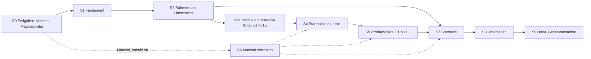

# 15. Repository Implementation Mapping

Ergebnis 12 des Website-Blueprints (MASTER-PROMPT V4), Phase M. Stand 24.10.2026, Arbeitszweig `claude/design-dna-styleguide`.
Planungsdokument: Das Repository wurde nur gelesen; gebaut, geändert oder eingecheckt wurde nichts. Dieses Kapitel enthält keinen Code.
Es nennt Dateien, Funktionen, Selektoren und Datenattribute nur als Ort und Schnittstelle der späteren Umsetzung.

**Was dieses Kapitel leistet.** Es ordnet jede Seite und jeden Abschnitt der Zielarchitektur (ZA 8.3) samt Paketentscheidung (PE 10.4)
und Designsystem (DS) den vorhandenen technischen Bausteinen zu: welche Datei betroffen ist, was wiederverwendet, geändert, neu gebaut
oder zurückgebaut wird. Es beschreibt die neuen Komponenten mit ihren Schnittstellen, die Token-Änderungen, die Folgen für Prüfsuite,
Einbettung, Fassung ohne JavaScript, CSP und Leistung, die benötigten Assets mit Anfrage an den Inhaber, eine Reihenfolge der Umsetzung
mit Abnahmekriterien und die Risiken. Wo die Abschnitts-Spezifikationen technisch voneinander abweichen oder eine Lücke lassen,
entscheidet dieses Kapitel mit **Festlegung 15-n**.

**Grundlage**

| Kürzel | Datei |
|---|---|
| PA, TD, CP, SI | [01-projektanalyse.md](01-projektanalyse.md), [bestand/technik-und-designsystem.md](bestand/technik-und-designsystem.md), [bestand/conversion-pfade.md](bestand/conversion-pfade.md), [bestand/seiten-und-inhalte.md](bestand/seiten-und-inhalte.md) |
| ZA | [08-zielarchitektur.md](08-zielarchitektur.md): Seiten S1–S32, Abschnitte, E-AB-n, Festlegung 8 |
| Spezifikation `xx-nn` | [09-abschnitte/](09-abschnitte/), je Datei Abschnitt H „Technische Umsetzung“; „fb-06 H“ = dort Abschnitt H |
| PE | [10-paketentscheidung.md](10-paketentscheidung.md): 10.4 C, F, H; J-AB-n, J-H-n, J-O-n |
| DS | [11-designsystem.md](11-designsystem.md): Festlegungen K-1 bis K-40, DS-AB-1 bis -10, DS-H-n; Rangfolge bei Widerspruch (DS, Einleitung) |
| DG, EV, EA, IA | Design-Grammatik, Expertenvergleich, Entscheidungs- und Informationsarchitektur (Kürzel wie in ZA) |
| DNA, SG, DNA-B | `docs/design-dna/03-design-dna.md`, `04-styleguide.md` (10.8 Technik, 10.9 Werte, 10.10 Ausschlüsse), `05-ergebnis-b-styleguide.md` |
| SKILL, DR, GEST | `.claude/skills/premium-gestaltung/SKILL.md` (Anforderungen des Inhabers), `…/designrichtung.md`, `docs/GESTALTUNG.md` |
| Dateien im Code | PS `functions/pakete-seite.js` · BP `scripts/bedingungen-pdf.mjs` · RB `scripts/ratgeber-bausteine.mjs` · PR `scripts/pruefen.mjs` · P29 `scripts/pruefen-instanzen/29.mjs` · VK `web/fuer-fensterbauer/index.html` · VJ/VC `web/assets/verkauf.js`/`.css` · PJ/PC `web/assets/portal.js`/`.css` · GJ/GC `web/assets/gemeinsam.js`/`.css` · RC `web/assets/recht.css` · RGC `web/assets/ratgeber.css` |

**Kennzeichnungen**

- `Datei:Zeile` belegt eine Stelle im Stand dieses Zweigs. Zeilen ohne Datei beziehen sich auf die zuletzt genannte Datei.
- **[V]** verbindlich (Anforderung des Inhabers, DNA-Prinzip, Pflichtregel des SG, Prüfsuite, Recht oder Festlegung aus DS). **[H]** Hypothese
  oder experimentelle Gestaltungsentscheidung mit Rückfall.
- **Abweichung von bestehender Regel – Freigabe durch den Inhaber nötig** steht an jedem Vorschlag gegen eine Regel aus GEST oder DR.
  Dieses Kapitel führt nur eine neue: 15-AB-1. Alle übrigen sind in ZA 8.4.5, PE 10.4 H, DS 11.B und den Spezifikationen geführt; die
  Umsetzung hängt sie an Schalter (Festlegung 15-2).
- **Anfrageentwurf**: Wortlaut einer Materialanfrage an den Inhaber (SKILL, Abschnitt 7), kein Seitentext. Neue Seitentexte entstehen in
  diesem Kapitel nicht; die Textentwürfe stehen in ZA, PE und den Spezifikationen und brauchen dort die Freigabe.
- Name, Wortmarke und Logo bleiben unverändert (GEST:7).

**Methode und Grenzen.** Byte-Größen sind am 24.10.2026 mit `wc -c` und `gzip -9` gemessen; Cloudflare liefert mit eigener Kompression aus,
die echten Übertragungsgrößen können abweichen. Pixellagen, Bildschirmnummern und Wirkungen stammen aus den Spezifikationen und sind geplant,
nicht gemessen. Simulierte Expertenperspektiven, auf denen Konzepte und Spezifikationen beruhen, sind eine Analysemethode, keine
Nutzerstudie; im Repository gibt es keine Nutzerforschung, Besucherzahlen oder Konversionsraten (PA, „Was es nicht gibt“). Aussagen über
Wirkung sind Hypothesen.

---

## Kurzfassung

- **Keine neue Technik nötig.** Alles lässt sich mit dem Bestand bauen: Worker ohne Build, statisches HTML mit Bausteinen aus PS, Generator
  RB, `portal.js` für `/`, `Verkauf.auf` für beide Orte der Seite für Fensterbauer, Hilfen aus GJ. Keine Bibliothek kommt dazu, die CSP
  bleibt unverändert (15.9).
- **Drei Quellen werden zu einer je Wahrheit.** Kopf, Menü und Fuß kommen künftig aus `web/assets/kopf.js` und `web/assets/fuss.js`, die
  im Browser und in Node laufen wie `pakete.js`; RB schreibt sie in alle statischen Seiten, `portal.js` ruft sie zur Laufzeit. Der
  Inhaltskatalog des Aufmaßblatts kommt aus `web/assets/aufmass-inhalt.js` (15.4).
- **App und Betriebsbereich bleiben unberührt.** `gemeinsam.css` und `gemeinsam.js` sind ihre Grundlage. Jede geänderte Komponentenregel
  gilt deshalb nur im Website-Bereich (Klasse `web`, Festlegung 15-1); `gemeinsam.css` bekommt nur zusätzliche Tokens (15.5).
- **Freigaben als Schalter.** Jede Abweichung, die einen Wert ändert, hängt an genau einem Token; bis zur Freigabe trägt er den
  Bestandswert (Festlegung 15-2, DS 11.10.1).
- **Die Seite für Fensterbauer wird zum größten Teil umgebaut.** In VK bleiben der Rahmen, die Bausteine aus PS, das Formular, die
  Einbettungsmechanik und vom Startbild die Erdlicht- und Maßlinien-Rechnung. Neu in VJ: `leiste`, `ihrName`, `probe`, `postfach`,
  `ablauf`, `zusagen`, `abschluss` und ein gemeinsamer Zustandsspeicher. Zurückgebaut werden `zahlen`, `szene`, `buehne`, `fortschritt`,
  die Meldungsschleife, Leiste B, fünf Lottie-Schleifen und drei Bildplätze (15.3.2).
- **Startseite.** `portal.js` baut H1 bis H7 neu. Der größte technische Eingriff ist die Ladereihenfolge: Heute laufen vor dem ersten
  Bild 177.637 B gepackte Skripte synchron. Vorgeschlagen ist ein statisches Startbild (15-AB-1) mit verzögert geladenen Skripten (15.10).
- **Prüfsuite.** 15.6.1 führt 23 Prüfstellen; an 18 ändert sich die Erwartung. Zwölf Arten von Prüfungen kommen dazu (15.6). Mehrere
  Textentwürfe kollidieren mit wörtlich geprüften Zeichenfolgen, darunter `<b>Vorläufige Preise.</b>`, „Bestellung bald möglich“ und
  `href="#bestellen" data-paket`. Sie werden entweder im Wortlaut gehalten oder mit Freigabe in der Suite angepasst (Festlegung 15-4, 15-13).
- **Einbettung.** Der Neuaufbau ersetzt den Behälter; Eigenschaften am Behälter gehen dabei verloren. Zustand liegt deshalb im Speicher von
  `verkauf.js` mit Spiegel in `sessionStorage` unter `aufmass.vk.*`. Mit diesem Präfix erfasst die vorhandene Cookies-Prüfung die neuen
  Einträge, sobald ihre Dateiliste `verkauf.js` enthält; die Cookies-Seite muss sie nennen (Festlegung 15-3, 15.7).
- **Material.** Beim Inhaber anzufragen sind zwei Telefonzuschnitte, bis zu sechs Fotos eines erkennbar erfundenen Beispielbetriebs und
  optional zwei Fensterfotos und die Figur der Fehlerseite. Alles andere entsteht im Haus aus Bühne, Einladungsseite, Aufmaßblatt und
  vorhandenen Fotos; vorher braucht es eine Materialprobe der Bühne (15.11).
- **Reihenfolge.** S0 Freigaben und Material → S1 unsichtbares Fundament → S2 Rahmen mit Umschalter → S3 Entscheidungsstrecke der Seite für
  Fensterbauer → S4 Startbild und Leiste → S5 Produktkapitel 01–03 → S6 Material (parallel) → S7 Startseite → S8 Unterseiten → S9 Doku
  und Gesamtabnahme. Jeder Schritt endet mit grüner Prüfsuite (15.12).

---

## 15.1 Technische Leitlinien der Umsetzung

### 15.1.1 Randbedingungen aus dem Bestand

| Bedingung | Folge für die Umsetzung | Beleg |
|---|---|---|
| Kein Build-Schritt, kein `package.json`; `web/` wird ausgeliefert, wie es liegt | Jede Datei ist Endprodukt. Zusammenfassen oder Minifizieren gibt es nicht; neue Module sind eigene Dateien mit `defer` | `README.md:11`; TD 1.1 |
| Worker schreibt HTML beim Ausliefern um (Kopfzeilen, Canonical, Paket-Bausteine, Einführungspreis) | Bausteine in VK bleiben zwischen `<!--pakete:NAME-->`-Marken; jede Änderung an PS braucht `node scripts/bedingungen-pdf.mjs`. Texte mit Einführungspreis folgen den Mustern von `nachEinfuehrung()` | `functions/seo.js:136-170`; PS:1-16, :252-259 |
| Drei Generatoren mit Gleichheitsprüfung: PS/BP (Paket-Bausteine), RB (Kopf, Fuß, Leseführung), `portal.js` (Laufzeit) | Was an mehreren Orten steht, kommt aus einem Modul, das Node und Browser laden. PR vergleicht jede Datei mit dem Generator | PR:1755-1769; P29 29.1 |
| Startseite im Browser gerendert, Textfassung `.vorab` ohne JavaScript | Jede Änderung an H1–H7 hat zwei Orte: PJ und `web/index.html` | `web/index.html:43-99`; GEST:439 |
| Verkaufsseite an zwei Orten (`/fuer-fensterbauer/`, `/#fensterbauer`) | Jedes Modul arbeitet auf einer Wurzel, bindet idempotent und übersteht den Neuaufbau | VJ:1-11; SKILL, Abschnitt 3 |
| CSP nur eigene Herkunft, keine Inline-Skripte, kein WebAssembly, `frame-ancestors 'none'` | Keine Bibliothek von außen, kein iframe, Skripte nur als Datei | `web/_headers:5-12`; `functions/seo.js:68-75` |
| Prüfsuite zählt jede fremde Anfrage, jede Antwort ab 400, jeden Konsolenfehler | Fehlende Assets dürfen nie angefragt werden; Platzhalter statt 404 | PR:76-85 |
| `gemeinsam.css`/`.js` tragen App und Betriebsbereich | Geänderte Regeln nur im Website-Bereich (Festlegung 15-1) | GC:1-3; GEST:27-28 |
| `/assets/*` ohne Cache-Regel und ohne Versionskennung | Neues HTML kann nach einer Veröffentlichung mit altem Skript zusammentreffen; Entscheidung vor dem ersten Livegang (15-O-1) | `web/_headers`; TD 7.12 |
| Pillow 12.3 mit WebP und AVIF, `ffmpeg`, Playwright mit Chromium liegen im Container | AVIF lässt sich im Haus erzeugen; Bildfolgen und Aufnahmen per Skript. WebKit fehlt, Safari ist im Container nicht prüfbar | gemessen am 24.10.2026; SKILL, Abschnitt 8 |

### 15.1.2 Grundsätze der Umsetzung [V]

| Nr. | Grundsatz | Herkunft |
|---|---|---|
| U1 | HTML ist der Endzustand. Jede Szene steht ohne JavaScript, bei „weniger Bewegung“ und vor dem Laden als Standbild mit Anker und Maßstabssprung; Skripte setzen erst den Anfangszustand einer Bewegung | SG 10.8 Regel 4; DS 11.7.7; SKILL, Abschnitt 3 |
| U2 | Bildschicht und Bedienschicht sind auch im Code getrennt: Bewegung, Physik, Licht und Unschärfe nur an Elementen der Bildschicht (Z 0–25); Bedienelemente ändern nur Füllung, Kontur, Farbe, Deckkraft | DNA Nr. 1, 9, 10; SG 10.8 Regel 1, 3; DS 11.1.1 |
| U3 | Eine Quelle je Wahrheit: Preise und Merkmale nur aus `pakete.js`, Ablauf nur aus `instanzregeln.js`, Kopf, Fuß, Menü nur aus `kopf.js`/`fuss.js`, Inhaltskatalog nur aus `aufmass-inhalt.js` | CP 13 Nr. 17, 18; ZA 8.4.6 |
| U4 | Leichtestes ausreichendes Verfahren: CSS, dann schlankes JavaScript mit `requestAnimationFrame`, dann vorgerenderte Bildfolge; keine Echtzeit-3D auf Verkaufsflächen | SG 10.8 Regel 2; DS 11.8.1; SKILL, Abschnitt 3 |
| U5 | Jede Bindung ist idempotent je Element, jeder Beobachter wird über `beobachten()` bzw. eine Entsprechung registriert und beim Neuaufbau gelöst | VJ:110, :467-469 |
| U6 | Prüfsuite im selben Schritt: Eine geänderte Erwartung wird im selben Schritt umgestellt; die Aussage bleibt, nur Selektor oder Fundstelle ändern sich. Entfällt eine Aussage, gibt der Inhaber das frei | SKILL, Abschnitt 8; ZA 8.4.7 Nr. 9 |
| U7 | Abweichungen sind umschaltbar: Bestandswert bis zur Freigabe, Umstellung an genau einer Stelle | DS 11.10.1, letzter Absatz |
| U8 | Platzhalter zeigen den Effekt nur in Vorschau und Telefon-Video, nie auf `main`; ein Bildplatz ohne echtes Bild entfällt | SKILL, Abschnitt 5; DS 11.8.1 |
| U9 | Online (`main`) nur auf ausdrücklichen Wunsch des Inhabers; volle Prüfsuite einmal vor dem Livegang | `CLAUDE.md`; SKILL, Abschnitt 1, 5 |

### 15.1.3 Wo die Design-DNA im Code wohnt

Die DNA unterscheidet verbindliche Merkmale (überall), variable Merkmale (je Abschnitt dosiert) und Signature-Effekte (gezielt, je
Seite höchstens einmal; DS 11.1.2 bis 11.1.5). Die Umsetzung bildet das als Ort im Code ab, damit eine Technik nicht unbemerkt an eine
zweite Stelle wandert.

| Art | Merkmal | wohnt in | Kontrolle |
|---|---|---|---|
| verbindlich | Grund `#161616`, Ordnungslinie, Raster 640/1024, Abstands-Tokens, Typorollen, Radien, Knopf- und Zustandsfamilien, Fokus, Kopf, Fuß | Tokens in GC, Regeln in `rahmen.css` unter `.web` | Codesperre, Schriftgrößen, Cream- und Grün-Prüfung (15.6.3) |
| variabel | Intensitätsstufe, Art des Helden, Ordnungsfigur, Bildanteil, Licht als Lichtfleck | je Abschnitt in VC bzw. PC, Block mit `data-abschnitt="<id>"` | Telefon-Video, `farbanteil.py` |
| Signature, inszenierend | Glas mit Hintergrundunschärfe | nur `fb-01` (Meldungen), `st-02` (Umschalter), `st-03` (Hinweis) | Codesperre: `backdrop-filter` nur in diesen drei Blöcken |
| Signature, inszenierend | Lichtübertrag (Rahmenbruch) und Lichtraum | `.vk-keil` in `fb-01`, Kegel in `fb-02`, Lichtfleck in `fb-04` | Codesperre: `mix-blend-mode` und Lichtverläufe nur dort |
| Signature, inszenierend | Schärfestaffelung | nur `leiste()` in `fb-02` | – |
| Signature, inszenierend | Explosionsansicht mit Annotation | nur `postfach()` in `fb-05` | – |
| Signature, informierend | Maßlinie mit Wert, Messraster, Fortschritts-Maßstab | `bullauge()` in `fb-01`, `he-02`; `.vk-raster` nur unter `fb-05`; `ablauf()` in `fb-10`, Maßstab in `he-04` | – |
| bewusst nicht eingesetzt | Riesenwort, Staub, scrollgekoppelte Bildfolge, Kantenlicht, Kapitelanzeige im Kopf, Lesefortschritt | – (Rückbau von Staub und Lesefortschritt) | Codesperre meldet `.vk-staub`, `--k` im Kopf |

### 15.1.4 Festlegungen dieses Kapitels

| Nr. | Thema | Widerspruch oder Lücke | Festlegung | Begründung | Rückfall |
|---|---|---|---|---|---|
| 15-1 | Geltungsbereich geänderter Regeln | DS und die Spezifikationen ändern Knöpfe, Kicker, Radien und Zustände; `fb-…`, `rh-02` legen CSS in GC ab | Website-Bereich = Element mit Klasse `web`: auf statischen Seiten am `body` (gesetzt von RB), auf `/` an `.main`, solange eine öffentliche Ansicht steht (Ansicht Hauseigentümer, Ansicht Fensterbauer), nicht im Betriebsbereich, in Tour, Preisen, Registrierung; in der App nur an `.ap-buehne`. Geänderte Komponentenregeln stehen in der neuen Datei `web/assets/rahmen.css` unter `.web`; GC bekommt nur neue Tokens | GC trägt App und Betriebsbereich (GC:1-3); deren Skalen bleiben (GEST:27-28); PR 3–22 bleiben unberührt | – |
| 15-2 | Freigaben im Code | DS 11.10.1 verlangt beide Fassungen umschaltbar, nennt aber kein Verfahren | Jede wertändernde Abweichung hängt an einem Schalter-Token in `rahmen.css` (Tabelle 15.5.4); strukturelle Abweichungen (Lage des Formulars E-AB-7, Namensfeld E-AB-2, Kopfknopf-Verhalten J-AB-9) an einer Option in PS bzw. `kopf.js` | eine Stelle je Freigabe; Rückfall ohne neuen Bau | – |
| 15-3 | Ereignisse und Speicher | `fb-03`/`fb-09`: `vk:name`, `vk-vorschau-name`; `fb-04`: `vk-probe`, `vk.probe`; `fb-05`: `vk:probe`, `vk-probe`; `fb-06`, `fb-15`: „gewählt“ ohne Namen | Ereignisse `vk:name`, `vk:probe`, `vk:wahl`, `vk:gesendet`, alle an der Wurzel und aufsteigend. Speicher `sessionStorage` `aufmass.vk.name`, `aufmass.vk.probe`, `aufmass.vk.wahl`, `aufmass.vk.gesendet` (nur Merker), jeder Zugriff in `try/catch`. Zustand im Modulspeicher von VJ; Eigenschaften an der Wurzel (`__vk…`) nur als Bindungsmerker | Präfix `aufmass.` ist die Konvention der Cookies-Seite; PR:3798-3802 liest Schlüssel mit diesem Präfix; der Behälter der Einbettung wird beim Neuaufbau ersetzt (15.7) | – |
| 15-4 | Ziel der Paketknöpfe | `fb-06 H` hält `href="#bestellen"` (Prüfsuite), `fb-09 H` und `fb-15 H` setzen `#frage` | Alle `a[data-paket]` (Karten, Abschluss, Gesprächsweg, „Ihre Frage ist nicht dabei?“) behalten `href="#bestellen"`; mit JavaScript landet der Fokus auf dem h3 `#frage` (PE 10.4 F) | P29:46 verlangt `href="#bestellen" data-paket="<paket>"` für jedes Paket; ohne JavaScript ist das h2 von 05 mit seinem Satz die richtige Landestelle | Ziel `#frage` nach Anpassung von P29:46 (Freigabe ZA 8.4.7 Nr. 9) |
| 15-5 | Sprünge | Sprungverhalten an fünf Orten verschieden: PJ:833-842 (Kopfhöhe + 12, glatt), `fb-07` (VJ), `fb-13` (GJ, `hashchange`), `fb-15` (`data-sprung`), `rh-01` (K-10) | Ein Sprung-Helfer `Sprung.zu` in GJ (15.4.2): Lage aus dem berechneten `scroll-margin-top` des Ziels (K-15), öffnet `details` am oder um das Ziel, setzt den Fokus, springt sofort (K-10). Ihn nutzen `Kopf.auf`, das Menü, PJ (Einbettung), VJ (statische Seite) und der `hashchange`-Hörer | ein Verhalten an allen Orten; in der Einbettung ändert sich `location.hash` nicht, ein globaler `hashchange` allein öffnete dort kein `details` | – |
| 15-6 | Foto-Auftritt | K-7 gilt für `fb-01`, `he-01`, `ap-01`; drei Spezifikationen planen drei Helfer | Ein Helfer `Auftritt` in GJ: Foto-Auftritt nach `decode()` und „erste Eingabe → Endzustand in 220 ms“ | eine Umsetzung von K-7; App lädt GJ ohnehin | – |
| 15-7 | Lottie-Spieler | VK und `/` laden `lottie_light` (46.334 B gepackt) mit `defer`; auf der Verkaufsseite bleibt nur der Haken im Dank (`fb-09`) | `Lottie.laden()` in GJ fügt den Spieler bei Bedarf einmal ein; VK und `/` laden ihn nicht mehr vorab. App und Betriebsbereich bleiben, wie sie sind | GJ:224-228 wartet heute auf ein vorhandenes Skript-Tag; ohne Tag liefe der Haken nie | Spieler wieder mit `defer` |
| 15-8 | Miniaturen im Abschluss | `fb-15 H` baut die Vorschau als skalierte HTML-Miniatur (Maßstab 0,3214); `fb-12 H` verwirft HTML-Miniaturen wegen Schrift unter 13 px | Grundfassung als Rasterbild je Stufe (Rückfall H-E9 aus `fb-15 H`, 270 × 558, ≤ 25 KB); der Name aus 01 erscheint dann nicht in der Miniatur | Die Prüfsuite misst berechnete Größen und sähe 13/15/24 px, sichtbar wären es ≈ 4–8 px (TD 5.2 Nr. 1; GEST:512 „keine Schrift unter 13 px“). ZA 8.3.2 A4 plant den Namen in der Miniatur: Entscheidung des Inhabers (15-O-3) | HTML-Miniatur wie in `fb-15 H` |
| 15-9 | Codesperre | SG 10.10, Umsetzung 5 schlägt Stylelint vor | Prüfung als neuer Teil von PR (Muster über die Website-CSS-Dateien), kein Stylelint | kein `package.json`, kein Build; die Suite läuft ohnehin vor jedem Livegang | – |
| 15-10 | Startbild der Startseite | `he-01 H` macht das Startbild statisch, `ap-01 H` verschiebt das für die App | `/` bekommt das statische Startbild (15-AB-1); die App behält das gerenderte Startbild mit Vorladen | `/` lädt vor dem ersten Bild 177.637 B gepackt synchron (15.10.2), die App ist nicht Gegenstand dieser Planung (ZA 8.3.10) | Startbild weiter aus PJ, nur `defer` und Vorladen |
| 15-11 | Telefonzuschnitte | `fb-01 H` (780 × 944 mit 52 px Kopfraum) gegen `st-02 H` (1560 × 1680, 13 : 14); `he-01 H` (1170 × 1260) | Je Motiv eine Vorlage, aus der beide Fassungen entstehen: Astronaut ≥ 1170 × 1416 (Bildfeld 390 × 472 dreifach), Waschbär ≥ 1170 × 1260 (13 : 14); 15.11.1 | ein Auftrag je Motiv | – |
| 15-12 | Klassenname `kopf` | `rh-01` führt `header.kopf` ein; RC:15-20 gestaltet `.kopf` und `.marke` der Rechtsseiten | Die alten Regeln in RC entfallen im selben Schritt; die Marke-Prüfung (PR:1611-1613) sucht `.kopf .wm` statt `.rg-kopf .wm` | sonst greifen 760-px-Spalte und `backdrop-filter` aus RC in den neuen Kopf | – |
| 15-13 | Wörtlich geprüfte Zeichenfolgen | Textentwürfe aus ZA und PE ersetzen Kästen durch Sätze | Die Sätze behalten `<b>Vorläufige Preise.</b>` (P29:46, :55) und „Bestellung bald möglich“ (P29:46; `30.mjs:117`) im Wortlaut | beide Zeichenfolgen sind Abnahme des Zustands A | Anpassung der Suite mit Freigabe |
| 15-14 | Tokens und Seiten mit RC | Rechtsseiten, 404 und Paketbedingungen laden nur RC mit eigenen Tokennamen (RC:3-8) | Alle Website-Seiten laden GC und `rahmen.css`; RC behält seinen Namen (`functions/api/widerruf.js:74` lädt ihn), führt die Tokennamen von GC und die alten als Aliasse | Tokens an einer Stelle (TD 2.1) | – |
| 15-15 | Zeichnungsfarben | `he-02 H` nennt `--z-wand`, `--z-glas`, `--z-rahmen`, `--z-tinte`; DS 11.5.1 belegt `--z-…` für die Ebenen | Präfix `--zeichnung-` (`--zeichnung-wand`, `--zeichnung-glas`, `--zeichnung-rahmen`); `--tinte-papier`, `--mo-papier`, `--papier` wie DS 11.4.1; das `--blatt` aus `he-05 H` entfällt zugunsten von `--papier` | eindeutige Namen | – |

**15-AB-1** (zu Festlegung 15-10). Bestehende Regel GEST:439: „Textfassung von Startseite und App: dieselben Bausteine innerhalb von
`#app`; sichtbar nur ohne JavaScript, mit JavaScript ersetzt sie die App beim ersten Bild, ohne Aufblitzen (`.js .vorab`).“ Vorschlag:
Das Startbild der Ansicht Hauseigentümer steht als statisches HTML am Anfang von `#app` und gilt mit und ohne JavaScript; `portal.js`
übernimmt den Knoten, statt ihn neu zu zeichnen. Die übrige Textfassung bleibt wie in GEST:439. Begründung: Ziel LCP ≤ 2,5 s (SG 10.8;
DS 11.9.2); heute steht die Überschrift erst nach den synchronen Skripten (TD 1.4). Rückfall: Startbild weiter aus `portal.js`, übrige
Skripte außer `config.js` und GJ mit `defer`, Foto vorgeladen. **Abweichung von bestehender Regel – Freigabe durch den Inhaber nötig.**

---

## 15.2 Landkarte der Dateien

Art: **bleibt** (unverändert) · **ändern** (Teile umbauen) · **ersetzen** (Inhalt weitgehend neu) · **neu** · **Rückbau** (Teile
entfallen). Schritt nach 15.12.

| Datei | Rolle heute | in der Umsetzung | Art | Abschnitte | Schritt |
|---|---|---|---|---|---|
| `worker.js`, `wrangler.jsonc` | Auslieferung, `run_worker_first` | unverändert; neue Bilder liegen unter `/bilder/*` und brauchen keinen Eintrag | bleibt | – | – |
| `web/_headers`, `functions/seo.js` (`SICHERHEIT`) | CSP und Kopfzeilen | CSP unverändert; ggf. Cache-Regel für `/assets/*` (15-O-1) | bleibt / ändern | – | S1 |
| `functions/seo.js` (`SEITEN`, `llms`, `nachEinfuehrung`) | Sitemap, Stand, llms.txt, Einführungspreis | `stand` jeder geänderten Seite nachziehen; `llms()` erst nach freigegebenen Texten abgleichen | ändern | alle | je Schritt |
| PS | Paket-Bausteine | neue Bausteine `ab-preis`, `geraet`, `preisstand`, `festblock`, `abschluss`; geänderte `karten`, `beispiel`, `punkte`, `hinweis`, `vergleich`, `ablauf`, `demos`, `formular`, `bestellen`, `leistungen` | ändern | fb-01, -03, -06 bis -12, -15, pb-02 | S3–S5, S8 |
| BP | schreibt Bausteine, PDFs | unverändert; nach jeder Änderung an PS ausführen | bleibt | – | – |
| `functions/api/partner.js` | Frage ohne Konto, Kundenkonto | Felder unverändert; optional Zähler `ereignis:paket_frage` (15-O-5) | bleibt / ändern | fb-09 | S3 |
| `functions/api/router.js` | 503 ohne Datenbank | optional HTML-Antwort für das Formular ohne JavaScript (15-O-4) | ändern [H] | fb-09 | S3 |
| `functions/api/widerruf.js` | Widerruf ohne JavaScript | `erfolgHtml()` angleichen (`re-01 H`) | ändern | re-01 | S8 |
| RB | Kopf, Fuß, Leseführung von Ratgeber und Fachartikeln | Generator für alle statischen Seiten: Kopf, Menü, Fuß, Brotkrumen, Artikelkopf, Handlungsbausteine, Rechtsseiten-Gliederung, Textfassung von `/` | ändern | rh-01 bis -03, ar-01, ar-02, re-01, st-05, he-05 | S2, S7, S8 |
| PR | Prüfsuite | Erwartungen umstellen (18 von 23 Prüfstellen in 15.6.1, mit P29 und `30*.mjs`), neue Prüfungen (15.6.3) | ändern | alle | jeder Schritt |
| P29, `30.mjs`, `30-welle3.mjs`, `27.mjs` | Verkaufsseite, Ende zu Ende, Kundenkonto | Muster umstellen (15.6.1) | ändern | fb-06, -07, -09, pb-02, st-04, pa-01 | S3, S7, S8 |
| `scripts/tour-bild.mjs` | Ausschnitt des Aufmaßblatts für die Tour | zweiter Ausgang für `fb-05` (Schichten), Variante `kunde` für `he-03` | ändern | fb-05, he-03 | S5, S7 |
| `scripts/fotos.py` | Fotos aus Originalen, Platzhalter | neue Plätze (Telefonzuschnitte, Bildband, Figur), relativer Ausschnitt, Alphakanal, AVIF | ändern | fb-01, he-01, he-07, nf-01, ap-01 | S6 |
| `scripts/buehne-bilder.mjs` (Name Vorschlag) | – | Renderings, Standbilder, Bildfolgen aus der eigenen Bühne | neu | fb-02, fb-04 | S0, S6 |
| `scripts/website-bilder.mjs` (Name Vorschlag) | – | Beispielbilder je Paket, Miniaturen, Führungsbildschirme, Gerät-Rückfall | neu | fb-03, -06, -12, -15, he-04 | S6 |
| `scripts/marke-bilder.mjs` | Icon, Vorschaubild | zusätzlich Vorschaubild der Seite für Fensterbauer (IA-O-8) | ändern | System | S9 |
| `scripts/lottie-erzeugen.py` | Lottie aus Code | unverändert; nur Vorlage für Zustände von `he-02` | bleibt | – | – |
| `web/index.html` | Kopf der Startseite, Textfassung | Ladereihenfolge, statisches Startbild (15-AB-1), Textfassung in der Folge H1–H7 mit generierten Teilen | ersetzen | st-01 bis -05, he-01 bis -07 | S7 |
| VK | Verkaufsseite | Abschnittsfolge nach ZA 8.3.2, neue Abschnitte, Rückbau (15.3.2) | ersetzen | fb-01 bis fb-15 | S3–S5 |
| `web/fuer-fensterbauer/*/index.html` (5) | Fachartikel | Kopf, Menü, Fuß, Artikelkopf, Handlungsbausteine aus RB | ändern (generiert) | ar-01, ar-02 | S2, S8 |
| `web/ratgeber/**/index.html` (24) | Ratgeber und Übersicht | wie Fachartikel | ändern (generiert) | ar-01, ar-02, ar-05 | S2, S8 |
| `web/konfigurator-bedingungen/index.html` | Paketbedingungen | Kopf, Fuß, Merkmalstabelle, Anker `merkmale` | ändern | pb-01 bis -03 | S2, S8 |
| `web/{impressum,datenschutz,cookies,agb,nutzungsbedingungen,widerruf}/index.html` | Rechtsseiten | Kopf, Fuß, Gliederung; Cookies: neue Speichereinträge; Datenschutz: Anker `fotos-ki`, ggf. Satz zur Namensvorschau (15-O-7) | ändern | re-01, fb-03, he-04 | S2, S5, S8 |
| `web/404.html` | Fehlerseite | neues Markup, GC und `rahmen.css` | ersetzen | nf-01 | S8 |
| `web/partner/index.html`, `web/assets/partner.js`/`.css` | Kundenkonto | Anmeldeseite als Weiche, `noscript`; optional Bestätigung in Schritt 1 (J-O-13) | ändern | pa-01 | S8 |
| `web/app/index.html`, `web/assets/app.js`/`.css` | App | nur Startbild-Schnittstelle, Vorladen, Link zur Seite für Fensterbauer | ändern | ap-01 | S8 |
| GC | Tokens und Bausteine aller Oberflächen | nur zusätzliche Tokens (15.5.3) | ändern (additiv) | alle | S1 |
| GJ | Hilfen | neu: `Sprung`, `Auftritt`, `Lottie.laden`, `eigenesAufmass` (aus PJ:20); Satz zur Tour in der Pilotleiste entfällt (GJ:349) | ändern | alle | S1, S2, S7 |
| `web/assets/rahmen.css` | – | Website-Bereich, Schalter, Kopf, Menü, Fuß, Brotkrumen, geänderte Komponentenregeln | neu | rh-01 bis -03, alle | S1, S2 |
| `web/assets/kopf.js` | – | Kopf und Menü aus einer Quelle (Browser und Node) | neu | rh-01, rh-02 | S2 |
| `web/assets/fuss.js` | – | Fuß und Rechtszeile aus einer Quelle | neu | rh-03 | S2 |
| `web/assets/aufmass-inhalt.js` | – | Inhaltskatalog des Aufmaßblatts (eine Fassung, K15) | neu | fb-05, he-03, st-05 | S5 |
| `web/assets/fehler.js` | – | nur Fassung B der Fehlerseite | neu [H] | nf-01 | S8 |
| VJ | Formular und Bewegung der Verkaufsseite | Module nach 15.4.3; Rückbau nach 15.3.2 | ersetzen | fb-01 bis fb-15 | S3–S5 |
| VC | Gestaltung der Verkaufsseite | Blöcke je Abschnitt neu; Einbettung angepasst | ersetzen | fb-01 bis fb-15, st-03 | S3–S5 |
| PJ, PC | Startseite und Betriebsbereich | Ansicht Hauseigentümer, Umschalter, Wechselkarte, Hinweis, Kopf; Betriebsbereich unverändert | ändern | st-01 bis -05, he-01 bis -07 | S2, S7 |
| RGC | Lesetext-Bausteine | Fragenzeile als Muster (`fb-13`), Artikelkopf, Handlungsbaustein, Vergleich-Ausnahme | ändern | fb-07, fb-13, ar-01, ar-02 | S3, S8 |
| RC | Rechtsseiten | Tokennamen, Skala, `.kopf` und `.fuss` entfallen, Merkmalstabelle | ändern | re-01, pb-02, nf-01 | S2, S8 |
| `web/assets/pakete.js`, `instanzregeln.js` | Preise, Merkmale, Ablauf | unverändert, einzige Quelle | bleibt | fb-06 bis -10, -15 | – |
| `web/assets/einladung.js` | Einladungsseite (Browser und Node) | unverändert; Quelle der Startansicht im Gerät (`fb-03`) und der Beispielbilder | bleibt | fb-03, -06, -15 | – |
| `web/assets/modell.js`, `ral.js`, `blatt.js` | Fenstermodell, Abrechnung, RAL, Aufmaßblatt | unverändert; auf `/` später nur verzögert geladen (15.10.3, Stufe B) | bleibt | he-07, st-05 | S7 |
| `web/assets/buehne.js` | WebGL-Bühne der App | unverändert; nur im Haus über `/app/?gl=voll` als Quelle von Renderings | bleibt | fb-02, fb-04 | S0, S6 |
| `web/assets/lottie/*.json`, `web/vendor/lottie_light.min.js` | Zeichen und Spieler | auf der Website nur noch `fertig` im Dank, bei Bedarf geladen | bleibt | fb-09 | S3 |
| `web/bilder/**` | Fotos, Zeichnungen | neue Dateien nach 15.11; Platzhalter `fb-kundenschutz`, `fb-frage`, `gross` werden nicht mehr eingebunden (Dateien bleiben) | ändern | – | S3–S8 |
| `docs/GESTALTUNG.md`, `docs/BILDER.md` | Regeln, Bildplätze | nach Freigabe nachziehen | ändern | – | S9 |
| `.claude/skills/premium-gestaltung/designrichtung.md` | Aussehen der Verkaufsflächen | nur nach ausdrücklicher Freigabe des Inhabers (15-O-9) | ändern [H] | – | S9 |

---

## 15.3 Zuordnung je Seite und Abschnitt

Jede Zeile nennt den Bestand mit Fundstelle, was davon wiederverwendet wird, was sich ändert, was neu entsteht und was entfällt. Details
der Gestaltung stehen in den Spezifikationen; wo DS einen Wert festlegt, gilt DS (DS, Rangfolge).

### 15.3.1 Rahmen auf allen Seiten

| ID | Bestand | wiederverwenden | ändern | neu | entfällt | Material | Schritt |
|---|---|---|---|---|---|---|---|
| `rh-01-kopf` | `.rg-kopf` (RGC:7-12; von Hand in VK:48-51 und den Ratgebern), `.kopf` (RC:15-20; Recht, 404, Paketbedingungen), `.top` (PJ:423-460), `kopfCta()` (PJ:551-562) | `Logo.svg`, `Marke.wort` (GJ:126-147); `.btn`-Familie (GC:56-76); Beobachterprinzip aus `kopfCta()` | PJ `render()`: `.top` mit `Kopf.html()`, im Kontext Fensterbauer ohne „Preise“ und „Kostenlos starten“ (EA AB-2); `kopfCta()` geht in `Kopf.auf` auf; `eigenesAufmass()` (PJ:20) wandert nach GJ | `kopf.js` (`Kopf.html`, `Kopf.auf`), Block `.kopf` in `rahmen.css`; Datenattribute als Schwellen (15.4.6) | Lesefortschritt `fortschritt()` (VJ:451-465) und VC:614; `backdrop-filter` in `.rg-kopf`/`.top`; RC-Regeln `.kopf`, `.marke` (Festlegung 15-12) | keins | S2 |
| `rh-02-menue` | kein Menü am Telefon (RGC:15) | Scrim-Wert aus PC:194 (`--scrim-blatt`) | – | `Kopf.menue()`; `<dialog id="menue">` von RB nach dem Fuß außerhalb von `main` geschrieben, auf `/` hinter `#app` (PJ:455 ersetzt `#app`); IDs mit Vorsatz `m-`; Block `.menue` in `rahmen.css` | – | keins | S2 |
| `rh-03-brotkrumen-fuss` | RB `GRUPPEN`, `fusszeile`, `FUSS` (RB:80-93); `footer()` (PJ:477-482); Rechtszeile der App (`app.js:6629-6635`); Fußregeln in RGC:148-159, RC:44-53, PC:368-380 | Klassen `rg-fuss`, `rg-pfad`, `rg-widerruf` (Druckregel RGC:168; PR-Muster); Gruppen aus RB | RB wird Generator für alle statischen Seiten; `footer()` → `Fuss.html()` (schlanke Fassung angemeldet und Instanz-Fuß bleiben) | `fuss.js` (`Fuss.html`, `GRUPPEN`, `RECHT`, `KONTAKT` mit `telefon: null` bis EA O-9); Fußteil von `rahmen.css`; `id="navigation"` am Fuß-`nav` (Ziel des Menüs ohne JavaScript) | Fuß-Links zum Altbestand (IA-AB-1); `.fuss` mit 14 px | keins | S2 |

### 15.3.2 Seite für Fensterbauer `/fuer-fensterbauer/` und Ansicht `/#fensterbauer`

**Abschnittsfolge in VK nach dem Umbau** (Anker in Klammern; Pflicht-h2 nach P29:110-114 ohne weitere Attribute): Kopf → V1 Startbild
(`fb-01`) → V2 Leiste (`fb-02`) → 01 (`fb-03`, `#die-idee`) → 02 (`fb-04`, `#so-funktioniert-es`) → 03 (`fb-05`,
`#was-in-jeder-anfrage-steht`) → 04.1 (`fb-06`, `#pakete`, `#paket-…`) → 04.2 (`fb-07`, `#vergleich`) → 04.3 (`fb-08`) → 05 (`fb-09`,
`#bestellen`, `#frage`) → 06.1 (`fb-10`, `#ablauf`) → 06.2 (`fb-11`, `#kundenschutz`) → A1 (`fb-12`, `#demos`) → A2 (`fb-13`,
`#haeufige-fragen`) → A3 (`fb-14`, `#warum-kunden-selbst-planen`, `#quellen`, `#wissen-fuer-fensterbauer`) → A4 (`fb-15`) → Brotkrumen
→ Fuß. Die Lage des Formulars ist eine Option in PS (Festlegung 15-2; Rückfall E-AB-7: 05 hinter 06).

| ID | Bestand (VK-Zeilen nach CP 5.1) | wiederverwenden | ändern | neu | entfällt | Material | Schritt |
|---|---|---|---|---|---|---|---|
| `fb-01-startbild` | VK:54-64; VC:167-255; VJ `startbild()` (:158-188), `bullauge()` (:197-254) | Glas-Meldungen (Baustein 1), Erdlicht-Rechnung `punkt()`, Maßlinie mit Zählwert (Bildschicht), `Scroll.binden` für die Foto-Tiefe | `startbild()` als einmalige Folge statt `setInterval(…, 3400)` (VJ:185), Abbruch bei erster Eingabe (`Auftritt`); Maßlinie bei 2,9 s; Stapel aus `STAPEL`; Foto-Tiefe 0,88 mit Ende vor der Leiste; drei Chips; Ring → `#die-idee`; Wrapper `.rg-cta` mit `a[href="#pakete"]` bleibt (PR:175) | Baustein `ab-preis` in PS (kleinster Monatspreis aus `pakete.js`, Zusatz bei `VORLAEUFIG`); `<picture>` mit Telefonquelle und Vorladen; `.vk-keil` (Lichtübertrag); Etikett „BEISPIEL“ | „Kurz gesagt“ (E-AB-5), Brotkrumen oben, `.vk-staub`, `vk-atmen`, Schatten unter Meldungen, h1-Textschatten, `ZEITEN` (VJ:157) | `fb-sessel-telefon` (Inhaber, 15.11.1 A1) | S4 |
| `fb-02-leiste-elementarten` | VK:66-72; VC:260-312, :527-542; VJ `leisten()` (:264-331) | Messung der Lagen, Schleife nur im Bild, Bindungsregister `LEISTEN` | `leisten()` → `leiste()`: Kopplung an das Scrolltempo (0,42), Trägheit, Einrasten, Wischen, Tasten, Namensplatz; Ende, sobald das Gerät aus 01 den unteren Rand erreicht | Markup nach `fb-02 H` (Liste aus 14 Einträgen, Klone `aria-hidden` und `inert`); Schlitz und Kegel als Pseudo-Elemente | Leiste B mit Kennzahlen (VK:70; E-AB-6), Grundlauf 30 px/s, Hover-Pause, Wiegen | 14 Renderings und 14 weiche Fassungen (im Haus, 15.11.2); bis dahin Zeichnungen 24 px (Rückfall R2 aus `fb-02 H`, nur Stufe 2) | S4, S6 |
| `fb-03-ihr-name` | VK:73-83 (Kacheln „Die Idee“), VC:308-311, :544-548 | Pflichtsätze VK:61 („… ohne ihn programmieren zu lassen“), VK:79 („Ihr eigenes Baby“); Gerätevorlage `.vk-telefon` (VC:346-347) ohne Schatten | h2 `#die-idee` bleibt wörtlich (VK:74) | Baustein `geraet` in PS, gebaut aus `Einladung.html({ vorschau: true, name: 'Fensterbau Brandt', instanz: { website: true, kz: 'deutlich', standardBild: true } })` (`einladung.js` läuft in Node, `einladung.js:7`, `:363`), `h1` dort als `p`; Gerätebaustein `.vk-geraet` (K-23); Feldgruppe ohne `form` und ohne `name`; Modul `ihrName()` | Kacheln `.vk-punkte` | Standardbild-Ausschnitt 16 : 9 aus `app-start.webp` (im Haus) | S5 |
| `fb-04-ihr-kunde` | VK:84-119 (Telefonbühne); VC:313-407; VJ `buehne()` mit `schrittSetzen`/`schrittRechnen` (:115-150) | `.vk-geraet` aus `fb-03`; `ruhig()`, `beobachten()`, `kannIO` | h2 genau `<h2 id="so-funktioniert-es">` (P29:112) | Modul `probe()` mit Wahlzeilen (`aria-pressed`), Bildwechsel 500 ms, Bildfolge auf `<canvas>` (`createImageBitmap`, Vorrat ± 6, Rückfall bei Median-Bildzeit > 25 ms), Lichtfleck; zwei Standbilder als Fassung ohne JavaScript | Telefonbühne, Lottie `messen`, `senden`, `eingang`, `fertig`, `fotos` an dieser Stelle, Papierflieger, Konfetti | 6 Standbilder, 3 Bildfolgen à 30 Bilder (im Haus nach Materialprobe); Platzhalter Aufnahmen des CSS-Modells | S5, S6 |
| `fb-05-ihr-postfach` | VK:120-147; VC:410-435, :562-578; VJ `szene()` (:441-449); Reveal-Liste (VJ:476) | `tour-aufmassblatt-15.webp`; `Scroll.binden`; Messraster `.vk-raster` (VC:518) | Lead wörtlich VK:80; die sieben Inhalte als Aufklapper aus `aufmass-inhalt.js` | Modul `postfach()` (Auftritt des Blatts, Explosion 0/28/56 px, Führungslinien); Karte „Aus Ihrer Probe“ hört auf `vk:probe`; zweiter Ausgang in `tour-bild.mjs` | `.vk-szene`, `.vk-mk*`, Bestellmaß-Karte | `fb-schicht-klaerung.webp`, `fb-schicht-fotos.webp` mit Fingerabdruck (im Haus); optional zwei Fensterfotos (Inhaber, A4) | S5 |
| `fb-06-pakete-karten` | PS `karten()` :109-131, `beispiel()` :105-107, `BEISPIEL_BILD` :96, `punkte()` :65-82; VJ `pakete()` :342-404; VC:8, :21-91 | Wischreihe mit `scroll-snap`, Zeiger, Umschalter „Leistungen ansehen“ (VJ:350-357), `subgrid` (VC:85) | Kartenfolge nach PE 10.4 B; Namensleiste vor die Reihe, mit Preisen (J-AB-6); Grenze Reihe → drei Spalten über die Behälterbreite 900 px (PE Festlegung 10-4); „Wenn“-Satz statt `kurzText()`; Pille als Kontur; `scroll-margin-top` 116/124 | Datenblatt mit Leitlinien (SVG, Koordinaten als `data-`-Attribute); Feder des Beispielbilds (ζ 0,75, 2 Hz, ≤ 24 px; K-37); Kopf-Ring ausblenden über `data-kopf-wechsel`; Cream nach Wahl (`vk:wahl`, J-AB-8) | `.vk-wischen` (VJ:390-404), grüner Schein (VC:23), Skalierung der Nachbarn (VC:91), Vorspann `farbwechsel` (J-AB-10), Kasten „Vorläufige Preise“ über der Reihe | 3 Beispielbilder (im Haus); Fotos des Beispielbetriebs (Inhaber, A3); bis dahin Skizzen (PS:99-104) | S3, S6 |
| `fb-07-entscheidungshilfe-vergleich` | PS `hinweis()` :86-91, `vergleich()` :133-140; VK:174, :182-187; VC:114, :453-454 | `details.vk-vergleich-auf`; `wertText()` (nur für `vergleich()` mit „nicht enthalten“) | `hinweis()` teilt sich in `preisstand(v)` (Satz unter der Reihe, mit `<b>Vorläufige Preise.</b>`, Festlegung 15-13) und `bald(v)` (an `fb-09`); `vergleich()` mit Gruppen (`GRUPPEN`, Restgruppe „Weitere“), Zeilen- und Gruppenköpfen | Baustein `preisstand` (Name `stand` ist in PS:245 belegt); Hebung der RGC-Tabellenregeln (RGC:59-74) | `data-k`-Kartenliste am Telefon (I-AB-1) | keins | S3 |
| `fb-08-festblock-gespraechsweg` | VK:188 (`.vk-recht`) | `BLOECKE`, `bausteineEinsetzen` (PS:249-259), `steuerText` (PS:44), `stand` (PS:245); Vorwahl „Noch offen“ (VJ:28-36) | – | Baustein `festblock` (serverseitig, ohne JavaScript vollständig); Gesprächsweg als Ring `href="#bestellen" data-paket=""` (Festlegung 15-4) | Absatz `.vk-recht` an alter Stelle | keins | S3 |
| `fb-09-anfrage` | VK:213-232; PS `formular()` :173-189, `bestellen()` :190-197; VJ `formular()` :19-90; VC:120-148, :487-493 | Formularweg mit und ohne JavaScript, Honigtopf, Bremse, Fehler am Feld, Dank mit Fokus; Start-Tag des Formulars Byte für Byte (PR:1793) | Reihenfolge Paket, Name, Firma, E-Mail, Telefon, Frage; `autocomplete`, `enterkeyhint`; Zustand A mit Satz statt Kasten (mit „Bestellung bald möglich“, Festlegung 15-13); Zustand B mit „Vorher eine Frage?“ | Auswahlzeile mit „Paket ändern“, Vorbefüllung der Firma aus `vk:name` mit „entfernen“, feste Sätze ab Status 500, Dank mit `Lottie.spielen(…, 'fertig')` über `Lottie.laden()`, Merker `aufmass.vk.gesendet`, Ereignis `vk:gesendet`; Anbieterzeile hinter dem Formular | Bildplatz `fb-frage.webp`, Raster `.vk-bestellen`, Chips „Rückruf, Nachricht, Unverbindlich“ | keins | S3 |
| `fb-10-ablauf` | PS `ABLAUF`, `SYMBOLE`, `symbol()`, `ablauf()` :141-164; VK:191-205; VC:461-477, :609-611, :626-631; Scroll-Bindung der Zeitleiste in `bewegung()` (VJ:500-510) | `LEISTE` aus `instanzregeln.js:74-77` (sechs Statuswörter, P29:113-114); Satz „3 bis 5 Werktage“ (VK:193) | `ABLAUF` mit Fakten je Schritt; Klasse `rg-schritte` entfällt (sonst Zählerkreise aus RGC:53-56) | Modul `ablauf()` mit einem IntersectionObserver (Marke wird grün als Zustand); Link `/konfigurator-bedingungen/#laufzeit` (Anker vorhanden) | Symbole, wachsende Linie (DG-AB-15) | keins | S3 |
| `fb-11-kundenschutz` | VK:158-168; VC:602-606, :443 | Wortlaut der vier Zusagen (VK:160-166; PR:611 zählt sie genau viermal in der Einbettung); Klasse `.vk-zusagen` | h2 genau `<h2 id="kundenschutz">Ihre Kunden bleiben Ihre Kunden</h2>` (PR:1691) | Ankerkachel, Medaillon, gezogene Haken (CSS-Abdeckung, Modul `zusagen()`) | Bildplatz `fb-kundenschutz.webp`; Einträge in den Reveal-Listen (VJ:476-479) | keins | S3 |
| `fb-12-live-demos` | PS `demos()` :165-172; VC:482-484 | Schalter `PAKETE_DEMOS`; Frist aus `R().FRISTEN.testTage` | Abschnitt wird `.vk-anhang` (gemeinsam mit A2, A3) | Zeile `demoZeile(m)`, Zuordnung `BEISPIEL_MINI`; Ring „App für Hauseigentümer öffnen“ mit neuem Tab in Zustand A | `.rg-karten.vk-demos`, Ring aus dem Startbild nach `#demos` (E-AB-3) | 3 Demo-Miniaturen 192 × 144 (im Haus), nur mit Demos | S3 |
| `fb-13-haeufige-fragen` | VK:234-246, FAQ-JSON-LD VK:29-39; RGC:128-134, :168-171 | Wortgleichheit JSON-LD ↔ `
` (PR:1738-1748) | acht statt zehn Fragen (zwei im Fluss beantwortet); Fragenzeile als Muster in RGC für alle 31 Seiten mit `rg-frage` | Öffnen per Sprung über `Sprung.zu` (Festlegung 15-5) | Fragen als Karten (DG-AB-19) | keins | S3 |
| `fb-14-hintergrund` | VK:147-157 (Zahlen), :248-257 (Wissen-Karten), :259-266 (Quellen) | Zahlen mit Quellen und die drei Anker (bleiben für Suchmaschinen und KI-Zitate) | drei zugeklappte Zeilen nach dem Muster von `fb-13`, ohne JSON-LD | – | Foto `fb-kunden-planen.webp` an dieser Stelle (Datei bleibt), Hochzählen `zahlen()` (VJ:411-437), Wissen-Karten | keins | S3 |
| `fb-15-abschluss` | – | `P().LISTE`, `P().preis()`, `EMPFOHLEN` (PS:33), Knopftexte nach `v.bestellen` (PS:113-115), `steuerText()` | – | Baustein `abschluss` (letzter Abschnitt in `main.rg`, damit die Einbettung ihn übernimmt); Modul `abschluss()` (liest `vk:wahl`, `vk:gesendet`); Miniatur je Stufe als Rasterbild (Festlegung 15-8) | – | 3 Miniaturen 270 × 558 (im Haus) | S3, S6 |
| Einbettung | PJ `vkLaden()`, `einbettungAuf()`, `vkStarten()` (:803-844); VC:636-658 | Mechanik bleibt (eine Quelle, Rückfallkarte, Sprünge ohne Hash-Wechsel) | `--vk-kopf` 122 → 56 px (VC:658), `.story-stage { top }` in PC; Sprung über `Sprung.zu` | `vonPdfHinweis()` (`st-03`); Vorabladen (`st-04`) | Band `.banner.vonpdf` (PJ:849, PC:139) | – | S2, S4, S7 |

**Rückbau auf der Seite für Fensterbauer** (alles, was nach dem Umbau keinen Platz mehr hat; Dateien unter `web/bilder/` werden nicht
gelöscht, nur nicht mehr eingebunden)

| Ort | Teil | Grund |
|---|---|---|
| VJ | `zahlen()` (:411-437), `szene()` (:441-449), `buehne()` mit `schrittSetzen`/`schrittRechnen` (:115-150), `fortschritt()` (:451-465), Meldungsschleife in `startbild()` (:185), Leiste B und Grundlauf in `leisten()`, Reveal-Block in `bewegung()` (:476-484), Zeitleisten-Bindung (:500-510) | K-6 (Bedienschicht ohne Auftritt), DG-AB-3, DG-AB-5, DG-AB-15; ersetzt durch neue Module |
| VC | `.vk-staub`, `vk-atmen`, `.vk-leiste-b`, `.vk-buehne`/`.vk-telefon`/`.vk-tisch` (:313-407), `.vk-anfrage`/`.vk-szene`/`.vk-mk*`, `.vk-gruende`/`.vk-zahl` (:585-598), `.vk-punkte`, `.vk-band`, Schein (:23), `.vk-wischen`, `.vk-demos`-Karten, Raster `.vk-bestellen`, Auftrittsregeln (:506-507), Lesefortschritt (:614) | wie oben; `scale` der Nachbarn (J-AB-2) |
| VK | „Kurz gesagt“, Leiste B, Kacheln „Die Idee“, Telefonbühne, Bestellmaß-Karte, Abschnitt „Warum Kunden selbst planen“ als eigener Abschnitt, Wissen-Karten, sichtbare Quellenliste, Kasten „Bestellung bald möglich“, `data-lottie`-Plätze außer dem Dank | ZA 8.4.1 |
| Bilder | `fb-kundenschutz.webp`, `fb-frage.webp` (Platzhalter), `fb-kunden-planen.webp` (frei) nicht mehr eingebunden; Einträge in `scripts/fotos.py:41-43` und `docs/BILDER.md` als entfallen bzw. frei | IA-AB-8; PA-Frage 24 |
| Lottie | `messen`, `senden`, `eingang`, `fotos`, `farbwechsel` nicht mehr auf der Website; Dateien bleiben für App und Betriebsbereich | SKILL, Abschnitt 2 („Bewegung mit Sinn“); DG-AB-2 |

### 15.3.3 Startseite `/`: Rahmen, Umschalter, Hinweis, Wechselkarte, Textfassung

| ID | Bestand | wiederverwenden | ändern | neu | entfällt | Material | Schritt |
|---|---|---|---|---|---|---|---|
| `st-01-baender` | `banners()` (PJ:967); `EinfBanner` (GJ:330-342); `PilotHinweis` (GJ:347-357) | Pilotleiste nur ohne Server | Satz „Zum Kennenlernen gibt es die Tour“ (GJ:349) entfällt (Festlegung 8) | – | Einführungsband auf `/` (IA-AB-6) | – | S7 |
| `st-02-umschalter` | `umschalter()` (PJ:403-406), Aktion `ansicht` (PJ:1775-1781), Zeile bis 879 px (PC:50-56) | Anker `#hauseigentuemer`, `#fensterbauer`, `#betriebe`; Speichern der Wahl; Wechsel ohne Verlaufseintrag | eine Funktion für drei Orte (Kopf ab 880 px, Bühne darunter, Menü); 150 ms bis zum Neuaufbau, Fokus und Statusmeldung danach; Glas der Meldungen (VC:199-201) auf gemeinsame Glas-Tokens | Glas-Segment 284 × 44 (K-29) mit Ersatzfüllung, `.klar` erst nach dem Foto-Auftritt; Zeile mit zwei Links in der Textfassung | Umschalter als eigene Kopfzeile am Telefon (IA-AB-3) | Telefonzuschnitte (A1, A2) | S2 |
| `st-03-hinweis-von-pdf` | Band `.banner.vonpdf` (PJ:849; PC:139); `vonPdf()` (PJ:964) | Klasse `vonpdf` (PR:195, :596), Aktion `data-act="reg"` | `vonPdf()` gilt bei gesperrtem Speicher mit dem Parameter allein | `vonPdfHinweis(wurzel)` in beiden Zweigen von `einbettungAuf()` vor `vkStarten()`; Glas-Karte an Stelle des Meldungsstapels; `ResizeObserver` für die Fassung „Zeile“ | Wortlaut des Bands, „Später“, „Die ersten 3 Aufmaße sind frei“ (nach EA O-4) | Telefonzuschnitt A1 | S4 |
| `st-04-wechselkarte` | `wechsel(zu)` (PJ:787-791) | Aktion `ansicht`, `ansichtMerken` (PJ:399-402), Klickdelegation | ein Ring-Knopf statt Cream-Link und Knopf | Fokus auf das h1 der Zielansicht; Vorabladen der Einbettung über IntersectionObserver (nicht bei `saveData`); `aria-busy`-Platzhalter | Cream „Pakete ansehen“ in der Karte (IA-AB-9) | – | S7 |
| `st-05-textfassung` | `web/index.html:43-99` | h1, „Aufmaß-App für Fenster“, „auf einen Blick“ (PR:1576-1577) | Folge H1–H7 in Textform, Block „Für Fensterbauer“ mit VK:61, drei bis vier Fragen | generierte Teile aus RB: Kopf, Menü, Fuß, Weg in sechs Schritten (aus `WEG`), Inhaltskatalog (aus `aufmass-inhalt.js`), Preiszeile mit `` | Inhalte ohne Entsprechung in der Ansicht (SI 5.3) | `probemessung.svg`, Blatt der Kundenfassung (im Haus) | S7 |

### 15.3.4 Ansicht Hauseigentümer `/#hauseigentuemer`

| ID | Bestand | wiederverwenden | ändern | neu | entfällt | Material | Schritt |
|---|---|---|---|---|---|---|---|
| `he-01-startbild` | `SCREENS.landing` (PJ:845-858), `worte()` (PJ:769), `heroFoto()` (PJ:777); PC:231-252 (`fotoin`); `web/index.html:44-54` | `.hero.b2c`, Eyebrow und h1 wörtlich (PR:149, :169, :605) | Startbild statisch am Anfang von `#app` (15-AB-1), PJ übernimmt den Knoten; Überschrift steht ab dem ersten Bild | Foto-Auftritt über `Auftritt` (K-7); Glas-Umschalter; Preiszeile aus `preiszeileHE()` | Aufbau Wort für Wort, Chips im Foto, Zeile zur Führung | Telefonzuschnitt A2; bis dahin Platzhalter per Skript aus dem Bestandsfoto | S7 |
| `he-02-probemessung` | – (Vorlage `web/bilder/messpunkte.svg`) | `appEinstieg()`, Klickverteiler mit `data-act`, `kopfCta`-Prinzip | – | `probeMessung()` in PJ; Fall `probe` ändert nur den Abschnitt, ohne `render()`; Zustand in einer Modulvariablen; Linien per Web Animations API nur auf `transform`; Zeichnungstokens (Festlegung 15-15) | – | `web/bilder/probemessung.svg` (aus Code, ≤ 4 KB) | S7 |
| `he-03-aufmassblatt-preis` | `aufmassInhalt()` (PJ:779), `CAPS`, `grossSection()` (PJ:784), `b2cVisual()` (PJ:861); `web/index.html:61`, `:72` | Preise und Stichtag aus `modell.js:1112-1130`; Elementarten als Chips | Kennzahlenleiste `.strip` entfällt (IA-AB-5) | `aufmassBlattPreis()` in PJ; Katalog aus `aufmass-inhalt.js`; Preisetikett mit Begleitschatten (K-25) | Fensterzeichnung mit Neigung ±7° (PC:256), Abschnitt „Auch ganz groß.“ mit Platzhalter `gross` | `he-aufmassblatt-kunde-{600,920,1240}.webp` mit Fingerabdruck (im Haus, `tour-bild.mjs` Variante `kunde`) | S7 |
| `he-04-ablauf-daten` | – | Haken- und Technikstimme aus GC | – | Block mit waagerechtem Maßstab, `ul` der Vertrauenszeilen, Ring „Führung starten“; Anker `fotos-ki` in `web/datenschutz/index.html` (nur `id`, kein Text) | – | Fassung B: vier Führungsbildschirme (im Haus) | S7 |
| `he-05-ratgeber-weg` | `RATGEBER` (PJ:786), neun `a.tcard` | `WEG` (RB:51-58) als Quelle | `RATGEBER_WEG` in PJ, von PR mit `WEG` verglichen | Raster 2 × 3 mit Ankerkachel in `--papier` (H5-AB-1), Inline-SVG `messausschnitt` | neun wechselnde Karten | keins | S7 |
| `he-06-haeufige-fragen` | `FAQ()` (PJ:880), `details.fq` | Muster `details.rg-frage` aus `fb-13` | vier Fragen, gleich in Ansicht und Textfassung, ohne `id="haeufige-fragen"` (sonst doppelter Anker in der Einbettung) | – | `.pchev`, Antworten in 15 px | keins | S7 |
| `he-07-abschluss` | – | `appEinstieg()`, `eigenesAufmass()`, `Abrechnung` (`modell.js`) | `afterRender()` setzt kein `.rv` an Elementen mit `data-ruhig` | `abschlussHE()`, `preiszeileHE()` (eine Quelle für H1, H7, Textfassung) | – | `start-hauseigentuemer-band.webp` (Ausschnitt per `fotos.py`) | S7 |

### 15.3.5 Fachartikel und Ratgeber (Muster)

| ID | Bestand | wiederverwenden | ändern | neu | entfällt | Material | Schritt |
|---|---|---|---|---|---|---|---|
| `ar-01-artikelkopf` | 23 Ratgeber und 5 Fachartikel; RB `baue()` (RB:130); RGC:18-33, :43-46 | `<figure class="rg-bild">` | erster `.rg-cta` entfällt, in Fachartikeln alle; „Auf dieser Seite“ folgt auf A-2 | `HANDLUNG`, `variante(pfad)` in RB; Blöcke zwischen `<!--handlung oben\|ende-->`-Marken; `[data-kopf-cream]`, `[data-fortsetzen]` für `Kopf.auf` | Cream im Kopf der Fachartikel (IA-AB-9) | keins | S8 |
| `ar-03`, `ar-04`, `ar-05` | Fließtext, Weg-Block, Übersicht | Vorlage bleibt | Kachel „Du bist hier“ ohne Cream-Fläche (`ar-02` H; Abweichung von bestehender Gestaltung RGC:115 – Freigabe durch den Inhaber nötig) | – | `weg-*.webp`, `ratgeber.webp` als Hauptbild | keins | S8 |

### 15.3.6 Paketbedingungen `/konfigurator-bedingungen/`

| ID | Bestand | wiederverwenden | ändern | neu | entfällt | Schritt |
|---|---|---|---|---|---|---|
| `pb-01-kopf-pdf-zeile` | Bausteine `stand`, `pdfs` (PS:245-247) | PDF-Zeile, Entwurfshinweis | Kopf im Kontext Fensterbauer mit Ring „Pakete ansehen“ → `/fuer-fensterbauer/#pakete` | – | Kopf-Link „Pakete“ | S2 |
| `pb-02-merkmalstabelle` | PS `leistungen()` :215-222, `wertText()` :47-57; RC:55 (`overflow-x: auto`) | Vertragstext und Prüfsumme der PDFs (`wertText()` bleibt unverändert, sonst ändert sich der Vertrag) | Klasse `merkmale`, `colgroup`, Rollen, `th scope="row"`, Präfix „EEZI “ für Vorleser; `id="merkmale"` an PB:39 | Block `.merkmale` mit klebendem Kopf ohne Querscrollen | Querscroll-Rahmen | S8 |
| `pb-03-bedingungstext` | Paragraphen, Anker `#kundenschutz`, `#laufzeit` | Anker | nach Muster `re-01` | – | – | S8 |

### 15.3.7 Rechtsseiten

| ID | Bestand | wiederverwenden | ändern | neu | entfällt | Schritt |
|---|---|---|---|---|---|---|
| `re-01-rechtsseite` | sechs Seiten; RC; `web/assets/widerruf.js`; `functions/api/widerruf.js:73-83` | Dateiname RC; genau ein `main` (der Server ersetzt es ohne JavaScript); `meta name="stand"`; Formular `method="post" action="/api/widerruf"` | Skala 32/40 · 24 · 17 · 15 · 13; Kopf und Fuß aus RB; `widerruf.js` blendet bei Erfolg auch `[data-wr-vorher]` aus; `erfolgHtml()` angeglichen | RB: `&shy;`, `id` für h2 ohne `id`, Abschnittsliste aus einer Quelle | h1 `clamp()`, h2 22, h3 18, `backdrop-filter` | S8 |
| Cookies, Datenschutz | `web/cookies/index.html:27-52`, `web/datenschutz/index.html` | Liste der Speichereinträge | neue Einträge `aufmass.vk.name`, `aufmass.vk.probe`, `aufmass.vk.wahl`, `aufmass.vk.gesendet` (Rechtstext, Freigabe); Anker `fotos-ki`; Satz zur Namensvorschau, falls nötig (ZA 8.4.7 Nr. 12) | – | – | S5 |

### 15.3.8 Kundenkonto, Fehlerseite, App-Startbild

| ID | Bestand | wiederverwenden | ändern | neu | entfällt | Material | Schritt |
|---|---|---|---|---|---|---|---|
| `pa-01-anmelde-weiche` | `partner.js` `anmeldenSeite()`, `anmeldeForm()`, `codeSenden()`, `codePruefen()`, `start()` (:775-791); `web/partner/index.html:27` | Anmeldung mit Code, Routen (:590-628) | Absatz „Noch kein Paket?“ entfällt; Fokus auf das fehlerhafte Feld | `weiche()` mit drei Einträgen (Zustand aus `S.stand.verkauf.bestellen`); `noscript`-Liste; Anker `#anmelden` in `ankerLink()` (PJ:1962-1975) | – | keins | S8 |
| `nf-01-fehlerseite` | `web/404.html`; RC `.mitte`, `.foto-karte`; `worker.js:33-41` | Titel, `lang`, Robots, Schrift-Vorladen | GC und `rahmen.css` laden; drei Ring-Knöpfe, keine Cream | Fassung B: `web/assets/fehler.js` (≈ zehn Zeilen, im Kopf, weil die CSP Inline-Skripte sperrt) | Platzhalter `fehler.webp` als Bild | Fassung B: Figur (Inhaber, A5) | S8 |
| `ap-01-startbild-schnittstelle` | `app.js:2767` (`FOTO_START`), `:2768-2777` (`SCREENS.home`), `:2308` (`FB_URL`), `:2781`, `:2810`; `app.css:170-196`, `:331` | Startbild, Eyebrow, Führung, Anmelde-Zeile | Link „Sie sind Fensterbauer?“ → `/fuer-fensterbauer/` (IA-AB-4); kein `EinfBanner` | `apKonditionen()` (Beträge aus `Abrechnung`), `startAuftritt()` über `Auftritt`; Vorladen im Kopf von `web/app/index.html` | Chips im Foto | `app-start-780.webp` (im Haus); optional `app-start-1600` (Inhaber, A6) | S8 |

### 15.3.9 System

| Teil | Umgang | Schritt |
|---|---|---|
| Sitemap und Stand | `SEITEN` in `functions/seo.js:19-58`: `stand` jeder geänderten Seite = `dateModified` im JSON-LD = „Stand“ im Text (PR:1735-1737); IndexNow meldet von selbst | je Schritt |
| JSON-LD | VK: `FAQPage` mit acht Fragen wortgleich; `SoftwareApplication` unverändert aus PS `ld()`. `/`: unverändert, der Preis `7.99` wird ab dem Stichtag vom Worker ersetzt (`functions/seo.js:144-152`) | S3, S7 |
| `llms.txt` | `paketeLlms()` (PS:272-285) unverändert; Teil der Startseite in `llms()` erst nach Freigabe der Textentwürfe abgleichen | S9 |
| Vorschaubild der Seite für Fensterbauer | neu `web/bilder/og-fensterbauer.png` (1200 × 630, aus `fb-sessel` und Wortmarke per `scripts/marke-bilder.mjs`), `og:image` in VK; unter `/bilder/` ohne `X-Robots-Tag` wie die übrigen Bilder | S9 |
| Statistik | heute kein Zähler für Fragen; optional `ereignis:paket_frage` mit Paketschlüssel in `functions/api/partner.js` (serverseitig, ohne Skript im Browser, wie `ereignis:paket_bezahlt` in `functions/api/bestellung.js:324`); Satz in der Datenschutzerklärung prüfen (15-O-5) | S3 |

---

## 15.4 Neue Komponenten und Schnittstellen

Schnittstellen sind als Funktionsname, Eingaben, Ausgaben und Verhalten beschrieben; Namen sind Vorschläge, solange eine Spezifikation sie
nicht festlegt.

### 15.4.1 Server und Generatoren

**Bausteine in PS** (Eintrag in `BLOECKE`, Signatur wie die bestehenden: `(o, v) → HTML`, `v` aus `verkaufFuer(env)`; nach jeder Änderung
`node scripts/bedingungen-pdf.mjs`)

| Baustein | liefert | Quelle | Zustände A / B / Demos | ersetzt | Prüfung |
|---|---|---|---|---|---|
| `ab-preis` | Preiszeile des Startbilds („Ab … € im Monat …“ nach Textentwurf ZA 8.3.2 V1) | kleinster Monatspreis aus `P().preis()`, Zusatz bei `v.vorlaeufig` | gleich | – | Preis = `pakete.js` |
| `geraet` | Gerät und Browserfenster mit Startansicht Essential als statisches HTML (`role="img"`, Namensstellen `data-vk-name`, Initialen `data-vk-initiale`) | `Einladung.html(…)` aus `einladung.js` | gleich | Kacheln „Die Idee“ | Abgleich mit `Einladung.html` (H-E9); Schriftgrößen im Gerät |
| `karten` (geändert) | Namensleiste mit Preisen, Kartenreihe mit „Wenn“-Satz, Preisblock, Knopf, Beispielbild, Datenblatt, Leistungsliste | `pakete.js`; `BEISPIEL_BILD` | A: „… anfragen“ `href="#bestellen" data-paket`; B: „… bestellen“ → `/partner/#bestellen/
`; Demos: kleiner Link „Demo“ [H] | heutige Karten | P29 29.1, 29.2 (15.6) |
| `preisstand` | Satz unter der Reihe mit `<b>Vorläufige Preise.</b>` | `pakete.js:15-17` | leer ohne `VORLAEUFIG` | Kasten aus `hinweis()` | P29:46, :55 |
| `vergleich` (geändert) | gruppierte Tabelle, „nicht enthalten“, Fußsatz wörtlich | `pakete.js:71-99`, `GRUPPEN` | gleich; Zeile „Im ersten Jahr“ nur mit Schalter `ERSTES_JAHR` (J-O-11) | ungegliederte Tabelle | P29:31-33 (Muster anpassen) |
| `festblock` | Festblock, Gesprächsweg, Rechtshinweis | PB-Paragraphen, `steuerText(v)`, `standText(PAKET_STAND)` | Standzeile mit Entwurfshinweis nur ohne `v.bestellen` | `.vk-recht` | Abschnitt 10, 27.1 |
| `bestellen` (geändert) | A: Satz mit „Bestellung bald möglich“, h3 `#frage`, Formular, Anbieterzeile; B: „Für die Bestellung brauchen Sie …“, `details` „Vorher eine Frage?“ | `formular()`, `bald(v)` | `data-zustand="a"`/`"b"` am Behälter | Kasten `.vk-bald`, Bildplatz | P29 29.2; `30.mjs:117` |
| `ablauf` (geändert) | Maßstab mit sechs Marken, Fakten je Schritt, Grenzlinie | `LEISTE`, `ABLAUF` | gleich | Symbole | P29:113-114 |
| `demos` (geändert) | A: zwei Zeilen und Ring zur App (neuer Tab); Demos: drei Zeilen mit Miniatur | `R().FRISTEN.testTage`, `BEISPIEL_MINI` | nach `PAKETE_DEMOS` | Karten | P29:112 |
| `abschluss` | h2, drei Zeilenknöpfe, Miniatur je Stufe, Steuerzeile | `P().LISTE`, `EMPFOHLEN`, `steuerText` | Verb und Ziel nach `v.bestellen` | – | eine Cream je Bildschirm; Zeilen ≥ 44 px |
| `leistungen` (geändert) | Merkmalstabelle der Paketbedingungen ohne Querscrollen | `wertText()` unverändert | – | Tabelle mit Querscroll | P29:135, :141 (Muster anpassen); `bedingungen-pdf.mjs --pruefen` |

**Generator RB** (bleibt idempotent; PR vergleicht jede Seite mit dem Ergebnis)

| Funktion | schreibt | Seiten | Quelle |
|---|---|---|---|
| Kopf | `<!--kopf-->…<!--/kopf-->` | alle statischen Seiten, Textfassungen von `/` und `/app/` | `Kopf.html(kontext, { seite })` aus `kopf.js` |
| Menü | `<!--menue-->…<!--/menue-->` nach dem Fuß, außerhalb von `main` | wie oben; auf `/` hinter `#app` | `Kopf.menue(kontext, { seite, zustand })` |
| Fuß und Brotkrumen | `footer.rg-fuss#navigation`, `nav.rg-pfad` | alle statischen Seiten | `Fuss.html({ laenge, kontext, seite })` |
| `artikelkopf(pfad, html)` | `header.rg-artikelkopf`, `<time datetime>`, Body-Klasse `rg-artikel` | 28 Artikel | Eyebrow, h1, erste `figure.rg-bild`, `.rg-kurz` |
| Handlung | Blöcke `<!--handlung oben\|ende-->` | 28 Artikel, Übersicht | `HANDLUNG`, `variante(pfad)`, Preise aus `web/config.js` |
| Rechtsseiten | `&shy;`, h2-`id`, Abschnittsliste | sechs Rechtsseiten, Paketbedingungen | Überschriften der Seite |
| Textfassung `/` | Weg, Katalog, Preiszeile, Kopf, Fuß | `web/index.html` | `WEG`, `aufmass-inhalt.js`, `web/config.js` |

### 15.4.2 Gemeinsame Browser-Module

| Modul | Schnittstelle | Verhalten | ohne JavaScript | Einbettung und Neuaufbau |
|---|---|---|---|---|
| `kopf.js` (Browser `window.Kopf`, Node `globalThis.Kopf`, Aufbau wie `pakete.js`) | `Kopf.html(kontext, { seite, ansicht, zustand }) → HTML`; `Kopf.menue(kontext, { … }) → HTML`; `Kopf.auf(kopf, { inhalt })` | Kontexte `hauseigentuemer`, `fensterbauer`, `neutral`; flächenlos ↔ opak nach K-27; Kopfknopf nach K-28 (Schwellen aus Datenattributen, 15.4.6); Menü als `<dialog>` mit `showModal()`, Schließen per Knopf, Escape, Wischen, Rand; Klicks an `document` delegiert; „Aufmaß fortsetzen“ über `eigenesAufmass()` | Kopf steht mit Ring im Ruhezustand; „Menü“ ist ein Link auf `#navigation` | `Kopf.auf` trennt alte Beobachter und bindet neu (wie `kopfCta()`); auf `/` nach jedem `render()` und nach dem Füllen der Einbettung |
| `fuss.js` (Browser und Node) | `Fuss.html({ laenge: 'kurz' \| 'lang', kontext, seite, server, einbettung }) → HTML`; `Fuss.GRUPPEN`, `Fuss.RECHT`, `Fuss.KONTAKT` | Gruppen nach ZA 8.2.5; Knopf „Vertrag widerrufen“ als `a.rg-widerruf`; liest `SEITEN_INFO` und `WEG` aus RB, damit es eine Quelle bleibt | statisch | auf `/` ohne Brotkrumen (GEST:193) |
| `aufmass-inhalt.js` (Browser und Node) | `AufmassInhalt.LISTE` mit `{ name, nameKunde, text }` | eine Fassung des Inhaltskatalogs (K15) für `fb-05`, `he-03`, Textfassung | – (Daten) | – |
| GJ `Sprung` | `Sprung.zu(ziel, { wurzel, fokus, glatt })` | Ziel per `id` in der Wurzel; Lage aus dem berechneten `scroll-margin-top`; öffnet `details` am oder um das Ziel; Fokus mit `tabindex="-1"` und `preventScroll`; sofort, glatt nur ohne Szene dazwischen (K-10); bei `prefers-reduced-motion` immer sofort. Dazu ein Hörer für `DOMContentLoaded` und `hashchange` auf statischen Seiten | Browser springt selbst | PJ ruft `Sprung.zu` statt der eigenen Rechnung (PJ:836-841); Adresse bleibt `#fensterbauer` |
| GJ `Auftritt` | `Auftritt.foto(bild, { anker, still })`; `Auftritt.ersteEingabe(fn)` | Foto-Auftritt 0,35 → 1 und 1,03 → 1 in 900 ms nach `decode()`, nur wenn die Bühne beim Laden im Bild ist (K-7); erste Eingabe (Scrollen > 4 px, Wischen, Rad, Taste) führt Laufendes in 220 ms in den Endzustand | Foto steht | `still: true` nach Neuaufbau: kein zweiter Auftritt |
| GJ `Lottie.laden` | `Lottie.laden() → Promise` | fügt `/vendor/lottie_light.min.js` einmal ein; `Lottie.spielen` ruft es, wenn kein Spieler-Tag da ist (Festlegung 15-7) | – | ein Tag je Dokument |
| GJ `eigenesAufmass` | `eigenesAufmass() → Anzahl` | aus PJ:20 verlegt; liest `aufmass.v1` | – | – |

### 15.4.3 Module der Seite für Fensterbauer in VJ

Alle Module werden aus `Verkauf.auf(wurzel, o)` aufgerufen, beziehen sich nur auf `wurzel`, binden je Element einmal, registrieren
Beobachter über `beobachten()` und lesen ihren Zustand aus dem Zustandsspeicher. `o.still` heißt: Was im Bild steht, erscheint und läuft
nicht noch einmal (VJ:5-7).

| Modul | Abschnitt | hört auf | sendet | Speicher | Technik | ruhige Fassung |
|---|---|---|---|---|---|---|
| `zustand` (intern) | alle | – | – | Modulspeicher, Spiegel `aufmass.vk.*` | `get`/`set` mit `try/catch`; ohne Speicher nur Modulspeicher | – |
| `startbild` (umgebaut), `bullauge` (umgebaut) | `fb-01` | erste Eingabe | – | – | Klassen und CSS-Übergänge auf `transform`/`opacity`; Maßlinie per `requestAnimationFrame`; Foto-Tiefe über `Scroll.binden` | Endbild, keine Tiefe |
| `leiste` | `fb-02` | passives `scroll`, Zeiger, Tasten | – | Index der Mitte im Modulspeicher | eine Schleife nur in Bewegung; je Kachel `transform`/`opacity`; Rückfall flache Fassung bei Median-Bildzeit > 25 ms für 2 s | stehende Reihe, Mitte scharf |
| `ihrName` | `fb-03` | Tipp aufs Textziel, Eingabe, „Fertig“ | `vk:name` | `aufmass.vk.name` | Beobachter (Schwelle 0,6) für das Angehen des Bildschirms; Überblendung 220 ms | Name ohne Überblendung |
| `probe` | `fb-04` | Tipp auf Wahlzeilen | `vk:probe` `{ element, sonnenschutz, beruehrt }` | `aufmass.vk.probe` | Standbilder per IntersectionObserver (`rootMargin: "100% 0px"`), Bildfolge auf `<canvas>`; Handler setzt nur Zustand, Bildarbeit danach (INP) | Standbild statt Bildfolge |
| `postfach` | `fb-05` | `vk:probe`, Fortschritt aus `Scroll.binden` | – | liest `aufmass.vk.probe` | Auftritt einmal, Explosion mit Trägheit (K-37), Schleife nur in Bewegung | auseinandergezogenes Endbild |
| `pakete` (umgebaut) | `fb-06` | Wischen, Segment, Kartenknopf | `vk:wahl` `{ paket }` | `aufmass.vk.wahl` | `scroll-snap`; Feder nur am Beispielbild; Zeiger 1 : 1 | kein Nachlauf |
| `formular` (erweitert) | `fb-09` | Klick `a[data-paket]`, `vk:name`, `vk:wahl` | `vk:gesendet` | `aufmass.vk.gesendet` (nur Merker, keine Angaben; ZA 8.2.6) | Vorwahl, Auswahlzeile, Fokus auf `#frage`, Dank mit Lottie bei Bedarf | Dank ohne Haken-Animation |
| `ablauf` | `fb-10` | IntersectionObserver | – | – | Zustand `.erreicht`, Übergang auf `border-color`/`color` | alle Marken erreicht (CSS-Standard) |
| `zusagen` | `fb-11` | IntersectionObserver (0,6) | – | – | Abdeckung `scaleX` 320 ms, nacheinander | Haken stehen |
| `abschluss` | `fb-15` | `vk:wahl`, `vk:gesendet`, `change` am Paketfeld | – | liest `aufmass.vk.wahl` | Cream an der gewählten Zeile (J-AB-8); Überblendung der Miniatur 220 ms | ohne Überblendung |

### 15.4.4 Bausteine der Startseite, der App und des Kundenkontos

| Datei | Funktion | Schnittstelle und Verhalten | Abschnitt |
|---|---|---|---|
| PJ | `umschalter(ort)` | ein Markup für Kopf (ab 880 px), Bühne (darunter) und Menü; `data-act="ansicht"` bleibt; nach dem Tipp 150 ms Zustand, dann Neuaufbau, Fokus und Statusmeldung (K-5) | `st-02` |
| PJ | `vonPdfHinweis(wurzel)` | entfernt den Meldungsstapel, setzt `data-vonpdf` an `.vk-hero`, fügt die Karte ein; im selben Task vor `vkStarten()`; idempotent | `st-03` |
| PJ | `wechsel(zu)` (umgebaut) | Karte mit Ring; Vorabladen der Einbettung über Beobachter; Fokus auf das h1 der Zielansicht | `st-04` |
| PJ | Startbild-Übernahme | übernimmt das statische `.hero.b2c` aus `web/index.html`, statt es zu zeichnen; startet `Auftritt.foto` einmal | `he-01` |
| PJ | `probeMessung()` | Abschnitt mit drei Messknöpfen; Fall `probe` im Klickverteiler ohne `render()`; Werte 1.236/1.231/1.234 mm als „Beispiel“ gleich im SVG-Asset | `he-02` |
| PJ | `aufmassBlattPreis()` | Blatt mit Preisetikett, Preiszeilen als `dl`, Katalog aus `aufmass-inhalt.js`, Elementarten-Chips | `he-03` |
| PJ | Ablauf und Daten | Maßstab mit vier Marken, Vertrauenszeilen, Ring „Führung starten“ | `he-04` |
| PJ | `RATGEBER_WEG` | sechs Einträge aus `WEG`, von PR verglichen | `he-05` |
| PJ | `abschlussHE()`, `preiszeileHE()` | Preiszeile zweizeilig aus `Abrechnung.preise().aufmass` und `Abrechnung.einfuehrung()`; nach dem Stichtag nur der reguläre Preis | `he-07`, `he-01`, `st-05` |
| `app.js` | `apKonditionen()`, `startAuftritt()` | Konditionsblock aus `Abrechnung`, `kontoBereit()`; Auftritt über `Auftritt` | `ap-01` |
| `partner.js` | `weiche()` | drei Einträge; Zustand B bei `S.stand.verkauf.bestellen`, sonst A | `pa-01` |
| `partner.js` | Bestätigung in Schritt 1 [H] | Zahlen statt erneuter Wahl, Miniatur mit `view-transition-name` (J-H9, J-H10) | PE 10.4 F; nur nach J-O-13 |

### 15.4.5 Ereignisse und Speicher

| Ereignis | Sender | Empfänger | Inhalt |
|---|---|---|---|
| `vk:name` | `ihrName` | `geraet`-Stellen, `formular` (Feld `firma`, nur wenn leer, gekennzeichnet und löschbar), `abschluss` (nur bei HTML-Miniatur, 15-8) | `{ name }` |
| `vk:probe` | `probe` | `postfach` | `{ element, sonnenschutz, beruehrt }` |
| `vk:wahl` | `pakete`, `abschluss`, `formular` („Paket ändern“) | `pakete` (Cream), `abschluss`, `formular` | `{ paket }` |
| `vk:gesendet` | `formular` | `abschluss`, `Kopf.auf` (Ring ausblenden) | – |

| Schlüssel | Speicher | Inhalt | Löschung | Cookies-Seite |
|---|---|---|---|---|
| `aufmass.vk.name` | `sessionStorage` | eingegebener Firmenname der Vorschau | mit dem Tab; „entfernen“ im Formular löscht ihn | neu, Rechtstext (15-O-7) |
| `aufmass.vk.probe` | `sessionStorage` | Wahl der Probe | mit dem Tab | neu |
| `aufmass.vk.wahl` | `sessionStorage` | zuletzt getipptes Paket | mit dem Tab | neu |
| `aufmass.vk.gesendet` | `sessionStorage` | Merker „Frage gesendet“, ohne Angaben | mit dem Tab | neu |

Nichts davon verlässt den Browser; gesendet wird nur das Formular beim Absenden (ZA 8.2.6, E-10).

### 15.4.6 Datenattribute als Vertrag zwischen Abschnitten und Kopf

| Attribut | gesetzt von | bedeutet für `Kopf.auf` | Spezifikation |
|---|---|---|---|
| `data-kopf-buehne-ende` | Kicker in `fb-01`, Umschalter auf `/` | Kopf wird opak, sobald das Element die Kopfunterkante + 8 px erreicht (K-27) | `rh-01` H |
| `data-kopf-start` | Cream des Startbilds (`fb-01`, `he-01`) | Kopfknopf erscheint, wenn sie unter dem Kopf verschwindet (K-28) | `rh-01` H |
| `data-kopf-wechsel` | Namensleiste und Kartenreihe (`fb-06`) | Kopfknopf ausgeblendet, solange sie das Band unter dem Kopf bis 60 % der Bildhöhe schneiden; danach in Zustand A Text „Paket anfragen“ | `fb-06` I-3, J-AB-9 |
| `data-kopf-ziel` | Abschnitt 05 (nur Zustand A) | Kopfknopf ausgeblendet, solange 05 ≥ 120 px über dem unteren Rand steht | `rh-01` H |
| `data-zustand="a\|b"` | PS an `[data-vk-pakete]` und am Behälter von 05 | Ziel und Text des Kopfknopfs | `rh-01`, `fb-09` |
| `data-kopf-cream` | Handlungsbaustein A-2/A-6 | Cream ↔ Ring im Kopf der Ratgeber | `ar-02` |
| `data-fortsetzen` | Knopf in A-2 der Ratgeber | Tausch auf „Aufmaß fortsetzen“ → `/app/` | `ar-02` |
| `data-sprung="direkt"` | Zeilen in `fb-15` | Sprung ohne Glättung | `fb-15` |
| `data-abschnitt="<id>"` | jeder neue Abschnitt | Zuordnung in Prüfsuite und Telefon-Video | Spezifikationen |

### 15.4.7 Werkzeuge für Material

| Werkzeug | Eingabe | Ausgabe | Prüfung | Schritt |
|---|---|---|---|---|
| `scripts/buehne-bilder.mjs` (neu) | `/app/?gl=voll` im Vorschau-Server, Elementart, Voreinstellung „Vitrine“ (Grund exakt `#161616` oder Alphakanal, Licht oben rechts nach K-24, ohne Bedienelemente) | `web/bilder/elementarten/*.webp` (240 und 180 px, scharf und weich), `web/bilder/probe/*.webp` (Standbilder 600 × 640, Bildfolgen 30 × 450 × 480), Fingerabdruck | PR: Datei vorhanden, Größe im Budget, Fingerabdruck passt | S0 (Probe), S6 |
| `scripts/website-bilder.mjs` (neu) | `Einladung.html` je Markenstufe, Führung der App, Startansicht im Gerät | Beispielbilder 708 × 460 (AVIF ≤ 40 KB, WebP ≤ 55 KB), Demo-Miniaturen 192 × 144, Auswahl-Miniatur 96 × 72, Abschluss-Miniaturen 270 × 558, Führungsbildschirme 260/520, Gerät-Rückfall | Fingerabdruck wie `web/bilder/tour-aufmassblatt.json` | S6 |
| `scripts/tour-bild.mjs` (erweitert) | Beispiel-PDF der Tour; Variante `kunde` | `fb-schicht-*.webp`, `fb-schichten.json`; `he-aufmassblatt-kunde-*.webp` mit `.json` | wie PR:1465-1467 | S5, S7 |
| `scripts/fotos.py` (erweitert) | Originale in `fotos-roh/` | Telefonzuschnitte, Bildband (relativer Ausschnitt), Figur mit Alphakanal, AVIF zusätzlich zu WebP; Platzhalter weiter ohne Text | Platzhalter nie auf `main` (U8) | S6 |

---

## 15.5 Token-Änderungen

### 15.5.1 Ort und Geltungsbereich

- Alle Tokens stehen in `:root` von GC (eine Stelle, TD 2.1). Neue Tokens sind zusätzliche Namen und wirken nicht, solange niemand sie
  nutzt; App und Betriebsbereich sehen deshalb nichts.
- Geänderte Werte bestehender Rollen und geänderte Komponentenregeln gelten nur im Website-Bereich `.web` und stehen in `rahmen.css`
  (Festlegung 15-1).
- Jede Abweichung mit Freigabe hängt an einem Schalter-Token, das bis zur Freigabe den Bestandswert trägt (15.5.4).

### 15.5.2 Bestehende Tokens (GC:9-32)

| Token | auf der Website | Grundlage |
|---|---|---|
| `--ground`, `--surface`, `--surface2`, `--surface3`, `--line`, `--line2`, `--text`, `--text2`, `--muted`, `--accent`, `--accent-soft`, `--cream`/`--primary`, `--on-primary`, `--mo`, `--el`, `--bad`, `--ring`, `--r2`, `--r3`, `--r4`, `--pill`, `--h1`, `--h2`, `--t1`, `--t2`, `--t3`, `--e-out`, `--e-io`, `--font` | bleiben mit Wert und Rolle nach DS 11.4.1 | DS 11.4.1, 11.6.1, 11.7.1 |
| `--float` | auf der Website nicht mehr genutzt (Lichtkante statt Schatten) | DG-AB-1 |
| `--primary-hover` | auf der Website nicht mehr für Hover; bleibt für App und Betriebsbereich | DS-AB-3 |
| `--r1` | nur noch App | DS-AB-5 |
| `--warn`, `--ok` | auf der Website ohne Rolle außer Status in Formularen | DS 11.4.2 |

### 15.5.3 Neue Tokens

| Token | Wert | Rolle | Quelle | Freigabe |
|---|---|---|---|---|
| `--t2-aus` | 165 ms | Austritt zu `--t2` | K-4 | – |
| `--t-motiv`, `--t-buehne`, `--t-mass` | 600, 900, 1.200 ms | Motiv-Auftritt, Foto-Auftritt, zählende Maßlinie und Bildfolge | K-4 | DS-AB-8 berührt (Dauern über GEST:38) |
| `--e-in` | `cubic-bezier(.4,0,1,1)` | Austritt beschleunigt | K-4 | – |
| `--primary-druck` | `#e2e1db` | gedrückte Cream | K-2 | DS-AB-7 (neuer Wert) |
| `--papier`, `--tinte-papier`, `--mo-papier` | `#ffffff`, `#141414`, `#c2410c` | Papier und Zeichnung auf Papier | DS 11.4.1 | H5-AB-1, P-AB-2, DS-AB-7 |
| `--zeichnung-wand`, `--zeichnung-glas`, `--zeichnung-rahmen` | Werte aus `web/bilder/messpunkte.svg` | Zeichnungsflächen auf Papier (`he-02`, `he-05`) | `he-02` H, Festlegung 15-15 | P-AB-2 |
| `--scrim-blatt` | `rgb(0 0 0 / .6)` | Scrim hinter dem Menüblatt | PC:194 | – |
| `--glas-fuellung`, `--glas-blur`, `--glas-ersatz`, `--glas-deckend` | `.60`, 24 px (Sättigung 100 %), `.80`/`.85`, `.95` | Glas | DS 11.5.3 | DG-AB-17 |
| `--kante-alpha`, `--kante-licht`, `--kante-quelle` | 14 %, 24 %, Lichtfarbe 24 % | Lichtkante | DS 11.5.4 | DG-AB-1 |
| `--licht-x`, `--licht-y` | −0,6, 0,8 | Lichtrichtung oben rechts | K-24 | – |
| `--z-grund`, `--z-kulisse`, `--z-bild`, `--z-vermittelnd`, `--z-scrim`, `--z-ui`, `--z-kopf` | 0, 10, 20, 25, 28, 30, 40 | Ebenen | DS 11.5.1 | – |
| `--a-haar`, `--a-gruppe`, `--a-nah`, `--a-kopf`, `--a-karte`, `--a-gruppen`, `--a-zone`, `--a-abschnitt` | 4, 8, 12, 16, 20/24, 24, 48/64, 96/128 px | Abstände nach Rolle | DS 11.2.2 | – |
| `--h-zeile` | 56 px | Zeilenknöpfe mit zwei Zeilen | DS 11.2.3 | – |
| `--kopf-h` | 56 px, ab 1024 px 64 px | Kopfhöhe; Grundlage für `scroll-padding-top` (72/80) und `scroll-margin-top` (116/124 bzw. 96/104) | K-15; `fb-07`, `pb-02` nutzen den Namen | – |

### 15.5.4 Geänderte Komponentenregeln und ihre Schalter

Jede Zeile ist eine bereits geführte **Abweichung von bestehender Regel – Freigabe durch den Inhaber nötig**; Grundlage in DS 11.B.

| Regel heute | Website nach Freigabe | Schalter (Bestandswert bis zur Freigabe) | Nr. |
|---|---|---|---|
| Kicker 800, +0,18 em (GC:44) | Versalzeilen 600, +0,12 em | `--versal-gewicht`, `--versal-sperrung` | DS-AB-1 |
| 13 px auch für Sätze | Sätze 15 px, 13 px nur Technikstimme | `--satz-klein` (13 → 15 px) | DS-AB-2 |
| Cream-Hover Weiß, Druck `scale(.98)` (GC:15, :65) | Hover innere Kontur, Druck `--primary-druck`, keine Skalierung | `--cream-hover`, `--druck-skala` | DS-AB-3 |
| gewählt = Cream (GC:82, :90) | `--surface3` mit 2-px-Kontur `--text` | `--gewaehlt-flaeche`, `--gewaehlt-schrift` | DS-AB-4 |
| Radien 8 · 12 · 18 · 24 | voll · 24 · 18 · 12 auf allen Breiten | keiner nötig (`--r1` wird auf der Website nicht genutzt) | DS-AB-5 |
| Erscheinen 8 px bzw. 24 px und 0,98 → 1 | Bedienschicht ohne Auftritt | `--auftritt-weg`, `--auftritt-dauer` (0 = aus) | DS-AB-8 |
| Logo-Licht beim Laden | nur auf Seiten ohne Bühnen-Ladeauftritt | Option in `Kopf.auf` | DS-AB-9 |
| Ghost-Rand `--line2` (GC:58) | Ring-Kontur `--muted` | `--ring-kontur` | DS-AB-10 |
| Umbruch „eine Spalte bis 760 px“ | 640 und 1024 px | in `rahmen.css` als Medienabfragen; kein Token möglich | DS-AB-6 |

---

## 15.6 Auswirkungen auf die Prüfsuite

### 15.6.1 Bestehende Erwartungen, die sich ändern

„Freigabe“: **ja** = eine Aussage entfällt oder ändert ihren Inhalt; **nein** = nur Selektor oder Fundstelle, die Aussage bleibt (U6).

| Stelle | heute erwartet | künftig | Auslöser | Freigabe |
|---|---|---|---|---|
| PR:147-148 | `.einf-bar` ganz oben auf `/` mit Restzeit; `.strip .einf` | Preiszeile in H1 mit `` bis zum Stichtag; keine Kennzahlenleiste | `st-01`, `he-01`, `he-03`; IA-AB-5, IA-AB-6 | ja |
| PR:160-170 | Fensterbauer-Kopf enthält „Anmelden“ und „Kostenlos starten“ | Kopf im Kontext Fensterbauer: „Anmelden“ und Ring „Pakete ansehen“ | `rh-01`; EA AB-2 | ja |
| PR:169 | `a.tcard[href="/ratgeber/fenster-ausmessen/"]` | `.he-weg a[href="/ratgeber/fenster-ausmessen/"]` | `he-05` | nein |
| PR:175-177 | Sprung legt `#pakete` bis 80 px unter den Kopf | bleibt; `Sprung.zu` nutzt `scroll-margin-top` 116 px, das h2 steht dann ≈ 60 px unter dem 56-px-Kopf | K-15, Festlegung 15-5 | nein |
| PR:195, :596 | `.banner.vonpdf` | `.vonpdf` im Startbild der Einbettung | `st-03`; Z-AB-1 | nein |
| PR:211-213 | Umschalter als eigene Kopfzeile ≥ 340 px, Kopf ≤ 124 px | Umschalter außerhalb von `.top`, 284 ± 4 px breit, Oberkante ≥ Kopfunterkante + 12, Kopf ≤ 67 px, Foto ab y 0 | `st-02`; IA-AB-3 | ja |
| PR:513 | `.fuss a.widerruf-knopf` mit `box-shadow` | `.rg-fuss a.rg-widerruf` mit Rand | `rh-03`, `re-01` | nein |
| PR:1595 | App verlinkt `a[href$="/#fensterbauer"]` | `a[href$="/fuer-fensterbauer/"]` | `ap-01`; IA-AB-4 | ja |
| PR:1610 | Ziele `.rg-kopf a, .rg-fuss a, .rg-cta a, .rg-karte, .rg-frage summary` | zusätzlich `.kopf a`, `.rg-pfad a`, `.rg-handlung a`, `.menue a`; `.rg-cta a` nur, wo es bleibt | `rh-01`, `rh-03`, `ar-01`, `ar-02` | nein |
| PR:1611-1613 | `.rg-kopf .wm` vorhanden | `.kopf .wm` | `rh-01`; Festlegung 15-12 | nein |
| PR:1721 | Rohtext von `web/index.html` enthält `class="einf"> (Einführungspreis bis 17. November 2026, danach 12,99&nbsp;€)` | Wortlaut der neuen Preiszeile (Textentwurf ZA 8.3.4 H1) oder Wortlaut halten | `st-05`, `he-01` | ja, wenn der Wortlaut wechselt |
| PR:1755-1769 | Leseführung gleich dem Generator | zusätzlich Kopf, Menü, Fuß, Artikelkopf, Handlung, Rechtsseiten, Textfassung von `/` | RB | nein |
| PR:1789-1797 | keine Eingabe außer dem Formular | Ausnahme genau für `div.vk-name` mit `input#vk-name-feld` ohne `name` | `fb-03`; E-AB-2 | ja |
| PR:3798-3802 | Schlüssel `aufmass.*` aus `app.js`, `portal.js`, `gemeinsam.js` stehen auf der Cookies-Seite | Dateiliste um `verkauf.js` und `kopf.js` erweitert | Festlegung 15-3 | nein |
| P29:28 | Artikel-Muster `<article class="vk-paket…" id="paket-…">` | bleibt; Klasse vor `id` (Falle in `fb-06` H) | `fb-06` | nein |
| P29:31-33 | `<table class="rg-tab vk-vergleich">` exakt; Zeilentitel als `<td>Titel</td>` | Tabelle mit weiteren Attributen; Zeilentitel als `<th scope="row">` | `fb-07` H (Rückfall bis zur Freigabe: Bestandsmarkup, Rollen per VJ) | ja |
| P29:46 | `<b>Vorläufige Preise.</b>`, „Bestellung bald möglich“, `href="#bestellen" data-paket="
"` je Paket | bleibt, wenn die Textentwürfe die Zeichenfolgen halten und Festlegung 15-4 gilt | `fb-07`, `fb-09` | nein (sonst ja) |
| P29:52-55 | mit `PAKETE_OFFEN`: Knöpfe nach dem Muster `<a class="btn X" href="…">… bestellen</a>` ohne Kindelement, je Ziel mindestens zweimal | Muster, das Pfeilkreis (K-31) und Zeilenknöpfe aus `fb-15` zulässt; Zahl der Ziele bleibt | `fb-06`, `fb-09`, `fb-15` | nein |
| P29 29.2 (Browser) | `#paket-signature a[data-paket="signature"]` wählt `select[name="paket"]` vor; drei Fehler mit Fokus; `.vk-danke` fokussiert | bleibt | `fb-09` | – |
| P29:135, :141 | Merkmalstabelle mit `<tr><td>Absender der E-Mails</td>`, `'<th>' + Name + '</th>'` | Text ohne Tags | `pb-02` | nein |
| `30.mjs:117` | Text „Vorläufige Preise“ und „Bestellung bald möglich“ | bleibt (Festlegung 15-13) | `fb-07`, `fb-09` | nein (sonst ja) |
| `30-welle3.mjs:233` | `.wechsel a[href="/fuer-fensterbauer/"]` auf `/` | Wechselkarte ohne diesen Link (ein Ring schaltet die Ansicht); Aussage „Startseite führt zu den Paketen“ über `[data-act="ansicht"][data-v="betrieb"]` und die Einbettung | `st-04`; IA-AB-9 | ja |
| `27.mjs` | Kundenkonto ohne Weiche | abgemeldet `.p-weiche` mit drei Einträgen, zwei Links, Ziel je Zustand | `pa-01` | nein |

### 15.6.2 Erwartungen, die bleiben und die Umsetzung binden

- h1 der Seite für Fensterbauer wörtlich mit grünem „Marke“; die sieben Pflicht-h2 als `<h2 id="…">` ohne weitere Attribute (P29:110-112).
- „3 bis 5 Werktage“ zusammenhängend im Quelltext; „ohne ihn programmieren zu lassen“; „Ihr eigenes Baby“; die sechs Statuswörter als
  `<b>…</b>` in Reihenfolge zwischen den Ablauf-Marken (P29:113-114).
- Mindestens sechs Fragen mit Domain, kündigen, Datenschutz, Kunde, Website, wortgleich im JSON-LD; gesamt ≥ 100 Fragen (P29:116-117;
  PR:1738-1748; nach dem Umbau 153).
- Auf `/fuer-fensterbauer/` kein Link auf `/#tour` oder `/#fensterbauer`, kein „Kostenlos starten“, kein „Einführungspreis“, kein
  `class="einf"` (PR:1587-1593; P29 29.1). Das gilt auch für Menü und Fuß dieser Seite.
- In der Einbettung `#kundenschutz` mit genau einem Link auf `/konfigurator-bedingungen/#kundenschutz` und genau vier Zusagen (PR:611).
- `.vk-einbettung .rg-cta a[href="#pakete"]` als Cream im Startbild (PR:175); `.hero.b2c` mit den Zielen `/app/#ausmessen` und
  `/app/#fuehrung` (PR:605).
- Schriftgrößen der Verkaufsseite: am Telefon nur 13, 15, 17, 24, 32, am Schreibtisch 13, 15, 17, 24, 40, auch in versteckten Elementen;
  jeder neue `<button>` trägt eine eigene Größe (PR:1606-1616; SKILL, Abschnitt 4).
- Keine fremde Anfrage, keine Antwort ab 400, kein Konsolenfehler (PR:76-85): Bilder, die noch fehlen, werden nicht angefragt.

### 15.6.3 Neue Prüfungen

| Nr. | Prüfung | Seiten | Anlass |
|---|---|---|---|
| N1 | Schriftgrößen nach Skala | zusätzlich `/` (beide Ansichten), Rechtsseiten, Paketbedingungen, 404 | TD 5.4; `he-04`, `re-01`, `pb-02`, `nf-01` |
| N2 | eine Cream-Fläche je Bildschirm und ein grünes Wort je h1/h2, Bildschirm für Bildschirm bei 390 × 844 und 1280 × 800 | Website | TD 5.4; nach dem Muster von PR:958-972 |
| N3 | „weniger Bewegung“: keine laufende Animation (`document.getAnimations()`), Endzustände stehen | Verkaufsseite, `/`, Ratgeber | CP 13 Nr. 12; CP 14 Nr. 14 |
| N4 | ohne JavaScript: Standbilder der Probe, Feld verborgen, Explosion als Endbild, alle Ablauf-Marken, Textfassung von `/` in der Folge H1–H7 | Verkaufsseite, `/` | U1 |
| N5 | Einbettung: `render()` zweimal, dann ein Tipp ändert den Zustand genau einmal; Name, Probe, Wahl und Dank kommen nach dem Neuaufbau wieder; keine doppelte `id` auf `/` | `/#fensterbauer` | SKILL, Abschnitt 3; 15.7 |
| N6 | Lage: bei 390 × 664 Preiszeile und Cream des Startbilds im Bild (`fb-01`: Cream-Unterkante ≤ 593 px; `he-01` ≤ 602 px; `ap-01` ≤ 600 px); nach dem Sprung auf `#pakete` Knopf der empfohlenen Karte bis y ≤ 651 | Verkaufsseite, `/`, `/app/` | E-1; PE 10.4 C |
| N7 | Budgets: Bilder im ersten Telefon-Bildschirm ≤ 300 KB; LCP-Element ist `img`, nie `canvas`; Bildfolge ≤ 60 Bilder | Verkaufsseite, `/` | DR 3.6; SG 10.8 Regel 5 |
| N8 | Fingerabdrücke der erzeugten Bilder (Schichten, Kundenfassung, Renderings, Beispielbilder, Führung) | – | `fb-05`, `he-03`, `fb-02`, `fb-06`, `he-04` |
| N9 | Codesperre: in Website-CSS kein `perspective`, `rotateX/Y`, `skew` an Bedienelementen, kein `transition: all`, kein animiertes `width`/`height`/`top`/`left`, `box-shadow` nur `none` oder Tokens, `backdrop-filter` nur in den Glas-Blöcken | `rahmen.css`, VC, PC (Website-Teil), RGC | SG 10.10 Umsetzung 5; Festlegung 15-9 |
| N10 | Generatorgleichheit für alle neuen generierten Blöcke | alle statischen Seiten | RB |
| N11 | Speicherschlüssel aus `verkauf.js` und `kopf.js` auf der Cookies-Seite | `/cookies/` | Festlegung 15-3 |
| N12 | abschnittsbezogene Prüfungen aus den Spezifikationen: Namensleiste mit drei Preisen und gleichen vier `dt` je Karte (`fb-06`), Gruppenköpfe und „In allen Paketen“ (`fb-07`), Anbieterzeile und kein Server-Text bei 503 (`fb-09`), Messknöpfe und Wert „1.231“ (`he-02`), `WEG`-Abgleich (`he-05`), zwei Handlungsbausteine je Artikel (`ar-02`), drei Wege ohne Cream (`nf-01`), Weiche (`pa-01`), kein `.einf-bar` auf `/app/` (`ap-01`) | je Abschnitt | Spezifikationen, Abschnitt H |

### 15.6.4 Ablauf

1. Jede Änderung einer Erwartung steht in der Freigabeliste von S0; die Spalte „Freigabe“ in 15.6.1 sagt, wo der Inhaber entscheiden muss.
2. Neue Prüfungen kommen in dem Schritt dazu, in dem ihr Gegenstand entsteht (N1 für `/` erst in S7, weil die Startseite heute
   `clamp()`-Größen nutzt, TD 2.2).
3. Während der Arbeit läuft nur der betroffene Teil (`NUR=…`); die volle Suite läuft am Ende jedes Schritts und einmal vor dem Livegang
   (SKILL, Abschnitt 1, 8).

---

## 15.7 Einbettung `/#fensterbauer` und `Verkauf.auf`

**Mechanik heute** (PJ:803-844): `vkLaden()` holt `/fuer-fensterbauer/` einmal je Seitenaufruf, nimmt `main.rg` ohne Brotkrumen und hält
das HTML im Speicher (`vkHtml`). Jeder Aufbau der Ansicht setzt `<section class="vk-einbettung rg">` mit diesem HTML neu und ruft
`Verkauf.auf(behälter, { still })`. Sprungmarken scrollen innerhalb der Ansicht.

**Folgen für die Umsetzung**

| Nr. | Regel | betrifft |
|---|---|---|
| E1 | Jeder Neuaufbau ersetzt den Behälter samt Kindern. Eigenschaften an Wurzel oder Elementen (`__vk…`) taugen nur als Bindungsmerker; Zustand liegt im Modulspeicher von VJ mit Spiegel in `sessionStorage` (Festlegung 15-3) | alle Module |
| E2 | Nach dem Neuaufbau stellt jedes Modul seinen Zustand ohne Bewegung wieder her: eingegebener Name im Gerät, Wahl der Probe, Cream am gewählten Paket, Dank statt Formular (Merker `aufmass.vk.gesendet`) | `ihrName`, `probe`, `pakete`, `formular`, `abschluss` |
| E3 | Fensterweite Hörer (`scroll`, `resize`, Tasten) werden je Modul einmal global gebunden und arbeiten auf einem Register, das entfernte Elemente selbst abräumt (Muster `LEISTEN`, VJ:264-283) | `leiste`, `postfach`, `startbild` |
| E4 | IDs bleiben auf `/` eindeutig: Menü mit Vorsatz `m-`; `he-06` ohne `id="haeufige-fragen"`; neue IDs der Abschnitte (`vk-name`, `vk-name-feld`, `probe-element`, `probe-sonne`, `vk-inhalt`, `vk-fest-titel`, `vk-abschluss-titel`, `vonpdf-t`, `wk-kicker`, `wk-satz`, `he07-titel`, `probe-h`, `he-weg-h`) kommen je Ansicht einmal vor; N5 prüft | alle |
| E5 | Sprünge innerhalb der Einbettung laufen über `Sprung.zu`; der Kopf-Ring auf `/` nutzt denselben Helfer (sonst greift er dort nicht, `rh-01` H) | PJ, `kopf.js` |
| E6 | Kopf auf `/`: `.top kopf` mit Kontext aus `ansicht()`; `Kopf.auf` läuft nach jedem `render()` und nach dem Füllen der Einbettung (heute `kopfCta()` an PJ:828) | PJ |
| E7 | Kopfhöhe in der Einbettung 56 px statt 122 px (VC:658 `--vk-kopf`, `.story-stage` in PC), weil der Umschalter am Telefon aus dem Kopf wandert | VC, PC |
| E8 | Kaskade: Auf `/` laden RGC, VC und PC zusammen. Neue Regeln der Verkaufsseite tragen das Präfix `.rg`, damit sie gegen RGC gewinnen (`fb-08`, `fb-13`); `.rg h2[id]` (VC:8) wird durch die Abschnittsregeln mit gleicher Spezifität ersetzt | VC |
| E9 | `vonPdfHinweis()` setzt die Karte im selben Task vor `vkStarten()`, damit nichts aufblitzt | PJ |
| E10 | Vorabladen der Einbettung aus der Ansicht Hauseigentümer nur einmal, nicht bei `saveData` | PJ (`st-04`) |
| E11 | Foto-Auftritt nur beim ersten Aufbau, wenn die Bühne im Bild ist; `still` danach | `Auftritt` |
| E12 | Die statische Seite startet sich weiter selbst (`Verkauf.auf(document)`, VJ:520) | VJ |

**Prüfung:** PR Abschnitt 2 (Einbettung, Sprung, Rückfall), 6 (Kundenschutz in der Einbettung), `30-welle3.mjs:236-239`, dazu N5.

---

## 15.8 Fassung ohne JavaScript und Textfassung

| Seite | ohne JavaScript | Quelle |
|---|---|---|
| `/fuer-fensterbauer/` | vollständige Seite aus statischem HTML im Endzustand: Startbild mit Meldungen in Endreihenfolge und gezeichneter Maßlinie; Leiste stehend; Gerät mit Startansicht, Namensfeld `hidden`; zwei Standbilder statt Probe; Blatt auseinandergezogen; Karten mit Preisen und offenen Listen; Vergleich in `details`; Festblock; Formular sendet als gewöhnliches Formular (`method="post"`); alle Ablauf-Marken erreicht; Haken stehen; Abschlusszeilen springen zu `#bestellen` | VK, Bausteine aus PS |
| `/` | Textfassung `.vorab` in der Folge H1–H7 (Startbild statisch nach 15-AB-1, Probemessung als SVG mit allen drei Werten, Blatt mit Preiszeilen und Katalog, Ablauf als Liste, Weg in sechs Schritten, Fragen, Abschluss), danach Steckbrief „eeziframes auf einen Blick“ und Block „Für Fensterbauer“ mit Links auf `/fuer-fensterbauer/` und `#pakete` | `web/index.html`, generierte Teile aus RB |
| `/app/` | Textfassung unverändert (ap-01 verschiebt ein statisches Startbild) | `web/app/index.html` |
| Ratgeber, Fachartikel, Paketbedingungen, Rechtsseiten, 404 | statisch wie heute; „Menü“ springt zu `#navigation` im Fuß; Kopfknopf als Ring im Ruhezustand | RB, `kopf.js` |
| Widerruf | Formular mit drei Feldern, Server antwortet mit Seite | `functions/api/widerruf.js` |
| Kundenkonto | `noscript`-Liste der Weiche (Zustand A) | `web/partner/index.html` |

`.js .vorab` blendet die Textfassung aus (GC:51). GJ setzt die Klasse `js` synchron im Kopf (GJ:11) und übernimmt dabei `window.KONFIG`
aus `config.js` (GJ:12). Auf `/` bleiben deshalb `config.js` und GJ die einzigen Skripte, die vor dem ersten Bild laufen (zusammen
15.414 B gepackt); sonst blitzte die Textfassung auf oder GJ arbeitete mit den Vorgabewerten. Alle übrigen Skripte bekommen `defer` in
unveränderter Reihenfolge (15.10.3).

---

## 15.9 CSP und Sicherheit

Die CSP bleibt unverändert [V]; `web/_headers:5-12` und `SICHERHEIT` (`functions/seo.js:68-75`) bleiben gleich, die Vergleichsprüfung bleibt
grün.

| Technik | Direktive | Ergebnis |
|---|---|---|
| neue Skriptdateien (`kopf.js`, `fuss.js`, `aufmass-inhalt.js`, `fehler.js`) | `script-src 'self'` | zulässig; kein Inline-Skript, keine `on…`-Attribute |
| Lottie-Spieler bei Bedarf eingefügt | `script-src 'self'` | zulässig (eigene Herkunft) |
| Bildfolge auf `<canvas>`, `createImageBitmap` | `img-src 'self' data: blob:` | zulässig; kein Worker aus `blob:` nötig |
| AVIF, WebP mit Alphakanal | `img-src 'self'` | zulässig; Dekodierung im Browser, kein WebAssembly |
| `style`-Attribute und CSS-Variablen per Skript | `style-src 'self' 'unsafe-inline'` | zulässig wie heute (VJ setzt `--py`, `--sp`) |
| `<dialog>`, View Transitions zwischen Dokumenten, `backdrop-filter`, Container-Abfragen | keine | zulässig |
| Live-Demos | `frame-ancestors 'none'` | nur als Link im neuen Tab, nie eingerahmt |
| Formular | `form-action 'self'` | unverändert `POST /api/partner/frage` |
| Video | `default-src 'self'` | zulässig, aber nicht eingeplant (DS 11.8.3) |
| JSON-LD | Datenblock | zulässig wie heute |

**Nicht möglich und nicht geplant:** Bibliotheken von außen, Schriften von außen, WebAssembly-Decoder (etwa für gepackte 3-D-Formate),
iframes der App oder der Demos, Analyse-Dienste. Messung von Hypothesen nur über das Paketfeld im Formular, Bestellungen und die eigene
Statistik auf dem Server (`functions/api/statistik.js:1-12`).

---

## 15.10 Leistung

### 15.10.1 Budgets [V]

LCP ≤ 2,5 s, INP ≤ 200 ms, CLS ≤ 0,1 am 75. Perzentil mobil; bis LCP ≤ 350 KB Übertragung am Telefon; JavaScript im ersten Bildschirm
≤ 100 KB gepackt; Bilder im ersten Telefon-Bildschirm ≤ 300 KB; Fokus-Asset ≤ 200 KB Telefon; Bildfolge ≤ 60 Bilder und ≤ 3 MB, erst bei
Annäherung (DS 11.9.2, 11.8.3; SG 10.8; DR 3.6).

### 15.10.2 Heute gemessen und Ziel

Gepackte Größen mit `gzip -9` am 24.10.2026; Ziele sind Planwerte.

| Seite | heute | Ziel | Maßnahme |
|---|---|---|---|
| `/fuer-fensterbauer/` Skripte (alle `defer`) | `gemeinsam.js` 14.679 B, `lottie_light` 46.334 B, `verkauf.js` 10.876 B; zusammen 71.889 B | ≈ 35–40 KB (GJ + VJ mit neuen Modulen + `kopf.js`) | Lottie bei Bedarf (15-7); Rückbau von `zahlen`, `szene`, `buehne`, `fortschritt` |
| `/fuer-fensterbauer/` Stile | GC 6.717, RGC 4.088, VC 17.999, Schriften 490 B | ≈ 30 KB mit `rahmen.css` | Rückbau alter Blöcke in VC |
| `/fuer-fensterbauer/` Bilder im ersten Bildschirm | Foto 82.850 B | Telefonzuschnitt ≤ 140 KB plus ≈ 50 KB Renderings | Vorladen mit `fetchpriority="high"` je `media` |
| `/` synchron vor dem ersten Bild | `einladung.js` 13.397, `config.js` 735, GJ 14.679, `ral.js` 9.579, `modell.js` 50.450, `portal.js` 88.797 B; zusammen 177.637 B | vor dem Startbild nur `config.js` und GJ (15.414 B) | Stufe A: statisches Startbild, übrige Skripte mit `defer` in gleicher Reihenfolge |
| `/` mit `defer` | `lottie_light` 46.334, `blatt.js` 22.587, VJ 10.876 B | ohne `lottie_light`; `blatt.js` erst im Betriebsbereich | Lottie bei Bedarf; Stufe B |
| `/` Foto | `start-hauseigentuemer.webp` 180.138 B | Telefonzuschnitt 780 × 840 ≤ 110 KB | `<picture>`, Vorladen |
| `/` Stile | GC, RGC, PC 19.486, `einladung.css` 3.886, VC 17.999 B (alle Ansichten) | gleich; VC optional erst mit der Ansicht Fensterbauer [H] | – |
| `/app/` | 1.414.022 B Skripte, `app-start.webp` 178.488 B | Bilder im ersten Bildschirm ≤ 180 KB; Skripte unverändert | Vorladen, `app-start-780.webp` |
| Ratgeber, Recht, 404 | kein Skript; Recht ohne GC | `kopf.js` (`defer`, ≈ 3 KB ungepackt); Recht zusätzlich GC und `rahmen.css` | – |

Stufe A löst das Startbild von den Skripten (LCP), hält auf `/` aber nicht das Budget von ≤ 100 KB JavaScript im ersten Bildschirm: Auch
mit `defer` lädt die Startseite alle Skripte sofort, darunter `portal.js` (88.797 B) und `modell.js` (50.450 B). Das Budget hält erst Stufe B
(15.10.3).

### 15.10.3 Maßnahmen

- **Stufe A, Startseite:** statisches Startbild (15-AB-1); `config.js` und GJ bleiben synchron (Klasse `js`, `window.KONFIG`), alle
  übrigen Skripte bekommen `defer` in unveränderter Reihenfolge, auch `portal.js`; Foto per `<link rel="preload" as="image" …
  fetchpriority="high">` mit `media`.
- **Stufe B, Startseite [H]:** `modell.js`, `ral.js`, `einladung.js`, `blatt.js` erst laden, wenn eine Ansicht sie braucht
  (Betriebsbereich, Tour, Registrierung). Voraussetzung: Die Ansicht Hauseigentümer nutzt `AW.svg` nicht mehr (`b2cVisual()` entfällt mit
  `he-03`), und `preiszeileHE()` liest die Preise aus `KONFIG` bzw. `/api/status`, wenn `Abrechnung` noch fehlt. Eingriff in die globale
  Struktur von `portal.js` (TD 6.1); eigener Schritt nach S7 (15-O-6).
- **Schleifen nur im Bild** über IntersectionObserver, Pause in verborgenen Tabs; `will-change` nur während der Bewegung; kein animierter
  Unschärferadius, kein Schatten, kein Layout (DS 11.9.2).
- **Rückfallstufen:** Median-Bildzeit > 25 ms → flache Leiste, Einzelbild statt Bildfolge, kein View-Übergang; `Save-Data` → keine
  Bildfolgen; ohne `backdrop-filter` Ersatzfüllung.
- **Feste Maße** an allen Bildern (`width`/`height` oder `aspect-ratio`) gegen Layoutverschiebung.

### 15.10.4 Messung

Laborwerte mit Playwright und Chromium aus `/opt/node-tools` bei 390 × 844 mit Netz- und CPU-Drosselung; Übertragungsgrößen über die
Performance-Schnittstelle des Browsers. Felddaten gibt es nicht (keine Analyse-Dienste). Wie flüssig es sich anfühlt, entscheidet der
Test des Inhabers am eigenen Telefon (SKILL, Abschnitt 8).

---

## 15.11 Benötigte Assets

### 15.11.1 Beim Inhaber anzufragen

Anfragen nach SKILL, Abschnitt 7: Zweck, Format und Pixelmaß, Freistellung, Licht und Blickrichtung, was nicht drin sein darf, Prompt auf
Englisch. Videos sind nicht eingeplant. Die Prompts sind **Anfrageentwürfe**.

**A1 · Telefonzuschnitt des Startfotos der Seite für Fensterbauer** (`fb-01` C.3, `st-02`, `st-03`; Festlegung 15-11)

| Feld | Vorgabe |
|---|---|
| Zweck | Startbild am Telefon mit freier Zone für den Meldungsstapel bzw. den Hinweis bei `?von=pdf`, ohne Verdeckung von Gesicht, Handy, Papierflieger |
| Format | Hochformat, Bildfeld 390 × 472 CSS-px (420 px Foto plus 52 px Kopfraum für die Einbettung); Lieferung mindestens 1170 × 1416 px, besser 1560 × 1888 px; ausgegeben 780 × 944 (WebP ≤ 140 KB, zusätzlich AVIF) |
| Zonen (Anteile der Bildfläche) | oberste 23 %: dunkle, ruhige Decke (Leuchtdichte ≤ 15 %); Stapelzone x 0–65 %, y 24–51 %: Stationsinnenraum mit leiser Struktur, mittlere Leuchtdichte 10–25 %, kein Lichter über 50 %, keine Figur- oder Schwebeteile; Bullauge mit Erde, Mitte bei x ≈ 88 %, y ≈ 44 %, sichtbarer Durchmesser 41–46 % der Breite, rechts um etwa ein Fünftel angeschnitten; Gesicht x 56–76 %, y 53–68 %, Blick nach rechts oben; Hände mit gelbem Zollstock am Bullaugenrand x 69–87 %, y 34–64 %; Papierflieger, Handy, Bleistift x 8–49 %, y 53–75 %; unterste 22 % dunkel und detailarm |
| Freistellung | keine, deckend |
| Licht | kühles Erdlicht aus dem Bullauge von rechts oben, warmes Filmlicht im Gesicht, wie im Original `fb-sessel.webp` |
| nicht drin | Text, Wasserzeichen, Logos, weitere Figuren |
| Prompt | „Vertical photo, 1560 × 1888 px, same astronaut and space station as the reference image. The astronaut measures a round porthole with a yellow folding rule; Earth is visible through the porthole. Camera pulled back slightly: the porthole sits at the right edge, cut off by about one fifth; the astronaut's face is in the right half, a little below the middle of the image, looking up to the right towards the porthole. A paper plane, a phone and a pencil float to the left of the astronaut in the lower half. The upper left area is a calm, dark station interior with subtle panels and cables and no bright lights; the top fifth is a dark, calm ceiling; the bottom fifth is dark with little detail. Cool earthlight from the upper right, warm film light on the face, photorealistic. No text, no watermark, no logos.“ |

**A2 · Telefonzuschnitt des Startfotos der Startseite** (`he-01` H.4, `st-02` H.3; Festlegung 15-11)

| Feld | Vorgabe |
|---|---|
| Zweck | Startbild der Ansicht Hauseigentümer am Telefon; der Glas-Umschalter (x 16–300, y 68–112 von 390 × 420) liegt über ruhiger Wand |
| Format | 13 : 14, Bildfeld 390 × 420 CSS-px; Lieferung mindestens 1170 × 1260 px, besser 1560 × 1680 px; ausgegeben 780 × 840 (≤ 110 KB) und 1170 × 1260 (≤ 170 KB) |
| Zonen | x 0–81 %, y 0–28 %: nur Decke und Wand mit weichem Tonwertverlauf; Ohren ab 29 %, Füße bis 69 %, Kopf x 38–62 %; erhobene Pfote über 28 % nur rechts von 81 %; Öffnung mit Tageslicht ab x 77 %; Tritt und Boden unter 66 % verschattet, detailarm |
| Freistellung | keine |
| Licht | Tageslicht von oben rechts aus der Öffnung (K-24) |
| nicht drin | Text, Wasserzeichen, Logos |
| Prompt | „Vertical 13:14 photo, 1560 × 1680 px, same scene as the reference photo. A raccoon stands on a wooden step stool in a raw-construction room and measures the width of a window opening with a yellow folding rule, smartphone in the other paw. Camera pulled back and slightly up: the upper third shows a calm, warm plaster wall and ceiling with no objects, not pure white; the raccoon is smaller and right of centre, its ears at about one third of the image height; the window opening with daylight is fully visible in the right quarter; stool and floor in soft shadow. Warm daylight from the upper right, photorealistic. No text, no watermark, no logos.“ |

**A3 · Fotos des Beispielbetriebs** (bis 6; für die Beispielbilder von Essential Plus und Signature in `fb-06` und die Miniatur in `fb-15`)

| Feld | Vorgabe |
|---|---|
| Zweck | eigene Fotos eines erkennbar erfundenen Betriebs („Fensterbau Brandt“, eine Beispielfirma auf der ganzen Website, J-O-8) in der Startansicht des Konfigurators; erscheinen nur verkleinert im Beispielbild |
| Format | 4 : 3, 1200 × 900 px, JPEG oder WebP |
| Motive | Werkstatt mit Fensterrahmen auf dem Tisch; ein Fenster im Einbau in einer Maueröffnung (ohne Personen); Musterfenster in einem kleinen Ausstellungsraum; weitere nach Wahl aus diesem Umfeld |
| Freistellung | keine |
| Licht | warm, von oben rechts (K-24; `fb-06` H und PE 10.4 H nennen noch „oben links“) |
| nicht drin | Text, Logos, Firmennamen, Wasserzeichen, erkennbare Personen, Markenzeichen von Herstellern |
| Prompt (Beispiel Werkstatt) | „Photo of a small, tidy window workshop, a white uPVC window frame lying on a wooden workbench, tools neatly arranged, warm light from the upper right, no people, photorealistic, 4:3. No text, no logos, no brand names, no watermark.“ |

**A4 · Zwei Fensterfotos für das Beispiel-PDF** (optional, `fb-05` H)

| Feld | Vorgabe |
|---|---|
| Zweck | erscheinen nur klein in der Schicht „Fotos“ des Beispiel-Aufmaßblatts |
| Format | JPEG 1600 × 1200 px; ein Fenster eines Einfamilienhauses, Baujahr 1978, einmal von innen, einmal von außen |
| Licht, Blick | frontal, Tageslicht |
| nicht drin | Menschen, Text, Wasserzeichen |
| Prompt | „Frontal photo of a single old window in a German single-family house built in 1978, seen from inside, daylight, no people, photorealistic, 4:3. No text, no watermark.“ (zweites Bild: „seen from outside“) |

**A5 · Figur der Fehlerseite** (nur Fassung B, `nf-01` H): Vorgaben und Prompt stehen vollständig in `nf-01` H (PNG mit Transparenz oder
grünem Hintergrund, 1.200 × 1.500 px, warme Quelle oben rechts, ohne Text und „404“); der Inhaber wählt das Motiv (Katze im Fensterrahmen
oder Astronaut).

**A6 · optional:** `app-start-1600` (1600 × 2000, gleiche Szene, für den Schreibtisch mit Pixeldichte 2, `ap-01` H); Original von
`start-hauseigentuemer` ≥ 2.000 px Breite (`he-01`, `he-07`); Variante „Öffnung mit eingesetztem Fenster“ nur nach Freigabe (`he-07` [H]).

**Freigaben ohne neues Material:** Look „Vitrine“ der Renderings (`fb-04`), Auswahl der vier Führungsbildschirme (`he-04`), Liste der 14
Elementarten (PA-Frage 29), neutrales Monogramm „Beispiel“ statt eines erfundenen Logos (EV X6), „Fensterbau Brandt“ als einzige
Beispielfirma.

### 15.11.2 Im Haus erzeugbar (Freigabe des Ergebnisses durch den Inhaber)

| Asset | Format, Maß, Budget | Freistellung | Werkzeug | für |
|---|---|---|---|---|
| 14 Renderings der Elementarten, je scharf und weich | WebP mit Alpha, 240 × 240 und 180 × 180, je ≈ 6–12 KB; hellster Wert ≤ `#c9c8c3`; Licht oben rechts | Alpha, Kante 1–2 px ohne Saum | `buehne-bilder.mjs` | `fb-02` |
| 6 Standbilder der Probe | WebP 600 × 640, ≤ 35 KB | Grund exakt `#161616` (ΔE00 ≤ 1) | `buehne-bilder.mjs` | `fb-04` |
| 3 Bildfolgen Raffstore | je 30 × 450 × 480, je ≤ 15 KB, ≤ 450 KB je Folge; Mindestumfang „Fenster“ | wie oben | `buehne-bilder.mjs` | `fb-04` |
| Standardbild-Ausschnitt im Gerät | WebP 500 × 281 und 750 × 422, ≤ 45 KB | keine | aus `app-start.webp` | `fb-03` |
| Schichten des Aufmaßblatts | 2 × WebP 920 × 230, ≤ 20 KB, Fingerabdruck | keine | `tour-bild.mjs` | `fb-05` |
| Beispielbild je Paket | 708 × 460, AVIF ≤ 40 KB, WebP ≤ 55 KB (Aufnahme 1480 × 960) | rechteckig | `website-bilder.mjs` | `fb-06` |
| Demo-Miniaturen | 3 × WebP 192 × 144, ≤ 8 KB (nur mit Demos) | rechteckig | `website-bilder.mjs` | `fb-12` |
| Auswahl-Miniatur | 96 × 72 | rechteckig | `website-bilder.mjs` | `fb-09` (Variante) |
| Abschluss-Miniaturen | 3 × WebP 270 × 558, ≤ 25 KB | rechteckig | `website-bilder.mjs` | `fb-15` (Festlegung 15-8) |
| Kundenfassung des Aufmaßblatts | WebP 600/920/1240, je ≤ 80 KB, Fingerabdruck | keine | `tour-bild.mjs` Variante `kunde` | `he-03` |
| Probemessung | SVG 358 × 300, ≤ 4 KB, Systemschrift wie `messpunkte.svg` | – | aus Code | `he-02`, `st-05` |
| Führungsbildschirme | 4 × WebP 260 × 533 und 520 × 1067 | keine | `website-bilder.mjs` mit `KI_ATTRAPPE=1` | `he-04` (Fassung B) |
| Bildband H7 | WebP 1100 × 564, ≈ 75 KB | keine | `fotos.py` (Ausschnitt) | `he-07` |
| App-Start klein | WebP 780 × 975, ≤ 95 KB | keine | `fotos.py` | `ap-01` |
| Platzhalter der Telefonzuschnitte | wie A1/A2, aus den Bestandsfotos | keine | `fotos.py` | nur Vorschau und Video (U8) |
| Vorschaubild der Seite für Fensterbauer | PNG 1200 × 630 | – | `marke-bilder.mjs` | System |

**Voraussetzung: Materialprobe der Bühne** (EV Ü7, DG-H-6; ZA 8.4.7 Nr. 10). Ein Rendering „Dreh-Kipp-Fenster“ 240 × 240 mit Alphakanal
und eine Bildfolge „Fenster mit Raffstore“ (30 Bilder) aus `/app/?gl=voll` ohne Grafikchip im Container. Offen ist, ob die Bühne einen
durchsichtigen Grund liefert, ob die Übergänge (Sonnenschutz fährt 1,8 s, Lamellen je 12 ms versetzt, `buehne.js:13`) sich Bild für Bild
abgreifen lassen und wie lange ein Bild mit SwiftShader braucht (TD 6.1). Der Weg soll ohne Änderung an `app.js` und `buehne.js`
auskommen (Zustand und Darstellung nur per Skript im Browser setzen), damit die Prüfabschnitte 20 und 22 der App unberührt bleiben.

### 15.11.3 Vorhanden

Wiederverwendet: `fb-sessel.webp` (Schreibtisch), `start-hauseigentuemer.webp`, `app-start.webp`, `tour-aufmassblatt-15.webp`,
`web/bilder/messpunkte.svg` und die 25 Zeichnungen der Ratgeber, `lottie/fertig.json`, Inter. Nicht mehr eingebunden: `gross.webp`,
`fb-kundenschutz.webp`, `fb-frage.webp` (Platzhalter), `fb-kunden-planen.webp`, `fuer-fensterbauer.webp`, `start-fensterbauer.webp` (frei,
Einsatz offen, PA-Frage 24), die Marketing-Videos (nicht im Budget, DS 11.8.3), die Aufnahmen `marketing/highlights/aufnahmen/h11-*` bis
`h13-*` (veraltet, nur Vorlage der Kameraeinstellung).

---

## 15.12 Empfohlene Reihenfolge der Umsetzung

**Begründung der Folge.** Freigaben und Material haben die längste Vorlaufzeit und kommen zuerst. Das Fundament (Bereich, Tokens,
Helfer, Prüfungen) ist unsichtbar und senkt das Risiko aller späteren Schritte. Der Rahmen folgt, weil Kopf und Umschalter jede Seite und
die Prüfsuite an vielen Stellen berühren. Auf der Seite für Fensterbauer kommt die Entscheidungsstrecke vor dem Produktbeweis: Sie braucht
kein neues Material, trägt die Zielhandlung (SKILL, Abschnitt 1) und ist in Zustand A und B prüfbar. Startbild und Produktkapitel hängen
an Material und Materialprobe. Die Startseite folgt, weil sie die schwerste Ladelast trägt und eigene Prüfungen braucht. Unterseiten sind
weitgehend generiert und kommen zuletzt.

Jeder Schritt endet auf dem Arbeitszweig mit grüner Prüfsuite, Bildern bei 390 und 1280 (bei Bewegung zusätzlich 1024) und einem
Telefon-Video bei 390 × 844 (SKILL, Abschnitt 5, 8). Online nur auf ausdrücklichen Wunsch (U9).

### S0 · Freigaben, Material, Materialprobe

- **Umfang:** Grundsatzfreigabe (ZA 8.4.7 Nr. 1); Freigabeliste je Abweichung (ZA 8.4.5, PE 10.4 H, DS 11.B, Spezifikationen, 15-AB-1)
  mit Ja, Nein oder Rückfall; Prüfsuite-Änderungen nach 15.6.1; Textentwürfe einschließlich der geprüften Zeichenfolgen (15-13); offene
  Fragen, die den Bau blockieren (15.14); Materialanfragen A1 bis A6; Materialprobe der Bühne.
- **Dateien:** keine im Code; die Materialprobe läuft als Skript außerhalb von `web/`.
- **Abnahme:** Liste mit einer Entscheidung je Nummer; Anfragen verschickt; Materialprobe mit Kennzahlen (Zeit je Bild, Dateigröße,
  Kantenqualität, Alphakanal ja/nein) vorgelegt und entschieden: Bildfolge oder Standbilder (ZA 8.3.2 g „E mit Standbildern“).

### S1 · Fundament (ohne sichtbare Änderung)

- **Umfang:** Website-Bereich `.web` (15-1); neue Tokens in GC (15.5.3); `rahmen.css` mit Schaltern im Bestandswert (15.5.4); Helfer
  `Sprung`, `Auftritt`, `Lottie.laden`, `eigenesAufmass` in GJ; Codesperre (N9) für neue Dateien; Erweiterung der Cookies-Prüfung (N11);
  Prüfung doppelter IDs auf `/` (Teil von N5); Entscheidung und Umsetzung zur Versionierung der Assets (15-O-1).
- **Dateien:** GC, GJ, `rahmen.css` (neu), PR, ggf. `web/_headers`.
- **Abnahme:** volle Prüfsuite grün; Bildvergleich vorher/nachher für App, Betriebsbereich, `/` und Verkaufsseite ohne Unterschied; keine
  neue fremde Anfrage; Lottie-Haken im Dank läuft auch ohne vorab geladenen Spieler (Probe in der Vorschau).

### S2 · Rahmen und Umschalter (`rh-01`, `rh-02`, `rh-03`, `st-02`, `pb-01`)

- **Umfang:** `kopf.js`, `fuss.js`, Kopf, Menü, Fuß und Brotkrumen auf allen Seiten; Glas-Umschalter (mit Ersatzfüllung, solange A1/A2
  fehlen); Lesefortschritt entfernt; RC-Kopf entfernt (15-12); Rechtsseiten, 404 und Paketbedingungen laden GC und `rahmen.css`.
- **Dateien:** `kopf.js`, `fuss.js`, `rahmen.css`, RB, alle statischen Seiten (generiert), PJ (`render()`, `kopfCta()`, `umschalter()`,
  `footer()`), PC:50-56, VJ (`fortschritt()`), VC:614, :658, RC, `app.js:6629-6635`, PR.
- **Voraussetzung:** Freigaben EA AB-2, IA-AB-1, IA-AB-3, IA-AB-9, IA-AB-10, DG-AB-15; Schalter DS-AB-3, -9, -10.
- **Abnahme:** PR 1, 2, 5, 10, 17, P29 29.3, `30.mjs` grün mit den Anpassungen aus 15.6.1; Kopf 56 px am Telefon und 64 px am Schreibtisch
  auf allen öffentlichen Seiten; Menü öffnet und schließt mit Knopf, Escape, Wischen und Rand, hält den Fokus und gibt ihn zurück; ohne
  JavaScript springt „Menü“ zu `#navigation`; ein zweiter Lauf von RB ändert nichts; kein Querscrollen bei 320, 360 und 390 px; auf
  `/fuer-fensterbauer/` kein Link auf `/#fensterbauer` oder `/#tour`.

### S3 · Entscheidungs- und Abschlussstrecke der Seite für Fensterbauer (`fb-06` bis `fb-15`)

- **Umfang:** Bausteine `karten`, `preisstand`, `vergleich`, `festblock`, `bestellen`, `ablauf`, `demos`, `abschluss` (Festlegung 15-4,
  15-13); Module `zustand`, `pakete`, `formular`, `ablauf`, `zusagen`, `abschluss`; neue Abschnittsfolge mit Option für die Lage des
  Formulars; Rückbau von `zahlen`, Wissen-Karten, Quellenliste, Reveal; FAQ mit acht Fragen; Skizzen als Platzhalter der Beispielbilder.
- **Dateien:** PS (danach BP), VK, VJ, VC, RGC (Fragenzeile, Vergleich), P29, `30.mjs`, PR, `functions/seo.js` (`stand`), ggf.
  `functions/api/partner.js` und `router.js` (15-O-4, 15-O-5).
- **Voraussetzung:** Freigaben E-AB-7 (sonst Option „Formular nach 06“), J-AB-1 bis J-AB-10, EA AB-4, EA AB-6, IA-AB-2, IA-AB-8, DG-AB-19;
  Textentwürfe von 04 bis A4.
- **Abnahme:** P29 29.1 bis 29.4, `30.mjs`, PR 2 und 6 grün in Zustand A, B und mit Demos; nach dem Sprung auf `#pakete` bei 390 × 664
  Preisblock und Knopf der empfohlenen Karte bis y ≤ 651 (N6); Kopf-Ring über der Reihe ausgeblendet; Kartenknopf wählt vor, zeigt die
  Auswahlzeile und setzt den Fokus auf `#frage`; Dank ersetzt das Formular und steht auch nach dem Neuaufbau auf `/` (N5); ohne JavaScript
  Preise sichtbar und Formular sendet (N4); bei „weniger Bewegung“ keine laufende Animation (N3); eine Cream je Bildschirm in diesem
  Bereich (N2); acht Fragen wortgleich im JSON-LD.

### S4 · Startbild und Leiste (`fb-01`, `fb-02`, `st-03`)

- **Umfang:** Startbild mit Preiszeile, einmaliger Meldungsfolge, Maßlinie, Foto-Tiefe, Lichtübertrag; Leiste mit Kopplung, Trägheit und
  Einrasten (bis zu den Renderings mit Zeichnungen, Rückfall R2); Hinweis bei `?von=pdf`; Einbettungshöhen.
- **Dateien:** VK:53-72, PS (`ab-preis`), VJ (`startbild`, `bullauge`, `leiste`), VC:167-312, :527-542, PJ (`vonPdfHinweis`, `vonPdf`),
  PC:139, PR:195, :596.
- **Voraussetzung:** A1 (sonst Platzhalter nur in Vorschau und Video, nicht auf `main`); Freigaben E-AB-1, E-AB-3, E-AB-4, E-AB-5, E-AB-6,
  DG-AB-5, DG-AB-6, DG-AB-17, Z-AB-1; Auslegung DG-E-4 A (Kegel als Ende des Lichtübertrags).
- **Abnahme:** bei 390 × 664 Preiszeile und Cream im Bild, statisch und eingebettet (N6); Ladeauftritt endet nach ≤ 5 s, erste Eingabe führt
  in ≤ 220 ms in den Endzustand; Foto-Tiefe endet vor der Leiste; höchstens zwei Glasflächen gleichzeitig; LCP-Element ist das Foto; Bilder
  im ersten Telefon-Bildschirm ≤ 300 KB (N7); Stapel bzw. Hinweis verdecken weder Gesicht noch Handy noch Papierflieger (SKILL, Abschnitt 6);
  `?von=pdf` zeigt den Hinweis statt des Stapels.

### S5 · Produktkapitel 01 bis 03 (`fb-03`, `fb-04`, `fb-05`)

- **Umfang:** Gerät mit Startansicht und Namensfeld; Probe mit Standbildern (Bildfolge nach Materialprobe); Blatt mit Explosion und Karte
  „Aus Ihrer Probe“; Inhaltskatalog aus `aufmass-inhalt.js`; Cookies-Seite und ggf. Datenschutzerklärung.
- **Dateien:** PS (`geraet`), VK:73-147, VJ (`ihrName`, `probe`, `postfach`), VC, `aufmass-inhalt.js`, `tour-bild.mjs`, PR:1789-1797,
  `web/cookies/index.html`, ggf. `web/datenschutz/index.html`.
- **Voraussetzung:** Freigaben E-AB-2, E-AB-8, EA AB-10, DG-AB-13; Auslegung „Bildfolge auf Tippen = Antwort“ (`fb-04`); Rechtstexte 15-O-7.
- **Abnahme:** Pakete bei 844 px auf Bildschirm 5 und bei 664 px auf Bildschirm 6 (gemessen); beim Tippen ins Namensfeld keine
  Netzwerkanfrage; Probe mit zwei Griffen, INP ≤ 200 ms im Labor; Explosion ohne JavaScript als Endbild; Fingerabdruck der Schichten passt;
  Ausnahme der Eingabeprüfung greift nur für dieses Feld; neue Speichereinträge stehen auf der Cookies-Seite.

### S6 · Material einsetzen (parallel, sobald es da ist)

- **Umfang:** Telefonzuschnitte, Renderings, Bildfolgen, Beispielbilder, Fotos des Beispielbetriebs, Miniaturen; Leiste wird Stufe 3; Probe
  mit Bildfolge.
- **Dateien:** `web/bilder/**`, `fotos.py`, `buehne-bilder.mjs`, `website-bilder.mjs`, PS (`BEISPIEL_BILD`, `BEISPIEL_MINI`),
  `docs/BILDER.md`.
- **Abnahme:** Budgets je Asset (15.11.2); Fingerabdrücke (N8); `farbanteil.py` je Bildschirm (≥ 80 % unbunt, ≤ 5 % kräftig, > 0,3 % farbig);
  Text auf Glas und Foto ≥ 4,5 : 1 gegen die ungünstigste Stelle; Rückfall bei Median-Bildzeit > 25 ms greift; kein Platzhalter auf `main`.

### S7 · Startseite (`st-01`, `st-04`, `st-05`, `he-01` bis `he-07`)

- **Umfang:** Ladereihenfolge Stufe A und statisches Startbild (15-AB-1); H1 bis H7; Wechselkarte mit Vorabladen; Textfassung; Pilotleiste
  ohne Tour-Satz.
- **Dateien:** `web/index.html`, PJ, PC, GJ:349, RB (Textfassung), `tour-bild.mjs` (Variante `kunde`), `fotos.py`, `aufmass-inhalt.js`,
  `web/datenschutz/index.html` (Anker), PR, `30-welle3.mjs`.
- **Voraussetzung:** Freigaben 15-AB-1, IA-AB-5, IA-AB-6, H5-AB-1, P-AB-1, P-AB-2, ST2-AB-1; Ansicht Hauseigentümer eigens bewertet (ZA
  8.4.7 Nr. 7; EV W13); A2 (sonst Platzhalter wie in `he-01` H.4, nur Vorschau und Video).
- **Abnahme:** im Labor LCP ≤ 2,5 s bei 390 × 844 mit Drosselung; vor dem Startbild kein Skript außer `config.js` und GJ; PR 2, 6, 9, 10, 14 grün mit
  Anpassungen; N1 für beide Ansichten von `/`; Textfassung in derselben Folge wie die Ansicht; Einführungspreis vor und nach dem Stichtag
  richtig (PR:1700-1726); Werte der Probemessung gleich im SVG; Abstand der Cream von H1 zu H2 ≥ 844 px; Wechselkarte in beiden Richtungen
  mit Fokus auf dem h1; Vorabladen nur einmal und nicht bei `saveData`.

### S8 · Unterseiten (`ar-01`, `ar-02`, `pb-02`, `pb-03`, `re-01`, `nf-01`, `pa-01`, `ap-01`)

- **Umfang:** Artikelkopf und Handlungsbausteine in 28 Artikeln; Merkmalstabelle; Rechtsseiten; Fehlerseite (Fassung A, B nach A5); Weiche im
  Kundenkonto; Startbild der App.
- **Dateien:** RB, alle Artikel (generiert), RGC, PS (`leistungen`), PB, RC, `widerruf.js`, `functions/api/widerruf.js`, `web/404.html`,
  `fehler.js` (B), `partner.js`, `partner.css`, `web/partner/index.html`, PJ (`ankerLink`), `app.js`, `app.css`, `web/app/index.html`, PR,
  P29, `27.mjs`.
- **Voraussetzung:** Freigaben IA-AB-4, IA-AB-9, RE-AB-n, NF-AB-n, PB-AB-1; J-O-13 für die Bestätigung in Schritt 1.
- **Abnahme:** RB ist bei zweitem Lauf ohne Änderung; PR 5, 10, 17, P29 29.4, `27.mjs` und die App-Abschnitte 3 bis 22 grün; Merkmalstabelle
  bei 320 und 390 px ohne Querscrollen, Spaltenköpfe kleben; Widerruf ohne JavaScript; Fehlerseite mit drei Ring-Knöpfen ohne Cream; App
  verlinkt `/fuer-fensterbauer/`.

### S9 · Doku und Gesamtabnahme

- **Umfang:** `docs/GESTALTUNG.md` (Abschnitte, Bewegungskatalog, Lottie-Tabelle GEST:43-58, Radien, Kicker, Fragen) und `docs/BILDER.md` nur
  für freigegebene Punkte; `designrichtung.md` nur mit ausdrücklicher Freigabe (15-O-9); `stand` in `SEITEN`; Vorschaubild der Seite für
  Fensterbauer; `llms.txt` abgleichen.
- **Abnahme:** volle Prüfsuite einmal grün; Telefon-Videos aller Seitentypen bei 390 × 844; Bilder bei 390, 1024, 1280; `farbanteil.py`;
  Test des Inhabers am eigenen Telefon; Liste „gebaut, selbst entschieden, brauche ich von dir“ (SKILL, Abschnitt 5). Livegang nur auf
  Wunsch, danach Cloudflare-Build prüfen.

---

## 15.13 Risiken

„Bedeutung“ ist eine Einschätzung der Folgen, keine Wahrscheinlichkeit.

| Nr. | Risiko | Wo | Auswirkung | Gegenmaßnahme | Rückfall | Bedeutung |
|---|---|---|---|---|---|---|
| R1 | Änderungen an GC/GJ wirken in App und Betriebsbereich | GC, GJ | Prüfabschnitte 3–22 brechen, gewohnte Oberflächen ändern sich | Website-Bereich (15-1), additive Tokens, Bildvergleich in S1 | Regeln zurück in `rahmen.css` | hoch |
| R2 | Prüfsuite hängt an Wortlauten und Markup | P29, PR, `30*.mjs` | Textentwürfe oder Umbauten brechen Abnahmen; Gefahr, Prüfungen still abzuschwächen | 15.6.1 mit Freigabespalte; Festlegungen 15-4, 15-13; Aussage bleibt, nur Selektor ändert sich (U6) | Wortlaut halten | hoch |
| R3 | Zustand und Bindungen gehen beim Neuaufbau verloren oder doppeln sich | Einbettung | Name, Wahl, Dank verschwinden; Doppelklicks; doppelte Animationen | Modulspeicher, idempotente Bindung, N5 (15.7) | – | hoch |
| R4 | Material kommt spät oder passt nicht (Telefonzuschnitte, Fotos) | `fb-01`, `he-01`, `fb-06` | Startbilder verdecken das Motiv; Beispielbilder fehlen | frühe Anfrage in S0; Platzhalter nur in Vorschau; Reihenfolge S3 vor S4 | heutiges Foto mit `object-position`, Skizzen | mittel |
| R5 | Materialprobe der Bühne scheitert (kein Alphakanal, Übergänge nicht abgreifbar, SwiftShader zu langsam) | `fb-02`, `fb-04` | Leiste und Probe ohne echte Renderings | Probe in S0; Weg ohne Änderung an der App | Aufnahmen des CSS-Modells, Zeichnungen, „E mit Standbildern“, B′ (ZA 8.3.2 g) | mittel |
| R6 | Ladereihenfolge der Startseite: `portal.js` und `modell.js` sind global gekoppelt | `/` | Stufe B braucht Umbau; ohne 15-AB-1 bleibt die Überschrift spät | Stufe A zuerst; Stufe B als eigener Schritt | `defer` und Vorladen ohne statisches Startbild | mittel |
| R7 | Flüssigkeit auf einem mittleren Android-Telefon (Glas, Bildfolge, Feder) | `fb-01`, `fb-02`, `fb-04`, `fb-06`, `st-02` | Ruckeln, das „fein, nicht laut“ widerspricht | Rückfallstufen nach Bildzeit, kleine Glasflächen, Schleifen nur im Bild | Ersatzfüllung, Einzelbild, flache Leiste | mittel |
| R8 | Assets ohne Versionskennung | `/assets/*` | neues HTML trifft altes Skript oder alten Stil, Seite bricht nach einer Veröffentlichung | Entscheidung 15-O-1 in S1; vor dem Livegang Kopfzeilen der Produktion prüfen | – | hoch |
| R9 | Stichtag des Einführungspreises (17.11.2026) fällt in die Umsetzung | `/`, Ratgeber, App | falsche Preise oder liegen gebliebene Hinweise | Hinweise nur in `` ohne verschachtelte `span` (Muster in `functions/seo.js:144-145`); PR simuliert vor und nach dem Stichtag; ohne Server bleibt `aufmass: 7.99` in `web/config.js:12` stehen (`he-07` H) | Wert zum Stichtag umstellen | mittel |
| R10 | Ohne Datenbank antwortet die Frage-Route mit 503, ohne JavaScript als JSON | `fb-09`; `functions/api/router.js:85-86` | Abschluss der Seite bricht | Datenbank vor dem Livegang (EA O-3); feste Sätze im Browser; optional HTML-Antwort (15-O-4) | – | hoch |
| R11 | Namensvorschau berührt Datenschutz und Cookies-Seite | `fb-03`, `fb-09` | Rechtstext unvollständig | Einträge `aufmass.vk.*` auf der Cookies-Seite; Prüfung 15-O-7 | ohne Feld (H-E2) | mittel |
| R12 | Sichtbar zu kleine Schrift in skalierten Miniaturen | `fb-15` | Widerspruch zu „keine Schrift unter 13 px“ trotz grüner Suite | Rasterbild (15-8) | HTML-Miniatur | niedrig |
| R13 | Kaskadenkonflikte zwischen RGC, VC, PC, RC | `/`, Rechtsseiten | Abstände oder Sprungziele falsch | Präfix `.rg`, Wegfall von RC-`.kopf` (15-12), Bilder an beiden Orten | – | mittel |
| R14 | Drift zwischen den Generatoren | Kopf, Fuß, Katalog, Weg | Unterschiede zwischen statischer Seite, `/` und Textfassung | Module für Browser und Node, Gleichheitsprüfung (N10) | – | mittel |
| R15 | Anker aus gedruckten PDFs, E-Mails und Kundenlinks | `#pakete`, `#bestellen`, `#frage`, `?von=pdf`, `/#fensterbauer`, `/app/#…` | tote Sprungziele | Ankerliste ZA 8.1.4 als Prüfung; keine Umbenennung | – | mittel |
| R16 | Drei Verkaufszustände (A, B, mit Demos) | PS, VJ | ein Zustand ungetestet | P29 mit `PAKETE_OFFEN`, zusätzlich Lauf mit `PAKETE_DEMOS` | – | mittel |
| R17 | Kein WebKit im Container | Safari-Eigenheiten (`role="list"`, `dvh`, `backdrop-filter`, `subgrid`) | Fehler erst beim Inhaber sichtbar | fortschreitende Verbesserung mit Rückfällen aus den Spezifikationen; Test am Telefon des Inhabers (15-O-10) | – | mittel |
| R18 | Zu viel eigene Deutung | alle | Umbau gegen „nicht zu viel interpretieren“ (SKILL, Abschnitt 1) | nur freigegebene Punkte; Hypothesen hinter Schaltern | Bestandswert | mittel |
| R19 | Erzeugte Bildschirmaufnahmen veralten | Beispielbilder, Gerät, Führung, Schichten | Bild zeigt eine alte Oberfläche | Fingerabdrücke, Skripte zum Neuerzeugen (N8) | – | niedrig |

---

## 15.14 Offene Entscheidungen, die die Umsetzung braucht

Weiter offen und hier nicht wiederholt: ZA 8.4.7 Nr. 1–14, PE 10.5.1 J-O-1 bis J-O-16, DS 11.B DS-AB-1 bis -10 und die Abweichungen der
Spezifikationen. Neu aus diesem Kapitel:

| Nr. | Frage | betrifft | bis |
|---|---|---|---|
| 15-O-1 | Wie werden Skripte und Stile nach einer Veröffentlichung aktuell: Cache-Regel für `/assets/*` in `web/_headers` (etwa erneute Prüfung bei jedem Aufruf) oder Versionskennung, die der Worker beim Ausliefern anhängt? | alle Seiten; R8 | S1 |
| 15-O-2 | Freigabe 15-AB-1 (statisches Startbild auf `/`) | `he-01`, `st-05`; 15.10 | S7 |
| 15-O-3 | Miniatur im Abschluss als Rasterbild ohne eingegebenen Namen (15-8) oder als HTML-Miniatur mit Namen | `fb-15` | S3 |
| 15-O-4 | Soll die Frage-Route ohne Datenbank für das Formular ohne JavaScript eine Seite statt JSON liefern? | `fb-09`; `functions/api/router.js` | S3 |
| 15-O-5 | Zähler `ereignis:paket_frage` mit Paket auf dem Server, um J-H5, J-H8 und H-E6 zu prüfen? | `functions/api/partner.js`, Datenschutzerklärung | S3 |
| 15-O-6 | Stufe B der Startseite (Skripte des Betriebsbereichs erst bei Bedarf) als eigener Schritt? | PJ | nach S7 |
| 15-O-7 | Wortlaut der Cookies-Seite für `aufmass.vk.*`; braucht die Datenschutzerklärung einen Satz zur Namensvorschau (ZA 8.4.7 Nr. 12)? | Rechtsseiten | S5 |
| 15-O-8 | Freigabe der Prüfsuite-Änderungen in 15.6.1 als Block | PR, P29, `30*.mjs`, `27.mjs` | S0 |
| 15-O-9 | Darf `designrichtung.md` (Teil des Skills des Inhabers) nach den Freigaben nachgezogen werden, oder bleibt sie unverändert und GEST trägt die neuen Regeln? | Doku | S9 |
| 15-O-10 | Auf welchem Gerät und Browser testet der Inhaber (Safari auf iPhone oder Chrome auf Android)? Davon hängt ab, welche Rückfälle zuerst geprüft werden | R7, R17 | S2 |
