# Bestand: Darstellung im Browser – Schreibtisch (1280 × 800)

Phase A der Neukonzeption (MASTER-PROMPT V4). Diese Datei beschreibt, was im Browser am Schreibtisch tatsächlich zu sehen ist. Sie bewertet
den Bestand, sie ist kein Vorbild für die neue Seite. Alles unter „Sichtbar“ ist am Foto abgelesen. Was als **Deutung** markiert ist, ist
eine Einschätzung und keine Beobachtung. Geschäftsangaben, die auf den Fotos stehen, sind am Ende mit Datei und Zeile belegt (Abschnitt 9).

## 0. Aufnahme und Grenzen

| Punkt | Wert |
|---|---|
| Datum | 24.10.2026 |
| Server | `KI_ATTRAPPE=1 PORT=8792 node scripts/dev-server.mjs` (lokale Vorschau, nicht die Seite online) |
| Browser | Chromium über Playwright (`/opt/node-tools`), headless, ohne Grafikchip, Gerätefaktor 1 |
| Fenster | 1280 × 800; Stichprobe 1024 × 768 auf der Verkaufsseite |
| Schrittweite | Bildschirmhöhe minus feste Kopfzeile (Startseite 67 px, Verkaufsseite und Ratgeber 57 px), damit nichts unter der Kopfzeile verschwindet. Der letzte Bildschirm endet am Seitenende und überlappt mit dem vorletzten. |
| Vor jedem Foto | in Schritten von 180 px gescrollt, danach 2,2 s gewartet, damit scrollgebundene Elemente auslösen |
| Fotos | 36 JPEG (Qualität 78) unter `screens/desktop-*.jpg` |

| Seite | Höhe bei 1280 | Bildschirme | Fotos |
|---|---|---|---|
| `/` (Hauseigentümer) | 3.474 px | ≈ 4,3 | 5, vollständig |
| `/#fensterbauer` | 13.223 px | ≈ 16,5 | 3, nur der Anfang; darunter derselbe Inhalt wie die Verkaufsseite |
| `/fuer-fensterbauer/` | 13.387 px | ≈ 16,7 | 18, vollständig; dazu 4 Fotos bei 1024 × 768 |
| `/app/` | 800 px (Startbild) | 1 | 1 |
| `/partner/` | 800 px | 1 | 2 (siehe unten) |
| `/ratgeber/` | 7.558 px | ≈ 9,4 | 3, nur der Einstieg der Übersicht |

**Grenzen.**

- Es sind Standbilder. Laufband, wechselnde Benachrichtigung im Startbild, die Bühne „So funktioniert es“, die Zeitleiste und die
  Zähler stehen in einem Zwischenzustand. Die Benachrichtigung im Startbild wechselte zwischen den Aufnahmen („Projekt angelegt“,
  „Bereit fürs Angebot“, „Neue Anfrage“).
- Was auf den Fotos zum Vorverkauf steht („Vorläufige Preise“, „Bestellung bald möglich“), hängt an einem Schalter
  (`functions/pakete-seite.js:13`, `PAKETE_OFFEN`). Der Stand online kann abweichen.
- Das Kundenkonto `/partner/` braucht eine Datenbank. Mit dem vorgegebenen Befehl zeigt es eine Fehlermeldung. Zusätzlich lief für ein
  einziges Foto ein zweiter Server mit `DATEN_ATTRAPPE=1` auf Port 8793. Er zeigt den eigentlichen Einstieg. Danach wurden beide
  Server beendet.
- Wie flüssig die Bewegung ist, lässt sich ohne Grafikchip nicht beurteilen.

---

## 1. Startseite `/`, Ansicht Hauseigentümer

### Bildschirm 1: Startbild

- **Sichtbar.** Oben stehen zwei Bänder. Das erste ist der Hinweis „Pilotphase: Im Bereich für Betriebe wird nichts berechnet …“: zwei Zeilen, mit
  Schließen-Kreuz. Das zweite zeigt „Einführungspreis bis 17. November: Aufmaßblatt 7,99 € · danach 12,99 €“, das Kästchen „Noch 25 Tage“ und den
  grünen Link „Jetzt ausmessen →“. Darunter folgt die Kopfzeile: Logo, Umschalter „Hauseigentümer | Fensterbauer“ (Hauseigentümer in Cream gewählt),
  rechts „Ratgeber“ und „Fenster ausmessen“, beide umrandet. Im Startbild stehen der Kicker „In Minuten zum Aufmaß für jeden Fensterbauer“
  (zweizeilig, grün), die Überschrift „Fenster ausmessen. Selbst. eezi.“ („eezi.“ grün) und ein Lead aus fünf Zeilen. Es folgen die
  Cream-Pille „Jetzt ausmessen“, ein umrandeter Knopf „Führung starten“ und eine Hinweiszeile aus zwei Zeilen. Rechts läuft ein Foto randlos aus:
  Ein Waschbär mit Werkzeuggürtel steht im Rohbau und misst mit gelbem Zollstock an der Maueröffnung, das Handy in der Pfote. Am
  unteren Rand sind die Chips „Maße · Öffnungsart · Farbe · Glas“ halb abgeschnitten.
- **Hierarchie und Blickführung.** Bänder und Kopfzeile belegen die oberen 184 px, also 23 % der Höhe. Die Überschrift beginnt erst bei
  y ≈ 380. *Deutung:* Das helle Foto rechts zieht den Blick zuerst. Danach führen Überschrift und Cream-Pille links.
- **Handlungsaufforderungen.** Es gibt eine Cream-Pille, sie ist deutlich zu sehen. Zum selben Ziel (`/app/#ausmessen`) führen auf diesem
  Bildschirm drei Wege: der Link im Band, „Fenster ausmessen“ im Kopf und „Jetzt ausmessen“.
- **Lesbarkeit.** Überschrift groß und kontrastreich, Lead hellgrau und gut lesbar. Die Hinweiszeile unter den Knöpfen ist klein und blass.
- **Textmenge.** Etwa 110 Wörter, davon rund 45 in den beiden Bändern. Für ein Startbild ist das viel.
- **Bildanteil.** Das Foto nimmt etwa die Hälfte des Bildschirms ein.
- **Breite.** Der Text steht zwischen x = 140 und x ≈ 670. Das Foto reicht bis an den rechten Rand. Die Breite ist ausgenutzt.

### Bildschirm 2: Kennzahlen und „Was im Aufmaß steckt.“

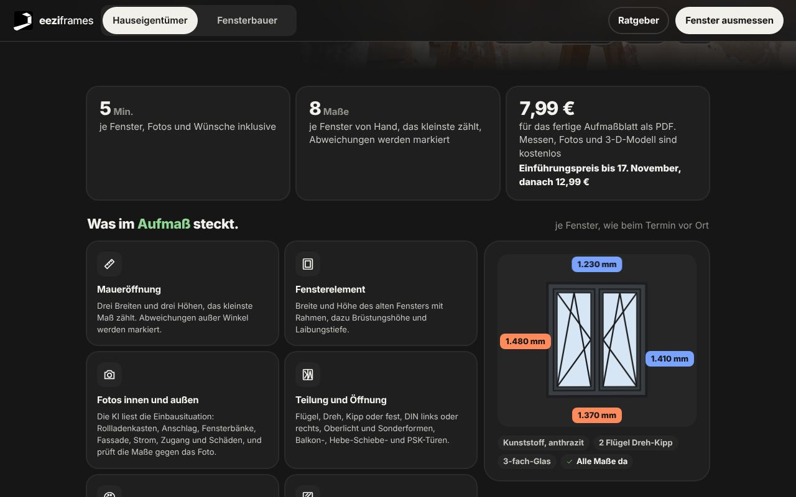

- **Sichtbar.** Ganz oben ist noch der Auslauf des Fotos zu sehen. Darunter stehen drei Kennzahlkarten: „5 Min. je Fenster, Fotos und Wünsche
  inklusive“, „8 Maße je Fenster von Hand, das kleinste zählt, Abweichungen werden markiert“ und „7,99 € für das fertige Aufmaßblatt als PDF
  … Einführungspreis bis 17. November, danach 12,99 €“. Es folgt der Abschnitt „Was im Aufmaß steckt.“ („Aufmaß“ grün), rechts daneben die Nebenzeile
  „je Fenster, wie beim Termin vor Ort“. Links stehen zwei Spalten mit Karten, jede mit Strichsymbol, Titel und drei bis vier Zeilen (Maueröffnung, Fensterelement, Fotos
  innen und außen, Teilung und Öffnung …). Rechts steht eine Karte mit einem gezeichneten zweiflügeligen Fenster. Die Maßschilder 1.230 und 1.410 mm sind blau,
  1.480 und 1.370 mm orange. Darunter liegen die Chips „Kunststoff, anthrazit · 2 Flügel Dreh-Kipp · 3-fach-Glas · Alle Maße da“.
- **Hierarchie.** Die beiden linken Kennzahlkarten sind im unteren Drittel leer, weil die dritte Karte mehr Text trägt. Einziges Motiv ist die
  Fensterzeichnung.
- **Handlungsaufforderungen.** „Fenster ausmessen“ in der festen Kopfzeile ist jetzt eine Cream-Pille. Im Inhalt steht kein Knopf.
- **Lesbarkeit.** Die Kartentexte sind klein und grau. Es sind viele kurze Absätze.
- **Textmenge.** Etwa 150 Wörter.
- **Bildanteil.** Etwa 12 % entfallen auf die Zeichnung. Die Symbole sind klein. Fotos gibt es keine.
- **Breite.** Der Inhalt ist 1.000 px breit (x 140–1140) und steht mittig.

### Bildschirm 3: Rest des Rasters und „Auch ganz groß.“

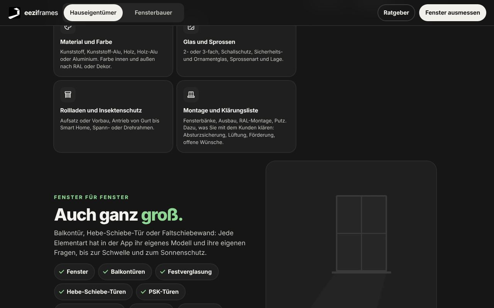

- **Sichtbar.** Die letzten vier Karten des Rasters: Material und Farbe, Glas und Sprossen, Rollladen und Insektenschutz, Montage und Klärungsliste.
  Rechts daneben ist eine Fläche von etwa 370 × 330 px leer. Darunter beginnt der Abschnitt „Auch ganz groß.“ mit dem Kicker „Fenster für Fenster“,
  einem Lead aus drei Zeilen und zehn Haken-Chips (Fenster, Balkontüren, Festverglasung, Hebe-Schiebe-Türen, PSK-Türen …). Rechts steht eine große
  Bildkarte. Sie zeigt nur den neutralen Platzhalter: einen Fensterumriss und eine Lichtfläche am Boden.
- **Auffällig.** Die Karte „Montage und Klärungsliste“ sagt „Dazu, was Sie mit dem Kunden klären“. Sie spricht also einen Fensterbauer an,
  steht aber in der Ansicht für Hauseigentümer.
- **Handlungsaufforderungen.** Nur die Cream-Pille in der Kopfzeile.
- **Textmenge.** Etwa 90 Wörter. **Bildanteil.** Etwa 25 % sind Platzhalter, echtes Bild gibt es keins.
- *Deutung:* Ohne Bild wirkt der Abschnitt unfertig. Die zehn Chips tragen die Aussage allein.

### Bildschirm 4: „Aus dem Ratgeber.“

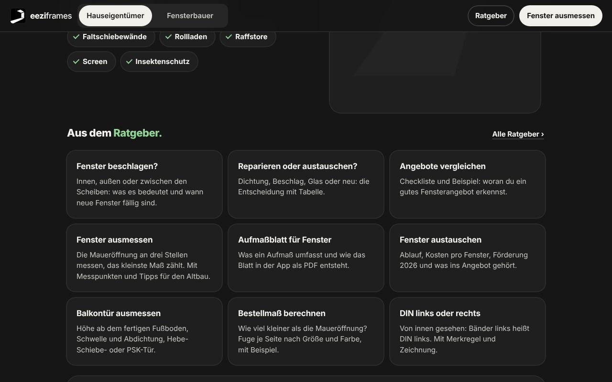

- **Sichtbar.** Die letzten Chips und das Ende der Platzhalterkarte. Darunter „Aus dem Ratgeber.“ („Ratgeber.“ grün), rechts der Link „Alle Ratgeber ›“.
  Es folgen neun Textkarten im Raster 3 × 3, jede mit Titel und zwei bis drei Zeilen.
- **Auffällig.** Die Karte „Angebote vergleichen“ duzt („woran du ein gutes Fensterangebot erkennst“). Die übrige Startseite siezt.
- **Handlungsaufforderungen.** Die Cream-Pille in der Kopfzeile. Die Karten sind Verweise.
- **Textmenge.** Etwa 140 Wörter. **Bildanteil.** Keiner.
- *Deutung:* Der Bildschirm wirkt wie eine Linkliste oder eine Blogübersicht.

### Bildschirm 5: Wechsel zu den Fensterbauern und Fußzeile

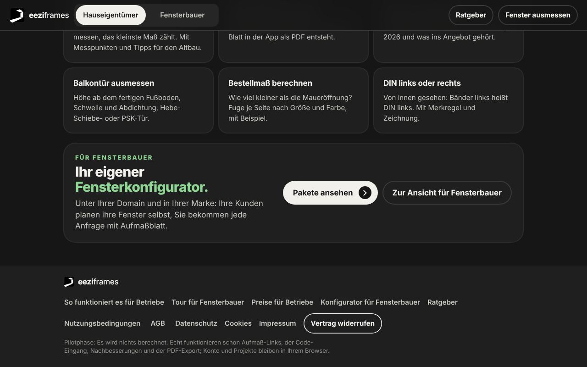

- **Sichtbar.** Die letzte Reihe der Ratgeber-Karten. Darunter eine breite Karte mit dem Kicker „Für Fensterbauer“, der Überschrift „Ihr eigener
  Fensterkonfigurator.“ (zweite Zeile grün) und einem Lead aus drei Zeilen. Rechts in der Karte die Cream-Pille „Pakete ansehen“ und der umrandete
  Knopf „Zur Ansicht für Fensterbauer“. Dann die Fußzeile: Logo, die Links „So funktioniert es für Betriebe · Tour für Fensterbauer · Preise für
  Betriebe · Konfigurator für Fensterbauer · Ratgeber“, darunter die Rechtstexte und als umrandeter Knopf „Vertrag widerrufen“, zuletzt der Satz
  „Pilotphase: Es wird nichts berechnet. …“.
- **Handlungsaufforderungen.** Sobald die Cream-Pille in der Karte im Bild ist, wird „Fenster ausmessen“ in der Kopfzeile wieder umrandet (Vergleich mit
  Bildschirm 4). Damit bleibt es bei einer Cream-Pille. In der Fußzeile ist „Vertrag widerrufen“ das Element mit dem meisten Gewicht.
- **Auffällig.** Die Fußzeile führt mit drei Links in den alten Bereich für Betriebe. Daneben steht „Konfigurator für Fensterbauer“. Für dieselbe Zielgruppe
  stehen damit zwei Angebote nebeneinander. Der Satz „Pilotphase: Es wird nichts berechnet.“ steht ohne Einschränkung unter der
  Hauseigentümer-Ansicht, die 7,99 € je Aufmaßblatt nennt.
- **Textmenge.** Etwa 110 Wörter. **Bildanteil.** Keiner.

### Bewertung Startseite, Hauseigentümer

- **Was überzeugt.** Das Startbild arbeitet mit einem eigenen Foto. Die Überschrift ist kurz, und es gibt eine einzige Hauptaktion. Der Preis steht offen
  da, mit Datum der Einführung. Die Fensterzeichnung mit Maßschildern zeigt das Ergebnis, statt es zu beschreiben. Die Kopfzeile schaltet
  ihre Cream-Pille ab, wenn eine andere sichtbar ist.
- **Was ungünstig präsentiert ist.** Vor dem Startbild stehen zwei Bänder, die 23 % der Höhe belegen. Eines davon richtet sich an Betriebe. Ab
  Bildschirm 2 tragen Strichsymbole und Textkarten die Seite, auf drei Bildschirmen gibt es kein einziges Foto. Der Bildplatz „Auch ganz groß.“
  zeigt einen Platzhalter. Die Kennzahlkarten sind ungleich gefüllt. Die Ansprache wechselt zwischen Sie und du, und eine Karte spricht den Fensterbauer an.
- **Was die Entscheidung erschweren kann.** *Deutung:* Die Zahlen widersprechen sich: „vier Maße mit dem Zollstock“ im Lead, „8 Maße
  je Fenster“ in der Kennzahl, „ein Fenster in zwei Minuten“ in der Führung, „5 Min. je Fenster“ in der Kennzahl. Die Fußzeile sagt „Es wird nichts
  berechnet“, während dieselbe Seite 7,99 € nennt.

---

## 2. Startseite `/#fensterbauer`, Ansicht Fensterbauer (erste Bildschirme)

### Bildschirm 1: Startbild

- **Sichtbar.** Oben das Pilotphase-Band („… Zum Kennenlernen gibt es die Tour.“). Das Band mit dem Einführungspreis fehlt hier. In der Kopfzeile ist
  „Fensterbauer“ gewählt, rechts stehen „Preise“, „Anmelden“ und „Kostenlos starten“, alle umrandet. Das Startbild gleicht dem der Verkaufsseite:
  Kicker „Für Fensterbauer und Fensterhändler“, Überschrift aus drei Zeilen „Ihr eigener Fenster-Konfigurator, unter Ihrer Marke“ („Marke“ grün),
  vier Haken-Chips (Ihre Domain · Kunden planen selbst · PDF per E-Mail · Ihre Marke, Ihre Kunden), die graue Zeile „Kurz gesagt“, ein Satz mit
  fetten Teilen, die Cream-Pille „Pakete ansehen“ und der umrandete Knopf „Konfigurator ausprobieren“. Rechts das Foto: Ein Astronaut sitzt im Sessel
  am Bullauge und misst mit dem Zollstock. Ein Handy und ein Bleistift schweben, ein Papierflieger fliegt. Oben rechts liegt eine gläserne
  Benachrichtigung „Während Sie unterwegs sind · Beispiel – Projekt angelegt – Balkontür, Köln · KI liest die Fotos – gerade eben“, am rechten Rand
  eine senkrechte Maßlinie „1.200 mm“.
- **Hierarchie.** Die Überschrift steht bei y ≈ 325–445, darunter folgen Chips, Kurztext und Knöpfe. *Deutung:* Foto und Benachrichtigung bilden
  einen Blickfang. Die Überschrift ist die stärkste Textmarke.
- **Handlungsaufforderungen.** Im Inhalt gibt es eine Cream-Pille. In der Kopfzeile stehen dazu drei Knöpfe, die zum alten Bereich für Betriebe gehören: „Kostenlos starten“
  öffnet die Registrierung eines Betriebs (`web/assets/portal.js:450`), „Preise“ dessen Preisseite. *Deutung:* Auf dem ersten Bildschirm konkurrieren
  zwei Angebote, ein kostenloser Betriebsbereich und bezahlte Konfigurator-Pakete.
- **Textmenge.** Etwa 90 Wörter, mit Band. **Bildanteil.** Etwa 45 %. **Breite.** Wie auf der Hauseigentümer-Seite: Text links ab x = 140, Foto
  bis zum Rand.

### Bildschirm 2: Laufband, Kennzahlenband, Abschnitt 01

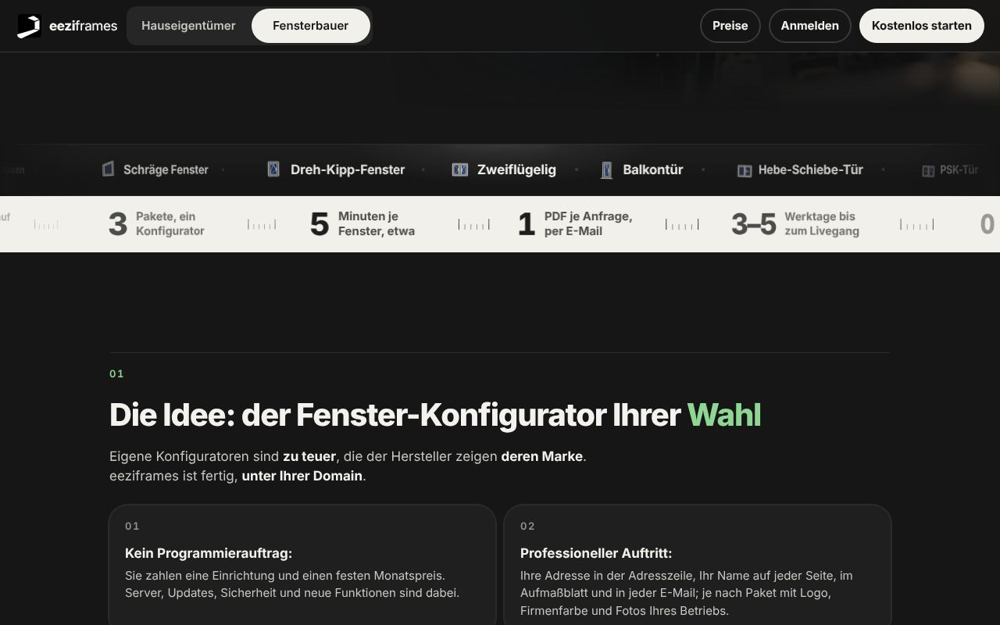

- **Sichtbar.** Der Auslauf des Fotos, danach etwa 120 px leerer Grund. Dann ein Laufband mit Elementarten, jeweils Symbol und Name (… Schräge Fenster ·
  Dreh-Kipp-Fenster · Zweiflügelig · Balkontür · Hebe-Schiebe-Tür · PSK-Tür). In der Mitte ist es heller, zu den Rändern blendet es aus. Darunter liegt ein vollbreites
  Band in Cream mit den Kennzahlen „3 Pakete, ein Konfigurator · 5 Minuten je Fenster, etwa · 1 PDF je Anfrage, per E-Mail · 3–5 Werktage bis
  zum Livegang · 0 € Gebühr je Anfrage“. Kleine Maßstriche trennen die Werte, an beiden Rändern sind sie angeschnitten. Nach etwa 130 px Leere folgen eine Haarlinie,
  „01“ in grüner Festbreitenschrift und die Überschrift „Die Idee: der Fenster-Konfigurator Ihrer Wahl“. Darunter ein Lead aus zwei Zeilen und zwei Karten (01, 02).
- **Handlungsaufforderungen.** „Kostenlos starten“ in der Kopfzeile ist jetzt Cream. Zusammen mit dem Kennzahlenband stehen zwei Cream-Flächen
  auf einem Bildschirm.
- **Lesbarkeit.** Die Zahlen im Band sind groß, Dunkel auf Cream ist gut lesbar. Die Werte am Rand sind abgeschnitten (am linken Rand „auf“).
- **Textmenge.** Etwa 80 Wörter. **Bildanteil.** Nur die kleinen Symbole im Laufband.

### Bildschirm 3: Karten 03/04 und Beginn „So funktioniert es“

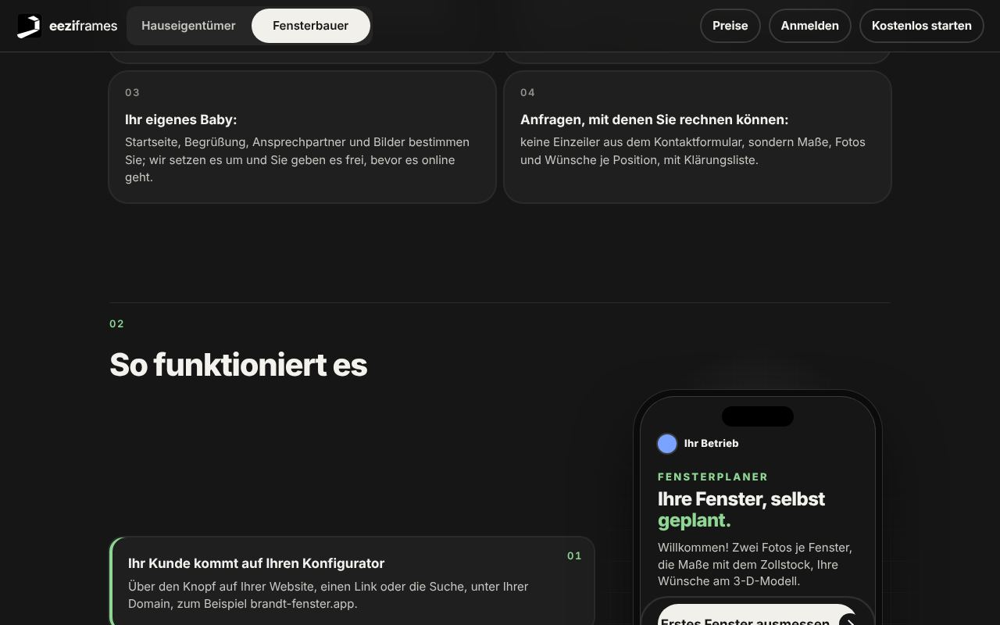

- **Sichtbar.** Die Karten 03 „Ihr eigenes Baby:“ und 04 „Anfragen, mit denen Sie rechnen können:“, danach etwa 120 px Leere. Dann „02 So funktioniert es“:
  links die Schrittkarte 01 mit grünem Rand links („Ihr Kunde kommt auf Ihren Konfigurator … zum Beispiel brandt-fenster.app“), rechts eine
  Telefon-Attrappe mit „Ihr Betrieb“, dem Kicker „Fensterplaner“, „Ihre Fenster, selbst geplant.“ und einem Cream-Knopf „Erstes Fenster ausmessen“, der am
  unteren Bildrand angeschnitten ist. „Kostenlos starten“ in der Kopfzeile ist wieder umrandet.
- Ab hier folgt dieselbe Abschnittsfolge wie auf `/fuer-fensterbauer/` (Abschnitt 3). Die Verkaufsseite ist in diese Ansicht eingebettet.

### Bewertung Ansicht Fensterbauer (Anfang)

- **Was überzeugt.** Das Startbild ist stark: ein eigenes Foto, eine als „Beispiel“ gekennzeichnete Benachrichtigung, Haken-Chips unter der Überschrift
  und eine Cream-Pille.
- **Was ungünstig präsentiert ist.** Die Kopfzeile und das Pilotphase-Band gehören zu einem anderen Angebot (Bereich für Betriebe, Tour,
  „Kostenlos starten“). Das Kennzahlenband ist eine zweite Cream-Fläche.
- **Was die Entscheidung erschweren kann.** *Deutung:* „Kostenlos starten“ neben „Sie zahlen eine Einrichtung und einen festen Monatspreis“
  (Karte 01 einen Bildschirm tiefer) lässt offen, was kostenlos ist und was nicht.

---

## 3. Verkaufsseite `/fuer-fensterbauer/` (vollständig)

Die Kopfzeile ist auf allen Bildschirmen gleich: Logo, „Ratgeber“, „Kundenkonto“ und „Pakete ansehen“ (umrandet, nie Cream). An ihrer
Unterkante läuft eine fein gepunktete Linie, die sich beim Scrollen von links grün füllt: auf Bildschirm 2 etwa 75 px, auf Bildschirm 17 fast
die volle Breite. Diese Seite hat keine Bänder. Die Abschnitte tragen Nummern von 01 bis 11.

### Bildschirm 1: Startbild

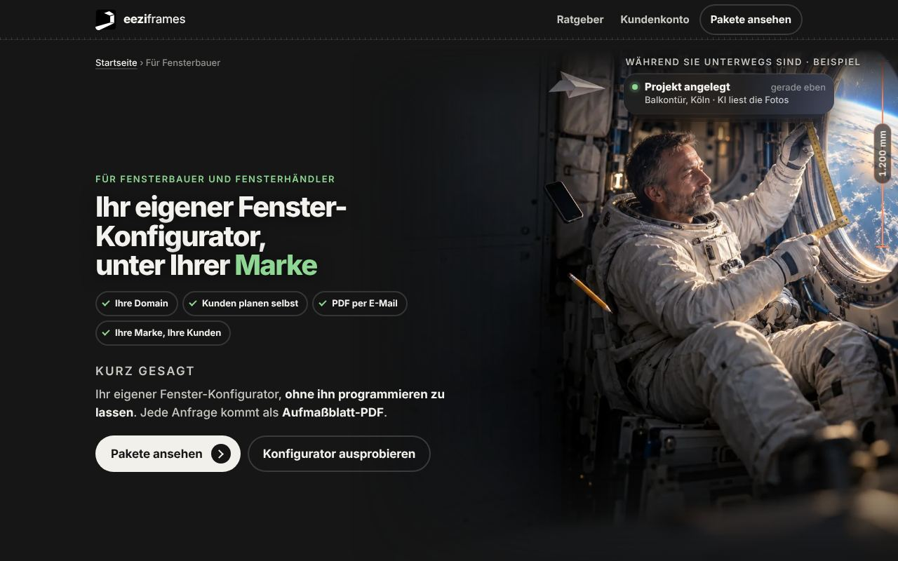

- **Sichtbar.** Die Brotkrumen „Startseite › Für Fensterbauer“. Das Startbild hat denselben Inhalt wie in Abschnitt 2, Bildschirm 1, ohne Band. Die
  Benachrichtigung lautet hier „Projekt angelegt · Balkontür, Köln · KI liest die Fotos“. Unter den Knöpfen sind bis zum Bildschirmende etwa 130 px leer.
- **Hierarchie.** Die Überschrift steht bei y ≈ 280–400. Die Zeile „Kurz gesagt“ wiederholt „Ihr eigener Fenster-Konfigurator“ etwa 270 px unter der
  Überschrift.
- **Handlungsaufforderungen.** Eine Cream-Pille „Pakete ansehen“ (springt zu `#pakete`) und der umrandete Knopf „Konfigurator ausprobieren“ (springt zu `#demos`).
  Zusätzlich steht „Pakete ansehen“ umrandet in der Kopfzeile.
- **Lesbarkeit.** Gut. Die Chip-Schrift ist klein, aber kontrastreich.
- **Textmenge.** Etwa 45 Wörter. **Bildanteil.** Etwa 45 %. **Breite.** Der Text steht ab x = 136, das Foto reicht bis an den Rand.
- *Deutung:* Dieses Startbild entspricht dem, was der Inhaber ausdrücklich mag (`.claude/skills/premium-gestaltung/SKILL.md`, Abschnitt 9:
  Foto, eingeblendete Benachrichtigungen, Haken-Chips unter der Überschrift).

### Bildschirm 2: Laufband, Kennzahlenband, 01 „Die Idee“

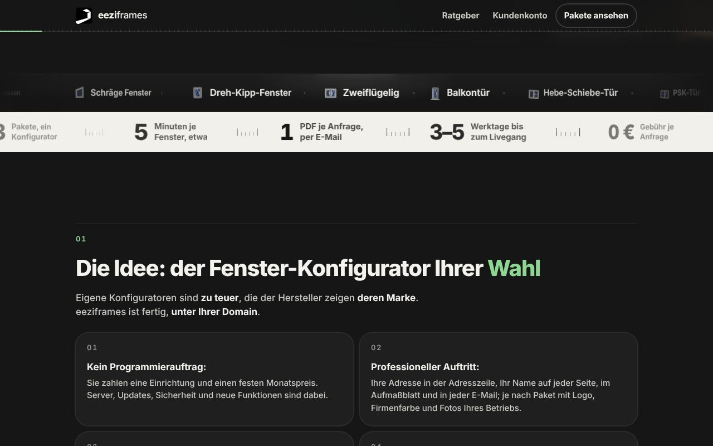

- **Sichtbar.** Dasselbe wie in Abschnitt 2, Bildschirm 2: Laufband, Kennzahlenband in Cream (die Werte an den Rändern sind angeschnitten), etwa 130 px Leere,
  „01 Die Idee: der Fenster-Konfigurator Ihrer Wahl“ („Wahl“ grün). Der Lead lautet: „Eigene Konfiguratoren sind **zu teuer**, die der Hersteller zeigen **deren
  Marke**. eeziframes ist fertig, **unter Ihrer Domain**.“ Dazu die Karten 01 „Kein Programmierauftrag: Sie zahlen eine Einrichtung und einen festen
  Monatspreis. Server, Updates, Sicherheit und neue Funktionen sind dabei.“ und 02 „Professioneller Auftritt: …“.
- **Handlungsaufforderungen.** Es gibt keine Cream-Pille. Das Cream-Band ist eine Fläche, keine Handlung.
- **Textmenge.** Etwa 90 Wörter. **Bildanteil.** Nur Symbole im Laufband.

### Bildschirm 3: Karten 03/04, 02 „So funktioniert es“, Schritt 1

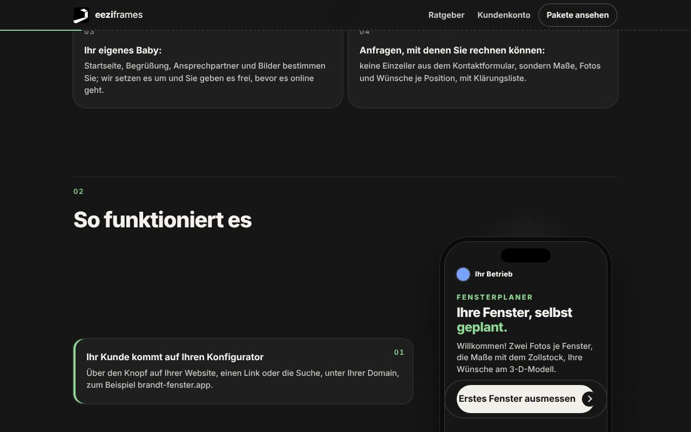

- **Sichtbar.** Die Karten 03 „Ihr eigenes Baby:“ und 04 „Anfragen, mit denen Sie rechnen können:“, danach etwa 130 px Leere und die Überschrift „02 So
  funktioniert es“ ohne grünes Wort. Links liegen etwa 200 px Leere, dann die Schrittkarte 01. Rechts steht die Telefon-Attrappe mit „Ihr Betrieb“, „Fensterplaner“,
  „Ihre Fenster, selbst geplant.“ und dem Willkommenssatz.
- **Auffällig.** Der Cream-Knopf „Erstes Fenster ausmessen“ in der Attrappe ragt rechts über den Bildschirm des Telefons hinaus. Ein dunkler Ring um
  den Knopf ist breiter als das Telefon. *Deutung:* ein Darstellungsfehler. Bei 1024 × 768 zeigt er sich genauso (Abschnitt 3a).
- **Handlungsaufforderungen.** Nur der Knopf in der Attrappe, der Teil der Abbildung ist.
- **Textmenge.** Etwa 70 Wörter. **Bildanteil.** Etwa 30 %, eine gezeichnete Attrappe.

### Bildschirm 4: Schritt 2

- **Sichtbar.** Das Telefon steht fest rechts. Es zeigt einen Sucher mit drei blauen Punkten über einem zweiflügeligen Fenster und darunter ein Fenster mit
  einer orangefarbenen Maßlinie. Links steht nur die Schrittkarte 02: „Er plant seine Fenster selbst – Im Browser, ohne Konto: zwei Fotos je Fenster, die
  Maße mit dem Zollstock, seine Wünsche am 3-D-Modell.“
- **Hierarchie.** Die linke Hälfte ist zu etwa 85 % leer.
- **Handlungsaufforderungen.** Keine. **Textmenge.** Etwa 25 Wörter. **Bildanteil.** Etwa 30 %.
- *Deutung:* Als Standbild wirkt der Bildschirm leer. Die Szene lebt davon, dass das Telefon mit dem Schritt wechselt. Der Abschnitt „So
  funktioniert es“ ist bei 1280 rund 2.650 px hoch, also etwa 3,3 Bildschirme, und trägt fünf Sätze.

### Bildschirm 5: Schritt 3

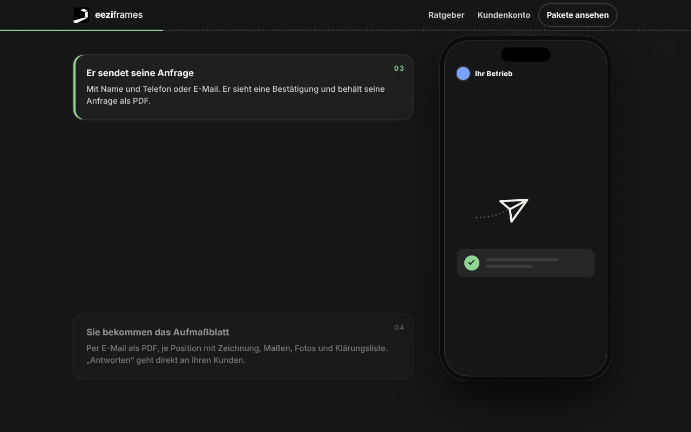

- **Sichtbar.** Oben links die Schrittkarte 03 „Er sendet seine Anfrage“, aktiv mit grünem Rand. Unten links die Schrittkarte 04, noch blass. Im Telefon
  fliegt ein Papierflieger an einer gepunkteten Bahn, darunter liegt eine Bestätigungskarte mit grünem Haken.
- **Handlungsaufforderungen.** Keine. **Textmenge.** Etwa 45 Wörter. **Bildanteil.** Etwa 30 %. Links sind etwa 360 px zwischen den Karten leer.

### Bildschirm 6: Schritt 5 und Übergang zu 03

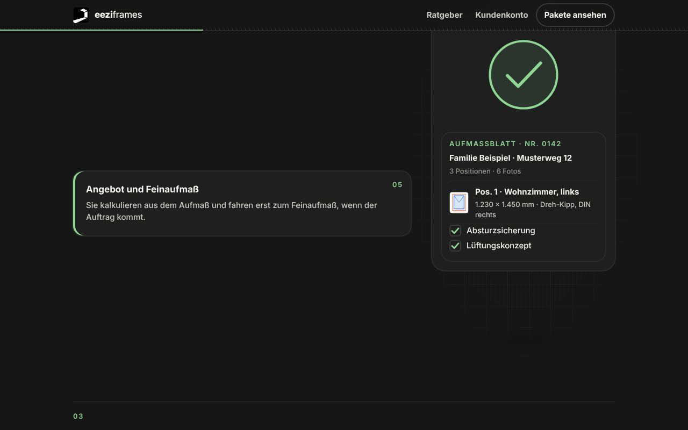

- **Sichtbar.** Links die Schrittkarte 05 „Angebot und Feinaufmaß – Sie kalkulieren aus dem Aufmaß und fahren erst zum Feinaufmaß, wenn der Auftrag
  kommt.“ Rechts steht statt des Telefons eine Karte mit großem grünem Haken-Kreis und einem kleinen Aufmaßblatt: „Aufmaßblatt · Nr. 0142 · Familie
  Beispiel · Musterweg 12 · 3 Positionen · 6 Fotos · Pos. 1 · Wohnzimmer, links · 1.230 × 1.450 mm · Dreh-Kipp, DIN rechts“ mit den Haken
  „Absturzsicherung“ und „Lüftungskonzept“. Darunter sind etwa 300 px leer, am unteren Rand steht „03“.
- **Handlungsaufforderungen.** Keine. **Textmenge.** Etwa 50 Wörter.

### Bildschirm 7: 03 „Was in jeder Anfrage steht“

- **Sichtbar.** Die Überschrift „Was in jeder Anfrage steht“ („Anfrage“ grün). Links eine Liste mit sieben Haken: Maueröffnung, Fensterelement, Fotos und
  Einbausituation, Teilung und Öffnung, Material/Farbe/Glas, Sonnenschutz und Montage, Mit dem Kunden zu klären. Jeder Punkt hat eine fette Zeile und eine bis
  drei graue Zeilen. Rechts liegt schräg ein echtes Aufmaßblatt (Kopf „Fensterbau Brandt“, „Familie Weber.“, Übersicht mit vier Positionen). Darüber schwebt
  die Karte „1.229 × 1.424 mm · Bestellmaß · Pos. 2 · Küche“ mit orangefarbener Maßlinie. Darunter stehen der Dateiname „Aufmassblatt_Weber.pdf“ und
  eine schwebende Karte „Mit dem Kunden zu klären: Absturzsicherung am bodentiefen Fenster · Lüftungskonzept nach dem Tausch · Förderweg mit
  Uw-Zielwert 0,95“.
- **Hierarchie.** Links steht die Textliste, rechts das Bild. Die schwebenden Karten liegen in einer zweiten Ebene über dem Blatt und werfen Schatten.
- **Lesbarkeit.** Die Liste ist gut lesbar, enthält aber viele Fachbegriffe. Die Schrift im Aufmaßblatt ist zu klein zum Lesen.
- **Textmenge.** Etwa 150 Wörter. **Bildanteil.** Etwa 35 %.
- *Deutung:* Das ist der stärkste Beleg auf der Seite, echtes Material statt Symbol. Das Beispiel hier (Familie Weber, vier Positionen)
  stimmt nicht mit dem Beispiel im Telefon überein (Familie Beispiel, drei Positionen, Bildschirm 6).

### Bildschirm 8: 04 „Warum Kunden selbst planen“

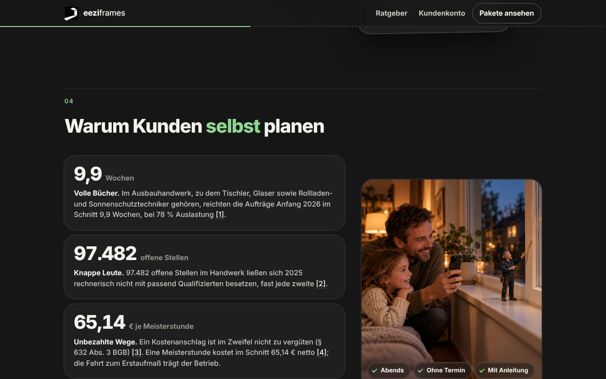

- **Sichtbar.** Etwa 120 px Leere, dann „04 Warum Kunden selbst planen“ („selbst“ grün). Links stehen drei Kennzahlkarten mit großer Zahl:
  „9,9 Wochen – Volle Bücher. … Ausbauhandwerk … reichten die Aufträge Anfang 2026 im Schnitt 9,9 Wochen, bei 78 % Auslastung [1]“,
  „97.482 offene Stellen – Knappe Leute. … [2]“ und „65,14 € je Meisterstunde – Unbezahlte Wege. Ein Kostenanschlag ist im Zweifel nicht zu vergüten
  (§ 632 Abs. 3 BGB) [3]. … 65,14 € netto [4]; die Fahrt zum Erstaufmaß trägt der Betrieb.“ Rechts eine Fotokarte: Vater und Tochter am Fenster
  mit dem Handy, auf der Fensterbank misst ein Miniatur-Handwerker mit Zollstock. Darunter die Chips „Abends · Ohne Termin · Mit Anleitung“.
- **Handlungsaufforderungen.** Keine. **Textmenge.** Etwa 120 Wörter. **Bildanteil.** Etwa 25 %, ein echtes Foto.
- **Lesbarkeit.** Die Zahlen sind groß und deutlich. Die Fließtexte in den Karten sind klein und grau, die Quellenmarken [1]–[5] sind unterstrichen.

### Bildschirm 9: Ende 04 und 05 „Ihre Kunden bleiben Ihre Kunden“

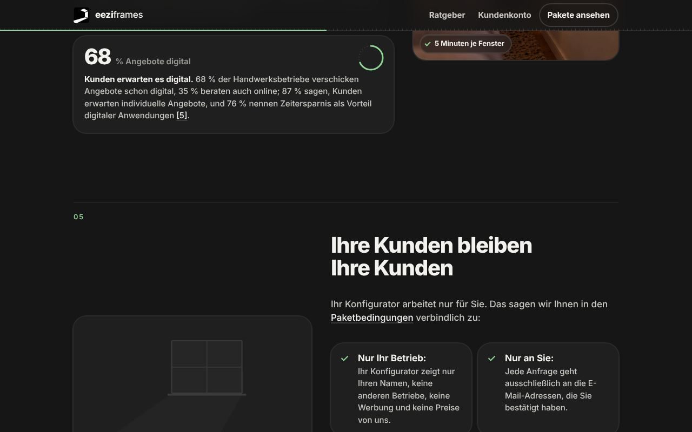

- **Sichtbar.** Die Karte „68 % Angebote digital – Kunden erwarten es digital. … [5]“ mit einem grünen Ring, der als Standbild nur teilweise gefüllt ist.
  Rechts endet die Fotokarte mit dem Chip „5 Minuten je Fenster“. Nach etwa 120 px Leere folgt „05“. Rechts steht die Überschrift „Ihre Kunden bleiben
  Ihre Kunden“ (zwei Zeilen, ohne grünes Wort). Links liegen etwa 150 px Leere, dann eine Bildkarte mit dem neutralen Platzhalter. Rechts folgen der Lead „Ihr Konfigurator arbeitet nur für Sie.
  Das sagen wir Ihnen in den Paketbedingungen verbindlich zu:“ und die Karten „Nur Ihr Betrieb“ und „Nur an Sie“.
- **Bildanteil.** Etwa 20 % entfallen auf den Platzhalter. **Textmenge.** Etwa 110 Wörter.

### Bildschirm 10: Ende 05 und 06 „Die Pakete“

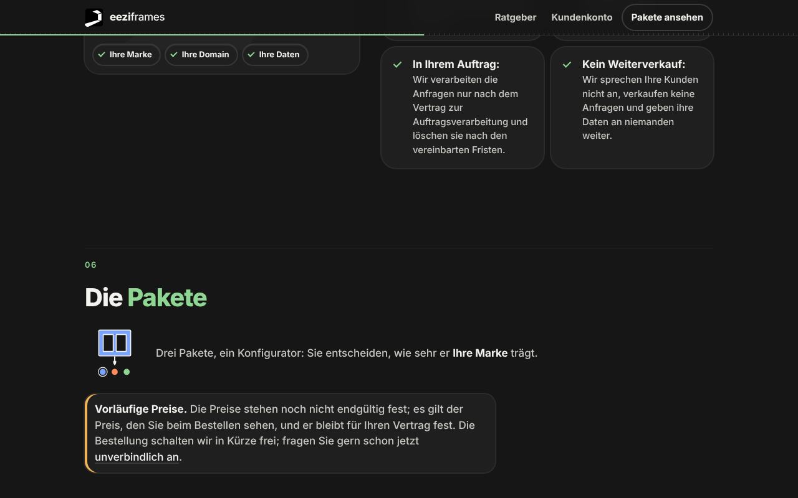

- **Sichtbar.** Unter dem Platzhalter die Chips „Ihre Marke · Ihre Domain · Ihre Daten“, rechts die Karten „In Ihrem Auftrag“ und „Kein Weiterverkauf“.
  Nach etwa 130 px Leere folgt „06 Die Pakete“ („Pakete“ grün). Daneben ein kleines Bewegtbild (blauer Rahmen, drei Farbpunkte) und der Satz „Drei
  Pakete, ein Konfigurator: Sie entscheiden, wie sehr er **Ihre Marke** trägt.“ Darunter ein Hinweiskasten mit orangefarbenem Rand links: „**Vorläufige Preise.**
  Die Preise stehen noch nicht endgültig fest; es gilt der Preis, den Sie beim Bestellen sehen, und er bleibt für Ihren Vertrag fest. Die Bestellung
  schalten wir in Kürze frei; fragen Sie gern schon jetzt unverbindlich an.“
- **Hierarchie.** Unter der Überschrift „Die Pakete“ kommt zuerst ein Vorbehalt. Auf diesem Bildschirm steht kein Preis.
- **Handlungsaufforderungen.** Keine Cream-Pille, nur der unterstrichene Link „unverbindlich an“.
- **Textmenge.** Etwa 110 Wörter.

### Bildschirm 11: Paketkarten, oberer Teil

- **Sichtbar.** Drei Paketkarten nebeneinander, jede etwa 330 px breit:
  „EEZI Essential – 29 € im Monat, dazu 99 € Einrichtung, einmalig vorab“, „EEZI Essential Plus – 39 € / 199 €“ (Plakette „Empfohlen“, heller Rand,
  leichter grüner Schimmer oben) und „EEZI Signature – 64 € / 279 €“. Unter jedem Preis steht „netto zzgl. MwSt. · nur für Unternehmer“, darunter die
  Merkmallisten mit Haken: Essential fünf Punkte, Plus sechs, Signature neun und mehr. Die Plakette „Empfohlen“ ragt oben in die Kopfzeile.
- **Hierarchie.** Die Preise sind die größten Zeichen auf dem Bildschirm. Plakette und Rand lenken auf die Mitte.
- **Handlungsaufforderungen.** Keine Knöpfe. Die Knöpfe „… anfragen“ stehen erst auf dem nächsten Bildschirm.
- **Lesbarkeit.** Die Listen sind gut lesbar. „netto zzgl. MwSt.“ ist klein und blass.
- **Auffällig.** Bei Essential steht „Hinweis auf eeziframes: „Powered by EEZIframes““, die Marke also in Versalien.
- **Textmenge.** Etwa 230 Wörter. **Bildanteil.** Keiner.

### Bildschirm 12: Paketkarten, unterer Teil

- **Sichtbar.** In den Karten Essential und Plus liegen über den Knöpfen etwa 150–200 px Leere, weil Signature länger ist. Die Knöpfe stehen auf gleicher Höhe:
  „Essential anfragen“ (umrandet), „Essential Plus anfragen“ (Cream) und „Signature anfragen“ (umrandet). Darunter steht in jeder Karte „Beispielseite“
  mit einer stilisierten Browser-Attrappe „ihr-name-fenster.de“: dunkel mit Grün, hell mit Blau und Foto, dunkelgrün mit Gold und Fortschrittsbalken. Es folgen
  der Ausklapper „Alle Merkmale im Vergleich +“ (zugeklappt) und das Kleingedruckte „Angebot nur für Unternehmer im Sinne von § 14 BGB, nicht für
  Verbraucher. Die Einrichtungsgebühr zahlen Sie vorab; das Monatsabo beginnt mit dem Livegang. … Ihr Kunde zahlt nichts.“ Darunter etwa 130 px
  Leere und „07“.
- **Handlungsaufforderungen.** Eine Cream-Pille in der Mitte, die beiden anderen sind umrandet. Alle drei springen zum Formular `#bestellen`.
- **Textmenge.** Etwa 70 Wörter. **Bildanteil.** Etwa 15 %, schematische Attrappen.
- *Deutung:* Die Führung zum mittleren Paket ist klar (Plakette, Rand, einziger Cream-Knopf). Preis und Knopf eines Pakets stehen aber bei 1280 × 800
  nie auf demselben Bildschirm, sie liegen rund 700 px auseinander. Die Beispielseiten, die den Unterschied der Pakete zeigen, stehen erst unter
  den Knöpfen.

### Bildschirm 13: 07 „Von der Bestellung bis zum Livegang“

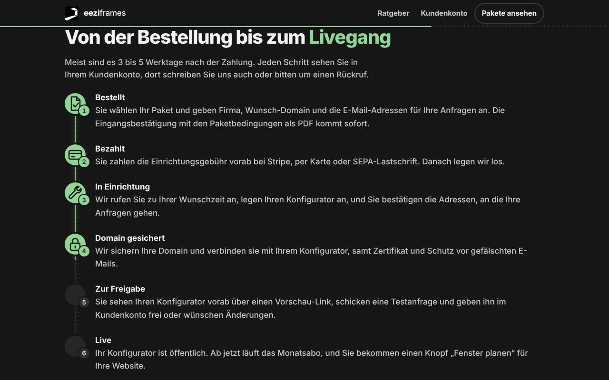

- **Sichtbar.** Die Überschrift „Von der Bestellung bis zum Livegang“ („Livegang“ grün) und der Lead „Meist sind es 3 bis 5 Werktage nach der Zahlung. Jeden Schritt sehen
  Sie in Ihrem Kundenkonto …“. Darunter eine senkrechte Zeitleiste mit sechs Schritten: Bestellt, Bezahlt, In Einrichtung, Domain gesichert, Zur Freigabe, Live.
  Die Schritte 1–4 sind grün mit Symbol gefüllt, 5–6 grau, weil die Leiste scrollgebunden ist. Jeder Schritt hat eine fette Zeile und eine bis zwei Zeilen Text über
  die volle Breite bis x ≈ 1110. Schritt 2 lautet „Sie zahlen die Einrichtungsgebühr vorab bei Stripe, per Karte oder SEPA-Lastschrift.“
- **Lesbarkeit.** Die Zeilen sind lang, etwa 110–120 Zeichen.
- **Handlungsaufforderungen.** Keine. **Textmenge.** Etwa 170 Wörter. **Bildanteil.** Keiner, nur die Symbole in den Kreisen.

### Bildschirm 14: 08 „Live-Demos“ und Beginn 09

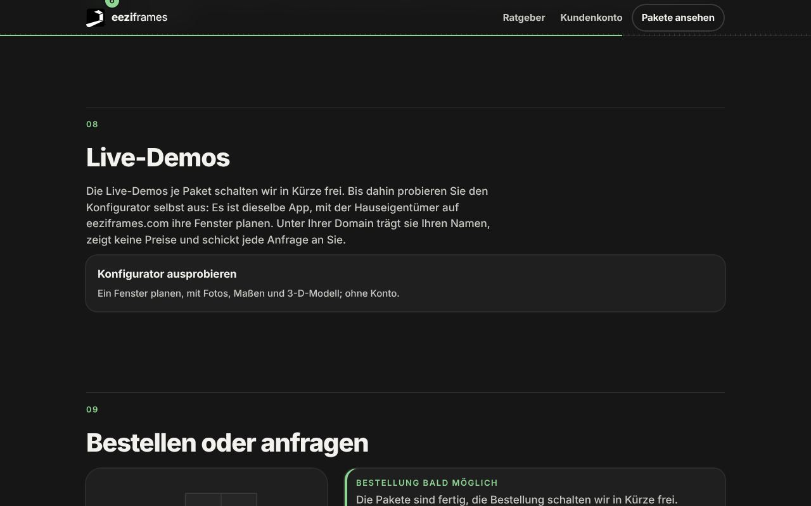

- **Sichtbar.** Der Kreis von Schritt 6 ragt in die Kopfzeile. Nach etwa 110 px Leere folgt „08 Live-Demos“ mit dem Text „Die Live-Demos je Paket schalten wir in
  Kürze frei. Bis dahin probieren Sie den Konfigurator selbst aus: Es ist dieselbe App, mit der Hauseigentümer auf eeziframes.com ihre Fenster planen.
  Unter Ihrer Domain trägt sie Ihren Namen, zeigt keine Preise und schickt jede Anfrage an Sie.“ Darunter eine vollbreite Karte „Konfigurator
  ausprobieren – Ein Fenster planen, mit Fotos, Maßen und 3-D-Modell; ohne Konto.“ Sie hat keinen Pfeil und keine Knopfform. Nach etwa 120 px Leere folgen
  „09 Bestellen oder anfragen“ und der Anfang zweier Karten: links ein Platzhalter, rechts der Kasten „Bestellung bald möglich“.
- **Handlungsaufforderungen.** Die Demo-Karte ist die einzige Handlung. *Deutung:* Als anklickbar ist sie kaum zu erkennen.
- **Breite.** Der Text endet bei x ≈ 780, rechts bleiben etwa 360 px frei.
- **Textmenge.** Etwa 90 Wörter.

### Bildschirm 15: 09 Anfrageformular

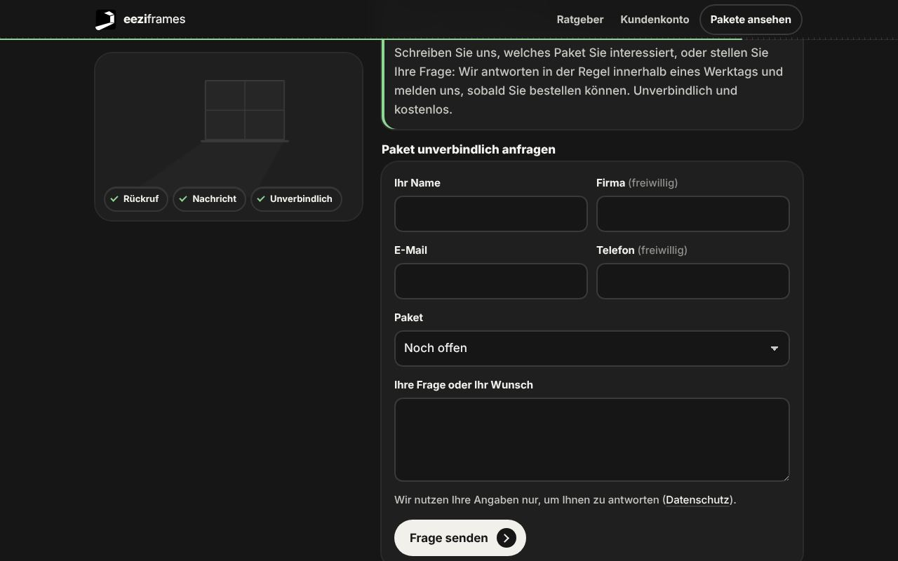

- **Sichtbar.** Links eine Platzhalterkarte mit den Chips „Rückruf · Nachricht · Unverbindlich“, darunter etwa 480 px Leere. Rechts ein Hinweis mit grünem
  Rand: „Schreiben Sie uns, welches Paket Sie interessiert, oder stellen Sie Ihre Frage: Wir antworten in der Regel innerhalb eines Werktags und melden
  uns, sobald Sie bestellen können. Unverbindlich und kostenlos.“ Darunter das Formular „Paket unverbindlich anfragen“ mit den Feldern Ihr Name, Firma
  (freiwillig), E-Mail, Telefon (freiwillig), Paket (Auswahl, voreingestellt „Noch offen“) und Ihre Frage oder Ihr Wunsch. Es folgen der Satz zum Datenschutz
  und die Cream-Pille „Frage senden“.
- **Lesbarkeit.** Die Felder sind groß, die Beschriftungen fett, alles klar. Das Formular ist zweispaltig.
- **Handlungsaufforderungen.** Eine Cream-Pille. *Deutung:* „Frage senden“ passt nicht ganz zur Abschnittsüberschrift „Bestellen oder anfragen“
  und zu „Paket unverbindlich anfragen“.
- **Bildanteil.** Etwa 15 %, Platzhalter.

### Bildschirm 16: 10 „Häufige Fragen“

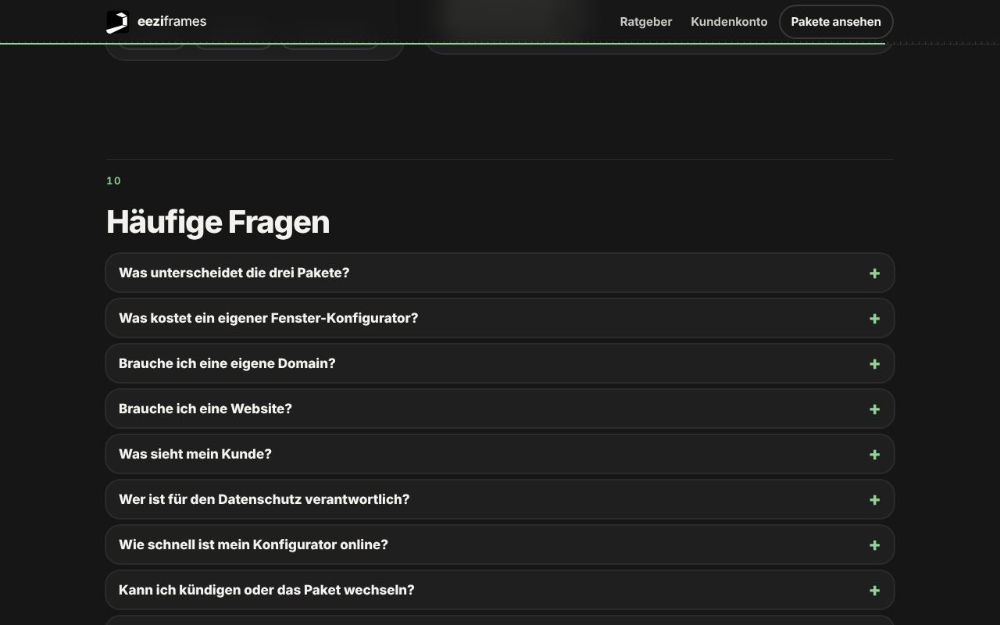

- **Sichtbar.** Etwa 130 px Leere, dann „10 Häufige Fragen“. Acht von zehn Fragen stehen als zugeklappte Zeilen mit grünem Plus, etwa „Was unterscheidet die
  drei Pakete?“, „Was kostet ein eigener Fenster-Konfigurator?“ oder „Wie schnell ist mein Konfigurator online?“.
- **Handlungsaufforderungen.** Keine. **Textmenge.** Etwa 60 Wörter. **Bildanteil.** Keiner.

### Bildschirm 17: Ende FAQ, 11 „Wissen für Fensterbauer“, Quellen

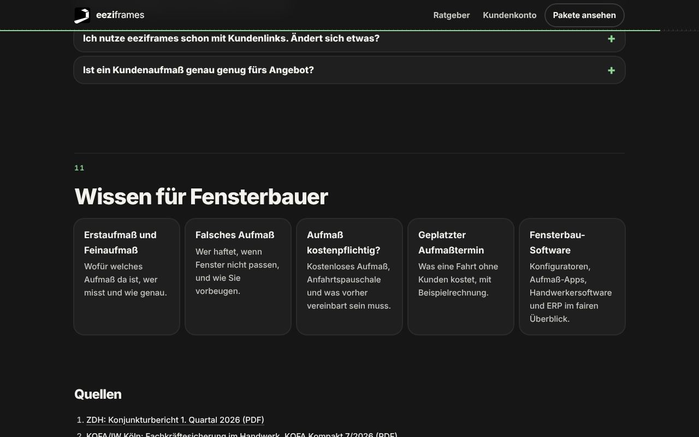

- **Sichtbar.** Die letzten zwei Fragen („Ich nutze eeziframes schon mit Kundenlinks. Ändert sich etwas?“ und „Ist ein Kundenaufmaß genau genug fürs
  Angebot?“). Nach etwa 120 px Leere folgen „11 Wissen für Fensterbauer“ und fünf Textkarten in einer Reihe (Erstaufmaß und Feinaufmaß, Falsches Aufmaß,
  Aufmaß kostenpflichtig?, Geplatzter Aufmaßtermin, Fensterbau-Software). Darunter „Quellen“ mit den ersten Einträgen.
- **Textmenge.** Etwa 100 Wörter. **Bildanteil.** Keiner.

### Bildschirm 18: Quellen und Fußzeile

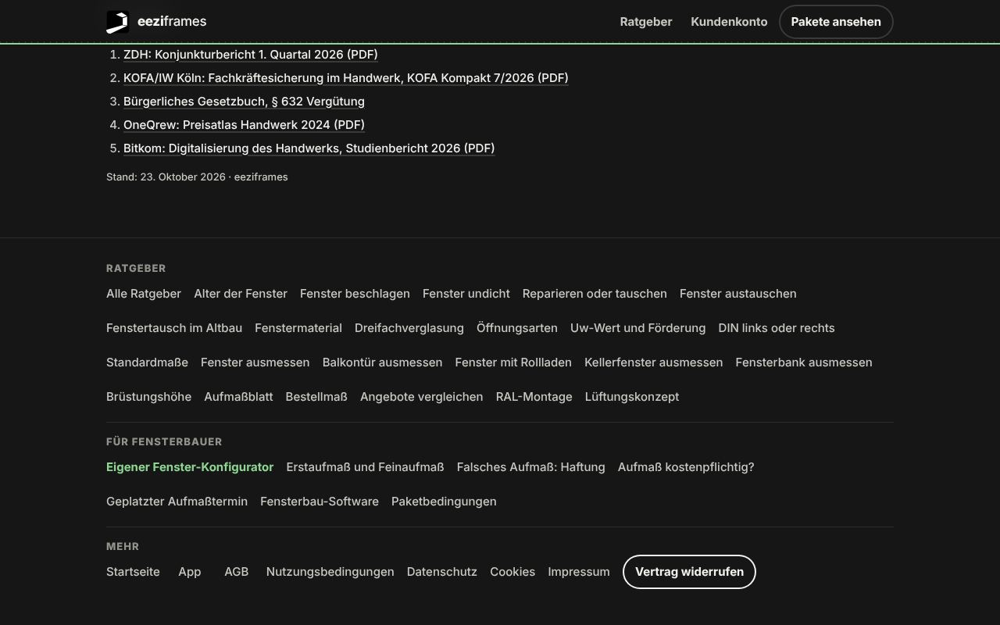

- **Sichtbar.** Die Quellen 1–5: ZDH Konjunkturbericht 1. Quartal 2026, KOFA/IW Köln, BGB § 632, OneQrew Preisatlas Handwerk 2024, Bitkom Digitalisierung des
  Handwerks 2026. Danach „Stand: 23. Oktober 2026 · eeziframes“. Die Fußzeile hat drei Gruppen: „Ratgeber“ mit 24 Links, „Für Fensterbauer“ mit 7 Links
  („Eigener Fenster-Konfigurator“ grün als aktuelle Seite) und „Mehr“ (Startseite, App, AGB, Nutzungsbedingungen, Datenschutz, Cookies, Impressum,
  umrandeter Knopf „Vertrag widerrufen“).
- **Handlungsaufforderungen.** Keine Cream-Pille. Die Seite endet mit Quellen und einer Linkliste, nicht mit einer Handlung.
- **Textmenge.** Etwa 130 Wörter.

### 3a. Stichprobe 1024 × 768

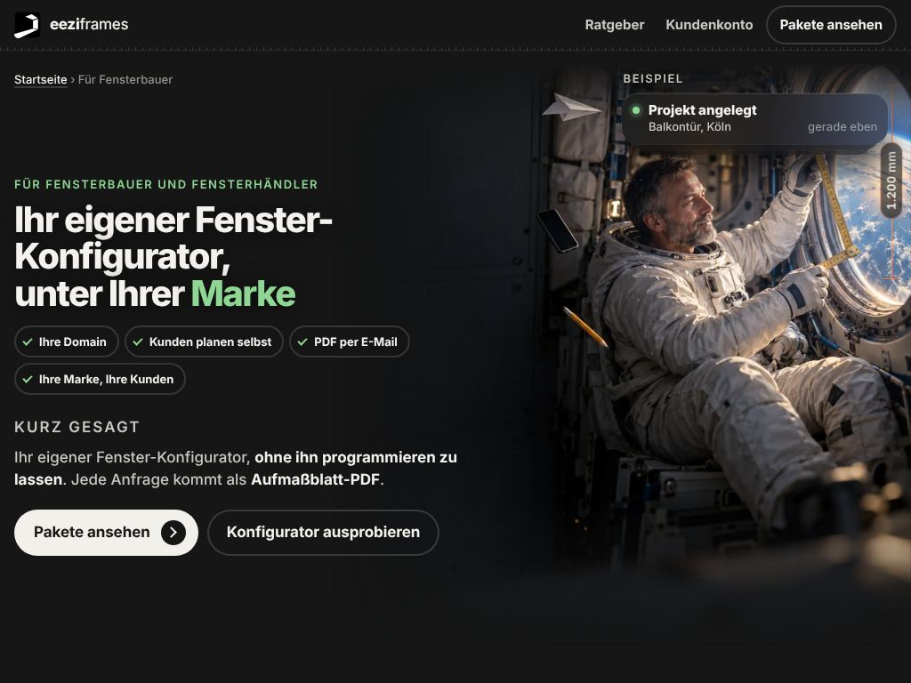

- **Startbild.** Text und Logo beginnen bei x = 16, bei 1280 sind es 136. Das Startbild steht vollständig auf einem Bildschirm, mit beiden Knöpfen. Die
  Benachrichtigung ist kürzer: Kicker „Beispiel“, ohne „Während Sie unterwegs sind“. Das Foto füllt die rechte Hälfte.

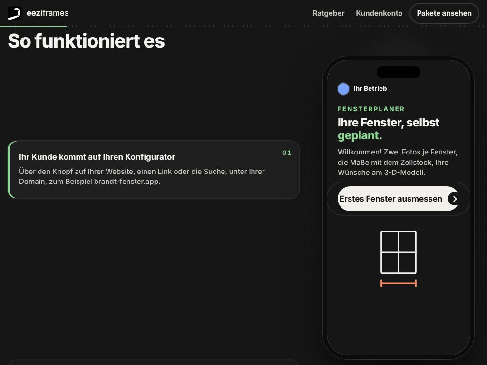

- **„So funktioniert es“.** Wie bei 1280: Der Cream-Knopf in der Telefon-Attrappe ragt mit seinem Ring über den Rand des Telefons. Links stehen über und unter der
  Schrittkarte etwa 180 bzw. 330 px Leere.

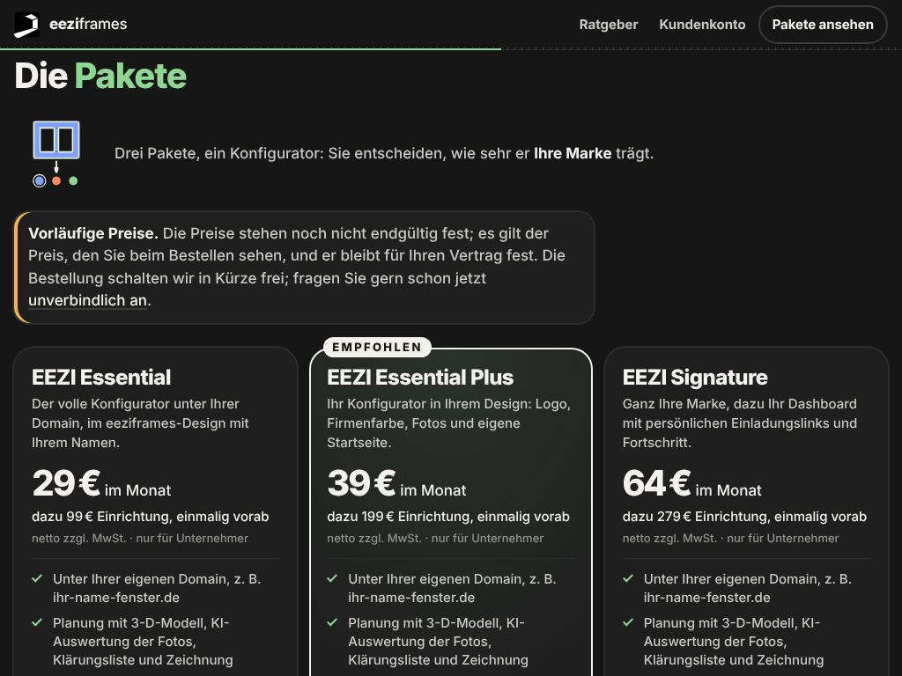

- **„Die Pakete“.** Überschrift, Vorspann, Vorbehalt und die drei Preise stehen auf einem Bildschirm, bei 1280 × 800 sind es zwei. Die Karten
  reichen von x = 16 bis x ≈ 1008.

- **Querscrollen.** Bei 1024 px Breite lässt sich die Seite um 44 px nach rechts schieben (gemessen: `scrollWidth` 1068, `scrollX` 44 nach
  `scrollTo(300, 0)`). Das Foto zeigt diesen Zustand: links sind Überschrift und Knöpfe angeschnitten, rechts erscheint ein schwarzer Streifen.
  Als überstehende Elemente wurden `div.vk-licht` (bis x = 1373) und die Spuren des Laufbands gemessen. Die Laufband-Spuren liegen in abschneidenden Elementen. Die
  Ursache ist damit nicht eindeutig bestimmt. In der eingebetteten Fassung `/#fensterbauer` gibt es bei 1024 kein Querscrollen (`scrollWidth` 1024).
  Der Inhaber verlangt „Kein Querscrollen“ (`SKILL.md`, Abschnitt 4).

### Bewertung Verkaufsseite

- **Was überzeugt.**
  - Das Startbild: Foto, als „Beispiel“ gekennzeichnete Benachrichtigung, Haken-Chips, eine Cream-Pille.
  - Das echte Aufmaßblatt mit schwebenden Karten in „Was in jeder Anfrage steht“ (Bildschirm 7), das einzige Element mit Tiefe aus echtem Material.
  - Die Zahlen in „Warum Kunden selbst planen“ sind mit Quellen belegt.
  - Die Pakete sind übersichtlich: drei Spalten, große Preise, Einrichtung direkt unter dem Monatspreis, netto-Hinweis. Das mittlere Paket ist „Empfohlen“ statt
    „Beliebt“, wie es `SKILL.md`, Abschnitt 2 verlangt.
  - Das Anfrageformular ist kurz und klar.
- **Was ungünstig präsentiert ist.**
  - Die Seite ist bei 1280 rund 17 Bildschirme lang und hat 11 nummerierte Abschnitte, dazu FAQ, Wissenskarten, Quellen und eine Fußzeile mit 39 Links. *Deutung:* Das
    wirkt eher wie ein Ratgeber als wie eine Verkaufsfläche (`SKILL.md`, Abschnitt 1: „Nie wie ein Ratgeber oder Blogbeitrag“).
  - Zwischen den Abschnitten liegen regelmäßig 110–300 px leerer Grund. Die Bühne „So funktioniert es“ zeigt auf drei Bildschirmen links je eine
    Karte mit einem Satz.
  - Zwei Bildplätze zeigen Platzhalter (05 Kundenschutz, 09 Bestellen neben dem Formular).
  - Auf den Bildschirmen 2, 4–11, 13, 14 und 16–18 steht keine Cream-Pille. Die einzige ständige Handlung ist „Pakete ansehen“ in der Kopfzeile, umrandet und
    mit wenig Gewicht.
  - Farbe tragen ab Bildschirm 2 nur das Kennzahlenband, das Foto in 04 und die Zeichnungen in 02 und 03. Sonst ist alles grau mit grünen Akzenten.
  - Mehrere Überschriften haben weder ein grünes Wort noch einen Punkt („So funktioniert es“, „Ihre Kunden bleiben Ihre Kunden“, „Live-Demos“, „Bestellen
    oder anfragen“, „Häufige Fragen“, „Wissen für Fensterbauer“). Die Regel verlangt beides (`docs/GESTALTUNG.md`, Abschnitt „Schrift“).
  - Der Cream-Knopf in der Telefon-Attrappe ragt über den Rand. Bei 1024 lässt sich die Seite quer scrollen.
- **Was die Kaufentscheidung erschweren kann.** *Deutung:*
  - Der Preis erscheint erst auf Bildschirm 11 von 18 (Schrittweite 743 px), nach Statistik und Kundenschutz.
  - Direkt über den Preisen steht der Vorbehalt „Vorläufige Preise“. Später folgen „Live-Demos in Kürze“ und „Bestellung bald möglich“. Drei Hinweise
    sagen, dass noch etwas fehlt.
  - Preis und Knopf eines Pakets stehen nie zusammen im Bild.
  - Es gibt keine Live-Demo je Paket, und die Unterschiede der Pakete zeigen nur schematische Attrappen.
  - Die Vergleichstabelle ist zugeklappt.

---

## 4. App `/app/`, Startbild

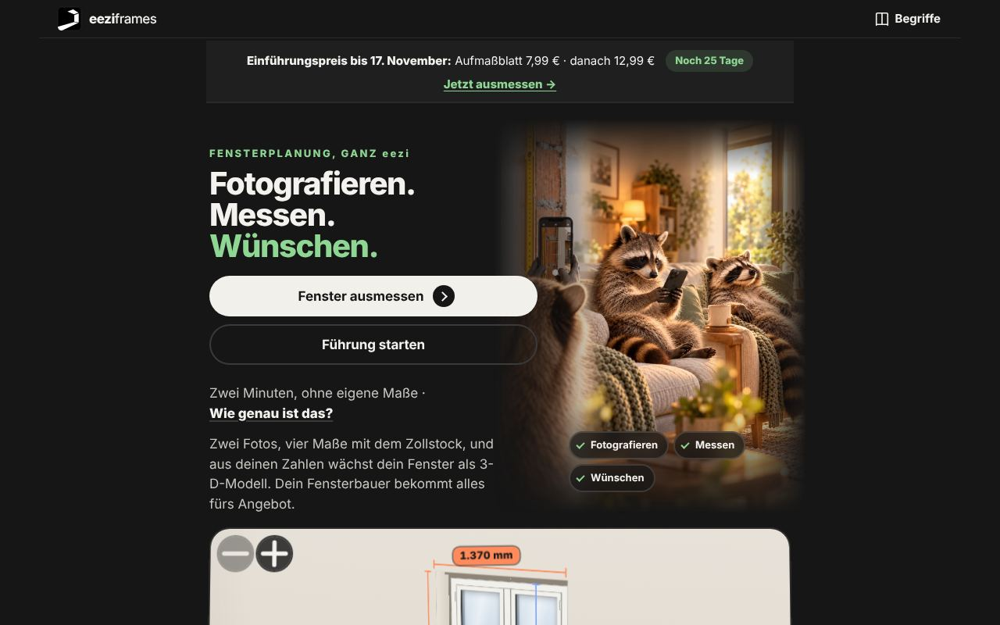

- **Sichtbar.** Eine schmale Kopfzeile mit Logo links (x ≈ 75) und „Begriffe“ mit Buchsymbol rechts. Der Inhalt steht in einer mittigen Spalte von etwa 744 px
  (x 268–1012). Oben in der Spalte das Band „Einführungspreis bis 17. November: Aufmaßblatt 7,99 € · danach 12,99 € · Noch 25 Tage · Jetzt ausmessen →“
  in zwei Zeilen. Darunter der Kicker „Fensterplanung, ganz eezi“ und die Überschrift „Fotografieren. Messen. Wünschen.“ („Wünschen.“ grün), dann die Cream-Pille
  „Fenster ausmessen“ (420 px breit) und darunter der gleich breite umrandete Knopf „Führung starten“. Es folgen die Zeile „Zwei Minuten, ohne eigene Maße ·
  Wie genau ist das?“ (unterstrichener Link) und der Lead „Zwei Fotos, vier Maße mit dem Zollstock, und aus deinen Zahlen wächst dein Fenster als 3-D-Modell.
  Dein Fensterbauer bekommt alles fürs Angebot.“ Rechts ein weich ausgeblendetes Foto: drei Waschbären im Wohnzimmer, einer fotografiert mit dem Handy,
  einer tippt, einer hält eine Tasse. Dazu die Chips „Fotografieren · Messen · Wünschen“. Unten beginnt die Karte des 3-D-Modells: heller Grund, ein Fenster mit dem Maß
  „1.370 mm“ und die Zoomknöpfe „−“ (blass) und „+“.
- **Hierarchie.** Überschrift und Cream-Pille führen. Das Modell kündigt sich am unteren Rand an.
- **Handlungsaufforderungen.** Eine Cream-Pille und ein umrandeter Knopf, beide groß. Dazu der Link im Band.
- **Lesbarkeit.** Gut. Die App duzt („deinen Zahlen“, „Dein Fensterbauer“), die Startseite siezt.
- **Textmenge.** Etwa 80 Wörter. **Bildanteil.** Etwa 30 %.
- **Breite.** Links und rechts bleiben je etwa 268 px Grund, also rund 42 % der Breite. *Deutung:* Die App ist erkennbar fürs Telefon gebaut
  (`SKILL.md`, Abschnitt 1: Mobil zuerst). Am Schreibtisch wirkt sie wie eine schmale Spalte.

---

## 5. Kundenkonto `/partner/`, Einstieg

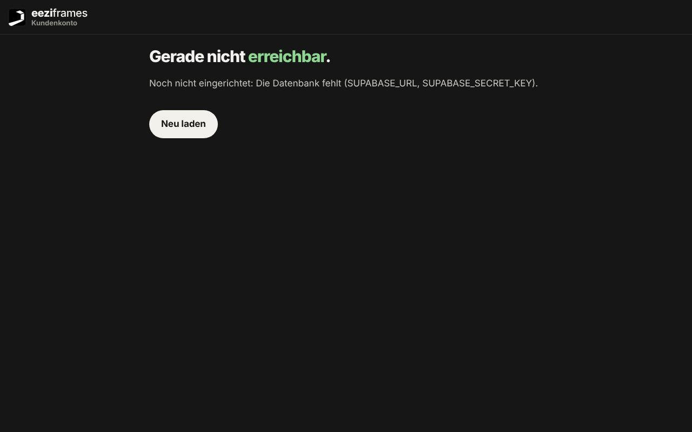

- **Mit dem vorgegebenen Server, ohne Datenbank.** Eine Kopfzeile nur mit Logo und der Unterzeile „Kundenkonto“. Darunter die Überschrift „Gerade nicht erreichbar.“
  („erreichbar.“ grün), der Text „Noch nicht eingerichtet: Die Datenbank fehlt (SUPABASE_URL, SUPABASE_SECRET_KEY).“ und die Cream-Pille „Neu laden“. Der Rest des
  Bildschirms ist leer. Die Meldung kommt vom Server (`functions/api/router.js:86`) und wird unverändert angezeigt (`web/assets/partner.js:777`).
  *Deutung:* Ein Besucher sähe interne Variablennamen. Ob dieser Zustand online eintreten kann, ist offen.

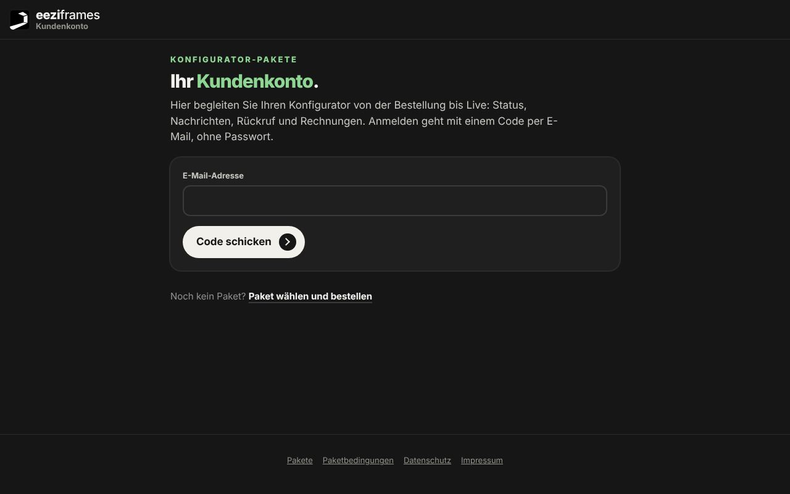

- **Mit `DATEN_ATTRAPPE=1` (zweiter Server, nur für dieses Foto).** Der Kicker „Konfigurator-Pakete“, die Überschrift „Ihr Kundenkonto.“ und der Lead „Hier begleiten Sie
  Ihren Konfigurator von der Bestellung bis Live: Status, Nachrichten, Rückruf und Rechnungen. Anmelden geht mit einem Code per E-Mail, ohne Passwort.“ Darunter eine
  Karte mit dem Feld „E-Mail-Adresse“ und der Cream-Pille „Code schicken“, dann „Noch kein Paket? **Paket wählen und bestellen**“. Unten eine mittige Fußzeile
  (Pakete, Paketbedingungen, Datenschutz, Impressum).
- **Hierarchie und Handlung.** Klar, mit einer Aufgabe und einer Cream-Pille. Die Spalte ist etwa 730 px breit, der Bildschirm zu etwa 55 % leer. Bild gibt es keins.
- **Auffällig.** „Paket wählen und bestellen“ steht hier, während die Verkaufsseite sagt, dass die Bestellung noch nicht freigeschaltet ist.

---

## 6. Ratgeber `/ratgeber/`, Übersicht (Einstieg)

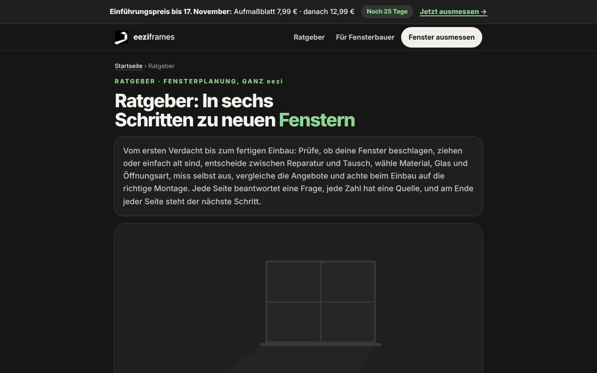

- **Sichtbar.** Oben das Band zum Einführungspreis in einer Zeile. Die Kopfzeile enthält Logo, „Ratgeber“, „Für Fensterbauer“ und die Cream-Pille „Fenster ausmessen“. Der Inhalt steht in
  einer Spalte von 790 px (x 246–1034). Darin die Brotkrumen, der Kicker „Ratgeber · Fensterplanung, ganz eezi“, die zweizeilige Überschrift „Ratgeber: In
  sechs Schritten zu neuen Fenstern“ („Fenstern“ grün, ohne Punkt) und eine Karte mit der Einleitung: fünf Zeilen, etwa 60 Wörter, in der Du-Form. Darunter
  eine große Bildkarte mit dem neutralen Platzhalter.
- **Handlungsaufforderungen.** Die Cream-Pille in der Kopfzeile und der Link im Band. Beide führen zur App.
- **Textmenge.** Etwa 100 Wörter. **Bildanteil.** Etwa 40 % Platzhalter. **Breite.** Links und rechts bleiben je etwa 245 px frei.

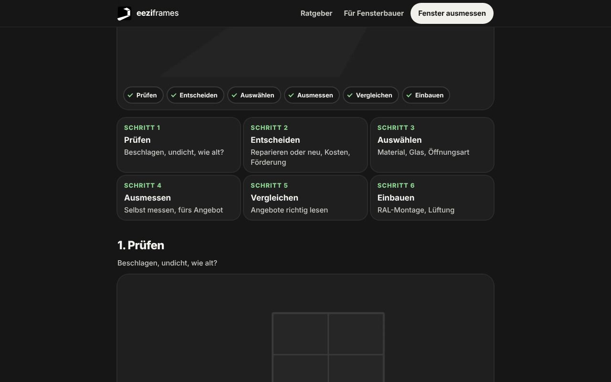

- **Sichtbar.** Das Ende des Platzhalters mit den Chips „Prüfen · Entscheiden · Auswählen · Ausmessen · Vergleichen · Einbauen“. Darunter sechs Schrittkarten im
  Raster 3 × 2 („Schritt 1“ in Grün, Titel, Unterzeile), dann „1. Prüfen“ mit Unterzeile und die nächste Platzhalterkarte.
- **Textmenge.** Etwa 50 Wörter. **Bildanteil.** Etwa 35 % Platzhalter.

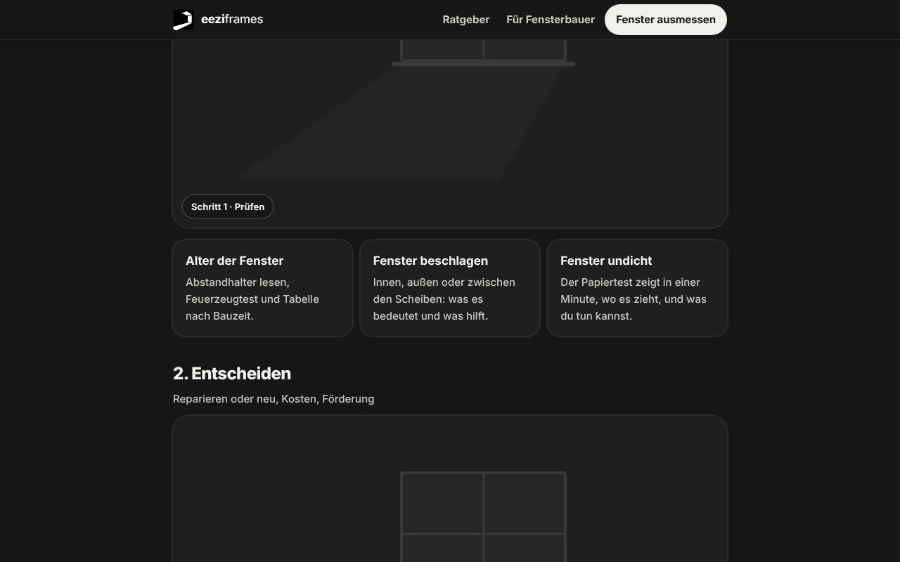

- **Sichtbar.** Ein Platzhalter mit dem Chip „Schritt 1 · Prüfen“ und drei Artikelkarten (Alter der Fenster, Fenster beschlagen, Fenster undicht). Darunter „2. Entscheiden“
  und die nächste Platzhalterkarte.
- **Textmenge.** Etwa 50 Wörter. **Bildanteil.** Etwa 55 % Platzhalter.

### Bewertung Ratgeber (Einstieg)

- **Was überzeugt.** Die Gliederung in sechs Schritte ist sofort zu verstehen. Die Schrittkarten bilden eine klare Übersicht.
- **Was ungünstig präsentiert ist.** Auf allen drei Bildschirmen ist die größte Fläche ein Platzhalter. Die Einleitung ist ein langer Absatz in einer Karte.
- **Für die Entscheidung.** *Deutung:* Der Ratgeber dient der Suche und dem Vertrauen. Die Hauptaktion „Fenster ausmessen“ steht dabei nur in der Kopfzeile.

---

## 7. Seitenübergreifende Befunde

**Kopfzeilen und Bänder je Seite** (am Foto abgelesen)

| Seite | Bänder oben | Kopfzeile rechts | Cream im Kopf |
|---|---|---|---|
| `/` Hauseigentümer | Pilotphase (Betriebe), Einführungspreis | Ratgeber, Fenster ausmessen | ja, sobald keine andere Cream-Pille sichtbar ist |
| `/#fensterbauer` | Pilotphase (Betriebe) | Preise, Anmelden, Kostenlos starten | ja, wie oben |
| `/fuer-fensterbauer/` | keine | Ratgeber, Kundenkonto, Pakete ansehen | nie |
| `/app/` | Einführungspreis (in der Spalte) | Begriffe | nein |
| `/partner/` | keine | nichts | nein |
| `/ratgeber/` | Einführungspreis | Ratgeber, Für Fensterbauer, Fenster ausmessen | ja |

*Deutung:* Jede der sechs Ansichten hat eine eigene Kopfzeile. Wer zwischen Startseite (Ansicht Fensterbauer) und Verkaufsseite wechselt, sieht
für dasselbe Angebot andere Navigation und eine andere Hauptaktion.

**Platzhalter statt Fotos.** Auf den Fotos zeigen diese Plätze den neutralen Platzhalter: Startseite „Auch ganz groß.“, Verkaufsseite 05 und 09,
Ratgeber-Übersicht und jeder Schritt. Die Dateien sind dort tatsächlich Platzhalter: `web/bilder/foto/gross.webp` (3.950 Byte, 34 Farben),
`fb-kundenschutz.webp`, `fb-frage.webp`, `ratgeber.webp` und `weg-*.webp` (je 3.494 Byte, 31 Farben). Echte Fotos sind dagegen `start-hauseigentuemer.webp`,
`start-fensterbauer.webp`, `fb-sessel.webp`, `fb-kunden-planen.webp` und `app-start.webp` (83–215 KB).

**Ansprache.** Startseite und Verkaufsseite siezen, App und Ratgeber duzen. Auf der Startseite stehen eine Ratgeber-Karte in der Du-Form und eine Karte,
die den Fensterbauer anspricht.

**Leerraum.** Zwischen den Abschnitten der Verkaufsseite liegen regelmäßig 110–300 px leerer Grund. Auf vielen Bildschirmen ist eine Hälfte leer (Verkaufsseite 4–6,
14, 15). *Deutung:* Das wirkt nicht wie bewusst gesetzte Ruhe, sondern wie fehlender Inhalt, weil die leeren Flächen keine Textur, kein Licht und kein Bild tragen.

**Abgleich mit den Mindestanforderungen des Inhabers** (`.claude/skills/premium-gestaltung/SKILL.md` und `designrichtung.md` daneben)

| Anforderung | Beobachtet | Fotos |
|---|---|---|
| Ein Held je Bildschirm | in den Startbildern erfüllt; ab dem zweiten Bildschirm meist Karten und Text ohne Held | start-02 bis -05, verkauf-02, -10 bis -18 |
| Echtes Material statt Symbole | Startseite: Raster aus acht Karten mit Strichsymbolen; Verkaufsseite: echtes Aufmaßblatt und zwei Fotos | start-02/-03, verkauf-07/-08 |
| Bild statt Text, kurze Abschnitte | Verkaufsseite mit 11 Abschnitten, FAQ, Wissenskarten und Quellen; Zeitleiste mit langen Zeilen | verkauf-13, -16 bis -18 |
| Eine Cream-Pille je Bildschirm | meist eingehalten, weil die Kopfzeile umschaltet; Ausnahme: Cream-Band und Cream-Kopfknopf zusammen; viele Bildschirme ganz ohne | fensterbauer-start-02 |
| Kein Querscrollen | auf der Verkaufsseite bei 1024 verletzt (44 px) | verkauf-1024-04 |
| Ehrlich | Benachrichtigung als „Beispiel“ gekennzeichnet, Zahlen mit Quellen, „Empfohlen“ statt „Beliebt“ | verkauf-01, -08, -11 |
| Zum Ziel hin | Pakete erst auf Bildschirm 11 von 18; drei Vorbehalte im Weg zum Kauf | verkauf-10, -14 |
| Am Schreibtisch nichts überdimensionieren | nichts übergroß; eher zu viel leerer Grund; die App als schmale Spalte | verkauf-04, app-01 |

---

## 8. Offene Fragen und Widersprüche

1. **Betriebsbereich oder Konfigurator?** In der Ansicht Fensterbauer stehen „Preise“, „Anmelden“ und „Kostenlos starten“ (Registrierung eines Betriebs,
   `web/assets/portal.js:450`). Dazu kommen das Pilotphase-Band (`web/assets/gemeinsam.js:349`) und drei Fußzeilen-Links zum Bereich für Betriebe (`web/assets/portal.js:482`).
   `SKILL.md`, Abschnitt 1 sagt: „Kein Thema mehr: eine Plattform, auf der Kunden bei eeziframes Projekte anlegen.“ `portal.js:848` sagt: Die Knöpfe „bleiben in der
   Kopfzeile für Bestandsbetriebe“. Was soll ein neuer Fensterbauer sehen?
2. **Wie viele Maße?** Im Lead stehen „vier Maße mit dem Zollstock“ (`web/assets/portal.js:852`, ebenso App), in der Kennzahl „8 Maße je Fenster von Hand“
   (`portal.js:854`).
3. **Kostet es etwas?** In der Fußzeile der Hauseigentümer-Ansicht steht „Pilotphase: Es wird nichts berechnet.“ (`portal.js:482`), auf derselben Seite 7,99 € je
   Aufmaßblatt (`web/config.js:12`).
4. **Lesefortschritt.** `docs/GESTALTUNG.md:41` sagt „Parallaxe, Neigen per Maus und Lesefortschritt gibt es nicht“, und `:476` nennt den Lesefortschritt als entfernt.
   Die Verkaufsseite zeigt ihn trotzdem (`web/assets/verkauf.js:448`, grüne Linie unter der Kopfzeile).
5. **Schreibweise der Marke.** Laut `docs/GESTALTUNG.md:7` wird eeziframes immer klein geschrieben. Die Paketkarte zeigt „Powered by EEZIframes“ (`web/assets/pakete.js:83`).
6. **Bildplatz `gross`.** `docs/BILDER.md:64` nennt ein „vorhandenes Bild“ (Oktopus an der Hebe-Schiebe-Tür). Die Datei `web/bilder/foto/gross.webp` ist ein
   Platzhalter.
7. **Bestellen im Kundenkonto.** „Paket wählen und bestellen“ (`web/assets/partner.js:132`), während die Verkaufsseite „Bestellung bald möglich“ zeigt
   (`web/fuer-fensterbauer/index.html:220`).
8. **Fehlermeldung des Kundenkontos** mit Variablennamen (`functions/api/router.js:86`): Kann sie online erscheinen?
9. **Zwei Musterkunden** auf der Verkaufsseite: „Familie Beispiel · Musterweg 12 · 3 Positionen“ (`index.html:111`) und „Familie Weber“ mit vier Positionen
   (`index.html:133`). Ist das gewollt?
10. **Überschriftenregel.** Mehrere Überschriften der Verkaufsseite haben weder Punkt noch grünes Wort (`docs/GESTALTUNG.md:26`). Ausnahme oder Versehen?
11. **Ursache des Querscrollens bei 1024** ist nicht eindeutig bestimmt (Abschnitt 3a).

---

## 9. Belege für die Geschäftsangaben auf den Fotos

| Angabe (wie sichtbar) | Quelle |
|---|---|
| Paketpreise 29 / 39 / 64 € im Monat, Einrichtung 99 / 199 / 279 € | `web/assets/pakete.js:44`, `:52`, `:60` |
| Paketnamen „EEZI Essential“, „EEZI Essential Plus“, „EEZI Signature“; „Empfohlen“ | `web/assets/pakete.js:44–60`; `web/fuer-fensterbauer/index.html:177` |
| „Powered by EEZIframes“ / „kleiner Hinweis im Fuß“ | `web/assets/pakete.js:83` |
| Aufmaßblatt 7,99 €, Einführungspreis bis 17.11.2026, danach 12,99 € | `web/config.js:12`, `:14` |
| Kennzahlenband: 3 Pakete, 5 Minuten je Fenster, 1 PDF je Anfrage, 3–5 Werktage, 0 € Gebühr je Anfrage | `web/fuer-fensterbauer/index.html:70` |
| Benachrichtigungen im Startbild („Projekt angelegt“, „Bereit fürs Angebot“, „Neue Anfrage“), gekennzeichnet als „Beispiel“ | `web/fuer-fensterbauer/index.html:55` |
| „Kein Programmierauftrag: Sie zahlen eine Einrichtung und einen festen Monatspreis …“ | `web/fuer-fensterbauer/index.html:77` |
| „Vorläufige Preise …“ | `web/fuer-fensterbauer/index.html:174`; Schalter `functions/pakete-seite.js:13` |
| „Angebot nur für Unternehmer im Sinne von § 14 BGB … Ihr Kunde zahlt nichts.“ | `web/fuer-fensterbauer/index.html:188` |
| „Meist sind es 3 bis 5 Werktage nach der Zahlung“ | `web/fuer-fensterbauer/index.html:193` |
| Zahlung „bei Stripe, per Karte oder SEPA-Lastschrift“ | `web/fuer-fensterbauer/index.html:197` |
| „Die Live-Demos je Paket schalten wir in Kürze frei“ | `web/fuer-fensterbauer/index.html:209` |
| „Bestellung bald möglich“, „innerhalb eines Werktags“ | `web/fuer-fensterbauer/index.html:220` |
| Kennzahlen 9,9 Wochen, 97.482, 65,14 €, 68 % | `web/fuer-fensterbauer/index.html:151–154`; Quellen `:261–265`; Stand `:267` |
| „Ihre Kunden bleiben Ihre Kunden“, Zusagen aus den Paketbedingungen | `web/fuer-fensterbauer/index.html:159` |
| Pilotphase-Band „Im Bereich für Betriebe wird nichts berechnet …“ | `web/assets/gemeinsam.js:349` |
| Fußzeile Startseite mit „Pilotphase: Es wird nichts berechnet.“ | `web/assets/portal.js:482` |
| Startseite: Lead „vier Maße“, Kennzahlen „5 Min.“, „8 Maße“, Preis | `web/assets/portal.js:852`, `:854` |
| Karte „Montage und Klärungsliste … was Sie mit dem Kunden klären“ | `web/assets/portal.js:623` |
| „Kostenlos starten“ (Registrierung Betrieb) | `web/assets/portal.js:450` |
| Kundenkonto: Fehlermeldung / Anmeldung | `functions/api/router.js:86`, `web/assets/partner.js:777`; `web/assets/partner.js:132` |
| Bildplätze und Motive | `docs/BILDER.md:28–44`, `:59–71`; Dateien `web/bilder/foto/` |
