# Bestand: Darstellung im Browser – Telefon (390 × 844)

Phase A, Teil „Darstellung im Browser – Telefon“. Stand 24.10.2026. Reine Bestandsaufnahme: Es wird beschrieben, was auf den
Bildschirmfotos zu sehen ist. Deutungen sind mit **Deutung:** gekennzeichnet. Die bestehende Gestaltung ist kein Vorbild für die
Neukonzeption; Maßstab für die Bewertung sind die Anforderungen des Inhabers (.claude/skills/premium-gestaltung/SKILL.md,
designrichtung.md) und die Markenregeln (docs/GESTALTUNG.md).

## 1. Aufnahme

- **Server:** `KI_ATTRAPPE=1 PORT=8791 node scripts/dev-server.mjs` (lokale Vorschau, ohne Datenbank und ohne Zahlung). Für den
  Kundenkonto-Einstieg zusätzlich ein zweiter Lauf mit `DATEN_ATTRAPPE=1` auf Port 8794, weil die Seite ohne Datenbank nur eine
  Fehlermeldung zeigt (siehe 6.). Beide Server danach über ihre Prozessnummer beendet.
- **Browser:** Playwright mit Chromium, Fenster 390 × 844, `isMobile` und `hasTouch`, Android-Kennung, Skalierung 1. JPEG mit Qualität 78.
- **Bildschirm für Bildschirm:** Schrittweise gescrollt (8 Zwischenschritte, danach 1,4 s Wartezeit für Auftritte). Die Schrittweite ist
  die Bildschirmhöhe abzüglich der klebenden Kopfzeile, damit nichts unter ihr verloren geht: Startseite und Ansicht Fensterbauer
  727 px (Kopf 117 px), Verkaufsseite und Ratgeber 787 px (Kopf 57 px). Abschnitte können deshalb über zwei Fotos verteilt sein.
- **Gemessen** wurden zusätzlich: Farbanteile je Foto mit `.claude/skills/premium-gestaltung/farbanteil.py` (Anteile unbunt / farbig /
  kräftig, Richtwerte in designrichtung.md, Abschnitt 3.1 und 6), Lage der Cream-Knöpfe, Textmenge, Tippziele unter 44 px und Querscrollen
  (DOM-Auswertung im selben Browser).
- **Grenzen:** Bewegung (Laufleisten, Glas-Nachrichten, Zähler, Zeitleiste) ist nur als Standbild erfasst; Chromium rechnet ohne
  Grafikchip. Das Paket-Karussell wurde nicht gewischt, Fragen und Vergleich nicht aufgeklappt, kein Formular abgeschickt.
- **Annahme zur Daumenreichweite:** Bei Bedienung mit einer Hand gilt hier das untere Drittel des Bildschirms (ab etwa y = 560) als gut
  erreichbar, die Mitte als erreichbar, die oberen Ecken als schwer erreichbar. Das ist eine Arbeitsannahme, keine eigene Messung.

### Übersicht

| Seite | Fotos | Seitenhöhe | Text (Wörter) | Erste Cream-Pille im Inhalt | Fotos ohne Akzent¹ |
|---|---|---|---|---|---|
| Startseite `/` (Hauseigentümer) | 9 | 6.211 px ≈ 7,4 Bildschirme | 593 (ganze Seite) | y = 756, im ersten Bildschirm | 4 von 9 |
| `/#fensterbauer` (Ansicht Fensterbauer) | 3 | 15.410 px ≈ 18,3 Bildschirme | 1.561 (ganze Seite) | y = 1.019, zweiter Bildschirm | 2 von 3 |
| `/fuer-fensterbauer/` (Verkaufsseite) | 21 | 16.019 px ≈ 19 Bildschirme | 1.456 (Inhalt ohne Kopf und Fuß) | y = 949, zweiter Bildschirm | 12 von 21 |
| `/app/` (Startbild und erste Schritte) | 6 | 844 px, innerer Bereich 2.421 px | – | y = 711, erster Bildschirm | 1 von 6 |
| `/partner/` (Einstieg) | 2 | 844 px | – | erster Bildschirm | 1 von 2 |
| `/ratgeber/` (Übersicht) | 4 | 9.201 px ≈ 10,9 Bildschirme | 613 (Inhalt) | nur im Kopf; im Inhalt erst y = 7.879 | 3 von 4 |

¹ farbanteil.py meldet „ohne Akzent“: weniger als 0,3 % farbige Fläche, also weder Bild noch Licht noch Signal. Insgesamt 23 von 45 Fotos.

Querscrollen: keine Seite ist breiter als 390 px (gemessen `scrollWidth` = 390).

---

## 2. Startseite `/` – Ansicht Hauseigentümer

### S1 · erster Bildschirm

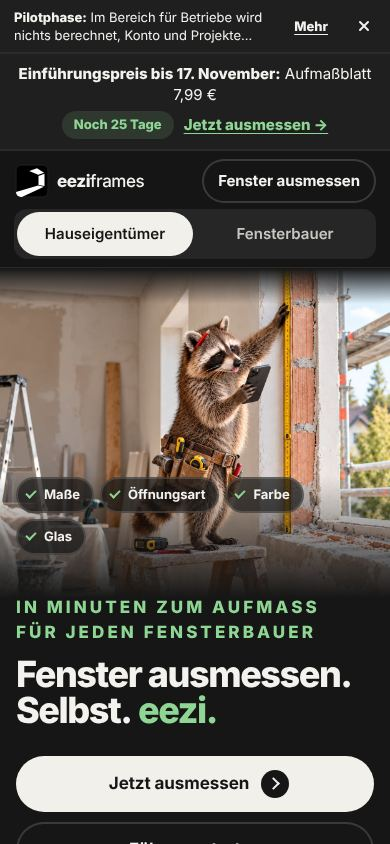

- **Sichtbar:** Ganz oben die Pilotleiste („Pilotphase: Im Bereich für Betriebe wird nichts berechnet, Konto und Projekte…“, abgeschnitten,
  „Mehr“, ×), darunter die Leiste „Einführungspreis bis 17. November: Aufmaßblatt 7,99 €“ mit grünem Chip „Noch 25 Tage“ und Link
  „Jetzt ausmessen →“. Dann Kopfzeile mit Logo und umrandetem Knopf „Fenster ausmessen“, darunter der Umschalter Hauseigentümer |
  Fensterbauer (Hauseigentümer aktiv, Cream gefüllt). Foto: Waschbär mit Werkzeuggürtel und Handy an einer Fensteröffnung im Rohbau, unten
  im Bild vier Haken-Chips (Maße, Öffnungsart, Farbe, Glas). Grüner Kicker in Versalien, zweizeilig („In Minuten zum Aufmaß für jeden
  Fensterbauer“), Überschrift „Fenster ausmessen. Selbst. eezi.“ („eezi.“ grün), Cream-Pille „Jetzt ausmessen“, darunter angeschnitten der
  umrandete Knopf „Führung starten“. Texte: web/assets/portal.js:852; Preis: functions/api/umgebung.js:72.
- **Hierarchie und Blickführung:** Vier Bänder liegen über dem Foto; es beginnt erst bei y = 268, also nach knapp einem Drittel des
  Bildschirms. Danach klare Folge Foto → Überschrift → Pille. **Deutung:** Die beiden Leisten oben konkurrieren mit dem Startbild um den
  ersten Blick.
- **Handlungsaufforderungen:** Die Cream-Pille ist das stärkste Element unter dem Foto. Dasselbe Ziel (Messen starten) steht dreimal auf
  dem Bildschirm (Link in der Preisleiste, Kopfknopf, Pille); dazu „Mehr“, × und der Umschalter: sieben Tippziele vor dem Inhalt.
- **Lesbarkeit, Textmenge:** Überschrift kurz und groß. Der Satz in der Pilotleiste bricht mit „…“ ab.
- **Bildanteil:** Foto 390 × 359 px; unbunt 67 %, farbig 9,8 %, kräftig 2,5 % (Foto).
- **Daumen:** Pille bei y = 756 bis 812 im gut erreichbaren Bereich; Kopfknopf und × oben rechts schwer erreichbar.

### S2

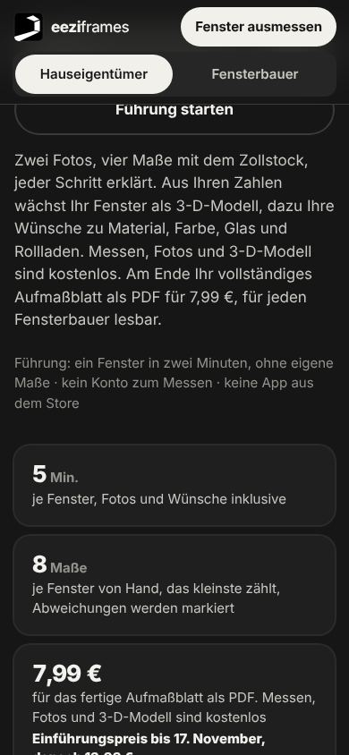

- **Sichtbar:** Kopf klebt, „Fenster ausmessen“ ist jetzt Cream gefüllt. Oben der Rest von „Führung starten“. Lesetext 17 px über sieben
  Zeilen („Zwei Fotos, vier Maße mit dem Zollstock, … Messen, Fotos und 3-D-Modell sind kostenlos. Am Ende Ihr vollständiges Aufmaßblatt
  als PDF für 7,99 € …“), grauer Hinweis „Führung: ein Fenster in zwei Minuten, ohne eigene Maße · kein Konto zum Messen · keine App aus
  dem Store“. Drei Zahlenkarten untereinander: „5 Min. je Fenster“, „8 Maße je Fenster von Hand, das kleinste zählt“, „7,99 € für das
  fertige Aufmaßblatt … Einführungspreis bis 17. November, danach 12,99 €“ (web/assets/portal.js:852 bis 854).
- **Hierarchie:** Kein Held; Textblock und drei gleich gewichtete Karten.
- **Handlungsaufforderungen:** nur der Kopfknopf (Cream, oben rechts).
- **Lesbarkeit, Textmenge:** gut lesbar, aber der Lesetext hat sieben Zeilen (designrichtung.md, 3.2: höchstens drei Zeilen je Block auf
  Verkaufsflächen). Im selben Bildschirm stehen „vier Maße“ (Lesetext) und „8 Maße“ (Karte), siehe offene Fragen.
- **Bildanteil:** kein Bild; unbunt 99 %, farbig 0 %.
- **Daumen:** einzige Handlung oben rechts.

### S3

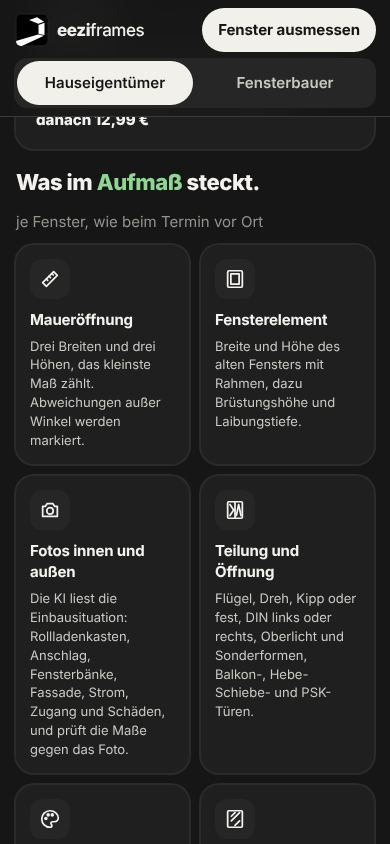

- **Sichtbar:** Ende der Preiskarte, Überschrift „Was im Aufmaß steckt.“ („Aufmaß“ grün), Unterzeile „je Fenster, wie beim Termin vor
  Ort“. Zweispaltiges Raster aus Karten mit Strichsymbol in einem Kästchen, Titel und Text: Maueröffnung, Fensterelement, Fotos innen und
  außen, Teilung und Öffnung, angeschnitten Material und Farbe, Glas und Sprossen.
- **Hierarchie:** Gleichförmiges Raster ohne Gewichtung; Strichsymbole sind die einzigen Bildträger.
- **Handlungsaufforderungen:** nur der Kopfknopf.
- **Lesbarkeit, Textmenge:** Schmale Spalten (etwa 150 px Text) erzwingen viele Umbrüche, die Karte „Fotos innen und außen“ hat acht
  Zeilen, Silbentrennung bei „Hebe-/Schiebe-“.
- **Bildanteil:** unbunt 99 %, farbig 0,1 %.
- **Daumen:** im Inhalt nichts zu tippen.

### S4

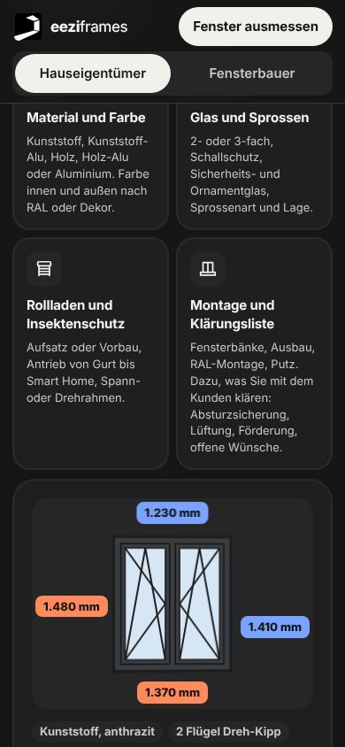

- **Sichtbar:** Restliche Karten (Material und Farbe, Glas und Sprossen, Rollladen und Insektenschutz, Montage und Klärungsliste). Danach
  eine Karte mit der Zeichnung eines zweiflügeligen Dreh-Kipp-Fensters in Anthrazit, vier Maßangaben als Schilder (1.480 und 1.370 mm in
  Orange, 1.230 und 1.410 mm in Blau), Chips „Kunststoff, anthrazit“, „2 Flügel Dreh-Kipp“.
- **Hierarchie:** Die Fensterzeichnung ist das erste Bildmotiv nach dem Startbild und zieht den Blick. Eine Erklärung, was Orange und Blau
  bedeuten, ist auf diesem Bildschirm nicht zu sehen.
- **Handlungsaufforderungen:** nur der Kopfknopf.
- **Bildanteil:** unbunt 95 %, farbig 2,1 %, kräftig 1,8 % (Maßschilder).
- **Daumen:** –

### S5

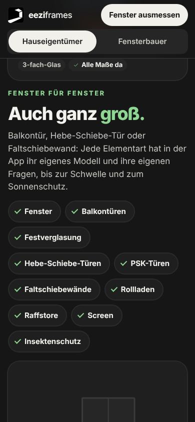

- **Sichtbar:** Chips „3-fach-Glas“, „Alle Maße da“. Kicker „Fenster für Fenster“, Überschrift „Auch ganz groß.“, Lesetext fünf Zeilen,
  zehn Haken-Chips (Fenster, Balkontüren, Festverglasung, Hebe-Schiebe-Türen, PSK-Türen, Faltschiebewände, Rollladen, Raffstore, Screen,
  Insektenschutz; web/assets/portal.js:783), Beginn einer Bildkarte.
- **Hierarchie:** Die Chip-Wolke ist der größte Block. **Deutung:** Die Chips haben Pillenform mit Rand wie Knöpfe und können für
  antippbar gehalten werden.
- **Handlungsaufforderungen:** nur der Kopfknopf.
- **Bildanteil:** unbunt 96 %, farbig 0,4 %.

### S6

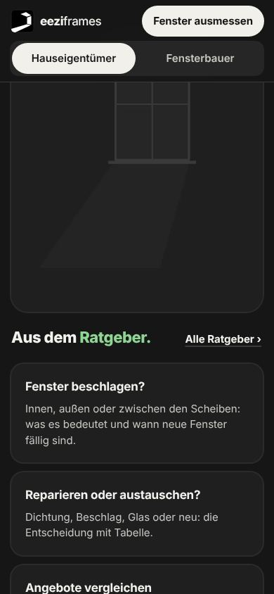

- **Sichtbar:** Die Bildkarte zeigt einen Platzhalter (dunkle Fläche, Fensterumriss, heller Lichtfleck am Boden). Laut Bildbeschreibung
  gehört hier ein Oktopus mit Kaffeetasse an einer Hebe-Schiebe-Tür hin (web/assets/portal.js:785, docs/BILDER.md:33 und 64); die Datei
  web/bilder/foto/gross.webp ist der neutrale Platzhalter aus docs/BILDER.md:16. Danach „Aus dem Ratgeber.“ mit Link „Alle Ratgeber ›“ und
  die ersten Ratgeberkarten (Fenster beschlagen?, Reparieren oder austauschen?, Angebote vergleichen).
- **Hierarchie:** Der Platzhalter belegt rund 330 px ohne Aussage. **Deutung:** Er wirkt wie ein fehlendes Bild.
- **Lesbarkeit:** Die Ratgeberkarten sprechen mit „du“ an („woran du ein gutes Fensterangebot erkennst“), der Rest der Seite mit „Sie“.
- **Bildanteil:** unbunt 99 %, farbig 0,1 %.

### S7

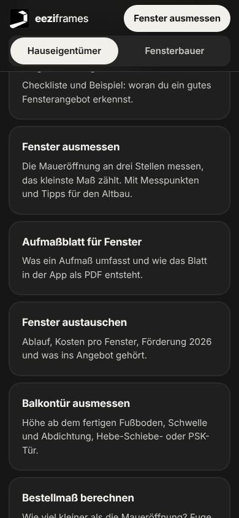

- **Sichtbar:** Weitere Ratgeberkarten in voller Breite: Fenster ausmessen, Aufmaßblatt für Fenster, Fenster austauschen, Balkontür
  ausmessen, Bestellmaß berechnen (angeschnitten). Insgesamt neun Karten (web/assets/portal.js:786).
- **Hierarchie:** Liste ohne Rangfolge, jede Karte Titel und zwei bis drei Zeilen. **Deutung:** wirkt wie eine Blog-Übersicht.
- **Bildanteil:** unbunt 100 %.

### S8

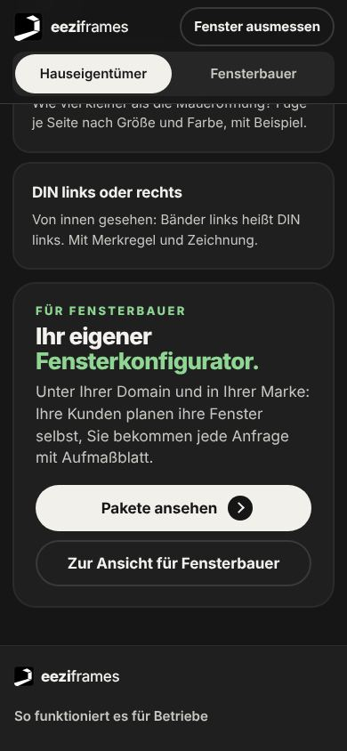

- **Sichtbar:** „DIN links oder rechts“, dann die Karte „Für Fensterbauer – Ihr eigener Fensterkonfigurator.“ mit drei Zeilen Text,
  Cream-Pille „Pakete ansehen“ und umrandetem Knopf „Zur Ansicht für Fensterbauer“ (web/assets/portal.js:787 bis 790). Darunter beginnt der
  Fuß. Der Kopfknopf ist jetzt nur umrandet.
- **Hierarchie:** Die letzte starke Handlung der Hauseigentümer-Seite führt zu den Paketen für Betriebe. Eine abschließende Aufforderung
  zum Messen gibt es am Seitenende nicht, nur den umrandeten Kopfknopf.
- **Daumen:** Pille mittig im unteren Bereich, gut erreichbar.
- **Bildanteil:** unbunt 97 %, farbig 0,6 %.

### S9

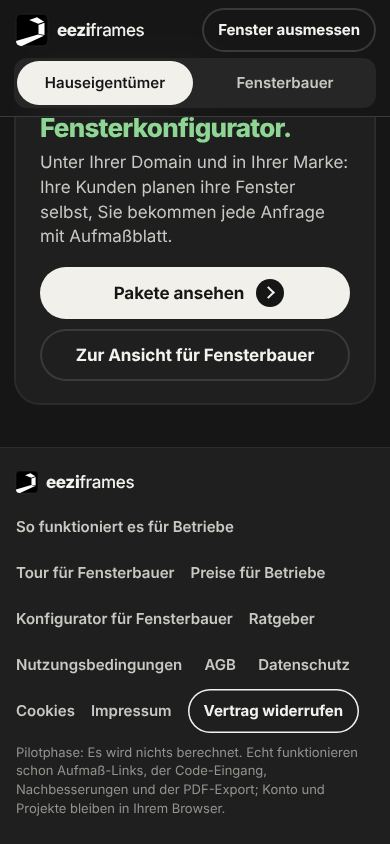

- **Sichtbar:** Fuß mit Links (So funktioniert es für Betriebe, Tour für Fensterbauer, Preise für Betriebe, Konfigurator für
  Fensterbauer, Ratgeber, Nutzungsbedingungen, AGB, Datenschutz, Cookies, Impressum) und umrandetem Knopf „Vertrag widerrufen“; grauer
  Text „Pilotphase: Es wird nichts berechnet. Echt funktionieren schon Aufmaß-Links …“ (web/assets/portal.js:482, erscheint nur ohne
  angeschlossenen Server).
- **Hierarchie:** „Vertrag widerrufen“ ist das einzige umrandete Element im Fuß und hebt sich stärker ab als die übrigen Links.
- **Lesbarkeit:** Der Pilotsatz „Es wird nichts berechnet“ steht auf derselben Seite wie der Preis 7,99 € für das Aufmaßblatt.

### Bewertung Startseite

- **Überzeugt:** Startbild mit Figur und Haken-Chips; kurze, klare Überschrift; die Hauptaktion liegt schon im ersten Bildschirm im
  Daumenbereich; der Preis ist offen genannt, einschließlich „danach 12,99 €“ und „Messen … kostenlos“; die Fensterzeichnung mit
  Maßschildern ist echtes Produktmaterial; die Seite hält überwiegend eine Cream-Pille je Bildschirm, weil der Kopfknopf zwischen gefüllt
  und umrandet wechselt.
- **Ungünstig präsentiert:** vier Bänder über dem Startbild; Lesetext mit sieben Zeilen; nach dem Startbild nur noch ein echtes Motiv
  (Fensterzeichnung) und ein Platzhalter, sonst Karten mit Strichsymbolen, zehn Chips und neun Ratgeberkarten; vier von neun Bildschirmen
  ohne jeden Farbakzent.
- **Kann die Entscheidung erschweren:** widersprüchliche Angaben „vier Maße“ und „8 Maße“; „Pilotphase: Es wird nichts berechnet“ neben
  7,99 €; wechselnde Anrede (Sie und du); das Seitenende führt zu den Fensterbauer-Paketen statt zurück zum Messen.

---

## 3. Ansicht Fensterbauer `/#fensterbauer` (erste drei Bildschirme)

Der Inhalt ist die eingebettete Verkaufsseite (portal.js lädt `main.rg` von /fuer-fensterbauer/, web/assets/portal.js:792 bis 800). Die
drei Bildschirme zeigen denselben Inhalt wie V1 bis V3 unten; anders sind Kopf, Pilotleiste und fehlende Brotkrumen.

### F1

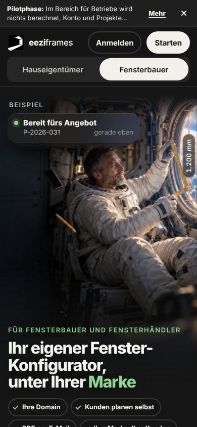

- **Sichtbar:** Pilotleiste; Kopf mit umrandetem „Anmelden“ und Cream „Starten“; Umschalter mit „Fensterbauer“ aktiv (Cream). Keine
  Einführungspreis-Leiste. Darunter das Startbild der Verkaufsseite (Astronaut, Glas-Nachricht „Bereit fürs Angebot“, Maßlinie 1.200 mm),
  Kicker, Überschrift, zwei Chips sichtbar.
- **Handlungsaufforderungen:** Die einzige Cream-Pille ist „Starten“ im Kopf. Sie öffnet die Registrierung des Betriebsbereichs
  („Kostenlos starten“, web/assets/portal.js:450), nicht die Pakete. „Pakete ansehen“ steht erst im zweiten Bildschirm.
- **Hierarchie:** Zwei Cream-Flächen gleichzeitig (Pille „Starten“ und das aktive Umschalter-Segment). **Deutung:** Das Segment ist ein
  Auswahlzustand, wirkt aber wie eine zweite Pille.
- **Bildanteil:** unbunt 68 %, farbig 2,1 % (Foto).
- **Daumen:** „Starten“ und „Anmelden“ oben rechts, schwer erreichbar.

### F2

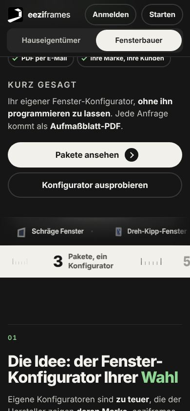

- **Sichtbar:** wie V2: „Kurz gesagt“, Cream „Pakete ansehen“, umrandet „Konfigurator ausprobieren“, zwei Leisten, Beginn „01 Die Idee“.
  Der Kopfknopf „Starten“ ist hier umrandet.
- **Bildanteil:** unbunt 97 %, farbig 0,2 % (ohne Akzent).

### F3

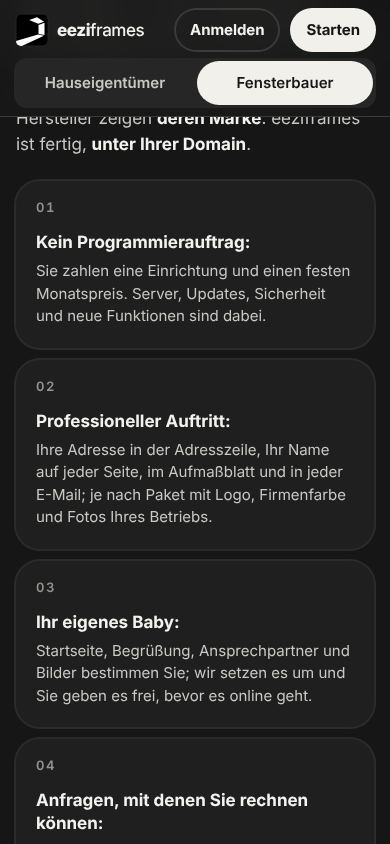

- **Sichtbar:** wie V3: Karten 01 bis 04. „Starten“ ist wieder Cream gefüllt.
- **Bildanteil:** unbunt 99 %, farbig 0 %.

**Bewertung:** Inhaltlich identisch mit der Verkaufsseite. Der Kopf dieser Ansicht bewirbt mit „Anmelden“ und „Starten“ den
Betriebsbereich, während der Inhalt die Konfigurator-Pakete verkauft; SKILL.md:23 bis 25 nennt die Plattform, auf der Kunden bei eeziframes
Projekte anlegen, „kein Thema mehr“.

---

## 4. Verkaufsseite `/fuer-fensterbauer/` (vollständig)

### V1 · erster Bildschirm

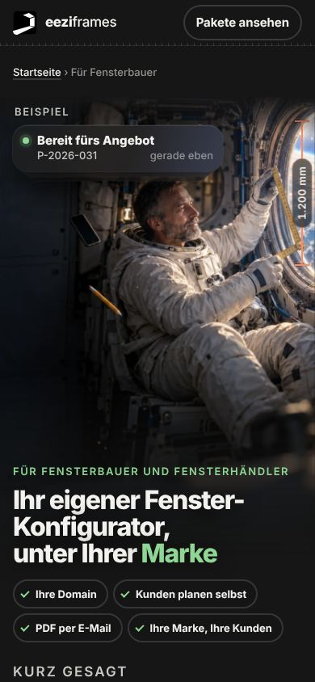

- **Sichtbar:** Kopf (Logo, umrandeter Knopf „Pakete ansehen“), Brotkrumen „Startseite › Für Fensterbauer“. Foto (web/bilder/foto/
  fb-sessel.webp, 390 × 655 px): Astronaut in einer Raumstation misst das Bullauge mit gelbem Zollstock; oben links eine Glas-Nachricht
  „Beispiel · Bereit fürs Angebot · P-2026-031 · gerade eben“ mit grünem Punkt, rechts eine senkrechte orange Maßlinie „1.200 mm“. Kicker
  „Für Fensterbauer und Fensterhändler“, Überschrift über drei Zeilen „Ihr eigener Fenster-Konfigurator, unter Ihrer Marke“ („Marke“
  grün), vier Haken-Chips (Ihre Domain, Kunden planen selbst, PDF per E-Mail, Ihre Marke, Ihre Kunden), unten angeschnitten „Kurz gesagt“.
  Quelle: web/fuer-fensterbauer/index.html:53 bis 58.
- **Hierarchie:** Ein Held (Foto) trägt den Bildschirm, Text darunter. Die Glas-Nachricht liegt über dem oberen linken Bildteil, nicht über
  dem Gesicht. Laut Quelltext wechseln drei Nachrichten (index.html:55); im Standbild ist eine zu sehen.
- **Handlungsaufforderungen:** Im ersten Bildschirm keine Cream-Pille; nur der umrandete Kopfknopf. Die erste Cream-Pille liegt bei
  y = 949.
- **Lesbarkeit:** Überschrift 32 px, gut lesbar; der Brotkrumen-Link „Startseite“ ist 60 × 16 px groß.
- **Bildanteil:** unbunt 69 %, farbig 2,1 %. Dieses Startbild mag der Inhaber (SKILL.md:120).
- **Daumen:** einzige Handlung oben rechts.

### V2

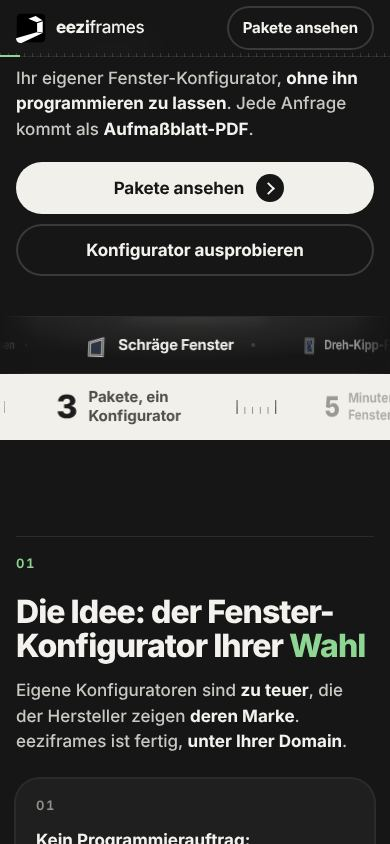

- **Sichtbar:** „Kurz gesagt“ mit drei Zeilen (fett: „ohne ihn programmieren zu lassen“, „Aufmaßblatt-PDF“), Cream „Pakete ansehen“,
  umrandet „Konfigurator ausprobieren“. Leiste A mit kleinen Fenstersymbolen und Namen („Schräge Fenster“, „Dreh-Kipp-…“), Leiste B als
  helles Band mit Zahlen („3 Pakete, ein Konfigurator“, angeschnitten „5 Minuten …“) und Maßstabsstrichen (index.html:66 bis 71). Danach
  „01 – Die Idee: der Fenster-Konfigurator Ihrer Wahl“ mit Lesetext (fett: „zu teuer“, „deren Marke“, „unter Ihrer Domain“). Unter dem
  Kopf eine feine grüne Linie mit Strichen (Lesefortschritt, web/assets/verkauf.css:613).
- **Hierarchie:** Das helle Band ist die hellste Fläche der ganzen Seite. **Deutung:** Es zieht den Blick stärker als die Pille darüber.
- **Handlungsaufforderungen:** Pille gut sichtbar, liegt nach dem Scrollen aber bei y = 162 bis 214, also im oberen Drittel.
- **Bildanteil:** unbunt 97 %, farbig 0,2 % (ohne Akzent; die Leisten sind unbunt).

### V3

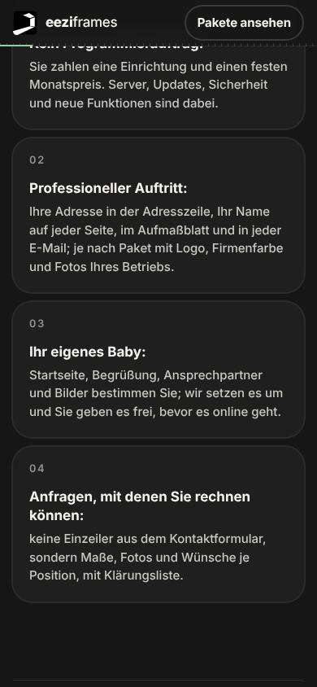

- **Sichtbar:** Vier Karten mit Nummer: „Kein Programmierauftrag“, „Professioneller Auftritt“, „Ihr eigenes Baby“, „Anfragen, mit denen
  Sie rechnen können“ (index.html:76 bis 80), je drei bis vier Zeilen 15 px.
- **Hierarchie:** vier gleich gewichtete Textkarten, kein Bild.
- **Lesbarkeit:** gut lesbar. **Deutung:** „Ihr eigenes Baby“ fällt im Ton aus dem übrigen sachlichen Text.
- **Bildanteil:** unbunt 99 %, farbig 0 %.

### V4

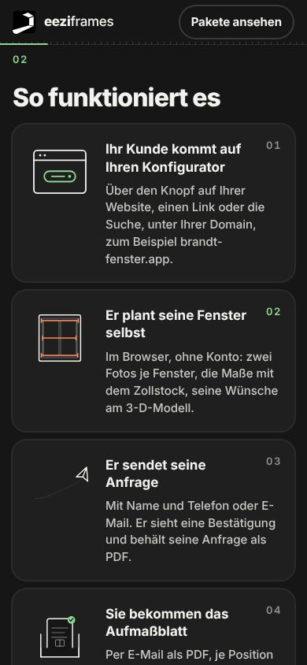

- **Sichtbar:** „02 – So funktioniert es“ (kein grünes Wort). Schrittkarten 01 bis 04 mit Strichzeichnung links (Browserfenster mit Knopf,
  Fenster mit orangen Linien, Papierflieger mit gestrichelter Bahn, Dokument mit grünem Haken), Titel und vier bis fünf Zeilen. Die Nummer
  „02“ ist grün, die übrigen grau. Im Text die Beispieldomain „brandt-fenster.app“.
- **Hierarchie:** Strichzeichnungen sind der Bildträger. **Deutung:** Die grüne „02“ markiert den gerade aktiven Schritt.
- **Bildanteil:** unbunt 98 %, farbig 0,1 %.

### V5

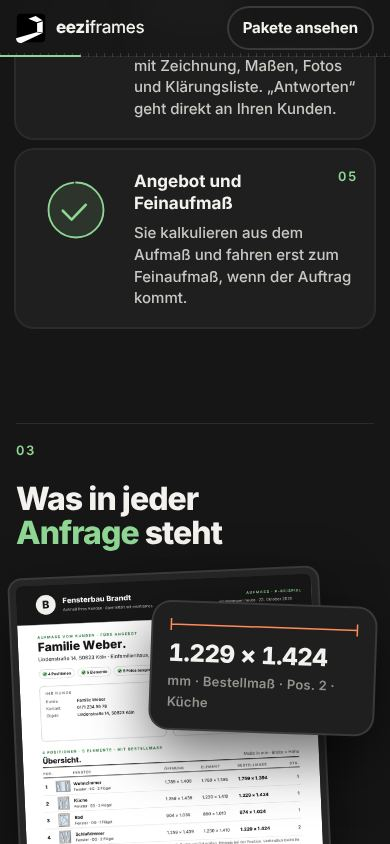

- **Sichtbar:** Ende von Schritt 04, Schritt 05 „Angebot und Feinaufmaß“ (grüner Kreis mit Haken). „03 – Was in jeder Anfrage steht“
  („Anfrage“ grün). Darunter echtes Material: ein Aufmaßblatt des Beispielbetriebs „Fensterbau Brandt“ für „Familie Weber“
  (web/bilder/tour-aufmassblatt-15.webp), schräg im Rahmen, überlagert von einer dunklen Karte „1.229 × 1.424 mm · Bestellmaß · Pos. 2 ·
  Küche“ mit oranger Maßlinie.
- **Hierarchie:** Das Aufmaßblatt mit der Bestellmaß-Karte ist der Held dieses Bildschirms und das erste Produktbild nach dem Startbild.
- **Lesbarkeit:** Die Tabelle im Blatt ist zu klein zum Lesen; die große Maßzahl ist gut lesbar.
- **Bildanteil:** unbunt 96 %, farbig 0,5 %.

### V6

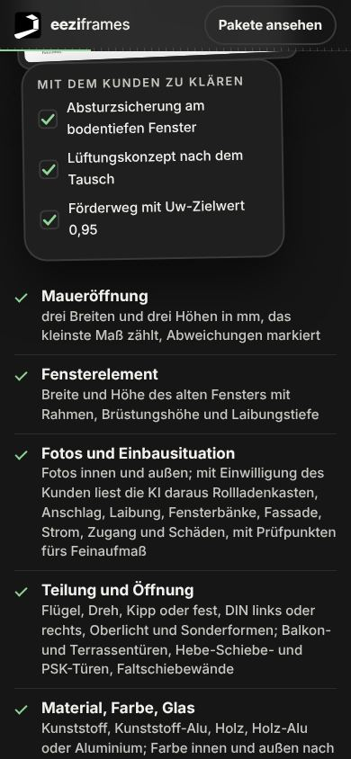

- **Sichtbar:** Karte „Mit dem Kunden zu klären“ mit drei abgehakten Punkten (Absturzsicherung, Lüftungskonzept, Förderweg mit
  Uw-Zielwert 0,95) über dem Blatt. Danach eine Liste mit grünen Haken: Maueröffnung, Fensterelement, Fotos und Einbausituation, Teilung
  und Öffnung, Material, Farbe, Glas (angeschnitten), je zwei bis fünf Zeilen.
- **Hierarchie:** Nach der Karte folgt eine lange Textliste. **Deutung:** Sie wiederholt den Abschnitt „Was im Aufmaß steckt“ der
  Startseite in anderer Form.
- **Bildanteil:** unbunt 98 %, farbig 0 % (ohne Akzent).

### V7

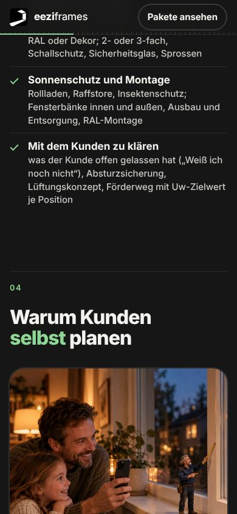

- **Sichtbar:** Rest der Liste (Sonnenschutz und Montage, Mit dem Kunden zu klären). „04 – Warum Kunden selbst planen“ („selbst“ grün).
  Oberer Teil eines Fotos (fb-kunden-planen.webp): Vater und Kind auf dem Sofa im Abendlicht mit Handy, am Fenster eine kleine
  Handwerkerfigur mit Zollstock.
- **Hierarchie:** Das Foto ist der Held, Überschrift darüber.
- **Bildanteil:** unbunt 71 %, farbig 12,1 %, kräftig 9,4 % (warmes Foto).

### V8

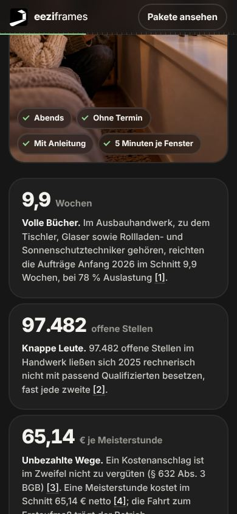

- **Sichtbar:** Unterer Teil des Fotos mit Chips (Abends, Ohne Termin, Mit Anleitung, 5 Minuten je Fenster). Drei Zahlenkarten: „9,9
  Wochen – Volle Bücher“, „97.482 offene Stellen – Knappe Leute“, „65,14 € je Meisterstunde – Unbezahlte Wege“ mit Verweisen [1] bis [4]
  und „§ 632 Abs. 3 BGB“ (index.html:151 bis 153, Quellen ab index.html:260).
- **Hierarchie:** Große Zahl (32 px) mit grauer Einheit, darunter vier bis fünf Zeilen Text.
- **Lesbarkeit, Textmenge:** Viel Text je Karte; Quellenverweise sind etwa 20 × 19 px große Links.
- **Bildanteil:** unbunt 71 %, farbig 6,2 %.
- **Deutung:** Die Zahlen beschreiben die Lage der Branche, nicht das Produkt; die Verbindung zum Kauf muss der Leser selbst ziehen.

### V9

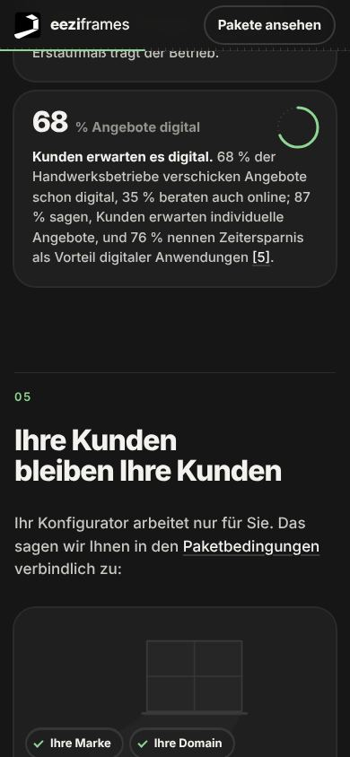

- **Sichtbar:** Karte „68 % Angebote digital“ mit grünem Teilring und sechs Zeilen voller Prozentwerte (68, 35, 87, 76 %; index.html:154).
  „05 – Ihre Kunden bleiben Ihre Kunden“ (kein grünes Wort), drei Zeilen mit Link „Paketbedingungen“. Bildkarte mit Platzhalter
  (fb-kundenschutz.webp, docs/BILDER.md:16) und Chips „Ihre Marke“, „Ihre Domain“.
- **Hierarchie:** Der Platzhalter belegt die untere Bildschirmhälfte ohne Aussage.
- **Bildanteil:** unbunt 98 %, farbig 0 % (ohne Akzent).

### V10

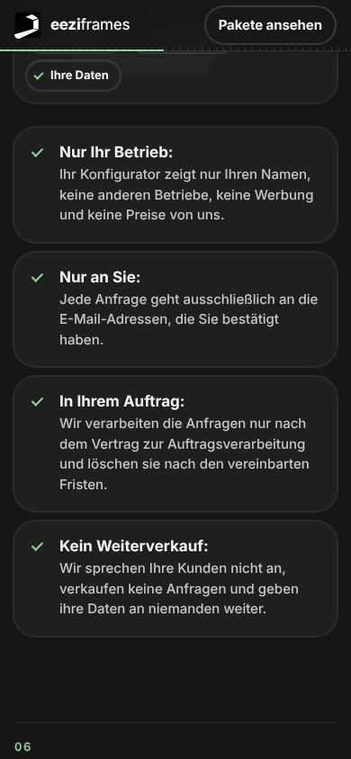

- **Sichtbar:** Chip „Ihre Daten“, vier Karten mit Haken: „Nur Ihr Betrieb“, „Nur an Sie“, „In Ihrem Auftrag“, „Kein Weiterverkauf“
  (index.html:163 bis 166). Unten der Kicker „06“.
- **Hierarchie:** vier gleich gewichtete Textkarten; klare, kurze Zusagen.
- **Handlungsaufforderungen:** nur der Kopfknopf.
- **Bildanteil:** unbunt 99 %, farbig 0 %.

### V11

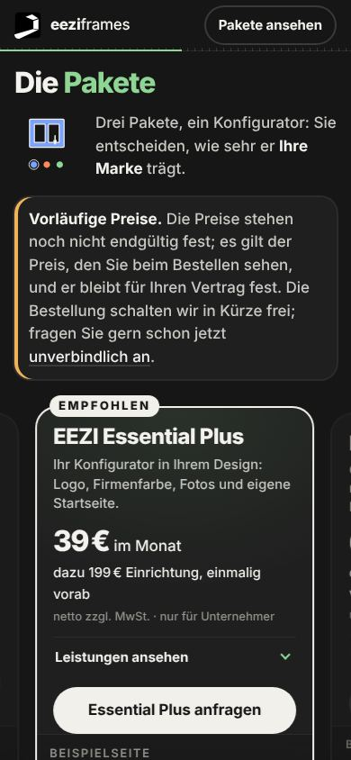

- **Sichtbar:** „Die Pakete“ („Pakete“ grün) mit kleinem Fenstersymbol und drei Farbpunkten, Lesetext drei Zeilen. Hinweiskarte mit orangem
  Randstrich: „Vorläufige Preise. Die Preise stehen noch nicht endgültig fest; es gilt der Preis, den Sie beim Bestellen sehen … Die
  Bestellung schalten wir in Kürze frei; fragen Sie gern schon jetzt unverbindlich an.“ (sieben Zeilen, index.html:174; gesteuert über
  PAKETE_OFFEN, functions/pakete-seite.js:13). Darunter das Paket-Karussell: mittig „Empfohlen – EEZI Essential Plus“, „Ihr Konfigurator
  in Ihrem Design: Logo, Firmenfarbe, Fotos und eigene Startseite“, „39 € im Monat, dazu 199 € Einrichtung, einmalig vorab, netto zzgl.
  MwSt. · nur für Unternehmer“, „Leistungen ansehen ⌄“, Cream „Essential Plus anfragen“, „Beispielseite“. Links und rechts die Kanten der
  Nachbarkarten (EEZI Essential 29 € / 99 €, EEZI Signature 64 € / 279 €; web/assets/pakete.js:44, 52, 60).
- **Hierarchie:** Die Hinweiskarte steht vor den Preisen und ist größer als die Preisangabe. Das Karussell startet beim mittleren Paket.
- **Handlungsaufforderungen:** Cream „Essential Plus anfragen“ deutlich, Kopfknopf umrandet. Ein Bestellknopf fehlt; nur „anfragen“.
- **Lesbarkeit:** Preis groß (32 px) und klar; „Leistungen ansehen“ ist 41 px hoch.
- **Bildanteil:** unbunt 95 %, farbig 0,7 %.
- **Daumen:** Pille bei y ≈ 763 bis 815, gut erreichbar; die anderen Pakete nur durch Wischen.

### V12

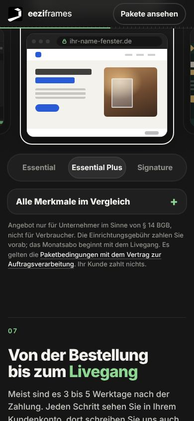

- **Sichtbar:** Unter der Paketkarte die „Beispielseite“: ein gezeichnetes Browserfenster „ihr-name-fenster.de“ mit Platzhalterbalken in
  Blau und Grau und einem braunen Bildfeld mit Fensterumriss. Segmentleiste „Essential | Essential Plus | Signature“ (Plus aktiv), Klappe
  „Alle Merkmale im Vergleich +“, Kleingedrucktes 13 px (nur für Unternehmer, Einrichtung vorab, Abo ab Livegang, Paketbedingungen mit
  Vertrag zur Auftragsverarbeitung, „Ihr Kunde zahlt nichts“). Danach „07 – Von der Bestellung bis zum Livegang“ („Livegang“ grün),
  Lesetext „Meist sind es 3 bis 5 Werktage nach der Zahlung …“ (index.html:193).
- **Hierarchie:** **Deutung:** Die Beispielseite ist eine schematische Skizze, kein Bild einer echten Konfigurator-Seite. Der Vergleich
  der Pakete ist zugeklappt.
- **Bildanteil:** unbunt 92 %, farbig 2,5 %, kräftig 1,8 % (Skizze).
- **Hinweis:** Der Inhaber wünscht Pakete zum Wischen mit einem Beispielbild darunter, das sichtbar mitwischt (SKILL.md:121 bis 122). Ob die
  Skizze mitwischt, zeigt das Standbild nicht.

### V13

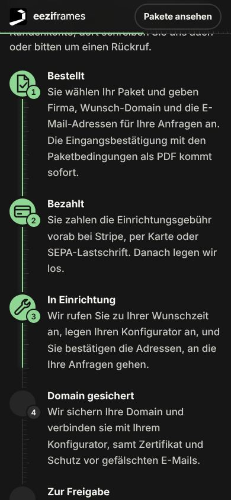

- **Sichtbar:** Senkrechte Zeitleiste mit Strichskala: 1 Bestellt, 2 Bezahlt, 3 In Einrichtung (grün gefüllte Kreise mit Strichsymbolen),
  4 Domain gesichert (grau), 5 Zur Freigabe (angeschnitten); je vier bis fünf Zeilen Text.
- **Hierarchie:** Die grüne Füllung bis Schritt 3 gibt eine Richtung vor. **Deutung:** Sie wächst mit dem Scrollen (verkauf.css:608).
- **Bildanteil:** unbunt 94 %, farbig 1,1 %.

### V14

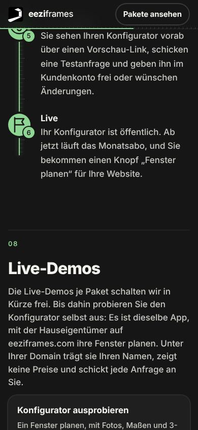

- **Sichtbar:** Schritte 5 und 6 („Live … Ab jetzt läuft das Monatsabo, und Sie bekommen einen Knopf ‚Fenster planen‘ für Ihre Website“).
  „08 – Live-Demos“ (kein grünes Wort): „Die Live-Demos je Paket schalten wir in Kürze frei. Bis dahin probieren Sie den Konfigurator selbst
  aus: Es ist dieselbe App, mit der Hauseigentümer auf eeziframes.com ihre Fenster planen …“ (sieben Zeilen, index.html:209). Beginn der
  Karte „Konfigurator ausprobieren“ (Link auf /app/, index.html:210).
- **Hierarchie:** zweiter „noch nicht“-Hinweis der Seite.
- **Bildanteil:** unbunt 95 %, farbig 0,6 %.

### V15

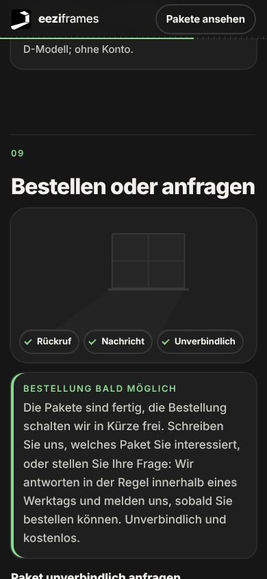

- **Sichtbar:** Ende der Demo-Karte. „09 – Bestellen oder anfragen“ (kein grünes Wort). Bildkarte mit Platzhalter (fb-frage.webp) und Chips
  Rückruf, Nachricht, Unverbindlich. Hinweiskarte mit grünem Randstrich: „Bestellung bald möglich – Die Pakete sind fertig, die Bestellung
  schalten wir in Kürze frei … in der Regel innerhalb eines Werktags … Unverbindlich und kostenlos.“ (neun Zeilen, index.html:220).
- **Hierarchie:** dritter „noch nicht“-Hinweis; Platzhalter als größtes Element.
- **Bildanteil:** unbunt 96 %, farbig 0,3 %.

### V16

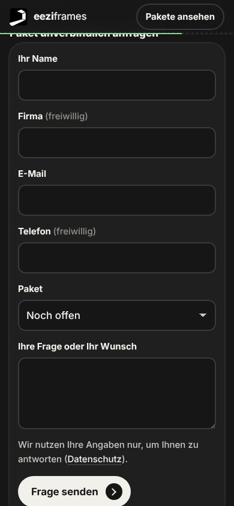

- **Sichtbar:** Formular „Paket unverbindlich anfragen“: Ihr Name, Firma (freiwillig), E-Mail, Telefon (freiwillig), Paket (Auswahl,
  vorbelegt „Noch offen“), Ihre Frage oder Ihr Wunsch, Datenschutzsatz, Cream „Frage senden“.
- **Lesbarkeit:** Große Felder (50 px), fette Beschriftungen, gut lesbar.
- **Handlungsaufforderungen:** Pille unten links, nicht volle Breite.
- **Daumen:** Felder und Pille im mittleren und unteren Bereich gut erreichbar.
- **Nicht geprüft:** ob „Essential Plus anfragen“ das Paketfeld vorbelegt.
- **Bildanteil:** unbunt 98 %, farbig 0 %.

### V17

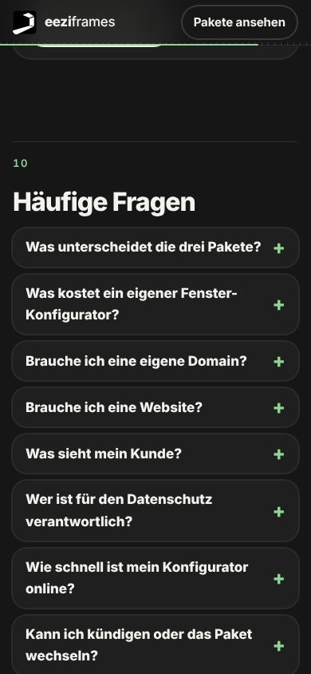

- **Sichtbar:** „10 – Häufige Fragen“, acht zugeklappte Fragen mit grünem „+“ (Was unterscheidet die drei Pakete?, Was kostet ein eigener
  Fenster-Konfigurator?, Brauche ich eine eigene Domain?, … Kann ich kündigen oder das Paket wechseln?).
- **Hierarchie:** einheitliche Liste, gut überfliegbar.
- **Bildanteil:** unbunt 97 %, farbig 0,1 %.

### V18

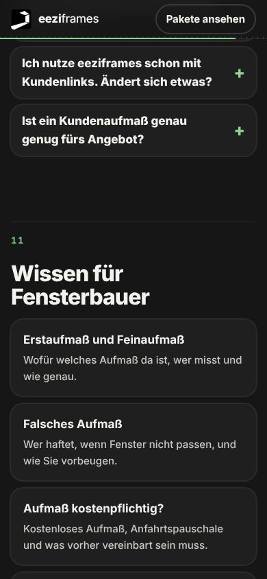

- **Sichtbar:** Zwei weitere Fragen (zusammen zehn), darunter „Ich nutze eeziframes schon mit Kundenlinks. Ändert sich etwas?“. „11 –
  Wissen für Fensterbauer“ mit Karten Erstaufmaß und Feinaufmaß, Falsches Aufmaß, Aufmaß kostenpflichtig?
- **Bildanteil:** unbunt 98 %, farbig 0 %.

### V19

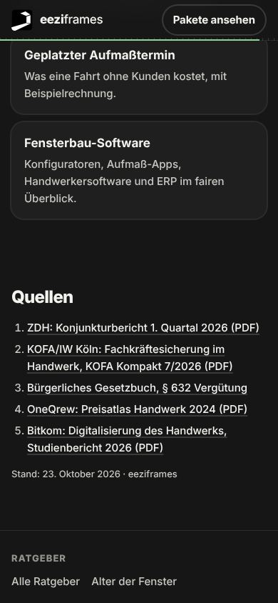

- **Sichtbar:** Karten Geplatzter Aufmaßtermin, Fensterbau-Software; „Quellen“ mit fünf nummerierten Links (ZDH, KOFA/IW Köln, BGB § 632,
  OneQrew, Bitkom); „Stand: 23. Oktober 2026 · eeziframes“; Beginn des Fußes „Ratgeber“.
- **Deutung:** Quellenliste und Wissenskarten geben dem Seitenende die Form eines Ratgeberartikels; der Inhaber will auf der
  Verkaufsseite keinen Ratgeber- oder Blogcharakter (SKILL.md:29 bis 30, 125 bis 127).
- **Bildanteil:** unbunt 98 %, farbig 0 %.

### V20

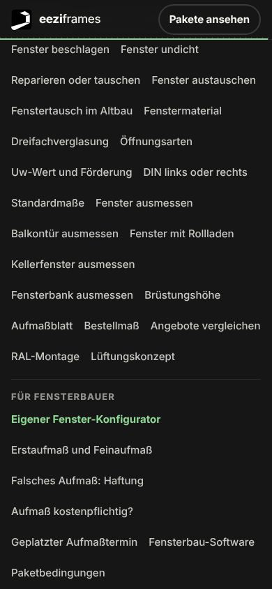

- **Sichtbar:** Fuß mit rund 24 Ratgeber-Links in Reihen, dann „Für Fensterbauer“ mit „Eigener Fenster-Konfigurator“ (grün, aktuelle
  Seite), Erstaufmaß und Feinaufmaß, Falsches Aufmaß: Haftung, Aufmaß kostenpflichtig?, Geplatzter Aufmaßtermin, Fensterbau-Software,
  Paketbedingungen.
- **Bildanteil:** unbunt 96 %, farbig 0,1 %.

### V21

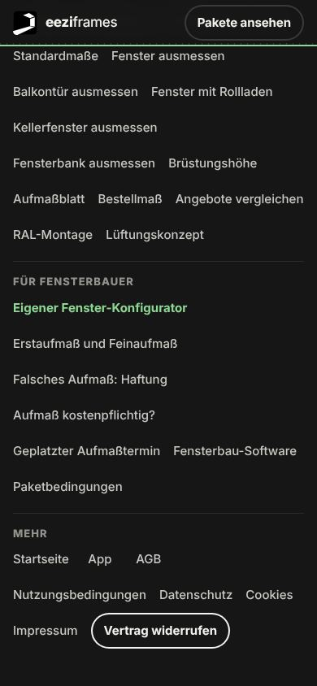

- **Sichtbar:** Ende des Fußes, „Mehr“: Startseite, App, AGB, Nutzungsbedingungen, Datenschutz, Cookies, Impressum und umrandet „Vertrag
  widerrufen“. Der Fuß füllt zusammen etwa zwei Bildschirme.
- **Bildanteil:** unbunt 96 %, farbig 0,1 %.

### Bewertung Verkaufsseite

- **Überzeugt:**
  - Das Startbild: ein Held, echtes Foto, Glas-Nachricht und Maßlinie aus der Welt des Aufmaßes, Haken-Chips; vom Inhaber ausdrücklich
    gemocht (SKILL.md:120).
  - Echtes Produktmaterial in Abschnitt 03 (Aufmaßblatt, Bestellmaß-Karte, Klärungsliste).
  - Preise offen und vollständig (Monat, Einrichtung, netto, nur Unternehmer); „Empfohlen“ statt „Beliebt“ (SKILL.md:49).
  - Konkreter Ablauf bis zum Livegang mit Zeitangabe; klare Zusagen zum Kundenschutz; Zahlen mit Quellen.
  - Kurzes, gut lesbares Formular; Lesefortschritt im Kopf; gemessene Schriftgrößen nur 13, 15, 17, 24 und 32 px (wie
    .claude/skills/premium-gestaltung/SKILL.md:69 verlangt).
- **Ungünstig präsentiert:**
  - Länge: 21 Bildschirme, rund 1.450 Wörter Inhalt. Die Pakete erscheinen erst im 11. Bildschirm (y ≈ 8.650).
  - Im ersten Bildschirm keine Cream-Pille; der Kopfknopf „Pakete ansehen“ ist auf allen Bildschirmen nur umrandet.
  - 12 von 21 Bildschirmen ohne Farbakzent; nach dem Startbild tragen überwiegend Textkarten, Strichsymbole (Abschnitt 02) und eine
    Textliste (Abschnitt 03). Zwei Bildplätze zeigen Platzhalter (V9, V15), die Beispielseite unter den Paketen ist eine Skizze.
  - Zahlenkarten mit vier bis sechs Zeilen Text; Lesetexte mit sieben bis neun Zeilen (V11, V14, V15).
  - Sechs Abschnittsüberschriften ohne grünes Wort (02, 05, 08, 09, 10, 11); die Regel lautet genau ein grünes Wort je Überschrift
    (designrichtung.md, 3.2).
  - Seitenende mit Quellen, Wissenskarten und einem Fuß über zwei Bildschirme.
- **Kann die Kaufentscheidung erschweren (Deutung):**
  - Drei Hinweise, dass etwas noch nicht geht: vorläufige Preise (V11), Bestellung bald möglich (V15), Live-Demos in Kürze (V14). Kaufen
    lässt sich nichts, nur anfragen.
  - Die Hinweiskarte zu vorläufigen Preisen steht vor den Preisen und ist größer als sie.
  - Vergleich der Pakete zugeklappt; das höchste Paket (Signature) nur durch Wischen sichtbar; das Karussell beginnt beim mittleren Paket.
  - „Konfigurator ausprobieren“ führt in die Hauseigentümer-App; dort steht oben der Einführungspreis 7,99 € für Hauseigentümer und die
    Anrede „du“ (siehe A1). Die Seite sagt dazu, unter der Domain des Betriebs zeige die App keine Preise (index.html:209).

---

## 5. App `/app/` (Startbild und erste Schritte)

### A1 · Startbild

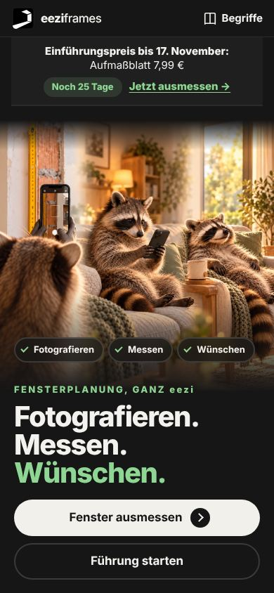

- **Sichtbar:** Kopf mit Logo und „Begriffe“ (Buchsymbol). Umrandeter Kasten „Einführungspreis bis 17. November: Aufmaßblatt 7,99 €“ mit
  Chip „Noch 25 Tage“ und Link „Jetzt ausmessen →“. Foto (app-start.webp): drei Waschbären auf einem Sofa im warmen Licht, einer
  fotografiert mit dem Handy ein Fenster; Chips Fotografieren, Messen, Wünschen. Kicker „Fensterplanung, ganz eezi“, Überschrift über drei
  Zeilen „Fotografieren. Messen. Wünschen.“ („Wünschen.“ grün), Cream „Fenster ausmessen“, umrandet „Führung starten“
  (web/assets/app.js:2772).
- **Hierarchie:** Alles Wesentliche auf einem Bildschirm: Foto, Überschrift, zwei Knöpfe. Der Preiskasten liegt zwischen Kopf und Foto.
- **Handlungsaufforderungen:** Cream-Pille klar; dasselbe Ziel zusätzlich als Link im Preiskasten.
- **Bildanteil:** unbunt 52 %, farbig 22,8 %, kräftig 12,6 % (großes warmes Foto; das Werkzeug meldet „zu bunt, außer große Fotos“).
- **Daumen:** Pille bei y = 711 bis 763, gut erreichbar.

### A2 · Startbild, zweiter Bildschirm (innerer Scrollbereich)

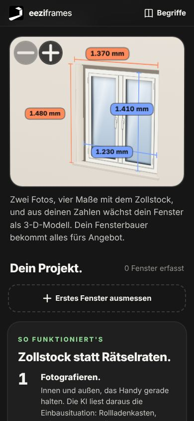

- **Sichtbar:** Karte mit Fenstermodell vor beiger Wand, Maßschilder in Orange und Blau, Zoomknöpfe „−“ und „+“ oben links über dem Modell;
  Text „Zwei Fotos, vier Maße mit dem Zollstock …“. „Dein Projekt.“ mit „0 Fenster erfasst“, gestrichelter Knopf „+ Erstes Fenster
  ausmessen“. Karte „So funktioniert's – Zollstock statt Rätselraten.“ mit Schritt 1 „Fotografieren.“
- **Lesbarkeit:** Der graue Knopf „−“ hebt sich kaum von der beigen Wand ab. Die Zoomknöpfe sitzen hier oben links; docs/GESTALTUNG.md:66
  nennt oben rechts.
- **Bildanteil:** unbunt 94 %, farbig 2,8 %.

### A3 · Schritt 1 von 6

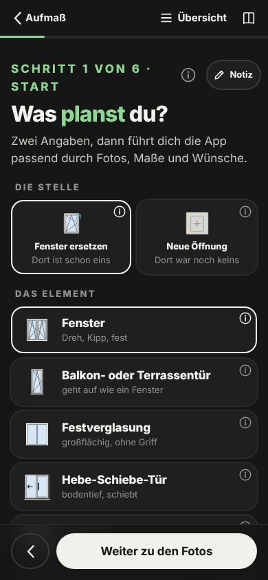

- **Sichtbar:** Kopf „‹ Aufmaß“, „Übersicht“, Buchsymbol; grüner Fortschrittsbalken. Kicker „Schritt 1 von 6 · Start“ (zweizeilig),
  Infozeichen und Knopf „Notiz“. „Was planst du?“ („planst“ grün), zwei Zeilen Text. „Die Stelle“: Kacheln „Fenster ersetzen“ (gewählt)
  und „Neue Öffnung“. „Das Element“: Liste mit Symbol und Unterzeile (Fenster gewählt, Balkon- oder Terrassentür, Festverglasung,
  Hebe-Schiebe-Tür, weitere angeschnitten), je mit Infozeichen. Feste untere Leiste: runder Zurück-Pfeil und Cream „Weiter zu den Fotos“.
- **Hierarchie:** klar: Frage, zwei Gruppen, eine Handlung. Vorauswahl ist gesetzt, ein Tipp genügt.
- **Daumen:** Leiste unten fest, gut erreichbar; Kopfknöpfe oben.
- **Bildanteil:** unbunt 96 %, farbig 0,4 %.

### A4 · Schritt 2 von 6

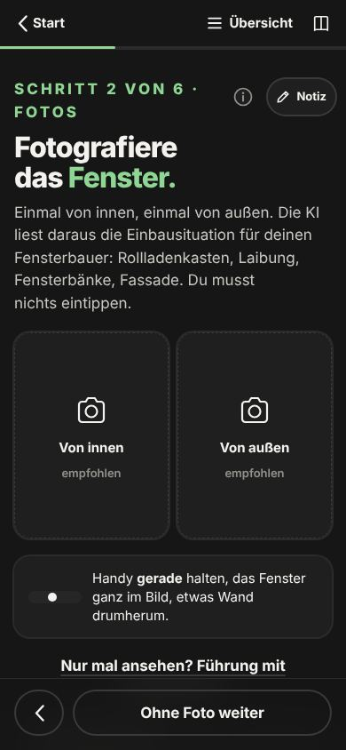

- **Sichtbar:** „Fotografiere das Fenster.“ („Fenster.“ grün), vier Zeilen Text. Zwei gestrichelte Kacheln „Von innen / empfohlen“ und „Von
  außen / empfohlen“ mit Kamerasymbol. Hinweiskarte mit Neigungsanzeige „Handy gerade halten …“. Link „Nur mal ansehen? Führung mit
  Beispielfotos“, dessen zweite Hälfte unter der unteren Leiste verschwindet (Link bei y = 737 bis 786, Leiste ab y = 776). Untere Leiste:
  Zurück und umrandet „Ohne Foto weiter“.
- **Handlungsaufforderungen:** Keine Cream-Pille; die Hauptaktion sind die beiden Fotokacheln.
- **Bildanteil:** unbunt 95 %, farbig 0,5 %.

### A5 · Hinweis „Ohne Foto“

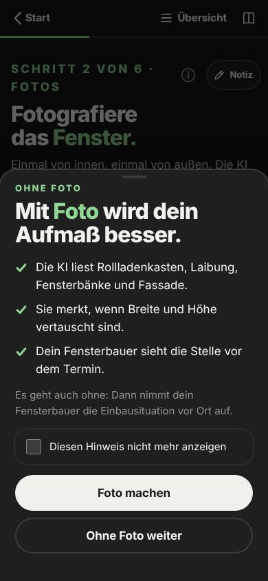

- **Sichtbar:** Blatt von unten über abgedunkeltem Schritt: „Ohne Foto – Mit Foto wird dein Aufmaß besser.“ mit drei Haken-Punkten,
  grauem Satz („Es geht auch ohne …“), Auswahl „Diesen Hinweis nicht mehr anzeigen“, Cream „Foto machen“, umrandet „Ohne Foto weiter“.
- **Hierarchie:** eine klare Entscheidung mit Nutzen in drei Zeilen.
- **Daumen:** beide Knöpfe im unteren Drittel.
- **Bildanteil:** unbunt 94 %, farbig 0,2 % (ohne Akzent).

### A6 · Maß 1 von 4

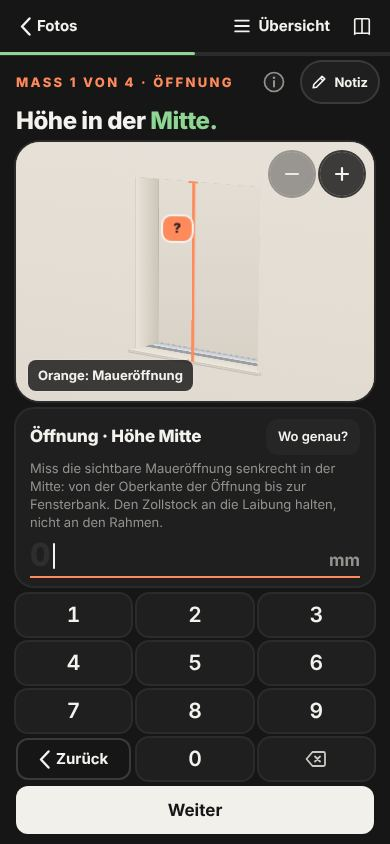

- **Sichtbar:** Kicker in Orange „Maß 1 von 4 · Öffnung“, „Höhe in der Mitte.“ Modell der Wandöffnung mit oranger senkrechter Messlinie
  und Fragezeichen, Schild „Orange: Maueröffnung“, Zoomknöpfe oben rechts. Eingabekarte „Öffnung · Höhe Mitte“ mit Knopf „Wo genau?“, vier
  Zeilen Erklärung 13 px, Eingabe „0 mm“. Zifferntasten 3 × 4 (42 px hoch, bewusst so festgelegt in docs/GESTALTUNG.md:151), „‹ Zurück“,
  Löschen, Cream „Weiter“ in voller Breite.
- **Hierarchie:** Modell oben, Eingabe darunter, Handlung unten: alles auf einem Bildschirm.
- **Daumen:** Tasten und „Weiter“ im unteren Bereich, gut erreichbar.
- **Bildanteil:** unbunt 94 %, farbig 1,1 %.

### Bewertung App

- **Überzeugt:** Das Startbild fasst alles auf einem Bildschirm zusammen, die Hauptaktion liegt im Daumenbereich; feste untere Leiste mit
  Zurück und Weiter; Vorauswahl im ersten Schritt; Farbcode des Modells mit Schild erklärt („Orange: Maueröffnung“); der Hinweis „Ohne
  Foto“ nennt den Nutzen in drei Zeilen; Schrittzähler und Fortschrittsbalken.
- **Ungünstig präsentiert:** Preiskasten über dem Foto; ein Link halb unter der unteren Leiste (A4); Zoomknopf „−“ mit schwachem Kontrast
  auf beiger Wand (A2).
- **Kann die Entscheidung erschweren:** „vier Maße“ in der App, „8 Maße“ auf der Startseite. Für einen Fensterbauer, der die App als Demo
  öffnet: Preis für Hauseigentümer und Anrede „du“.

---

## 6. Kundenkonto `/partner/` (Einstieg)

### P1 · Vorschau ohne Datenbank

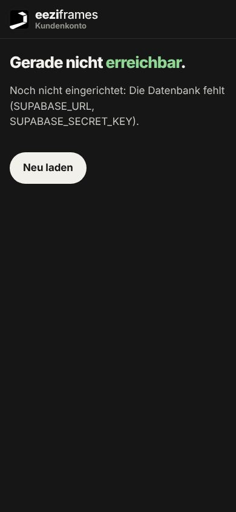

- **Sichtbar:** „Gerade nicht erreichbar.“ („erreichbar.“ grün), Satz „Noch nicht eingerichtet: Die Datenbank fehlt (SUPABASE_URL,
  SUPABASE_SECRET_KEY).“, Cream „Neu laden“, sonst leer (web/assets/partner.js:777, functions/api/router.js:86).
- **Lesbarkeit:** Der Besucher sieht technische Variablennamen.
- **Bildanteil:** unbunt 99 %, farbig 0,2 % (ohne Akzent).

### P2 · mit nachgestellter Datenbank (`DATEN_ATTRAPPE=1`)

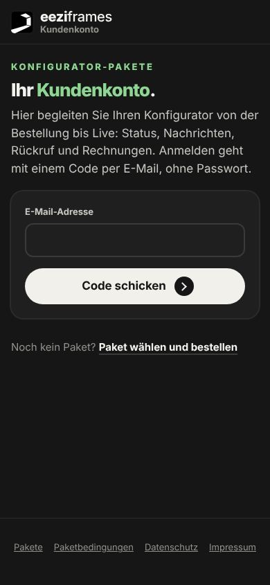

- **Sichtbar:** Kopf „eeziframes · Kundenkonto“, Kicker „Konfigurator-Pakete“, „Ihr Kundenkonto.“ („Kundenkonto“ grün), vier Zeilen Text
  („… von der Bestellung bis Live: Status, Nachrichten, Rückruf und Rechnungen. Anmelden geht mit einem Code per E-Mail, ohne Passwort.“),
  Karte mit Feld „E-Mail-Adresse“ und Cream „Code schicken“, darunter „Noch kein Paket? Paket wählen und bestellen“ (Link auf #bestellen,
  web/assets/partner.js:131 bis 132), unten Fußlinks.
- **Hierarchie:** eine Aufgabe, eine Handlung; untere Bildschirmhälfte leer.
- **Daumen:** Feld und Pille in der Bildschirmmitte (y = 322 bis 439), erreichbar.
- **Bildanteil:** kein Bild; unbunt 96 %, farbig 0,4 %.

**Bewertung:** Mit Datenbank ein klarer, ruhiger Einstieg. Ohne Datenbank eine technische Fehlermeldung. Der Link „Paket wählen und
bestellen“ verspricht eine Bestellung, die Verkaufsseite meldet „Bestellung bald möglich“ (siehe offene Fragen).

---

## 7. Ratgeber `/ratgeber/` (Übersicht, erste Bildschirme)

### R1

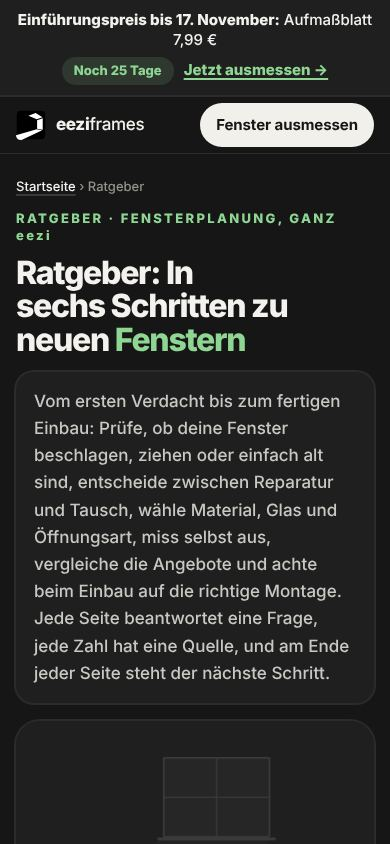

- **Sichtbar:** Einführungspreis-Leiste (ohne Pilotleiste), Kopf mit Cream „Fenster ausmessen“, Brotkrumen, Kicker „Ratgeber · Fensterplanung,
  ganz eezi“ (zweizeilig), Überschrift über drei Zeilen „Ratgeber: In sechs Schritten zu neuen Fenstern“ („Fenstern“ grün), umrandeter
  Kasten mit zehn Zeilen Text in 17 px (web/ratgeber/index.html:68 bis 72), Beginn einer Bildkarte.
- **Hierarchie:** Überschrift, dann ein großer Textkasten; kein Bild im ersten Bildschirm.
- **Handlungsaufforderungen:** einzige Cream-Pille im Kopf oben rechts.
- **Lesbarkeit, Textmenge:** zehn Zeilen in einem Block, Anrede „du“.
- **Bildanteil:** unbunt 95 %, farbig 0,7 %.
- **Daumen:** Handlung oben rechts, schwer erreichbar.

### R2

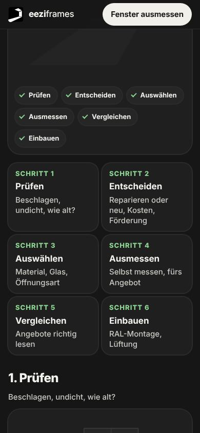

- **Sichtbar:** Unterer Teil der Bildkarte (Platzhalter, ratgeber.webp) mit sechs Chips (Prüfen, Entscheiden, Auswählen, Ausmessen,
  Vergleichen, Einbauen). Raster 2 × 3 mit Karten „Schritt 1 bis 6“ (grüner Kicker, Titel, eine Zeile). Danach „1. Prüfen“ mit Unterzeile,
  Beginn der nächsten Bildkarte.
- **Hierarchie:** Das Schrittraster gibt einen guten Überblick. **Deutung:** Die Chips über dem Raster wiederholen dieselben sechs Begriffe.
- **Bildanteil:** unbunt 97 %, farbig 0,1 % (ohne Akzent).

### R3

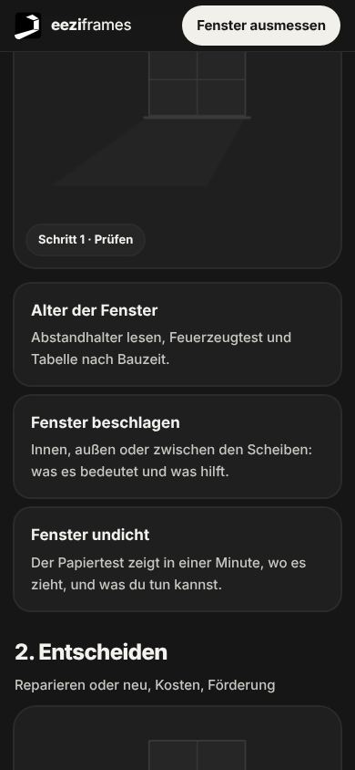

- **Sichtbar:** Platzhalter mit Chip „Schritt 1 · Prüfen“ (weg-pruefen.webp), Karten Alter der Fenster, Fenster beschlagen, Fenster
  undicht; „2. Entscheiden“.
- **Bildanteil:** unbunt 100 %.

### R4

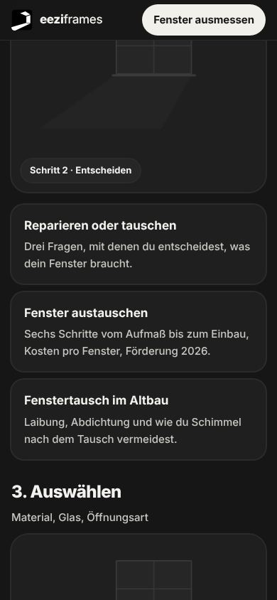

- **Sichtbar:** Platzhalter mit Chip „Schritt 2 · Entscheiden“, Karten Reparieren oder tauschen, Fenster austauschen, Fenstertausch im
  Altbau; „3. Auswählen“, Beginn des nächsten Platzhalters.
- **Bildanteil:** unbunt 99 %.

**Bewertung:** Klare Gliederung in sechs Schritte, kurze Kartentexte. Alle sieben Bildplätze der Übersicht zeigen Platzhalter (ratgeber.webp
und sechs weg-*.webp), jeder Schritt beginnt mit rund 280 px dunkler Fläche. Die Aufforderung „Fenster ausmessen, kostenlos“ im Inhalt
steht erst bei y = 7.879; bis dahin nur der Kopfknopf.

---

## 8. Seitenübergreifend

1. **Bild und Licht fehlen nach dem Startbild.** 23 von 45 Fotos haben keinen Farbakzent. Echte Fotos stehen nur in den Startbildern
   (Startseite, Verkaufsseite, App) und einmal in Abschnitt 04 der Verkaufsseite. designrichtung.md:52 bis 53 hat denselben Befund für den
   zweiten und dritten Bildschirm bereits gemessen.
2. **Platzhalter.** 11 von 17 Dateien in web/bilder/foto sind 3-KB-Platzhalter in einer Farbe (fb-frage, fb-kundenschutz, fehler, gross,
   ratgeber, sechs weg-*), docs/BILDER.md:16. Auf den Fotos sichtbar: S6, V9, V15, R1 bis R4.
3. **Cream-Pille.** Der Kopfknopf wechselt zwischen gefüllt und umrandet, sodass meist nur eine Pille gefüllt ist (S1, S2, S8; F1 bis F3).
   Das aktive Segment des Umschalters ist auf jedem Bildschirm der Startseite ebenfalls Cream gefüllt.
4. **Kopfhöhe.** Startseite und Ansicht Fensterbauer: klebender Kopf mit Umschalter 117 px (14 % der Bildschirmhöhe), dazu im ersten
   Bildschirm zwei Leisten darüber. Verkaufsseite und Ratgeber: 57 px.
5. **Hauptaktion und Daumen.** Startseite und App: Hauptaktion im ersten Bildschirm unten. Verkaufsseite: im ersten Bildschirm nur der
   umrandete Kopfknopf oben rechts. Ratgeber: nur der Kopfknopf oben rechts.
6. **Anrede.** „Sie“ auf Startseite (Lesetext, Karten), Verkaufsseite und Kundenkonto; „du“ in App, Ratgeber und in den Ratgeberkarten der
   Startseite.
7. **Tippziele unter 44 px** (SKILL.md:71): Brotkrumen-Link „Startseite“ 60 × 16 px, Quellenverweise [1] bis [5] etwa 20 × 19 px, Links im
   Fließtext etwa 20 px hoch, „Leistungen ansehen“ 41 bis 43 px. Die Zifferntasten der App (42 px) sind dokumentiert (GESTALTUNG.md:151).
8. **Textmenge.** Lesetexte mit sieben bis zehn Zeilen auf Startseite (S2), Verkaufsseite (V11, V14, V15) und Ratgeber (R1);
   designrichtung.md, 3.2, nennt höchstens drei Zeilen je Block auf Verkaufsflächen.
9. **Kein Querscrollen** auf allen Seiten; Schriftgrößen auf Verkaufsseite und Ratgeber gemessen nur 13, 15, 17, 24 und 32 px.

## 9. Offene Fragen

1. **Vier oder acht Maße?** Startseite und App: „Zwei Fotos, vier Maße mit dem Zollstock“ (web/assets/portal.js:852, App A2, A6 „Maß 1 von
   4“); Karte der Startseite: „8 Maße je Fenster von Hand“ (portal.js:854); Abschnitt „Maueröffnung“: drei Breiten und drei Höhen. Welche
   Zahl gilt für den Besucher?
2. **Pilotleiste und „Es wird nichts berechnet“.** Beide erscheinen nur, wenn kein Server angeschlossen ist (web/assets/gemeinsam.js:344
   bis 349, web/assets/portal.js:482, web/config.js:6). Ist die Live-Seite mit Server verbunden? Sonst steht der Satz neben dem Preis 7,99 €.
3. **Kopf der Ansicht Fensterbauer.** „Anmelden“ und „Starten“ führen in den Betriebsbereich (portal.js:450), der Inhalt verkauft die
   Pakete; der Fuß der Startseite verlinkt „Tour für Fensterbauer“ und „Preise für Betriebe“. Gelten Betriebsbereich und seine Preise
   (functions/api/umgebung.js:72: abo 49 €, plus 79 €) noch neben den Paketen (web/assets/pakete.js:44 bis 60), obwohl SKILL.md:25 die
   Plattform „kein Thema mehr“ nennt?
4. **Bestellen oder nur anfragen?** Verkaufsseite: „Bestellung bald möglich“ (index.html:220, gesteuert über PAKETE_OFFEN,
   functions/pakete-seite.js:13); Kundenkonto: „Paket wählen und bestellen“ (partner.js:132). Welcher Stand gilt live?
5. **Fehlermeldung mit Variablennamen.** Kann die Meldung „Die Datenbank fehlt (SUPABASE_URL, SUPABASE_SECRET_KEY)“ auf der Live-Seite
   erscheinen (functions/api/router.js:86)?
6. **Platzhalterbilder.** Wann kommen die elf fehlenden Bilder (docs/BILDER.md)? Sie betreffen sichtbare Plätze auf allen drei
   Verkaufsflächen.
7. **„Vertrag widerrufen“** ist im Fuß als umrandeter Knopf hervorgehoben. Ist diese Form vorgegeben?
8. **Zoomknöpfe im Startbild der App** oben links statt oben rechts (docs/GESTALTUNG.md:66): Absicht oder Abweichung?
